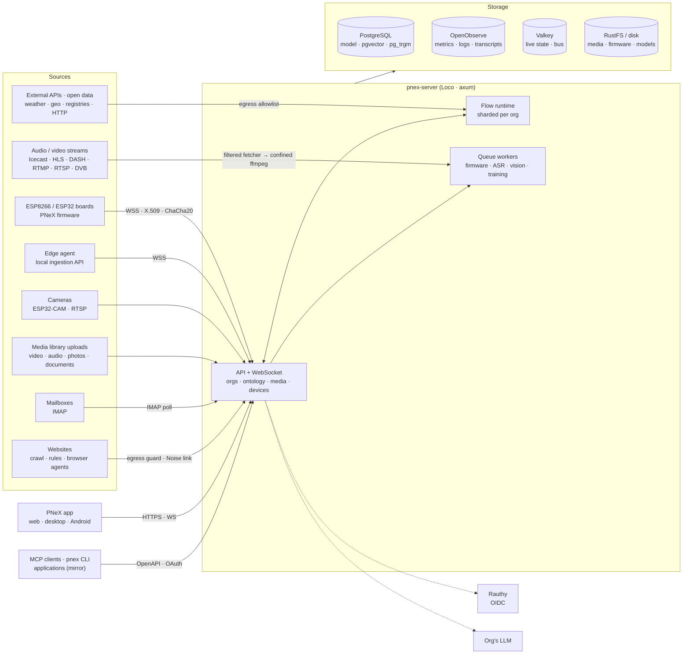

<p align="center">
  <a href="https://pnex.io">
    <picture>
      <source media="(prefers-color-scheme: dark)" srcset="https://pnex.io/logo-light.png">
      
    </picture>
  </a>
</p>

<h3 align="center">Your sources. Your server. Your data.</h3>

<p align="center">
  Self-hosted data platform on an industrial IoT foundation, written in Rust end to end.<br>
  Boards, cameras, audio and video streams, mailboxes, websites, files and APIs land in one organization,
  linked by an ontology, processed by flows, read in dashboards — <a href="https://pnex.io">pnex.io</a>
</p>

<p align="center">
  <a href="https://github.com/Pnex/pnex-rs/actions/workflows/ci.yml?query=branch%3Amain"></a>
  <a href="https://github.com/Pnex/pnex-rs/actions/workflows/e2e.yml"></a>
  <a href="https://github.com/Pnex/pnex-rs/actions/workflows/firmware.yml?query=branch%3Amain"></a>
  <a href="https://github.com/Pnex/pnex-rs/actions/workflows/images.yml"></a>
  <a href="https://github.com/Pnex/pnex-rs/actions/workflows/apps.yml"></a>
</p>
<p align="center">
  <a href="https://www.rust-lang.org"></a>
  <a href="https://dioxuslabs.com"></a>
  <a href="https://pnex.io/roadmap"></a>
  <a href="LICENSE"></a>
  <a href="https://hub.docker.com/r/shanisma/pnex-server-rs"></a>
</p>

<p align="center">
  <a href="https://pnex.io"><b>Website</b></a> ·
  <a href="https://pnex.io/docs/quickstart"><b>Quickstart</b></a> ·
  <a href="https://pnex.io/docs"><b>Documentation</b></a> ·
  <a href="https://pnex.io/roadmap"><b>Roadmap</b></a> ·
  <a href="https://github.com/Pnex/pnex-rs/releases/tag/nightly"><b>Nightly apps</b></a>
</p>

---

> [!WARNING]
> **Beta (0.2.0).** Features are maintainer-tested on a real bench and by an end-to-end
> suite, not yet community-validated. Don't run a critical process on it yet. The
> [roadmap](https://pnex.io/roadmap) gives the real state of each feature.

## What PNeX is

PNeX (**Platform Nexus**) started as an industrial IoT platform — devices, firmware, flows,
SCADA dashboards — and grew into a data platform built on that foundation. Everything an
organization collects lives in one place and one model:

- **Sources**: ESP boards and edge agents, IP and ESP32 cameras, live audio and video
  streams, files of the media library (video, audio, photos, documents), mailboxes (IMAP),
  websites (crawls, navigation rules, browser agents), open-data files and external HTTP APIs.
- **One model**: an ontology of typed objects, relations, actions and time ranges links
  devices, media, transcripts, mails, documents, places, companies, people and investigation
  cases. What a machine finds is *proposed* to one inbox before it becomes a fact.
- **Processing**: a flow runtime (Node-RED style, in Rust) for the light ETL; queue workers
  for the heavy work (firmware builds, speech-to-text, vision inference and training).
- **Reading**: SCADA and home dashboards, map, timelines, investigation workspaces, pages
  rendered to PDF, full-text and semantic search, and an AI assistant on the org's own LLM.
- **Opening up**: the API is a public OpenAPI contract, from which an MCP server for AI
  clients and the `pnex` admin CLI are derived; applications built on the ontology get a
  change feed and an offline mirror.

The whole stack — server, web/desktop/Android app, flow runtime, nodes, vision, ASR glue,
thermodynamics — is one Rust workspace. No Python at runtime.

## Architecture



### Boundaries

- **The organization is the security boundary.** Every row carries an `org_id` taken from the
  authenticated principal, never from the request. Every operation carries a `service:verb`
  permission ([`iam.md`](docs/architecture/iam.md): custom roles, teams, service accounts),
  enforced by one extractor before the handler runs. The rules (R1–R23) and the findings
  register are in
  [`docs/architecture/security.md`](docs/architecture/security.md).
- **User code is untrusted.** Flows, JavaScript and Starlark functions run in a sandbox with an
  allowlisted node registry and no environment access. Outbound HTTP goes through one egress
  guard (allowlist, no loopback or private ranges unless configured).
- **Heavy work never runs in a flow.** A flow carries references and events, not bytes:
  transcription, detection and builds are queue jobs, and their results come back as events.

### Ingestion paths

| Source | Path |
|---|---|
| Boards | WebSocket per device, X.509 identity + per-device ChaCha20 frames; telemetry to OpenObserve, live values to Valkey, commands and OTA back on the same socket. |
| Edge agent | Local HTTP API on the plant network, durable disk queue, encrypted uplink; optional media capture box. |
| Cameras | Binary WebSocket (ESP32-CAM) or an IP stream joining the camera bus; recordings, detection, tracking and zones as flow nodes. |
| Streams | A `media_streams` entity: one supervisor per stream, a Rust fetcher (redirects and HLS sub-URLs re-checked) piping into an ffmpeg without network; 30 s PCM segments, speech-to-text, diarization, speaker profiles; text to OpenObserve, events to flows. |
| Files | Media library with versions and an upload allowlist; video frames to the Vision Lab, documents chunked and indexed (`tsvector` + `pgvector`) for search and the assistant. |
| Mailboxes | IMAP accounts read on a schedule; a `mail_received` flow trigger that replays what it missed; attachments to the media library, invitations to the calendar, unknown senders proposed to the CRM. |
| Websites | Crawls and site navigation rules (studio, live view of the server browser), `web_visit` / `site_crawl` / `web_search` nodes, and Chrome/Firefox browser agents paired over a Noise link. |
| Open data | Imports declared in ontology packs (files or network registries), with their own steps, run on a schedule and written in bulk, each run journaled. |
| APIs | Flow nodes (`http-fetch`, `weather`) and geo providers, all through the egress guard. |

### Ontology

The data model of an organization is itself data
([`ontology.md`](docs/architecture/ontology.md), D176–D189):

- **Object types are versioned data**, installed from YAML packs (maintenance, investigation,
  companies, CRM, B2B prospecting, web presence, media coverage, quality watch…): typed
  properties, temporal properties included, labels in French and English. A pack also ships
  imports, flows, functions and page templates; an org's own edits survive pack upgrades.
  User objects live in one generic table; system objects (devices, media, POIs…) stay in
  their own tables and are exposed as types.
- **Links are typed, temporal and carry attributes**; containment (site → building → room) is
  a separate tree. Time belongs to objects: named time ranges apply to any object.
- **Actions are declared on types and executed by flows**, traced like any write. Every fact
  records its provenance (user, flow, import, model).
- **Proposals**: case detections, recognized voices, flows and models propose facts to one
  to-validate inbox; an org rule may accept some without a human.
- **Personal data** is classified per property, masked and erasable.
- One query API serves the generic explorer, dashboards, reports, investigation cases and the
  AI assistant, which reasons on the same graph. Applications declared in an org read a
  gap-free change feed scoped to them, and `pnex-mirror` keeps an offline SQLite copy.

### API, MCP and CLI

The HTTP API is a contract ([`api-contract.md`](docs/architecture/api-contract.md)): every
route is annotated and published in [`docs/contracts/openapi.json`](docs/contracts/openapi.json),
checked by blocking tests. From that one spec:

- **MCP** at `/api/v1/mcp` ([`mcp.md`](docs/architecture/mcp.md)), OAuth sign-in, the caller's
  own rights. Deletes, device commands and deploy/stop are never exposed.
- **`pnex` CLI** ([`cli.md`](docs/architecture/cli.md)): every operation as
  `pnex <tag> <action>`, dangerous ones behind `--yes`.

### Vision Lab: from footage to a deployed model

The Lab turns pictures into a detection model without leaving PNeX
([`media-vision-studio.md`](docs/architecture/media-vision-studio.md)):

1. **Pictures** from photos of the media library, frames sampled from videos (one picture
   every N seconds) or from camera recordings. Each import is one *source*, kept whole on the
   training or the validation side so near-duplicate frames never inflate the scores.
2. **Labeling** on a shared timeline: boxes per class, negative examples, interpolation
   between keyframes, and a review queue where the current model proposes boxes to accept.
3. **Dataset versions** frozen and exportable (COCO).
4. **Training**: the head of a registered YOLOX model is fine-tuned on a frozen version, in
   pure Rust (`pnex_vision::train`, no Python), with progress, cancellation and heartbeat.
   The result is an ONNX in the media library and the model registry, checked like an upload.
5. **Deployment**: the model runs in the `pnex-vision-detect` flow node on live cameras and
   streams (tracking, zones), and its detections feed dashboards, alerts and the ontology.

### Processing and scaling

- **Flow runtime**: a vendored fork of EdgeLinkd plus PNeX nodes (`crates/pnex-node-*`),
  supervised by the server. Orgs are sharded across flow-worker pods; Valkey carries the device
  bus and live state, so API pods need no session affinity.
- **Workers**: Loco queue in PostgreSQL. Firmware builds run in the `pnex-builder` image
  (PlatformIO); ASR runs in a confined `pnex-asr` process (Whisper / sherpa-onnx); vision uses
  ONNX on `tract`, pure Rust.
- **Deployment**: one machine (Raspberry Pi 4/5 included) with `docker compose`, or N pods
  behind a load balancer with the Helm chart of [pnex-deploy](https://github.com/Pnex/pnex-deploy).

### App

`pnex-frontend` is a client-side Dioxus 0.7 app: compiled to wasm and served by the server
for the web, and built natively for Linux, Windows and Android. It talks to the server over
plain HTTP/WebSocket, the same contract as any client (`pnex-api-contract`). Every string goes
through Fluent (`fr-FR` / `en-US`), and server errors are machine codes translated by the app.

Design records (in French): [`docs/architecture/`](docs/architecture) — start with
[`roadmap.md`](docs/architecture/roadmap.md), [`ontology.md`](docs/architecture/ontology.md),
[`flow-engine.md`](docs/architecture/flow-engine.md),
[`media-ingest.md`](docs/architecture/media-ingest.md) and
[`horizontal-scaling.md`](docs/architecture/horizontal-scaling.md).

## Repository layout

| Path | Content |
|---|---|
| `crates/pnex-backend` | Server: Loco + axum, SeaORM, WebSocket ingestion, queue workers, migrations, assistant knowledge base |
| `crates/pnex-frontend` | Dioxus 0.7 app — web (wasm), desktop, Android |
| `crates/pnex-core`, `pnex-api-contract` | Shared domain types, API contract, MCP exposure and IAM registers (native + wasm) |
| `crates/pnex-cli` | `pnex` admin CLI generated from the OpenAPI spec |
| `crates/pnex-extension` | Browser agent (Chrome / Firefox), compiled to wasm |
| `crates/pnex-mirror` | Offline copy of an org for applications (change feed, SQLite, media by hash) |
| `crates/pnex-flow-runtime`, `pnex-node-*` | Flow engine on the vendored EdgeLinkd fork, and its nodes (device, control, camera, vision, predict, memory, notify, events, weather, Starlark…) |
| `crates/pnex-media-capture`, `pnex-asr` | Stream capture chain (fetcher, RTSP, confined ffmpeg, segmenter) and speech-to-text |
| `crates/pnex-vision`, `pnex-decide` | ONNX detectors and typed decisions on `tract` |
| `crates/pnex-edge-agent` | Edge agent: local ingestion API, disk queue, encrypted uplink |
| `crates/pnex-firmware-builder` | PlatformIO / esptool build pipeline |
| `crates/pnex-notify`, `pnex-pdf`, `pnex-stitcher`, `pnex-coolprop*` | Notification channels, page PDF rendering, 360° stitching, CoolProp bindings |
| `firmware/` | PlatformIO firmware: generic ESP8266 / ESP32 / C3 / C6 / S3 / CAM, the `pnex` library, hardware-in-the-loop bench |
| `e2e/` | Playwright suite (web), plus Linux desktop and Android harnesses |
| `deploy/` | Dockerfiles, TLS edge, edge agent distribution |
| `vendor/` | EdgeLinkd fork, CoolProp, patched crates |
| `docs/architecture/` | Design and decision records |
| `docs/contracts/` | Public OpenAPI spec |

## Install

One command installs a TLS-everywhere server on a Raspberry Pi 4/5 (64-bit) or any Debian /
Ubuntu machine (amd64 or arm64):

```bash
curl -fsSL https://raw.githubusercontent.com/Pnex/pnex-deploy/main/install.sh \
  | sudo bash -s -- --admin-user admin@acme.io --admin-password 'choose-a-strong-one'
```

Options (domain, Let's Encrypt, S3, SMTP, image pinning) are in
[Pnex/pnex-deploy](https://github.com/Pnex/pnex-deploy) and the
[self-hosting guide](https://pnex.io/docs/self-hosting). Images are published on every green
`main`: `shanisma/pnex-server-rs` and `shanisma/pnex-builder-rs` (`linux/amd64`,
`linux/arm64`), tagged `main-<sha>`, `main` and `latest`.

## Development

Requirements: Rust stable (MSRV 1.88) with `wasm32-unknown-unknown`,
[dioxus-cli](https://dioxuslabs.com) 0.7, [bun](https://bun.sh), Docker and
[Task](https://taskfile.dev). Firmware work also needs PlatformIO
(`uv tool install platformio esptool`).

```bash
git clone https://github.com/Pnex/pnex-rs.git && cd pnex-rs
git submodule update --init   # vendor/edgelinkd (not recursive)
task db:up        # PostgreSQL, Rauthy, OpenObserve, Valkey, RustFS, mailcrab
task db:migrate
task db:seed
task dev          # app build + server on http://localhost:5150
```

| Task | What it does |
|---|---|
| `task check` | `cargo check`, native + wasm32 |
| `task test` | Workspace tests (PostgreSQL required) |
| `task lint` | Clippy, warnings as errors |
| `task fmt` / `fmt:check` | `cargo fmt` + guarded `rsx!` formatting (CI gate) |
| `task security:deps` | `cargo deny`: RustSec advisories and crate sources (CI gate) |
| `task app:up` | Run server + builder in containers on top of the infra (`EDGE=1` adds the TLS edge) |
| `task e2e` | Playwright suite against the running stack (`e2e/README.md`) |
| `task docker:build` | Build the `server` and `builder` images locally |

Heavy builds go through `scripts/guarded.sh` (the `task` targets already do): a capped systemd
scope, one heavy build at a time, a free-disk check. Schema changes follow
[`docs/architecture/migrations.md`](docs/architecture/migrations.md): additive first,
PostgreSQL only.

**CI**: `ci.yml` (fmt, deny, check native + wasm + ARM, tests, web build) → `images.yml`
(multi-arch images on green `main`) → `e2e.yml` (whole stack from the published images,
nightly, strict accessibility) · `firmware.yml` · `apps.yml` (desktop + Android, releases).

## Contributing

Issues and pull requests are welcome.

- Code and code comments in English; every user-facing string in both Fluent locales
  (`crates/pnex-frontend/locales`), kept in parity by the tests.
- Commits follow [Conventional Commits](https://www.conventionalcommits.org)
  (`type(scope): description`); release notes are generated from them.
- Before a pull request: `task fmt`, `task check`, `task test`, `task lint`,
  `task security:deps`. Only permissively licensed dependencies (MIT, BSD, Apache-2.0…).

## License

PNeX is free software under the [MIT license](LICENSE).
