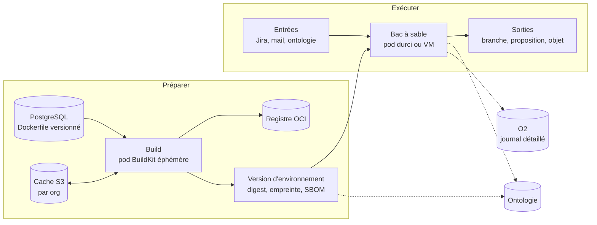
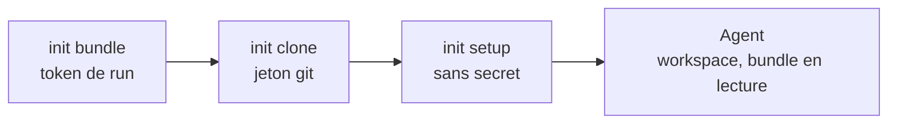
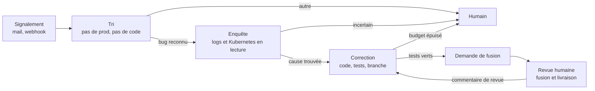

# Environnements d'agents — PRD (D700–D720)

| | |
|---|---|
| Statut | **Validé le 2026-11-04, implémentation E0 en cours** ; recette sur cluster en fin de chantier |
| Numérotation | **D700…D720**, lots **E0…E6** |
| Complète | `worker-fabric.md` §14 (runner, bacs à sable), `autonomous-agents.md` (D378–D401), `operational-platform.md` D561 |
| Amende | D561 et fabric §14 : BuildKit au lieu de buildah (D700), secrets en variables d'environnement (D705) ; D394 : le catalogue de moteurs devient un usage des environnements (D704) |
| Sécurité | `security.md` §6 avant tout lot ; finding = ligne SEC-n au §7 |

## 1. Ce que ce document ajoute

Déjà écrit, et non repris ici : runner par cluster et join token, pod durci ou
VM, egress, token de run, passerelle LLM, politique, journal chaîné, sortie
branche + demande de fusion.

Manquait pour passer de « un agent a une image » à « une org prépare
l'environnement de ses agents » :

| Sujet | État avant ce document |
|---|---|
| Connecteur de registre | Cité comme secret de run, sans modèle ni écran |
| Versions des Dockerfile | Absentes |
| Pipeline de build d'image | Une phrase dans D561 (buildah) |
| Cache de build | Absent |
| Environnement comme objet versionné | Absent (seulement « image de toolchain ») |
| Trace dans l'ontologie | Absente : `agent_runs` + O2 seulement |
| Entrées et sorties d'un run (Jira, mail) | Déclencheurs D398, sans règle d'accès aux outils tiers |
| Contenu des échanges LLM pour l'audit | Non tranché |

## 2. Vue d'ensemble

Deux temps séparés : **préparer** (humain, aboutit à un digest) et **exécuter**
(un run, sur ce digest figé).

## 3. Build

### D700 — BuildKit remplace buildah

D561 et la fabric §14 citaient buildah. BuildKit le remplace pour une raison
mesurée : il exporte et importe son cache directement sur S3, sans registre
intermédiaire, et il écrit SBOM et provenance sans outil de plus
(`--attest type=sbom`, `--attest type=provenance,mode=max`).

**Mesure du 2026-11-04** (image de test, BuildKit 0.30 Wolfi, RustFS 1.0.0-rc.2) :

| Build | Durée |
|---|---|
| À froid, export vers S3 | 34 s |
| Nouveau démon, sans état local, import depuis S3 | 6 s, étape `CACHED` |

Cache de 13 objets et 100 Mo, sous le préfixe demandé (`org_1/`). Cette mesure a
tourné avec un démon **privilégié** : elle valide le cache, **pas** le bac à
sable (voir D701).

**Image du builder** : construite par nous sur `wolfi-base` (`buildkitd`,
`buildctl`, `rootlesskit`, paquets Wolfi disponibles). L'image `buildkit` et
l'image `kaniko` du catalogue Chainguard ne sont pas accessibles sans licence
(403 vérifié). L'image amont est basée sur Alpine : écartée (`container-images.md`).

**Sens de « distroless » ici** :

- le builder ne peut pas l'être : il lance `rootlesskit` et `runc` ;
- l'image d'un environnement peut l'être si son moteur ne demande rien ; un agent
  de code a besoin d'un shell, donc `wolfi-base` par défaut ;
- la base est le choix de l'org ; la liste des registres de base autorisés est
  un réglage d'org, journalisé.

### D701 — Un Dockerfile est du code non fiable

Une étape `RUN` exécute ce que le Dockerfile contient. Règles :

- un pod par build, détruit à la fin, créé par le runner dans son namespace ;
- jamais de socket Docker, jamais de conteneur privilégié (D387) ;
- pas de repli : sans isolation durcie annoncée par le runner, le build est
  refusé (`environment-build-isolation`), comme fabric §14 ;
- cache par org, sous `org_<id>/buildcache/`, jamais partagé entre orgs ; purge
  depuis l'UI ;
- les identifiants du build sont livrés au claim, courts et limités : écriture
  d'un seul dépôt d'images, un seul préfixe S3.

**Le build tourne en rootless**, mode recommandé par BuildKit
(`examples/kubernetes/job.rootless.yaml`, UID 1000, ni `privileged` ni
capabilities). Ce manifeste a trois conséquences :

| Exigence ou effet (doc BuildKit) | Conséquence ici |
|---|---|
| `seccompProfile` et `appArmorProfile` en `Unconfined` | Écart à D387, propre au pod de build, à inscrire au registre `security.md` §7. Le pod d'un agent reste durci |
| `--oci-worker-no-process-sandbox`, Kubernetes n'ayant pas l'équivalent de `systempaths=unconfined` | Une étape `RUN` peut tuer un processus du démon, et le tracer selon le profil seccomp. Elle peut donc atteindre ses identifiants (déduction, non mesurée) |
| Ubuntu 24.04 et suivants : `kernel.apparmor_restrict_unprivileged_userns=0` sur le nœud | Prérequis de nœud, à annoncer dans les capabilities du runner au lieu d'échouer au premier build |

Le rootless réduit le risque d'évasion, mais avec seccomp ouvert il n'est pas une
frontière pour du code non fiable. D'où deux règles :

1. Un Dockerfile écrit par une autre personne que l'exploitant du cluster tourne
   sous gVisor ou Kata (fabric §14). La compatibilité de BuildKit rootless avec
   ces runtimes reste à mesurer (Q-E1).
2. Le vol d'identifiants reste borné à l'org. Un build ne reçoit aucun droit sur
   une autre org ni sur PneX.

Constaté sur le poste de dev : démarrage refusé par `rootlesskit`, avec le réglage
Ubuntu ci-dessus à 1. Non retesté avec ce réglage à 0. Notre image Wolfi doit aussi
rendre `newuidmap` et `newgidmap` setuid, ce qu'ils ne sont pas dans le paquet ;
`allowPrivilegeEscalation: false` risque alors de bloquer le démarrage (à tester).

### D702 — Le Dockerfile vit en base

Pas de connecteur git : les autres objets versionnés de PneX vivent déjà en base
(flows, fonctions, dashboards), le Dockerfile suit le même modèle. C'est une
brique et un secret en moins, sans egress vers une forge pendant un build.

- Une version d'environnement porte en PostgreSQL le Dockerfile et ses fichiers de
  contexte texte (`COPY`), plafonnés à 1 Mo. Un binaire vient de l'image de base ou
  d'un téléchargement épinglé par empreinte dans une étape `RUN`.
- Édition dans l'UI, coquille d'éditeur et historique de versions communs
  (D221, D222), avec `expected_version`.
- Le runner reçoit ce contenu au claim et le pose dans le contexte du build. Le
  build référence la version et son **empreinte** SHA-256.
- Un secret détecté à l'enregistrement est refusé
  (`environment-secret-in-dockerfile`).
- Un agent ou l'assistant peut écrire un brouillon. Lancer le build et activer
  restent des gestes humains. Mettre à niveau suit le même chemin : nouvelle
  version, build, activation.
- D388 n'est pas modifiée : un agent codeur qui produit une branche dans un dépôt
  client aura son secret git de run au lot A4. Ce n'est pas un connecteur.

### D703 — Connecteur de registre : OCI, épinglé par digest

- API Distribution v2 uniquement, donc tout registre conforme. Test du connecteur
  = `GET /v2/` authentifié + droit sur le dépôt visé.
- **Deux secrets distincts** : écriture, livrée au seul pod de build ; lecture,
  livrée au seul runner en `imagePullSecret`. Un bac à sable ne peut jamais
  pousser.
- Un tag n'est jamais une référence d'exécution : on exécute un digest.

## 4. Environnement

### D704 — Environnement : un objet versionné, qui absorbe le catalogue de moteurs

Le catalogue de moteurs D394 et les « images de toolchain » de la fabric §14
deviennent une seule notion.

| Élément | Contenu |
|---|---|
| Source | Dockerfile, fichiers de contexte, arguments de build (D702) |
| Cible | Connecteur de registre, dépôt d'images |
| Préparation (D714) | Dépôts à cloner, commande de préparation |
| Exécution | Commande d'entrée, ressources, variables non secrètes, secrets, egress minimal |
| Moteur (optionnel, D394) | Protocole LLM attendu, emplacement des instructions et des compétences |

Une **version** est immuable une fois construite : sources, empreinte, `digest`,
SBOM, provenance, journal du build. Cycle `building → ready | failed`, puis une version
**active**, choisie par un geste humain et remplaçable en un geste. Un run fige
la version (D393–D396), elle suit D399 (`draft → canary → active`) dès que ce lot
existe.

### D705 — Secrets du run en variables d'environnement, depuis un Secret Kubernetes

Décision du 2026-11-04, amende D561 et fabric §14 (« montés en fichier »). Le
fichier monté ne protège pas d'un agent qui a un shell : il le lit comme il lit
son environnement. La protection vient de ce qu'on lui donne, pas de la façon de
le livrer. Les moteurs attendent par ailleurs leur configuration en variables.

| Type | Livraison |
|---|---|
| Variable non secrète | Variable d'environnement, en clair dans la fiche |
| Secret de l'org | Référence au coffre : le runner crée un Secret Kubernetes propre au run, le pod le lit par `secretKeyRef`, le runner le détruit en fin de run. Fichier monté en option, pour un certificat par exemple |
| Accès LLM | URL de la passerelle + token de run, en variables |
| Clé du fournisseur LLM | Dédiée à l'agent (D710), gardée au coffre, utilisée par la passerelle. N'entre pas dans le bac (D385, inchangée) : la passerelle porte le budget et le journal, et un agent trompé ne peut pas la faire sortir |

Règles :

- Tout secret est listé explicitement dans la politique, limité au strict besoin et
  de durée courte quand le service le permet. La valeur ne figure jamais dans la
  spec du pod, une réponse d'API ni une sortie d'outil (R4, R16).
- Le processus de l'agent et ses sous-processus **lisent ces valeurs** : un secret
  donné à un bac est un secret que l'agent peut divulguer. Ce qui le borne : l'egress
  en liste blanche et la durée de vie. La fiche de l'agent l'affiche.
- Les valeurs des secrets du run sont masquées dans le journal et les logs avant
  envoi à O2 (R16).
- Une variable en clair dont le nom ou la valeur ressemble à un secret est refusée
  (`environment-secret-in-env`) : elle se lirait dans la fiche et dans la spec du pod.

**Trois environnements, jamais mélangés** :

| Environnement | Contient | Durée |
|---|---|---|
| Serveur PneX | Secrets de la plateforme : base, trousseau du coffre, S3 | Celle du déploiement |
| Runner | Son adresse du control plane, son identité de runner | Celle du runner |
| Bac à sable | Variables et secrets de ce run, token de run | Celle du run |

- R6 reste vrai : aucun secret de la plateforme n'entre dans un bac ni dans un runner.
- Un bac n'hérite jamais de l'environnement du runner : l'identité du runner
  permettrait de prendre les jobs d'autres runs. Kubernetes le garantit (pod
  distinct) ; l'exécuteur VM (D706) doit démarrer le bac avec un environnement vide.
- Le runner ne garde les secrets d'un run que le temps de le lancer.

### D706 — Kubernetes d'abord, VM ensuite, même contrat

Le runner expose un seul contrat d'exécution (créer, attendre, journaliser,
détruire). Kubernetes est le premier exécuteur. Le même binaire installé sur une
VM ou une machine nue en fournit un second (Firecracker ou libvirt, D387), au lot
E6. Le placement reste D393 : runner nommé ou étiquettes, sans repli silencieux.

### D710 — Une clé LLM par agent

Une clé partagée par tous empêche d'attribuer un coût ou un abus côté fournisseur,
et sa révocation arrête tout le monde. Chaque agent hébergé a donc sa propre entrée
au catalogue `llm_providers`, avec sa clé au coffre, par la résolution D383.

| Vu où | Ce qu'on lit |
|---|---|
| Console du fournisseur | Consommation et plafond de cette clé, donc de cet agent |
| PneX (passerelle, D709) | Run, tokens, coût et empreintes de chaque appel |

- Créer la clé chez le fournisseur reste un geste humain en V1 ; on la colle au
  coffre. Une création automatique dépend de chaque fournisseur (non étudié).
- Révoquer la clé d'un agent n'arrête que lui.
- Le plafond chez le fournisseur protège même si la passerelle est contournée ou
  défaillante ; le budget D384 reste le contrôle fin, par run.
- La clé reste hors du bac : un token de run expire à la fin du run, pas une clé de
  fournisseur.

### D714 — Préparation du bac par des init containers

Le pod se prépare avant que l'agent ne démarre. Tout est décrit par des variables sur
la fiche d'environnement, surchargeables par run en resserrant : dépôts (URL, ref,
chemin, secret), commande de préparation.

| Étape | Image | Reçoit | Fait |
|---|---|---|---|
| `bundle` | Image d'init PneX (Wolfi, git, épinglée) | Token de run | Télécharge de PneX les instructions, les compétences et la configuration du moteur (D394, D711) vers un volume, ensuite monté en lecture seule |
| `clone` | Image d'init PneX | Jeton git de lecture, à ce seul conteneur | `git clone --depth 1` sur la ref, sans sous-module par défaut ; le commit obtenu remonte sur le run |
| `setup` | Image de l'environnement | Variables non secrètes, **aucun secret** | Commande de la fiche (`npm ci`, `cargo fetch`…) |
| Agent | Image de l'environnement | Secrets de sa politique (D705) | Son travail, dans le volume `workspace` |

- **Jeton git** : les secrets se donnent conteneur par conteneur, donc l'agent ne reçoit
  pas le jeton de lecture. Passé par un fichier hors du volume partagé et jamais dans
  l'URL, il ne reste ni dans `.git/config` ni dans le workspace. Seule l'étape qui pousse
  une branche (D388) reçoit un jeton d'écriture, comme secret de l'agent.
- **`setup` exécute du code du dépôt** (scripts de paquets) : c'est pourquoi il tourne
  sans secret, et avant l'agent, dans le même pod durci.
- **Limite réseau** : une `NetworkPolicy` s'applique au pod, pas à un conteneur. Si `clone`
  atteint la forge, l'agent l'atteint aussi. Sans jeton, il ne peut que lire ce qui est
  public, mais il peut y pousser une donnée s'il a un jeton d'écriture : un agent qui
  voit la prod n'a donc jamais de jeton d'écriture (D713).
- **Échec** : run `failed`, code `sandbox-init-failed`, étape nommée au journal. Pas de
  relance de l'agent sans workspace.
- **Reprise (D397)** : mêmes init containers, sur le commit déjà enregistré au run, puis
  dépôt de l'espace de travail de la dernière étape validée.

## 5. Run

### D707 — Entrées et sorties passent par PneX

| Sens | Exemple | Chemin |
|---|---|---|
| Entrée | Ticket Jira | Connecteur OP2 ou webhook signé, déclencheur D398 ; le contenu entre dans le contexte, jamais dans les droits (D381) |
| Entrée | Mail | Boîte d'un compte de service (`mail.md`), déclencheur D398 |
| Entrée | Données | MCP PneX avec le token de run |
| Sortie | Code | Branche + demande de fusion (D388), seul accès direct à un tiers |
| Sortie | Fait, document | Objet, page ou proposition via l'API (D367, D563) |
| Sortie | Commentaire Jira, mail | Action PneX soumise à la politique (D563), jamais de jeton tiers dans le bac |

Passer par PneX est ce qui rend le journal complet : un jeton Jira monté dans le
bac ferait sortir l'échange de l'audit. L'egress vers un tiers reste possible par
politique, et la fiche du run le signale alors comme non observé (même règle que
l'agent libre, D378).

### D708 — Ontologie : les faits durables, O2 pour le détail

Nouveau pack `agent_ops`. Les tables `agent_runs`, `sandboxes` et les versions
d'environnement restent la source de vérité des états. Le service qui change un
état projette l'objet.

| Type | Liens |
|---|---|
| `agent` | Compte de service, rôle |
| `agent_environment`, `environment_version` | Empreinte, registre, digest, vulnérabilités connues du SBOM |
| `agent_run` | `runs_as` agent, `uses` version, `started_by` personne ou déclencheur, `read` et `produced` objets |
| `container_registry` | Connecteur, sans secret (R4, R16) |

**Limite assumée** : une étape ou un appel d'outil **n'est pas un objet**. À ce
rythme, le graphe et son journal de changements se rempliraient de bruit. L'objet
`agent_run` porte le résumé (usage, coût, verdict, liens) et renvoie au journal
O2. Les liens `read` et `produced` viennent de la provenance D389 ; ils répondent
à « qui a touché à cet objet, et avec quel environnement ».

### D709 — Audit LLM : prévu dès la passerelle, contenu activé plus tard

La passerelle (D385) est le seul point de passage, donc le seul point de capture.
Politique `llm_capture` : `metadata` (défaut) ou `full`.

| Niveau | Où | Contenu |
|---|---|---|
| Métadonnées (dès A0) | O2, stream du run | Modèle, tokens, coût, latence, **empreinte** de la demande et de la réponse |
| Contenu (plus tard) | S3 `org_<id>/agent_runs/<run>/llm/`, chiffré | Demande et réponse complètes |

- **PneX est la référence, O2 l'index.** Un corps LLM contient des données
  personnelles et des secrets lus par l'agent. La rétention d'O2 se règle par
  stream, sans effacement fin ; S3 permet d'effacer un run ou une personne.
- L'empreinte est écrite **dès le premier jour** et entre dans la chaîne D401 : un
  corps stocké plus tard, ou effacé, reste vérifiable ou se voit comme effacé.
- Rien d'autre à préparer aujourd'hui : ni table, ni écran.

### D711 — Compétences : tout vit dans PneX, trois façons d'y entrer

Prolonge D396. Une compétence est du texte, stocké et versionné en base. Une fois
entrée, elle ne dépend plus d'aucun service extérieur : un run la lit depuis PneX, même
si le dépôt d'origine a disparu, et tout fonctionne en milieu fermé. L'org la choisit
par agent ou par rôle, à une version épinglée.

| Source | Pour quoi | Comment |
|---|---|---|
| **Intégrée au build** | Les compétences fournies par PneX, disponibles partout, milieu fermé compris | `crates/pnex-backend/skills/`, embarqué par `include_dir!` comme `assistant-kb`. Seulement du texte écrit par nous, jamais une copie de tiers. Copiée dans l'org à la demande ; une nouvelle release propose un brouillon, n'écrase rien |
| **Dépôt git** | Faire évoluer ses compétences avec leur dépôt | URL, ref et chemin. Voir ci-dessous |
| **À la main** | Milieu fermé, ou texte propre à l'org | Éditeur dans l'UI, coquille et historique communs (D221, D222), import d'un fichier |

**Lecture d'un dépôt, sans `git clone` réel.** L'image serveur n'a ni shell ni binaire
git (D71), et aucune bibliothèque git n'est dans le projet. L'import fait deux requêtes
HTTP gardées (R8) : `info/refs` résout la ref en commit, de la même façon sur toute forge,
puis l'archive tar.gz de ce commit est lue par `services/ingest/archive.rs`, qui plafonne
déjà la taille et refuse les chemins dangereux. Seuls les fichiers texte du chemin demandé
sont gardés. Aucun hook ni sous-module ne s'exécute. Le jeton d'un dépôt privé vient du
coffre et n'est envoyé qu'à cet hôte.

- Le commit et l'empreinte sont conservés. Comparer la ref au commit connu montre qu'une
  version amont existe : elle crée un brouillon, jamais une mise à jour.
- Toute source aboutit à un brouillon. Activation par un humain après lecture du diff
  (`agents:write`), recherche de secrets, évaluation D399 dès que ce lot existe.
- La structuration de documents par LLM, évoquée au départ, n'entre pas en V1.
- Le seul vrai clone du système est celui du projet de l'agent, par l'init container du
  bac (D714). L'ingestion à volumétrie en cours de développement n'est pas concernée.
- Une compétence est chargée à chaque run : un texte piégé devient une injection
  **permanente**. C'est le risque principal de cette décision, d'où l'absence
  d'activation automatique, y compris pour une compétence générée par un agent.

### D712 — Un pod par run, jamais de pod d'agent permanent

Ce qui tourne en continu : PneX, le runner, le moteur de flows. Un agent n'existe
en pod que le temps de son run.

| Besoin | Réponse |
|---|---|
| Boucle de raisonnement | Dans le pod, menée par le moteur (D394), bornée par `max_steps`, budget et durée |
| Attendre un humain ou un événement | Le pod est détruit ; l'état reste en base (`waiting_approval`, D397) ; un nouveau pod reprend |
| Démarrage rapide | Image épinglée et cache par org ; un pool de pods préchauffés seulement si la mesure le justifie |
| Suivre la charge | File D400 : autant de pods que les plafonds le permettent, zéro au repos |

Un pod permanent coûterait au repos, garderait ses secrets longtemps et conserverait
d'un travail à l'autre un contexte qu'une injection peut avoir empoisonné. Il rendrait
aussi floue la frontière du run, qui est l'unité de journal et de budget.

### D713 — Orchestration : un flow enchaîne des runs courts

Deux niveaux de boucle : **dans** le run, le LLM décide ; **entre** les runs, un flow
déployé par un humain décide de façon déterministe. Pas de nouveau moteur : c'est le
nœud `agent-run` de D398, dans sa forme « lance et rend l'id » (répond à Q-A10). Un
déclencheur de fin de run, sur le modèle d'`action_trigger`, lance l'étape suivante :
aucun flow n'attend en mémoire, et l'état reste dans `agent_runs` et l'ontologie.

Chaque étape a son environnement et sa politique, au plus juste. Exemple du bug
signalé par un client :

| Étape | Lit | Écrit | N'a pas accès à |
|---|---|---|---|
| Tri | Ticket, historique du client dans l'ontologie | Objet `bug_report`, doublons regroupés | Prod, code |
| Enquête | `bug_report`, logs et état Kubernetes en lecture seule sur un namespace | Preuves et hypothèse sur l'objet, données personnelles masquées | Code en écriture, Internet |
| Correction | Hypothèse, dépôt, jeu de tests du bac | Branche + demande de fusion (D388) | Prod, ticket brut |
| Humain | Tout, avec le journal | Fusion, livraison | — |

- **Pourquoi découper** : le ticket est écrit par un tiers et peut contenir une
  injection. L'agent qui le lit ne touche ni à la prod ni au code ; celui qui écrit du
  code ne lit pas le ticket brut, seulement des champs structurés. Enquête et
  correction n'ont aucun accès commun qui permette de sortir une donnée de prod par
  le code.
- **Mémoire entre les étapes** : les objets de l'ontologie, pas le contexte LLM. C'est
  aussi la trace d'audit (D708).
- **Anti-tempête** : même signalement répété = même `bug_report`, pas de run de plus
  (D398).
- **Superviseur LLM** (D390) : il peut, plus tard, choisir parmi les agents autorisés
  dans ses bornes. Pas en V1 : un enchaînement fixe se teste, se relit et s'audite.
- **Accès git** : ce scénario exige le secret git de run et l'API de demande de fusion
  d'une forge (Q-A3, à trancher au lot A4). D702 n'écarte git que pour les Dockerfile.
- **Accès Kubernetes** : un compte de service en lecture sur le namespace visé, livré
  comme secret du run (D705) ; il n'ouvre aucune écriture (D391) et n'est pas conservé
  par PneX hors du coffre.

### D715 — Première cible et portes avant un client réel

Première cible : un bug de PneX lui-même, dans l'org de l'exploitant, sur le cluster dev.
Deux sujets sont volontairement reportés, et **bloquent l'ouverture à un client réel** :

| Sujet | Tant qu'il n'est pas traité |
|---|---|
| Droits par objet (OP3) | Une org par client : un token de run couvre toute son org |
| Masquage des données personnelles, règle « quelles données vers quel fournisseur LLM », cadre contractuel | Aucun log ni ticket d'un client réel vers un LLM externe |

### D716 — Chaîne : un identifiant, un budget, un nombre de tours

Les runs d'un même sujet partagent un `chain_id`, porté par l'objet `bug_report` ou
équivalent. La chaîne a son plafond de coût et de durée, prélevé comme D390, et un nombre
maximal de tours de revue. Au-delà, elle repasse à un humain. L'export d'audit D401 se
fait aussi par chaîne.

### D717 — Services de test à côté de l'agent

La fiche d'environnement déclare des **services** : image épinglée par digest, variables,
sonde de disponibilité.

- Démarrés dans le pod comme conteneurs annexes natifs (init container
  `restartPolicy: Always`), avant `setup` : Postgres et Valkey répondent sur `localhost`
  quand la préparation et l'agent démarrent.
- Variables réglées comme le demande le code source du projet (`DATABASE_URL`…), sur la
  fiche ou par l'agent dans son shell après lecture du projet (`.env.example`, doc).
- Mots de passe de ces services **générés par run**, sans coffre : ils ne protègent que
  des données jetables. **Jamais de données de prod** dans ces services.
- Mêmes règles de durcissement que l'agent, volume éphémère pour leurs données ;
  ressources comptées dans les limites du run (compilation et tests compris).

### D718 — Un seul agent codeur par sujet

Une **clé de travail** `(org, dépôt, numéro de ticket ou id du bug_report)` est tenue par
la chaîne, pas par le pod : elle reste prise pendant la revue humaine.

- En base : index unique partiel sur les chaînes actives, comme `data_builds_one_running`.
  Pas de Valkey : la garantie suit la transaction qui crée la chaîne.
- Un deuxième signalement du même sujet **rejoint** la chaîne existante, ajouté à son
  contexte, sans second run.
- Branche déduite de la clé (`agent/<ticket>`), donc stable d'un tour à l'autre. Auteur des
  commits = compte de service de l'agent, label `agent` sur la demande de fusion.
- Libération : fusion ou fermeture de la demande, abandon de la chaîne, ou geste humain.
  Chaîne sans activité au-delà d'un délai réglable : signalée à un humain, jamais libérée
  en silence.
- Hors périmètre : deux sujets différents qui touchent les mêmes fichiers. Le conflit se
  voit à la demande de fusion, et un plafond de runs par dépôt (D400) le limite.

### D719 — Logs du bac collectés par le runner

Chemin : conteneurs du pod → runner → API PneX (route `Machine`) → O2. PneX masque les
valeurs des secrets du run (D705) avant O2, et applique un plafond de débit et de volume par
run. L'ontologie ne reçoit pas de lignes : l'objet `agent_run` porte le résumé, le lien vers
le journal et le code de sortie (D708).

| | Runner (retenu) | Fluent Bit en sidecar |
|---|---|---|
| Init containers | Vus, dont `clone` et `setup` | Ratés si démarré après eux |
| Jeton d'envoi dans le pod | Non | Oui |
| Image de plus par pod, egress de plus | Non | Oui |
| Fichiers écrits dans le workspace | Non | Oui |

Le runner crée déjà ses pods et les détruit : il lui suffit du droit `pods/log` sur son
namespace, ajouté à son RBAC (fabric §14), pour lire leur sortie jusqu'à la destruction.
Fluent Bit reste possible si la lecture de fichiers de logs devient
nécessaire ; on le déciderait alors sur un cas réel.

- **En cas d'échec** : le workspace part dans S3 avant destruction, durée limitée (D389).
- **Limite** : l'agent écrit lui-même sa sortie. Ces logs servent à déboguer. La preuve
  d'audit reste le journal chaîné des appels passés par PneX (D401).

### D720 — Scan des images : Trivy, côté PneX, même après la fin des pods

Un pod est temporaire, son image non : un digest peut resservir, et une faille est souvent
publiée après le build. PneX surveille donc les **versions d'environnement**, pas les pods.

| Moment | Geste |
|---|---|
| Fin de build | Scan du digest par un job du runner. Résultat attaché à la version, qui reste activable selon le seuil de l'org |
| Chaque jour | Nouveau scan de la version active de chaque environnement, et de toute version utilisée par un run récent, à partir de son SBOM : ni image à retirer, ni registre à solliciter |
| Nouvelle faille au-dessus du seuil | Notification, objet `environment_version` mis à jour (D708), run refusé ou signalé selon le réglage de l'org |

- **Suggestion de correction** : Trivy donne la version corrigée. PneX propose de
  reconstruire, souvent suffisant quand la base a été corrigée, ou crée un brouillon de
  Dockerfile. Build et activation restent des gestes humains (D702).
- **SBOM** : celui que Trivy produit lui-même. Sa documentation prévient qu'un SBOM d'un
  autre outil peut donner une détection inexacte. L'attestation BuildKit reste pour la
  provenance (D700).
- **Le scan tourne dans un pod du runner**, jamais dans `pnex-server` : un binaire tiers
  lit là un contenu fourni par l'org.
- **Trivy a subi une compromission de sa chaîne de publication en mars 2026**
  (CVE-2026-33634, binaire v0.69.4 et images v0.69.5 et v0.69.6 piégés). Donc paquet Wolfi
  (`trivy` 0.68.2-r1 vu le 2026-11-04, hors des versions touchées) dans notre image plutôt que
  les publications de l'éditeur, épinglée par digest, mise à jour par un geste relu, jamais de
  tag mobile. L'image du scan n'a ni secret ni droit d'écriture sur
  le registre. Le format de résultat stocké est le nôtre : changer d'outil reste possible.
- **Milieu fermé** : base de vulnérabilités à fournir par un miroir (Q-E5).
- **Limites** : le scan voit l'image, pas ce que `setup` installe au démarrage, ni le code du
  projet, qui relève des pipelines du client.

## 6. Contrat, IAM, MCP

- Routes `registry-connectors`, `environments` (versions et builds compris) :
  annotées, inscrites dans `iam.rs` (`environments:read`, `environments:write`,
  `environments:build`, `connectors:manage`) et dans `exposure.rs`.
- MCP : lecture et brouillon de version `EXPOSED`, sans secret. Créer un connecteur,
  lancer un build, activer une version : `EXCLUDED` (motifs secret ou runtime), donc
  `DANGEROUS` en CLI. Un agent ne lance pas de build en V1.
- Routes du runner : `Machine`, absentes du MCP.
- Lexique, fiches `assistant-kb` et clés `err-<code>` au lot qui rend chaque
  notion visible.

## 7. Risques

| Risque | Réponse |
|---|---|
| `RUN` lit les identifiants du démon | Pod sous gVisor ou Kata, identifiants courts et limités à l'org (D701) |
| Cache empoisonné | Cache par org, purge UI ; l'empreinte et le SBOM de chaque version permettent de remonter |
| Image de base piégée | Liste de registres autorisés, digest épinglé, SBOM (D700, D703) |
| Agent trompé qui divulgue un secret de son environnement | Egress en liste blanche, secrets limités et courts, clé LLM hors du bac (D705, D385) |
| Secret dans un journal | Masquage des valeurs connues du run avant O2 (D705) |
| Secret en clair dans une fiche | Refus au formulaire (D705) |
| Bac à sable qui pousse une image | Secret de lecture seule côté runner (D703) |
| Fuite par le contenu LLM | `metadata` par défaut, contenu chiffré et effaçable (D709) |
| Disque de build saturé | `ephemeral-storage` limité par pod, élagage du cache S3 par âge |

## 8. Lots

| Lot | Contenu | Preuve de fin |
|---|---|---|
| **E0** | Runner minimal : join token, claim, bail, heartbeat, reaper en HTTP sortant, exécuteur Kubernetes, manifeste généré. Sans repli 360/firmware ni GPU (reste de P2.7) | Un pod de test créé et détruit depuis PneX, runner tué = job repris |
| **E1** | Connecteur de registre : coffre, CRUD, test | Test réel sur un registre, 403 sans permission |
| **E2** | Environnements, versions en base, build BuildKit, cache S3, logs par le runner (D719), SBOM, scan Trivy (D720) | Dockerfile en base → digest dans le registre, 2ᵉ build sur cache, faille connue signalée sur la version |
| **E3** | Bac à sable depuis un digest : init containers (D714), services de test (D717), pod durci, variables, Secret Kubernetes par run, NetworkPolicy, reaper | Projet cloné et bundle présent au démarrage, jeton de clone absent du workspace et du conteneur de l'agent, secret absent de la spec et du journal, Secret détruit en fin de run, egress refusé hors liste |
| **E4** | Pack `agent_ops` et projection des builds et des versions | Requête d'ontologie : environnement → version → digest |
| **A0, A1, A3** | Déjà au PRD agents ; D709 métadonnées entre dans A0 ; le catalogue A3 devient E2 | Un run réel sur un environnement construit |
| **E5** | Compétences multi-sources (D711), enchaînement par flow (D713), chaîne et budget (D716), verrou par sujet (D718), entrées et sorties D707 (OP2 pour Jira), A4 agents codeurs | Signalement → tri → enquête → demande de fusion sur un vrai bug de recette, trace de bout en bout |
| **E6** | Exécuteur VM (D706), capture `full` (D709) | Même scénario sur une VM, contenu LLM effaçable |

Ordre : E0 → E1 → E2 → E3 → E4, puis A0/A1. Chaque lot de E0 à E3 se teste sur un
vrai cluster : les tests d'un bac à sable sans vrai noyau ne prouvent rien.

## 9. Questions ouvertes

- **Q-E1** — BuildKit rootless sur le cluster dev, seul puis sous gVisor ou Kata,
  et réglage AppArmor des nœuds : à mesurer avant E2, sur un namespace dédié.
- **Q-E2** — RustFS sait-il émettre des identifiants limités à un préfixe et de
  courte durée ? Sinon, un compte S3 par org pour le cache.
- **Q-E3** — Registre de la première recette, et jeton dédié.
- **Q-E4** — Reconstruction périodique pour reprendre les correctifs de la base :
  à planifier avec D575, ou geste humain en V1 ?
- **Q-E5** — Milieu fermé : miroir de la base de vulnérabilités (y compris la base Java de
  Trivy), des images de base et des paquets.
- **Q-E6** — Seuil par défaut du scan (critique seulement ?), et refus du run ou simple
  signalement.

## 10. Récapitulatif des décisions

| # | Décision |
|---|---|
| D700 | BuildKit remplace buildah (cache S3 mesuré), image builder sur Wolfi |
| D701 | Dockerfile = code non fiable : pod rootless par build, gVisor ou Kata pour le code de tiers, cache par org, aucun repli |
| D702 | Dockerfile et contexte versionnés en base, édités dans l'UI, sans connecteur git |
| D703 | Connecteur de registre OCI : secrets écriture et lecture distincts, exécution par digest |
| D704 | Environnement versionné, absorbe le catalogue de moteurs D394 |
| D705 | Secrets du run en variables, via un Secret Kubernetes par run ; clé du fournisseur LLM toujours hors du bac ; masquage dans les journaux |
| D706 | Un contrat d'exécution : Kubernetes d'abord, VM ensuite |
| D707 | Entrées et sorties d'un run par PneX ; seul git est un accès tiers direct |
| D708 | Pack `agent_ops` pour les faits durables, étapes dans O2 |
| D709 | Audit LLM : empreintes dès A0, contenu en S3 plus tard, `metadata` par défaut |
| D710 | Une clé LLM par agent, au coffre, utilisée par la passerelle |
| D711 | Compétences stockées dans PneX : intégrées au build, lues d'un dépôt git ou écrites à la main ; brouillon puis activation humaine, épinglées |
| D712 | Un pod par run, aucun pod d'agent permanent, zéro au repos |
| D713 | Un flow enchaîne des runs courts, chacun au plus juste ; pas de superviseur LLM en V1 |
| D714 | Bac préparé par des init containers (bundle, clone, setup), décrits par variables ; jeton de clone hors de portée de l'agent |
| D715 | Première cible interne ; droits par objet et masquage bloquent l'ouverture à un client réel |
| D716 | Chaîne de runs : identifiant, budget, nombre de tours |
| D717 | Services de test dans le pod, variables selon le projet, mots de passe générés, jamais de données de prod |
| D718 | Une clé de travail par sujet, tenue par la chaîne, en base ; un doublon rejoint la chaîne |
| D719 | Logs collectés par le runner vers PneX puis O2, workspace conservé en cas d'échec |
| D720 | Scan Trivy épinglé des versions d'environnement, au build puis chaque jour sur le SBOM |
