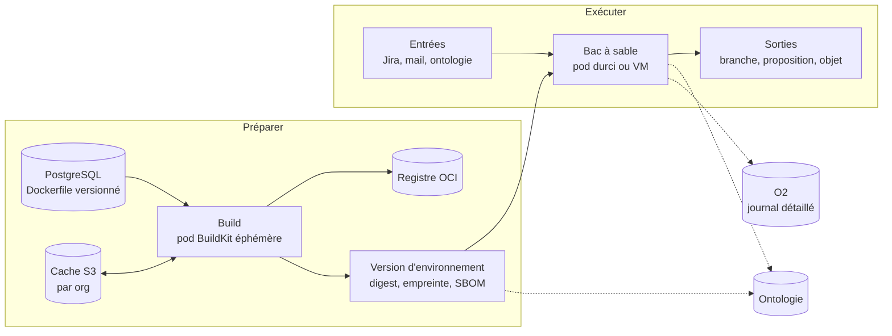
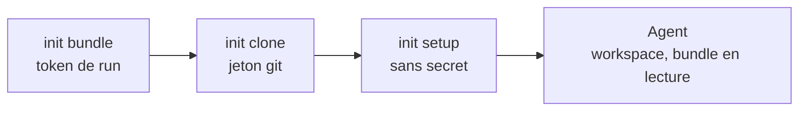
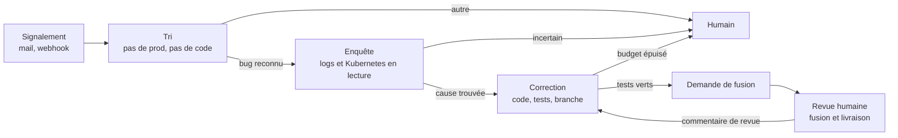

# Environnements d'agents — PRD (D700–D720, D728–D730)

| | |
|---|---|
| Statut | **Validé le 2026-11-04. E0, E1 et le build de E2 codés, non commités** ; build réel validé sur cluster et Scaleway sans le serveur ni le runner complets ; cache S3 des couches, scan Trivy, activation et nouveau scan quotidien codés ; SBOM stocké et tracé dans l'ontologie (D728) ; restent seuil et notification du scan (Q-E6), cache de dépendances, build sur VM. E3 : pod du bac prouvé sur cluster et branché au runner, pas encore à des runs. Recette sur cluster et sur VM en fin de chantier, API seule (pas de page) |
| Numérotation | **D700…D720, D728…D733, D744…D759**, lots **E0…E6** ; PRD clos le 2026-11-06 (§11) |
| Complète | `worker-fabric.md` §14 (runner, bacs à sable), `autonomous-agents.md` (D378–D401), `operational-platform.md` D561 |
| Amende | D561 et fabric §14 : BuildKit au lieu de buildah (D700), secrets en variables d'environnement (D705) ; D394 : le catalogue de moteurs devient un usage des environnements (D704) |
| Sécurité | `security.md` §6 avant tout lot ; finding = ligne SEC-n au §7 |

## 1. Ce que ce document ajoute

Déjà écrit, et non repris ici : runner par cluster et join token, pod durci ou
VM, egress, token de run, passerelle LLM, politique, journal chaîné, sortie
branche + demande de fusion.

Manquait pour passer de « un agent a une image » à « une org prépare
l'environnement de ses agents » :

| Sujet | État avant ce document |
|---|---|
| Connecteur de registre | Cité comme secret de run, sans modèle ni écran |
| Versions des Dockerfile | Absentes |
| Pipeline de build d'image | Une phrase dans D561 (buildah) |
| Cache de build | Absent |
| Environnement comme objet versionné | Absent (seulement « image de toolchain ») |
| Trace dans l'ontologie | Absente : `agent_runs` + O2 seulement |
| Entrées et sorties d'un run (Jira, mail) | Déclencheurs D398, sans règle d'accès aux outils tiers |
| Contenu des échanges LLM pour l'audit | Non tranché |
| Fichiers en entrée et en sortie d'un run | Une phrase (« artefacts déposés dans le MediaStore »), sans déclaration ni passage d'un run à l'autre |

## 2. Vue d'ensemble

Deux temps séparés : **préparer** (humain, aboutit à un digest) et **exécuter**
(un run, sur ce digest figé).



## 3. Build

### D700 — BuildKit remplace buildah

D561 et la fabric §14 citaient buildah. BuildKit le remplace pour une raison
mesurée : il exporte et importe son cache directement sur S3, sans registre
intermédiaire, et il écrit SBOM et provenance sans outil de plus
(`--attest type=sbom`, `--attest type=provenance,mode=max`).

**Mesure du 2026-11-04** (image de test, BuildKit 0.30 Wolfi, RustFS 1.0.0-rc.2) :

| Build | Durée |
|---|---|
| À froid, export vers S3 | 34 s |
| Nouveau démon, sans état local, import depuis S3 | 6 s, étape `CACHED` |

Cache de 13 objets et 100 Mo, sous le préfixe demandé (`org_1/`). Cette mesure a
tourné avec un démon **privilégié** : elle valide le cache, **pas** le bac à
sable (voir D701).

**Image du builder** : construite par nous sur `wolfi-base` (`buildkitd`,
`buildctl`, `rootlesskit`, paquets Wolfi disponibles). L'image `buildkit` et
l'image `kaniko` du catalogue Chainguard ne sont pas accessibles sans licence
(403 vérifié). L'image amont est basée sur Alpine : écartée (`container-images.md`).

**Sens de « distroless » ici** :

- le builder ne peut pas l'être : il lance `rootlesskit` et `runc` ;
- l'image d'un environnement peut l'être si son moteur ne demande rien ; un agent
  de code a besoin d'un shell, donc `wolfi-base` par défaut ;
- la base est le choix de l'org ; la liste des registres de base autorisés est
  un réglage d'org, journalisé.

### D701 — Un Dockerfile est du code non fiable

Une étape `RUN` exécute ce que le Dockerfile contient. Règles :

- un pod par build, détruit à la fin, créé par le runner dans son namespace ;
- jamais de socket Docker, jamais de conteneur privilégié (D387) ;
- le build est un simple pod : pas de gVisor ni de Kata exigé (décision du
  2026-11-05, amende fabric §14 pour le build) ;
- cache par org, sous `org_<id>/buildcache/`, jamais partagé entre orgs ; purge
  depuis l'UI ;
- les identifiants du build sont livrés au claim : écriture d'un seul dépôt d'images, et pour le
  cache des identifiants S3 temporaires limités à un préfixe (D730).

**Le build tourne en rootless**, mode recommandé par BuildKit
(`examples/kubernetes/job.rootless.yaml`, UID 1000, ni `privileged` ni
capabilities). Ce manifeste a trois conséquences :

| Exigence ou effet (doc BuildKit) | Conséquence ici |
|---|---|
| `seccompProfile` et `appArmorProfile` en `Unconfined` | Écart à D387, propre au pod de build, à inscrire au registre `security.md` §7. Le pod d'un agent reste durci |
| `--oci-worker-no-process-sandbox`, Kubernetes n'ayant pas l'équivalent de `systempaths=unconfined` | Une étape `RUN` peut tuer un processus du démon, et le tracer selon le profil seccomp. Elle peut donc atteindre ses identifiants (déduction, non mesurée) |
| Ubuntu 24.04 et suivants : `kernel.apparmor_restrict_unprivileged_userns=0` sur le nœud | Prérequis de nœud, à annoncer dans les capabilities du runner au lieu d'échouer au premier build |

Le rootless réduit le risque d'évasion, mais avec seccomp ouvert il n'est pas une
frontière pour du code non fiable. **Risque accepté le 2026-11-05** : le build tourne
sans runtime durci, sur le cluster du client et pour ses propres Dockerfile. À inscrire
au registre `security.md` §7 avec ce lot. Reste une règle :

- Le vol d'identifiants reste borné à l'org. Un build ne reçoit aucun droit sur une
  autre org ni sur PneX.

**Mesure du 2026-11-05** (Q-E1), image amont `moby/buildkit:v0.23.2-rootless`, namespace
`pnex-agents-test`, microk8s 1.36, Ubuntu 26.04, un nœud testé (`node-worker-1`), réseau et
cache hors sujet (sortie OCI locale) :

| Pod | Résultat |
|---|---|
| UID 1000, seccomp et AppArmor `Unconfined`, `--oci-worker-no-process-sandbox` | Build réussi en 17 s, sans privilège ni réglage de nœud |
| Le même avec `allowPrivilegeEscalation: false` | Échec : `newuidmap: Could not set caps` |

Même pod, poussé sur Scaleway (`rg.fr-par.scw.cloud/pnex/pnex-test-agent-base`) : build et push
réussis, puis image relancée par son digest dans un pod durci, non root, racine en lecture seule.
Le connecteur (D703) passe aussi sur ce registre : pull et push vérifiés, mauvais secret refusé.

Le pod de build garde donc `allowPrivilegeEscalation` : deuxième écart à D387, propre à ce pod,
à inscrire au même registre. Sur le poste de dev, le démarrage avait été refusé par
`rootlesskit` : ce réglage de nœud reste donc à vérifier chez chaque client. Notre image (`deploy/docker/image-builder.Dockerfile`, Wolfi, `newuidmap` et `newgidmap` setuid) passe
le même test : les manifestes du runner construisent, poussent sur Scaleway et rendent le digest par
le message de fin du pod (`crates/pnex-runner/tests/k8s_build.rs`).

**Sur VM** : pas de build en V1 de ce lot, le runner Podman n'annonce pas `builder:buildkit`.

### D702 — Le Dockerfile vit en base

Pas de connecteur git : les autres objets versionnés de PneX vivent déjà en base
(flows, fonctions, dashboards), le Dockerfile suit le même modèle. C'est une
brique et un secret en moins, sans egress vers une forge pendant un build.

- Une version d'environnement porte en PostgreSQL le Dockerfile et ses fichiers de
  contexte texte (`COPY`), plafonnés à 1 Mo. Un binaire vient de l'image de base ou
  d'un téléchargement épinglé par empreinte dans une étape `RUN`.
- Édition dans l'UI, coquille d'éditeur et historique de versions communs
  (D221, D222), avec `expected_version`.
- Le runner reçoit ce contenu au claim et le pose dans le contexte du build. Le
  build référence la version et son **empreinte** SHA-256.
- Un secret détecté à l'enregistrement est refusé
  (`environment-secret-in-dockerfile`).
- Un agent ou l'assistant peut écrire un brouillon. Lancer le build et activer
  restent des gestes humains. Mettre à niveau suit le même chemin : nouvelle
  version, build, activation.
- D388 n'est pas modifiée : un agent codeur qui produit une branche dans un dépôt
  client aura son secret git de run au lot A4. Ce n'est pas un connecteur.

### D703 — Connecteur de registre : OCI, épinglé par digest

- API Distribution v2 uniquement, donc tout registre conforme. Test du connecteur
  = `GET /v2/` authentifié + droit sur le dépôt visé.
- **Deux secrets distincts** : écriture, livrée au seul pod de build ; lecture,
  livrée au seul runner en `imagePullSecret`. Un bac à sable ne peut jamais
  pousser.
- Un tag n'est jamais une référence d'exécution : on exécute un digest.

## 4. Environnement

### D704 — Environnement : un objet versionné, qui absorbe le catalogue de moteurs

Le catalogue de moteurs D394 et les « images de toolchain » de la fabric §14
deviennent une seule notion.

| Élément | Contenu |
|---|---|
| Source | Dockerfile, fichiers de contexte, arguments de build (D702) |
| Cible | Connecteur de registre, dépôt d'images |
| Préparation (D714) | Dépôts à cloner, commande de préparation |
| Exécution | Commande d'entrée, ressources, variables non secrètes, secrets, egress minimal |
| Moteur (optionnel, D394) | Protocole LLM attendu, emplacement des instructions et des compétences |

Une **version** est immuable une fois construite : sources, empreinte, `digest`,
SBOM, provenance, journal du build. Cycle `building → ready | failed`, puis une version
**active**, choisie par un geste humain et remplaçable en un geste. Un run fige
la version (D393–D396), elle suit D399 (`draft → canary → active`) dès que ce lot
existe.

### D705 — Secrets du run en variables d'environnement, depuis un Secret Kubernetes

Décision du 2026-11-04, amende D561 et fabric §14 (« montés en fichier »). Le
fichier monté ne protège pas d'un agent qui a un shell : il le lit comme il lit
son environnement. La protection vient de ce qu'on lui donne, pas de la façon de
le livrer. Les moteurs attendent par ailleurs leur configuration en variables.

| Type | Livraison |
|---|---|
| Variable non secrète | Variable d'environnement, en clair dans la fiche |
| Secret de l'org | Référence au coffre : le runner crée un Secret Kubernetes propre au run, le pod le lit par `secretKeyRef`, le runner le détruit en fin de run. Fichier monté en option, pour un certificat par exemple |
| Accès LLM | URL de la passerelle + token de run, en variables |
| Clé du fournisseur LLM | Dédiée à l'agent (D710), gardée au coffre, utilisée par la passerelle. N'entre pas dans le bac (D385, inchangée) : la passerelle porte le budget et le journal, et un agent trompé ne peut pas la faire sortir |

Règles :

- Tout secret est listé explicitement dans la politique, limité au strict besoin et
  de durée courte quand le service le permet. La valeur ne figure jamais dans la
  spec du pod, une réponse d'API ni une sortie d'outil (R4, R16).
- Le processus de l'agent et ses sous-processus **lisent ces valeurs** : un secret
  donné à un bac est un secret que l'agent peut divulguer. Ce qui le borne : l'egress
  en liste blanche et la durée de vie. La fiche de l'agent l'affiche.
- Les valeurs des secrets du run sont masquées dans le journal et les logs avant
  envoi à O2 (R16).
- Une variable en clair dont le nom ou la valeur ressemble à un secret est refusée
  (`environment-secret-in-env`) : elle se lirait dans la fiche et dans la spec du pod.

**Trois environnements, jamais mélangés** :

| Environnement | Contient | Durée |
|---|---|---|
| Serveur PneX | Secrets de la plateforme : base, trousseau du coffre, S3 | Celle du déploiement |
| Runner | Son adresse du control plane, son identité de runner | Celle du runner |
| Bac à sable | Variables et secrets de ce run, token de run | Celle du run |

- R6 reste vrai : aucun secret de la plateforme n'entre dans un bac ni dans un runner.
- Un bac n'hérite jamais de l'environnement du runner : l'identité du runner
  permettrait de prendre les jobs d'autres runs. Kubernetes le garantit (pod
  distinct) ; l'exécuteur VM (D706) doit démarrer le bac avec un environnement vide.
- Le runner ne garde les secrets d'un run que le temps de le lancer.

### D706 — Kubernetes et VM à égalité, même contrat

Beaucoup d'installations tournent encore sur des VM : elles ne viennent pas après
Kubernetes. Le runner expose un seul contrat d'exécution (créer, suivre, détruire), livré
dès E0 pour les deux. Le placement reste D393, avec l'étiquette `platform:kubernetes` ou
`platform:vm`, sans repli silencieux.

| | Kubernetes | VM ou machine nue |
|---|---|---|
| Installation | Deployment, RBAC du namespace (`deploy/runner/runner.yaml`) | Service utilisateur systemd, Podman rootless (`deploy/runner/pnex-runner.service`) |
| Unité d'un job | Pod | Conteneur, mêmes limites : non-root, sans capability, racine en lecture seule |
| Runtime durci annonçant `isolation:pod` | RuntimeClass gVisor ou Kata | `runsc` (gVisor) |
| Token du runner | Secret du namespace | Fichier en mode 600 |

Reste à traiter pour la VM, avant E3 :

- **Egress** : il n'y a pas de `NetworkPolicy`. Sans solution (réseau interne et proxy en
  liste blanche, Q-E7), un runner VM ne doit pas recevoir de run avec egress restreint.
- **Services et init containers** (D714, D717) : `podman pod` et étapes lancées dans l'ordre
  par le runner.
- **BuildKit** (D700) : même image, en conteneur rootless. Mêmes réserves que D701.
- **Docker** : sa CLI est compatible (`PNEX_RUNNER_CONTAINER_CLI`), mais Docker rootful donne
  la machine à l'utilisateur du runner : choix explicite, à éviter.
- **VM jetable par job** (Firecracker ou libvirt, D387) : isolation plus forte pour du code de
  tiers, au lot E6.

### D710 — Une clé LLM par agent

Une clé partagée par tous empêche d'attribuer un coût ou un abus côté fournisseur,
et sa révocation arrête tout le monde. Chaque agent hébergé a donc sa propre entrée
au catalogue `llm_providers`, avec sa clé au coffre, par la résolution D383.

| Vu où | Ce qu'on lit |
|---|---|
| Console du fournisseur | Consommation et plafond de cette clé, donc de cet agent |
| PneX (passerelle, D709) | Run, tokens, coût et empreintes de chaque appel |

- Créer la clé chez le fournisseur reste un geste humain en V1 ; on la colle au
  coffre. Une création automatique dépend de chaque fournisseur (non étudié).
- Révoquer la clé d'un agent n'arrête que lui.
- Le plafond chez le fournisseur protège même si la passerelle est contournée ou
  défaillante ; le budget D384 reste le contrôle fin, par run.
- La clé reste hors du bac : un token de run expire à la fin du run, pas une clé de
  fournisseur.

### D714 — Préparation du bac par des init containers

Le pod se prépare avant que l'agent ne démarre. Tout est décrit par des variables sur
la fiche d'environnement, surchargeables par run en resserrant : dépôts (URL, ref,
chemin, secret), commande de préparation.



| Étape | Image | Reçoit | Fait |
|---|---|---|---|
| `bundle` | Image d'init PneX (Wolfi, git, épinglée) | Token de run | Télécharge de PneX les instructions, les compétences et la configuration du moteur (D394, D711) vers un volume, ensuite monté en lecture seule |
| `clone` | Image d'init PneX | Jeton git de lecture, à ce seul conteneur | `git clone --depth 1` sur la ref, sans sous-module par défaut ; le commit obtenu remonte sur le run |
| `setup` | Image de l'environnement | Variables non secrètes, **aucun secret** | Commande de la fiche (`npm ci`, `cargo fetch`…) |
| Agent | Image de l'environnement | Secrets de sa politique (D705) | Son travail, dans le volume `workspace` |

- **Jeton git** : les secrets se donnent conteneur par conteneur, donc l'agent ne reçoit
  pas le jeton de lecture. Passé par un fichier hors du volume partagé et jamais dans
  l'URL, il ne reste ni dans `.git/config` ni dans le workspace. Seule l'étape qui pousse
  une branche (D388) reçoit un jeton d'écriture, comme secret de l'agent.
- **`setup` exécute du code du dépôt** (scripts de paquets) : c'est pourquoi il tourne
  sans secret, et avant l'agent, dans le même pod durci.
- **Limite réseau** : une `NetworkPolicy` s'applique au pod, pas à un conteneur. Si `clone`
  atteint la forge, l'agent l'atteint aussi. Sans jeton, il ne peut que lire ce qui est
  public, mais il peut y pousser une donnée s'il a un jeton d'écriture : un agent qui
  voit la prod n'a donc jamais de jeton d'écriture (D713).
- **Échec** : run `failed`, code `sandbox-init-failed`, étape nommée au journal. Pas de
  relance de l'agent sans workspace.
- **Reprise (D397)** : mêmes init containers, sur le commit déjà enregistré au run, puis
  dépôt de l'espace de travail de la dernière étape validée.

## 5. Run

### D707 — Entrées et sorties passent par PneX

| Sens | Exemple | Chemin |
|---|---|---|
| Entrée | Ticket Jira | Connecteur OP2 ou webhook signé, déclencheur D398 ; le contenu entre dans le contexte, jamais dans les droits (D381) |
| Entrée | Mail | Boîte d'un compte de service (`mail.md`), déclencheur D398 |
| Entrée | Données | MCP PneX avec le token de run |
| Sortie | Code | Branche + demande de fusion (D388), seul accès direct à un tiers |
| Sortie | Fait, document | Objet, page ou proposition via l'API (D367, D563) |
| Sortie | Commentaire Jira, mail | Action PneX soumise à la politique (D563), jamais de jeton tiers dans le bac |
| Entrée et sortie | Fichier ou dossier | Artefact déclaré, transporté par PneX (D729) |

Passer par PneX est ce qui rend le journal complet : un jeton Jira monté dans le
bac ferait sortir l'échange de l'audit. L'egress vers un tiers reste possible par
politique, et la fiche du run le signale alors comme non observé (même règle que
l'agent libre, D378).

### D708 — Ontologie : les faits durables, O2 pour le détail

Nouveau pack `agent_ops`. Les tables `agent_runs`, `sandboxes` et les versions
d'environnement restent la source de vérité des états. Le service qui change un
état projette l'objet.

| Type | Liens |
|---|---|
| `agent` | Compte de service, rôle |
| `agent_environment`, `environment_version` | Empreinte, registre, digest, vulnérabilités connues du SBOM |
| `agent_run` | `runs_as` agent, `uses` version, `started_by` personne ou déclencheur, `read` et `produced` objets |
| `container_registry` | Connecteur, sans secret (R4, R16) |
| `software_image`, `software_bom`, `software_component`, `software_vulnerability` | Pack `software_supply` (D728) |
| `agent_artifact` | `produced_by` run, `consumed_by` runs, empreinte, taille, échéance, jamais le contenu (D729) |

**Limite assumée** : une étape ou un appel d'outil **n'est pas un objet**. À ce
rythme, le graphe et son journal de changements se rempliraient de bruit. L'objet
`agent_run` porte le résumé (usage, coût, verdict, liens) et renvoie au journal
O2. Les liens `read` et `produced` viennent de la provenance D389 ; ils répondent
à « qui a touché à cet objet, et avec quel environnement ».

### D709 — Audit LLM : prévu dès la passerelle, contenu activé plus tard

La passerelle (D385) est le seul point de passage, donc le seul point de capture.
Politique `llm_capture` : `metadata` (défaut) ou `full`.

| Niveau | Où | Contenu |
|---|---|---|
| Métadonnées (dès A0) | O2, stream du run | Modèle, tokens, coût, latence, **empreinte** de la demande et de la réponse |
| Contenu (plus tard) | S3 `org_<id>/agent_runs/<run>/llm/`, chiffré | Demande et réponse complètes |

- **PneX est la référence, O2 l'index.** Un corps LLM contient des données
  personnelles et des secrets lus par l'agent. La rétention d'O2 se règle par
  stream, sans effacement fin ; S3 permet d'effacer un run ou une personne.
- L'empreinte est écrite **dès le premier jour** et entre dans la chaîne D401 : un
  corps stocké plus tard, ou effacé, reste vérifiable ou se voit comme effacé.
- Rien d'autre à préparer aujourd'hui : ni table, ni écran.

### D711 — Compétences : tout vit dans PneX, trois façons d'y entrer

Prolonge D396. Une compétence est du texte, stocké et versionné en base. Une fois
entrée, elle ne dépend plus d'aucun service extérieur : un run la lit depuis PneX, même
si le dépôt d'origine a disparu, et tout fonctionne en milieu fermé. L'org la choisit
par agent ou par rôle, à une version épinglée.

| Source | Pour quoi | Comment |
|---|---|---|
| **Intégrée au build** | Les compétences fournies par PneX, disponibles partout, milieu fermé compris | `crates/pnex-backend/skills/`, embarqué par `include_dir!` comme `assistant-kb`. Seulement du texte écrit par nous, jamais une copie de tiers. Copiée dans l'org à la demande ; une nouvelle release propose un brouillon, n'écrase rien |
| **Dépôt git** | Faire évoluer ses compétences avec leur dépôt | URL, ref et chemin. Voir ci-dessous |
| **À la main** | Milieu fermé, ou texte propre à l'org | Éditeur dans l'UI, coquille et historique communs (D221, D222), import d'un fichier |

**Lecture d'un dépôt, sans `git clone` réel.** L'image serveur n'a ni shell ni binaire
git (D71), et aucune bibliothèque git n'est dans le projet. L'import fait deux requêtes
HTTP gardées (R8) : `info/refs` résout la ref en commit, de la même façon sur toute forge,
puis l'archive tar.gz de ce commit est lue par `services/ingest/archive.rs`, qui plafonne
déjà la taille et refuse les chemins dangereux. Seuls les fichiers texte du chemin demandé
sont gardés. Aucun hook ni sous-module ne s'exécute. Le jeton d'un dépôt privé vient du
coffre et n'est envoyé qu'à cet hôte.

- Le commit et l'empreinte sont conservés. Comparer la ref au commit connu montre qu'une
  version amont existe : elle crée un brouillon, jamais une mise à jour.
- Toute source aboutit à un brouillon. Activation par un humain après lecture du diff
  (`agents:write`), recherche de secrets, évaluation D399 dès que ce lot existe.
- La structuration de documents par LLM, évoquée au départ, n'entre pas en V1.
- Le seul vrai clone du système est celui du projet de l'agent, par l'init container du
  bac (D714). L'ingestion à volumétrie en cours de développement n'est pas concernée.
- Une compétence est chargée à chaque run : un texte piégé devient une injection
  **permanente**. C'est le risque principal de cette décision, d'où l'absence
  d'activation automatique, y compris pour une compétence générée par un agent.

### D712 — Un pod par run, jamais de pod d'agent permanent

Ce qui tourne en continu : PneX, le runner, le moteur de flows. Un agent n'existe
en pod que le temps de son run.

| Besoin | Réponse |
|---|---|
| Boucle de raisonnement | Dans le pod, menée par le moteur (D394), bornée par `max_steps`, budget et durée |
| Attendre un humain ou un événement | Le pod est détruit ; l'état reste en base (`waiting_approval`, D397) ; un nouveau pod reprend |
| Démarrage rapide | Image épinglée et cache par org ; un pool de pods préchauffés seulement si la mesure le justifie |
| Suivre la charge | File D400 : autant de pods que les plafonds le permettent, zéro au repos |

Un pod permanent coûterait au repos, garderait ses secrets longtemps et conserverait
d'un travail à l'autre un contexte qu'une injection peut avoir empoisonné. Il rendrait
aussi floue la frontière du run, qui est l'unité de journal et de budget.

### D713 — Orchestration : un flow enchaîne des runs courts

Deux niveaux de boucle : **dans** le run, le LLM décide ; **entre** les runs, un flow
déployé par un humain décide de façon déterministe. Pas de nouveau moteur : c'est le
nœud `agent-run` de D398, dans sa forme « lance et rend l'id » (répond à Q-A10). Un
déclencheur de fin de run, sur le modèle d'`action_trigger`, lance l'étape suivante :
aucun flow n'attend en mémoire, et l'état reste dans `agent_runs` et l'ontologie.

Chaque étape a son environnement et sa politique, au plus juste. Exemple du bug
signalé par un client :



| Étape | Lit | Écrit | N'a pas accès à |
|---|---|---|---|
| Tri | Ticket, historique du client dans l'ontologie | Objet `bug_report`, doublons regroupés | Prod, code |
| Enquête | `bug_report`, logs et état Kubernetes en lecture seule sur un namespace | Preuves et hypothèse sur l'objet, données personnelles masquées | Code en écriture, Internet |
| Correction | Hypothèse, dépôt, jeu de tests du bac | Branche + demande de fusion (D388) | Prod, ticket brut |
| Humain | Tout, avec le journal | Fusion, livraison | — |

- **Pourquoi découper** : le ticket est écrit par un tiers et peut contenir une
  injection. L'agent qui le lit ne touche ni à la prod ni au code ; celui qui écrit du
  code ne lit pas le ticket brut, seulement des champs structurés. Enquête et
  correction n'ont aucun accès commun qui permette de sortir une donnée de prod par
  le code.
- **Mémoire entre les étapes** : les objets de l'ontologie, pas le contexte LLM. C'est
  aussi la trace d'audit (D708).
- **Anti-tempête** : même signalement répété = même `bug_report`, pas de run de plus
  (D398).
- **Superviseur LLM** (D390) : il peut, plus tard, choisir parmi les agents autorisés
  dans ses bornes. Pas en V1 : un enchaînement fixe se teste, se relit et s'audite.
- **Accès git** : ce scénario exige le secret git de run et l'API de demande de fusion
  d'une forge (Q-A3, à trancher au lot A4). D702 n'écarte git que pour les Dockerfile.
- **Accès Kubernetes** : un compte de service en lecture sur le namespace visé, livré
  comme secret du run (D705) ; il n'ouvre aucune écriture (D391) et n'est pas conservé
  par PneX hors du coffre.

### D715 — Première cible et portes avant un client réel

Première cible : un bug de PneX lui-même, dans l'org de l'exploitant, sur le cluster dev.
Deux sujets sont volontairement reportés, et **bloquent l'ouverture à un client réel** :

| Sujet | Tant qu'il n'est pas traité |
|---|---|
| Droits par objet (OP3) | Une org par client : un token de run couvre toute son org |
| Masquage des données personnelles, règle « quelles données vers quel fournisseur LLM », cadre contractuel | Aucun log ni ticket d'un client réel vers un LLM externe |

### D716 — Chaîne : un identifiant, un budget, un nombre de tours

Les runs d'un même sujet partagent un `chain_id`, porté par l'objet `bug_report` ou
équivalent. La chaîne a son plafond de coût et de durée, prélevé comme D390, et un nombre
maximal de tours de revue. Au-delà, elle repasse à un humain. L'export d'audit D401 se
fait aussi par chaîne.

**Mesure du 2026-11-05 sur le cluster** (`crates/pnex-runner/tests/k8s_sandbox.rs`, 3 passages de suite) :
depuis l'intérieur du pod, le dépôt est cloné et `setup` a tourné ; non-root, racine en lecture seule,
aucune capability ; le secret du run est présent chez l'agent ; le jeton de clone n'est ni dans son
environnement, ni dans le workspace, ni dans `.git/config` ; aucun jeton d'API ; le service répond sur
`localhost` ; la forge répond et une autre adresse est refusée. Aucun secret dans la spec ni dans les logs.

**Limite de l'egress** : une `NetworkPolicy` ne connaît que des adresses, pas des noms. Une forge ou un
fournisseur qui change d'adresse casse la règle : une exécution sur cinq a échoué sur l'egress
autorisé, sans cause établie. Un vrai déploiement demandera un proxy de sortie par nom, à trancher avec Q-E7.

### D717 — Services de test à côté de l'agent

La fiche d'environnement déclare des **services** : image épinglée par digest, variables,
sonde de disponibilité.

- Démarrés dans le pod comme conteneurs annexes natifs (init container
  `restartPolicy: Always`), avant `setup` : Postgres et Valkey répondent sur `localhost`
  quand la préparation et l'agent démarrent.
- Variables réglées comme le demande le code source du projet (`DATABASE_URL`…), sur la
  fiche ou par l'agent dans son shell après lecture du projet (`.env.example`, doc).
- Mots de passe de ces services **générés par run**, sans coffre : ils ne protègent que
  des données jetables. **Jamais de données de prod** dans ces services.
- Mêmes règles de durcissement que l'agent, volume éphémère pour leurs données ;
  ressources comptées dans les limites du run (compilation et tests compris).

### D718 — Un seul agent codeur par sujet

Une **clé de travail** `(org, dépôt, numéro de ticket ou id du bug_report)` est tenue par
la chaîne, pas par le pod : elle reste prise pendant la revue humaine.

- En base : index unique partiel sur les chaînes actives, comme `data_builds_one_running`.
  Pas de Valkey : la garantie suit la transaction qui crée la chaîne.
- Un deuxième signalement du même sujet **rejoint** la chaîne existante, ajouté à son
  contexte, sans second run.
- Branche déduite de la clé (`agent/<ticket>`), donc stable d'un tour à l'autre. Auteur des
  commits = compte de service de l'agent, label `agent` sur la demande de fusion.
- Libération : fusion ou fermeture de la demande, abandon de la chaîne, ou geste humain.
  Chaîne sans activité au-delà d'un délai réglable : signalée à un humain, jamais libérée
  en silence.
- Hors périmètre : deux sujets différents qui touchent les mêmes fichiers. Le conflit se
  voit à la demande de fusion, et un plafond de runs par dépôt (D400) le limite.

### D719 — Logs du bac collectés par le runner

Chemin : conteneurs du pod → runner → API PneX (route `Machine`) → O2. PneX masque les
valeurs des secrets du run (D705) avant O2, et applique un plafond de débit et de volume par
run. L'ontologie ne reçoit pas de lignes : l'objet `agent_run` porte le résumé, le lien vers
le journal et le code de sortie (D708).

| | Runner (retenu) | Fluent Bit en sidecar |
|---|---|---|
| Init containers | Vus, dont `clone` et `setup` | Ratés si démarré après eux |
| Jeton d'envoi dans le pod | Non | Oui |
| Image de plus par pod, egress de plus | Non | Oui |
| Fichiers écrits dans le workspace | Non | Oui |

Le runner crée déjà ses pods et les détruit : il lui suffit du droit `pods/log` sur son
namespace, ajouté à son RBAC (fabric §14), pour lire leur sortie jusqu'à la destruction.
Fluent Bit reste possible si la lecture de fichiers de logs devient
nécessaire ; on le déciderait alors sur un cas réel.

- **En cas d'échec** : le workspace part dans S3 avant destruction, durée limitée (D389).
- **Limite** : l'agent écrit lui-même sa sortie. Ces logs servent à déboguer. La preuve
  d'audit reste le journal chaîné des appels passés par PneX (D401).

### D720 — Scan des images : Trivy, côté PneX, même après la fin des pods

Un pod est temporaire, son image non : un digest peut resservir, et une faille est souvent
publiée après le build. PneX surveille donc les **versions d'environnement**, pas les pods.

| Moment | Geste |
|---|---|
| Fin de build | Scan du digest par un job du runner. Résultat attaché à la version, qui reste activable selon le seuil de l'org |
| Chaque jour | Nouveau scan du build actif de chaque environnement, puis à E3 de toute version utilisée par un run récent. **V1 : l'image est relue dans le registre.** Scanner depuis un SBOM stocké, sans solliciter le registre, reste à faire |
| Nouvelle faille au-dessus du seuil | Notification, objet `environment_version` mis à jour (D708), run refusé ou signalé selon le réglage de l'org |

- **Suggestion de correction** : Trivy donne la version corrigée. PneX propose de
  reconstruire, souvent suffisant quand la base a été corrigée, ou crée un brouillon de
  Dockerfile. Build et activation restent des gestes humains (D702).
- **Mesure du 2026-11-05** : Trivy 0.68.2 (paquet Wolfi, épinglé) dans un pod durci généré par le
  runner, 30 s environ sur le cluster : `CVE-2021-36159`, critique, version corrigée connue, sur
  `alpine:3.10` ; image privée Scaleway lue avec le secret de registre. Le runner lit le rapport dans
  les logs du pod, en tolérant les lignes ajoutées par le runtime du conteneur, et n'envoie à PneX que
  notre format borné.
- **SBOM** : celui que Trivy produit lui-même, stocké et tracé dans l'ontologie (D728). Sa documentation prévient qu'un SBOM d'un
  autre outil peut donner une détection inexacte. L'attestation BuildKit reste pour la
  provenance (D700).
- **Le scan tourne dans un pod du runner**, jamais dans `pnex-server` : un binaire tiers
  lit là un contenu fourni par l'org.
- **Trivy a subi une compromission de sa chaîne de publication en mars 2026**
  (CVE-2026-33634, binaire v0.69.4 et images v0.69.5 et v0.69.6 piégés). Donc paquet Wolfi
  (`trivy` 0.68.2-r1 vu le 2026-11-04, hors des versions touchées) dans notre image plutôt que
  les publications de l'éditeur, épinglée par digest, mise à jour par un geste relu, jamais de
  tag mobile. L'image du scan n'a ni secret ni droit d'écriture sur
  le registre. Le format de résultat stocké est le nôtre : changer d'outil reste possible.
- **Milieu fermé** : base de vulnérabilités à fournir par un miroir (Q-E5).
- **Limites** : le scan voit l'image, pas ce que `setup` installe au démarrage, ni le code du
  projet, qui relève des pipelines du client.

### D729 — Artefacts d'un run : des fichiers déclarés en entrée et en sortie

Décision du 2026-11-05 : un run reçoit et produit des fichiers, comme les
`inputs.artifacts` et `outputs.artifacts` d'un workflow Argo. Elle précise la phrase
« artefacts déposés dans le MediaStore » de `autonomous-agents.md`. Un run suivant reprend la
sortie du précédent : le code d'un correctif, un rapport, un jeu de données préparé.

**Déclaration**, sur la fiche de l'agent, surchargeable par run en resserrant :

```yaml
inputs:
  - name: logs
    path: /artifacts/in/logs
    from: { run_output: triage/report }   # or upload, or media
outputs:
  - name: report
    path: /artifacts/out/report
    required: true
    expires_in: 30d
```

| Règle | Contenu |
|---|---|
| Sources d'une entrée | Sortie d'un run de la même chaîne (D713, D716), fichier déposé par un humain, média de l'org. Pas d'URL ni de seau S3 : un dépôt git passe par `clone` (D714), une donnée par le MCP (D707) |
| Droits | Vérifiés à la création du run, avec les droits de son auteur (D381). Un artefact d'une autre org n'existe pas (R1) |
| Immuable | Identifiant, SHA-256, taille. Une entrée est vérifiée à l'empreinte avant le démarrage de l'agent |
| Forme | Un fichier ou un dossier, ce dernier en archive tar |

**S3 reste l'espace de stockage intermédiaire**, exigence du 2026-11-05 : aucun volume partagé
entre deux runs, aucune donnée gardée sur un nœud ou un runner. Une sortie part dans S3 avant la
destruction du pod, et le run suivant la reprend depuis S3, sur n'importe quel runner.

**Transport par PneX, jamais d'accès S3 depuis le bac.** C'est la différence avec Argo, où le pod
reçoit les identifiants du seau. Ici le bac n'atteint que PneX (egress, D705), le journal reste
complet (D707) et le code est le même sur Kubernetes et sur VM. Le serveur écrit en flux dans
`S3Store`, sous `org_<id>/agent-artifacts/<run>/`, sans URL présignée, comme le reste du dépôt.

| Sens | Kubernetes | VM (Podman) |
|---|---|---|
| Entrée | Init container `artifacts`, après `bundle` (D714), volume ensuite en lecture seule | Même conteneur, lancé avant l'agent |
| Sortie | Conteneur de collecte en sidecar natif : à la fin de l'agent il reçoit `SIGTERM`, puis envoie (à mesurer en E3) | Même conteneur, lancé après la sortie de l'agent, avec le volume |

- **La collecte ne vit pas dans le conteneur de l'agent** : un agent tué ne perd pas ses sorties,
  et un run en échec les envoie aussi. Elle a son propre jeton, limité à ce run et aux noms
  déclarés.
- **Le runner ne lit jamais le volume lui-même**, en particulier sur VM : un lien symbolique posé
  par l'agent lui ferait lire son hôte. Le conteneur de collecte ne voit que le volume en lecture
  seule, ne suit aucun lien et ne prend que des fichiers réguliers.
- **Limites et conservation** : taille par artefact et par run, nombre de fichiers, échéance par
  défaut. Ce sont des réglages globaux que l'utilisateur choisit, pas des valeurs du code. Un dépassement refuse cet artefact et le dit sur le run
  (`artifact-too-large`), jamais de troncature silencieuse. Une sortie `required` absente fait
  échouer le run (`artifact-output-missing`).
- **Le contenu n'est pas fiable** : téléchargement en pièce jointe, jamais affiché sur l'origine
  de l'app (R11–R13). Lu comme entrée d'un run suivant, il reste du contexte, jamais des droits
  (D381).
- **Un artefact peut contenir un secret** : le masquage de D705 vaut pour les journaux, pas pour
  les fichiers. La lecture demande donc sa propre permission (`agent-artifacts:read`), et chaque
  artefact a une échéance (D389).
- **Une seule notion** : le workspace conservé après un échec (D719) devient un artefact
  `workspace`.
- **Trace** : un objet `agent_artifact` par artefact (D708). L'ontologie répond ainsi à « quel run
  a produit ce fichier, et lesquels l'ont lu ».
- **Hors V1** : publication en cours de run, sources externes, déduplication entre runs.

### D730 — Cache S3 à deux niveaux : couches d'image, et dépendances

Décision du 2026-11-05 : BuildKit + S3 reste le choix, car sans cache les builds Java, Rust,
C# et C++ sont trop longs. Le pod est éphémère, donc tout ce qui doit survivre part dans S3.

| Niveau | Quoi | Où | Sert à |
|---|---|---|---|
| Couches | Cache BuildKit, `mode=max` | `org_<id>/buildcache/<environnement>/` | Tout ce que le Dockerfile a déjà construit, étapes intermédiaires comprises |
| Dépendances et compilation | Dossiers nommés et archivés (`~/.m2`, `~/.cargo`, `~/.nuget`, sortie de `sccache` ou `ccache`) | `org_<id>/depcache/<environnement>/<nom>/<clé>` | Un `RUN` qui recompile, et le travail de l'agent dans son bac |

**Piège** : les dossiers `RUN --mount=type=cache` restent dans l'état local du démon. Ils
disparaissent avec le pod et le cache S3 de BuildKit ne les exporte pas (à vérifier à la mesure).
Dans un build, on s'appuie donc d'abord sur les couches, avec un Dockerfile qui copie le fichier de
verrou et récupère les dépendances avant de copier les sources.

- **Déclaration**, sur la fiche d'environnement : nom, chemins, clé. La clé est l'empreinte des
  fichiers de verrou (`Cargo.lock`, `pom.xml`, `packages.lock.json`), avec repli sur la dernière
  archive du même nom. Plafonds et durée de vie sont des réglages globaux, comme D729.
- **Dans un bac** : restauration par l'init container `artifacts`, sauvegarde par le conteneur de
  collecte, en passant par PneX (D729). Le bac n'a toujours aucun accès S3.
- **Dans un build** : à la prise du job, le serveur demande à S3 (STS `AssumeRole`) des identifiants
  temporaires limités par une politique de session à `org_<id>/buildcache/<environnement>/`. Le pod
  de build ne reçoit jamais les clés du serveur, et reste le seul à parler directement à S3. Sans STS
  sur le stockage, ou sans `PNEX_BUILD_CACHE_ENDPOINT`, le build tourne sans cache.

**Mesure du 2026-11-05** (RustFS 1.0.0-rc.2 dans un namespace de test, pods neufs, notre image) :

| Vérification | Résultat |
|---|---|
| Build avec une étape de 25 s, sans cache puis depuis le cache | 32 s, puis 3 s, même digest, étapes `CACHED` |
| Identifiants temporaires sans droit de lister le bucket | Le cache BuildKit fonctionne |
| Hors du préfixe : autre org, autre environnement, listing, création de bucket | Refusés (403) |
- **Empoisonnement** : un cache écrit par du code non fiable est relu par le run suivant. Donc un
  cache par org et par environnement, jamais entre orgs, écrit seulement par un run réussi, purge
  depuis l'UI, et un agent exposé à du contenu tiers lit le cache sans pouvoir l'écrire.
- **Compilation partagée** : `sccache` sait parler à S3 lui-même, ce qui demanderait des
  identifiants dans le `RUN`. Pas en V1 : son dossier passe par le mécanisme ci-dessus.
- **Hors V1** : Gradle Build Cache distant, déduplication entre environnements.

### D728 — Le SBOM est tracé dans l'ontologie

Décision du 2026-11-05 : le SBOM n'est pas un simple fichier joint au build. Il prépare un futur pack
qui suivra un logiciel du code source à la production, en passant par la livraison. D721 à D727
étant pris par `sales-dashboards.md`, ce numéro saute.

| Élément | Où | Pourquoi |
|---|---|---|
| Document CycloneDX complet | O2, stream `environment_sboms`, tel que produit ; empreinte vérifiée à la relecture ; téléchargeable sur le build | JSON texte, consultable avec le reste. Format standard, produit par Trivy lui-même (D720) |
| Suivi | O2, stream `environment_scan_events` : un événement par scan, un par faille ; route de suivi sur l'environnement | Courbes, recherche et tableaux de bord dans le temps |
| `software_image` | Objet, clé `reference` (dépôt + digest) | Ce qui tourne |
| `software_bom` | Objet, relié à l'image, renvoie au document | Le SBOM comme fait durable |
| `software_component` | Objet, clé `purl`, partagé entre images | Répond à « où tourne ce paquet ? » |
| `software_vulnerability` | Objet, clé `advisory` ; lien `image_exposed_to`, avec paquets et version corrigée | Fermé quand un scan ne la retrouve plus : l'historique reste |

- **O2 et non S3** (demande du 2026-11-05) : un SBOM est du JSON, à consulter et à suivre. Mesuré sur l'O2
  local : documents de 28 Ko à 90 Mo relus identiques, et un document de 10 Mo encore identique 20 minutes
  plus tard. L'écriture des fichiers de stockage d'O2 n'a pas été observée directement. Un SBOM doit survivre à son image : son stream
  garde 10 ans pour l'instant, à passer en réglage global. Sans O2 sur le déploiement, le scan se termine
  quand même, sans document.
- **Pack générique `software_supply`**, installé au premier scan. Rien n'y parle d'agents : le futur
  pack le prendra en `requires` et reliera ses livraisons et ses déploiements à ces objets.
- **Le scan lit le SBOM produit** (`trivy image` puis `trivy sbom`) : le rapport décrit exactement le
  document stocké. Mesuré le 2026-11-05 sur `alpine:3.10` : même faille trouvée que par un scan direct.
- **Exception à la limite de D708** (« une étape n'est pas un objet ») : un composant est un fait durable
  et partagé, pas une étape. Le volume reste borné : 20 000 composants par image au plus.
- **Écart assumé au garde `engine_genericity`** : le moteur écrit dans ce pack, comme le veut D708. La
  dépendance est déclarée dans le garde.
- **Future page des images** (demande du 2026-11-05, pas prioritaire) : à côté de chaque image, son statut
  (en édition, construite et disponible) et son score de scan, qui ouvre la liste des failles.
- **Reste à faire** : le lien vers `environment_version` arrive avec `agent_ops` (E4) ; d'ici là, l'image
  porte le nom et la version de son environnement. Le scan quotidien relit encore l'image.

### D731 — Un run : un job `sandbox`, un token frappé au claim

Décision du 2026-11-05, première tranche de A1 pour faire tourner un vrai agent. Un run est
une ligne `agent_runs` et un job `sandbox` sur le build **actif** de l'environnement, par
digest. Le serveur ne pousse rien : le runner prend le job comme les autres.

- **Token de run** (`pnagr_…`) frappé à **chaque claim**, haché en base. Un runner qui perd
  le job emporte un token mort : celui du runner suivant le remplace.
- Il n'ouvre la passerelle **que pendant que le job tourne** (jointure sur
  `runner_jobs.state = 'running'`) : arrêt, fin, reprise ou bail perdu le ferment sans
  autre geste. Aucune autre route ne l'accepte en V1 (pas d'API ni de MCP avec ce token).
- Variables livrées au bac : `PNEX_GATEWAY_URL`, `ANTHROPIC_BASE_URL`, `OPENAI_BASE_URL` en
  clair ; `PNEX_RUN_TOKEN`, `ANTHROPIC_API_KEY`, `OPENAI_API_KEY` = le token, par le Secret
  du run (D705). Un moteur standard marche donc sans configuration ; ces noms sont refusés
  dans les variables du run, comme une valeur qui ressemble à un secret.
- **Adresse de la passerelle** : `PNEX_AGENT_GATEWAY_URL`, sinon `https://$PNEX_PROD_HOST`.
  Sans elle, le job échoue au claim : un agent sans modèle ne démarre pas. Le serveur
  résout son nom au claim et livre les adresses dans l'egress du bac (Q-E13 : une
  `NetworkPolicy` ne connaît que des adresses ; un serveur derrière une IP de Service du
  cluster n'est pas couvert).
- **Arrêt** : geste humain (`agents:stop`), job en `failed` / `stopped`, le runner l'apprend
  à son heartbeat (409) et détruit le pod.
- Droits : `agents:read` (Viewer), `agents:run` (Admin, comme le build : un run consomme le
  budget LLM et exécute du code), `agents:stop` (Member). Lecture `EXPOSED` au MCP,
  lancement et arrêt `EXCLUDED` (runtime) : l'assistant ne lance ni n'arrête de run (D391).
- **Pas encore** : agent = compte de service (D379) et sa clé propre (D710), politique,
  dépôts à cloner et services de test dans la demande de run, page. La clé
  est celle de l'usage `agent` de l'org (D383, sans niveau agent).

### D733 — Journal d'un job, V1 de D719 : en fin de job, par le runner

Décision du 2026-11-06, qui applique D719 à tous les jobs du runner (build, sonde, bac) :

- **Quand** : à la fin du job, quelle qu'elle soit (succès, échec, délai), avant la
  destruction du pod. Le runner lit `pods/log` de chaque conteneur, init containers d'abord,
  dans l'ordre où ils ont tourné (`clone`, services, `setup`, agent). Pas de scan : sa sortie
  est son rapport, rangé à part (D728).
- **Bornes** : les 4 000 dernières lignes et 256 Kio par conteneur, 32 conteneurs, ligne
  coupée à 16 Kio. Un conteneur coupé commence par `[older lines left out]`.
- **Masquage, deux fois** : le runner remplace chaque secret livré au claim (secrets du bac,
  jetons de clone, login de registre, identifiants STS du cache) ; PneX remplace ensuite tout
  mot à la forme d'un identifiant connu (`pnagr_`, `ghp_`, `sk-`, `AKIA`…) et les blocs de
  clé privée. Le jeton de run n'est gardé que haché : seule la forme le rattrape côté serveur.
- **Transport** : `POST /api/v1/runner/jobs/{id}/logs` (`Machine`, jeton du runner, job
  tenu), avant `finish`. Au mieux : un échec n'empêche jamais le résultat du job de partir.
- **Stockage** : stream O2 `runner_job_logs`, une ligne par enregistrement (job, conteneur,
  rang). Rien en base.
- **Lecture** : `GET /api/v1/agent-runs/{id}/logs`, paginé, `agents:read`, `EXPOSED` au MCP
  (les secrets sont masqués). 503 `agent-run-logs-unavailable` sans O2.
- **Limites V1** : rien n'arrive pendant le run, seulement à la fin ; pas de lecture sur VM
  (Podman). Le journal d'un run arrêté à la main et celui d'un build sont faits (D759).

### D744 — Artefacts, V1 de D729 : noms fixes, deux conteneurs de transfert, jeton à part

Décision du 2026-11-06, qui applique D729 au bac Kubernetes :

- **Déclaration dans la demande de run** : `inputs: [{name, artifact_id}]`,
  `outputs: [{name, required}]`, 16 de chaque au plus, noms `[a-z0-9-]`. **Le chemin n'est
  pas libre** : entrée à `/artifacts/in/<nom>`, sortie à `/artifacts/out/<nom>`, données à
  l'agent par `PNEX_ARTIFACTS_IN` et `PNEX_ARTIFACTS_OUT`. Une source d'entrée est un
  artefact prêt de l'org : déposé par une personne (`POST /agent-artifacts?name=`, flux brut,
  `agents:run`) ou sortie d'un run précédent. La fiche d'agent viendra avec D710.
- **Deux conteneurs, l'image `init`** : `artifacts-in` (init, après `clone`) télécharge
  chaque entrée et compare son SHA-256, puis dépose ; un écart arrête le pod avant `setup`
  et l'agent. `artifacts-out`, sidecar natif, attend le `SIGTERM` de fin d'agent et envoie
  chaque sortie ; la période de grâce du pod passe à 300 s quand des sorties sont déclarées.
  Un fichier part tel quel, un dossier en tar de ses seuls fichiers réguliers ; un lien
  symbolique est ignoré. Les deux scripts sont prouvés par `crates/pnex-runner/tests/artifact_scripts.rs`
  (sh, curl, tar réels).
- **Jeton d'artefacts `pnart_…`**, frappé au claim, haché en base, distinct du jeton de run :
  il ne va qu'aux deux conteneurs de transfert, jamais à l'agent ni à `setup`. Il n'ouvre que
  `GET /api/v1/agent-transfer/inputs/{nom}` et `PUT …/outputs/{nom}` des noms déclarés,
  tant que le job tourne. Une sortie s'envoie une fois (409 ensuite).
- **Stockage** : `org_<id>/agent-artifacts/<run>/<id>` et `…/uploads/<id>`, écrit en flux par
  le serveur avec son empreinte ; ligne `agent_artifacts` (état `pending`, `ready`,
  `refused`, `missing`, forme, taille, SHA-256, échéance), migration 000099.
- **Limites, réglages globaux** `settings.agents.artifacts` : `max_bytes` (1 Gio),
  `run_max_bytes` (4 Gio), `expires_days` (30). Dépassement : refus entier,
  `agent-artifact-too-large`. Ménage horaire des artefacts échus, objets d'abord.
- **Fin du job** : ce qui n'a pas été envoyé passe `missing` ; une sortie `required`
  manquante fait échouer un run que l'agent avait réussi (`error =
  agent-run-output-missing`). Un arrêt à la main ferme aussi les sorties.
- **Lecture** : `GET /agent-runs/{id}/artifacts` et `GET /agent-artifacts/{id}`
  (`agents:read`, `EXPOSED`) ; contenu `GET /agent-artifacts/{id}/content` en pièce jointe,
  `nosniff`, permission **`agent-artifacts:read`** (Member), `EXCLUDED` (binaire).
- **Pas encore** : objet `agent_artifact` dans l'ontologie (D708), source « média », VM,
  cache de dépendances par ce chemin (D730), workspace d'échec (D719), preuve sur le
  cluster.

### D732 — Passerelle LLM : deux protocoles, le modèle de l'org, compté et tracé

- Routes `Machine` : `POST /api/v1/agent-gateway/v1/messages` (Anthropic) et
  `…/v1/chat/completions` (OpenAI). Token en `x-api-key` ou `Authorization: Bearer`.
- Fournisseur : celui de l'usage **`agent`** (nouvel usage D383, réglable dans l'UI), sinon
  le défaut de l'org. Le `model` du moteur est **remplacé** par celui de l'org : c'est l'org
  qui choisit et paie. Pas de traduction entre protocoles : un moteur Anthropic face à un
  fournisseur OpenAI reçoit `agent-gateway-protocol-mismatch`.
- Réponse rendue telle quelle, flux SSE compris ; la passerelle lit le flux au passage pour
  l'usage (Anthropic : `message_start` + `message_delta` ; OpenAI : `include_usage` forcé).
  Un moteur qui raccroche est compté sur ce qui est passé.
- **Budget** : appels par run (`llm_calls_max`, 200 par défaut, 10 000 au plus), compteur
  journalier par org propre aux agents (`settings.ai.agent_daily_calls`, 5 000), qui ne
  touche ni l'assistant ni les flows (D384). Tokens d'entrée et de sortie cumulés sur le run.
- **Journal** (D709, niveau `metadata`) : un événement par appel dans le stream O2
  `agent_llm_calls` : run, fournisseur, modèle, statut, tokens, latence, empreinte SHA-256
  de la requête envoyée et de la réponse reçue. Jamais le contenu.
- Corps limité à 8 Mo ; client HTTP de la passerelle sous la garde d'egress R8, sans
  redirection.
- Preuve : `crates/pnex-backend/tests/agent_runs.rs` face à un faux fournisseur local (claim
  sans clé, modèle remplacé, flux et JSON comptés, budget, arrêt qui ferme le token,
  isolation d'org et droits). Pas encore prouvé : un vrai moteur dans un vrai bac, et
  l'écriture O2 (aucun O2 dans ces tests).

## 6. Contrat, IAM, MCP

- Routes `image-registries`, `environments` (versions et builds compris) :
  annotées, inscrites dans `iam.rs` (`image-registries:read|write|test|delete`,
  `environments:read|write|delete`, puis `environments:build` avec le build) et dans
  `exposure.rs`.
- MCP : lecture et brouillon de version `EXPOSED`, sans secret. Créer un connecteur,
  lancer un build, activer une version : `EXCLUDED` (motifs secret ou runtime), donc
  `DANGEROUS` en CLI. Un agent ne lance pas de build en V1.
- Artefacts : lecture des métadonnées `EXPOSED` ; dépôt et téléchargement `EXCLUDED` (binaire).
- Routes du runner : `Machine`, absentes du MCP.
- Lexique, fiches `assistant-kb` et clés `err-<code>` au lot qui rend chaque
  notion visible.

## 7. Risques

| Risque | Réponse |
|---|---|
| `RUN` lit les identifiants du démon | Risque accepté sans runtime durci, identifiants courts et limités à l'org (D701) |
| Cache empoisonné | Cache par org, purge UI ; l'empreinte et le SBOM de chaque version permettent de remonter |
| Image de base piégée | Liste de registres autorisés, digest épinglé, SBOM (D700, D703) |
| Agent trompé qui divulgue un secret de son environnement | Egress en liste blanche, secrets limités et courts, clé LLM hors du bac (D705, D385) |
| Secret dans un journal | Masquage des valeurs connues du run avant O2 (D705) |
| Secret en clair dans une fiche | Refus au formulaire (D705) |
| Bac à sable qui pousse une image | Secret de lecture seule côté runner (D703) |
| Fuite par le contenu LLM | `metadata` par défaut, contenu chiffré et effaçable (D709) |
| Lien symbolique ou archive piégée dans une sortie | Collecte dans son conteneur, fichiers réguliers seuls, aucun accès du runner au volume (D729) |
| Secret ou contenu actif dans un artefact | Permission dédiée, échéance, pièce jointe seule (D729) |
| Disque de build saturé | `ephemeral-storage` limité par pod, élagage du cache S3 par âge |

## 8. Lots

| Lot | Contenu | Preuve de fin |
|---|---|---|
| **E0** | Runner minimal : join token, claim, bail, heartbeat, reaper en HTTP sortant, exécuteurs Kubernetes et Podman (D706), fichiers d'installation. Sans repli 360/firmware ni GPU (reste de P2.7) | Un job de test créé et détruit depuis PneX sur un cluster et sur une VM, runner tué = job repris |
| **E1** | Connecteur de registre : coffre, CRUD, test | Test réel sur un registre, 403 sans permission |
| **E2** | Environnements, versions en base, build BuildKit, cache S3 des couches (D730), logs par le runner (D719), SBOM, scan Trivy (D720) | Dockerfile en base → digest dans le registre, 2ᵉ build sur cache, faille connue signalée sur la version |
| **E3** | Bac à sable depuis un digest : init containers (D714), artefacts d'entrée et de sortie (D729), cache de dépendances (D730), services de test (D717), pod durci, variables, Secret Kubernetes par run, NetworkPolicy, reaper | Projet cloné et bundle présent au démarrage, artefact d'entrée vérifié et sortie remontée même après l'échec de l'agent (D729), jeton de clone absent du workspace et du conteneur de l'agent, secret absent de la spec et du journal, Secret détruit en fin de run, egress refusé hors liste |
| **E4** | Pack `agent_ops` et projection des builds et des versions | Requête d'ontologie : environnement → version → digest |
| **A0, A1, A3** | Déjà au PRD agents ; D709 métadonnées entre dans A0 ; le catalogue A3 devient E2 | Un run réel sur un environnement construit |
| **E5** | Compétences multi-sources (D711), enchaînement par flow (D713) avec passage d'artefacts (D729), chaîne et budget (D716), verrou par sujet (D718), entrées et sorties D707 (OP2 pour Jira), A4 agents codeurs | Signalement → tri → enquête → demande de fusion sur un vrai bug de recette, trace de bout en bout |
| **E6** | VM jetable par job (D706), capture `full` (D709) | Même scénario dans une VM jetable, contenu LLM effaçable |

Ordre : E0 → E1 → E2 → E3 → E4, puis A0/A1. Chaque lot de E0 à E3 se teste sur un
vrai cluster : les tests d'un bac à sable sans vrai noyau ne prouvent rien.

## 9. Questions ouvertes : toutes tranchées le 2026-11-06

Plus aucune question ne bloque le code. Chacune est close par une décision du §11 ; ce qui
reste demande un geste, pas une discussion (§11.3).

| Question | Close par |
|---|---|
| Q-E3, Q-E15 — Comptes Scaleway, lecture et écriture séparées | D745 |
| Q-E4 — Reconstruction périodique | D746 |
| Q-E5 — Milieu fermé | D747 |
| Q-E6 — Seuil du scan | D748 |
| Q-E7 — Egress sur VM | D749 |
| Q-E8 — Moteur de la démonstration (et Q-A7) | D750 |
| Q-E9 — Clé LLM de test | D751 |
| Q-E10 — Scénario et forge (et Q-A3) | D752 |
| Q-E11, Q-E12 — Serveur de recette, RustFS de recette | D753 |
| Q-E13 — Egress par nom | D754 |
| Q-E14 — Limites en réglages globaux | D755 |
| Q-A1, Q-A2, Q-A4, Q-A5, Q-A6, Q-A8, Q-A9, Q-A10 (`autonomous-agents.md` §18) | D756 |

## 10. Récapitulatif des décisions

| # | Décision |
|---|---|
| D700 | BuildKit remplace buildah (cache S3 mesuré), image builder sur Wolfi |
| D701 | Dockerfile = code non fiable : un pod rootless par build, sans runtime durci exigé (risque accepté), cache par org |
| D702 | Dockerfile et contexte versionnés en base, édités dans l'UI, sans connecteur git |
| D703 | Connecteur de registre OCI : secrets écriture et lecture distincts, exécution par digest |
| D704 | Environnement versionné, absorbe le catalogue de moteurs D394 |
| D705 | Secrets du run en variables, via un Secret Kubernetes par run ; clé du fournisseur LLM toujours hors du bac ; masquage dans les journaux |
| D706 | Un contrat d'exécution, Kubernetes et VM (Podman rootless) dès E0 ; VM jetable plus tard |
| D707 | Entrées et sorties d'un run par PneX ; seul git est un accès tiers direct |
| D708 | Pack `agent_ops` pour les faits durables, étapes dans O2 |
| D709 | Audit LLM : empreintes dès A0, contenu en S3 plus tard, `metadata` par défaut |
| D710 | Une clé LLM par agent, au coffre, utilisée par la passerelle |
| D711 | Compétences stockées dans PneX : intégrées au build, lues d'un dépôt git ou écrites à la main ; brouillon puis activation humaine, épinglées |
| D712 | Un pod par run, aucun pod d'agent permanent, zéro au repos |
| D713 | Un flow enchaîne des runs courts, chacun au plus juste ; pas de superviseur LLM en V1 |
| D714 | Bac préparé par des init containers (bundle, clone, setup), décrits par variables ; jeton de clone hors de portée de l'agent |
| D715 | Première cible interne ; droits par objet et masquage bloquent l'ouverture à un client réel |
| D716 | Chaîne de runs : identifiant, budget, nombre de tours |
| D717 | Services de test dans le pod, variables selon le projet, mots de passe générés, jamais de données de prod |
| D718 | Une clé de travail par sujet, tenue par la chaîne, en base ; un doublon rejoint la chaîne |
| D719 | Logs collectés par le runner vers PneX puis O2, workspace conservé en cas d'échec |
| D720 | Scan Trivy épinglé des versions d'environnement, au build puis chaque jour sur le SBOM |
| D728 | SBOM tracé dans l'ontologie : pack générique `software_supply`, document CycloneDX et suivi des scans dans O2, composants partagés par `purl`, exposition fermée quand la faille disparaît |
| D730 | Cache S3 à deux niveaux : couches BuildKit, et dépendances archivées par clé ; le bac passe par PneX, seul le pod de build parle à S3 |
| D729 | Artefacts de run déclarés en entrée et en sortie, transportés par PneX sans accès S3 depuis le bac, collectés hors du conteneur de l'agent, passés de run en run dans une chaîne |
| D731 | Run = job `sandbox` sur le build actif ; token de run frappé à chaque claim, valable tant que le job tourne ; adresse de la passerelle résolue au claim pour l'egress |
| D732 | Passerelle LLM Anthropic et OpenAI, modèle de l'usage `agent` imposé, flux rendu tel quel et compté, budget par run et par jour, empreintes dans O2 |
| D733 | Journal d'un job en fin de job : `pods/log` lu par le runner, secrets livrés masqués par le runner puis formes d'identifiant par PneX, une ligne par enregistrement O2, lu sur le run |
| D744 | Artefacts V1 : noms fixes sous `/artifacts/{in,out}`, conteneurs `artifacts-in` et `artifacts-out`, jeton `pnart_` à part, empreinte vérifiée, limites en réglages globaux, sortie requise manquante = échec |
| D745 | Recette Scaleway : clé de lecture et clé d'écriture séparées ; le compte unique ne sert qu'au test, son fichier reste hors du dépôt |
| D746 | Reconstruction d'une version : geste humain en V1, planifiée plus tard avec D575 |
| D747 | Milieu fermé hors V1 ; miroirs en réglages globaux le jour venu |
| D748 | Seuil du scan : faille critique corrigeable signalée par défaut, refus en option de l'org |
| D749 | Pas de bac sur une VM partagée ; le bac sur VM vient avec la VM jetable (E6) |
| D750 | Moteur : choix de l'org, aucun par défaut ni livré ; PneX garantit les protocoles Anthropic et OpenAI-compatible |
| D751 | Clés LLM de test Anthropic et OpenAI-compatible, saisies dans l'UI, au coffre de l'org de recette |
| D752 | Démonstration : dépôt GitHub privé créé par `gh`, test rouge, ticket en entrée, correctif requis en sortie |
| D753 | Recette de bout en bout : serveur PneX dans `pnex-agents-test`, `rustfs-test`, sans donnée réelle |
| D754 | Egress : adresses au claim, plages publiées pour une forge, proxy par nom seulement sur cas réel |
| D755 | Limites en réglages `settings.agents.*` avec leurs défauts, puis page Système |
| D756 | Questions du PRD agents closes (premier cas = agent correcteur, clusters de l'exploitant, tokens seuls…) |
| D757 | Agent = compte de service dès V1, rôle borné par son auteur, fiche versionnée, run lancé depuis la fiche en resserrant, intersection des droits |
| D758 | Dépôts et services déclarés dans la fiche ou le run, jeton au seul `clone`, mots de passe générés |
| D759 | Logs d'un run arrêté pris pendant dix minutes ; logs de build lisibles |
| D760 | Recette locale d'abord : kind + registre local + runner + serveur de dev, par la CLI seule |
| D761 | Réponses pour R1 à R10 : agents par Admin et `viewer`, quota à part, entrée « Agents », `agent_ops` au premier usage, Firecracker pour E6, recette cluster par Claude, poussée à 19 h |


## 11. Clôture du PRD (2026-11-06)

Demande du 2026-11-06 : finir le PRD pour ne plus avoir à revenir en discuter. Shan a
tranché le 2026-11-06 le moteur, la forge, l'identité de l'agent, le bac sur VM, le seuil du
scan, la clé de test et le serveur de recette (D748 à D753, D757). Les autres décisions
prennent la proposition déjà écrite, sinon le choix le plus sûr et le plus petit. Les
changer reste possible, mais il faut alors une nouvelle décision : le code ne s'arrête plus
pour attendre.

### 11.1 Décisions de clôture

**D745 — Recette Scaleway : deux clés, la clé unique ne sert qu'au test.** La recette de
D703 demande une clé de lecture seule (pull) et une clé d'écriture (push), créées dans la
console Scaleway. Jusque-là, le compte unique de `scw-regsecert.yaml` ne sert qu'aux tests
du namespace `pnex-agents-test`. Ce fichier n'entre jamais dans le dépôt : il est ignoré
(`.gitignore`), et sa place est hors du dépôt (`~/.config/pnex/`), sous forme de Secret
`regcred` dans le namespace de test.

**D746 — Reconstruction : geste humain en V1.** Quand un scan trouve une faille corrigée
dans une version plus récente, la version porte « reconstruire » (D720). Il n'y a pas de
reconstruction planifiée en V1 : elle viendra avec la planification de D575, comme un job
de plus, et une activation restera humaine (D702).

**D747 — Milieu fermé : hors V1.** Rien ne se construit ni ne se scanne sans Internet en
V1. Le jour où un client le demande, il faudra un miroir OCI des images de base et de la base
Trivy (`--db-repository`, base Java comprise), plus un miroir des paquets. Ce seront des
réglages globaux (D755), sans code propre à ce mode.

**D748 — Seuil du scan : signaler, jamais refuser par défaut** (Shan, 2026-11-06). Est signalée par défaut
toute faille critique qui a une version corrigée : notification à `environments:write` et
marque sur la version. Le run n'est pas refusé. L'org peut choisir `refuse`, qui bloque
l'activation et le run d'une version au-dessus du seuil. Les niveaux possibles sont
`critical` (par défaut), `high`, ou aucun seuil.

**D749 — Pas de bac sur une VM partagée** (Shan, 2026-11-06). Sans `NetworkPolicy`, un Podman rootless ne
peut pas tenir l'egress d'un conteneur en liste blanche sans droits root. Une VM partagée
n'exécute donc que des builds et des sondes, et n'annonce jamais `sandbox:pod`. Le bac sur
VM arrive avec la VM jetable de E6, dont le pare-feu nftables (root dans la VM, qui meurt
avec le job) tient la liste. Les artefacts y suivent le même chemin (D744).

**D750 — Moteur : le choix de l'org, aucun par défaut** (Shan, 2026-11-06). PneX ne livre
aucun moteur, n'en propose aucun par défaut et ne redistribue rien. L'org installe le sien
dans le Dockerfile de son environnement (D704), sous sa propre licence. PneX garantit
seulement les deux protocoles de la passerelle :
- Anthropic, par `ANTHROPIC_BASE_URL` et `ANTHROPIC_API_KEY` ;
- OpenAI-compatible, par `OPENAI_BASE_URL` et `OPENAI_API_KEY`.

La documentation peut citer des moteurs connus comme exemples, sans recommandation. Le
moteur de la démonstration est choisi par l'utilisateur au moment de construire son
environnement. Cette décision clôt aussi Q-A7 : le catalogue de moteurs de D394 est celui
des environnements de l'org.

**D751 — Clés LLM de test : Anthropic et OpenAI-compatible, saisies dans l'UI** (Shan,
2026-11-06). Une clé de chaque protocole, pour prouver les deux portes de la passerelle sur
de vrais fournisseurs. Elles vivent dans le coffre de l'org de recette : on les saisit dans
les réglages IA, puis on les route sur l'usage « Agents hébergés » ou sur la clé propre
d'un agent (D710). Elles ne vont jamais dans le dépôt, dans un Secret Kubernetes ni dans un
fichier de test.

**D752 — Démonstration : un dépôt GitHub privé avec un bug** (Shan, 2026-11-06). Le dépôt
`agent-bugfix-demo` est petit, avec un test rouge. Claude le crée avec `gh` sur le compte de
Shan, en privé. Il ne contient aucune entreprise réelle ni aucune donnée. L'accès du run :
- le dépôt arrive par `clone` (D714), avec un jeton fin en lecture seule sur ce seul dépôt,
  au coffre de l'org de recette ;
- l'egress couvre les plages publiées par GitHub ;
- un ticket arrive en artefact d'entrée (D744).

Le run rend en sortie un correctif (`patch`, requis) et un rapport. La branche et la
demande de fusion (D388) viennent ensuite avec D707. GitLab viendra par le même connecteur.
Cette décision clôt aussi Q-A3 : GitHub en V1.

**D753 — Recette de bout en bout dans `pnex-agents-test`** (Shan, 2026-11-06). Un serveur PneX de recette y
est déployé par le chart de `pnex-deploy`, avec :
- sa propre base PostgreSQL ;
- le `rustfs-test` déjà en place ;
- aucune donnée réelle ;
- son adresse donnée au runner par `PNEX_AGENT_GATEWAY_URL`.

Le vrai RustFS du namespace `pnex` reste fermé à la recette, ce qui clôt Q-E12.

**D754 — Egress : adresses résolues au claim, proxy par nom plus tard.** On garde la règle
de D731. Une destination nommée (une forge, par exemple) passe par ses plages publiées. Un
proxy de sortie par nom ne viendra que sur un cas réel qu'une plage ne couvre pas, et il sera
alors un composant du runner, pas de PneX.

**D755 — Limites : `settings.agents.*`, puis la page Système.** Toutes les limites sont
des réglages globaux, lus de la configuration. Leur valeur par défaut :

| Réglage | Défaut |
|---|---|
| `artifacts.max_bytes` | 1 Gio |
| `artifacts.run_max_bytes` | 4 Gio |
| `artifacts.expires_days` | 30 |
| `depcache.max_bytes` | 8 Gio |
| `depcache.expires_days` | 14 |
| `build.memory` | 8 Gi |
| `build.ephemeral_storage` | 40 Gi |
| `retention.sbom_days` | 3 650 |
| `retention.scan_events_days` | 365 |
| `retention.job_logs_days` | 30 |

Ces réglages s'éditeront ensuite dans la page Système (D72), qui est réservée à
l'exploitant de la plateforme, pas à une org.

**D756 — Questions du PRD agents.**
- **Q-A1** : le premier cas d'usage est l'agent correcteur de D752, parce qu'il éprouve
  tout le chemin (environnement, clone, artefacts, passerelle). La veille vient ensuite.
- **Q-A2** : en V1, seuls les clusters de l'exploitant. Un cluster client attend les
  conditions de D715.
- **Q-A4** : réglée par D732 (compteur `llm-agent` propre aux agents, à part de
  l'assistant et des flows).
- **Q-A5** : la création assistée (image, voix, 3D) reste hors de la passerelle en V1.
- **Q-A6** : seulement les tokens en V1 ; la grille de prix par modèle viendra plus tard.
- **Q-A8** : aucune bibliothèque de rôles livrée en V1 ; les rôles sont écrits par l'org.
- **Q-A9** : un LLM local (vLLM, Ollama, OpenAI-compatible) se déclare déjà comme
  fournisseur de l'org derrière la passerelle. Le runner hors ligne attend un client.
- **Q-A10** : le nœud `agent-run` lance un run et rend son id. La fin du run est un
  événement qui déclenche un autre flow, sans nœud qui attend.

**D757 — Un agent est un compte de service dès la V1** (Shan, 2026-11-06), comme le dit
D379.
- **Identité** : créer un agent crée une identité IAM de service dans l'org. Elle porte un
  rôle géré, `viewer` par défaut, choisi par un humain qui a ce rôle au moins (D390, jamais
  au-dessus de son auteur). Cette identité apparaît dans les membres et dans l'audit.
  Supprimer l'agent révoque l'identité, et ses runs gardent leur trace.
- **Fiche versionnée** : environnement, commande, variables, entrées et sorties déclarées,
  dépôts, services, budget, et fournisseur LLM de son choix. Ce choix porte sa clé propre
  au coffre (D710), sinon c'est l'usage `agent` qui s'applique.
- **Run** : il se lance depuis la fiche, qu'il peut resserrer sans jamais l'élargir
  (D380). Il agit sous l'identité de l'agent, avec l'intersection des droits de l'agent et
  de l'humain qui le lance (D379). Le token de run porte cette identité.
- **En V1**, le token n'ouvre que la passerelle et le transfert d'artefacts. L'accès MCP
  (D707) s'ouvrira sur la même identité, sans rien changer au modèle. Aucun token de
  l'agent n'est un token d'utilisateur : il n'ouvre ni l'UI ni les routes `User`.

**D758 — Dépôts et services dans le run.** La fiche, ou la demande, déclare
`repos: [{url, ref, path, secret_id?}]`, où `secret_id` est un secret du coffre de l'org.
Le jeton est livré au seul conteneur `clone`. Elle déclare aussi
`services: [{name, image, env, ready_command, data_paths}]`, avec une image épinglée par
digest (D717). Les mots de passe des services sont générés au claim. Les forges et les
registres des services s'ajoutent à l'egress.

**D759 — Journal d'un run arrêté : dix minutes de grâce.** Le serveur prend encore les logs
d'un job arrêté par un humain pendant dix minutes, ce qui couvre la limite de D733. Le
runner les lit juste avant la destruction qui suit le 409. Les logs d'un build se lisent sur
`GET /environments/{id}/builds/{build}/logs`, sur le même modèle que ceux d'un run.

**D760 — Recette locale d'abord, dans kind** (Shan, 2026-11-06 : « tu peux tout faire avec
pnex cli sur la stack locale »). Avant le cluster de D753, la chaîne entière tourne sur le
poste, par la CLI `pnex` seule :
- un cluster `kind` nommé `pnex-agents`, qui applique les `NetworkPolicy` ;
- un registre local `kind-registry` sur le réseau kind ;
- le runner, déployé dans le namespace `pnex-agents-test` ;
- le serveur de dev sur `:5160`, avec sa base `pnex_agents_dev`, joint par les pods à
  l'adresse de passerelle du réseau kind.

La procédure est décrite dans `docs/architecture/agent-environments-recette.md`.

Prouvé le 2026-11-06 par la CLI seule, sans faux runner :
- le Dockerfile en base est construit par BuildKit dans le cluster et poussé dans le
  registre, puis le build est activé ;
- le ticket déposé garde son empreinte ;
- le run lancé prend son entrée vérifiée, fait un appel au modèle par la passerelle, avec
  le modèle de l'org imposé et les tokens comptés ;
- la sortie réseau vers une adresse interdite est refusée ;
- le jeton imprimé par l'agent apparaît `[masked]` dans le journal ;
- les sorties sont remontées : un fichier, un dossier en tar sans le lien symbolique posé
  par l'agent, et une sortie absente marquée `missing` ;
- le pod, son Secret et sa règle sont détruits ;
- les journaux du run et du build se lisent par leurs routes.

La recette a trouvé trois défauts, corrigés :
- la course entre `NetworkPolicy` et démarrage du pod (SEC-E4, porte `egress-gate`) ;
- le digest de build perdu, parce que buildctl ne peut pas renommer dans `/dev` (script de
  build explicite) ;
- le total paginé faux des journaux O2.

Elle en a laissé un ouvert : l'API du nœud reste joignable depuis le bac (SEC-E5).

Deuxième recette, le 2026-11-06 à 16 h, par la CLI seule, sur l'agent `bugfix` créé comme
compte de service (`viewer`) :
- une exécution lancée depuis la fiche clone `octocat/Hello-World` depuis GitHub, l'egress
  vers la forge étant résolu au claim ;
- elle démarre Valkey en service, avec un mot de passe généré que l'agent reçoit en
  `VALKEY_REQUIREPASS` ;
- elle vérifie l'entrée, fait un appel au modèle, remonte la sortie requise et sauvegarde
  le cache ;
- la seconde exécution retrouve le cache sous la même clé et ne le renvoie pas ;
- une demande qui élargit la fiche (délai plus long) est refusée en 400 `above_agent` ;
- les deux exécutions, l'agent, l'environnement et les fichiers sont dans l'ontologie, avec
  leurs liens.

**D761 — Réponses du 2026-11-06 pour dérouler R1 à R10 sans retour** (Shan, 2026-11-06,
questions posées d'un bloc).

- **Création des agents** : un agent se crée ou se modifie avec `agents:write` (Admin).
  Il naît `viewer`, et son rôle peut monter jusqu'à celui de son auteur, jamais au-dessus.
- **Quota** : un agent ne prend pas de siège humain. Il compte à part, avec un plafond
  d'agents propre à chaque palier.
- **Page** : une entrée de premier niveau « Agents » dans la navigation, avec les fiches et
  les runs (journal, sorties, arrêt). Environnements et runners y sont en sous-onglets.
- **Pack `agent_ops`** : installé au premier usage, comme `software_supply`.
- **VM jetable (E6)** : une micro-VM Firecracker lancée par le runner sur un hôte Linux KVM,
  détruite à la fin du job. Son pare-feu nftables tourne dans la VM.
- **Recette sur le cluster** : Claude déploie le serveur de recette dans
  `pnex-agents-test`, et dans ce namespace seulement, une fois le code stable et poussé. Les
  vraies clés attendent que Shan les saisisse.
- **Poussée** : chaque jour à partir de 19 h, sans attendre de feu vert, tests verts et
  commits limités à leurs chemins, avec un résumé de ce qui est parti.
- **Stack locale** : kind, le registre, le serveur `:5160` et le faux fournisseur restent en
  place pour rejouer la recette après chaque lot.

### 11.2 Reste à faire, dans cet ordre

Chaque ligne se code sans nouvelle discussion. Une ligne est finie quand sa preuve passe
et que le contrat, l'IAM, le MCP, les fiches et les `.ftl` suivent dans le même commit.

| # | Contenu | Preuve de fin |
|---|---|---|
| R1 | ✅ D759 : logs d'un run arrêté, logs de build (fait le 2026-11-06) | `tests/agent_runs.rs` : pris juste après l'arrêt, refusés à onze minutes ; recette locale |
| R2 | ✅ D757 : agents comptes de service (fait le 2026-11-06 : tables `agents` et `agent_versions`, migration 000101, rôle par l'affectation IAM et son contrôle d'escalade, run depuis la fiche, fournisseur propre dans la passerelle, plafond `subscription_tiers.max_agents`) | `tests/agent_runs.rs` `agents_are_service_accounts_whose_runs_only_tighten_them` |
| R3 | ✅ D758 : dépôts et services dans le run et la fiche (fait le 2026-11-06, migration 000103) : `https` seul, sans identifiant dans l'URL, ref sans tiret initial ; jeton lu au coffre au claim pour le seul `clone` ; `@generated` devient un mot de passe frais, livré à l'agent en `<SERVICE>_<CLÉ>` ; hôte de la forge ouvert en egress | `tests/agent_runs.rs` `repos_and_services_reach_only_their_own_containers` |
| R4 | ✅ Page Agents (2026-11-06) : entrée de premier niveau `/agents`, onglets Agents, Exécutions, Environnements (builds et leur journal), Runners ; créer, lancer en déposant les fichiers d'entrée, journal, sorties téléchargées en pièce jointe, arrêt, suppression ; lexique « Agent », « Exécution », « Entrée / Sortie », « Journal » | `e2e/tests/agents.spec.ts` (créer, lancer avec un fichier, suivre, télécharger, arrêter, onglets), smoke en et fr, a11y strict de la page et du dialogue |
| R5 | ✅ Pack `agent_ops` (2026-11-06 : environnement, agent, exécution, fichier ; liens `run_of_agent`, `run_in_environment`, `file_produced_by`, `run_read_file` ; projeté à la fin de chaque job et à l'arrêt, installé au premier usage) | `tests/agent_runs.rs` : la sortie renvoie à son exécution, l'exécution à l'entrée lue |
| R6 | ✅ D748 (fait le 2026-11-06, migration 000104) : politique par org `GET`/`PUT /environments/scan-policy` (seuil `critical`/`high`/`none`, mode `signal`/`refuse`), décompte des failles corrigeables au scan, notification dans l'app, refus de l'activation et du run en mode `refuse` (`environment-scan-refused`), recompté avec la politique du moment | `tests/agent_runs.rs` `a_scan_over_the_threshold_signals_by_default_and_refuses_on_demand` |
| R7 | ✅ D730 côté bac (fait le 2026-11-06, migration 000105) : `caches: [{name, path, key_files}]` dans le run et la fiche ; `artifacts-in` calcule la clé (SHA-256 des fichiers de verrou, après le clone), restaure l'archive de la clé ou la dernière du même nom ; le collecteur sauvegarde, sauf clé déjà exacte ; `org_<id>/depcache/<env>/<nom>/<clé>`, `settings.agents.depcache` (8 Gio, 14 jours), ménage horaire | `tests/artifact_scripts.rs` (scripts réels) et `tests/agent_runs.rs` `a_dependency_cache_goes_by_key_and_falls_back_to_the_latest` |
| R8 | D753 : recette de bout en bout sur le cluster (déjà passée en local, D760) | La démonstration de D752 passe ; artefact d'entrée vérifié, sortie remontée après un échec, egress refusé hors liste |
| R9 | 🟡 D755 (2026-11-06) : `settings.agents.build` (taille du pod de build, livrée au runner avec le job, quantité validée) et `settings.agents.retention` (SBOM, événements de scan, journaux) lus de la configuration, avec les limites des fichiers et des caches déjà en place ; reste l'édition dans la page Système | `services/fabric_settings.rs`, test du manifeste de build |
| R10 | E6 : VM jetable (D749) | Le scénario de R8 dans une VM |

### 11.3 Gestes attendus de Shan (pas de discussion)

1. Sortir `scw-regsecert.yaml` du dépôt, vers `~/.config/pnex/` (il est déjà ignoré).
2. Créer dans Scaleway une clé de lecture seule et une clé d'écriture pour la recette (D745).
3. Saisir une clé Anthropic et une clé OpenAI-compatible de test dans les réglages IA de
   l'org de recette (D751).
4. Créer, au moment de la recette, un jeton GitHub fin en lecture seule sur le dépôt de
   démonstration ; Claude crée le dépôt avec `gh` (D752).
5. Choisir le moteur de la démonstration au moment de construire son environnement (D750).
6. Rien à faire pour la poussée : elle part à 19 h (D761).

