# Agents : runs, environnements, règles de navigation, porte de validation

## 1. Résumé

Ce document décrit les agents de PneX et tout ce qui les exécute. Il s'adresse aux développeurs et aux admins d'org. Un agent est une identité de l'org qui mène une tâche : un run. Chaque run a le même état, le même journal, les mêmes entrées et sorties, quel que soit son moteur. Quatre moteurs existent : un bac à sable chez un runner, une boucle LLM dans le backend, le navigateur du serveur et l'extension Chrome. PneX garde le contrôle : droits, budget, journal, arrêt, et une porte de validation sur les écritures.

## 2. Concepts

- **Agent** : identité de l'org (compte de service IAM) et sa fiche versionnée (`agents`, `agent_versions`). Il n'ouvre ni l'UI ni les routes `User`.
- **Niveau** : endroit où tourne la boucle d'un agent. `hosted` (bac à sable) ou `internal` (backend). Voir `AgentLevel`.
- **Fiche** : réglages d'un agent (`AgentSpec`) : environnement, commande, variables, entrées, sorties, dépôts, services, caches, fournisseur LLM, compétences, outils, porte.
- **Run** : une exécution, du lancement à la fin. C'est l'unité de journal, de budget et de nettoyage (`agent_runs` + `runner_jobs`).
- **Moteur** : genre du job d'un run : `sandbox`, `internal_llm`, `server_browser`, `extension`.
- **Runner** : processus installé chez l'exploitant, dans un namespace Kubernetes ou sur un hôte. Il prend des jobs en sortant et crée un bac par job.
- **Bac à sable (bac)** : pod durci ou micro-VM d'un seul run, détruit à la fin.
- **Environnement** : Dockerfile versionné en base, construit en image par BuildKit, épinglé par digest. Un build **actif** sert aux runs.
- **Harnais** : agent de code qui mène la boucle dans le bac (choix de l'org, D750).
- **Passerelle LLM** : seul point d'appel des modèles pour un bac. Elle compte, borne et trace.
- **Token de run** : jeton `pnagr_…` frappé au claim, valable tant que le job tourne.
- **Artefact** : fichier ou dossier déclaré en entrée ou en sortie d'un run, transporté par PneX.
- **Chaîne** : suite de runs d'un même sujet, avec un budget et un sujet tenu.
- **Compétence** : texte versionné que l'agent lit à chaque run.
- **Règle de navigation (règle)** : YAML qui décrit un parcours de site web (`pnex_core::site_recipe`). Le code dit `recipe`.
- **Passage** : run d'une règle.
- **Porte de validation (porte)** : mode qui dit qui décide chaque écriture d'un agent interne.
- **Validateur** : agent interne qui accepte ou refuse les demandes d'un autre agent.

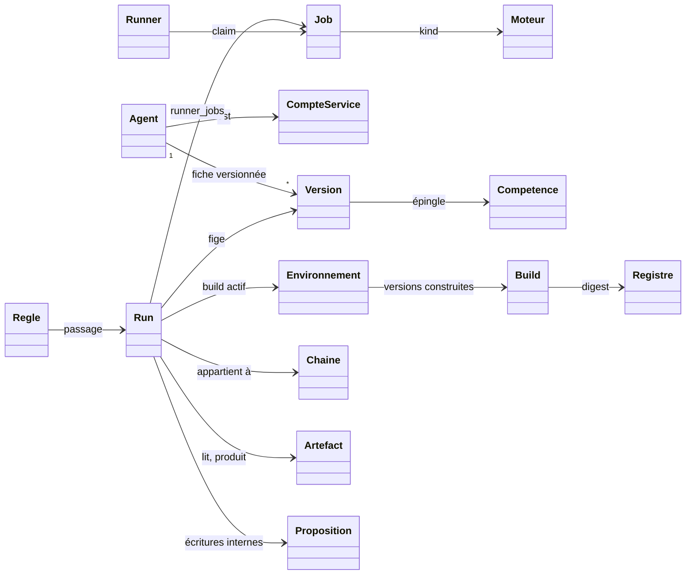

## 3. Fonctionnement

### 3.1 Run unifié et moteurs (D780–D786)

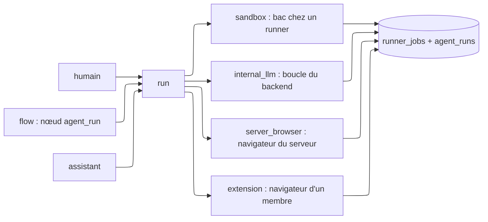

Chaque exécution est un run du même type. Seul le moteur change. La paire `runner_jobs` + `agent_runs` porte l'état, les dates et le plan. `GET /agent-runs` liste tous les moteurs, avec un filtre `engine`. Un passage de règle porte `rule` et `site` et s'ouvre dans le studio du site.

Seul `sandbox` est loué à un runner. `internal_llm` et `server_browser` tournent dans le backend. `extension` est loué à un agent navigateur par sa WebSocket.

Le LLM vient en dernier (D785). Une tâche qu'une règle sait faire passe par une règle, pour une question de coût.

Un seul nœud de flow lance des runs : `agent_run`, qui joue un agent ou une règle (D786). Il rend l'identifiant du run aussitôt. Le nœud `agent_run_finished` reçoit la fin du run.

### 3.2 Agent : identité, fiche, droits (D378, D379, D757, D761)

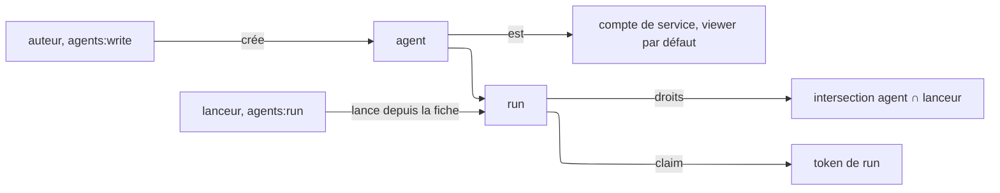

Créer un agent crée une identité IAM de service dans l'org. L'agent naît `viewer`. Son rôle peut monter jusqu'à celui de son auteur, jamais au-dessus. L'identité apparaît dans les membres et dans l'audit. Supprimer l'agent révoque l'identité. Ses runs gardent leur trace.

Un agent ne prend pas de siège humain. Le plafond `subscription_tiers.max_agents` limite leur nombre par palier.

Un run part de la fiche. La demande peut resserrer la fiche, jamais l'élargir (400 `above_agent`). Le run agit sous l'identité de l'agent, avec l'intersection des droits de l'agent et du lanceur.

Les droits viennent de la fiche, jamais du contenu lu (D381). Un texte lu par l'agent ne peut ni élargir ses outils, ni lever une porte, ni prolonger un budget.

### 3.3 Runner et file des jobs

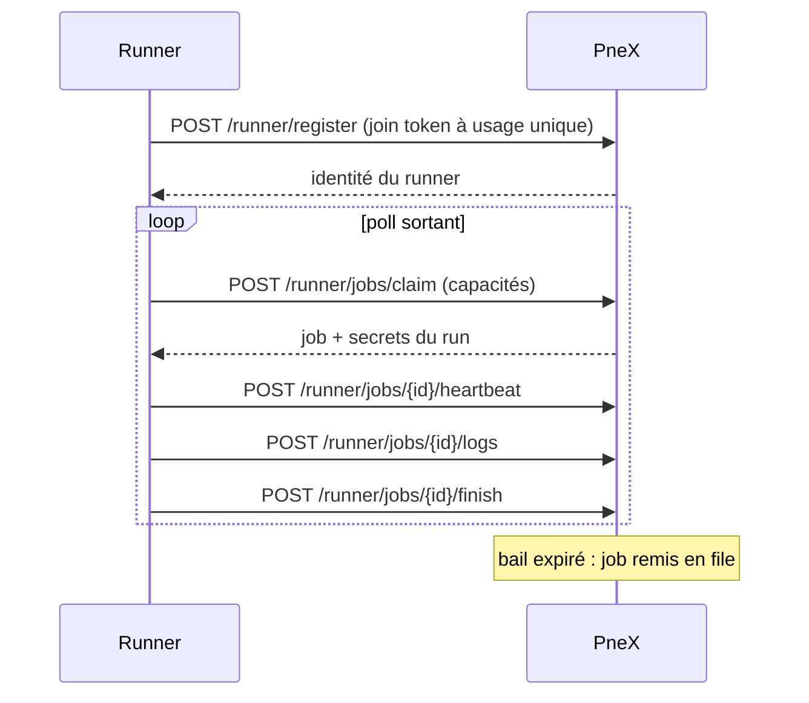

Le runner suit le modèle d'un runner de CI. PneX ne détient aucun kubeconfig ni accès à un hyperviseur (D386). Le runner tourne avec un compte de service limité à son namespace : pods, Secrets, `NetworkPolicy`, lecture de `pods/log`. Un runner sert un namespace, car il range son jeton dans le Secret `pnex-runner-token`.

Le runner annonce ses capacités (`sandbox:pod`, `sandbox:vm`, `builder:buildkit`…). Le serveur prend un job par `FOR UPDATE SKIP LOCKED`. Un bail et un heartbeat détectent un runner mort. Un job dont le bail expire repart en file.

Un arrêt humain passe le job en `stopped`. Le runner l'apprend au heartbeat suivant (409) et détruit le bac.

Kinds de job (`RunnerJobKind`) : `probe`, `environment_build`, `environment_scan`, `sandbox`, `server_browser`, `internal_llm`, `extension`.

Installation (D706, D764) :

| Cible | Installation | Unité d'un job |
|---|---|---|
| Kubernetes | chart `pnex-runner` de `pnex-deploy`, ou `deploy/runner/runner.yaml` sans Helm | pod |
| Hôte Linux | service systemd `deploy/runner/pnex-runner.service`, Podman rootless | conteneur (build et sonde seulement, D749) |
| Hôte Linux KVM | exécuteur `firecracker` du runner | micro-VM (D762) |

### 3.4 Environnements : build, registre, scan (D700–D704, D720, D728, D748)

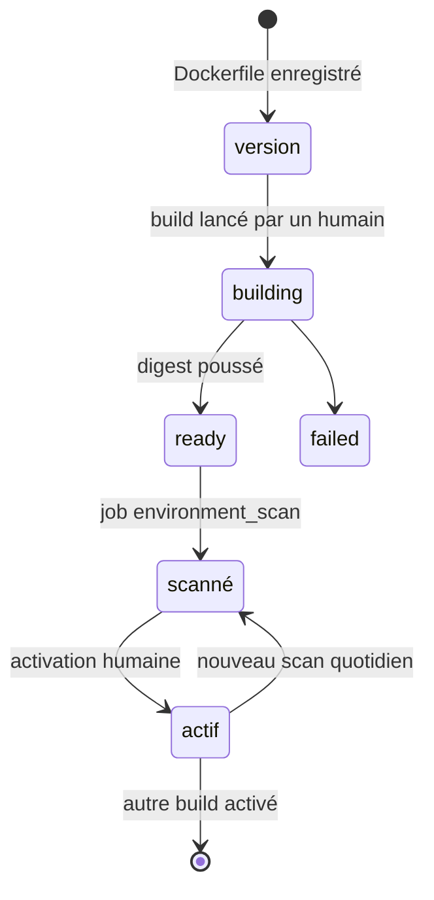

Le Dockerfile et ses fichiers de contexte texte vivent en PostgreSQL, plafonnés à 1 Mo (D702). Il n'y a pas de connecteur git pour un Dockerfile. L'éditeur utilise la coquille et l'historique de versions communs (D221, D222). Un secret détecté à l'enregistrement est refusé (`environment-secret-in-dockerfile`).

Un agent ou l'assistant peut écrire un brouillon. Lancer le build et activer restent des gestes humains.

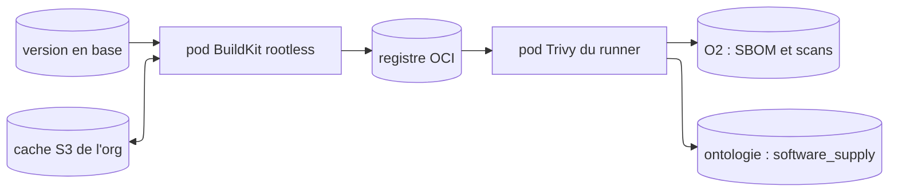

- **Build (D700, D701)** : un pod BuildKit rootless par build (`deploy/docker/image-builder.Dockerfile`, Wolfi). Il exige `seccomp` et AppArmor `Unconfined` et `allowPrivilegeEscalation`. Ce sont deux écarts à D387, propres au pod de build, avec un risque accepté. Les identifiants du build restent bornés à l'org.
- **Registre (D703)** : API Distribution v2 seule. Deux secrets distincts : écriture pour le pod de build, lecture pour le runner. Un bac ne peut jamais pousser. On exécute un digest, jamais un tag.
- **Image du builder** : le serveur exige une image épinglée `@sha256:`. Sinon le build répond 409 `environment-build-unavailable`.
- **Scan (D720)** : Trivy 0.68.2 du paquet Wolfi, épinglé, dans un pod du runner, jamais dans `pnex-server`. Scan au build, puis chaque jour sur le build actif. V1 relit l'image dans le registre.
- **Seuil (D748)** : une faille critique corrigeable est signalée par défaut. L'org peut choisir `refuse` (`environment-scan-refused`) et un seuil `critical`, `high` ou `none`.
- **SBOM (D728)** : document CycloneDX de Trivy dans le stream O2 `environment_sboms`, scans dans `environment_scan_events`. Objets `software_image`, `software_bom`, `software_component` (clé `purl`), `software_vulnerability` dans le pack `software_supply`. 20 000 composants par image au plus.
- **Isolation (D763)** : un environnement porte `isolation` (`pod` par défaut, `vm`). Un run `vm` attend un runner VM libre, il ne retombe jamais sur un pod.

**Attention :** Trivy a subi une compromission de sa chaîne de publication en mars 2026 (CVE-2026-33634). Utilisez seulement le paquet Wolfi épinglé, jamais un tag mobile ni une publication de l'éditeur.

### 3.5 Bac à sable : préparation et run (D705, D712, D714, D717, D731, D758)

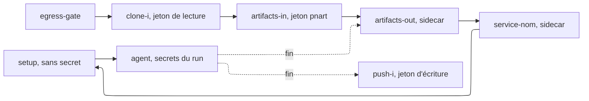

Un pod existe le temps d'un run, jamais plus (D712). Les init containers préparent le pod avant l'agent. Chaque secret va à un seul conteneur :

| Conteneur | Reçoit | Fait |
|---|---|---|
| `egress-gate` | rien | attend que la `NetworkPolicy` s'applique (SEC-E4) |
| `clone-<i>` | jeton de lecture du dépôt | `git clone` de la ref. Le jeton ne reste ni dans `.git/config` ni dans le workspace |
| `artifacts-in` | jeton `pnart_` | télécharge les entrées, compare leur SHA-256, restaure les caches |
| `artifacts-out` | jeton `pnart_` | sidecar natif : envoie les sorties à la fin de l'agent |
| `service-<nom>` | mot de passe généré | service de test (Postgres, Valkey…) sur `localhost` (D717) |
| `setup` | variables non secrètes | commande de préparation (`npm ci`, `cargo fetch`…) |
| agent | secrets du run, token de run | le travail, dans le volume `workspace` |
| `push-<i>` | jeton d'écriture du dépôt | sidecar : pousse la branche à la fin (§3.10) |

`setup` exécute du code du dépôt. Il tourne donc sans secret et avant l'agent.

Secrets (D705) : la fiche liste chaque secret. Le runner crée un Secret Kubernetes propre au run. Le pod le lit par `secretKeyRef`. Le runner le détruit à la fin. L'agent peut lire ses secrets, donc il peut les divulguer. L'egress en liste blanche et la durée de vie le bornent.

Trois environnements ne se mélangent jamais : serveur (secrets de la plateforme), runner (son identité), bac (secrets du run). Aucun secret de la plateforme n'entre dans un bac (R6).

Dépôts et services (D758) : `repos: [{url, ref, path, secret_id?, push_secret_id?}]` en `https` seul, sans identifiant dans l'URL. `services: [{name, image, env, ready_command, data_paths}]`, image épinglée par digest. `@generated` devient un mot de passe frais, livré à l'agent en `<SERVICE>_<CLÉ>`. **Jamais de données de prod** dans ces services.

Egress (D731, D754) : le serveur résout au claim l'adresse de la passerelle et des forges. Le runner ajoute ses propres réponses DNS (`resolve_here`). Une `NetworkPolicy` ne connaît que des adresses : une destination nommée passe par ses plages publiées. Un proxy par nom viendra seulement sur un cas réel, comme composant du runner.

#### Micro-VM Firecracker (D749, D762, D763)

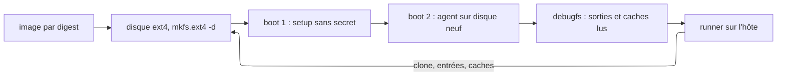

Une VM partagée n'exécute que des builds et des sondes : Podman rootless ne tient pas l'egress d'un conteneur sans root. Le bac sur VM passe par une micro-VM Firecracker, détruite à la fin du job.

- Le runner clone et tire entrées et caches côté hôte. Aucun jeton (clone, artefacts) n'entre dans la VM.
- L'agent repart d'un disque neuf de l'image. Seuls l'espace de travail et les caches reviennent. `setup` ne peut rien changer à ce qui tourne avec les secrets.
- Réseau : une tap et une /30 par VM, une table nftables par VM côté hôte (destinations du claim et résolveur seuls).
- Le runner lit la console série comme `pods/log`. Il lit les sorties par `debugfs`, sans montage ni root, sans suivre les liens.
- Un job détruit envoie encore ses sorties pendant `COLLECT_GRACE_SECS` (5 min), en tâche de fond.

L'hôte doit porter `firecracker`, `mkfs.ext4`, `debugfs`, `nft`, `ip`, `git`, `curl`, `tar`. Le service du runner doit avoir `CAP_NET_ADMIN`, `/dev/kvm` et `/dev/net/tun`. Sans `CAP_NET_ADMIN`, il prend seulement des jobs sans réseau.

### 3.6 Passerelle LLM (D383–D385, D709, D710, D732)

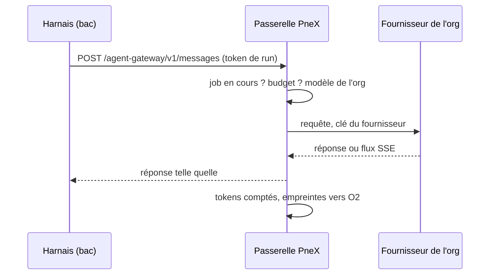

La clé du fournisseur n'entre jamais dans le bac (D385). Le bac reçoit le token de run sous les noms qu'un harnais standard attend :

| Variable | Valeur |
|---|---|
| `PNEX_GATEWAY_URL`, `ANTHROPIC_BASE_URL`, `OPENAI_BASE_URL` | adresse de la passerelle, en clair |
| `PNEX_RUN_TOKEN`, `ANTHROPIC_API_KEY`, `OPENAI_API_KEY` | token de run, par le Secret du run |

- **Fournisseur** : clé propre de l'agent (`provider_id`, D710), sinon l'usage `agent`, sinon le défaut de l'org. La passerelle remplace le `model` du harnais par celui de l'org.
- **Protocoles** : Anthropic et OpenAI-compatible, sans traduction. Un écart rend `agent-gateway-protocol-mismatch`.
- **Budget** : `llm_calls_max` par run (200 par défaut, 10 000 au plus) et compteur quotidien `llm-agent` par org (`settings.ai.agent_daily_calls`, 5 000). Ce budget ne touche ni l'assistant ni les flows (D384).
- **Journal (D709)** : un événement par appel dans le stream O2 `agent_llm_calls` : run, fournisseur, modèle, statut, tokens, latence, empreintes SHA-256 de la requête et de la réponse. Jamais le contenu.
- **Limites** : corps de 8 Mo au plus, client HTTP sous la garde d'egress R8, sans redirection.
- **Adresse** : `PNEX_AGENT_GATEWAY_URL`, sinon `https://$PNEX_PROD_HOST`. Sans elle, le job échoue au claim.

PneX ne livre aucun harnais et n'en propose aucun par défaut (D750). L'org installe le sien dans son Dockerfile, sous sa propre licence.

### 3.7 Artefacts et caches (D729, D730, D744)

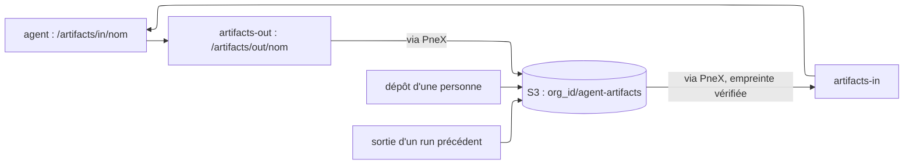

S3 est le seul stockage entre deux runs. Aucun volume n'est partagé, aucune donnée ne reste sur un nœud. Le bac n'a jamais d'accès S3 : PneX transporte tout, ce qui garde le journal complet et le même code sur pod et sur VM.

- **Déclaration** : `inputs: [{name, artifact_id}]`, `outputs: [{name, required}]`, 16 de chaque au plus, noms `[a-z0-9-]`. Les chemins sont fixes : `/artifacts/in/<nom>`, `/artifacts/out/<nom>` (`PNEX_ARTIFACTS_IN`, `PNEX_ARTIFACTS_OUT`).
- **Jeton `pnart_…`** : frappé au claim, distinct du token de run. Il va seulement aux conteneurs de transfert. Il ouvre `GET /agent-transfer/inputs/{nom}` et `PUT …/outputs/{nom}` des noms déclarés, tant que le job tourne. Une sortie s'envoie une fois (409 ensuite).
- **Forme** : un fichier tel quel, un dossier en tar de ses seuls fichiers réguliers. Un lien symbolique est ignoré.
- **Fin** : une sortie non envoyée passe `missing`. Une sortie `required` absente fait échouer le run (`agent-run-output-missing`). Un dépassement refuse l'artefact entier (`agent-artifact-too-large`).
- **Lecture** : métadonnées avec `agents:read`. Contenu en pièce jointe, `nosniff`, avec `agent-artifacts:read` (Member). Un artefact peut contenir un secret.

Caches de dépendances (D730) : `caches: [{name, path, key_files}]`. La clé est le SHA-256 des fichiers de verrou, après le clone. `artifacts-in` restaure l'archive de la clé, sinon la dernière du même nom. Le collecteur sauvegarde, sauf si la clé existe déjà. Chemin `org_<id>/depcache/<env>/<nom>/<clé>`.

Cache des couches d'image : `org_<id>/buildcache/<environnement>/`, mode `max`. Le serveur demande à S3 (STS `AssumeRole`) des identifiants temporaires limités à ce préfixe. Seul le pod de build parle à S3. Sans STS ou sans `PNEX_BUILD_CACHE_ENDPOINT`, le build tourne sans cache.

**Danger :** un cache écrit par du code non fiable est relu par le run suivant. Gardez un cache par org et par environnement, jamais partagé entre orgs.

### 3.8 Journal d'un job (D719, D733, D759)

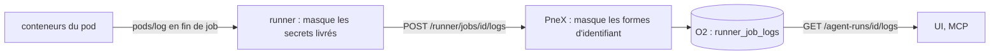

Le runner lit le journal à la fin du job, quelle qu'elle soit, avant la destruction. Il lit chaque conteneur dans l'ordre où il a tourné. Bornes : 4 000 dernières lignes et 256 Kio par conteneur, 32 conteneurs, ligne coupée à 16 Kio.

Le masquage se fait deux fois. Le runner remplace chaque secret livré au claim. PneX remplace ensuite toute forme d'identifiant connue (`pnagr_`, `ghp_`, `sk-`, `AKIA`…) et les blocs de clé privée.

L'envoi se fait au mieux : un échec n'empêche jamais le résultat du job. Après un arrêt humain, le serveur prend encore les logs pendant dix minutes. Sans O2, la lecture rend 503 `agent-run-logs-unavailable`. Les logs d'un build se lisent sur `GET /environments/{id}/builds/{build}/logs`.

### 3.9 Chaînes de runs et flows (D713, D716, D718, D765–D768)

Deux niveaux de boucle existent. **Dans** le run, le LLM décide. **Entre** les runs, un flow déployé par un humain décide de façon déterministe. Le nœud `agent_run` lance un run et rend son id. Le nœud `agent_run_finished` reçoit la fin d'un run. Aucun flow n'attend en mémoire.

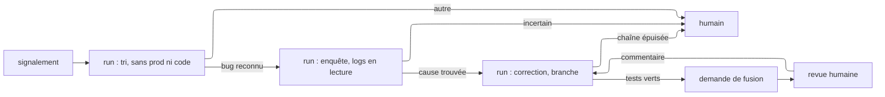

Chaque étape a son environnement et sa fiche, au plus juste. L'agent qui lit un ticket écrit par un tiers ne touche ni à la prod ni au code. Les objets de l'ontologie servent de mémoire entre les étapes, pas le contexte LLM.

Règles d'une chaîne :

- Toute exécution lancée par un flow appartient à une chaîne.
- Bornes fixées à l'ouverture : `runs_max` (10), `llm_calls_max` (500, toutes exécutions), `rounds_max` (3 passages d'un même agent). Une borne atteinte refuse le départ (`agent-chain-exhausted`, `args.reason`). La chaîne reste active et un humain reprend.
- Une exécution à la fois par chaîne (`agent-chain-busy`, 409).
- Le sujet est une clé libre de 200 caractères, tenue par la chaîne active (index unique partiel). Un départ sur un sujet tenu ne lance rien : le nœud répond `joined`, la route HTTP rend 409 `agent-subject-taken` avec `args.chain_id`.
- Un humain libère le sujet par `POST /agent-chains/{id}/close` (`agents:stop`).

Entrées d'une exécution lancée par un flow : `inputs` lit un id d'artifact dans le message. `texts` lit un texte du message (64 Kio au plus), par exemple la description d'un ticket. Le serveur garde ce texte comme artifact d'entrée, écrit au nom de la personne qui a déployé le flow (D1052). Dans l'autre sens, le message de fin d'exécution donne `texts` : le texte de chaque sortie UTF-8 de 64 Kio au plus. Un flow peut ainsi poster le rapport ou les questions d'un agent sans lire l'artifact (D1053). Le droit de lire un artifact est au niveau membre, comme le déploiement d'un flow : `texts` n'ouvre aucun accès nouveau.

Droits d'un flow (D768) : le déploiement retient `flows.deployed_by` et exige `agents:run` pour chaque nœud `agent_run`. À chaque message, le backend relit le graphe déployé et revérifie `agents:run` de cette personne. Si elle perd ce droit, le flow ne lance plus rien. La fin d'un run est publiée une fois (`agent_runs.finished_event_at`), après la projection `agent_ops`.

### 3.10 Sortie en branche (D388, D752, D775)

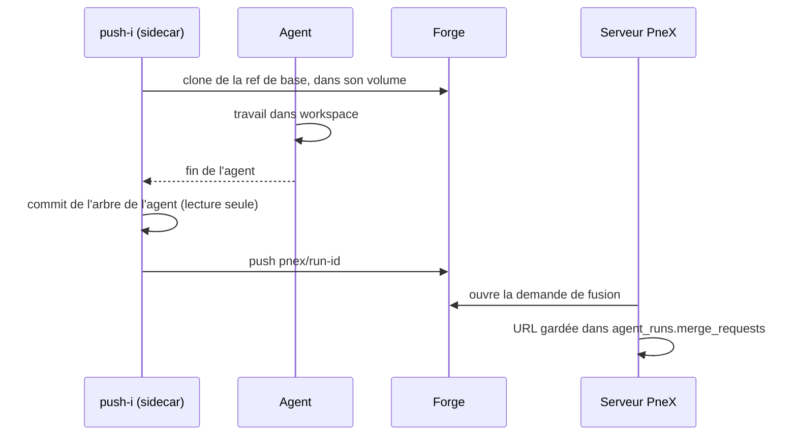

Un dépôt peut porter `push_secret_id`, un jeton d'écriture limité à ce dépôt. Seul le sidecar `push-<i>` le reçoit. Git ne tourne jamais dans le `.git` de l'agent : hooks, `credential.helper` ou `url.insteadOf` pourraient détourner le jeton. Les liens symboliques sont stockés comme liens, jamais suivis.

La branche est toujours `pnex/run-<id>`, jamais la branche de base ni une branche choisie par l'agent. La fusion reste un geste humain. `services/forge.rs` parle à GitHub sur `github.com` et à GitLab sur tout autre hôte `https` (D1051). Le jeton va seulement à l'hôte du dépôt, sous la règle de sortie de l'org (R8). Sur micro-VM, le runner lit l'arbre par `debugfs` et lance le même script côté hôte.

### 3.11 Agent interne (D785)

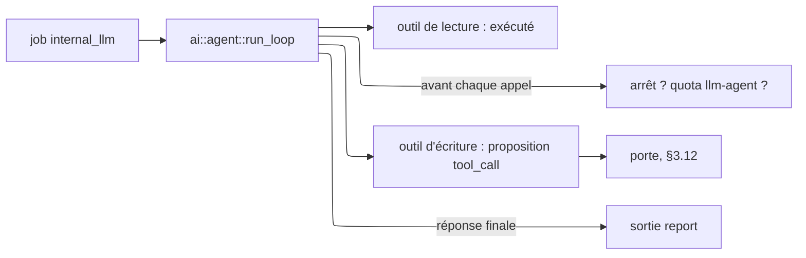

Un agent `internal` tourne dans le backend (`services/internal_agents.rs`), jamais chez un runner. Le bail vaut la durée du run plus 2 min.

- **Fiche** : `tools` (noms du registre de l'assistant), `max_steps` (20 par défaut, de 1 à 50). Un agent lecteur ne reçoit aucun outil d'écriture (`write_needs_member`). Un champ du bac est refusé (`hosted_only`).
- **Boucle** : celle de l'assistant, sous une politique. Même outil et mêmes arguments trois fois : échec `agent-loop-detected`.
- **Entrées** : le texte des fichiers d'entrée (64 Kio chacun au plus, balisé comme donnée) est la tâche. Les compétences épinglées sont les consignes.
- **Journal** : envoyé dans O2 après chaque appel au modèle et chaque outil, donc lisible pendant le run.
- **Planification** : un flow avec un `inject` périodique et le nœud `agent_run`. La fiche n'a pas d'horaire propre.

Un backend tué rejoue le run depuis le début après l'expiration du bail : les étapes reprenables (D397) n'existent pas.

### 3.12 Porte de validation (D833–D840)

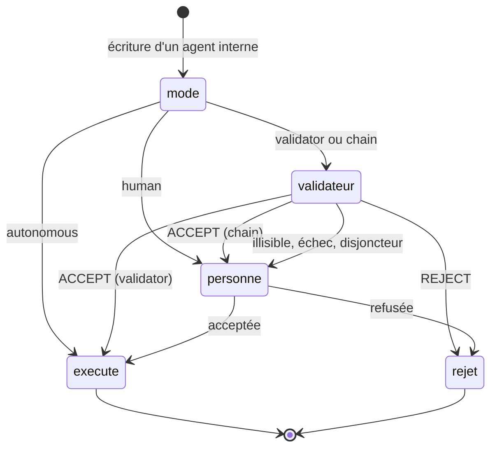

Chaque écriture reste une proposition `tool_call`, même en autonome, pour un journal complet des décisions. Un agent hébergé n'écrit pas dans PneX : la porte ne le concerne pas.

- **Mode par outil (D833)** : `AgentSpec.gate` associe un outil d'écriture à `human` (défaut), `autonomous`, `validator` ou `chain`.
- **Droits (D834)** : une écriture autonome, ou acceptée par le validateur, s'exécute par `tools::execute` avec le compte de service de l'agent demandeur. Mêmes validations, mêmes 409. Une décision humaine s'exécute avec les droits de la personne.
- **État (D835)** : la porte vit dans les `values` de la proposition (`gate`, `gate_stage`, `validator`), pas dans des colonnes. La boîte « À valider » reste inchangée.
- **Validateur (D836)** : `AgentSpec.validator_id` désigne un agent interne de l'org. La demande lui arrive en fichier d'entrée `request`, balisé comme donnée. La première ligne de sa réponse dit `ACCEPT` ou `REJECT`. Il ne modifie jamais la demande.
- **Séparation (D837)** : le validateur n'est ni le demandeur, ni un agent de la chaîne du run demandeur. Sinon, la demande va à une personne.
- **Jamais délégable (D838)** : un outil dont la permission relève de `iam`, `secrets`, `governance`, `devices`, `controls` ou `ota`, ou dont le verbe est `delete` ou `purge`, prend seulement `human` (`not_delegable`).
- **Disjoncteur (D839)** : plus de 30 décisions dans l'heure, ou 20 acceptations d'affilée depuis le réarmement. Le validateur est alors déclenché (`agents.validator_tripped_at`). Ses demandes vont à une personne jusqu'au réarmement (`POST /agents/{id}/validator/rearm`).
- **Lecture non fiable (D840)** : un run qui a lu un contenu extérieur (`UNTRUSTED_TOOLS`) ne fait plus d'écriture `autonomous`. Elle passe à une personne.

Une personne peut toujours décider avant le validateur. Une demande en attente n'expire jamais : le contrôle de version protège d'une écriture périmée.

### 3.13 Compétences (D711, D770–D774)

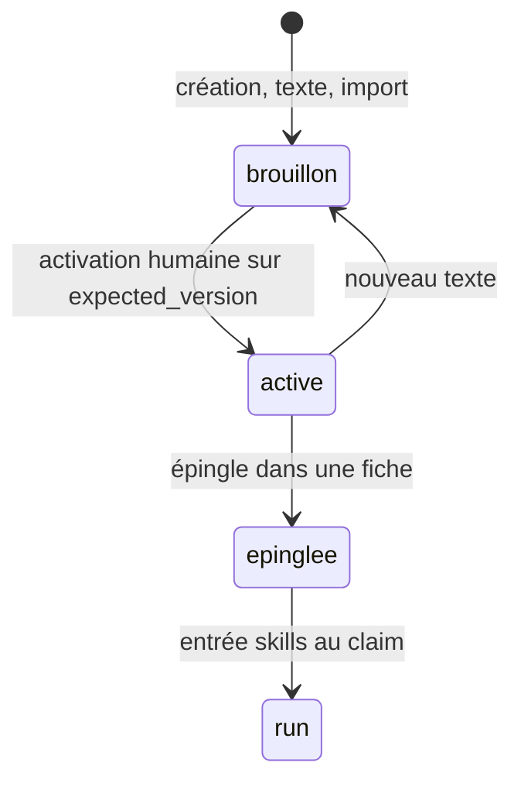

Une compétence est du texte stocké et versionné en base (`agent_skills`, `agent_skill_versions`). V1 couvre la saisie et l'import d'un fichier dans l'UI. Le navigateur lit le `.md` et l'envoie comme nouveau texte. Le format `SKILL.md` n'est pas analysé.

- Toute écriture crée un brouillon. `POST /agent-skills/{id}/activate` prend `number` et `expected_version` et exige `agents:write`. L'activation n'est jamais un outil MCP.
- La recherche de secrets tourne à l'écriture et à l'activation (`agent-skill-secret`, 422).
- Une épingle `{ skill_id, version }` vit dans la fiche (`spec.skills`, 20 au plus). Le départ d'un run revérifie l'épingle.
- Le run reçoit les compétences épinglées comme entrée `skills`, forme tar : `/artifacts/in/skills/<nom>.md`, mode 0444. L'archive est relue en base, rien ne passe par S3. Cette entrée remplace le conteneur `bundle` prévu par D714.
- Un agent interne lit les compétences comme consignes, sans script.

**Danger :** une compétence est chargée à chaque run. Un texte piégé devient une injection permanente. N'activez jamais une compétence sans lire son diff.

### 3.14 Règles de navigation (D323–D328, D789, D790)

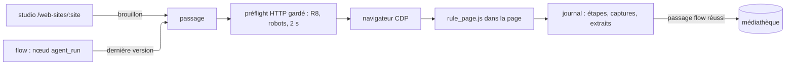

Une règle est du YAML rangé sous un site (`site_recipes`, `version` incrémentée, 409 `site-recipe-version-conflict`). `pnex_core::site_recipe` la valide, côté client et côté serveur. Les violations rendent `{path, token}` sous `site-recipe-invalid`. Une règle n'est jamais livrée par un pack d'ontologie.

Format :

| Clé | Contenu |
|---|---|
| `name`, `site` | nom unique par site, hôte normalisé (schéma, port, `www.` et chemin retirés) |
| `allow_hosts` | 10 hôtes au plus |
| `params` | 10 au plus, `{{nom}}` dans les étapes |
| `browser` | navigateur nommé de l'org |
| `session: required` | la règle exige un utilisateur connecté (§3.15) |
| `captures` | rétention des fichiers : `none`, `days:N`, `keep` (défaut `days:30`) |
| `steps` | 60 au plus |

Actions fermées : `open`, `click`, `scroll`, `wait` (15 s au plus), `follow_pdf`, `extract` (`selector`, `between`, `all_text`, `cards`), `assert`, `type`, `press`, `for_each`. Une cible introuvable ou une vérification fausse arrête le passage, sauf avec `optional: true`.

- **`type` (D789)** : écrit seulement dans un champ de recherche. Un mot de passe, un champ d'identifiant ou d'adresse mail, ou un champ d'un formulaire avec mot de passe est refusé (`not-a-search-field`). `press` accepte `Enter`, `Tab`, `Escape`, `ArrowDown`, `ArrowUp`.
- **`cards` et `for_each` (D790)** : `cards` lit 50 cartes au plus, un sous-sélecteur par champ. `for_each` ouvre 10 liens au plus d'un extrait `cards`, sur le site seulement, avec 10 étapes au plus, sans `open` ni boucle. Les extraits s'appellent `<as>.<n>`.
- **Code de page unique** : `pnex-core/js/rule_page.js` porte toutes les fonctions qui tournent dans la page. Le navigateur du serveur l'évalue par CDP, l'extension l'importe. Les deux moteurs ne divergent pas sur l'effet d'une étape.

Navigateur du serveur (D325) : Chrome headless-shell (service `browser` du compose), piloté par un client CDP maison (`services/site_recipes/cdp.rs`). Résolution : navigateur nommé par la règle, puis défaut de l'org (`browser_endpoints`), puis navigateur de la plateforme (`PNEX_BROWSER_URL`, `PNEX_BROWSER_TOKEN`). Une adresse d'org passe la garde de sortie R8. Chaque passage a un contexte de navigation neuf. Chaque appel de mise en route est borné à 20 s : un navigateur muet donne `browser-unavailable`.

Studio (D324) : coquille d'éditeur commune et lecteur commun (D220). La capture de l'étape choisie occupe la scène. Une frise montre un couloir Étapes et un couloir Extraits. La colonne de droite porte les onglets Règle (blocs), Code (YAML) et Extraits (diff avec le passage précédent). Le studio offre aussi :

- **Versions** (`site_recipe_versions`) : ouvrir, comparer, rétablir.
- **Reprendre à l'étape N** : rejoue le brouillon depuis l'étape N, sur la page atteinte après l'étape N−1.
- **Vue en direct** : capture du navigateur toutes les 1,5 s dans Valkey (`pnex:site-recipe:live:<run>`, 20 s de vie), servie par `GET /navigations/{id}/live`.
- **Assistant** : outils `list_site_recipes`, `get_site_recipe`, `get_site_recipe_run`, `try_site_recipe`, `propose_site_recipe`. Les extraits arrivent au modèle entre balises `<data>` (D208). Une proposition s'ouvre en brouillon non enregistré.

Règle dans un flow (D327, D786) : le nœud `agent_run` porte `recipe_id` et `params` à la place d'un agent. Le backend lit la règle dans la version déployée du flow et joue sa dernière version enregistrée. Le nœud n'attend pas la fin : le port 0 rend le run, le port 1 rend un refus. À la fin du run, le nœud `agent_run_finished` reçoit son `outcome` :

- `passed` : le passage a réussi.
- `failed` : le passage a échoué.
- `broke` : le passage a échoué juste après un passage `flow` réussi.

Un filtre `recipe_id` et un filtre `outcome` choisissent les fins reçues. Une notification « une fois quand ça casse » se câble derrière un `agent_run_finished` filtré sur `broke`. Le message porte `extracts` (texte par extrait) et `outputs` (média par extrait). Un run de règle n'appartient à aucune chaîne. `GET /pipelines/{id}/flows` donne les 5 prochaines dates depuis les inject en amont.

À chaque passage `flow` réussi, chaque extrait devient un média `document`. Une nouvelle version naît seulement si le SHA-256 change. Un pruner horaire supprime captures et PDF au-delà de la rétention `captures`. Étapes, extraits texte et journal restent.

Journal (D326) : une vue `recipe_runs` présente les passages au studio, au nœud et à la reprise. Les étapes partent aussi dans `runner_job_logs` (conteneur `browser`). Un passage resté `running` au-delà de 11 min est montré `interrupted`.

### 3.15 Moteur extension et routage (D782, D783)

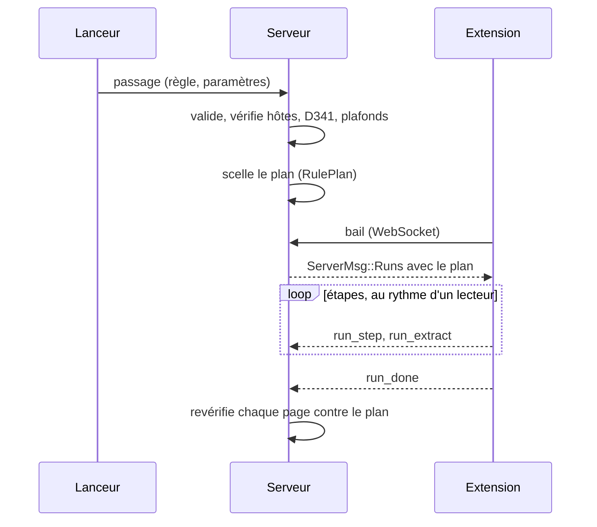

L'extension n'a aucune configuration et ne fait aucun aller-retour de validation pendant un passage. Le serveur valide au lancement et revérifie au retour. Une étape hors du site et des hôtes permis termine le passage en `off-site`. Un extrait hors plan ou d'un profil opposé (D341) est écarté.

Routage : le lanceur peut forcer un moteur. Sinon une règle `session: required` part sur une extension, et les autres sur le navigateur du serveur. Un passage que le site bloque sur le serveur (429, ou 403 sur l'étape) repart en file pour une extension sous le même id, sauf si le lanceur a forcé `server_browser`.

- Un job `extension` attend 30 min en file. Il est loué au navigateur du lanceur, sinon à un navigateur commun de l'org (D550). Un passage à la fois par navigateur, bail de 2 min renouvelé par chaque message.
- Refus immédiat sans navigateur appairé (`site-recipe-no-agent`) ou au-delà de 100 passages par jour et par org (`site-recipe-daily-cap`).
- Le nœud de flow joue une règle à session sur un navigateur commun et attend 18 min au plus.
- L'assistant ne joue jamais une règle à session (`site-recipe-needs-session`).
- Un site non autorisé par l'utilisateur termine le passage en `permission-missing`. `follow_pdf` reste au navigateur du serveur.
- Pas de capture d'écran ni de fichier stocké pour un passage d'extension.

Les captures de profils et de listes de salariés passent par des règles jouées par les pipelines du pack `prospecting_b2b` (`pipelines.md`). La recherche d'une personne par la barre de recherche (D784, D788) suit D998 : le pipeline cherche, ouvre et extrait, les flows du pack scorent et écrivent (`operational-platform.md` D998, T3). Les types de mission restants de l'extension sont dans `browser-agents.md`.

### 3.16 Ontologie : packs `agent_ops` et `software_supply` (D708, D728)

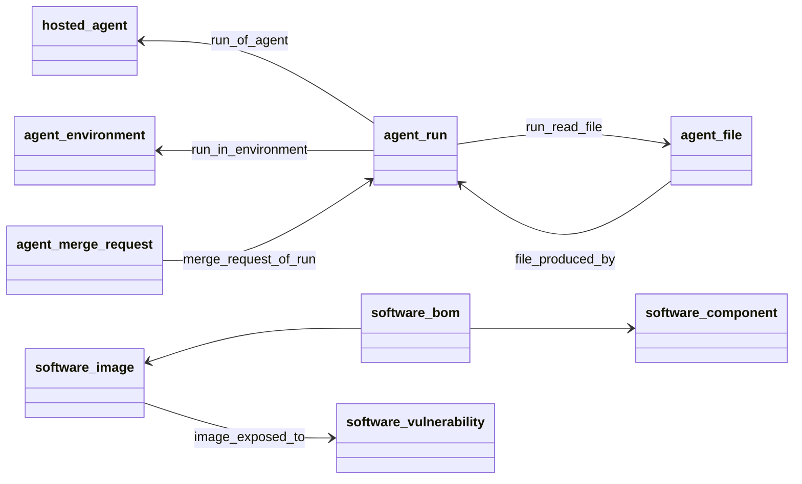

Les tables restent la source de vérité des états. Le service projette l'objet à la fin de chaque job et à l'arrêt. Les deux packs s'installent au premier usage. Une étape ou un appel d'outil n'est pas un objet : l'objet `agent_run` porte le résumé et renvoie au journal O2. Ce résumé donne le début, la fin, la durée, les appels au modèle et les tokens. Chaque demande de fusion ouverte par le run devient un objet `agent_merge_request`, relié au run. La demande de fusion est ouverte avant la projection, donc la projection la voit (pack 1.1.0).

### 3.17 Recette locale (D760)

La chaîne complète tourne sur le poste, sans faux runner, par la CLI `pnex` seule.

| Pièce | Où |
|---|---|
| Cluster | `kind`, nommé `pnex-agents`. kindnet applique les `NetworkPolicy`, avec quelques secondes de délai |
| Registre | conteneur `registry:3` `kind-registry` sur le réseau `kind`, exposé en `127.0.0.1:5001` (HTTP, `hosts.toml` sur le nœud) |
| Runner | namespace `pnex-agents-test`, `deploy/runner/runner.yaml`, avec `PNEX_RUNNER_SERVER_URL`, `PNEX_RUNNER_ALLOW_HTTP=1`, `PNEX_RUNNER_BUILDS=true`, `PNEX_RUNNER_JOB_EGRESS` |
| Serveur | `pnex-server start --server-and-worker -b 0.0.0.0 -p 5160`, base `pnex_agents_dev`. La stack sur `:5150` n'est pas touchée |
| Images de test | `pnex/sandbox-init`, `pnex/image-builder`, épinglées par digest, jamais livrées |
| Fournisseur LLM | faux fournisseur Anthropic local, ou des clés de test (D751) |

Variables du serveur : `PNEX_AGENT_GATEWAY_URL` (joignable depuis les pods), `PNEX_SANDBOX_INIT_IMAGE`, `PNEX_IMAGE_BUILDER`, `OPENOBSERVE_ROOT_EMAIL`, `OPENOBSERVE_ROOT_PASSWORD`.

Procédure :

1. Obtenez un jeton par mot de passe auprès du Rauthy de la stack. Rangez la session dans un dossier à part (`XDG_CONFIG_HOME`).
2. Créez un join token (`pnex runners join-tokens-create`), puis le Secret `pnex-runner-join`, puis déployez le runner.
3. Créez le registre (`pnex image-registries create`), sans TLS, avec un secret d'écriture factice.
4. Créez l'environnement, une version, un build, puis activez le build (`pnex environments …`).
5. Déclarez le fournisseur LLM sur l'usage `agent` (`pnex ai providers-create`).
6. Déposez le ticket d'entrée (`agent-artifacts-upload --name ticket`).
7. Lancez le run avec `inputs` et `outputs` (`pnex agent-runs create`).
8. Lisez le run, son journal, ses artefacts et leur contenu.

L'agent de test n'embarque aucun harnais. Il doit prouver ces points :

- Son entrée a la même empreinte que le dépôt.
- Le jeton qu'il imprime apparaît `[masked]` dans le journal.
- L'appel au modèle passe par la passerelle, avec le modèle de l'org.
- Une sortie réseau interdite est refusée.
- Un fichier et un dossier remontent, même si l'agent échoue.
- Un lien symbolique vers `/etc/passwd` est absent du tar.
- Une sortie déclarée absente est `missing`.

La même procédure tourne sur le cluster, dans le namespace `pnex-agents-test` seul (D753).

### 3.18 Fabric de workers (proposition non construite)

La fabric généralise les workers : un seul binaire, des capacités annoncées, un routage par capacités, un enregistrement par join token. Le runner (§3.3) en est la seule partie construite. Les workers de file (`build_firmware`, `stitch_panorama`) tournent encore dans le serveur (`pnex-server start --worker`).

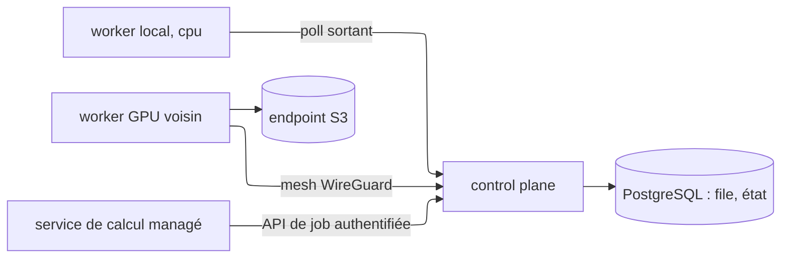

Principes retenus par la proposition :

- La localisation d'un worker est une configuration, pas une variante de code.
- Le mode de communication suit la frontière de confiance. Même propriétaire : mesh privé. Frontières différentes : API de job authentifiée, sans base partagée. Jamais de PostgreSQL exposé sur Internet.
- Le worker interroge le control plane en sortant, jamais l'inverse.
- PostgreSQL est la source de vérité. Le pilotage par fichiers (GitOps) et par l'UI écrivent par la même API.
- La progression d'un job passe par O2, pas par la file.
- Le plancher GPU est Vulkan, pas CUDA.
- La fabric enregistre et route. Elle ne provisionne pas l'infrastructure (pas de fleet manager). La livraison logicielle est un produit distinct (D562).

### 3.19 Traces, évaluations, reprise, boucle, budget (proposition non construite, D1031–D1037)

Le benchmark du 2026-11-24 (`docs/journal/bench/agents-ops-correlation.md`) compare PneX aux outils d'agents connus. Le lancement planifié avec harnais, compétences et secrets existe déjà : un flow avec `inject` périodique et le nœud `agent_run`. Les manques ci-dessous sont retenus par Shan le 2026-11-24, après dix fiches détaillées. Un organigramme d'agents a été écarté le même jour : un rôle n'est qu'une compétence, la délégation est un flow, le budget existe par chaîne et par run.

```mermaid
---
config:
  layout: elk
---
flowchart LR
  run[run] --> tr[trace en arbre]
  tr --> o2[(O2)]
  tr --> otlp[export OTLP de l'org]
  cas[Table de cas] --> camp[campagne d'évaluation]
  camp --> run
  run --> ev[évaluateurs : règle, LLM-juge, humain]
  ev --> sc[scores par version]
  run --> ck[checkpoint par étape]
```

- **Trace en arbre (D1031)** : un run devient une trace. Chaque appel au modèle, chaque outil, chaque passage de la porte et chaque run enfant devient une étape. Les noms suivent les conventions OpenTelemetry GenAI. Le contenu reste hors du journal, comme D709. La page du run montre l'arbre, la durée et les tokens de chaque étape.
- **Export OTLP (D1032)** : une org peut envoyer ses traces vers son propre collecteur OTLP. L'adresse passe R8 et le jeton vient du coffre. Le contenu n'est jamais exporté sans un réglage explicite de l'org.
- **Évaluation (D1033, précise D399)** : un jeu de cas est une Table (entrée, attendu). Une campagne joue une version d'agent ou de compétence sur chaque cas. Il y a trois évaluateurs :
  - une règle, qui est une fonction JS ou Starlark existante
  - un LLM-juge, qui est un agent interne comme le validateur (D836)
  - un humain, par la boîte « À valider ».

  Les scores se comparent entre versions et entre modèles (taux de réussite, coût, latence P50 et P95, répétitions). Chaque résultat garde une copie de l'entrée et de l'attendu du moment, donc un ancien résultat reste lisible. L'échantillonnage est déterministe (empreinte de la cible), et l'identifiant d'une évaluation vient de (évaluateur, cible), donc rien n'est payé deux fois. Le juge rend un score typé et sa justification, en sortie structurée. Un juge ne juge jamais un autre juge. Une campagne peut rejouer des sorties d'outil enregistrées, en plus des runs réels. Une correction humaine peut ajouter un cas à la Table. Une activation de compétence peut exiger une campagne réussie.
- **Reprise (D1034, précise D397)** : le moteur `internal_llm` enregistre chaque étape avant de lancer la suivante, jamais en différé. Un bail empêche deux backends de reprendre le même run. Les règles sont les suivantes :
  - Chaque appel d'outil a un identifiant fixe : l'empreinte de (run, étape, rang). Une contrainte d'unicité sur les propositions empêche une double écriture.
  - Un outil coupé en cours n'est jamais rejoué. Il reçoit l'erreur « interrompu », puis le modèle décide de la suite.
  - Une pause humaine se place entre deux étapes. C'est une proposition en attente, et le run dort.
  - La décision nomme chaque appel (`call_id`). Une réponse incomplète, en double ou périmée est refusée.
  - Un refus revient au modèle avec sa raison, pour qu'il change d'approche.
  - Le moteur `sandbox` reste relancé depuis le début, car le harnais tient son propre état.
- **Boucle (D1035)** : la boucle interne suit les règles suivantes :
  - Au dernier pas, le modèle ne reçoit plus d'outils. Il doit conclure, et le run ne finit pas sur un simple dépassement.
  - Le deuxième appel identique est refusé comme une erreur d'outil. Le troisième garde l'échec `agent-loop-detected`.
  - D'autres motifs d'agent bloqué s'ajoutent : même erreur trois fois, alternance A-B, messages sans action.
  - Un résultat d'outil est plafonné à 15 % du contexte. Le reste devient un artefact du run, et le modèle reçoit un aperçu et l'ordre de filtrer.
  - À 85 % du contexte, la boucle résume les anciennes étapes. Le journal garde tout, seule la vue envoyée au modèle rétrécit.
  - Le modèle voit le nom et la description des compétences. Il lit le texte d'une compétence à la demande.
  - Une source indisponible est citée au modèle avec son erreur, pour qu'il dise « intégration absente » au lieu d'inventer.
- **Budget en argent et file (D1036)** : un run réserve son budget en argent avant de partir. La réservation est revérifiée avant le premier appel au modèle. Un modèle sans prix connu est refusé, il ne compte jamais comme gratuit. Une alerte part à 80 %. À 100 %, l'arrêt est dur, et reprendre demande une décision humaine. Un frein par org coupe les runs automatiques après trop d'échecs ou de refus du fournisseur. Il ne coupe jamais un run lancé par une personne. Dans la file, un run humain passe d'abord, et un départ sur quatre va au run qui attend depuis le plus longtemps.
- **Porte des agents hébergés (D1037)** : une demande de permission du harnais tiers devient une proposition de la porte, comme une écriture d'agent interne. Le runner branche cette demande sur PneX quand le harnais l'accepte. Avant le validateur, un étage déterministe classe le risque par règles. Le risque déclaré par le modèle ne suffit jamais, car une injection peut le baisser.

## 4. Exigences

1. Un run doit avoir une seule forme (`runner_jobs` + `agent_runs`), quel que soit son moteur.
2. Un agent doit être un compte de service de l'org. Son rôle ne doit jamais dépasser celui de son auteur.
3. Une demande de run doit seulement resserrer la fiche de l'agent.
4. Les droits d'un run doivent venir de la fiche, jamais d'un contenu lu.
5. PneX ne doit détenir aucun kubeconfig ni accès à un hyperviseur.
6. Un bac doit exécuter une image par digest, jamais par tag.
7. Un bac ne doit jamais recevoir la clé d'un fournisseur LLM ni un secret de la plateforme.
8. Chaque secret d'un bac doit aller à un seul conteneur, et `setup` ne doit recevoir aucun secret.
9. Le bac ne doit jamais accéder à S3. PneX doit transporter les artefacts et les caches.
10. Le journal doit masquer les secrets livrés et les formes d'identifiant connues avant O2.
11. La passerelle doit imposer le modèle de l'org et compter chaque appel sur le budget du run et de l'org.
12. Le budget LLM des agents ne doit consommer ni celui de l'assistant ni celui des flows.
13. Un run `vm` ne doit jamais retomber sur un pod.
14. Lancer un build, activer un build, activer une compétence et fusionner une branche doivent rester des gestes humains.
15. Un agent ne doit pousser que `pnex/run-<id>`, par un conteneur qui ne partage pas le `.git` de l'agent.
16. Une chaîne doit tenir son sujet et ses bornes en base. Un doublon ne doit lancer aucun run.
17. Un flow ne doit lancer un run que si la personne qui l'a déployé garde `agents:run`.
18. Chaque écriture d'un agent interne doit passer par une proposition `tool_call` et par sa porte.
19. Un outil jamais délégable doit prendre seulement le mode `human`.
20. Une règle doit refuser toute saisie hors d'un champ de recherche, dans les deux moteurs.
21. L'extension doit jouer seulement le plan scellé par le serveur. Le serveur doit revérifier chaque page au retour.
22. Aucun agent ne doit agir sur le physique, déployer, arrêter ni supprimer (D123, D144, D391).
23. Les limites de la fabric doivent être des réglages globaux `settings.agents.*`, modifiables par un admin plateforme.

## 5. Décisions

État : ✅ codé, 🟡 en partie, ⬜ pas codé. Une décision levée dit ce qui l'a remplacée.

| # | Décision | État |
|---|---|---|
| D323 | Règle de navigation : YAML validé, rangé sous un site, versionné | ✅ |
| D324 | Studio `/web-sites/:site` : coquille, lecteur, versions, reprise, vue en direct, assistant | ✅ |
| D325 | Navigateur du serveur Chrome headless-shell par CDP maison, navigateurs d'org configurables | ✅ |
| D326 | Journal des passages. La table `site_recipe_runs` est remplacée par le run unifié (D781) | ✅ |
| D327 | Règle jouée par un flow, issue « cassé », dates à venir, extraits versés à la médiathèque | ✅ |
| D328 | Étape `llm_extract` optionnelle | ⬜ |
| D378 | Niveaux de confinement interne, hébergé, libre, affichés tels quels | 🟡 `hosted` et `internal` seuls |
| D379 | Agent = compte de service, token de run court, intersection des droits | ✅ (D757) |
| D380 | Politique versionnée, surcharge par run seulement en resserrant. Codée comme fiche d'agent | 🟡 |
| D381 | Les droits viennent de la fiche, jamais du contenu lu | ✅ |
| D382 | Run : états, heartbeat, journal O2, arrêt immédiat, interrupteur global | 🟡 pas d'interrupteur `PNEX_AGENTS_ENABLED` |
| D383 | Usage LLM `agent`, surchargeable par agent | ✅ (D710, D732) |
| D384 | Budgets LLM cloisonnés par usage et par run | ✅ (D732) |
| D385 | Passerelle unique, aucune clé de fournisseur dans un bac | ✅ |
| D386 | Runner par cluster, aucun identifiant de cluster dans PneX | ✅ |
| D387 | Isolation pod durci ou VM, jamais privilégié. Écarts propres au pod de build (D701) | ✅ |
| D388 | Agent codeur : branche et demande de fusion, jamais de fusion | ✅ GitHub (D775), GitLab (D1051) |
| D389 | Provenance `agent_run_id`, TTL, purge par geste humain | ⬜ |
| D390 | Délégation atténuante, équipes à budget partagé | ⬜ (D716 borne les chaînes) |
| D391 | Frontière physique et gestes réservés inchangés, amendés par D563 et D564 | ✅ |
| D392 | Contrat, IAM, MCP et fiches de l'assistant dans le même commit | ✅ |
| D393 | Placement explicite, jamais de repli silencieux | ✅ (D763) |
| D394 | Catalogue de harnais par org. Absorbé par les environnements (D704, D750) | levée |
| D395 | Rôles = consignes versionnées sans droit | ⬜ aucune bibliothèque en V1 (D756) |
| D396 | Compétences versionnées par org, activées par un humain | ✅ (D770–D774) |
| D397 | Run reprenable par étapes, écritures idempotentes | ⬜ |
| D398 | Déclencheurs par événement, dont le nœud de flow | 🟡 nœuds `agent_run` et `agent_run_finished` seuls |
| D399 | Évaluation avant promotion, `draft → canary → active` | ⬜ |
| D400 | File à priorités, équité entre orgs, repli de fournisseur | ⬜ |
| D401 | Journal d'audit en ajout seul et chaîné, export | ⬜ |
| D700 | BuildKit remplace buildah, image du builder sur Wolfi | ✅ |
| D701 | Dockerfile = code non fiable : pod rootless par build, risque accepté, cache par org | ✅ |
| D702 | Dockerfile et contexte en base, sans connecteur git | ✅ |
| D703 | Registre OCI : secrets d'écriture et de lecture distincts, exécution par digest | ✅ |
| D704 | Environnement versionné, qui absorbe le catalogue de harnais | ✅ |
| D705 | Secrets du run en variables par un Secret Kubernetes par run, masqués dans les journaux | ✅ |
| D706 | Un contrat d'exécution pour Kubernetes et VM | ✅ |
| D707 | Entrées et sorties d'un run par PneX. Seul git est un accès direct à un tiers | 🟡 pas de déclencheur Jira ni mail |
| D708 | Pack `agent_ops` pour les faits durables, étapes dans O2 | 🟡 sans version d'environnement, `started_by`, registre |
| D709 | Audit LLM : empreintes dès le départ, contenu chiffré plus tard | 🟡 niveau `metadata` seul |
| D710 | Une clé LLM par agent, au coffre | ✅ |
| D711 | Compétences stockées dans PneX : build, dépôt git, saisie | 🟡 saisie seule (D770) |
| D712 | Un pod par run, aucun pod d'agent permanent | ✅ |
| D713 | Un flow enchaîne des runs courts, sans superviseur LLM | ✅ |
| D714 | Bac préparé par des init containers. `bundle` remplacé par l'entrée `skills` (D770) | ✅ |
| D715 | Première cible interne. Droits par objet et masquage bloquent l'ouverture à un client réel | en vigueur |
| D716 | Chaîne de runs : identifiant, budget, nombre de tours | ✅ (D765) |
| D717 | Services de test dans le pod, mots de passe générés, jamais de données de prod | ✅ |
| D718 | Une clé de travail par sujet, tenue par la chaîne | ✅ (D766) |
| D719 | Logs collectés par le runner vers O2 | ✅ (D733) |
| D720 | Scan Trivy des versions d'environnement, au build puis chaque jour | ✅ |
| D728 | SBOM tracé dans l'ontologie, pack `software_supply` | ✅ |
| D729 | Artefacts déclarés en entrée et en sortie, transportés par PneX | ✅ (D744) |
| D730 | Cache S3 à deux niveaux : couches et dépendances | ✅ |
| D731 | Run = job `sandbox` sur le build actif, token frappé au claim | ✅ |
| D732 | Passerelle Anthropic et OpenAI, modèle de l'org imposé, budget, empreintes | ✅ |
| D733 | Journal d'un job en fin de job, masqué deux fois | ✅ |
| D744 | Artefacts V1 : chemins fixes, conteneurs de transfert, jeton `pnart_` | ✅ |
| D745 | Recette Scaleway : clés de lecture et d'écriture séparées, hors du dépôt | en vigueur |
| D746 | Reconstruction d'une version : geste humain en V1 | ✅ |
| D747 | Milieu fermé hors V1 | en vigueur |
| D748 | Seuil du scan : signaler par défaut, refuser en option | ✅ |
| D749 | Pas de bac sur une VM partagée | ✅ |
| D750 | Harnais au choix de l'org, aucun livré. Protocoles Anthropic et OpenAI garantis | ✅ |
| D751 | Clés LLM de test saisies dans l'UI, au coffre de l'org de recette | en vigueur |
| D752 | Démonstration : dépôt GitHub privé avec un test rouge. GitHub en V1 | ✅ |
| D1051 | Demande de fusion GitLab : tout hôte `https` autre que `github.com`, projet avec sous-groupes, jeton `PRIVATE-TOKEN` | ✅ |
| D1052 | Nœud `agent_run` : `texts` donne un texte du message comme artifact d'entrée | ✅ |
| D1053 | Fin d'exécution : `texts` donne le texte des sorties UTF-8 de 64 Kio au plus | ✅ |
| D753 | Recette de bout en bout dans `pnex-agents-test` | ✅ |
| D754 | Egress : adresses au claim, plages publiées, proxy par nom plus tard | ✅ |
| D755 | Limites en réglages `settings.agents.*`, édités dans la page Système | ✅ |
| D756 | Questions du PRD agents closes : premier cas = agent correcteur, clusters de l'exploitant, tokens seuls | en vigueur |
| D757 | Agent = compte de service dès V1, fiche versionnée, intersection des droits | ✅ |
| D758 | Dépôts et services déclarés, jeton au seul `clone` | ✅ |
| D759 | Logs d'un run arrêté pris pendant dix minutes, logs de build lisibles | ✅ |
| D760 | Recette locale dans kind, par la CLI seule | ✅ |
| D761 | Création par Admin, quota à part, entrée « Agents », Firecracker pour la VM jetable | ✅ |
| D762 | Exécuteur Firecracker : disque ext4 de l'image, réseau nftables par VM | 🟡 sans services ni uid sans privilège |
| D763 | Isolation par environnement, run avec services en pod, envoi après arrêt | ✅ |
| D764 | Le runner a son propre chart `pnex-runner` | ✅ |
| D765 | Bornes d'une chaîne : exécutions, appels au modèle, tours | ✅ |
| D766 | Une exécution à la fois par chaîne, sujet tenu, doublon `joined` | ✅ |
| D767 | Sujet libéré par un geste humain | 🟡 sans fermeture à la fusion |
| D768 | `flows.deployed_by`, `agents:run` revérifié à chaque message | ✅ |
| D770 | Compétences V1 saisies à la main, remises au bac en entrée `skills` | ✅ |
| D771 | Toute écriture = brouillon, activation humaine sur `expected_version` | ✅ |
| D772 | Import d'un fichier lu par le navigateur | ✅ |
| D773 | Épingle `{ skill_id, version }` dans la fiche | ✅ |
| D774 | Aucune permission nouvelle pour les compétences, activation hors MCP | ✅ |
| D775 | Sortie en branche par un conteneur `push`, demande de fusion par le serveur | ✅ |
| D780 | Un seul format de règle, joué par le serveur et par l'extension | ✅ |
| D781 | Un run, plusieurs moteurs | ✅ |
| D782 | La règle déclare sa session, repli vers l'extension | ✅ |
| D783 | Tout est tenu côté serveur : plan scellé, contrôle au retour | ✅ |
| D784 | Profil d'une personne par son nom. Levée partielle de D254 et D333. Devenue D788 | levée |
| D785 | Le LLM en dernier recours : moteur `internal_llm` | ✅ |
| D786 | Un nœud de flow (`agent_run` joue un agent ou une règle, réponse immédiate, issue reçue par `agent_run_finished`), une page | ✅ |
| D787 | Canaux de communication d'un agent (mail, téléphone, messageries) | ⬜ plus tard |
| D788 | Identifier une personne saisie par un commercial. Collecte en pipeline, score et écriture en flow (D998) | ✅ |
| D789 | Une règle tape dans un champ de recherche, jamais dans un formulaire | ✅ |
| D790 | Liste de résultats (`cards`) et chacun de ses liens (`for_each`) | ✅ |
| D833 | Un mode par outil d'écriture, dans la fiche | ✅ |
| D834 | Écriture sans personne avec le compte de service de l'agent | ✅ |
| D835 | La proposition `tool_call` porte la porte. État dans les `values` | ✅ |
| D836 | Le validateur est un run d'un agent interne désigné | ✅ |
| D837 | Séparation du validateur et de la chaîne | ✅ |
| D838 | Liste serveur d'outils jamais délégables | ✅ |
| D839 | Disjoncteur du validateur et réarmement | ✅ |
| D840 | Après une lecture non fiable, pas d'écriture autonome | ✅ |
| D1031 | Un run = une trace en arbre, conventions OTel GenAI, sans contenu | ⬜ proposée |
| D1032 | Export OTLP vers le collecteur de l'org | ⬜ proposée |
| D1033 | Jeux de cas en Table, trois évaluateurs, scores par version (précise D399) | ⬜ proposée |
| D1034 | Reprise par étape du moteur `internal_llm`, pause humaine (précise D397) | ⬜ proposée |
| D1035 | Boucle interne : conclusion forcée, refus doux, sorties plafonnées, résumé du contexte | ⬜ proposée |
| D1036 | Budget en argent réservé, alerte, frein par org, file équitable | ⬜ proposée |
| D1037 | Porte de validation pour les harnais hébergés, étage déterministe avant le validateur | ⬜ proposée |

Décisions liées, définies ailleurs : D123, D144 (`ai-assistant.md`, `security.md`), D221, D222 (`design-system.md`), D254, D258, D333, D341, D550 (`browser-agents.md`, `crm.md`), D367 (`proposals.md`), D441 (`external-apps.md`), D563, D564, D998 (`operational-platform.md`).

## 6. Interfaces

### 6.1 Routes

| Groupe | Routes | Droit |
|---|---|---|
| Agents | `GET/POST /agents`, `GET/PUT/DELETE /agents/{id}`, `GET /agents/{id}/versions`, `GET /agents/tools`, `POST /agents/{id}/runs`, `POST /agents/{id}/validator/rearm` | `agents:read`, `agents:write`, `agents:delete`, `agents:run` |
| Runs | `GET/POST /agent-runs`, `GET /agent-runs/{id}`, `…/logs`, `…/artifacts`, `POST …/stop` | `agents:read`, `agents:run`, `agents:stop` |
| Chaînes | `GET /agent-chains/{id}`, `POST /agent-chains/{id}/close` | `agents:read`, `agents:stop` |
| Artefacts | `POST /agent-artifacts?name=`, `GET /agent-artifacts/{id}`, `GET …/content` | `agents:run`, `agents:read`, `agent-artifacts:read` |
| Compétences | `/agent-skills`, `…/{id}`, `…/activate`, `…/diff`, `…/versions`, `…/versions/{number}` | `agents:read`, `agents:write`, `agents:delete` |
| Environnements | `/environments`, `…/versions`, `…/versions/{number}/builds`, `…/builds/{build}` (`activate`, `logs`, `sbom`, `scan`), `…/scans`, `…/isolation`, `/environments/scan-policy` | `environments:read`, `environments:write`, `environments:build`, `environments:delete` |
| Registres | `/image-registries`, `…/{id}`, `…/{id}/test` | `image-registries:*` |
| Runners (org) | `GET /runners`, `DELETE /runners/{id}`, `POST /runners/join-tokens`, `GET/POST /runner-jobs` | `runners:*` |
| Runner (machine) | `POST /runner/register`, `/runner/jobs/claim`, `…/{id}/heartbeat`, `…/logs`, `…/sbom`, `…/finish` | `Machine` |
| Bac (machine) | `POST /agent-gateway/v1/messages`, `…/v1/chat/completions`, `/agent-transfer/inputs/{name}`, `/outputs/{name}`, `/caches/{name}` | `Machine` (token de run, jeton `pnart_`) |
| Règles | Une règle est un pipeline d'org (`/pipelines`, PE5.5). `/navigations`, `/navigations/{id}` (`files`, `live`), `GET /pipelines/{id}/flows`, `GET /web-sites` | `pipelines:read`, `browse:use` pour jouer |
| Navigateurs | `/browser-endpoints`, `…/{id}`, `…/{id}/test` | `browser-endpoints:*` |
| Système | `GET/PUT /system/agent-limits` | `Platform` |

Toutes les routes sont sous `/api/v1`. Le spec `docs/contracts/openapi.json` fait foi. MCP : lectures et brouillons `EXPOSED`. Lancer, arrêter, activer, fermer une chaîne, réarmer, lire un contenu binaire et créer un connecteur sont `EXCLUDED`. L'assistant ne lance ni n'arrête de run.

### 6.2 Réglages globaux `settings.agents.*` (D755)

| Réglage | Défaut |
|---|---|
| `artifacts.max_bytes` | 1 Gio |
| `artifacts.run_max_bytes` | 4 Gio |
| `artifacts.expires_days` | 30 |
| `depcache.max_bytes` | 8 Gio |
| `depcache.expires_days` | 14 |
| `build.memory` | 8 Gi |
| `build.ephemeral_storage` | 40 Gi |
| `retention.sbom_days` | 3 650 |
| `retention.scan_events_days` | 365 |
| `retention.job_logs_days` | 30 |

Un admin plateforme les remplace dans la carte « Limites des agents hébergés » (`system_settings`, `services/fabric_settings.rs`). La nouvelle valeur s'applique au prochain usage, sans redémarrage.

### 6.3 Variables d'environnement

| Variable | Côté | Rôle |
|---|---|---|
| `PNEX_AGENT_GATEWAY_URL` | serveur | adresse de la passerelle vue des bacs |
| `PNEX_SANDBOX_INIT_IMAGE`, `PNEX_IMAGE_BUILDER` | serveur | images d'init et de build, par digest |
| `PNEX_BUILD_CACHE_ENDPOINT` | serveur | S3 du cache de build (STS) |
| `PNEX_BROWSER_URL`, `PNEX_BROWSER_TOKEN` | serveur | navigateur de la plateforme |
| `PNEX_RUNNER_SERVER_URL`, `PNEX_RUNNER_ALLOW_HTTP`, `PNEX_RUNNER_BUILDS`, `PNEX_RUNNER_JOB_EGRESS` | runner | adresse du serveur, HTTP de recette, builds, egress des jobs |
| `PNEX_RUNNER_CONTAINER_CLI` | runner | CLI de conteneur sur un hôte (Podman) |
| `PNEX_RUNNER_VM_DNS` | runner | active `sandbox:vm` |

## 7. Reste à faire

- **Missions de l'extension** : `collect_value`, `collect_page`, `follow_account`, `watch_live`, `crawl_site`, `capture_proof` restent des types de mission (`MissionSpec`). Chacune doit devenir une étape ou une sortie déclarée d'une règle.
- **Niveau libre (D378)** : non codé. L'extension est un moteur, pas un niveau d'agent.
- **Non codé** : D389, D390, D395, D397, D399, D400, D401, l'interrupteur global de D382, D328 (`llm_extract`), le contenu LLM chiffré de D709.
- **Forge** : GitLab et Forgejo. Un push refusé laisse le run « réussi ». Le titre de la demande de fusion est générique. La fermeture du sujet à la fusion (D767) attend la forge.
- **D707** : déclencheurs de run sur un ticket Jira ou un mail entrant. Sorties gouvernées vers un tiers (D563).
- **D708** : objet `environment_version`, lien `started_by`, objets lus et produits, registre, demande de fusion et dépôt.
- **D720** : scanner depuis le SBOM stocké, sans relire le registre.
- **D762** : services dans la micro-VM, agent sous un uid sans privilège.
- **Recette** : un clone en délai dépassé sur 2 runs sur 8 dans kind, cause non établie.
- **Compétences** : import depuis un dépôt git et compétences intégrées au build (D711).
- **Porte** : la boîte « À valider » n'a pas été vue avec une vraie demande en attente du validateur. Un validateur se choisit parmi les 200 premiers agents.
- **D787** : canaux d'un agent. À décider avant de coder : envoi seul ou validé, quotas d'envoi, tenue de D123.
- **Fabric de workers** (§3.18, choix de Shan) : garder, réduire ou abandonner la proposition (worker GPU, pools, mesh, générateur de script d'installation).
- **Page des images** : statut et score de scan de chaque image (D728, non prioritaire).
- **§3.19 (D1031–D1037)** : lots AE1 traces, AE2 export OTLP, AE3 évaluations, AE4 reprise, AE5 boucle, AE6 budget en argent et file, AE7 porte des agents hébergés. Ordre proposé : AE1 → AE5 → AE3 → AE4, puis AE2, AE6, AE7. Fiches : `docs/journal/bench/agents-ops-correlation/`. À trancher : contenu des étapes visible dans la trace (jamais, ou au choix de l'org) et campagne réussie obligatoire avant activation d'une compétence.
