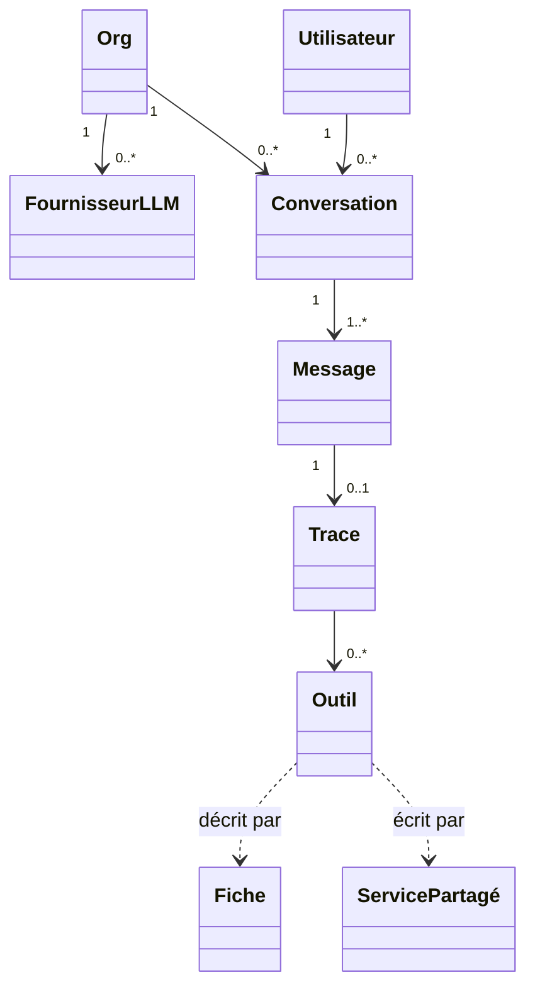
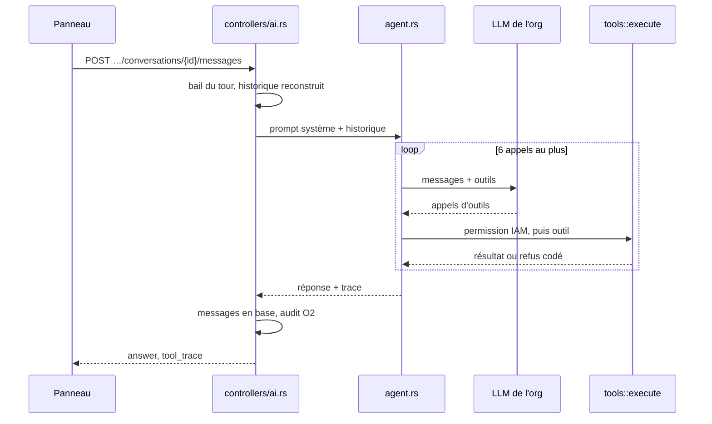
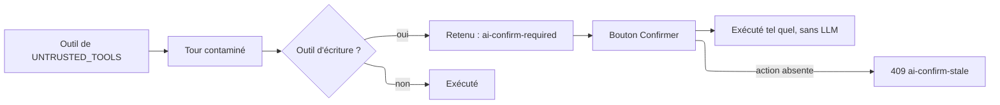
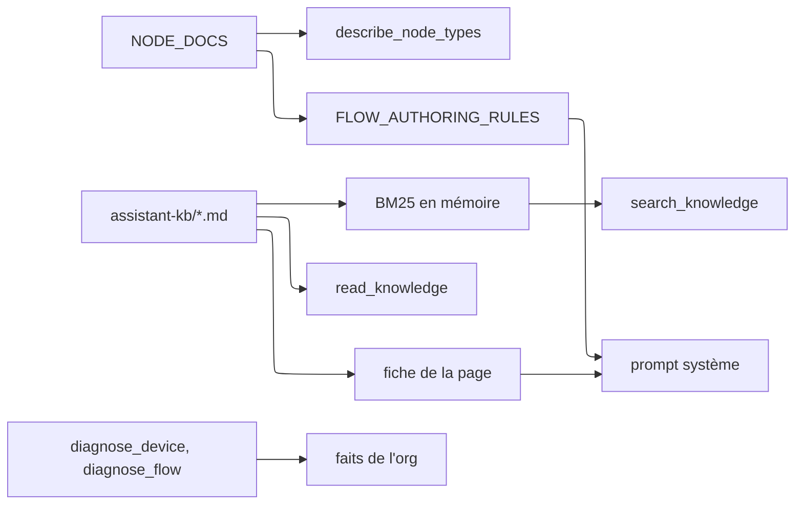
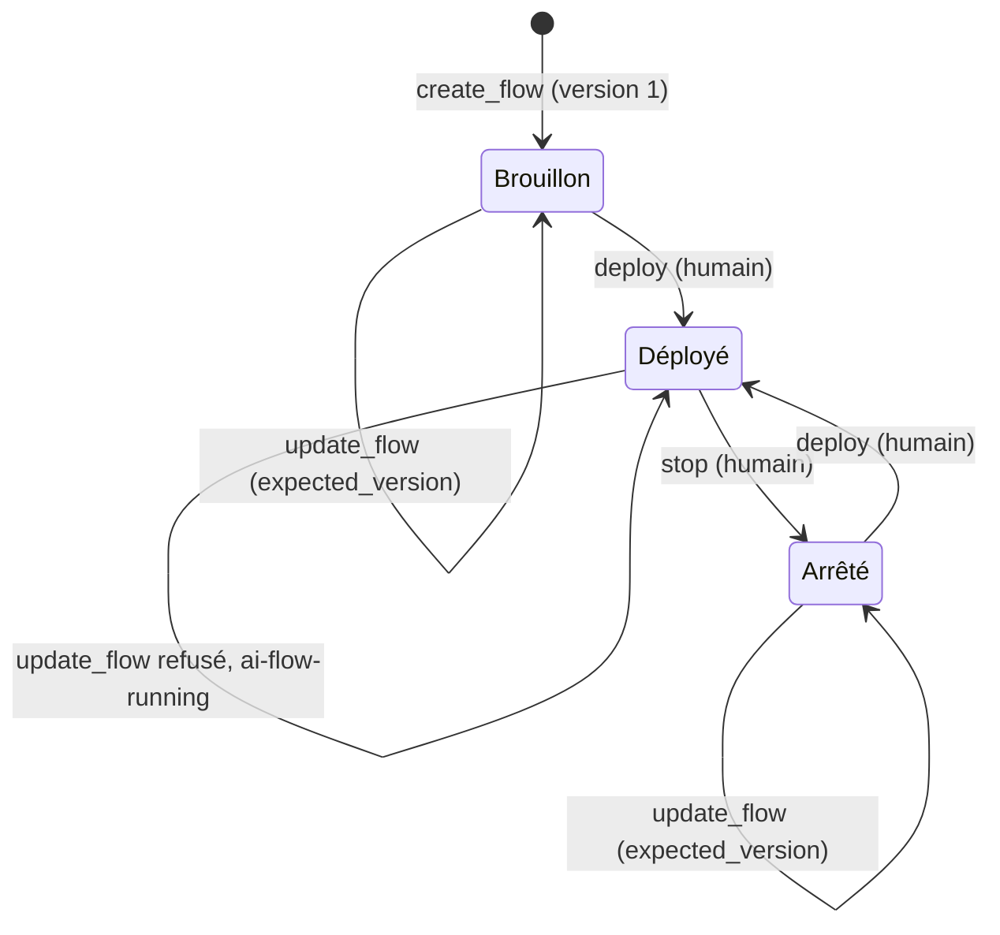
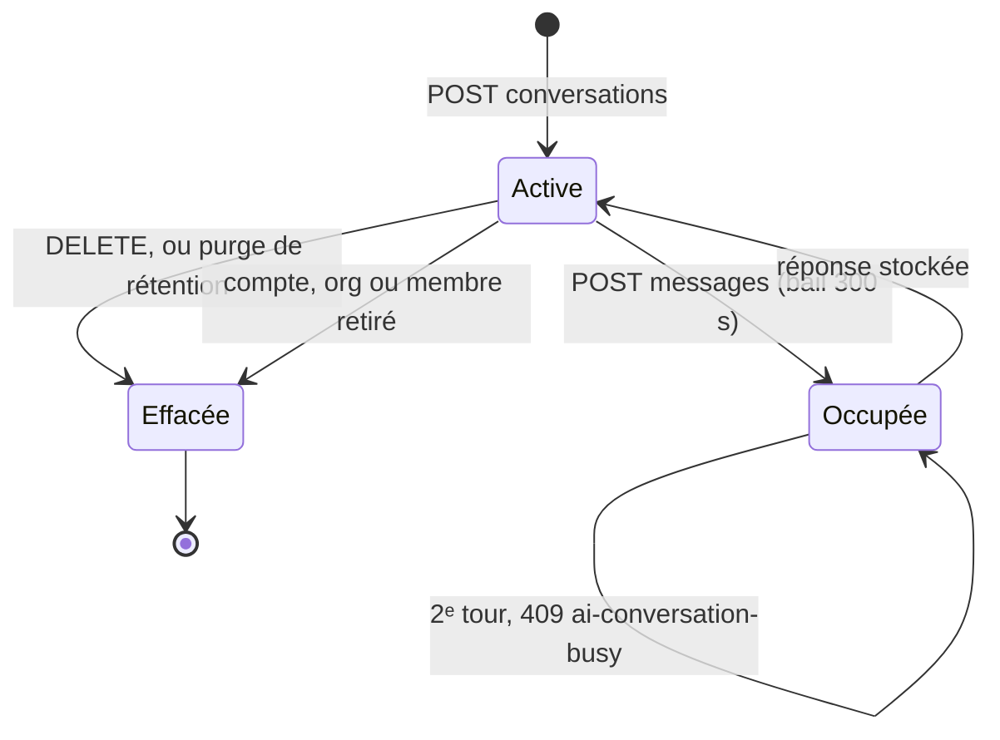

# Assistant IA intégré

## Résumé

L'assistant est un chat présent sur toutes les pages de l'UI. Il aide l'utilisateur à lire l'état de son org et à écrire des brouillons (flows, dashboards, objets, fonctions). Il appelle le LLM que l'org a configuré : la plateforme n'a pas de LLM propre (D119). Le LLM agit seulement par un registre fermé d'outils. L'assistant n'agit jamais sur le monde physique et ne déploie, n'arrête ni ne supprime rien (D143).

## 1. Concepts

- **Fournisseur LLM** : le service LLM d'une org (`llm_providers`), avec sa clé dans le coffre.
- **Tour d'agent** : un message de l'utilisateur, puis 6 appels LLM au plus, puis une réponse.
- **Outil** : une opération du registre fermé (`services/ai/tools::dispatch`). Le LLM n'a pas d'autre chemin d'exécution.
- **Fiche** : un fichier `crates/pnex-backend/assistant-kb/*.md`, compilé dans le binaire.
- **Conversation** : l'historique privé d'un utilisateur dans une org (D145).
- **Trace** : la liste des outils appelés pendant un tour, affichée dans le panneau.
- **Tour contaminé** : un tour qui a lu un contenu externe (mail, page web, document). Ses écritures attendent la confirmation humaine (SEC-71).
- **Conversation figée** : une conversation où chaque outil répond à un instant donné (D902, `markets-research.md`).
- **Widget couplé** : un widget de contrôle dont le contrôle alimente un `control-source` d'un flow déployé (D144).

## 2. Fonctionnement

### 2.1 Tour d'agent

Le serveur reconstruit l'historique : le client envoie seulement le nouveau message. Un client ne peut donc pas forger un faux résultat d'outil. Chaque appel LLM a `max_tokens` = 4096 et le délai du fournisseur. Au 6ᵉ appel, l'agent force une réponse sans outil.

`tools::execute` appelle d'abord `tools::authorize_tool`. Cette garde vérifie la permission de l'outil au registre IAM (`pnex_api_contract::iam::TOOLS`). Un viewer peut converser, mais un outil d'écriture lui répond `access-denied` + `args.permission`.

### 2.2 Écritures retenues (tour contaminé)

`agent::UNTRUSTED_TOOLS` liste les outils qui rendent un contenu externe : mails, pages web, documents. Après un de ces outils, le tour retient ses outils d'écriture. Un outil `propose_*` n'est pas retenu : il dépose une proposition et n'exécute rien.

### 2.3 Conversation figée

Une conversation créée avec `frozen_at` est figée à cet instant (D902). Le harnais, pas le modèle, pose l'instant de chaque outil (`services/ai/frozen.rs`). Un instant plus tardif demandé par le modèle revient à `frozen_at`, et la réponse le signale. Un outil absent de `frozen::TOOLS` est retiré : il répond `ai-frozen-tool`.

## 3. Fournisseurs LLM (D116, D119)

Table `llm_providers` :

| Colonne | Rôle |
|---|---|
| `org_id` | org propriétaire (toujours renseignée, D119) |
| `name` | unique par org |
| `kind` | `anthropic` ou `openai_compat` |
| `base_url` | requise pour `openai_compat` : racine `…/v1`, sans slash final |
| `model` | modèle appelé |
| `secret_id` | clé API au coffre (secret dédié `llm/<nom>/api_key`, ou secret de l'org) |
| `is_default` | un seul défaut par org |
| `timeout_secs` | délai d'un appel |

`services/ai/providers.rs::effective` prend le fournisseur par défaut de l'org. Sans défaut, l'assistant est non configuré (`ai-not-configured`). Le serveur déchiffre la clé en mémoire à chaque appel. Le client HTTP passe par la garde de sortie `pnex_core::egress` (R8, SEC-14) et ne suit aucune redirection.

L'UI gère les fournisseurs à un seul endroit : le détail de l'org (D119). Aucune variable d'environnement ne configure un LLM. Seul le kill-switch `PNEX_AI_ENABLED=false` reste.

## 4. Outils (registre fermé)

Le registre est le `match` de `tools::dispatch`. La garde `registry_contains_only_allowed_tools` refuse un nom qui contient `deploy`, `delete`, `remove`, `command`, `write_gpio`, `http` ou `sql_exec`. `execute` refuse un nom hors registre.

| Famille | Outils | Fichier |
|---|---|---|
| Devices, télémétrie | `list_devices`, `get_device_pins`, `query_telemetry`, `list_notifications` | `tools.rs` |
| Flows | `list_flows`, `get_flow`, `describe_node_types`, `validate_flow_graph`, `validate_calc_expression`, `create_flow`, `update_flow` | `tools.rs` |
| Connaissance, diagnostic | `search_knowledge`, `read_knowledge`, `diagnose_device`, `diagnose_flow` | `knowledge.rs`, `diagnose.rs` |
| Dashboards | `list_dashboards`, `get_dashboard`, `validate_dashboard_layout`, `create_dashboard`, `update_dashboard` | `dashboard_tools.rs` |
| Templates de notification | `get_`, `preview_`, `create_`, `update_notification_template` | `more_tools.rs` |
| Fonctions JS/Starlark | `list_functions`, `get_function`, `validate_function`, `test_function`, `create_function`, `update_function` | `more_tools.rs` |
| Lectures diverses | `list_annotation_sets`, `list_tours`, `list_pois`, `list_controls`, `read_memory` | `more_tools.rs` |
| Taxonomies | `list_taxonomies`, `get_taxonomy`, `create_taxonomy_version` | `more_tools.rs` |
| Ontologie | `describe_ontology`, `query_ontology`, `aggregate_objects`, `get_object`, `create_object`, `update_object`, `open_link`, `close_link`, `propose_action`, `save_object_type` | `ontology_tools.rs` |
| Dossiers | `case_workspace`, `case_signals`, `case_board`, `case_proposals` | `ontology_tools.rs` |
| Calendrier | `list_calendar`, `propose_occurrence_change` | `calendar_tools.rs` |
| Marchés | `market_figures`, `market_rule_test`, `market_session` | `market_tools.rs` |
| Documents | `search_docs`, `read_chunk`, `open_page` | `doc_tools.rs` |
| Règles de sites | `list_site_recipes`, `get_site_recipe`, `try_site_recipe`, `get_site_recipe_run`, `propose_site_recipe` | `site_tools.rs` |
| Mail | `list_mailboxes`, `list_mails`, `read_mail` | `mail_tools.rs` |

Limites de portée :
- `preview_notification_template` rend le template et n'envoie rien. Les canaux restent hors de portée : ils portent des identifiants, et leur test envoie un vrai message.
- `list_tours` dit seulement si un lien public existe. Il ne rend jamais le jeton de partage.
- L'écriture d'annotations et de visites est écartée. Une annotation peut porter des contrôles (même couplage que D144).
- `try_site_recipe` accepte seulement un `recipe_id` enregistré. Un brouillon passe par `propose_site_recipe` (SEC-71).

**Trace.** Chaque appel réussi porte une clé `ai-trace-*` + `args`. L'UI la rend dans la langue de l'utilisateur. Le résumé anglais sert de repli et d'historique rejoué au modèle. Un refus porte `code` + `args`, rendu `err-<code>`. Une erreur base ne sort jamais : `tools::internal` journalise le détail et rend `ai-tool-internal` (R4, R16).

## 5. Contexte du modèle

`context.rs` reconstruit le prompt système à chaque tour :
- le rôle et les interdits (pas de deploy, de suppression ni de commande) ;
- les règles de graphe générées (`FLOW_AUTHORING_RULES`) ;
- le schéma de l'ontologie de l'org ;
- un état de l'org : 50 devices, 30 séries O2 et 20 flows au plus ;
- le résumé de la fiche de la page courante (`knowledge::card_for_page`) ;
- la langue du dernier message, sinon celle de l'UI.

## 6. UI (Dioxus)

| Composant | Rôle |
|---|---|
| `components/assistant.rs` | bouton flottant et drawer : conversations, bulles, trace repliable, bouton Confirmer, carte « Ouvrir dans l'éditeur » (`state::flows::OPEN_FLOW`), mention du fournisseur tiers |
| `components/llm_providers.rs` | liste et formulaire, monté seulement dans `OrgDetail` (D119). Clé = `SecretField` |
| `components/ai_retention.rs` | carte de rétention : /system pour l'org, /admin/status pour la plateforme |

Le bouton est visible si `enabled && configured`. Les clés `ai-*`, `ai-trace-*`, `err-ai-*` et `err-llm-*` existent dans les deux `.ftl`.

## 7. Interfaces

| Route | Accès | Effet |
|---|---|---|
| `GET /api/v1/ai/status` | membre | `{enabled, configured, provider_name, provider, model}` |
| `GET /api/v1/ai/providers` | membre | fournisseurs de l'org, sans référence de clé |
| `POST /api/v1/ai/providers`, `PUT`/`DELETE …/{id}` | owner/admin | clé `{"value"}` ou `{"secret_id"}` ; `PUT` sans `api_key` garde la clé ; 409 `llm-provider-name-taken` |
| `POST /api/v1/ai/providers/{id}/test` | owner/admin | ping, `{ok, latency_ms, error, code, args}` |
| `/api/v1/ai/conversations*` | membre | §9.4 |
| `GET`/`PUT /api/v1/ai/retention` | membre / owner-admin | rétention de l'org (§9.4) |
| `PUT /api/v1/ai/retention/default` | admin plateforme | rétention plateforme, 1 à 3650 jours |

Erreurs du fournisseur (`services/ai/error.rs`), toujours code + description anglaise :

| Code | Statut |
|---|---|
| `ai-disabled` | 403 |
| `ai-not-configured` | 400 |
| `ai-auth-rejected`, `ai-timeout`, `ai-bad-response` | 502 |
| `ai-upstream` (`args.status`), `ai-network` (`args.detail`, verbatim) | 502 |
| `ai-rate-limited` | 429 |

Le test d'un fournisseur rend les mêmes codes, plus `llm-provider-no-key` et `llm-provider-key-unreadable` avant l'appel.

| Variable | Rôle | Défaut |
|---|---|---|
| `PNEX_AI_ENABLED` | kill-switch : chat 403, UI masquée, sans requête en base | `true` |

## 8. Tests

- **Unitaires** (`services/ai`) : protocoles Anthropic et OpenAI (fixtures JSON), registre == ensemble autorisé, refus hors registre, gardes des fiches (§9.1).
- **Intégration** (`crates/pnex-backend/tests/ai.rs`, mock LLM local) : kill-switch, CRUD fournisseurs, tour complet (flow créé en brouillon, 0 deploy), refus `access-denied`, `ai-auth-rejected`, `ai-not-configured`, borne d'appels, conversations, dashboards, rétention, templates.
- Tests nommés : `update_flow_only_on_a_stopped_flow`, `coupled_dashboard_widget_is_frozen_while_its_flow_runs`, `assistant_works_the_ontology_through_the_ui_services`.

## 9. Règles de l'assistant (D142–D145)

### 9.0 Décisions

| # | Décision |
|---|---|
| A1 | Tranche v1 (D20b, `docs/journal/inventory.md`) : chat, fournisseur par org, lecture O2, flows en brouillon |
| A2 | UI = panneau flottant global, monté dans `pages/shell.rs` |
| A3 | Levée. Remplacée par D116 puis D119 : défaut de l'org, sinon non configuré. Le kill-switch `PNEX_AI_ENABLED` reste |
| A4 | Devices en lecture seule : l'assistant n'envoie aucune commande (frontière D17, étendue par D143) |
| A5 | Levée. La table `ai_connectors` a disparu avec la migration de base (D120) |
| D116 | Fournisseurs LLM en CRUD, `PNEX_AI_*` retirées (`security.md`) |
| D119 | Pas de LLM plateforme : fournisseur de l'org seulement |
| D142 | Base de connaissance embarquée et autoportante, sans RAG vectoriel, avec gardes anti-dérive |
| D143 | Édition de flow seulement à l'arrêt. Jamais de deploy, d'arrêt, de suppression ni d'action physique |
| D144 | Outils dashboards par le service de l'UI, concurrence optimiste. Règle d'extension du registre (§9.3) |
| D145 | Conversations privées utilisateur × org en base, audit sans contenu dans O2 |

### 9.1 D142 : base de connaissance

La connaissance a trois couches :
1. **Doc des nœuds** : `pnex_core::flow::node_docs` (`NODE_DOCS`, `FLOW_AUTHORING_RULES`, `FLOW_EXAMPLE`). Chaque kind de nœud a son entrée, sans liste manuelle ailleurs.
2. **Fiches** : en anglais, compilées par `include_dir`. L'en-tête porte `id`, `title`, `kind` (`feature`, `howto`, `troubleshooting`), `tags`, `pages`, `nodes`, `err_codes`, `tools`. Une fiche `troubleshooting` suit symptôme → cause → geste dans l'UI.
3. **Outils** : `search_knowledge` (5 résultats au plus) et `read_knowledge`, en lecture seule.

Les fiches donnent la cause type. Les faits viennent de `diagnose_device` (présence D108, pins, firmware, OTA) et de `diagnose_flow` (version sauvegardée et déployée, `last_error`, statuts des nœuds). Une sortie cite un secret seulement par son nom (R4, R16).

Le corpus est petit, donc une recherche lexicale suffit. Un index vectoriel dépendrait du fournisseur de l'org et mélangerait produit et org (R1). Ce choix se revoit si le corpus dépasse quelques centaines de fiches, ou s'il faut indexer du contenu de l'org.

Gardes bloquantes :

| Garde | Vérifie |
|---|---|
| `every_kind_is_documented` (`pnex-core`) | kinds acceptés par `FlowNodeKind` == kinds de `NODE_DOCS` |
| `every_card_parses_and_is_well_formed` | en-tête valide, `id` = nom du fichier |
| `cards_only_reference_existing_things` | pages ∈ routes du routeur, nœuds ∈ `NODE_DOCS`, codes ∈ `err_codes::ALL` |
| `every_ui_route_has_a_feature_card` | chaque route de premier niveau a une fiche `feature` |
| `every_tool_is_described_by_a_card` | chaque outil du registre est cité par une fiche |
| `cards_never_send_users_to_a_cli_or_the_api` | aucun corps de fiche ne cite une CLI ou l'API |
| `typical_questions_find_their_card` | pertinence sur des questions types |

### 9.2 D143 : édition de flow et frontière physique

`update_flow` exige `expected_version` = `latest_version_number` lu par `get_flow`. Une version plus récente rend un conflit, et le modèle recharge. `services::flow::append_version_if_stopped` relit le statut dans la transaction, après le verrou de ligne. Un deploy entre la lecture et l'écriture rend donc `ai-flow-running`. Le serveur fait le contrôle, jamais le modèle.

Ce gel évite le piège « sauvegardé ≠ déployé » : l'éditeur montrerait la version de l'assistant pendant que le moteur exécute l'ancienne. L'humain redéploie une version qu'il voit.

Interdits structurels :
- deploy, stop ou suppression de flow ;
- commande device, OTA ou flash ;
- écriture de contrôle (D123) ou de mémoire Valkey ;
- lecture de la valeur d'un secret.

L'assistant peut lire l'état d'un contrôle et la valeur d'une mémoire (`list_controls`, `read_memory`). Selon D123, une surface lit et un flow agit.

### 9.3 D144 : dashboards et règle d'extension

`create_dashboard` fixe le format (`pc` ou `mobile`) à la création. Créer un widget de contrôle déclare une source et n'actionne rien (D131). Un widget ajouté par l'assistant perd toute liaison fournie par le modèle : il reçoit un contrôle neuf. `update_dashboard` exige `expected_version`, car une sauvegarde de dashboard est live. Aucun outil ne supprime un dashboard.

Un widget couplé est gelé tant que ses flows tournent :

| Changement par l'assistant | Widget couplé | Sinon |
|---|---|---|
| ajout, déplacement, redimensionnement | libre | libre |
| widget d'affichage | libre | libre |
| retrait, re-liaison (`control_id`), type, spec, renommage | refus `ai-flow-running` + flows | libre |

Le serveur détecte le couplage au moment de l'outil, par le balayage de `release_surface` (D131). Le refus liste les flows (id + nom) dans `args`. `get_dashboard` marque chaque widget couplé (`coupled_flows`), et `validate_dashboard_layout` signale le conflit à blanc. Le renommage est gelé, car l'humain lit le libellé au moment d'appuyer.

**Règle d'extension du registre** (opposable à tout nouvel outil) :
1. Un outil d'écriture doit passer par le **service partagé avec le contrôleur HTTP de l'UI** : mêmes validations, mêmes 409. Jamais d'écriture directe en base.
2. La permission de l'outil doit être inscrite dans `pnex_api_contract::iam::TOOLS` (garde `tests/iam.rs`). L'org vient du principal (R1, R2).
3. Un outil ne doit ni supprimer ni agir sur le monde physique (§9.2).
4. Une fiche doit décrire l'outil (§9.1).
5. Une écriture doit laisser une trace UI (`summarize`) et un deep-link vers la ressource.
6. Un outil qui rend un contenu externe doit entrer dans `UNTRUSTED_TOOLS` (§2.2).

Ontologie (D189) : écriture par les services de `/api/v1/ontology`, `expected_version` → 409. Le schéma est réservé aux admins d'org, et le rôle d'écriture du type est re-vérifié (D188). Aucun outil n'archive ni ne supprime : un lien fermé reste dans l'historique. Les outils de dossier sont en lecture seule.

### 9.4 D145 : conversations

**Modèle.** `ai_conversations` (`id` uuid, `org_id`, `user_id`, `title`, `frozen_at`, `busy_until`, dates) et `ai_messages` (`seq`, `role`, `content`, `tool_trace` borné, `page`, tokens). Les clés étrangères vers l'utilisateur et l'org cascadent. Le départ d'une org efface les conversations dans la transaction du retrait. Supprimer un fournisseur ne touche pas l'historique.

**Strictement privé.** Seul l'auteur voit une conversation, dans l'org où il l'a créée. Ni l'owner de l'org ni l'admin plateforme n'y ont accès. Une ressource d'un autre rend 404, pas 403.

**Historique.** Le serveur rejoue les 24 derniers messages en texte. Il remplace les outils d'un ancien tour par leur résumé. La trace stockée garde 16 entrées au plus, des arguments de 2 000 caractères au plus et un résumé de 500 caractères au plus. Le titre vient du premier message, sans appel LLM.

**Rétention.** Une conversation inactive est purgée après N jours. Le défaut plateforme est `ai_conversation_retention_days` dans `system_settings` (D72, 180 jours). Une org peut seulement le réduire (`organizations.ai_retention_days`) : effective = min(org, plateforme). Une purge horaire tourne sur un seul pod. Refus : `ai-retention-forbidden`, `ai-retention-above-platform` + `args.max`.

**Audit.** Le stream O2 `ai_audit` reçoit un événement par tour : org, utilisateur, conversation, fournisseur, modèle, tokens, noms d'outils et résultat, ressources écrites, latence. Il ne reçoit jamais le texte ni les arguments d'outils. O2 n'efface pas un enregistrement seul, donc le contenu reste en base relationnelle.

Le contenu part chez le fournisseur de l'org. Le drawer et la fiche `assistant` le disent.

| Route | Effet |
|---|---|
| `GET /api/v1/ai/conversations` | mes conversations dans l'org, paginées (D14) |
| `POST /api/v1/ai/conversations` | nouvelle conversation, `title` et `frozen_at` facultatifs |
| `GET /api/v1/ai/conversations/{id}` | messages (reprise) |
| `PATCH /api/v1/ai/conversations/{id}` | renommer |
| `DELETE /api/v1/ai/conversations/{id}` | effacer |
| `DELETE /api/v1/ai/conversations` | effacer toutes mes conversations de l'org |
| `GET /api/v1/ai/conversations/export` | export JSON |
| `POST /api/v1/ai/conversations/{id}/messages` | `{content, page, language, confirm?}` → `{answer, tool_trace}` |

Lire, effacer et exporter restent permis kill-switch coupé.

### 9.5 Exigences

1. Le LLM doit exécuter seulement les outils du registre fermé (`tools::dispatch`).
2. Aucun outil ne doit envoyer de commande device, OTA ou flash, ni écrire un contrôle ou une mémoire Valkey (D123, D143).
3. Aucun outil ne doit déployer, arrêter ou supprimer (D143).
4. `update_flow` doit refuser un flow déployé avec `ai-flow-running`, vérifié sous le verrou d'écriture.
5. Un widget couplé doit refuser retrait, re-liaison, changement de spec et renommage tant que ses flows tournent (D144).
6. Toute écriture doit porter la version lue (`expected_version`, ou `expected_updated_at` pour les templates). Un conflit rend 409.
7. Un refus d'outil doit porter un code machine + `args`, avec la clé `err-<code>` dans les deux `.ftl`.
8. Une sortie d'outil ne doit contenir ni secret ni identifiant (R4, R16).
9. Une conversation doit être visible de son auteur seulement, dans son org (D145).
10. L'audit O2 ne doit contenir aucun contenu de message ni d'outil.
11. Le LLM doit être le fournisseur de l'org. La plateforme n'en fournit aucun (D119).
12. Un tour contaminé doit retenir ses écritures jusqu'à la confirmation humaine (SEC-71).
13. Chaque outil, nœud et route de premier niveau doit avoir sa doc ou sa fiche (§9.1).

## 10. Résiduels acceptés

- **Dashboards.** Le couplage d'un widget dépend des versions déployées d'autres flows. Aucun verrou commun ne sérialise un deploy et une sauvegarde de dashboard. La fenêtre dure de l'ordre de la milliseconde, et le 409 protège la version du dashboard. Le deploy reste un geste humain sur un layout visible. Un verrou commun n'est pas justifié (`security.md` §7).
- **Traces anciennes.** Les traces stockées sans clé `ai-trace-*` s'affichent verbatim.
