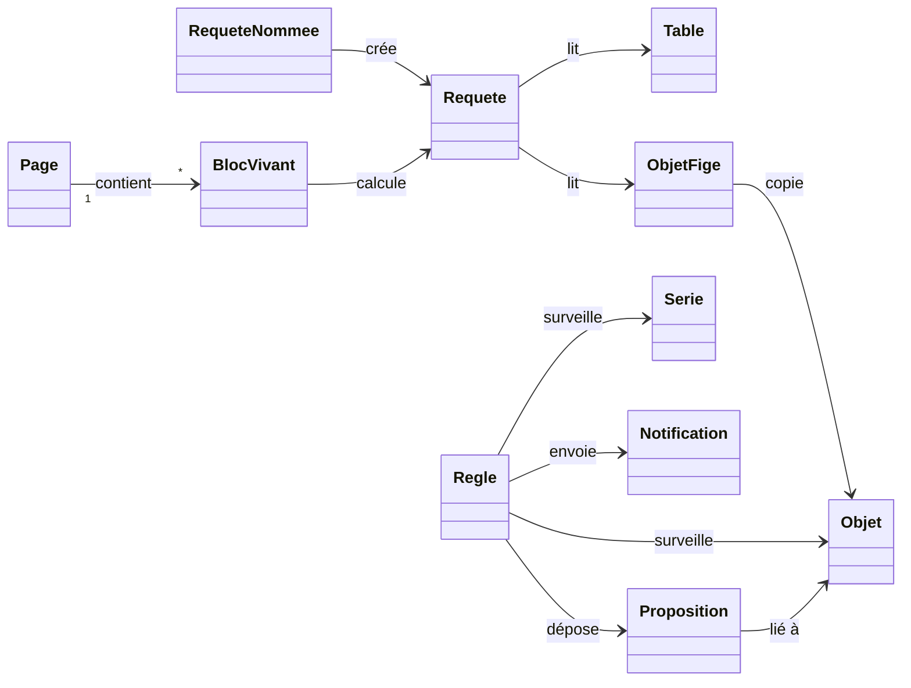
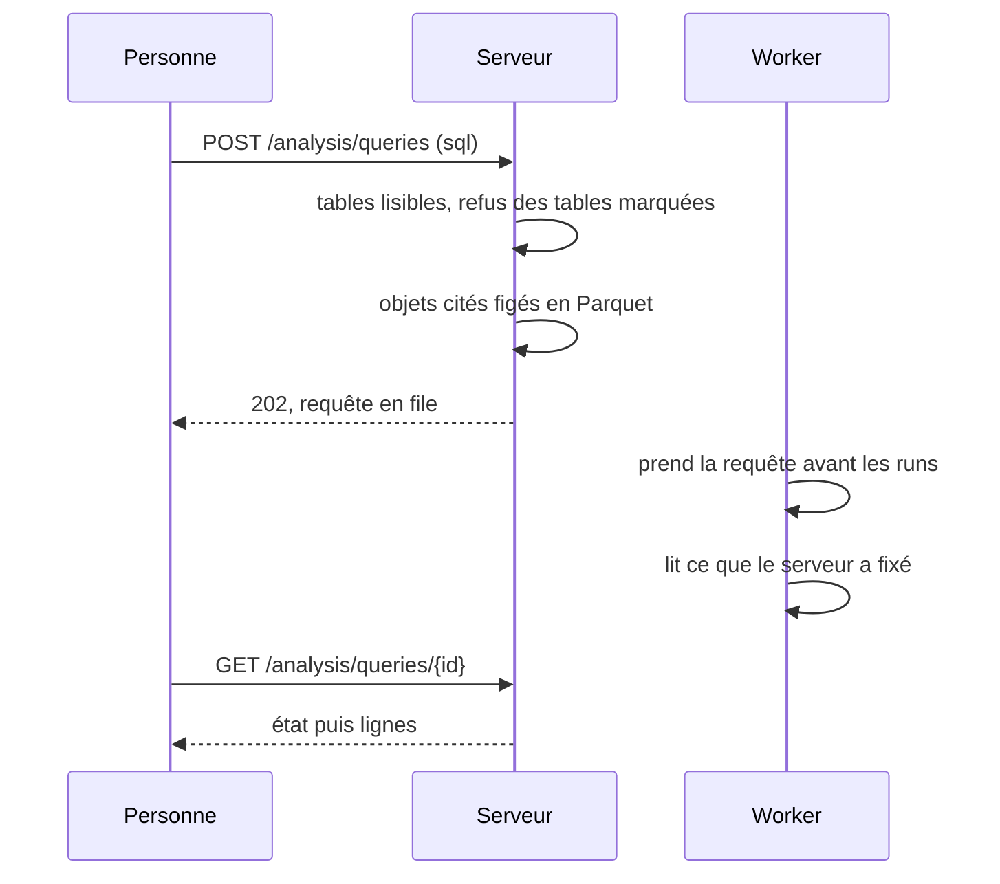
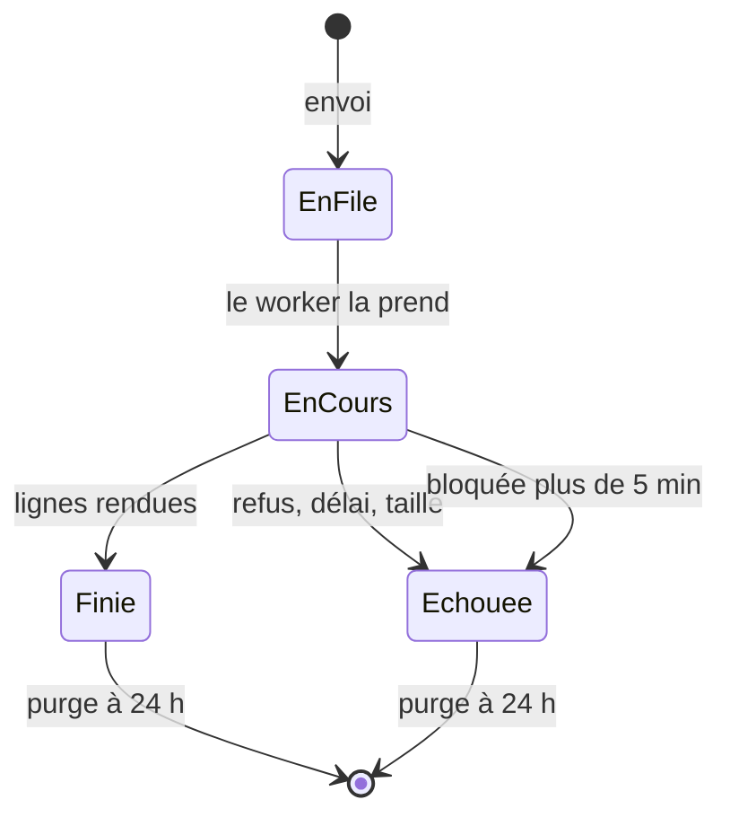
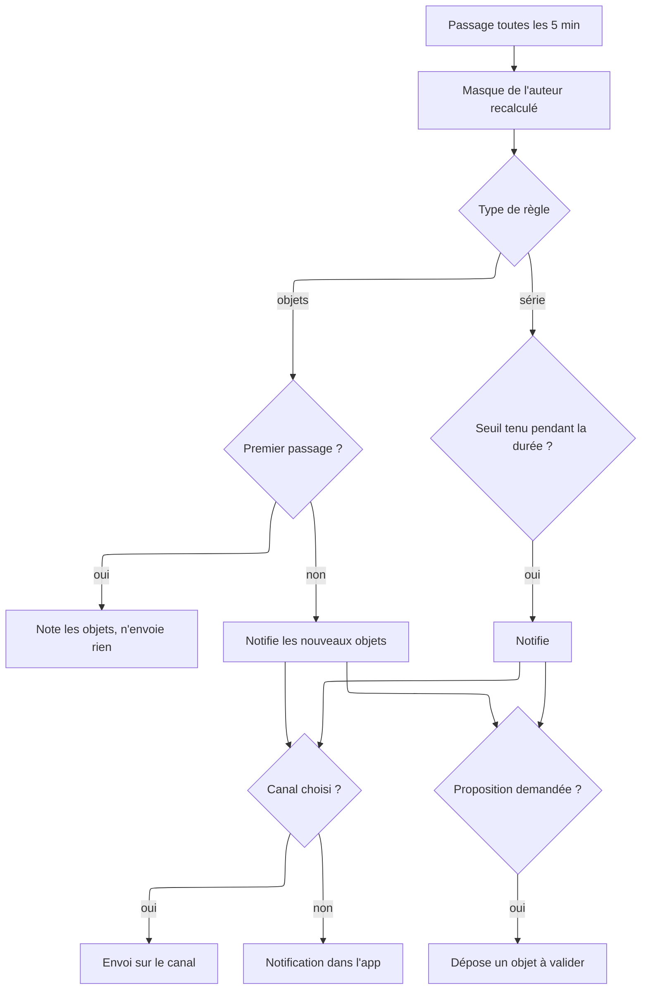
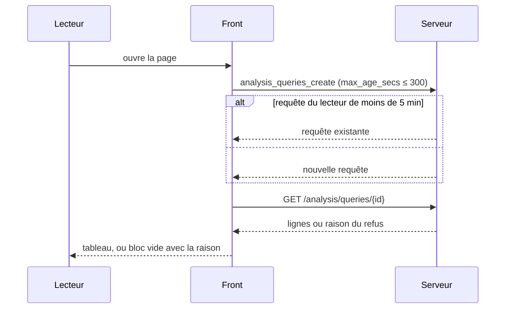

# Analyse : SQL en lecture, règles avec rejeu, blocs vivants (OP5, D825–D832)

| | |
|---|---|
| Statut | Livré (lots AN1 à AN4, règle qui propose D829) |
| Repose sur | `operational-platform.md` (D557), `pipelines.md` (worker D571–D574, requêtes nommées D948), `governance.md` (D801, D803), `crm.md` (masque D443), `ontology.md` (requête D185), `viz.md` (agrégats D579), `pages.md` |

## Résumé

L'analyse permet de poser une question en SQL aux tables et aux objets d'une org, sans rien écrire.
Une règle surveille une condition et notifie quand elle devient vraie. Le rejeu montre sur le passé
les instants où une règle s'est déclenchée. Un bloc vivant met la réponse d'une requête dans une
page, calculée avec les droits du lecteur. Tout se fait en lecture seule (D557).

## 1. Concepts

- **Requête** : une instruction `SELECT` d'une personne, exécutée par le worker de pipelines.
- **Objet figé** : copie Parquet des objets d'un type, tels que l'auteur de la requête les voit.
- **Requête nommée** : requête d'un pack installé, avec des paramètres typés (D948, `pipelines.md`).
- **Règle** : condition sur les objets d'un type ou sur une série, avec son auteur.
- **Proposition de règle** : objet qu'une règle propose à chaque déclenchement, lié à ce qui a
  déclenché. Il attend dans « À valider » (`proposals.md`).
- **Rejeu** : aperçu des déclenchements d'une règle sur une fenêtre passée. Il n'envoie rien.
- **Bloc vivant** : nœud de page `live_block` qui porte une requête SQL ou un calcul sur des objets.
- **Tableau croisé** (AN4) : calcul sur des objets réparti en lignes et en colonnes par deux
  propriétés, avec des filtres. Il se construit sans code.

## 2. Fonctionnement

### 2.1 Exécuter une requête

Le serveur fixe à l'envoi tout ce que la requête peut lire :

- **Tables** : les tables de l'org que l'auteur lit. Une table marquée sans habilitation complète,
  citée par son nom, fait échouer la requête en `marking-required`.
- **Objets** : chaque `objects.<type>` cité devient un objet figé. Le masque D443 et les marquages
  D801 s'appliquent. Les objets cachés sont absents.

Le worker n'a ni l'ontologie ni les droits. Il lit seulement les clés que le serveur a listées.

### 2.2 Cycle de vie d'une requête

Une personne a au plus une requête en file ou en cours (`analysis-busy`). La boucle horaire purge
les requêtes et leurs objets figés après un jour.

### 2.3 Passage d'une règle

Le passage tourne en singleton `rules-pass`. Une règle suit au plus 2 000 objets. Une condition
modifiée remet l'état de la règle à zéro.

Une règle qui propose dépose une proposition `object_create` par déclenchement, 50 au plus par
passage. L'origine de la proposition est `rule`. L'objet proposé porte le type, le titre et les
valeurs fixes de la règle. Il est lié à l'objet qui a déclenché, ou à l'objet du device d'une
série. Le titre remplace `{value}` par la valeur de la série. Il ne cite jamais le titre de l'objet
déclencheur : la proposition montre cet objet masqué pour chaque lecteur. Une proposition n'a pas
d'auteur : tout membre qui peut valider l'accepte, l'auteur de la règle aussi.

Le rejeu lit l'historique des changements (objets) et les séries (O2). Il calcule les instants de
déclenchement sur 24 h, 7 j ou 30 j, avec les droits de la personne qui demande.

### 2.4 Calculer un bloc vivant

Le front calcule les blocs un par un, avec les droits du lecteur. Il recalcule un bloc quand ses
réglages changent, au bout de 5 min ou sur « Recalculer ». L'éditeur insère un bloc par l'entrée
« Bloc vivant » du menu `/`.

À l'export PDF, la route `docs_versions_pdf` recalcule chaque bloc avec les droits de la personne
qui exporte. Le tableau porte « Valeur au … UTC » et 200 lignes au plus. Le nœud de flow `page_pdf`
laisse le bloc vide. L'export Markdown écrit la requête d'un bloc SQL et le titre d'un calcul.

## 3. Exigences

1. Une requête doit contenir une seule instruction `SELECT`, avec la liste blanche de fonctions des
   transformations (D572), sans fichier ni réseau.
2. Une requête doit s'arrêter à 60 s (`analysis-timeout`).
3. Le résultat doit tenir en 10 Mo (`analysis-result-too-large`). Au-delà de 1 000 lignes, il porte
   `truncated`.
4. Un type d'objet cité doit contenir 50 000 objets au plus (`analysis-too-many-objects`).
5. Le texte SQL doit tenir en 64 Ko.
6. Le résultat d'une requête doit être lisible par son seul auteur (404 pour les autres).
7. Une règle ne doit jamais écrire de donnée (D557). Elle peut seulement déposer une proposition.
8. Le rejeu ne doit rien envoyer ni stocker.
9. Un bloc vivant doit se calculer avec les droits du lecteur, jamais avec ceux de l'auteur.
10. Les attributs d'un bloc vivant doivent être des chaînes bornées, validées par le serveur (titre
    ≤ 200 caractères). L'éditeur affiche du texte seulement, jamais de HTML.

## 4. Décisions

### D825 — Une requête est un travail du worker, sous les droits de l'appelant

Le serveur fixe à l'envoi les tables lisibles et fige les objets cités. Le worker lit seulement ça.

### D826 — Lecture seule, bornée

Mêmes garde-fous que D572, plus 60 s, 1 000 lignes, 10 Mo, une requête par personne et 24 h de garde.

### D827 — Les requêtes passent avant les pipelines

Le worker prend une requête en file avant un run. Il n'interrompt jamais un run commencé.

### D828 — Une lecture marquée se trace

Une requête sur une table marquée laisse une ligne `governance_reads`, comme un échantillon (D803).

### D829 — Règles : une condition, une alerte ou une proposition (AN2)

Une règle porte sur un type d'objet (filtres D185) ou sur une série (seuil, durée). Elle notifie.
Elle peut aussi proposer un objet lié à ce qui a déclenché (choix de Shan, 2026-11-20). Proposer
demande `proposals:file` à l'auteur de la règle, à l'enregistrement et à chaque passage.

### D830 — Rejeu

Une règle se rejoue sur une fenêtre passée, sans rien envoyer.

### D831 — Bloc vivant (AN3)

Un bloc porte une requête SQL ou un agrégat (D579), calculé à l'affichage avec les droits du lecteur.

### AN4 — Tableau croisé sans code

Le tableau croisé réutilise l'agrégat D579 avec deux clés de répartition. Il ne demande aucune
route nouvelle. Il s'ouvre dans l'onglet « Tableau croisé » de `/pipelines`, à côté de « Requête
SQL ». Le même réglage existe dans un bloc vivant, par le champ « Colonnes ». Le calcul lit 1 000
cellules au plus et montre 12 colonnes au plus. Au-delà, une note demande de resserrer les filtres.
L'onglet demande `ontology:read`. Le calcul se fait avec les droits du lecteur (D831).

### D832 — Export PDF

L'export PDF recalcule chaque bloc et le date « au <date> ».

## 5. Interfaces

| Route | Opération | Permission |
|---|---|---|
| `POST /api/v1/analysis/queries` | `analysis_queries_create` | `analysis:run` (Membre) |
| `GET /api/v1/analysis/queries/{id}` | `analysis_queries_get` | `analysis:run` |
| `GET /api/v1/analysis/named` | `analysis_named_list` | `analysis:run` |
| `POST /api/v1/analysis/named/{pack}/{key}` | `analysis_named_run` | `analysis:run` |
| `GET /api/v1/rules`, `GET …/{id}` | `rules_list`, `rules_get` | `rules:read` (Lecteur) |
| `POST /api/v1/rules`, `PUT …/{id}` | `rules_create`, `rules_update` | `rules:write` (Membre) |
| `DELETE /api/v1/rules/{id}` | `rules_delete` | `rules:delete` (Membre) |
| `POST /api/v1/rules/{id}/replay` | `rules_replay_preview` | `rules:read` |
| `GET /api/v1/analysis/event-study` | `analysis_event_study` | `ontology:read` |
| `GET /api/v1/analysis/chains` | `analysis_chains` | `datasets:read` + `ontology:read` |

Deux lectures génériques (PE8, `pipelines.md`) mesurent une série autour d'événements :

- **Étude d'événement** : `object`, `metric` (`close` par défaut), `benchmark` (le repère de l'org
  par défaut) et `date`, répété 100 fois au plus. La série est lue dans `market_observations`. La
  réponse donne une étude par date, `null` sans repère ou sans assez de valeurs (D532).
- **Chaînes candidates** : `table` (une Table de bougies d'une minute), `key` (valeur de la colonne
  `instrument`), `source` (facultatif), `as_of`, `from` et `threshold_pct`. La lecture est
  point-in-time. Les causes viennent des paires des packs (`markets-research.md` §3.14, D742).

- **MCP** : requêtes, lecture et rejeu des règles exposés. Écriture et suppression des règles exclues
  (une règle envoie des messages).
- **Écritures de règle** : à `expected_version` (`rule-version-conflict`), nom unique par org
  (`rule-name-taken`).
- **Codes** : `analysis-busy`, `analysis-unavailable`, `analysis-table-unknown`,
  `analysis-sql-invalid`, `analysis-timeout`, `analysis-result-too-large`,
  `analysis-too-many-objects`, `named-query-not-found`, `rule-not-found`.
- **Tables** : `analysis_queries` (migration 000131), `rules` (migrations 000132 et 000161,
  colonne `propose`).
- **UI** : onglet « Requête SQL » de `/pipelines` (Ctrl+Entrée). Page `/rules` sous Automatisation.
  Fiche `assistant-kb/rules.md`.
- **Code** : `pnex_core::{analysis, rules, pages}`, `services/{analysis,rules}.rs`, module
  `analysis.rs` du worker.

## 6. Limites assumées

- Le serveur trace D828 à l'envoi, pour les tables marquées dont le nom apparaît dans le texte. Il
  compare des mots, il n'utilise pas l'analyse du moteur.
- Un objet figé d'une requête jamais exécutée reste jusqu'à la purge du lendemain (`shortcut:`).
- Sous une longue transformation, une requête attend la fin du run en cours.
- L'aperçu d'une version figée (panneau Versions) montre le titre d'un bloc sans le calculer.
- Les nombres d'un bloc n'ont pas de séparateur de milliers.
- Dans un PDF, un bloc en échec dit seulement « ouvrez la page ». La page donne la raison traduite.

## 7. Reste à faire

- **D827, worker dédié aux requêtes** : l'ancien texte cite `PNEX_WORKER_QUEUES=analysis`, absent
  du code. Choix de Shan : le coder, ou retirer cette option.
