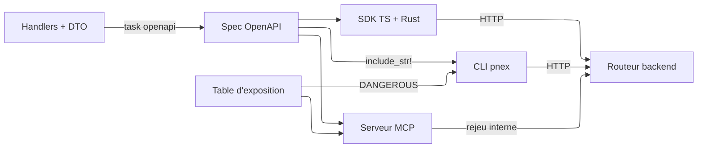
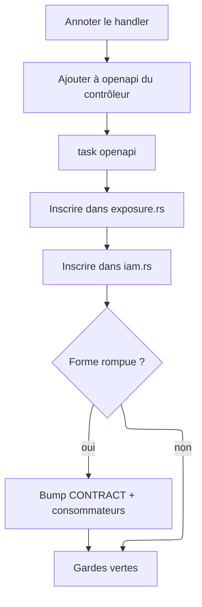
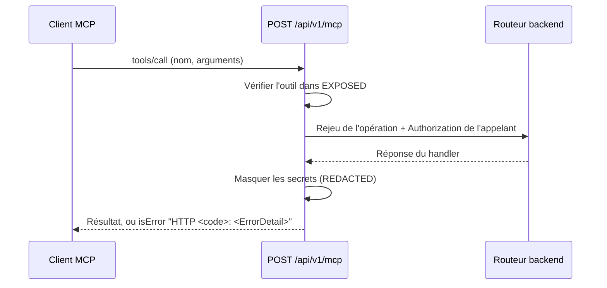
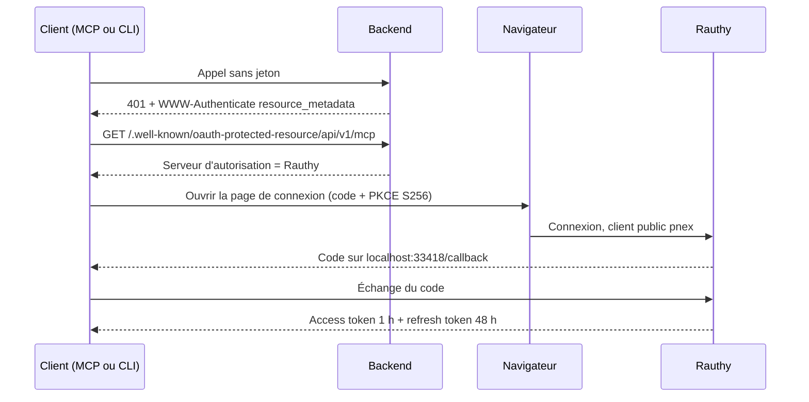
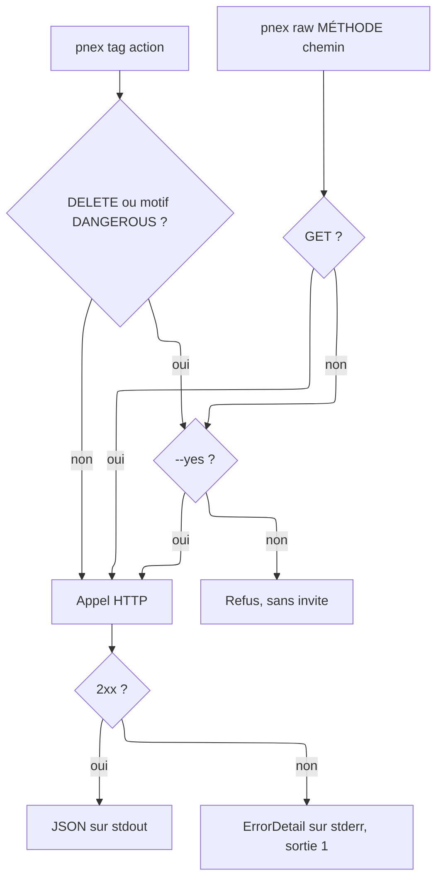

# API HTTP : contrat OpenAPI, serveur MCP et CLI `pnex` (D238–D253)

## 1. Résumé

Le spec OpenAPI `docs/contracts/openapi.json` est le contrat public de l'API HTTP de PneX. Le code génère ce spec. Trois consommateurs partent de lui : les SDK, le serveur MCP pour les clients LLM et la CLI d'administration `pnex`. Le MCP expose seulement les opérations sûres, avec les droits de l'appelant. La CLI expose tout, mais une opération dangereuse exige `--yes`. Le serveur reste le seul juge des droits.

## 2. Concepts

- **Spec** : `docs/contracts/openapi.json`, généré depuis `#[utoipa::path]` sur chaque handler et `ToSchema` sur chaque DTO (`crates/pnex-backend/src/openapi.rs`).
- **`ErrorDetail`** : la seule forme d'erreur, `{"error": "<code>", "description": "<anglais canonique>", "errors": {…}}`.
- **`Paginated<T>`** : la seule forme de liste, `count`, `next`, `previous`, `results`, `limit`/`offset` (D14).
- **`CONTRACT`** : version du contrat, `pnex_api_contract::CONTRACT`. Le front et la CLI comparent cette version à celle du serveur.
- **Table d'exposition** : `crates/pnex-api-contract/src/exposure.rs`. Chaque opération est dans `EXPOSED` ou dans `EXCLUDED` sous un motif.
- **Outil MCP** : une opération de `EXPOSED`, appelée par un client LLM.
- **Motif dangereux** : un motif d'`EXCLUDED` listé dans `DANGEROUS` (`crates/pnex-cli/src/main.rs`). La CLI exige `--yes` pour lui.



## 3. Fonctionnement

### 3.1 Ajouter ou modifier une route



Toutes ces étapes vont dans le même commit. Le spec n'est jamais écrit à la main. `tests/openapi.rs` vérifie que le spec est à jour et que chaque route est documentée. La liste d'attente de ce test est vide. Les routes `/ws/*` (WebSocket), `/internal/*` (serveur à serveur) et les sondes loco `/_*` restent hors du spec. Le serveur ne sert pas le spec en HTTP (pas de Swagger UI).

### 3.2 Appel d'un outil MCP



Le serveur génère les outils au premier appel depuis le spec. Le nom d'un outil est l'`operationId`. Sa description est le résumé plus la description. Son schéma d'entrée contient les paramètres de chemin, de requête et d'en-tête, plus `body`. Les schémas référencés sont embarqués en `$defs`. Le rejeu passe par les mêmes extracteurs, gardes, validations et 409 que l'UI. Le MCP n'a aucun droit propre. `X-Org-Id` est un argument. Sans lui, le MCP prend celui de la connexion.

### 3.3 Connexion OAuth (MCP et CLI)



Le client rafraîchit seul l'access token dans sa dernière minute. Le refresh token vit 48 h et se renouvelle à chaque usage. L'utilisateur revoit le navigateur seulement après 48 h sans usage. La CLI suit le même schéma par les proxys de l'instance (`/api/v1/oauth2/sso`, `/token`), sans découverte. Sans edge HTTPS (dev nu), le MCP n'a pas de découverte : passer `--header "Authorization: Bearer <jeton>"`.

Rauthy exige que la ressource RFC 8707 du client figure dans `allowed_resources` du client `pnex`. Le jeton porte alors `aud = ["pnex", "<origine>/api/v1/mcp"]`, et le backend l'accepte. `deploy/edge/apply-edge.sh` pose l'URI de retour et la ressource à chaque `task app:up`.

**Attention :** Une installation `pnex-deploy` doit recevoir ces deux mêmes réglages. Sinon, la connexion MCP échoue.

Tout autre `/.well-known/*` répond 404, jamais l'`index.html` de la SPA. Un client sonde d'abord `/.well-known/oauth-authorization-server/auth/v1` (RFC 8414) et abandonne sur un 200 non JSON.

### 3.4 Commande de la CLI



Une commande est `pnex <tag> <action>`. Le tag vient du spec. L'action est l'`operationId` sans le préfixe du tag, en kebab-case. Chaque paramètre est un flag (`--id`, `--limit`). Le corps passe par `--body <json|@fichier|->`. Une route ajoutée au spec devient une commande au build suivant. `pnex login` compare `CONTRACT` au serveur et refuse un écart. La CLI ne traduit pas l'`ErrorDetail` : c'est un outil d'admin, en anglais canonique.

## 4. Exigences

1. Chaque handler public doit porter `#[utoipa::path]` avec une description anglaise qui dit l'effet et le rôle requis.
2. Chaque réponse non 2xx d'une route publique doit être un `ErrorDetail`. Cela vaut aussi pour le firmware et l'agent edge (`/api/v1/agent/*`, `/api/v1/ota/firmware/*`, `/api/v1/download/firmware/*`).
3. Une erreur de champ doit utiliser le code `field-invalid` et `errors.fields = {"<champ>": "<jeton>"}` (`required`, `max_length:255`).
4. Une violation de flow doit utiliser le code `flow-invalid` et `errors.violations`. L'interpolation passe par `errors.args`.
5. Une réponse ne doit contenir aucun texte français. Un message devient un code de `err_codes::ALL` en kebab-case, plus la clé `err-<code>` dans les deux `.ftl`.
6. Une réponse 2xx ne doit jamais être un tableau JSON nu. Une collection doit être `Paginated<T>`, même un petit catalogue fixe.
7. Un résultat calculé qui n'est pas une collection (chemin, graphe d'impact) doit être un objet nommé.
8. Une liste indisponible doit répondre 503 avec un code (`events-unavailable`, `telemetry-unavailable`, `memory-unavailable`…).
9. Un identifiant de chemin doit être `int64` ou `uuid` déclaré. Un champ `*_at` doit être `format: date-time`.
10. Un ensemble fermé (statut, mode, rôle, phase) doit être un `enum` Rust sérialisé en minuscules.
11. Une lecture doit être `GET`. Un `POST` de lecture est admis seulement pour un corps complexe, nommé `…/query` ou `…/search`.
12. `PATCH` doit faire une mise à jour partielle, `PUT` un remplacement complet.
13. Les résumés, descriptions et docs de champ des DTO exposés doivent être en anglais, y compris dans `pnex-core`.
14. Une rupture de forme doit augmenter `CONTRACT` et adapter le front, `e2e/` et le firmware ou l'agent dans le même commit.
15. Chaque opération du spec doit être dans `EXPOSED` ou `EXCLUDED`, une seule fois, dans le commit de son annotation.
16. Aucune opération `DELETE`, physique, de deploy ou de stop ne doit être dans `EXPOSED` (D123, D144).
17. Une sortie d'outil MCP doit masquer en `[redacted]` chaque champ de `REDACTED` (`services/mcp/mod.rs`), à toute profondeur (R4, R16).
18. Un nouveau motif d'`EXCLUDED` doit être classé dans `DANGEROUS` ou non, dans le même commit.
19. Une opération passe de `EXCLUDED` à `EXPOSED` seulement par une décision justifiée dans le commit, jamais pour faire taire une garde.

## 5. Décisions

| Dn | Décision |
|---|---|
| D238 | Le spec OpenAPI généré est le contrat public. `X-Org-Id` est un paramètre d'en-tête obligatoire, pas un schéma de sécurité. |
| D239 | Une seule forme d'erreur : `ErrorDetail`, sans exception pour le firmware ni l'agent. |
| D240 | Toute liste est paginée (D14 strict). Une liste indisponible répond 503 codée, plus de champ `available`. |
| D241 | Types précis : ids typés, `date-time`, enums en minuscules. Une colonne peut changer de type pour un DTO. |
| D242 | Lecture = `GET`, `POST` de lecture seulement en `…/query` ou `…/search`. `PATCH` partiel, `PUT` complet. |
| D243 | Les descriptions du contrat sont en anglais, y compris les commentaires publiés de `pnex-core`. |
| D244 | Rupture versionnée par `CONTRACT`. Le front bascule dans le même commit (porte de compatibilité au boot). Le spec porte la version du workspace. |
| D245 | Le MCP se génère du spec, avec les droits de l'utilisateur, et filtre l'exposition. |
| D246 | Le MCP est intégré au backend : `POST /api/v1/mcp`, Streamable HTTP en JSON, sans SSE ni session. |
| D247 | Un outil = une opération du spec, rejouée en interne sur le routeur. |
| D248 | La table d'exposition est explicite et gardée. |
| D249 | Aucun secret dans une sortie d'outil. |
| D250 | Le client MCP se connecte seul par OAuth 2.1 (découverte RFC 9728, code + PKCE). |
| D251 | Un binaire `pnex`, généré du spec embarqué, sans liste à maintenir. |
| D252 | La CLI se connecte une fois, sur toute instance, avec le retour en boucle locale du MCP. |
| D253 | `--yes` est obligatoire pour une opération dangereuse, sans invite interactive. |

## 6. Interfaces

### 6.1 Exceptions au contrat

| Cas | Règle |
|---|---|
| `POST /oauth2/token`, `/oauth2/refresh` | Les refus de l'IdP gardent la forme RFC 6749 §5.2 (`{error, error_description}`). Nos erreurs de champ restent `field-invalid`. |
| `logout`, `native`, `sso` | Pages HTML ou redirection, hors JSON. |
| `/resources/{kind}/{id}` | `id` polymorphe (`int64` pour un device, UUID pour un média), déclaré `string`. |
| Rejets d'extracteur axum | `controllers::rejection_to_error_detail` les réécrit en `ErrorDetail` code `request-invalid`. La description est le message du parseur. |
| Disponibilité partielle d'un résultat calculé | Le champ `available` reste pour les requêtes multi-séries de dashboards, le résumé d'accueil et les pistes et signaux d'enquête. |
| Résultats classés | `GET /media/search` (`{hits}`) et la recherche globale (`{count, q, groups}`) sont des objets nommés. |

### 6.2 MCP

- Route : `POST /api/v1/mcp`. Méthodes : `initialize`, `ping`, `tools/list`, `tools/call`. Une notification répond 202.
- Protocole 2025-06-18. Le serveur accepte aussi 2025-03-26 et 2024-11-05.
- Une réponse est plafonnée à 4 Mio. Au-delà, l'outil demande de restreindre la requête.
- Motifs d'`EXCLUDED` : `destructive`, `physical`, `runtime`, `firmware`, `credential`, `access`, `outward`, `sign-off`, `assistant`, `platform`, `bulk`, `binary`, `auth`, `mcp`.

```sh
claude mcp add --transport http --client-id pnex --callback-port 33418 \
  pnex https://<hôte>/api/v1/mcp
```

### 6.3 CLI

- Motifs `DANGEROUS` : `destructive`, `physical`, `runtime`, `firmware`, `credential`, `access`, `outward`, `sign-off`, `platform`, `bulk`. Le test `dangerous_reasons_exist` refuse un motif listé qui n'existe plus.
- Session : `$XDG_CONFIG_HOME/pnex/session.json` (`%APPDATA%` sous Windows), mode `0600`. Elle contient l'URL, l'org par défaut et les jetons.
- `pnex org <id>` fixe l'org par défaut. `--org` la change pour un appel.
- `pnex dataset load <id> <fichier> --yes` envoie un CSV par parties de 32 Mio. La CLI retente chaque partie quatre fois sur une panne réseau ou un 5xx. Elle attend la conversion et sort en erreur si l'envoi ne devient pas une version. Options : `--delimiter`, `--append`. Ce découpage passe un proxy qui limite la taille d'une requête (Cloudflare : 100 Mo).
- `pnex media load <fichier>` envoie un média de la même façon (`/api/v1/media/uploads`). La CLI sort en erreur avec le `code` du refus si l'envoi ne devient pas une version. `--asset <id>` crée une nouvelle version, sinon un nouvel asset (`--name`, `--kind`). Pas de `--yes` : l'opération n'est pas dangereuse.
- `pnex import run <id> --yes` lance une exécution d'import. Avec `--wait`, la CLI la suit et sort en 1 si elle ne finit pas `applied`. La CLI réessaie un serveur injoignable ou occupé pendant 5 minutes. Le run continue côté serveur.
- `pnex import update <id> --mapping @fichier.yaml` remplace la correspondance d'un import. La CLI relit l'import et envoie son `expected_version`. Une modification concurrente rend un 409.
- Distribution : `task build:cli [TARGET=<triple>]` produit `target/dist/pnex-cli-<triple>.tar.gz` (`.zip` sous Windows). Le job `cli` d'`apps.yml` publie Linux x86_64 et aarch64 (musl, statique), Windows x86_64 et macOS aarch64 dans la release `nightly` et chaque tag `v*`. Depuis les sources : `cargo install --path crates/pnex-cli`.

```sh
pnex login https://pnex.example.org
pnex org 16
pnex devices list --limit 5 | jq '.results[].device_id'
pnex devices delete --id 42 --yes
pnex raw GET '/api/v1/flows?limit=1'
pnex import run 7f3e… --wait --yes
pnex logout
```

### 6.4 Gardes

| Garde | Vérifie |
|---|---|
| `tests/openapi.rs` | Spec à jour, toute route documentée, `no_bare_array_responses`, `error_responses_are_error_detail`, `ids_and_timestamps_are_typed`, `contract_text_is_english` (heuristique), `every_ref_resolves` |
| `task openapi:lint` | Réponses 2xx et 4xx documentées. Exceptions motivées dans `docs/contracts/.redocly.lint-ignore.yaml`. |
| `tests/error_codes.rs` | Tout code littéral est enregistré. |
| `tests/mcp.rs` | `every_operation_is_exposed_or_excluded_once`, `exposed_operations_are_safe_and_json`, `mcp_serves_tools_with_the_callers_rights` |
| Tests unitaires de `services/mcp` | Schémas d'entrée sans `$ref` pendante, masquage en profondeur |
| `e2e/tests/mcp.spec.ts` | Parcours MCP à travers l'edge TLS, et `mcp oauth` (découverte, connexion, échange, rafraîchissement) |

Les verbes (D242) et les enums restent à la revue humaine.

## 7. Reste à faire

- Ensembles fermés encore en chaînes : `CaseProposal.kind`/`status`, `SignalItem.kind`, `CaseRead.purpose`, `TourDoc.mode`/`TourLink.kind`, `Device.device_type`, `AgentKey.kind`/`chip_family`, `OtaAssignmentState.state`, `IndexState.status`, `MediaStream.capture_on` (non fermé). Les codes de violation de documents (flow, visite, calque) restent en snake_case, hors `ALL`.
- `o2-not-configured` sert aussi à « OpenObserve injoignable » (502). Renommer ce code avec le chantier O2.
- `tools/list` est lourd (environ 340 Ko). Un filtrage par tag (M2) reste à faire pour les clients qui chargent tous les outils.
- Le rejeu MCP ne porte pas l'adresse du client. Sans effet aujourd'hui : les routes sous rate-limit sont exclues.
- `pnex logout` oublie la session locale, sans révoquer le refresh token chez Rauthy (48 h au plus).
- Le port 33418 est partagé par le MCP et la CLI : deux connexions simultanées se refusent (« port busy »).
- Le binaire macOS n'est pas signé. Contournement : `xattr -d com.apple.quarantine pnex`.
