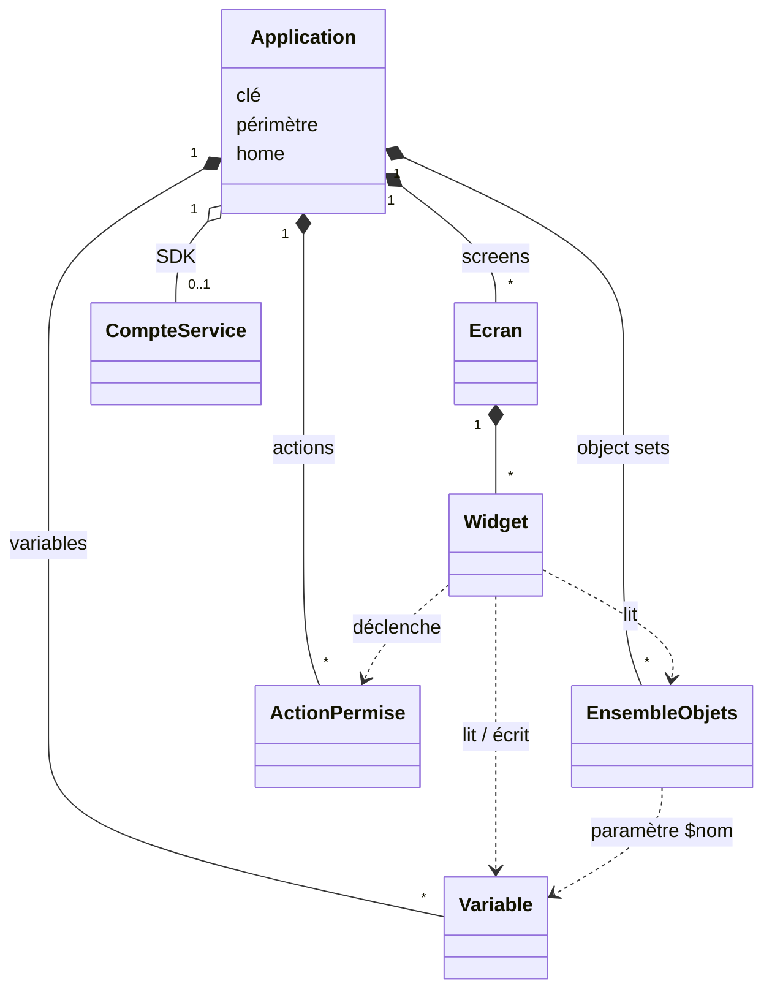
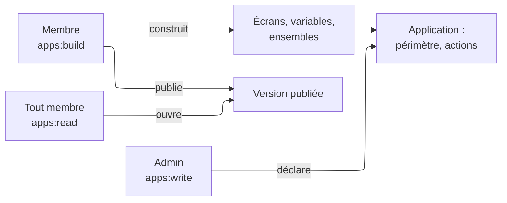
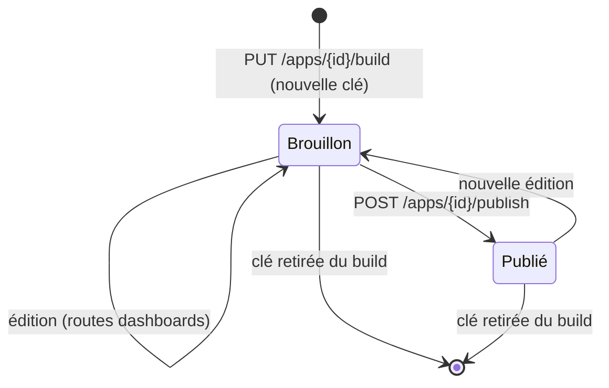
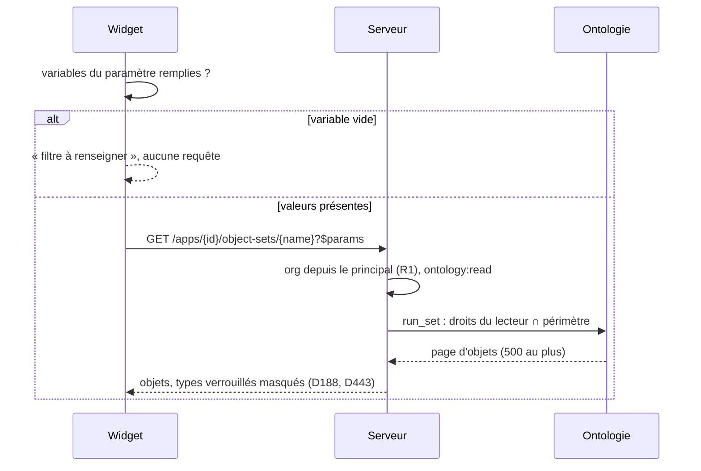
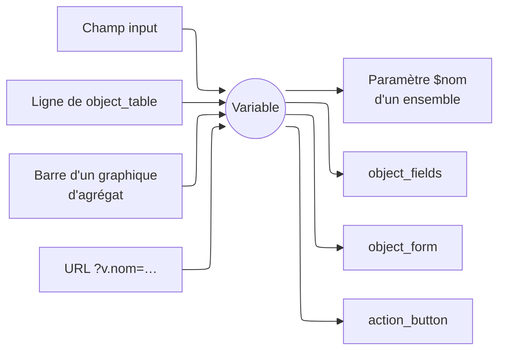
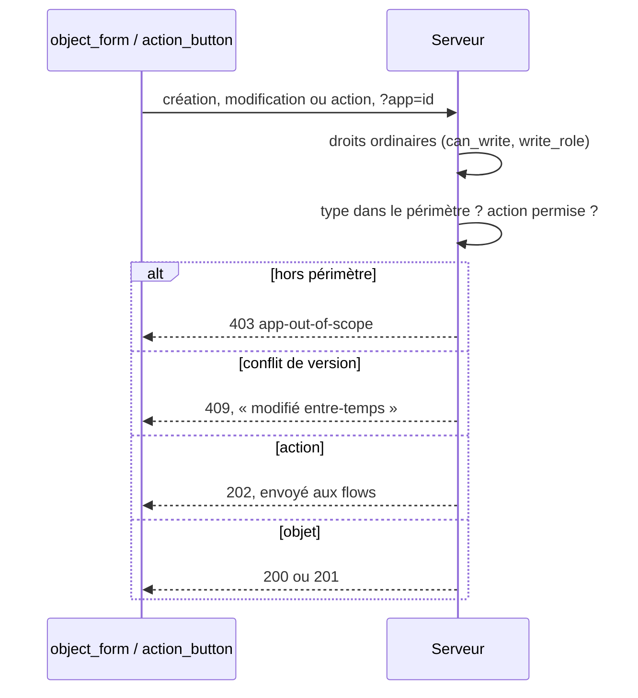
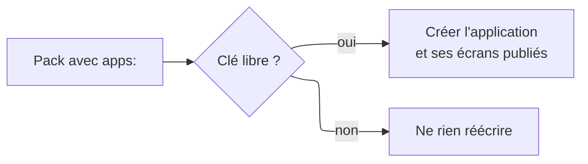

# Applications construites dans PneX : écrans métier sur l'ontologie (D506–D513)

**Statut : codé, en pause.** Les lots AB0–AB5 sont livrés (commit `546904b9`). Shan a mis le chantier en pause le 2026-11-02. Aucun nouveau lot ne démarre sans son accord. Le code livré reste en place et reçoit des correctifs.

Liens : `external-apps.md` (D432–D441, D560), `viz.md` (D24, D40, D123–D133, D579–D588), `ontology.md` (D183, D185, D187, D188), `iam.md`, `design-system.md` §7 (lexique) et §8 (coquille d'éditeur), `security.md` (R1–R23), `ai-assistant.md`, `api.md`, `crm.md` (D726).

## 1. Résumé

Une application (D433) peut avoir une interface construite dans PneX, sans code. Cette interface est un ensemble d'écrans qui lisent et écrivent des objets de l'ontologie. Elle sert aux membres d'une org qui travaillent sur des objets : chercher, consulter, saisir, déclencher une action. Un tableau de bord sert à regarder des séries. Une application sert à travailler sur des objets. Une application ne donne aucun droit : elle réduit les droits du lecteur à son périmètre.

## 2. Concepts

- **Application** : objet D433 de l'org. Elle a une clé, un périmètre (types d'objets), des ensembles d'objets, des actions permises, et en option un compte de service.
- **Écran** : document de mise en page versionné, rattaché à une application. Techniquement, c'est un tableau de bord avec `app_id`.
- **Écran d'accueil** (`home`) : écran ouvert par défaut.
- **Ensemble d'objets** (D434) : requête nommée de l'application (type, filtres, tri). Un filtre peut porter un paramètre `$nom`.
- **Variable** : valeur nommée, partagée entre les écrans d'une application, pour une session.
- **Action permise** (D440) : action `type.action` que les écrans peuvent déclencher.
- **Widget de données** : widget qui lit ou écrit des objets. Il existe seulement dans un écran d'application.
- **Constructeur** : rôle qui édite les écrans, les variables et les ensembles (permission `apps:build`).

Une application peut avoir des écrans seulement, un compte de service seulement (SDK, `external-apps.md`), ou les deux.

| | Tableau de bord | Application |
|---|---|---|
| Usage | Regarder : supervision, métriques, contrôles | Travailler : chercher, consulter, saisir, agir |
| Données | Séries (`SourceRef`), mémoire, contrôles | Ensembles d'objets de l'application, dans son périmètre |
| Où | Menu Dashboards | Lanceur Applications (`/apps`) |

Les deux partagent le moteur de rendu, l'éditeur (`EditorShell`) et les widgets de métriques. Un écran peut donc afficher une jauge.

## 3. Fonctionnement

### 3.1 Qui fait quoi

L'admin déclare l'application dans la page Accès, onglet Applications. Le constructeur édite le reste dans `/apps/{app}/build`. Tout membre de l'org voit dans le lanceur les applications qui ont un écran publié.

### 3.2 Cycle de vie d'un écran

Le lecteur voit toujours la version publiée de l'écran. Le constructeur édite la version courante sans casser ce que les autres utilisent. La publication vérifie chaque écran contre l'application telle qu'elle est. Avant sa première publication, un écran répond 404 au lecteur.

Un écran n'apparaît pas dans la liste des tableaux de bord, ni dans la recherche globale, ni dans les outils de l'assistant. `DELETE /dashboards/{id}` sur un écran répond 404 : un écran se supprime avec sa clé, par le build.

### 3.3 Lire des objets

Un paramètre porte une valeur seulement (`bind`). Il ne porte jamais une clé, un opérateur ni une traversée. Le serveur réserve les paramètres `limit`, `offset`, `sort` et `desc`. Le front ne reçoit jamais une liste complète.

### 3.4 Variables

Une variable a un `name` (`[a-z][a-z0-9_]*`), un `kind` (`text`, `number`, `date`, `object`, `enum`) et un `default`. Les genres `object` et `enum` exigent un `type_key`. Le genre `enum` exige aussi une `property`. Un second clic sur la même barre vide la variable (`crm.md` D726). L'état reste local à la session : il n'est jamais écrit en base.

### 3.5 Écrire des objets

Les écrans utilisent les routes d'écriture existantes, avec les mêmes services et les mêmes 409. Un client qui omet `?app=` garde ses droits ordinaires. Une action déclenchée ne renvoie pas de résultat : l'écran affiche « envoyé », puis recharge.

### 3.6 Application livrée par un pack

Une montée de version du pack ne réécrit jamais l'application. Exemple : le pack `crm` (depuis 3.2.0) livre « Suivi commercial » (clé `sales_follow_up`).

## 4. Exigences

1. Une application ne doit donner aucun droit. Elle doit seulement réduire les droits du lecteur à son périmètre.
2. Le serveur doit prendre l'org depuis le principal (R1), jamais depuis la requête.
3. Le serveur doit vérifier le périmètre et les actions permises, pas seulement l'interface.
4. Un widget doit afficher les valeurs en texte, jamais en HTML (R11–R13).
5. Un paramètre d'ensemble doit être une valeur, jamais une expression.
6. Le save du build doit refuser un ensemble, une variable ou une propriété inconnue.
7. Le moteur ne doit contenir aucun métier (D441). Les exemples et tests utilisent une ontologie inventée (`article`, `auteur`).
8. Un libellé visible doit passer par les deux `.ftl` et le lexique D218 (« Écran », « Variable » dans `lexicon_guard`).
9. Sur un écran étroit, un écran doit empiler ses widgets par ordre de lecture.

## 5. Décisions

### D506 — Une application a une interface construite, externe, ou les deux

L'application D433 gagne des écrans, un écran d'accueil et des variables. Ses requêtes restent ses ensembles d'objets (D434), ses écritures ses actions permises (D440).

### D507 — Un écran est un document de mise en page versionné, rattaché à son application

Un écran est une ligne de `dashboards` avec `app_id` (`ON DELETE CASCADE`). Il réutilise les versions, les 409, l'éditeur et la validation des tableaux de bord.

### D508 — Un widget de données lit un ensemble d'objets de son application, avec les droits du lecteur

`WidgetOptions.object_set` nomme l'ensemble. La lecture passe par `GET /apps/{id}/object-sets/{name}`, droits du lecteur ∩ périmètre.

### D509 — Les widgets d'une application communiquent par des variables déclarées

Les variables sont déclarées au niveau de l'application et partagées entre ses écrans. Une variable est une valeur, jamais une expression.

### D510 — Trois widgets de lecture et de saisie

`object_table` (lignes, tri, pages, clic → variable et écran cible), `object_fields` (fiche d'un objet), `input` (champ typé qui écrit une variable).

### D511 — Deux widgets d'écriture, par les routes existantes et la liste d'actions permises

`object_form` crée ou modifie un objet sur `expected_version`. `action_button` déclenche une action D183 permise. Précision de D123 : écrire une donnée est permis, agir sur un device reste réservé aux flows déployés.

### D512 — Ni source externe, ni code, ni HTML dans une application

Pas de connecteur SQL, REST ni GraphQL : les données externes entrent par l'ingestion (D317), avec leur provenance (D184). Pas de JS, de Starlark ni d'expression `{{ }}`. Pas de HTML ni de CSS libre. Amendée par D560 : une application en code est admise sur une origine isolée (`external-apps.md`).

### D513 — Le lanceur, la vue plein écran et les gardes habituelles

Lanceur « Applications », vue `/apps/{app}/{screen}`, routes au spec, à `exposure.rs` et à `iam.rs`, fiche de l'assistant, écrans livrés par pack.

### Questions tranchées (Shan, 2026-10-29)

| # | Décision |
|---|---|
| Q-B1 | Qui construit : permission `apps:build` (niveau Membre, comme `dashboards:write`). Le périmètre et les actions restent `apps:write` (Admin) |
| Q-B2 | Le lecteur voit la version publiée (pointeur, comme les flows et les visites) |
| Q-B3 | Tout membre de l'org voit le lanceur. Une restriction par rôle viendra plus tard |
| Q-B4 | Pas de partage hors de l'org |
| Q-B5 | Pas de retour d'un flow vers l'écran : « envoyé », puis rechargement |
| Q-B6 | Pas de mode d'édition mobile : l'écran s'empile sur écran étroit |

## 6. Interfaces

| Route | Opération | Permission | MCP |
|---|---|---|---|
| `PUT /api/v1/apps/{id}/build` | `apps_build` : écrans, accueil, variables, ensembles, sur `expected_version` | `apps:build` | exclu |
| `POST /api/v1/apps/{id}/publish` | `apps_publish` | `apps:build` | exclu |
| `GET /api/v1/apps/{id}/screens/{key}` | `apps_screens_get` : version publiée | `apps:read` | exposé |
| `GET /api/v1/apps/{id}/object-sets/{name}` | `apps_object_sets_run` | `ontology:read` | exposé |
| `POST /api/v1/apps/{id}/object-sets/{name}/aggregate/query` | `apps_object_sets_aggregate_query` : agrégats d'un ensemble (`viz.md` D579–D588) | `ontology:read` | exposé |
| `?app=<id>` sur création, modification et action d'objet | contrôle du périmètre (D511) | celle de la route | — |

Le contenu d'un écran s'édite par les routes `/dashboards`, sous la garde `apps:build`. Code d'erreur : `app-out-of-scope` (403).

| Widget (`pnex_core::viz`) | Rôle |
|---|---|
| `object_table` | Tableau d'objets, clic sur une ligne → variable `object` |
| `object_fields` | Fiche d'un objet |
| `input` | Champ typé qui écrit une variable |
| `object_form` | Formulaire de création ou de modification |
| `action_button` | Bouton d'action D183 |

Pages du front : `/apps` (lanceur), `/apps/{app}/build` (constructeur), `/apps/{app}/{screen}?v.<nom>=…` (vue). Code : `crates/pnex-core/src/apps.rs`, `crates/pnex-backend/src/controllers/apps.rs`, `crates/pnex-frontend/src/pages/apps/`, `crates/pnex-frontend/src/components/app_widgets.rs`. Fiche de l'assistant : `crates/pnex-backend/assistant-kb/applications.md`.

Tests : `crates/pnex-backend/tests/apps.rs` (`a_screen_reads_and_writes_inside_its_application`), `tests/crm.rs` (`the_pack_ships_its_screens`), `e2e/tests/crm.spec.ts` (écrans de « Suivi commercial »).

## 7. Reste à faire

Le chantier est en pause. Chaque point attend l'accord de Shan.

- La vue reste dans la coquille PneX (barre latérale visible), pas en plein écran comme D513 le prévoit.
- Pas d'aperçu d'un écran non publié : il faut publier pour le voir.
- L'assistant ne propose pas de brouillon d'écran (prévu par D513).
- Le tri d'un tableau ne porte pas sur le titre.
- Pas de spec e2e par lot (AB1–AB4). Seul `crm.spec.ts` ouvre des écrans. Non essayés en réel : le lien profond `?v.`, une action reçue par un flow déployé (202), le 409 d'un formulaire, un rôle masqué, le mode sombre.
- Restriction du lanceur par rôle (Q-B3) : à décider.
