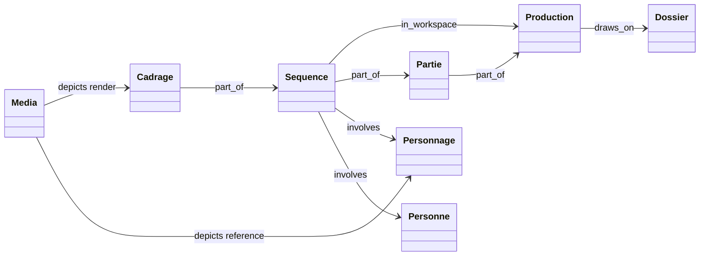
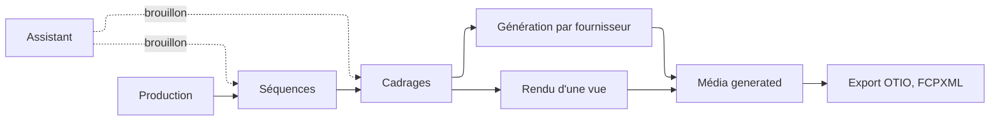
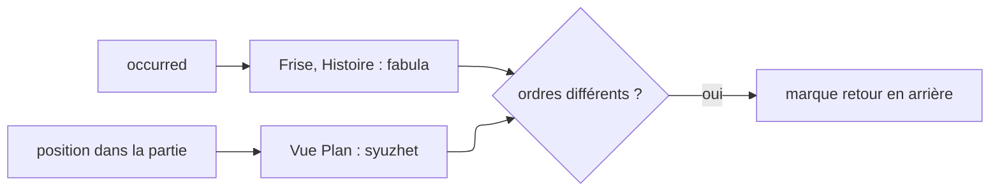
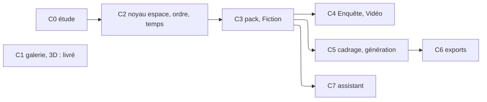

# Création assistée : noyau et pack (D225–D237)

| | |
|---|---|
| Statut | Décisions D225–D237 validées. Lot C1 livré (galerie, visionneuse 3D). Lots C2 à C7 proposés, sans code |
| Roadmap | P2.22 |
| Repose sur | `cases.md` (espace de travail, vues, K49, K55), `ontology.md` (événements, liens), `media.md` (versions, lecteur), `design-system.md` (D220–D222, lexique §7), `ai-assistant.md` (§9.3) |

## Résumé

La création assistée produit des vidéos et des récits depuis les données de la plateforme. Elle aide à
chaque étape : idée, structure, séquences, cadrages, médias, génération, export vers un monteur.
Elle sert trois usages : l'enquête, la vidéo et la fiction. Elle crée le moins de types possible :
une séquence est un événement, une production est un espace de travail comme le dossier. Les vues
des dossiers (frise, Histoire, graphe, carte, Argent) servent donc sans code nouveau.

## 1. Concepts

- **Production** : espace de travail de création, type du pack `creation` (D225). Elle porte un profil.
- **Profil** : usage de la production (`profile`) : Enquête, Vidéo ou Fiction. Il choisit les modèles de page, les sections de fiche et la vue par défaut.
- **Séquence** : événement du noyau (`event`) membre d'une production (D226). Ce document l'appelle aussi « scène » pour la notion narrative.
- **Partie** : niveau d'ordre entre la production et ses séquences : chapitre, accroche, développement, conclusion.
- **Personnage** : type `character` du pack. Ce n'est jamais une personne réelle (D230).
- **Cadrage** : type `shot` du pack, unité visuelle d'une séquence (D232). Son résultat est un média.
- **Galerie** : médias liés à un objet par le lien système `depicts` (D231).
- **Fabula** : ordre chronologique des faits, porté par `occurred` de l'événement.
- **Syuzhet** : ordre de présentation, porté par la position dans une partie (D229). Un retour en arrière est un écart entre les deux ordres.
- **Vue Plan** : arbre ordonné d'un conteneur, dans la coquille d'éditeur (D222).

Les trois profils partagent un seul modèle :

| Profil | Départ | Ajout |
|---|---|---|
| Enquête | un dossier | les séquences impliquent les objets du dossier, chaque cadrage garde sa source |
| Vidéo | un sujet | parties, métadonnées de publication, sous-titres depuis la transcription |
| Fiction | une prémisse | personnages, fils, chapitres, temps relatif, analyse de répartition |

## 2. Fonctionnement

### 2.1 De l'idée à l'export

L'assistant propose des séquences et des cadrages. Il écrit un brouillon, jamais un fait (D237).
Régénérer un cadrage crée une nouvelle version du média. Les versions précédentes restent.
Le monteur reçoit la timeline. Un cadrage sans média devient un trou visible (`MissingReference`).

### 2.2 Deux ordres

La frise et l'Histoire montrent la fabula. La vue Plan montre le syuzhet et peut afficher la date de
chaque séquence. Le temps relatif (D228) change seulement l'affichage : `occurred` reste un intervalle daté.

### 2.3 Visionneuse 3D (livrée, lot C1)

La visionneuse affiche un GLB dans une vue en orbite. Elle lit les animations du fichier et montre le
squelette. L'utilisateur choisit une articulation dans une liste et l'oriente avec 3 curseurs. Une
**pose nommée** enregistre les angles et une vignette PNG comme média de la galerie. Un clic réapplique
la pose. La visionneuse sert aussi sur la fiche d'un média GLB.

Code : `crates/pnex-frontend/js/mesh.js` (three.js 0.186.1, MIT, dans le bundle `viewers.js`) et
`components/mesh_viewer.rs`. Le rigging automatique, l'animation pilotée et la génération 3D sont hors lot.

**Note :** un GLB d'un générateur automatique peut avoir un squelette sans poids. Les articulations
tournent mais le maillage ne bouge pas. La fiche `assistant-kb/ontology.md` donne le geste.

## 3. Exigences

1. Un objet de tout type, sauf un média, doit montrer un onglet Galerie (livré).
2. Une pose doit être un objet JSON de quaternions finis par articulation, validé par le serveur (`pose_valid`, livré).
3. Un lecteur doit recevoir 403 sur l'écriture d'un lien `depicts` (livré).
4. Après le passage à `in_workspace`, un dossier existant doit s'ouvrir sans régression (e2e `cases.spec`).
5. Une production fictive doit montrer ses séquences sur la frise en « J+n » et dans la vue Plan dans l'ordre de présentation.
6. La vue Plan doit marquer une séquence présentée avant une séquence plus ancienne.
7. La vue Histoire d'une production fictive doit tracer les fils des personnages sans code de vue ajouté.
8. Un objet d'un type `personal` doit être masqué à l'export et sur une page publique, sauf marque « public » humaine.
9. Un objet marqué « mineur » ne doit jamais devenir public.
10. Un média généré doit montrer la pastille « généré » partout où il s'affiche.
11. La plateforme ne doit faire aucun calcul GPU. Le serveur ne rend aucune vidéo.
12. Une séquence proposée en profil Enquête doit impliquer des objets du dossier. Une phrase sans objet source est marquée « non sourcée ».

## 4. Décisions

### D225 — La production est un espace de travail, comme le dossier

Le noyau généralise `CaseWorkspace` : un conteneur, ses membres, ses vues. Le lien `in_case` devient
`in_workspace`, ouvert à tout type déclaré `workspace: true`, sans compatibilité (beta). Le dossier
reste un type système. Une production en profil Enquête référence un dossier par `draws_on` et ne copie rien.

### D226 — La scène est un événement

Une séquence est un `event` membre d'une production. Personnages, lieux, objets et pièces s'y
attachent par `involves`, avec les rôles existants. Une séquence sans date est absente de la frise et présente dans la vue Plan.

### D227 — Un pack peut ajouter des rôles d'attachement

Le noyau accepte des rôles de `involves` déclarés par un pack (`involves_roles`). Le pack `creation`
déclare `pov` et `mention`. Après la désinstallation du pack, ses rôles quittent les sélecteurs et les liens restent lisibles.

### D228 — Temps relatif

Un espace de travail peut porter une origine et un affichage relatif (« J+3 », « T+12 min »). Seul l'affichage change.

### D229 — Liens ordonnés et vue Plan

Un type de lien peut déclarer `ordered: true` : le noyau gère un rang fractionnaire. Le pack déclare
`part_of` ordonné. La vue Plan sert aussi aux étapes d'une procédure et d'un ordre de travail.
Le tableau des cadrages est une vue Plan en grille.

### D230 — Un personnage n'est jamais une personne réelle

Une `person` n'est jamais convertie en `character`. Une production peut mêler les deux, mais la
légende les sépare par la couleur et une pastille « réel » marque les personnes.

### D231 — Assets sur tout objet

Lien système `depicts` (média → tout objet) avec un `role` : `reference`, `model`, `voice`, `pose`,
`render`. Les versions sont celles du média (D221). Livré avec la galerie, le format GLB (type de média `mesh`) et la visionneuse 3D (§2.3).

### D232 — Le cadrage : un type du pack, le résultat est un média

Le type `shot` porte cadrage, mouvement, durée, dialogue, prompt, paramètres et fournisseur. Son
résultat est un média `depicts` de rôle `render`. En profil Enquête, un cadrage peut être le rendu d'une vue du dossier, avec ses filtres.

### D233 — Données personnelles masquées par défaut à l'export

Une définition de type peut déclarer `personal: true`. La publication demande un geste humain : l'étiquette système « public » (D218), tracée dans la provenance. La protection n'en demande aucun.

### D234 — Génération par les fournisseurs de l'organisation

Image, vidéo, voix et 3D passent par les fournisseurs de l'org, avec sa clé (extension de D119).
Clés au coffre (D110–D118), appels sortants par la garde (R8), aucune clé en lecture (R4, R16).

### D235 — « Contenu généré » se voit et se transporte

Un média généré porte `generated: true`, le fournisseur et le prompt (provenance D184). Le manifeste
C2PA signé est reporté : la donnée `generated` suffit pour l'écrire plus tard sans migration.

### D236 — Exports

Timeline en OpenTimelineIO (JSON) et FCPXML, écrits en Rust sans dépendance. Vidéo des vues rendue
dans le navigateur (WebCodecs), en 1080×1920 et 4K. L'export glTF du graphe et des lieux vient plus tard.

### D237 — L'assistant écrit un brouillon, jamais un fait

Les outils écrivent par les services partagés avec l'UI (`ai-assistant.md` §9.3), avec
`expected_version` et `can_write`. L'assistant n'invente aucun fait sur une personne réelle et ne touche jamais un objet `personal`.

## 5. Interfaces

### 5.1 Partage noyau et pack

| | Noyau | Pack `creation` (YAML) |
|---|---|---|
| Modèle | `in_workspace` (D225), rôles de pack (D227), temps relatif (D228), liens ordonnés (D229), `depicts` (D231), `personal` (D233), `generated` (D235) | types `production`, `part`, `character`, `shot` ; liens `part_of`, `draws_on` ; rôles `pov`, `mention` ; modèles de page par profil |
| Vues | vues des dossiers, vue Plan, Galerie, visionneuse 3D | aucune |
| Calcul | analyse de répartition (présence par personnage, lieu, fil, partie), en Rust | — |
| Export | OTIO, FCPXML, vidéo des vues | — |
| Assistant | outils D237, fiche `assistant-kb` | règles d'aide du profil |

Une fonction utile seulement à la création va dans le pack. Une fonction qui sert ailleurs va au noyau.

### 5.2 Code livré (C1)

| Élément | Emplacement |
|---|---|
| `REL_DEPICTS`, `DEPICTS_ROLES`, `pose_valid` | `crates/pnex-core/src/ontology/mod.rs` |
| Écriture et contrôle des poses | `crates/pnex-backend/src/services/ontology/links.rs` |
| Reconnaissance GLB | `crates/pnex-backend/src/services/media_sniff.rs` |
| Galerie | `crates/pnex-frontend/src/components/ontology/gallery.rs` |
| Visionneuse | `crates/pnex-frontend/js/mesh.js`, `src/components/mesh_viewer.rs` |
| Tests | `gallery_depicts_a_model_and_its_poses` (`tests/ontology.rs`), `e2e/tests/gallery.spec.ts` avec `e2e/src/rig_glb.ts` |

### 5.3 Salle blanche

PneX est sous MIT. L'étude du corpus suit l'annexe B de `ontology.md` :

- Étudier des concepts et des comportements, jamais du code, des textes d'interface ni des icônes.
- Écrire un schéma au niveau concept, sans noms de tables ni de colonnes.
- Rédiger les sections de fiche avec nos mots. Ne recopier aucune liste de questions.
- Garder les notes dans `research/assisted-creation/` et les captures hors du dépôt.
- Utiliser un outil copyleft ou Python seulement à côté de PneX (montage, rendu), jamais dedans.

## 6. Lots

C1 et C2 servent aussi hors création. Le lot C7 accompagne chaque lot visible.

## 7. Reste à faire

- C1 : choisir une articulation par un clic sur le modèle (aujourd'hui : une liste).
- C1 : servir les vignettes en petite taille (aujourd'hui : l'image entière).
- C0 : notes de salle blanche. Le dossier `research/assisted-creation/` n'existe pas.
- C2 à C7 : rien n'est codé (`in_workspace`, `involves_roles`, `ordered`, `draws_on`, `generated`, OTIO, FCPXML absents du code).
- Décision de Shan : D233 recoupe la classification `personal` déjà codée (D442, `services/ontology/redact.rs`). Garder un drapeau de type ou réutiliser la classification ?
- Question : liste blanche initiale des fournisseurs de génération et format commun des paramètres.
- Question : WebCodecs sur web, desktop WebKitGTK et Android, et le repli là où il manque.
- Question : sections de la fiche personnage.
- Question : un objet membre de deux espaces de travail (un dossier et sa production). Proposé : autorisé, et la suppression d'un membre retire seulement l'appartenance.
- Question : C2PA, quelle clé de signature (PKI de l'org, D153 ?) et seulement à l'export ?
