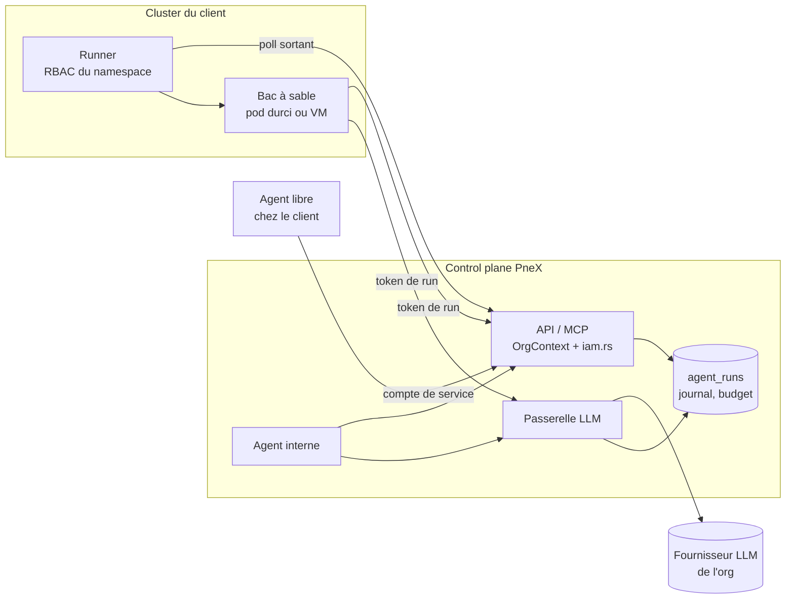

# Agents autonomes — PRD (D378–D401)

| | |
|---|---|
| Statut | **Proposé le 2026-10-23, rien d'implémenté** |
| Numérotation | **D378…D401**, lots **A0…A5** |
| Repose sur | IAM et comptes de service (`iam.md`, D285–D299), MCP (`mcp.md`, D245–D250), assistant (`ai-assistant.md` §9, D142–D145), propositions (`proposals.md`, D367, D371–D377), usages LLM (`media-import-pipeline.md` D212), fabric de workers (`worker-fabric.md`, §14 bacs à sable), coffre (`secrets.md`, D110–D119), egress (`security.md` R8), extension navigateur (`extension-collector.md`) |
| Sécurité | `security.md` §6 avant tout lot ; finding = ligne SEC-n au §7 |

## 0. Ce qui existe déjà (à réutiliser, pas à refaire)

| Brique | Où | Ce qu'elle apporte ici |
|---|---|---|
| Principal machine, permissions `service:verb` | `pnex-api-contract/src/iam.rs`, extracteur `OrgContext` | L'agent est un compte de service ; ses droits sont des permissions déjà inscrites |
| Outils exposés et motifs d'exclusion | `pnex-api-contract/src/exposure.rs`, `/api/v1/mcp` | Le catalogue d'outils d'un agent = un sous-ensemble d'`EXPOSED` ; rien d'`EXCLUDED` |
| Consignes de l'assistant | `ai-assistant.md` §9.3 | Aucune action physique, ni deploy, ni stop, ni suppression ; `expected_version` |
| Propositions | `proposals.md` | Porte humaine : l'agent propose, une personne retient ou rejette |
| Fournisseurs et usages LLM | `llm_providers`, `llm_usages` (D212), `services/ai/config.rs::resolve` | Routage par usage déjà en place (`assistant`, `extraction`, `vision`) |
| Compteur journalier | `services/flow_ai.rs::count_daily` (Valkey, `pnex:<what>:v1:<org>:<jour>`) | Base du budget par usage |
| Workers distants, join-by-token, capabilities | `worker-fabric.md` | Enregistrement des exécutants hors du control plane |
| Agent externe déjà surveillé | `extension-collector.md` (missions, verrou, rythme) | Premier cas réel d'« agent externe » : le modèle doit le couvrir sans le casser |
| Egress gardé | `pnex_core::egress` (R8) | Sorties réseau des agents internes |

Ce PRD ajoute une **couche de gouvernance** (agent, politique, run, budget,
délégation) et un **exécuteur de bacs à sable** dans la fabric. Il ne crée
pas un second moteur d'outils, ni un second système de droits.

## 1. Constat

- Des agents autonomes existent déjà autour de PneX (extension navigateur,
  scripts clients branchés sur le MCP) ; chacun a son propre contrôle, ou
  aucun.
- Un client veut faire tourner ses propres agents (Agent SDK, LangGraph,
  n8n…) sur ses données PneX, avec un journal, un budget et un bouton
  d'arrêt au même endroit.
- Les agents qui écrivent du code ont besoin d'un environnement à eux
  (compilation, tests, packaging) que ni le control plane ni un worker
  actuel ne fournissent.
- Le LLM est consommé à plusieurs endroits (assistant, nœuds `llm_text`,
  `vision_caption`, `media_fuse`, recherche, création assistée) ; un agent
  qui boucle ne doit pas épuiser le budget des autres.

## 2. Objectifs / non-objectifs

**Objectifs**

- Un agent = une identité de l'org, des droits bornés, une politique par
  tâche, un journal de runs, un budget, un arrêt immédiat.
- Trois niveaux de confinement, dits honnêtement dans l'UI (D378).
- Une passerelle LLM unique pour tous les consommateurs de l'org,
  budgétée par usage et par run (D383–D385).
- Des bacs à sable éphémères (pod durci ou VM) dans les clusters du
  client, sans qu'aucun identifiant de cluster ne réside dans PneX
  (D386–D388).
- Équipes et délégation, sans escalade de droits (D390).
- Chaque agent configurable : placement, moteur (agent de code), rôle
  (system prompt) et compétences, sans que rien de cela n'ouvre de droit
  (D393–D396).
- Exploitable en production industrielle : runs reprenables, déclencheurs
  par événement, évaluation avant promotion, file équitable, journal
  d'audit opposable (D397–D401).
**Non-objectifs**

- Pas de framework d'agents maison concurrent des SDK : PneX gouverne,
  il n'impose pas la boucle de raisonnement de l'agent externe.
- Pas de LLM fourni par la plateforme (D119 inchangé).
- Aucune action physique, deploy, stop ni suppression par un agent (D391).
- Pas de fleet manager : la fabric enregistre et route, le runner crée
  les bacs à sable dans son propre namespace (`worker-fabric.md` §13).

## 3. Vocabulaire

À reporter au lexique (`design-system.md` §7) et à la garde
`lexicon_guard.rs` au premier lot qui rend la notion visible.

| Notion | fr-FR | en-US | Définition |
|---|---|---|---|
| Agent | Agent | Agent | Identité autonome de l'org (compte de service) + sa politique |
| Run | Exécution | Run | Une tâche menée par un agent, du lancement à la fin ; unité de journal, de budget et de nettoyage |
| Politique | Politique | Policy | Outils permis, budget, limites, portes humaines |
| Équipe | Équipe | Team | Agents partageant une mission et un budget |
| Bac à sable | Bac à sable | Sandbox | Environnement éphémère (pod ou VM) d'un run |
| Runner | Runner | Runner | Worker de la fabric doté de l'exécuteur de bacs à sable, installé dans un cluster |
| Moteur | Moteur | Harness | Agent de code qui mène la boucle d'un agent hébergé (Claude Code, Codex CLI, OpenCode…) |
| Rôle | Rôle | Role | System prompt versionné + compétences par défaut + politique suggérée ; n'ouvre aucun droit |
| Compétence | Compétence | Skill | Instructions (`SKILL.md`) + fichiers joints, versionnées par org |
| Passerelle LLM | Passerelle LLM | LLM gateway | Point d'appel unique des modèles de l'org |

« Worker » reste réservé à la fabric (calcul) ; un agent n'est pas un
worker, il **s'exécute sur** un runner.

## 4. Trois niveaux de confinement (D378)

| Niveau | Où tourne la boucle de l'agent | Outils | Ce que PneX garantit | Ce qu'il ne garantit pas |
|---|---|---|---|---|
| **Interne** | Dans le backend PneX | Registre fermé (sous-ensemble d'`EXPOSED`) | Tout : droits, budget, journal complet, arrêt | — |
| **Hébergé** | Dans un bac à sable créé par un runner | N'importe quel outil **dans** le bac + API/MCP PneX | Droits PneX, egress filtré, LLM via passerelle, durée et ressources bornées, destruction en fin de run | Ce que l'agent fait de son temps CPU dans le bac |
| **Libre** | Chez le client, hors de PneX | Ce qu'il veut | Droits PneX, journal des appels qui passent par PneX, budget d'appels, révocation | Les prompts, les coûts LLM s'il apporte son modèle, ses autres actions |

- Le niveau est un champ de l'agent, affiché sur sa fiche et sur chaque
  run. Un agent libre n'est jamais présenté comme « confiné ».
- L'agent de l'extension navigateur entre dans le niveau **libre**
  (navigateur de l'utilisateur) ; ses missions deviennent des runs au lot
  A1, sans changer son protocole.

## 5. Identité et droits (D379)

- Un agent **est** un compte de service de l'org (`iam.md`, P2.25) avec
  un rôle géré ou des permissions explicites. Aucun nouveau type de
  principal.
- Chaque run reçoit un **token de run** : durée courte (au plus la durée
  max du run), lié à `(org, agent, run)`, portant les permissions de la
  politique (intersection, jamais union, avec celles de l'agent).
  Révoqué à la fin du run ou à l'arrêt.
- L'org vient toujours du principal (R1) ; le backend re-vérifie chaque
  appel comme pour un appel humain. Le token de run n'ouvre aucune route
  `Platform`.
- Un agent ne voit jamais un secret en clair (R4, R16) : les secrets
  dont un run a besoin (git, registre) sont livrés au runner, scopés et
  courts, jamais via une sortie d'outil.

## 6. Politique de tâche (D380, D381)

Une politique est un document versionné, attaché à l'agent (défaut) et
surchargeable par run, **seulement en resserrant** :

| Champ | Effet |
|---|---|
| `tools` | Liste blanche d'opérations (ids du spec) ; refus `agent-tool-denied` + `args.operation` |
| `budget` | Plafonds du run : tokens LLM, appels API, coût estimé, durée murale |
| `max_steps` | Nombre maximum de tours de boucle (agent interne et hébergé) |
| `loop_guard` | Même appel (opération + arguments normalisés) répété N fois dans une fenêtre → arrêt `agent-loop-detected` |
| `approval` | Opérations qui passent par une **proposition** (D367) au lieu d'écrire directement |
| `isolation` | `pod` ou `vm`, ressources, image de toolchain (agents hébergés) |
| `egress` | Liste blanche d'hôtes sortants (agents hébergés et internes) |
| `ttl` | Durée de vie des objets éphémères créés par le run (D389) |
| `runners` | Runners ou étiquettes autorisés pour le placement (D393) |
| `max_resumes` | Nombre de reprises après interruption (D397) |
| `concurrency` | Runs simultanés de l'agent, priorité par défaut (D400) |

- **D381 — Les droits viennent de la politique, jamais du contenu.** Un
  texte lu par l'agent (page web, document, message) ne peut ni élargir
  ses outils, ni lever une porte, ni prolonger un budget. C'est la
  réponse à l'injection de prompt : on borne ce que l'agent peut faire
  quand il est trompé.
- Écritures : `expected_version` obligatoire, comme pour l'assistant ; un
  409 est rendu à l'agent, jamais contourné.
- Chaque refus est un code machine + `args`, avec sa clé `err-<code>`
  dans les deux `.ftl`.

## 7. Configuration d'un agent (D393–D396)

La fiche d'un agent assemble cinq réglages indépendants, versionnés avec
l'agent (historique de versions commun, D221) et affichés sur sa fiche :

| Réglage | Question | Décision |
|---|---|---|
| Placement | Où tourne-t-il ? | D393 |
| Moteur | Quel agent de code mène la boucle ? | D394 |
| Rôle | Quel system prompt, quelle posture ? | D395 |
| Compétences | Quelles skills sont chargées ? | D396 |
| Politique | Quels droits, quel budget ? | D380 (inchangé) |

Le fournisseur et le modèle LLM restent réglés par D383. Un run fige la
version de chaque réglage (comme la politique), pour qu'un run se relise
tel qu'il a tourné.

**D393 — Placement explicite.** Le niveau (D378) se précise d'une cible :

| Niveau | Cible |
|---|---|
| Interne | Le backend PneX ; rien à choisir |
| Hébergé | Un runner nommé, ou des étiquettes (`cluster:prod-a`, `arch:arm64`, `gpu`) que le scheduler matche avec les capabilities du runner (`worker-fabric.md` §14) |
| Libre | Aucune : PneX n'exécute rien, il identifie et journalise |

- Le placement est surchargeable par run, seulement parmi les runners que
  la politique autorise (`runners` ajouté à la politique).
- Aucun runner compatible joignable : le run reste `queued` puis passe
  `expired`. Jamais de repli silencieux vers un autre cluster ni un autre
  niveau.

**D394 — Moteur configurable (agents hébergés).** Le moteur est l'agent
de code qui mène la boucle dans le bac à sable : Claude Code, Codex CLI,
OpenCode, Aider, Goose, ou une boucle maison (Agent SDK, LangGraph…).

- **Catalogue de moteurs par org** : image (toolchain + moteur, épinglée
  par digest, base Chainguard/Wolfi), commande d'entrée, protocole LLM
  attendu (OpenAI ou Anthropic, servi par la passerelle D385), emplacement
  attendu des instructions et des compétences.
- **PneX génère la configuration du moteur** au lancement, à partir de la
  fiche : fichier d'instructions, réglages, serveur MCP PneX pointé avec
  le token de run, URL de la passerelle. L'agent n'écrit pas sa propre
  configuration ; une modification faite dans le bac ne survit pas au run.
- Le moteur ne change aucune garantie : mêmes droits, même passerelle,
  même egress, même journal.
- Agent interne : le moteur est la boucle PneX, pas de choix. Agent libre :
  moteur déclaré (affiché sur la fiche), non vérifié, dit tel quel.

**D395 — Rôles : system prompts versionnés.** Un rôle = un system prompt
+ des compétences par défaut + une politique suggérée.

- Bibliothèque fournie en modèles copiables (architecte, designer,
  relecteur de code, chef de produit, testeur, sécurité, rédacteur
  technique), plus les rôles propres à l'org.
- **Un rôle n'ouvre aucun droit** : c'est du contenu (D381). La politique
  suggérée pré-remplit la création d'un agent, elle n'est jamais appliquée
  implicitement.
- Instructions effectives d'un run = consignes fixes de la plateforme
  (D391, en tête, non retirables) + rôle + consignes propres à l'agent.
- Une équipe (D390) se compose par rôles : par exemple un superviseur
  chef de produit qui délègue à un architecte, un codeur et un relecteur.

**D396 — Compétences (skills) versionnées par org.** Une compétence =
des instructions (format `SKILL.md` : nom, description, corps) + des
fichiers joints optionnels (scripts, gabarits, références).

- Stockée par org, versionnée, attachée à un rôle ou à un agent.
- Agent hébergé : montée en lecture seule dans le bac, à l'emplacement
  attendu par le moteur ; ses scripts ne s'exécutent que dans le bac.
- Agent interne : instructions seulement, aucun script exécuté dans le
  backend.
- Import (dépôt git, fichier) : relu et activé par un humain
  (`agents:write`), jamais par un agent ni l'assistant.
- Une compétence ne porte ni droit ni secret : un secret détecté à
  l'import = refus `agent-skill-secret`.

## 8. Run : cycle de vie et journal (D382)

États : `queued → running → (waiting_approval | interrupted) → succeeded |
failed | stopped | expired` (`interrupted` : reprise, D397).

- Table `agent_runs` : `id`, `org_id`, `agent_id`, `parent_run_id`
  (délégation, D390), `team_id`, `level`, `policy` (copie figée),
  `placement`, `engine`, `role_version`, `skill_versions`
  (copies figées, D393–D396), `trigger` (D398), `priority` (D400),
  `state`, `started_at`, `ended_at`, `heartbeat_at`, `resumes` (D397),
  `usage` (tokens, appels, coût), `score` (D399), `stop_reason`,
  `created_by` ; étapes dans `agent_run_steps` (D397).
- **Heartbeat** : un run hébergé ou libre sans heartbeat au-delà du bail
  passe en `interrupted` puis reprend (D397), ou `expired` au-delà de
  `max_resumes` ; son token est alors révoqué, son bac à sable détruit.
- **Journal** : chaque appel d'outil et chaque appel LLM passé par PneX
  est un événement du run (stream O2 dédié, comme `notify_deliveries`),
  sans secret ni identifiant (R4).
- **Arrêt** : un geste humain dans l'UI (`agents:stop`), effet immédiat :
  token révoqué, bac à sable détruit, run `stopped`. Arrêt global par org
  et kill-switch plateforme `PNEX_AGENTS_ENABLED=false`, sur le modèle de
  `PNEX_AI_ENABLED`.
- Lancer un run : geste humain, planification (cron d'org), délégation
  par un run parent ou déclencheur (D398). L'assistant ne lance ni n'arrête de run (D391).

## 9. Passerelle LLM (D383–D385)

**D383 — Un usage `agent` dans D212, surchargeable par agent.**
`llm_usages` gagne l'usage `agent` ; l'agent (ou l'équipe) peut pointer
vers un autre fournisseur du catalogue de l'org. Résolution : agent →
équipe → usage `agent` → défaut de l'org. D119 inchangé : tout fournisseur
appartient à l'org.

**D384 — Budget par usage et par run.** Le compteur `count_daily`
(aujourd'hui `flow-ai` seul) devient un compteur par usage :
`pnex:llm:<usage>:v1:<org>:<jour>`, plafonds réglables par l'org. Un run
a en plus son propre plafond (D380). Le budget des agents ne consomme
jamais celui de l'assistant ni celui des flows.

**D385 — Une seule passerelle, exposée aux bacs à sable.**

- Tous les appels LLM de l'org passent par `config::resolve` + comptage ;
  c'est la passerelle. Pour les agents hébergés, elle est exposée en HTTP
  (compatible OpenAI et Anthropic) avec le token de run : **la clé du
  fournisseur n'entre jamais dans le bac à sable.**
- Modes LLM d'un agent, affichés sur sa fiche :

| Mode | Niveaux | Visibilité PneX |
|---|---|---|
| Passerelle | interne, hébergé (défaut), libre (option) | Totale : tokens, coût, budget, arrêt |
| Apporté | libre seulement | Aucune côté LLM ; seulement les appels API/MCP |

- Une clé injectée dans un bac à sable est refusée : du code non fiable
  qui lit une clé est une fuite.

## 10. Agents codeurs et bacs à sable (D386–D388)

Le détail d'infrastructure est dans `worker-fabric.md` §14 ; ici, les
règles du point de vue de l'agent.

- **D386 — Aucun identifiant de cluster dans PneX.** Un runner installé
  dans chaque cluster s'enregistre par join token (fabric §7), poll en
  sortant, et crée les bacs à sable dans **son** namespace avec un RBAC
  limité. PneX ne détient ni kubeconfig ni accès hyperviseur.
- **D387 — Isolation déclarée par la politique.** `pod` = runtime durci
  (gVisor ou Kata), sans privilèges, rootless, système de fichiers en
  lecture seule hors espace de travail ; `vm` = KubeVirt (cluster) ou
  Firecracker/libvirt (machine nue) quand il faut un vrai Docker, un
  noyau ou une isolation forte. Jamais de conteneur privilégié, jamais de
  socket Docker de l'hôte.
- **D388 — Sortie d'un agent codeur = branche + demande de fusion.** Le
  secret git du run est limité à un dépôt et à la création de branches ;
  pas de push sur la branche par défaut, pas de fusion. La fusion reste
  un geste humain, comme une proposition retenue.
- Espace de travail : checkout, caches de dépendances par org (jamais
  partagés entre orgs), artefacts déposés dans le MediaStore et rattachés
  au run.

## 11. Nettoyage (D389)

- Tout objet créé par un run (objets d'ontologie, pages, médias,
  artefacts, propositions, mémoire) porte sa provenance `agent_run_id`
  (prolonge la provenance D184).
- `ttl` de la politique : les objets marqués éphémères sont purgés à
  échéance ; les autres restent, attribués au run.
- Purge d'un run : liste ce qu'il a créé, la montre à l'humain, supprime
  sur confirmation (geste humain, jamais l'agent ni l'assistant).
- Bacs à sable : détruits en fin de run et après un TTL d'inactivité ;
  un reaper du runner détruit tout bac sans run vivant.
- Runs abandonnés : `expired` au-delà du bail, puis même traitement.

## 12. Équipes, hiérarchie, délégation (D390)

- **Délégation atténuante** : un run parent peut lancer un run enfant
  dont les outils, le budget, la durée et l'isolation sont un
  **sous-ensemble** des siens. Le budget de l'enfant est prélevé sur
  celui du parent. Jamais d'escalade, contrôlée côté serveur.
- Profondeur maximale réglable (défaut 3), aucun cycle ; arrêter un
  parent arrête ses descendants.
- **Équipe** = agents + mission + budget partagé + fournisseur LLM
  éventuel. Le superviseur d'une équipe est un agent comme un autre, avec
  le droit de délégation dans sa politique.
- Un agent libre ne délègue qu'à des agents de niveau libre ; un agent
  hébergé ou interne peut déléguer à tout niveau, avec les mêmes bornes.

## 13. Exploitation industrielle (D397–D401)

Ce qui sépare un démonstrateur d'un système d'orchestration qu'on confie
à une usine : tenir sous la panne, sous la charge et sous l'audit.

**D397 — Run reprenable, écritures idempotentes.** Un run n'est pas
perdu parce que son bac à sable, son runner ou le backend redémarre.

- Le run est une suite d'**étapes** journalisées ; chaque étape validée
  est un point de reprise (état de la boucle, espace de travail déposé
  pour un agent hébergé).
- Chaque écriture d'un agent porte une **clé d'idempotence**
  `(run, étape, appel)` : une étape rejouée ne crée pas deux fois le même
  objet, le backend renvoie le premier résultat.
- Bail dépassé : le run passe `interrupted` et reprend depuis la dernière
  étape validée, sur le même runner ou un autre compatible (D393), dans
  la limite d'un nombre de reprises de la politique (`max_resumes`) ;
  au-delà, `expired` comme aujourd'hui.
- Modèle de Temporal, sans Temporal : la table `agent_runs` et ses étapes
  restent la source de vérité (`worker-fabric.md` §9).

**D398 — Déclencheurs par événement.** En plus du geste humain, du cron
et de la délégation, un run peut être lancé par :

- un **nœud de flow `agent-run`** (fiche `NodeDoc`, garde
  `every_kind_is_documented`) : c'est le flow déployé par un humain qui
  lance, D391 reste vrai ; le nœud attend la fin du run ou rend la main
  avec l'id du run ;
- une alerte de notification, un changement d'objet d'ontologie, un
  webhook entrant signé.

Chaque déclencheur est rattaché à un agent et à une politique figée à la
déclaration ; le contenu de l'événement entre dans le contexte du run,
jamais dans ses droits (D381). Anti-tempête : au plus N runs en vol par
déclencheur, les suivants sont regroupés ou ignorés et comptés.

**D399 — Évaluation avant promotion.** Une nouvelle version de rôle, de
compétence, de moteur ou de politique ne remplace pas l'actuelle en
silence.

- **Suites d'évaluation** par rôle : tâches de référence + critères
  (assertions sur le résultat, juge LLM via la passerelle, revue humaine).
  Chaque run termine avec un score et un verdict humain optionnel.
- Cycle d'une version : `draft → canary` (une part des runs, réglable)
  `→ active`, retour arrière en un geste. La promotion compare les scores
  de la version candidate à ceux de la version active.
- Les évaluations consomment le budget `agent` de l'org, comptées à part.

**D400 — File, priorités et équité.**

- Plafonds de runs simultanés par org, par équipe et par agent ; au-delà,
  `queued` avec une priorité (basse, normale, haute) et un partage
  équitable entre orgs côté plateforme.
- Plafond de concurrence par runner (ses quotas, `worker-fabric.md` §14).
- Passerelle LLM : un 429 ou une panne du fournisseur est rejoué avec
  attente croissante puis basculé sur le **fournisseur de repli** déclaré
  par l'org (jamais un fournisseur de la plateforme, D119) ; sinon le run
  attend au lieu d'échouer, dans la limite de sa durée murale.

**D401 — Journal d'audit opposable.**

- Le journal d'un run est en **ajout seul** et **chaîné** (chaque
  événement porte l'empreinte du précédent) ; une rupture de chaîne est
  détectée et signalée.
- **Export d'audit** par run et par période : qui l'a lancé, quel
  déclencheur, quelles versions de politique, rôle, compétences et
  moteur, quels appels, quelles portes humaines, qui a retenu ou rejeté,
  coût. Lisible sans PneX (JSON + empreinte).
- Rétention réglable par org, au-delà de celle des traces O2.
- Correspondance documentée avec l'AI Act (journalisation, supervision
  humaine), ISO/IEC 42001 et les zones et conduits de l'IEC 62443 ; la
  frontière physique (D391) en est l'argument principal.

**Hors V1, à décider** (sans numéro de décision tant que rien n'est
arbitré) :

- **Agents as code** : agents, rôles, compétences, politiques et
  déclencheurs décrits en fichiers dans un dépôt, synchronisés (GitOps),
  avec environnements dev, recette, prod.
- **Chaîne d'approvisionnement** : images de moteurs signées (cosign) avec
  leur SBOM ; provenance SLSA des branches produites par les agents
  codeurs (prolonge D388).
- **Interopérabilité** : protocole A2A pour les agents externes, en plus
  du MCP ; traces OpenTelemetry (conventions GenAI) vers O2.
- **Packs de rôles et de compétences**, installables et versionnés comme
  les packs d'ontologie (D368).
- **Refacturation** des coûts par équipe ou projet, à partir de D384.

## 14. Frontière physique et gestes réservés (D391)

Inchangés et opposables, quel que soit le niveau :

- aucune commande device/OTA/flash, aucune écriture de contrôle ou de
  mémoire Valkey (D123, A4) ;
- ni deploy, ni stop, ni suppression ; un flow déployé et un widget
  couplé à un flow déployé ne sont pas modifiables (D144) ;
- lancer, arrêter, purger un run et fusionner une branche restent des
  gestes humains.

La garde `tests/mcp.rs` couvre déjà l'exposition ; la politique ne peut
référencer qu'une opération `EXPOSED`.

## 15. Contrat, IAM, MCP, assistant (D392)

- Routes `agents`, `agent_runs`, `agent_teams`, `agent_policies`,
  `agent_roles`, `agent_skills`, `agent_engines`, `runners` : annotées (`api-contract.md`),
  inscrites dans `iam.rs`
  (`agents:read`, `agents:write`, `agents:run`, `agents:stop`,
  `runners:manage`) et dans `exposure.rs` :
  - lecture des agents, runs, journal : `EXPOSED` ;
  - lancer, arrêter, purger un run, gérer les runners : `EXCLUDED`
    (motif runtime ou destructif) ; la CLI les classe en `DANGEROUS`.
- La passerelle LLM des bacs à sable est une route `Machine` (token de
  run), absente du MCP.
- Assistant : fiches `assistant-kb` (page Agents, niveaux, refus) ; il
  lit les runs et explique un arrêt, il ne lance ni n'arrête rien.

## 16. Sécurité (grille `security.md` §6, points saillants)

| Risque | Réponse |
|---|---|
| Injection de prompt via les données lues | D381 : droits fixés par la politique ; portes `approval` sur les écritures sensibles |
| Escalade par délégation | D390 : sous-ensemble strict, vérifié serveur |
| Exfiltration depuis un bac à sable | Egress en liste blanche (NetworkPolicy + proxy), pas de clé LLM dans le bac (D385), secrets scopés et courts |
| Évasion du conteneur | D387 : gVisor/Kata ou VM, jamais privilégié |
| Compromission de PneX = accès aux clusters | D386 : aucun kubeconfig dans PneX |
| Agent libre surestimé | D378 : niveau affiché, « non observé côté LLM » écrit |
| Fuite inter-org | Caches et bacs par org, token de run lié à l'org (R1) |
| Boucle coûteuse | `max_steps`, `loop_guard`, budgets par run et par usage (D384) |
| Compétence ou moteur piégé | D396 : import relu par un humain, scripts seulement dans le bac, aucun droit porté ; D394 : image épinglée par digest, configuration régénérée par PneX à chaque run |
| Rôle qui « s'accorde » des droits | D395 : un rôle est du contenu, la politique seule donne les droits (D381) |
| Tempête de déclencheurs | D398 : runs en vol bornés par déclencheur, événement = contexte, jamais droits |
| Journal altéré après coup | D401 : ajout seul, chaîné, rupture détectée |
| Double écriture à la reprise | D397 : clé d'idempotence par appel |

## 17. Lots

| Lot | Contenu | Dépend de |
|---|---|---|
| **A0** | Passerelle LLM : usage `agent`, compteurs par usage (D383, D384), page de consommation par usage | D212 (livré) |
| **A1** | Agents libres : agent = compte de service, `agent_runs`, token de run, journal O2, journal d'audit chaîné et export (D401), budget d'appels, arrêt, page Agents ; reprise des missions de l'extension en runs | IAM comptes de service (P2.25) |
| **A2** | Agents internes : politique (D380), rôles et compétences en instructions (D395, D396), `max_steps`, `loop_guard`, portes par propositions, planification, étapes reprenables et idempotence (D397), déclencheurs dont le nœud `agent-run` (D398), file et priorités (D400) | A0, A1 |
| **A3** | Runner + bacs à sable pod durci (fabric §14), placement (D393), catalogue de moteurs et configuration générée (D394), compétences montées (D396), reprise sur un autre runner (D397), repli fournisseur (D400), évaluations et promotion (D399), passerelle exposée (D385), egress, nettoyage (D389) | fabric MVP (P2.7), A0 |
| **A4** | Agents codeurs : espace de travail, caches, sortie branche + demande de fusion (D388) ; isolation VM | A3 |
| **A5** | Équipes et délégation (D390) | A2 |

## 18. Questions ouvertes

- **Q-A1** — Premier cas d'usage pour valider A1/A2 : veille
  (`partner-watch.md`), enquêtes, ingestion open data ?
- **Q-A2** — Clusters cibles du runner en V1 : seulement ceux de
  l'exploitant (microk8s), ou aussi ceux des clients ?
- **Q-A3** — Forge git de D388 : une seule (GitHub ou Gitea/Forgejo) en
  V1, laquelle ?
- **Q-A4** — L'assistant a-t-il déjà son propre compteur journalier, ou
  seuls les flows sont-ils comptés aujourd'hui ? (à vérifier avant A0)
- **Q-A5** — Les fournisseurs de la création assistée (image, voix, 3D)
  entrent-ils dans la passerelle, ou restent-ils hors périmètre ?
- **Q-A6** — Coût estimé : grille de prix par modèle saisie par l'org, ou
  seulement les tokens ?
- **Q-A7** — Moteurs du catalogue initial (D394) : lesquels fournir en
  image prête, avec quelle licence (cf. briques permissives) ?
- **Q-A8** — Bibliothèque de rôles fournie (D395) : liste et contenu de
  la V1, maintenue où (code, fixtures, pack) ?
- **Q-A9** — Sites isolés (sans Internet) : runner hors ligne, miroir
  d'images de moteurs, LLM local (vLLM, Ollama) déclaré comme fournisseur
  de l'org derrière la passerelle. Cible client confirmée avant d'en
  faire un lot ?
- **Q-A10** — Le moteur de flows sait-il porter un nœud qui attend un
  résultat long (minutes, heures) sans bloquer le runtime, ou le nœud
  `agent-run` (D398) ne fait-il que lancer et rendre l'id ?

## 19. Récapitulatif des décisions

| # | Décision |
|---|---|
| D378 | Trois niveaux de confinement (interne, hébergé, libre), affichés tels quels |
| D379 | Agent = compte de service ; token de run court, intersection des droits |
| D380 | Politique de tâche versionnée, surcharge par run seulement en resserrant |
| D381 | Les droits viennent de la politique, jamais du contenu lu |
| D382 | Run : états, heartbeat, journal O2, arrêt immédiat, kill-switch |
| D383 | Usage LLM `agent`, surchargeable par agent ou équipe |
| D384 | Budgets LLM par usage et par run, cloisonnés |
| D385 | Passerelle LLM unique, exposée aux bacs à sable ; aucune clé dans un bac |
| D386 | Runner par cluster, aucun identifiant de cluster dans PneX |
| D387 | Isolation pod durci ou VM, jamais privilégié |
| D388 | Agent codeur : branche + demande de fusion, jamais de fusion |
| D389 | Provenance `agent_run_id`, TTL, purge par geste humain |
| D390 | Délégation atténuante, équipes à budget partagé |
| D391 | Frontière physique et gestes réservés inchangés |
| D392 | Contrat, IAM, exposition MCP et fiches assistant dans le même commit |
| D393 | Placement explicite (runner nommé ou étiquettes), jamais de repli silencieux |
| D394 | Moteur d'agent hébergé au catalogue de l'org, configuration générée par PneX |
| D395 | Rôles = system prompts versionnés, sans droit, politique seulement suggérée |
| D396 | Compétences versionnées par org, importées par un humain, scripts seulement dans le bac |
| D397 | Run reprenable par étapes, écritures idempotentes, `max_resumes` |
| D398 | Déclencheurs par événement, dont le nœud de flow `agent-run` ; événement = contexte, jamais droits |
| D399 | Évaluation avant promotion : suites par rôle, `draft → canary → active` |
| D400 | File à priorités, plafonds de concurrence, équité entre orgs, repli fournisseur de l'org |
| D401 | Journal d'audit en ajout seul et chaîné, export lisible sans PneX |
