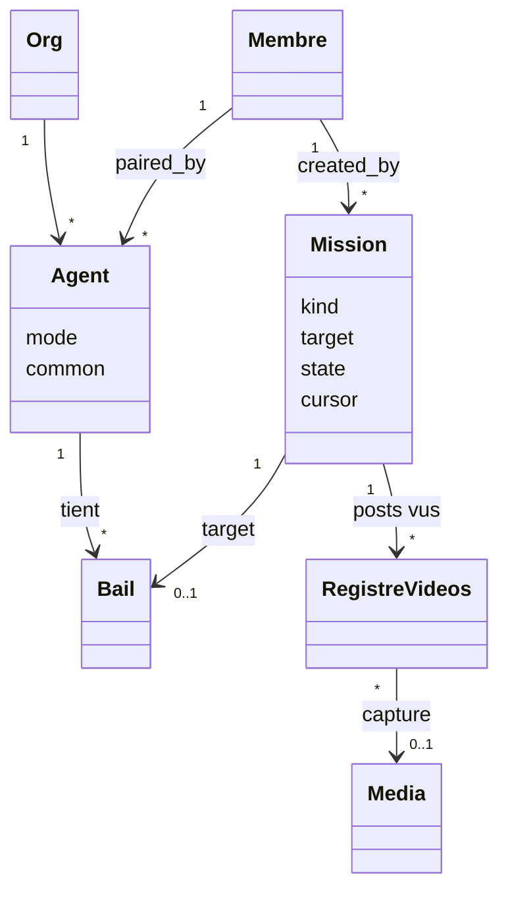
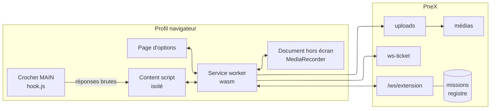
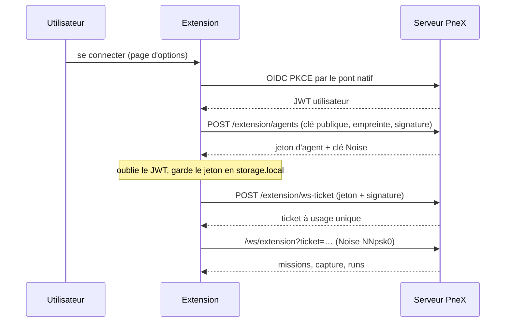
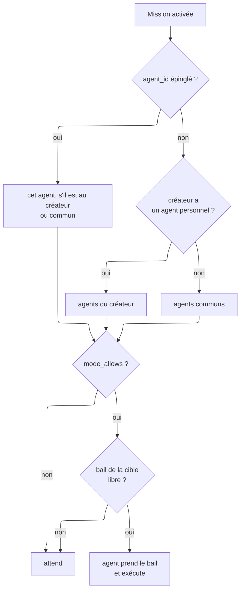
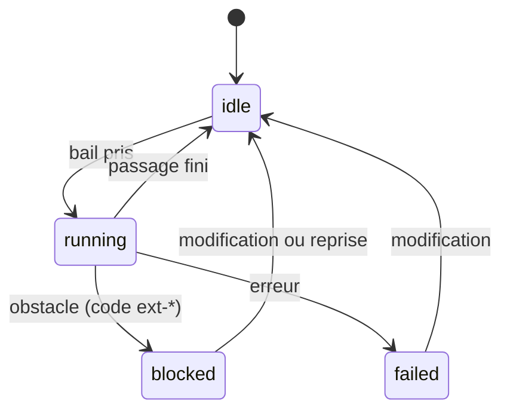
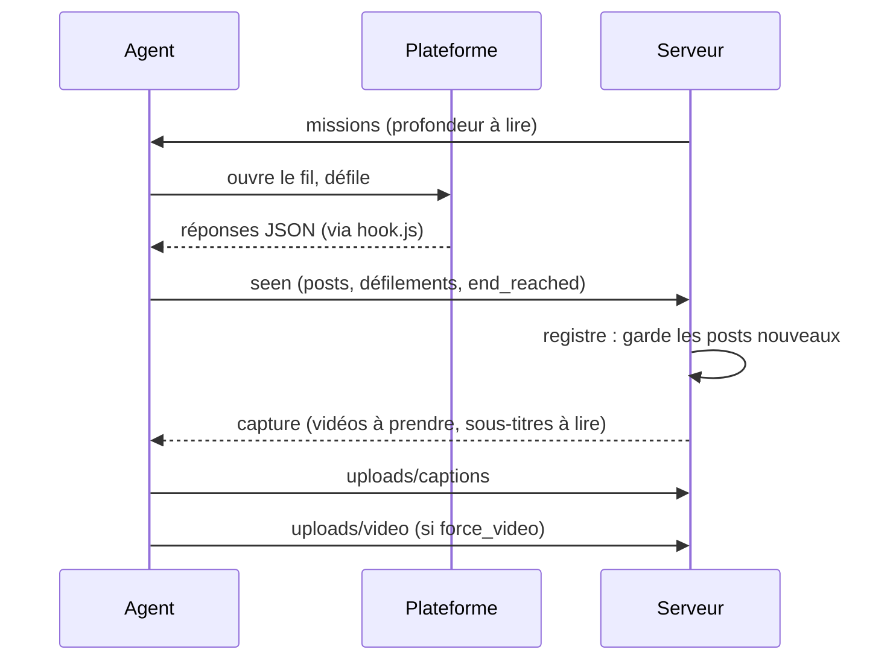
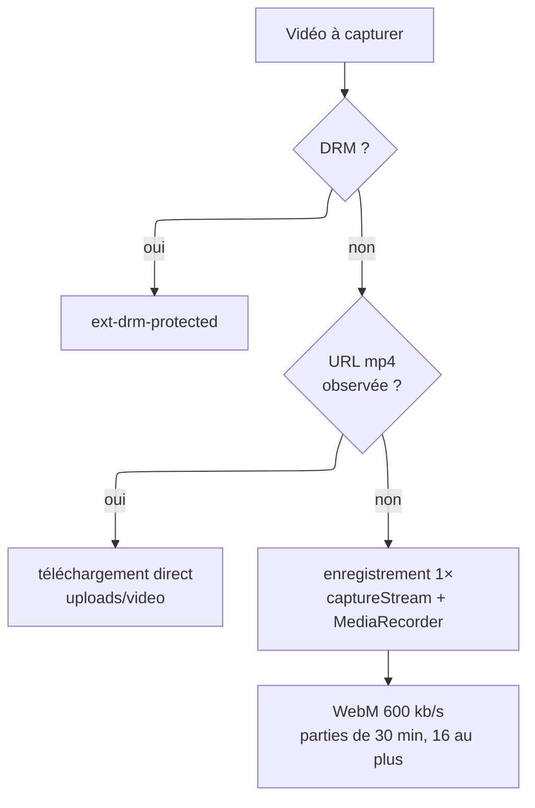
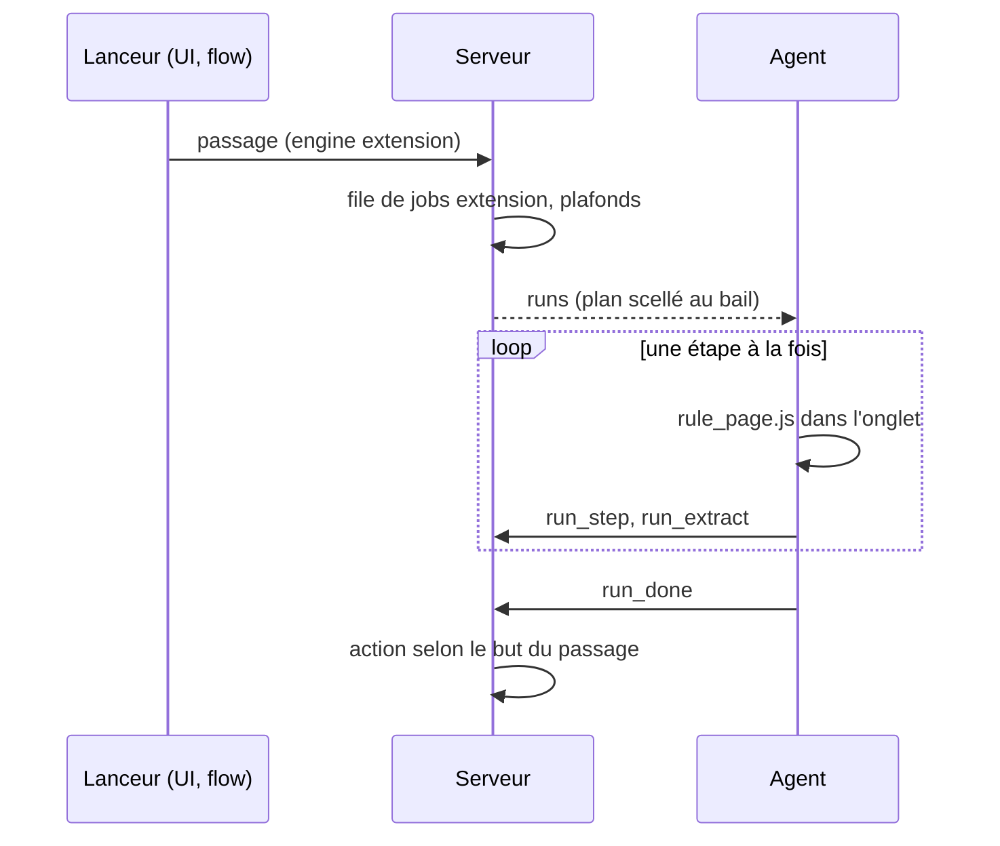

# Agents navigateur (extension Chrome/Firefox)

Décisions D254–D270, D281–D284, D550. Liens : `edge.md` §2.3 (doctrine edge), `security.md` (identité device D153–D158, grille §6, registre §7), `media.md` (flux, segments, passes, relecture), `doc-search.md` (indexation), `crm.md` (profils D333, salariés D779, relations D976–D977), `partners.md` (sites et preuves D307–D310), `agents.md` (règles jouées par l'extension D780–D790), `api.md`, `ai-assistant.md` §9.

## 1. Résumé

Un agent navigateur est une extension Chrome ou Firefox appairée à une org PneX. Il lit le web dans la session déjà ouverte du navigateur, au rythme d'un humain. Il exécute des missions déclarées dans l'UI : lire une valeur, suivre le texte d'une page, suivre un compte de réseau social, enregistrer un live, parcourir un site. Il joue aussi les règles de navigation qui exigent une session (D782), par exemple la capture d'un profil. Le serveur garde tout l'état : missions, baux, registre des vidéos, plans de règle. L'extension n'a aucune configuration et n'exécute aucun code distant.

## 2. Concepts

- **Agent navigateur** (agent) : une installation de l'extension dans un profil navigateur, appairée à une org. Une ligne `device_registries` du modèle `browser_agent` plus une ligne `extension_agents` (clé d'installation, hash du jeton, clé Noise, empreinte, mode).
- **Hôte** : le profil navigateur qui porte l'agent. Un hôte porte un seul agent (D255).
- **Plateforme** : X, YouTube, TikTok, ou un site web (origine). Clé de l'onglet de l'agent.
- **Mission** : un travail déclaré dans l'UI, typé (`MissionSpec`), stocké dans `extension_missions`.
- **Cible** : ce que vise une mission, normalisée (`x:@handle`, `web:<url>`…). Clé du bail (D257).
- **Bail** : verrou Valkey `pnex:ext:v1:{org}:lease:{target}`. Seul l'agent qui le tient exécute la mission.
- **Adaptateur** : le code propre à une plateforme, compilé dans l'extension (§3.7).
- **Registre des vidéos** : la table `social_videos`, les posts que l'org a déjà vus ou capturés (D259).
- **Agent personnel** : un agent qui exécute seulement les missions de son membre (`paired_by`).
- **Agent commun** : un agent posé par un admin (`extension:share`). Il exécute aussi les missions des membres sans agent et les tâches du serveur (D550).
- **Mode** : `shared` (toutes les plateformes sauf les exclusives) ou `dedicated:<plateforme>` (une seule plateforme, D269).

## 3. Fonctionnement

### 3.1 Architecture

Le crate `pnex-extension` compile en wasm la logique de l'agent : missions, protocole, adaptateurs, rythme, lecteur de règles (D264). Le JS se limite au manifeste, aux chargeurs wasm, au crochet MAIN (`hook.js`), à l'hôte d'onglets (`host.js`) et à l'enregistreur (`recorder.js`). Le crochet MAIN reste en JS parce que la CSP des sites bloque en général le wasm dans la page. Il relaie les réponses brutes et le wasm les décode.

La page d'options est en HTML simple. Ses textes passent par les `_locales` du navigateur (fr, en, parité testée), pas par Dioxus.

### 3.2 Appairage et lien

La connexion passe par le pont natif du serveur (`/api/v1/oauth2/sso` → `/oauth2/native/{state}`). L'extension n'a donc aucune configuration propre dans l'IdP. À l'installation, l'extension crée une paire de clés WebCrypto ECDSA P-256 non extractible, gardée en IndexedDB (D266). Chaque appairage, ticket et upload est signé par cette clé. Un jeton copié sans la clé n'ouvre rien.

L'appairage depuis la même installation remplace l'agent existant et fait tourner le jeton (D263). Une installation déjà appairée à une autre org est refusée (`extension-install-paired-elsewhere`). Le serveur propose un nom tiré de l'empreinte (« Chrome · Linux · Paris »). L'utilisateur peut le changer dans PneX.

Le jeton d'agent ne vit pas dans `device_tokens`. Aucun autre lien device ne l'accepte. `/ws/extension` refuse tout autre device.

### 3.3 Attribution des missions

Un agent personnel exécute seulement les missions de son membre, même hors ligne : la mission l'attend (D550). Un agent commun exécute aussi les missions des membres sans agent personnel et les tâches du serveur (preuves). Un admin voit et déconnecte tout agent. Il n'envoie jamais de mission sur le navigateur personnel d'un autre membre. Modifier la mission d'un collègue la transfère à celui qui modifie. Le départ d'un membre supprime ses agents.

Le bail vaut par cible et par org (D257). Il dure 45 s et le lien le renouvelle. Une perte de connexion laisse expirer le bail, puis un autre agent reprend la mission. Deux agents ne suivent jamais la même cible. Deux membres sur la même cible s'attendent.

Un agent tient au plus un onglet par plateforme, dans un groupe d'onglets à son nom (D255). Les onglets de plateformes différentes travaillent en parallèle. Les missions d'une même plateforme passent l'une après l'autre. Un live occupe l'onglet de sa plateforme tant qu'il dure.

### 3.4 États d'une mission

L'agent joint un code à l'état `blocked` (`AGENT_STATE_CODES`). L'UI le traduit par `err-<code>` :

| Code | Cause | Geste dans l'UI |
|---|---|---|
| `ext-login-required` | mur de connexion | se connecter dans le profil de l'agent |
| `ext-challenge` | captcha, vérification | résoudre à la main, puis reprendre |
| `ext-rate-limited` | message de limite du site | attendre, puis reprendre |
| `ext-permission-missing` | site non autorisé | « Autoriser » dans la page d'options |
| `ext-tab-hidden` | onglet caché sur une plateforme exclusive | garder la fenêtre au premier plan |
| `ext-drm-protected` | vidéo protégée | aucun : jamais de déchiffrement |
| `ext-selector-not-found`, `ext-value-not-numeric` | `collect_value` ne lit pas la valeur | corriger le sélecteur |
| `ext-registry-full` | registre plein (500 000 posts) | aucun : les nouveaux posts ne sont plus enregistrés |

L'agent ne contourne jamais un obstacle (D258). Une modification de la mission remet son état à `idle`.

### 3.5 Types de mission

| `kind` | Cible | Ce que fait l'agent | Sortie |
|---|---|---|---|
| `collect_value` | URL + sélecteur CSS + attribut | recharge la page, lit une valeur | `report` → série O2 |
| `collect_page` | URL | lit le texte lisible (`innerText`, 1 Mo au plus) | document Markdown versionné, indexé |
| `follow_account` | X, YouTube ou TikTok + nom du compte | défile le fil, relève les posts | registre des vidéos, sous-titres, vidéos (§3.6) |
| `watch_live` | URL d'un live | enregistre le direct en parties de 30 min | un média `video` par partie |
| `crawl_site` | origine d'un site | parcourt le site dans son origine (`partners.md` D307) | registre `site_pages` (D309) |
| `capture_proof` | une page du registre `site_pages` | capture pleine page, HTML nettoyé, texte | preuve chaînée (D308, D310) |

Le serveur crée seul les missions `capture_proof`. `crawl_site` peut aussi tourner sur le serveur (`CrawlExecutor`). L'intervalle va de 60 s à 1 jour. Un texte de page inchangé n'ajoute pas de version (empreinte dans `cursor`). Aucun HTML ne quitte la page pour `collect_page` (D261 amendé). Seule la preuve D308 transporte du HTML nettoyé.

### 3.6 Suivre un compte

Une mission `follow_account` lit les posts récents et remonte tout l'historique du compte (D283). Le serveur garde la progression dans `cursor` (`history_depth`, `history_done`). La profondeur augmente de 20 défilements par visite, jusqu'à 400. Le fil est fini après 4 défilements sans rien de neuf. Ensuite, chaque visite lit seulement le haut du fil (3 défilements).

Le registre `social_videos` est unique par org, plateforme et post (D259). Un post déjà connu n'est jamais repris, quel que soit l'agent. États d'un post : `seen` (relevé), `captioned` (sous-titres rangés), `captured` (fichier dans les médias).

Par défaut, l'agent garde les métadonnées, le texte et les sous-titres de la plateforme quand ils existent (D284). Les sous-titres deviennent une passe de transcription d'origine `platform` (`media.md`, D281). La case « Forcer la collecte vidéo » (`force_video`) prend aussi le fichier de chaque vidéo, puis lance la transcription PneX.

L'enregistrement en temps réel utilise `captureStream()` (`mozCaptureStream` sous Firefox) sur l'élément `<video>` (D260). Chrome enregistre dans un document hors écran, Firefox dans sa page de fond. Un live suit le même chemin : chaque partie est un média `video` (`uploads/live`), pas un flux `browser` segmenté.

Une mission `follow_account` peut nommer la personne ou l'organisation du compte (`publisher_id`). Chaque média capturé reçoit alors le lien `published_by` (pack `investigation`, D278) et `metadata.published_by_object`. La provenance commune est dans `media_assets.metadata` : `source = browser_agent`, `mission_id`, `source_url`, `platform`, `platform_id`, `author_handle`, `published_at`, `captured_at`.

### 3.7 Adaptateurs

Un adaptateur par plateforme, en Rust, dans `crates/pnex-extension/src/adapters/` : `x.rs`, `youtube.rs`, `tiktok.rs`. Il décode les réponses relayées par `hook.js`, avec un repli sur le DOM. Le web générique n'a pas d'adaptateur : `collect_page` lit le texte de la page.

| Plateforme | Source lue | Pages |
|---|---|---|
| X | réponses `UserTweets`, `UserMedia` | `x.com/<handle>` |
| YouTube | `ytInitialData`, réponses `youtubei/v1/browse` | `/@<handle>/videos`, `/@<handle>/shorts` |
| TikTok | réponses `item_list`, WebVTT listé avec le post | `tiktok.com/@<handle>` |

Les formats des plateformes changent sans prévenir. Un décodage en échec n'est jamais silencieux : la mission passe en `blocked` avec un code. La correction passe par une nouvelle version de l'extension (MV3 : pas de code distant). Chaque adaptateur a des tests sur une réponse enregistrée.

Une plateforme exclusive (`needs_foreground`, TikTok aujourd'hui) met ses vidéos en pause dans un onglet caché (D269). Seul un agent `dedicated:<plateforme>` l'exécute. Cet agent lit toujours au premier plan et met la mission en pause (`ext-tab-hidden`) si l'onglet reste caché. Un PC dédié reste allumé, session ouverte, écran non verrouillé, fenêtre de l'agent au premier plan. Deux plateformes dédiées sur une machine demandent deux profils et deux fenêtres visibles côte à côte.

### 3.8 Règles jouées par l'agent

Une règle de navigation qui exige une session (`session: required`) part sur un agent (D782, `agents.md`). L'agent joue le plan reçu, sans aller-retour de validation (D783). Il le joue dans l'onglet de la plateforme du site, avec la même cadence que les missions. Une étape hors du site termine le passage en échec (`off-site`). Un flow joue une règle à session seulement sur un agent commun.

Trois usages passent par des règles par défaut (`pnex_core::default_rules`), plus par des types de mission :

| Usage | Demandé depuis | Plafond par jour et par org | Refus |
|---|---|---|---|
| Profil d'une personne (D333) : LinkedIn, X, Facebook, Instagram, TikTok, YouTube | fiche `person` | 30 par réseau | `ext-target-not-profile`, `prospecting-opposed` |
| Salariés d'une entreprise sur LinkedIn (D779), 5 écrans | fiche `organization` | 10 | `ext-target-not-people-page` |
| Relations LinkedIn d'un contact (D976–D977), 3 pages | fiche `person`, si l'utilisateur est en relation | 10 | `ext-not-connected`, `ext-connections-hidden` |

L'agent du demandeur exécute la capture, sinon un agent commun. Sans agent appairé, la demande est refusée (`site-recipe-no-agent`). L'opposition d'une personne (D341) bloque toute capture de son profil.

## 4. Exigences

1. L'agent doit lire seulement des cibles déclarées par un utilisateur, une par une (D254).
2. L'agent ne doit jamais contourner un mur de connexion, un captcha, une limite de débit ou un DRM.
3. L'agent ne doit jamais remplir un formulaire de connexion. PneX et l'extension ne stockent aucun identifiant de plateforme (D265).
4. L'agent doit attendre au moins 20 s entre deux navigations, avec une variation de ±15 % (planchers compilés, D258).
5. L'intervalle d'une mission doit être d'au moins 60 s.
6. L'org doit tenir au plus 20 agents et 200 missions (`AGENTS_MAX`, `MISSIONS_MAX`, `extension-limit-reached`).
7. Le serveur doit accepter au plus 30 uploads par minute et par agent, et 60 messages `seen` par minute et par lien.
8. Le registre des vidéos doit garder au plus 500 000 posts par org.
9. Une vidéo capturée doit faire au plus 200 Mo par partie et 16 parties de 30 min.
10. L'org et l'agent doivent venir de l'identité du jeton (R1). Une mission qui n'est pas celle de l'agent répond 404.
11. Chaque appairage, ticket et upload doit porter une signature de la clé d'installation, à usage unique, à 2 min près.
12. Le contenu collecté est non fiable : il ne doit jamais être exécuté ni rendu en HTML sur l'origine de l'app (R11–R13).
13. Désactiver ou supprimer un agent doit couper ticket, websocket et uploads à la requête suivante.
14. L'extension doit demander ses permissions d'hôte par plateforme, à la première mission qui la vise. Jamais `<all_urls>`.
15. Toute injection dans un onglet doit être bornée à 20 s (`tab-timeout`) et ne jamais renvoyer la promesse d'un défilement.
16. L'assistant doit seulement lire les agents, les missions et le registre. Aucun outil ne crée ni ne lance une mission (D144).

## 5. Décisions

| # | Décision | Choix actuel |
|---|---|---|
| D254 | Périmètre | sources publiques déclarées une par une, rythme humain, aucun contournement ; levée pour des cas bornés par D333, D779, D784, D976 |
| D255 | Agent | un hôte = un agent ; au plus un onglet par plateforme ; plateformes en parallèle, missions d'une plateforme en série |
| D256 | Missions | types `MissionSpec` dans `extension_missions` ; les types `capture_profile` et `capture_people` sont devenus des règles par défaut (D780) |
| D257 | Bail | bail Valkey par cible et par org, école D108 |
| D258 | Rythme | budget par agent, planchers compilés, `blocked` sur tout obstacle |
| D259 | Registre des vidéos | `social_videos` unique `(org, platform, platform_id)`, jamais deux captures d'un post |
| D260 | Capture | fichier direct si observé, sinon enregistrement 1× ; jamais de DRM ; live en parties `video` |
| D261 | Page | texte lisible seulement, document versionné ; le HTML nettoyé vient avec la preuve (D308) |
| D262 | Transport | ticket signé → `/ws/extension` sous Noise NNpsk0 (D156), uploads HTTP signés |
| D263 | Jeton | `storage.local`, révocable, tourné à chaque appairage |
| D264 | Code | crate wasm `pnex-extension`, JS minimal, chemin commun Chrome/Firefox ; page d'options en HTML + `_locales` |
| D265 | Compte | session du profil ; profil et compte dédiés recommandés, jamais imposés |
| D266 | Identité | clé WebCrypto non extractible + empreinte automatique ; tout signé |
| D267 | Sous-titres | sous-titres de la plateforme d'abord ; `media_policy` remplacée par `force_video` (D284) |
| D268 | Rétention | par mission (`none`, `days:N`, `keep`) : reportée à la phase « rétention et limites d'usage » (O91), non codée |
| D269 | Plateformes exclusives | `needs_foreground` par plateforme ; seul un agent `dedicated:<plateforme>` les exécute |
| D270 | Distribution | zip construit avec l'image, servi par `GET /api/v1/extension/download` avec `server.json` |
| D281 | Vidéos capturées | média `video` relu (D271), sous-titres = passe `platform`, provenance commune, éditeur `published_by` (D278) |
| D282 | Vidéos | enregistrement possible sur toutes les plateformes, YouTube compris ; jamais de DRM ni de contournement |
| D283 | Historique | tout l'historique du compte, profondeur croissante par visite |
| D284 | Mission simple | un compte à suivre ; texte par défaut, case `force_video` |
| D550 | Agent personnel ou commun | un agent est personnel ; un admin (`extension:share`) le rend commun pour les membres sans agent et les tâches du serveur (SEC-56) |

Décisions liées, tenues ailleurs : D307–D310 (`partners.md`), D333 et D779 (`crm.md`), D976–D977 (`crm.md`), D780–D790 (`agents.md`), D341 (opposition).

## 6. Interfaces

Routes sous `/api/v1/extension` (contrôleur `controllers/extension.rs`, service `services/extension.rs`, types `pnex_core::browser_agent`) :

| Route | Appelant | Permission |
|---|---|---|
| `GET/POST /agents`, `PATCH /agents/{id}` | utilisateur | `extension:read`, `extension:enroll`, `extension:write` (`extension:share` pour `common`) |
| `POST /ws-ticket` | agent (jeton + signature) | — |
| `GET /download?browser=firefox` | public | — |
| `POST /uploads/{page,video,captions,live,proof,site-page,crawl-done}` | agent (jeton + signature) | — |
| `GET/POST /missions`, `GET/PATCH/DELETE /missions/{id}` | utilisateur | `extension:read`, `extension:write`, `extension:delete` |
| `GET /missions/{id}/pages`, `GET /proofs`, `/proofs/{id}`, `/proofs/verify` | utilisateur | `extension:read` |
| `GET /videos` | utilisateur | `extension:read` |
| `GET/POST /people/{id}/profile-captures`, `/organizations/{id}/people-captures` | utilisateur | `extension:read`, `extension:write` |
| `GET/POST /people/{id}/opposition`, `GET/PUT /people/{id}/connection`, `GET/POST /people/{id}/connections-captures` | utilisateur | `extension:read`, `extension:write` |

Websocket `/ws/extension?ticket=…` (`controllers/ws_extension.rs`), JSON dans des trames Noise :

- serveur → agent : `missions` (état désiré complet), `capture` (vidéos et sous-titres à prendre), `runs` (plans de règle scellés), `pong` ;
- agent → serveur : `report`, `state`, `seen`, `run_step`, `run_extract`, `run_done`, `ping`.

Tables : `extension_agents` (mode, `paired_by`, `common`), `extension_missions` (`cursor`), `social_videos`, `site_pages`. MCP : les routes de l'agent sont `EXCLUDED` (runtime). Les créations et modifications de mission ou de capture sont `EXCLUDED` (sortant). Les lectures, `PATCH /agents/{id}` et la déclaration d'opposition sont `EXPOSED`.

UI : page `/edges/browser-agents` (menu Appareils) avec les onglets Agents navigateur, Missions et Registre des vidéos. Fiche assistant `browser-agents`. Manifestes `manifest.json` (Chrome) et `manifest.firefox.json` (Firefox 128+, page d'événements, fenêtre dédiée au lieu des groupes d'onglets).

Tests : `crates/pnex-backend/tests/extension.rs`, tests unitaires des adaptateurs, `e2e/tests/browser-agent.spec.ts` (`@extension`, Chromium, page de test locale, jamais une vraie plateforme).

## 7. Reste à faire

- **Publication** (question 4) : Chrome Web Store et signature AMO pour Firefox, ou chargement non empaqueté seulement ? Aujourd'hui : chargement non empaqueté en mode développeur. Choix de Shan.
- **D976 retiré le 2026-11-18** (`crm.md` §3.6) : supprimer du code la règle `connections_capture`, la table `network_connections`, les routes `connection` et `connections-captures`, et le panneau de la fiche.
- **U4b** (`agents.md`) : `collect_value`, `collect_page`, `follow_account`, `watch_live`, `crawl_site` et `capture_proof` doivent devenir des étapes ou des sorties de règle.
- **D268** : coder la rétention par mission avec la phase « rétention et limites d'usage » (O91).
- **Mission `search`** (proposée) : une recherche sur une plateforme dont chaque résultat passe par le registre des vidéos.
- **Campagne de test réelle** : X, YouTube, TikTok, lives et Firefox ne sont pas encore éprouvés en conditions réelles.

### 7.1 Mesures d'arrière-plan (réglage de D269)

Mesurer chaque plateforme et chaque usage sur un profil de test, dans quatre états : onglet visible, autre onglet au premier plan, fenêtre recouverte, fenêtre réduite. Relever si la vidéo avance, si le fil charge au défilement, si les réponses réseau arrivent, et le rythme réel des pas. Revoir le tableau à chaque version d'adaptateur.

| Plateforme | Usage | Onglet caché | Fenêtre recouverte | Fenêtre réduite | `needs_foreground` | Date |
|---|---|---|---|---|---|---|
| X | fil + vidéo | à mesurer | à mesurer | à mesurer | — | — |
| X | live | à mesurer | à mesurer | à mesurer | — | — |
| TikTok | fil + vidéo | pause signalée | à mesurer | à mesurer | `true` (provisoire) | — |
| TikTok | live | à mesurer | à mesurer | à mesurer | — | — |
| YouTube | fil (vidéos + shorts) | lit la tête (`ytInitialData`), ne charge pas la suite : nouveautés seules | à mesurer | à mesurer | `false` (`dedicated:youtube` pour l'historique) | 2026-10-20 |
| YouTube | live | à mesurer | à mesurer | à mesurer | — | — |
| Web générique | page | à mesurer | à mesurer | à mesurer | — | — |
