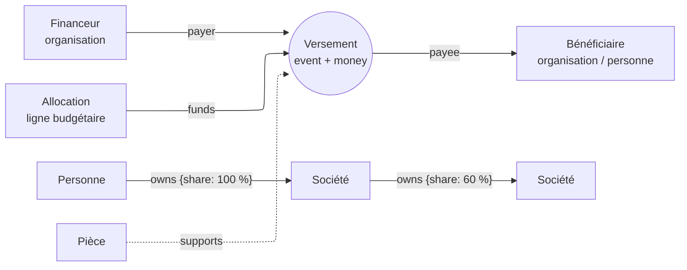

# PRD — Navigation des enquêtes et flux financiers

| | |
|---|---|
| Statut | **v0.2 — 2026-10-16**, décisions arbitrées et premiers lots codés (§16) |
| Cible | PNEX 0.2.x (noyau ontologique, espace de travail du dossier) |
| Relation | Prolonge `cases-workspace.md` (K20–K47) et `cases.md` (K1–K19). Décisions numérotées **K48…K64** à la suite. Le graphe Sigma reste celui de `cases-graph-sigma.md` |
| Règle d'or | Lisible par un enfant de 10 ans : la vue Histoire a passé ce test, la matrice, le radar, la fiche d'acteur et la BD ne l'ont pas passé (2026-10-15) — on ne les repropose pas |

## 1. Problème

1. **Navigation.** À 118 objets, le graphe d'un dossier devient une pelote :
   pièces et affirmations y sont des nœuds comme les autres et s'empilent.
   On ne peut ni filtrer par type d'objet ou de lien, ni enregistrer une vue,
   ni demander « comment A est relié à B ».
2. **Argent.** L'ontologie n'a aucune notion monétaire : un montant est un
   `number` avec une unité en texte libre. Aucune vue ne montre d'où vient
   l'argent, où il va, ni la part qui n'est pas documentée.
3. **Données éparses.** Les financements publics, la commande publique, les
   registres de sociétés et les jeux de données d'enquête existent en données
   ouvertes, mais PNEX ne sait pas les charger : l'import tabulaire (K10) n'est
   pas implémenté et aucun nœud de flow n'écrit dans l'ontologie.

Cas d'usage visés : suivre des financements publics de leur ligne budgétaire
jusqu'aux bénéficiaires ; reconstituer une chaîne de détention de sociétés
jusqu'à ses bénéficiaires effectifs ; relier des versements, des sociétés et
des personnes issus de fuites de documents ou de décisions de justice.

## 2. État de l'art (recherche du 2026-10-16)

| Source | Idée | Ce qu'on retient |
|---|---|---|
| Shneiderman 1996, *Visual Information-Seeking Mantra* | vue d'ensemble, zoom et filtre, détail à la demande | règle de toutes les vues (K48) |
| van Ham & Perer, InfoVis 2009, *Search, Show Context, Expand on Demand* | partir d'une recherche, montrer le voisinage pondéré par un degré d'intérêt, étendre à la demande | K48 ; l'expansion au double-clic existe déjà, il manque le point de départ par recherche et le degré d'intérêt |
| Survey de visualisation d'ontologies (Knowledge Engineering Review) | presque tout est en nœuds-liens 2D ; montrer une vue d'ensemble d'une grosse ontologie tout en gardant le détail reste le défi ouvert | ne pas tout miser sur le graphe |
| Wiens, Lohmann & Auer, K-CAP 2017 (VOWL) | zoom sémantique : trois niveaux de détail discrets ; meilleure lisibilité mesurée en test utilisateur | K49, K53 |
| Lissandrini et al., SIGWEB 2020 | exploration d'un graphe de connaissances = profilage, recherche, analyse ; l'analyse exploratoire reste peu outillée | les vues ne remplacent pas les listes et les compteurs |
| Jigsaw (Stasko, Görg & Liu 2008) | vues coordonnées entités ↔ documents ; en pratique les analystes travaillent surtout dans la vue Liste | K49 : la preuve est une couche, la liste reste un geste de premier rang |
| Gotham (documentation produit publique, ~2010–2017) | applications (graphe, carte, explorateur d'objets) + « helpers » (frise, histogramme) ; *Search Around* depuis un objet | même partage chez nous : vues + frise commune ; K51 |
| Linkurious (outil des fuites ICIJ) | étendre, filtrer, requêtes devenues boutons, vues partagées, commentaires | K50 |
| KeyLines (Cambridge Intelligence) | *combos* : grouper des nœuds pour réduire le bruit, déplier à la demande ; barre de temps qui filtre | K53 ; la barre de temps = notre frise K23/K24 |
| Aleph / FollowTheMoney (OCCRP, MIT) | modèle d'enquête : entités (personne, société, bien) + **intervalles** datés qui les relient (détention, mandat, versement, sanction) ; croisement d'un nom contre des centaines de jeux | K55, K56, K61, K62 |
| Open Ownership — BODS / BOVS | standard de données de bénéficiaires effectifs et règles de dessin des structures de détention | K56, K58 (conventions, dessin PneX) |
| Riehmann et al. 2005 ; Chang et al. 2007 (WireVis) ; Lokanan 2023 | diagramme de Sankey interactif ; analyse visuelle de virements ; en lutte anti-blanchiment, graphe et réseau dominent | K57 |
| Cambridge Intelligence, *flow analysis* | un Sankey ne tient qu'avec peu d'entités et d'étapes ; au-delà, un graphe à **flux net** par paire | K57 : repli au-delà d'un seuil |
| d3-sankey-circular, ApexSankey | les cycles existent dans les flux réels ; ils se dessinent en liens de retour (au-dessus/en dessous, pointillés) | K57 : un cycle se montre, il ne se casse pas |
| FlowShield (arXiv 2026) | fusion des sous-graphes multi-sauts d'un versement signalé en un diagramme de flux | K57 : suivre un versement sur plusieurs sauts |

Sources : §15.

## 3. Navigation (vaut pour toutes les vues du dossier)

### K48 — Chercher, montrer le contexte, étendre

Toute vue part d'un objet trouvé (palette, recherche) ou du dossier entier,
puis montre son voisinage limité par un **degré d'intérêt** : distance à
l'objet de départ, nombre de pièces, récence par rapport au curseur. Le reste
est replié en compteurs (« +12 sociétés »). L'expansion au double-clic
(existante) devient le geste unique pour déplier, dans le graphe comme dans
l'arbre de détention (K58).

### K49 — La preuve est une couche, pas un nœud

Par défaut, pièces et affirmations ne sont plus des nœuds du graphe : elles
deviennent un badge (nombre, pire note de fiabilité) sur l'objet ou le lien
qu'elles soutiennent. Un interrupteur « Preuves » les remet en nœuds. Clic sur
un badge = liste des pièces, comme partout ailleurs.

### K50 — Filtres et vues enregistrées

- Filtres par **type d'objet**, **type de lien** et **note de certitude**,
  communs à graphe, Histoire, carte et vue Argent.
- Une **vue enregistrée** = filtres + objet de départ + position du curseur +
  vue active. Partagée avec l'équipe du dossier, nommée, ouverte par un lien.

### K51 — Chemins entre deux objets

« Comment A est relié à B ? » : les *k* chemins les plus courts (k = 5 par
défaut), en liste lisible (« A — dirige → S1 — détient 60 % → S2 — a versé
→ B »), chacun surlignable dans le graphe. Calcul côté serveur (CTE récursive
ou petgraph, annexe A3 de `ontology.md`), borné en profondeur et en temps,
filtré par l'org du principal (R1).

### K52 — La certitude se voit pareil partout

Trait plein = lien sourcé par au moins une pièce de fiabilité A–C ; pointillé
= affirmation non confirmée ; trait fin gris = aucune pièce. Même encodage
dans le graphe, la vue Argent, l'arbre de détention et la carte. Une
allégation n'est jamais dessinée comme un fait (K45).

### K53 — Regrouper

Une organisation et ses filiales, ou les membres d'un groupe, se replient en
un méta-nœud (taille ∝ nombre de membres, montants cumulés sur les liens) qui
se déplie à la demande. Même regroupement dans l'Histoire : les personnes
sous leur organisation (déjà demandé après la livraison de la vue Histoire).

## 4. Modèle : l'argent et la détention

### K54 — Type de propriété `money`

`{amount, currency (ISO 4217), estimated: bool, range?: {min, max}}`.
`estimated` et `range` couvrent les montants connus en fourchette, fréquents
dans les financements publics. Pas de conversion de devise implicite : une
vue agrège par devise ; la conversion, quand elle viendra, porte sa date et sa
source de taux.

### K55 — Le versement est un événement

**Arbitré le 2026-10-16 : pas de type `payment` ni `allocation`.** Le type
noyau `event` (K20) reçoit une propriété `amount` (`money`), et l'attache
`involves` deux rôles de plus, `payer` et `payee`. Un événement avec un
montant, un payeur et un bénéficiaire est un **versement**. Conséquences
gratuites : il apparaît sur la frise, dans l'Histoire et sur la carte ; il
porte ses pièces (rôles `evidence` / `source`) et sa provenance (D184).

- Plusieurs payeurs ou bénéficiaires : le montant est réparti à parts égales
  et marqué estimé (raccourci : une part par attache viendra si besoin).
- Payeur ou bénéficiaire absent : la vue Argent montre « Payeur inconnu » /
  « Bénéficiaire inconnu ».
- Montant prévu (ligne budgétaire, programme) : c'est un versement de
  l'organisme vers le programme, puis des versements du programme. Le
  **non tracé** se déduit tout seul (reçu − reversé d'un intermédiaire, K57) :
  aucun type `allocation` n'est nécessaire.

### K56 — Détention et bénéficiaire effectif

Le lien `owns` reçoit l'attribut `share` (pourcentage, `range` admis) et reste
temporel (`valid_from` / `valid_to`). La **part effective** d'une personne dans
une société = produit des parts le long de chaque chaîne, sommé sur les
chaînes. Les personnes au-dessus du seuil réglementaire (25 % par défaut,
réglable par dossier) sont marquées « bénéficiaire effectif calculé » — une
déduction, jamais un fait : elle porte la mention et la liste des liens qui
la fondent.

## 5. Vues nouvelles

### K57 — Vue « Argent » (diagramme de Sankey)

Nouvel onglet de l'espace de travail, à côté de Graphe / Carte / Histoire.
Nom à valider au lexique (§11) : « Flux » est déjà pris par les streams.

- **Colonnes** = étapes (financeur → intermédiaire → bénéficiaire) déduites des
  liens `payer`/`payee` ; **épaisseur** = montant cumulé sur la période.
- **Niveau d'agrégation** : par objet, par type, par juridiction, par regroupement
  K53.
- **Curseur commun** (K24) : la vue cumule jusqu'au curseur ; la frise filtre.
- **Non documenté** : pour chaque `allocation`, un nœud reçoit la différence
  entre le montant prévu et la somme des versements tracés. C'est la mesure de
  ce qu'on ne sait pas encore.
- **Cycles** : un cycle (l'argent revient à un objet déjà traversé) se dessine en
  lien de retour pointillé au-dessus du diagramme et se signale dans la liste ;
  on ne le casse pas, c'est souvent l'information cherchée.
- **Détail à la demande** : clic sur une bande = liste des versements qui la
  composent, avec montant, date, pièces.
- **Passage à l'échelle** : au-delà d'environ 40 nœuds visibles après
  agrégation, la vue propose le repli en graphe à flux net (une flèche par
  paire, épaisseur = solde).
- **Technique** : mise en page en Rust dans `pnex-core` (comme
  `ontology/layout.rs` : colonnes par plus long chemin, relaxation itérative,
  déterministe et testée), rendu SVG maison comme `story.rs`. Pas de
  dépendance JS : d3-sankey n'est plus maintenu.
- **Certitude (K52)** : bande en pointillé quand un de ses versements n'a
  aucune pièce attachée (`evidence` / `source`) ; pâle quand estimée ; orange
  quand l'argent remonte la chaîne (cycle).

### K58 — Arbre de détention

Mise en page hiérarchique d'une structure de sociétés à partir d'un objet :
parts en % sur les liens, juridiction en badge, bénéficiaires effectifs
calculés (K56) en bas. Conventions de lecture inspirées de BOVS (Open
Ownership), dessin et pictogrammes PneX. Même expansion à la demande (K48).

### K59 — Arcs financiers sur la carte

Dans l'onglet Carte, les versements dont le payeur et le bénéficiaire ont un
lieu se dessinent en arcs (épaisseur ∝ montant, agrégés par paire de lieux),
filtrés par le curseur. Réutilise MapLibre et la couche de trajets existante.

## 6. Données

### K60 — Pack `finance`

**Reporté (2026-10-16)** : K55 n'a pas besoin de nouveaux types. Le pack
`investigation` 1.6.0 porte la part détenue sur `owns`. Restent à décider
au moment de l'import FollowTheMoney (K61.2) : immatriculation de société
(juridiction, numéro, statut), mandat de dirigeant (`directs`, temporel).

### K61 — Chemins d'import

1. **Import tabulaire K10** (CSV / xlsx → objets, liens, versements, avec
   prévisualisation à blanc comme l'import de traces) : prérequis de tout le
   reste.
2. **Import FollowTheMoney** (JSON lignes) : Aleph et OpenSanctions exportent
   dans ce format.
3. **Nœud de flow d'écriture ontologique** (création/mise à jour idempotente
   par clé externe) : rend possible l'import continu depuis une API publique.
   Code utilisateur non fiable : le backend re-vérifie type, org (R1), rôle (R2)
   et taille ; `NodeDoc` et fiche assistant dans le même commit.

Toute donnée importée porte `source_ref = import:<jeu>@<date>` (D184).

### K62 — Fusion de doublons

Des sources différentes nomment la même société ou la même personne
autrement. Proposition de rapprochement (identifiant officiel identique,
sinon nom normalisé + date + lieu), **validée par un humain**, réversible ;
l'objet fusionné garde la provenance de chaque source. Sans validation
humaine, deux objets ne fusionnent jamais : une fusion fausse crée un faux lien.

### K63 — Sources ouvertes de référence

Catalogue documenté (pas de connecteur imposé) :

| Jeu | Contenu | Licence |
|---|---|---|
| Annexe « jaune » du PLF, associations subventionnées | subventions de l'État par ministère et programme | Licence Ouverte 2.0 |
| DECP | données essentielles de la commande publique | Licence Ouverte |
| Subventions des collectivités (format SCDL) | subventions locales | Licence Ouverte |
| Transparence Santé | avantages et rémunérations des industriels aux professionnels de santé | Licence Ouverte |
| API Recherche d'entreprises (Sirene, registre national des entreprises) | identité et dirigeants des sociétés | Licence Ouverte |
| HATVP | représentants d'intérêts, déclarations | Licence Ouverte |
| BODACC | annonces civiles et commerciales | Licence Ouverte |
| GLEIF (LEI) | identifiants d'entités et liens mère–filiale | CC0 |
| ICIJ Offshore Leaks | sociétés offshore issues de fuites | ODbL (attribution, partage à l'identique) |
| OpenSanctions | sanctions, personnes politiquement exposées | CC BY-NC (licence pour usage commercial) |

L'accès aux registres de bénéficiaires effectifs est restreint depuis l'arrêt
de la CJUE du 22 novembre 2022 : réservé aux personnes justifiant d'un
intérêt légitime. PNEX n'en contourne pas l'accès. Les licences de chaque jeu
sont rappelées sur les objets importés.

### K64 — Données personnelles et neutralité

K38 (données personnelles) et K45 (vocabulaire neutre, droit de réponse)
s'appliquent. Un versement ou une détention issus d'une fuite restent des
affirmations tant qu'une pièce de fiabilité suffisante ne les confirme pas
(K52). Le bénéficiaire effectif calculé est une déduction (K56).

## 7. Lots

| Lot | Contenu | Dépend de |
|---|---|---|
| M0 | K49 preuves en badges, K50 filtres, K52 certitude | — |
| M1 | K51 chemins, K50 vues enregistrées, K53 regroupement | M0 |
| M2 | K54 `money`, K55 versement, K56 détention, K60 pack | — |
| M3 | K61.1 import tabulaire, K62 fusion de doublons | M2 |
| M4 | K57 vue Argent | M2 (données de démo), M3 (données réelles) |
| M5 | K58 arbre de détention, K59 arcs sur la carte | M2 |
| M6 | K61.2 import FollowTheMoney, K61.3 nœud d'écriture, catalogue K63 | M3 |

Chaque lot : clés fluent dans les deux langues, ligne au lexique et règle
dans `lexicon_guard`, fiche `assistant-kb`, revue de sécurité §6.

## 8. Données de démo

Un dossier de démo construit uniquement à partir de données ouvertes
(par exemple : une ligne de l'annexe « jaune » → ses associations
bénéficiaires → leurs marchés publics), jamais de personnes privées. Sert aux
e2e et aux captures de la documentation.

## 9. Exigences non fonctionnelles

- Vue Argent : < 200 ms de mise en page pour 500 versements agrégés en ≤ 40
  nœuds ; au-delà, repli K57.
- Chemins K51 : profondeur ≤ 6, délai serveur borné, résultat partiel signalé.
- Import tabulaire : 100 000 lignes sans bloquer l'UI (tâche de fond,
  progression, reprise).

## 10. Risques

| Risque | Parade |
|---|---|
| Fusion erronée → faux lien → atteinte à une personne | K62 humain dans la boucle, réversible ; K52 |
| Sankey illisible au-delà de quelques dizaines de nœuds | agrégation K57, repli en flux net |
| Devises mélangées | K54 : agrégation par devise, pas de conversion implicite |
| Licences incompatibles (partage à l'identique, non commercial) | rappel de licence sur l'objet importé ; export qui la respecte |
| Graphe qui reste une pelote | K48/K49/K53 avant toute nouvelle vue |

## 11. Lexique (à ajouter à `design-system.md` §7)

| Notion | fr | en | Note |
|---|---|---|---|
| Vue des flux d'argent | Argent (à valider) | Money | « Flux » = streams, interdit ici |
| Versement | Versement | Payment | jamais « transaction » ni « paiement » en fr |
| Montant prévu | Allocation | Allocation | |
| Part de détention | Détention | Ownership | |
| Part non tracée | Non documenté | Undocumented | |
| Bénéficiaire effectif calculé | Bénéficiaire effectif (calculé) | Beneficial owner (computed) | |

## 12. Questions ouvertes

- **Q-M1** — Nom de l'onglet : **« Argent » / « Money »** (arbitré
  2026-10-16 ; « Financements » trop étroit : l'argent d'un dossier n'est pas
  toujours un financement).
- **Q-M2** — Seuil de bénéficiaire effectif : **25 % fixe en v1** (constante
  `ownership::BENEFICIAL_OWNER_PERCENT`), réglage par dossier si un usage le
  demande.
- **Q-M3** — Vues enregistrées : ouvert (non codé).
- **Q-M4** — Connecteur prêt à l'emploi : ouvert ; le catalogue K63 d'abord.

## 13. Critères d'acceptation

- Le dossier de 118 objets du test de volume se lit sans pelote avec les
  réglages par défaut (K49 + K53).
- Depuis une ligne budgétaire importée, on voit en un écran où va l'argent,
  combien est non documenté, et on remonte à la pièce de chaque bande.
- Depuis une personne, on voit ses sociétés et sa part effective, avec la
  chaîne qui la justifie.

## 14. Hors périmètre

Conversion de devises, détection automatique de schémas de blanchiment,
scoring de risque, accès aux registres restreints.

## 15. Sources

- [Ontology visualization methods and tools: a survey of the state of the art (Knowledge Engineering Review)](https://cambridge.org/core/journals/knowledge-engineering-review/article/ontology-visualization-methods-and-tools-a-survey-of-the-state-of-the-art/5EA8C64D7DF60A84F6D2B7B9A09B6E6A)
- [Lissandrini et al., Knowledge Graph Exploration: Where Are We and Where Are We Going? (SIGWEB 2020)](https://people.cs.aau.dk/~matteo/publications/journal/2020-SIGWEB-graph-exploration.html)
- [Knowledge graph visualization frameworks review (arXiv 2412.05289)](https://arxiv.org/abs/2412.05289v1)
- [Visualizing Ontologies with VOWL (Semantic Web Journal)](https://journals.sagepub.com/doi/full/10.3233/SW-150200) ; semantic zooming : DOI 10.1145/3148011.3148015
- [Jigsaw — évaluation VAST 2009](https://sites.cc.gatech.edu/gvu/ii/talks/vast09-jigsaweval.pdf) ; [Jigsaw — VAST Challenge 2011](https://faculty.cc.gatech.edu/~stasko/papers/vast11-challenge.pdf)
- [Gotham — description produit](https://s3.documentcloud.org/documents/810526/1035-palantir-product-description-gotham.pdf)
- [Linkurious et les fuites ICIJ](https://linkurio.us/panama-papers-how-linkurious-enables-icij-to-investigate-the-massive-mossack-fonseca-leaks/) ; [Linkurious Enterprise](https://linkurious.com/blog/introducing-linkurious-enterprise-cloud-graph-visualization-analytics/)
- [KeyLines — fonctionnalités (combos, time bar)](https://cambridge-intelligence.com/keylines/features)
- [Aleph — diagrammes de réseau](https://docs.aleph.occrp.org/users/investigations/network-diagrams) ; [FollowTheMoney](https://docs.aleph.occrp.org/developers/followthemoney/)
- [Open Ownership — Beneficial Ownership Visualisation System](https://www.openownership.org/en/publications/beneficial-ownership-visualisation-system/visualiser-user-guidance/)
- [Chang et al., WireVis (VAST 2007)](https://illusioneering.cs.umn.edu/papers/chang-vast2007.pdf) ; [Lokanan 2023, Journal of Money Laundering Control](https://www.emerald.com/insight/content/doi/10.1108/JMLC-04-2022-0058/full/html)
- [Cambridge Intelligence — visualisation de flux](https://cambridge-intelligence.com/visualization-tools-for-flow-analysis)
- [d3-sankey-circular](https://cdn.jsdelivr.net/npm/d3-sankey-circular@0.34.0/README.md) ; [ApexSankey — liens circulaires](https://apexcharts.com/apexsankey/docs/orientation-circular/)
- [FlowShield (arXiv 2608.17355)](https://arxiv.org/pdf/2608.17355)
- [PLF — Jaune — Associations subventionnées (data.gouv.fr)](https://www.data.gouv.fr/datasets/plf-jaune-associations-subventionnees)
- Cités de mémoire, non revérifiés en ligne : Shneiderman 1996 ; van Ham & Perer, InfoVis 2009 ; Riehmann, Hanfler & Froehlich, InfoVis 2005 ; Pirolli & Card 2005 ; Rosvall & Bergstrom 2010 ; licences et contenu exacts de DECP, SCDL, Transparence Santé, HATVP, BODACC, GLEIF, ICIJ, OpenSanctions ; arrêt CJUE C-37/20 et C-601/20.

## 16. Avancement

### 2026-10-16 — M0 partiel, M2, M4, K51, K56 (non commité)

- **Noyau** : type de propriété `money` (`schema::Money`, montant fini,
  devise ISO 4217 en majuscules, `estimated`) ; propriété `amount` de
  l'événement ; rôles `payer` / `payee` d'`involves`. Saisie dans
  l'inspecteur de l'événement et dans l'éditeur de type.
- **`pnex_core::ontology::money`** : extraction des versements d'un dossier,
  agrégation par paire, cycles détectés (DFS) et gardés, colonnes par plus
  long chemin, non tracé, ordre par barycentres, formats `compact_amount` /
  `full_amount` (fr/en). Tests unitaires.
- **Vue Argent** (`pages/cases/workspace/money.rs`) : Sankey SVG, totaux
  (versé, non tracé, retours), sélecteur de devise, « Jusqu'au curseur »,
  détail d'une bande (versements, « sans pièce »), légende.
- **K49/K50** : pièces et affirmations repliées en pastilles (`without()`
  dans `graph.rs`, pastille dessinée par `graph.js`), légende filtrable par
  famille avec compteurs (masque côté Rust : la mise en page ignore les
  familles masquées).
- **K51** : « Comment est-il relié à… » dans l'inspecteur d'un objet,
  endpoint existant `GET /ontology/path` (un plus court chemin, 4 liens au
  plus), graphe estompé hors chemin.
- **K56** : `pnex_core::ontology::ownership` (parts multipliées le long des
  chaînes, sommées sur les chaînes, part manquante = partiel, cycles bornés) ;
  bloc « Détenu par / Détient » de l'inspecteur, « Bénéficiaire effectif
  (calculé) ». Pack `investigation` 1.6.0 : `owns.share` (0–100 %).
- **Lexique** : lignes Versement, Argent, Non tracé, Détention, Bénéficiaire
  effectif ; règles de `lexicon_guard` (paiement, transaction, flux
  financiers, money flows). Fiche assistant `cases.md` mise à jour.
- **Tests** : pnex-core ontology 35, front 299, backend ontology 23 (dont
  `case_payments_and_ownership_shares`), ai 21.
- **Reste** : K50 vues enregistrées, K52 dans le graphe, K53 regroupement,
  K58 arbre de détention, K59 arcs sur la carte, K61 imports (tabulaire,
  FollowTheMoney, nœud d'écriture), K62 fusion de doublons, données de démo §8.
