# Dossiers d'enquête

Décisions K1–K64, GS1–GS17, D904–D911. Liens : `ontology.md` (D176–D191 : types, liens temporels D179, provenance D184, requête D185, packs D190), `pages.md` (P5, P6, P13), `proposals.md` (boîte commune), `media.md` (D271–D280 : apparitions, déclarations), `media.md` §3.12 (K19 variante A), `partners.md` (dossiers de veille D426–D431), `markets-research.md` (§3.14 : cœur causal réutilisé), `discourse-analysis.md`, `security.md`, `ai-assistant.md` §9. Benchmark : `docs/journal/bench/dossier-enquete.md` et `docs/journal/bench/dossier-enquete/`.

## 1. Résumé

Un dossier d'enquête rassemble les objets, les médias, les documents et les acteurs d'une question à élucider. Il ne copie rien : il référence des objets de l'ontologie par des liens. Le dossier montre ces objets sur une frise, une carte, un graphe, une vue Histoire et une vue Argent, toutes pilotées par un seul curseur de temps. Chaque fait renvoie à sa source. Le même outil sert une RCA industrielle, une enquête sur des données, un journaliste et un vidéaste.

## 2. Concepts

- **Dossier** (`case`) : type système sans table native. Propriétés : `question`, `status` (`open`, `concluded`, `archived`), `legal_basis`, `conclusion_page`, seuils des détecteurs, `causal_min_lift`. Un dossier peut contenir des sous-dossiers (containment D42).
- **Événement** (`event`) : type système. Un fait daté, instant ou période. Propriétés : `occurred` (temps flou), `note`, `origin` (`manual`, `detection`, `signal`, `import`, `flow`), `location`, `amount`.
- **Temps flou** (`fuzzy_time`) : `{from, to, precision}`. `precision` vaut `instant`, `minute`, `hour`, `day`, `month`, `year`, `range` ou `approx`. Une période a `precision = range`.
- **Attache** : lien `involves` d'un événement vers un objet. Attributs `role` (`evidence`, `actor`, `context`, `hypothesis`, `source`, `payer`, `payee`) et `detail` (texte libre).
- **Lien `in_case`** : relie au dossier ses événements et ses objets non datés. Retirer un objet ferme le lien (D179).
- **Membre** : objet attaché à un événement du dossier, ou objet du bac. Les membres se déduisent, personne ne les saisit.
- **Bac** (« Non datés ») : objets liés `in_case` et attachés à aucun événement du dossier.
- **Note** (`note`) : type système, texte d'analyse de 4 000 caractères au plus.
- **Trace** : suite de positions datées d'un objet. Sources : un device D38, un lien `tracks` (device → objet, temporel), un fichier importé.
- **Trou de signal** : écart entre deux positions plus grand que `signal_gap_s` (300 s par défaut).
- **Zone** : valeur `geo_area` (cercle ou polygone) portée par un `place` ou un membre.
- **Signal** : élément brut calculé à la lecture (changement, lien, plage, notification, date floue). Il n'est pas stocké.
- **Détection** : résultat d'un détecteur sur les traces ou les signaux. Elle devient une proposition.
- **Proposition** : ligne de la table commune `proposals`, `kind = case_event`. Un humain la retient ou la rejette.
- **Gel** : état figé du dossier, ligne de `case_snapshots`, avec son empreinte SHA-256.
- **Curseur** : l'instant `t` partagé par toutes les vues.
- **Versement** : événement avec un `amount`, un `payer` et un `payee`.
- **Pack `investigation`** : personnes, organisations, lieux, pièces, affirmations (`claim`), hypothèses, déclarations (`statement`), identifiants et leurs liens.

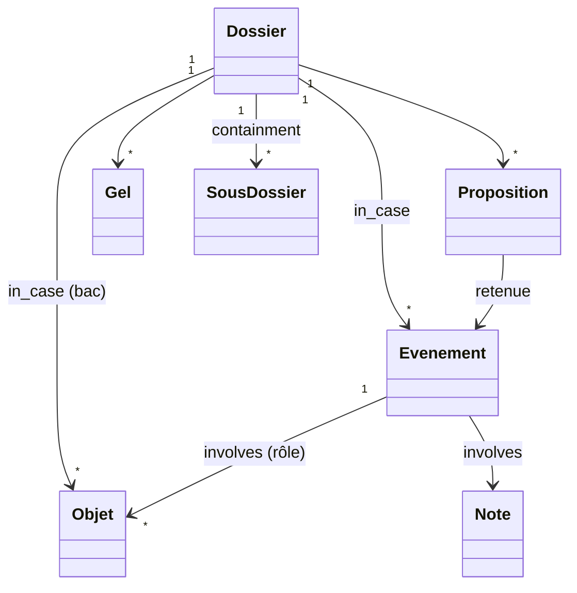

## 3. Fonctionnement

### 3.1 Ouvrir un dossier

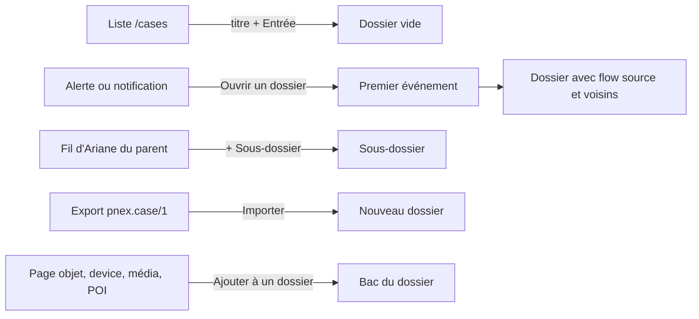

L'ouverture depuis une alerte crée le dossier et son premier événement. Le flow source est attaché en contexte, avec ses voisins valides à l'instant de l'alerte. Un flow d'une autre org est ignoré (R1). Le dossier n'a plus de fenêtre saisie : la fenêtre se calcule à partir des événements.

### 3.2 Membres, événements et bac

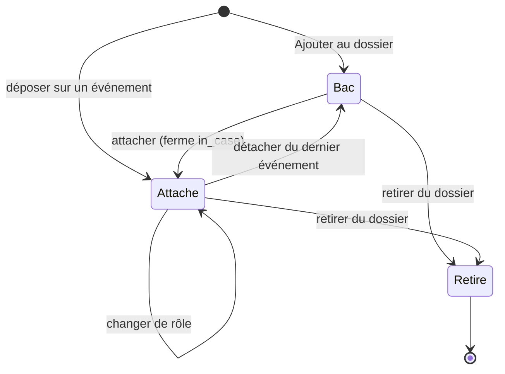

Chaque geste est une écriture unitaire. Déplacer un événement envoie l'objet avec `expected_version`. Un 409 recharge l'événement seul. L'interface est optimiste et revient en arrière si le serveur refuse. Retirer un événement du dossier garde ses pièces. Le rôle est proposé selon le type de l'objet : personne ou organisation → acteur, POI ou lieu → contexte, note ou hypothèse → hypothèse, flow → source, tout autre type → preuve.

Attacher une personne exige une base de traitement (`legal_basis`) sur le dossier. Sinon le serveur refuse avec `case-legal-basis-required` et l'UI ouvre le Cadre sur ce champ.

### 3.3 Espace de travail et curseur

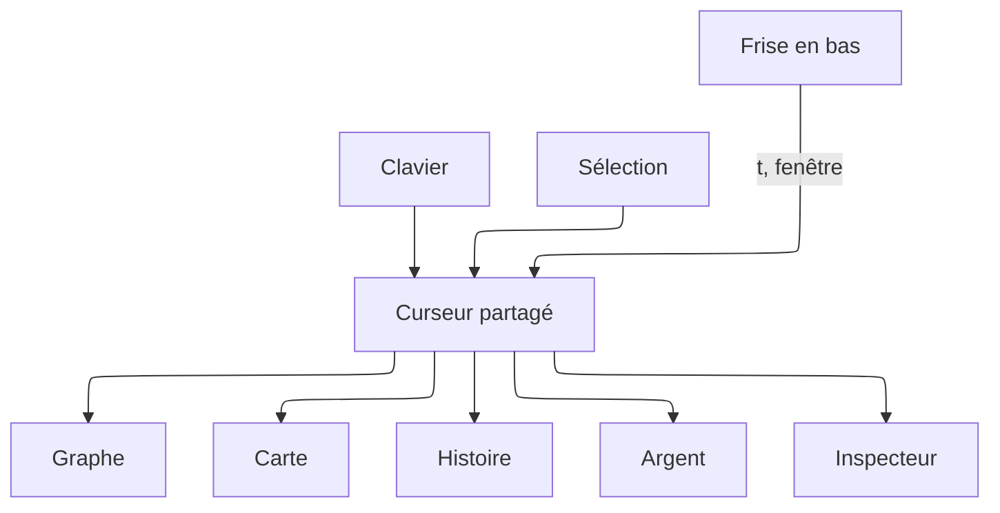

L'espace de travail utilise `EditorShell`. La barre du haut porte le titre, le statut, la bascule de vue (Graphe, Carte, Histoire, Argent), le Cadre, les exports et l'aide. Une seule grande vue occupe le centre. Le bouton **+** ouvre les onglets *Objets* (recherche, nouvelle note) et *Non datés* (le bac).

La frise est en bas et se replie. Elle porte une règle continue de la seconde à deux siècles, un histogramme de densité et ces lignes :

1. Événements : clic = instant, glisser = période, glisser un événement = le déplacer.
2. Signaux : masqués par défaut, regroupés (« 127 objets créés »).
3. Une ligne par acteur suivi : zones de présence et trous de signal hachurés.

L'axe compacté replie les périodes vides en coupures étiquetées (« ≈ 6 ans »). Au-delà de 6 lignes d'étiquettes, le reste devient une pastille « +N ». Le fuseau d'affichage est toujours étiqueté, le stockage est en UTC. La lecture avance à ×1, ×3 ou ×8 en temps réel multiplié, ou en mode ajusté (toute la fenêtre en 60 s).

Sélectionner un événement déplace le curseur à son début et centre la carte sur son lieu. L'inspecteur s'ouvre en tiroir à droite, en trois modes : dossier au curseur, événement, objet. La vue Histoire dessine chaque acteur présent dans au moins deux événements comme un fil dans le temps.

| Touche | Action |
|---|---|
| Espace | Lecture ou pause |
| ← / → | Événement précédent ou suivant |
| + / − , 0 | Zoom de la frise, ajuster au dossier |
| N | Nouvel événement au curseur |
| R | Retenir la détection sous le curseur |
| Échap | Fermer le tiroir, sinon désélectionner |
| ? | Aide clavier |

Chaque état vide propose une action. Si O2 ne répond pas, la frise et les événements restent intacts et les lignes d'acteurs sont grisées.

### 3.4 Traces

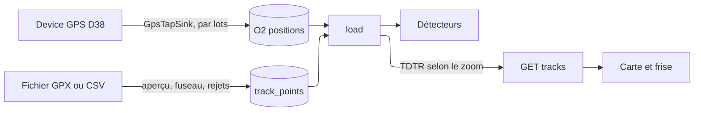

Les positions en direct vont dans le stream O2 `positions`. Les traces importées vont dans Postgres (`track_imports`, `track_points`) : une trace importée est une pièce, sans limite d'âge, et la rétention de la télémétrie (D72) ne la purge pas. La lecture `load` fusionne les deux sources.

L'import lit le GPX et le CSV (séparateurs `,` `;` tabulation, epoch en s ou ms). Une heure sans décalage exige un fuseau IANA. Chaque ligne écartée a son motif. Le même fichier sur le même membre donne le même import. Limites : 20 Mo et 500 000 points.

`GET /cases/{id}/tracks` renvoie des segments `[lon, lat, alt|null, dt_ms]` relatifs à `t0`, généralisés par TDTR selon `resolution_ms`. Un segment s'arrête à un trou de signal. Les distances se calculent dans un repère local en mètres. Au-delà de 31 jours (`MAX_WINDOW_DAYS`), ni traces ni détections : l'UI demande de zoomer.

La carte reçoit les traces une fois par fenêtre (`setTracks`), puis seulement `setTime(t)` à chaque image. Le JS coupe la trace au curseur (`track_cut.js`) sans interpoler à travers un trou. Des fixtures communes tiennent Rust et JS identiques.

### 3.5 Signaux, détections et propositions

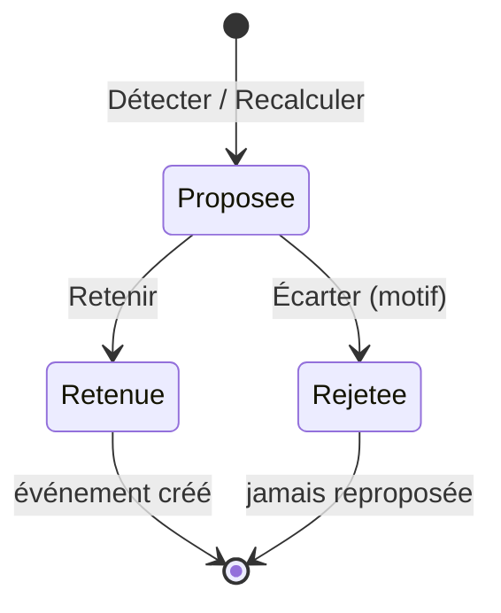

| Détecteur | Défauts (réglables dans le Cadre) | Résultat retenu |
|---|---|---|
| `co_presence@1` | 40 m, ≥ 2 min, sortie à 1,2 × | événement, membres en acteur |
| `stop@1` | diamètre 25 m, ≥ 15 min | événement au point médian |
| `signal_loss@1` | trou > 300 s ou trace muette avant la fin | événement |
| `zone@1` | zones des membres | entrée et sortie interpolées, zone en contexte |
| `causal_chain@1` | désactivé par défaut (§3.6) | événement « Chaîne : X → Y » |

Le calcul tourne côté serveur, à l'ouverture pour qui peut écrire et sur *Recalculer*. Chaque proposition porte une empreinte (détecteur, membres triés, début à la minute). Recalculer n'insère que le nouveau. Retenir crée l'événement, ses attaches et une note qui cite le détecteur et ses seuils, avec `source_ref = detector:<clé>@<version>`. Retenir est idempotent sous verrou de ligne. Les propositions apparaissent aussi dans la boîte commune (`proposals.md`).

Les signaux bruts (`GET /cases/{id}/signals`) couvrent les liens ouverts ou fermés, les changements d'objets, les plages, les notifications des flows membres et les dates floues. Ils se calculent à la lecture.

### 3.6 Chaînes causales (D904–D911)

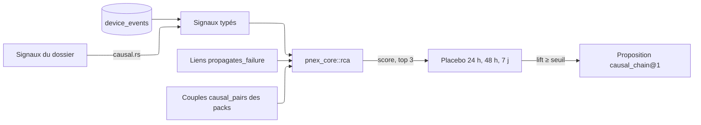

Un signal A sur X précède un signal B sur Y. Y est en aval de X par des liens qui propagent les pannes. Le couple (type de A, type de B) est déclaré par un pack. Le détecteur propose alors une chaîne : une piste, jamais un fait. Le placebo replace l'effet plus tôt. Une alarme quotidienne précédée d'une poussée quotidienne tombe donc sous le seuil.

Le réglage `maintenance.causal_chains_enabled` est faux par défaut. Il reste faux tant que le critère McNemar n'est pas mesuré sur un jeu d'incidents étiquetés. Le détecteur tourne sur *Detect* ou *Recompute*, comme les autres. La table `device_events` reçoit les bascules `active` et les changements de `fw_version` par un trigger sur `device_registries`.

### 3.7 Graphe

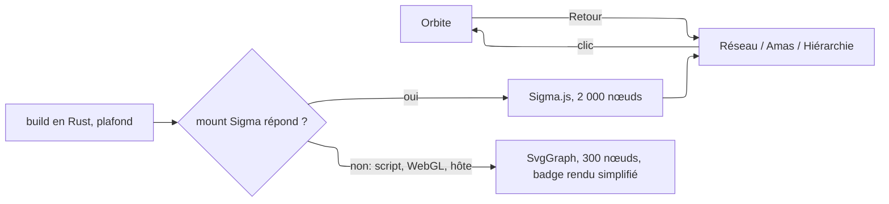

Le graphe est biparti : les événements sont des anneaux, les objets des disques colorés par famille (`person`, `organization`, `place`, `piece`, `claim`, `identifier`, `other`). Les attaches sont des traits droits, les relations d'ontologie des courbes. Pièces et affirmations sont repliées en pastilles sur l'objet qu'elles soutiennent. La légende filtre les familles.

- **Réseau** : ForceAtlas2 puis noverlap, positions de départ par FNV-1a de `(caseId, key)`, identique en Rust et en JS. Les nœuds isolés vont en colonne à droite.
- **Amas** : un disque par type, en spirale de l'angle d'or.
- **Hiérarchie** : propriétaire au-dessus du possédé, groupe au-dessus de ses membres.
- **Orbite** : un clic met le nœud au centre, ses voisins sur un anneau, leurs voisins sur un second. *Retour* dépile.

L'estompage au curseur se calcule en Rust (`faded`, `relation_at`) et passe à JS par `setState`. Un double-clic sur un objet ouvre l'expansion : voisins comptés par type de lien et type d'objet, puis voisins choisis (100 au plus). *Garder* les met au bac. Un glisser en vue Réseau enregistre la disposition (`PUT /cases/{id}/layout`), partagée par l'équipe. *Réorganiser* l'efface. Les données vont vers JS en JSON, les libellés se dessinent sur canvas (R11, R13).

### 3.8 Argent et détention

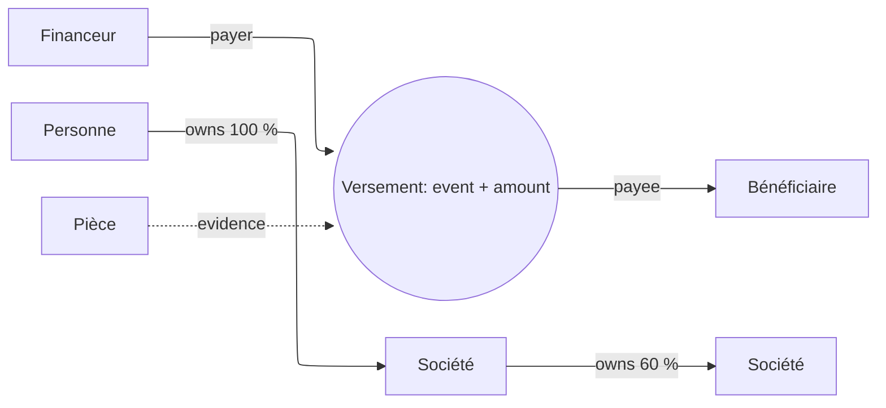

Le type de propriété `money` vaut `{amount, currency ISO 4217, estimated}`. Aucune conversion de devise n'est implicite : la vue agrège par devise. Plusieurs payeurs ou bénéficiaires partagent le montant à parts égales, marqué estimé. Un payeur absent s'affiche « Payeur inconnu ».

La vue Argent est un Sankey SVG calculé dans `pnex_core::ontology::money` : colonnes par plus long chemin, cycles gardés en liens de retour, non tracé (reçu − reversé). Un clic sur une bande liste ses versements et leurs pièces. Une bande sans pièce est en pointillé.

La part effective d'une personne est le produit des parts `owns.share` le long de chaque chaîne, sommé sur les chaînes (`pnex_core::ontology::ownership`). À 25 % ou plus (`BENEFICIAL_OWNER_PERCENT`), l'inspecteur la marque « Bénéficiaire effectif (calculé) » : une déduction, avec les liens qui la fondent. L'inspecteur répond aussi à « Comment est-il relié à… » par `GET /ontology/path`.

### 3.9 Affirmations, hypothèses et pages

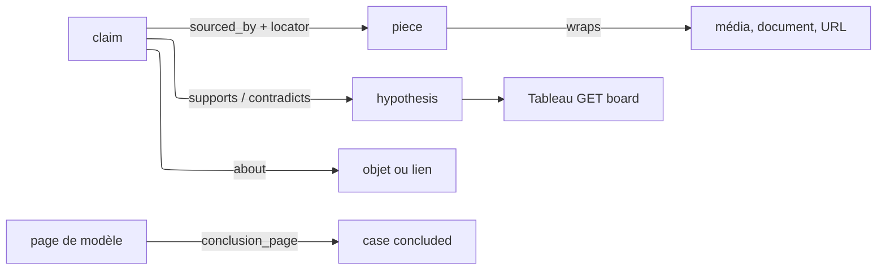

Le statut `corroborated` exige deux pièces `sourced_by` d'origines distinctes. Sinon le serveur répond 409 `ontology-claim-unsourced`. Une `corroboration_note` non vide autorise la dérogation, et le tableau la montre. La grille de crédibilité vaut fiabilité A–F × crédibilité 1–6. Le tableau des hypothèses n'a aucun score : l'humain conclut.

Le pack `investigation` livre cinq modèles de pages : 5 pourquoi, Ishikawa, compte rendu d'incident, note d'enquête, script. `POST /cases/{id}/pages` crée la page remplie côté serveur et la range dans le dossier. Au passage en `concluded`, la page `conclusion_page` reçoit une version nommée « Conclusion ».

### 3.10 Gel, export, purge

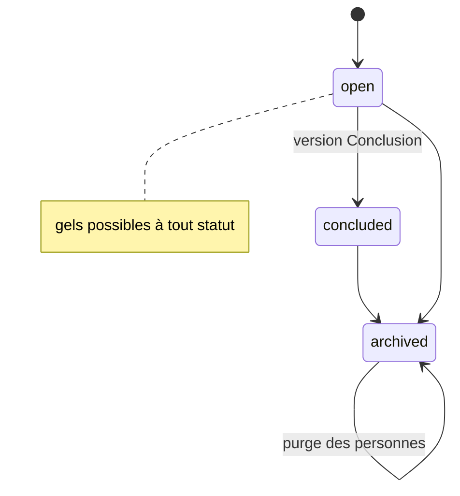

Un gel enregistre l'export `pnex.case/1`, les propositions examinées et les traces généralisées autour des événements (± 1 h, omises au-delà de 2 Mo ou de 31 jours). Le contenu est un JSON canonique (clés triées) en colonne `text`, avec SHA-256 et numéro croissant. Aucune route ne modifie un gel (405).

`GET /cases/{id}/export` rend le dossier en `pnex.case/1`. L'UI rend le Markdown dans la langue du lecteur. `POST /cases/import` recrée un dossier dans la même org : les objets absents sont listés, jamais recréés (R1).

La purge vise un dossier archivé. Les candidats sont les `person` et `identifier` qu'aucun autre dossier ni lien extérieur ne tient. La purge supprime l'objet, ses liens, ses plages, ses étiquettes, son profil vocal et les gels qui le citent. C'est la seule exception à la fermeture des liens (D179). Les copies déjà dans le journal O2 restent jusqu'à sa rétention.

### 3.11 Enquête média

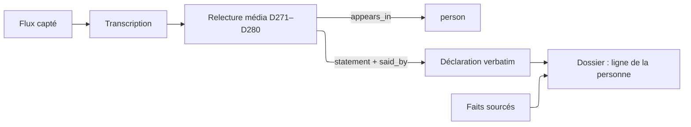

Une déclaration (`statement`) est citée mot pour mot, avec `aired`, `locator`, `stance` et deux phrases de contexte. Une apparition (`appears_in`) dit `present`, `speaking` ou `mentioned`, avec son origine. Une personne n'est jamais rattachée par le visage. La voix ne sert que par enrôlement consenti (`media.md` §3.12). Le dossier montre sur une frise les faits sourcés et ce que les personnes ont dit. Les détecteurs de discours (K44) ne sont pas codés.

### 3.12 Sous-dossiers et dossiers de veille

Un dossier peut contenir des sous-dossiers. Un sous-dossier est une lecture plus étroite, pas une copie. Il reçoit une copie de la `legal_basis` du parent à la création. Dans le graphe du parent, un sous-dossier est un nœud `case` : un double-clic l'ouvre. Un bandeau porte le fil d'Ariane et **+ Sous-dossier**. L'espace de travail se remonte à chaque changement de dossier.

Un dossier de veille porte une `watch_key` et un `watch_state`. Le nœud `check_record` y écrit des événements `origin = flow`, et le panneau *Contrôles* en montre l'état (`partners.md` D426–D431).

## 4. Exigences

1. Le dossier ne doit copier aucune donnée : il référence des objets de l'org par des liens.
2. Retirer un objet ou détacher une attache doit fermer le lien, jamais le supprimer (sauf purge).
3. Le serveur doit refuser l'attache d'une `person` sans `legal_basis` (409 `case-legal-basis-required`).
4. Toute lecture de traces qui contient une personne doit écrire une ligne dans le stream O2 `case_reads` (identifiants seulement).
5. Une détection ne doit jamais devenir un événement sans le geste « Retenir » d'un humain.
6. Une proposition rejetée ne doit jamais revenir après un recalcul.
7. La lecture et le glisser du curseur dans une fenêtre chargée ne doivent faire aucune requête.
8. La carte ne doit jamais interpoler une position à travers un trou de signal.
9. Un gel ne doit jamais changer : son empreinte doit se recalculer sur les octets relus.
10. Un export doit se réimporter dans un nouveau dossier, et l'aller-retour doit rendre le même export hors identifiants.
11. L'export doit avertir quand il contient des personnes.
12. Le graphe doit retomber sur le rendu SVG sans erreur quand Sigma ou WebGL manque.
13. Une chaîne causale, un bénéficiaire effectif calculé et une explication de l'assistant doivent s'afficher comme des déductions, jamais comme des faits.
14. Une allégation non sourcée ne doit jamais se dessiner comme un fait sourcé.
15. Chaque route d'écriture doit exiger la permission d'écriture (R2) et prendre l'org dans le principal (R1).
16. L'assistant ne doit ni retenir, ni rejeter, ni attacher, ni geler (D123, D189). Il lit seulement.
17. Chaque action de l'écran doit avoir un équivalent clavier.
18. Le dossier ne doit créer aucune frontière de sécurité : la frontière est l'org. Un dossier confiné vit dans une org dédiée (K9).

Hors périmètre (PNEX ne doit pas le faire) :

- identifier une personne par le visage, ou par la voix sans enrôlement consenti ;
- collecter des personnes sur le web ou les réseaux sociaux (seules des sources déclarées une par une, `browser-agents.md` D254) ;
- publier un dossier sur le web (D173) : un export reste un dossier de travail ;
- donner au gel une valeur de chaîne de possession légale (pas d'horodatage qualifié) ;
- fusionner des dossiers entre orgs, convertir des devises, détecter des schémas de blanchiment ou noter un risque ;
- qualifier une personne (« suspect », « coupable ») : un acteur a des rôles dans des événements.

## 5. Décisions

Modèle d'enquête (K1–K19) :

| # | Décision | Choix actuel |
|---|---|---|
| K1 | Le dossier est un type système | `case` sans table native ; fenêtre et modèle saisis retirés (K22, K33) ; tables de travail admises par K30, K33 |
| K2 | Appartenance par `in_case` | remplacée par K22 : `in_case` relie événements et bac, les rôles vivent sur `involves` |
| K3 | Ouvrir depuis un événement | alerte ou notification → dossier avec premier événement, flow source et voisins |
| K4 | Pack `investigation` | personnes, organisations, lieux, pièces, affirmations, hypothèses, déclarations, identifiants ; `event` et `involves` passés au noyau (K20, K21) |
| K5 | Temps flou | `fuzzy_time` dans le noyau ; `instant` impose `from == to` ; lien `before` entre événements |
| K6 | Chronologie unifiée | remplacée par K23 et K30 : frise d'événements et signaux bruts séparés |
| K7 | Affirmations sourcées | `corroborated` exige deux origines distinctes ou une `corroboration_note` ; grille A–F × 1–6 |
| K8 | Hypothèses et modèles RCA | tableau sans score, cinq modèles de pages, page de conclusion versionnée |
| K9 | Confinement | par l'org ; ACL par dossier repoussées avec D188 |
| K10 | Imports « données seules » | traces : K26 ; tableaux : imports d'ontologie (K61) |
| K11 | Extraction proposée | entités et affirmations proposées en revue, jamais imposées ; aucune inférence sur les personnes |
| K12 | Intégrité et gel | gel = K33 ; pas d'horodatage qualifié |
| K13 | Modèles de dossier | non codés ; les modèles de pages vivent dans les packs |
| K14 | Vues synchronisées | remplacée par K24 (un seul curseur) |
| K15 | Assistant scopé | outils de lecture `case_workspace`, `case_signals`, `case_board`, `case_proposals` |
| K16 | Données personnelles | purge à l'archivage, base de traitement déclarée, aucun champ de qualification |
| K17 | Apparitions média | `appears_in` (`present`, `speaking`, `mentioned`) écrit par la relecture média (D278) ; deux horloges : diffusion et position |
| K18 | Collecte conçue par l'IA | l'assistant propose des brouillons ; seul l'humain active et déploie (D123) |
| K19 | Identification vocale | variante A (enrôlement consenti) dans `media.md` §3.12 ; variante B (sources publiques) non retenue ; avis juridique requis avant usage réel |

Espace de travail (K20–K47) :

| # | Décision | Choix actuel |
|---|---|---|
| K20 | L'événement est un type du noyau | `event` système, sans table ; servi à plusieurs dossiers |
| K21 | Attache `involves` | rôle fermé + `detail` ; détacher ferme le lien au temps système |
| K22 | Membres déduits, bac | membres = attachés ∪ bac ; attacher sort du bac |
| K23 | Frise toujours visible | règle continue, lignes Événements, Signaux, acteurs ; fuseau étiqueté ; axe compacté |
| K24 | Un seul état de temps | curseur `t` + fenêtre ; lecture en temps réel multiplié |
| K25 | Acteurs suivis | trace par D38, lien `tracks` ou import |
| K26 | Traces | direct dans O2 `positions` ; imports dans Postgres `track_points` |
| K27 | Fenêtre de traces généralisée | TDTR selon `resolution_ms`, segments coupés aux trous, 31 jours au plus |
| K28 | Carte MapLibre seule | `setTracks` une fois, `setTime` par image ; pas de deck.gl |
| K29 | Zones | `geo_area` : cercle ≤ 100 km ou polygone ≤ 1 000 sommets ; saisie par formulaire |
| K30 | Signaux et détections | signaux calculés, détections en propositions avec empreinte |
| K31 | Graphe dérivé et borné | biparti, déterministe, disposition enregistrée ; rendu remplacé par GS1 |
| K32 | Inspecteur à trois modes | dossier au curseur, événement, objet |
| K33 | Cadre, gel, export | tiroir Cadre ; gels multiples immuables ; JSON et Markdown ; réimport |
| K34 | Glisser-déposer et palette | événements pointeur, équivalent clavier, type `note` |
| K35 | Écritures unitaires | `expected_version`, interface optimiste ; journal O2 par lots non fait |
| K36 | Raccourcis clavier | §3.3 |
| K37 | États vides qui guident | chaque état vide porte une action ; O2 absent = lignes grisées |
| K38 | Données personnelles | base de traitement vérifiée côté serveur, journal `case_reads`, purge des traces importées |
| K39 | Accessibilité, thèmes, téléphone | clavier, clair et sombre aux jetons, téléphone en consultation |
| K40 | Vues commutables | Graphe, Carte, Histoire, Argent |
| K41 | Nom | proposition « Enquêtes » non retenue ; libellé « Dossiers d'enquête » / « Cases » |
| K42 | Enquête média | mêmes écrans, autres sources et détecteurs |
| K43 | Déclaration | `statement` verbatim + `said_by` dans le pack ; écrite par la relecture média |
| K44 | Détecteurs de discours | positions opposées, jugements différents, écart avec un fait ; vérification mot pour mot ; non codés |
| K45 | Vocabulaire neutre | libellés imposés, contexte affiché, motif d'écart, réponse de la personne |
| K46 | Faits et déclarations alignés | faits en ligne Événements, déclarations en ligne de personne |
| K47 | Fond commun RCA et média | pas de mode : les panneaux suivent les membres |

Navigation et argent (K48–K64) :

| # | Décision | Choix actuel |
|---|---|---|
| K48 | Chercher, montrer le contexte, étendre | expansion au double-clic, geste unique |
| K49 | La preuve est une couche | pièces et affirmations repliées en pastilles au départ ; la légende les remet en nœuds |
| K50 | Filtres et vues enregistrées | filtres par famille faits ; vues enregistrées non faites |
| K51 | Chemins entre deux objets | un plus court chemin par `GET /ontology/path` (4 liens au plus) |
| K52 | Certitude visible partout | plein = sourcé, pointillé = non confirmé ; fait dans la vue Argent seulement |
| K53 | Regrouper | méta-nœuds non faits |
| K54 | Type `money` | montant, devise ISO 4217, `estimated` ; pas de conversion implicite |
| K55 | Le versement est un événement | `amount` sur `event`, rôles `payer` / `payee` ; pas de type `payment` |
| K56 | Détention et bénéficiaire effectif | `owns.share`, part effective calculée, seuil 25 % fixe |
| K57 | Vue Argent | Sankey SVG, cycles gardés, non tracé ; repli en flux net non fait |
| K58 | Arbre de détention | non fait (vue Hiérarchie du graphe en tient lieu en partie) |
| K59 | Arcs financiers sur la carte | non fait |
| K60 | Pack `finance` | reporté : `investigation` porte `owns.share` |
| K61 | Chemins d'import | tableaux : imports d'ontologie ; nœuds `object_upsert` / `link_upsert` ; FollowTheMoney non fait |
| K62 | Fusion de doublons | validée par un humain, réversible ; non faite |
| K63 | Sources ouvertes | catalogue documenté, aucun connecteur imposé ; registres de bénéficiaires effectifs jamais contournés |
| K64 | Données personnelles et neutralité | K38 et K45 s'appliquent ; une fuite reste une affirmation |

Graphe (GS1–GS17) :

| # | Décision | Choix actuel |
|---|---|---|
| GS1 | Sigma.js + graphology | `js/graph.js` en IIFE, versions exactes (`sigma@3.0.2`), pont `graph_viewer.rs` |
| GS2 | Contrat Rust ↔ JS | `mount`, `setData`, `setState`, `relayout`, `positions`, `screenPos` ; événements par polling |
| GS3 | Données transmises | `build()` en Rust avec `type_key` et famille |
| GS4 | ForceAtlas2 + noverlap | positions FNV-1a identiques Rust/JS, isolés en colonne ; 2 000 nœuds sous Sigma |
| GS5 | Vue chronologique | `chronoLayout` testé ; aucun bouton ne l'ouvre |
| GS6 | Encodage visuel | sept familles, événements en anneau, taille selon le degré |
| GS7 | Libellés | grille de densité + test de collision, halo canvas |
| GS8 | Focus et estompage | voisinage au survol ; estompage au curseur calculé en Rust |
| GS9 | Interactions | clic, double-clic d'expansion, glisser enregistré, Réorganiser |
| GS10 | Thème | couleurs relues sur `data-theme` |
| GS11 | Repli SVG | `SvgGraph` avec badge « rendu simplifié » |
| GS12 | Sécurité et dépendances | canvas sans `innerHTML` (R11), JSON (R13), aucune requête depuis JS |
| GS13 | Assistant | fiche `assistant-kb/cases.md` seulement |
| GS14 | Barre de vues | Réseau, Amas, Hiérarchie |
| GS15 | Orbite au clic | voisins en anneaux, pile et *Retour* |
| GS16 | Sous-dossiers | affichage seulement ; `legal_basis` du parent copiée ; contenu non imposé |
| GS17 | API d'abord | `parent_id` sur `POST /cases`, `parents` / `children` dans le workspace |

Chaînes causales (D904–D911) :

| # | Décision | Choix actuel |
|---|---|---|
| D904 | Signal typé commun | `pnex_core::rca::Signal`, `kind` en liste fermée, seuils déclarés seulement |
| D905 | Drapeau `propagates_failure` | une chaîne suit ces liens, dans leur sens, ouverts à l'instant de la cause, 3 liens au plus |
| D906 | Couples déclarés par les packs | `causal_pairs`, chaque couple = deux réglages (`prior`, écart max) |
| D907 | Score | `prior` × exp(−écart / τ) / (1 + distance), produit des sauts, top 3 par effet |
| D908 | Placebo | effet replacé 24 h, 48 h et 7 j plus tôt ; proposé si lift ≥ `causal_min_lift` (2) |
| D909 | Une proposition, jamais un fait | retenir crée l'événement, les attaches, la note, et avec le pack une hypothèse |
| D910 | Assistant figé | un paquet tel qu'à `T0 + 15 min` (D902) |
| D911 | Mesurer, ne pas apprendre | bilan par couple dans les réglages du pack ; signalé sous 20 %, jamais désactivé |

Décisions liées, tenues ailleurs : D176–D191 (`ontology.md`), D159–D175 (`media.md`), D271–D280 (`media.md`), D426–D431 (`partners.md`), D441 (garde `engine_genericity`), D902 (`markets-research.md`).

## 6. Interfaces

Routes sous `/api/v1/cases` (`controllers/cases.rs`, services `services/ontology/cases/`) :

| Route | Effet |
|---|---|
| `POST /` (`from`, `parent_id`) · `POST /import` | ouvrir un dossier, réimporter un export |
| `GET /{id}/workspace` | dossier, événements et attaches, bac, zones, lieux, parents, sous-dossiers |
| `POST /{id}/events` · `POST /{id}/attach` · `POST /{id}/detach` | créer un événement, attacher, détacher ou retirer |
| `GET /{id}/signals` · `GET /{id}/tracks` | signaux bruts, traces de la fenêtre |
| `POST /{id}/tracks/import` · `GET …/tracks/imports` · `DELETE …/tracks/imports/{iid}` | importer (aperçu `dry_run`), lister, supprimer une trace |
| `POST /{id}/detect` · `GET /{id}/proposals` · `POST …/proposals/{pid}/retain` · `…/reject` | détecter, lister, retenir, rejeter |
| `GET /{id}/board` | tableau des hypothèses |
| `POST /{id}/snapshots` · `GET …/snapshots` · `GET …/snapshots/{seq}` | geler, lister, relire |
| `GET /{id}/export` · `GET /templates` · `POST /{id}/pages` | export, modèles de pages, créer une page |
| `GET /{id}/purge` · `POST /{id}/purge` | candidats, purge réelle (dossier archivé) |
| `GET /{id}/reads` | journal d'accès aux traces (503 `case-reads-unavailable`) |
| `GET /{id}/relations` · `POST /{id}/graph/query` · `GET/PUT /{id}/layout` | relations entre membres, expansion, disposition |

Le reste (édition d'un événement, d'une note, d'un rôle) passe par `/api/v1/ontology/*`.

- **Tables** : `case_snapshots`, `track_imports`, `track_points`, `case_layouts` (migration `m20261012_000013_case_workspace`), `proposals` (`kind = case_event`, migration 000049), `device_events` (migration 000140).
- **Streams O2** : `positions`, `case_reads`.
- **Erreurs** : `case-legal-basis-required`, `case-proposal-stale`, `case-reads-unavailable`, `ontology-claim-unsourced`, `track-import-timezone-required`, `track-import-empty`, `track-import-unreadable`.
- **Noyau** : `pnex_core::track` (normalisation, trous, TDTR, détecteurs), `geo_area`, `ontology::{layout, money, ownership}`, `rca`.
- **Front** : `pages/cases/mod.rs` (liste), `pages/cases/workspace/` (frise, graphe, carte, Histoire, Argent, inspecteur, Cadre, gels, imports, sous-dossiers), `js/graph.js`, `js/graph_layout.js`, `js/map.js`, `js/track_cut.js`.
- **Assistant** : outils `case_workspace`, `case_signals`, `case_board`, `case_proposals` ; fiche `assistant-kb/cases.md`.
- **Tests** : `crates/pnex-backend/tests/ontology.rs`, `e2e/tests/cases.spec.ts`, `e2e/tests/causal-chains.spec.ts`, `bun test js/`.

## 7. Reste à faire

- **Écran** : journal O2 des changements par lots (K35) ; séries à bornes absolues et ligne de mesures ; cercle de zone dessiné à la souris ; zone sur `map_pin` ; bouton de la vue chronologique du graphe (GS5).
- **Navigation et argent** : vues enregistrées (K50, Q-M3), certitude dans le graphe (K52), regroupement (K53), arbre de détention (K58), arcs sur la carte (K59), repli du Sankey en flux net (K57), fusion de doublons (K62), import FollowTheMoney (K61), dossier de démo sur données ouvertes.
- **Enquête média** : chronologie des citations, détecteurs de discours K44 avec vérification mot pour mot, comparateur, motifs d'écart, réponse de la personne.
- **Chaînes causales** : jeu d'incidents étiquetés et mesure McNemar avant d'activer le détecteur par défaut.
- **Sous-dossiers** : découper les dossiers de `pnex-france-overview` par l'API (GS-L7).
- **Graphe** : licences npm à consigner dans `docs/journal/inventory.md` ; colonne des isolés coupée au bord quand il y a peu de nœuds reliés.
- **Export** : vérification de divergence SHA-256 des pièces ; JSON canonique RFC 8785 exact (aujourd'hui clés triées seulement) ; réimport entre orgs.

Choix de Shan :

- ACL par dossier (K9 V2) : à rouvrir avec D188, ou jamais (org dédiée suffit) ?
- Pack de base « Acteurs » pour `person` / `organization`, requis par Enquête et Couverture médiatique, ou déclaration par chaque pack ?
- Horodatage qualifié (RFC 3161) des gels, ou hors champ ?
- Seuil de confiance des apparitions sous lequel un rattachement part en revue (K17).
- Validité « monde » sur une attache (Q-T1) : proposé non, une sous-période devient un événement.
- Rattrapage des positions antérieures au stream `positions` (Q-T2) : proposé non.
- Palette d'acteurs : 8 couleurs suffisent-elles (Q-T3) ?
- Détections relancées automatiquement à l'arrivée de points (Q-T4) : proposé non.
- Connecteur prêt à l'emploi pour une source ouverte (Q-M4), ou catalogue K63 seulement ?
- Champs de société du pack `finance` (immatriculation, mandat `directs`) au moment de l'import FollowTheMoney (K60).
- `graph.js` chargé au démarrage ou à la première ouverture d'un dossier (Q-GS2) ?
