# Suivi commercial : comptes, données personnelles et pack `crm`

Décisions D329–D343, D442–D452, D514–D517, D522, D537–D539, D590, D591, D610, D611, D721–D727, D779, D976–D977. Liens : `ontology.md` (D176–D191, D368 réglages de pack, D370 libellés), `partners.md` (D300–D316 : imports, clé naturelle, vue Hiérarchie, crawl, preuves), `browser-agents.md` (D254–D284), `agents.md` (D780–D790, recherche d'une personne D788), `pipelines.md` (D972–D973 pack `watch`, D996–D999), `operational-platform.md` (D998), `iam.md` (D296, D298), `proposals.md` (D367, D371–D377), `mail.md` (D453–D462, D518–D521), `viz.md` §3.5 (calculs sur des objets, D579–D588), `app-builder.md` (D506–D513), `cases.md` (chemins K51), `labor-market.md`.

## 1. Résumé

Le suivi commercial couvre un compte de la liste cible au contrat, dans le même graphe que l'ontologie. Le pack `prospecting_b2b` montre un compte comme un réseau daté : groupe, filiales, sites, contacts, recommandations et signaux. Le pack `crm` ajoute les pistes, les opportunités, les activités, les relances, les devis et les factures, avec une application et ses tableaux de bord. Le noyau donne seulement des briques génériques : classification, masquage, effacement, opposition, couleurs, couverture, historique d'étape. La plateforme prépare les textes. Un humain envoie, décide et valide.

## 2. Concepts

- **Compte** : une `organization` du pack mondial `companies`. Aucun type « entreprise » ou « compte » à côté (D304).
- **Statut commercial** (`account_status`) : `customer`, `prospect`, `target`, `former_customer`, `competitor`, `partner`, `excluded`. Un **compte suivi** a le statut `customer`, `prospect` ou `target`.
- **Couche pays** : pack `<pack générique>_<pays>` qui contient seulement ce qui est propre au pays (`companies_fr`, `prospecting_b2b_fr`).
- **Persona** : rôle d'une `person` dans le comité d'achat (`decision_maker`, `champion`, `sponsor`, `influencer`, `buyer`, `user`, `technical`, `other`). L'intitulé de poste reste sur `employs.position`.
- **Couverture** : résumé calculé à la lecture sur une hiérarchie (sites clients, utilisateurs, contacts par persona, signaux).
- **Espace blanc** : filiales et sites d'un groupe sans contact ni statut client.
- **Signal commercial** (`sales_signal`) : ce qui a bougé sur un compte suivi. `kind` dit comment il a été détecté, `topic` dit de quoi il parle.
- **Contact de liste** (`list_contact`) : une ligne d'une liste de salon, d'association ou de salariés. Ce n'est pas une `person` du graphe.
- **Rendez-vous** (`meeting`) : rencontre avec un compte, ses participants, son enregistrement et son compte rendu.
- **Piste** (`lead`) : une demande ou un contact pas encore qualifié. Elle devient une opportunité par l'action `convert`.
- **Opportunité** (`opportunity`) : une affaire suivie avec un compte, de `discovery` à `won` ou `lost`.
- **Activité** (`activity`) : ce qui est fait ou à faire (appel, mail, rendez-vous, message réseau, note, tâche).
- **Plan de relance** : les objets `follow_up_step` de l'org (jour, nature, consigne).
- **Effacement** : retrait des données personnelles d'un objet, qui reste en **coquille** en lecture seule.
- **Opposition** : refus de prospection d'une personne, gardé en empreintes dans la liste `prospecting_oppositions`.
- **Point de contact** (`contact_point`) : une propriété qui atteint une personne (adresse, téléphone, URL de profil).

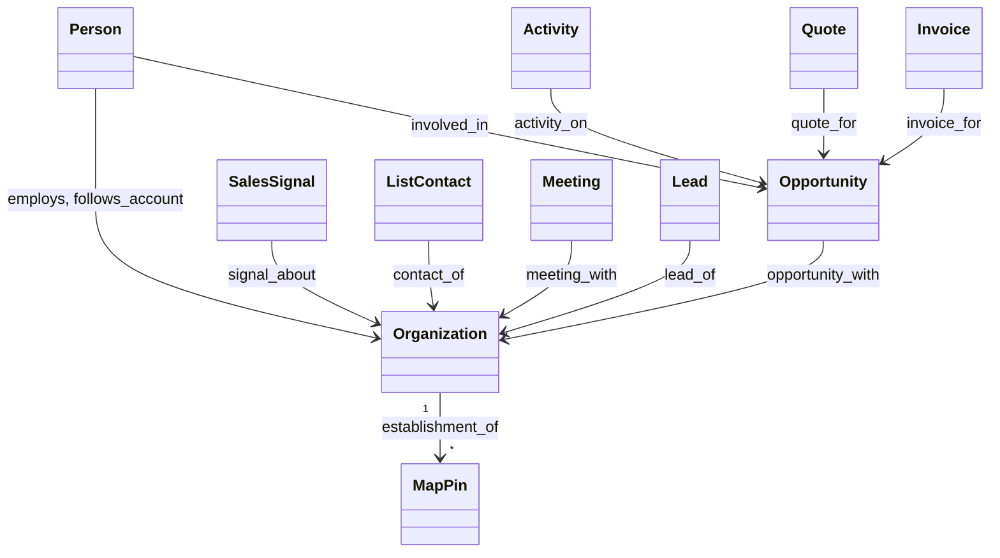

## 3. Fonctionnement

### 3.1 Packs et couches

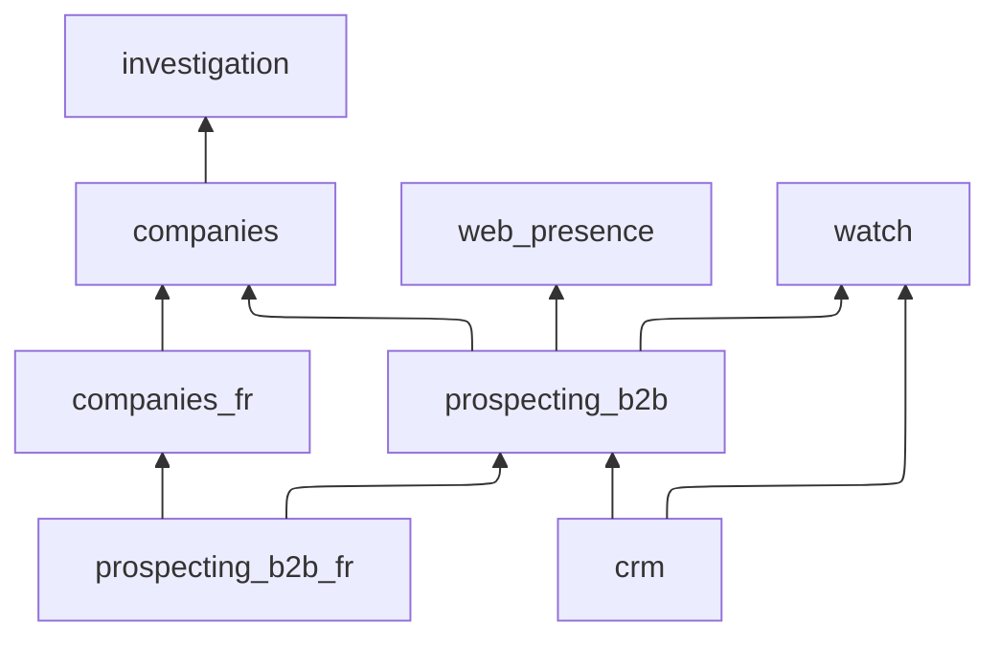

Le socle `companies` vaut pour tout pays (D343) : pays ISO 3166-1, LEI, classe NACE, effectif minimum et maximum, `subsidiary_of`, hiérarchie `group`. Une couche pays ajoute sa clé, ses codes et son registre. Son import remplit aussi les champs communs (NAF vers NACE, tranche vers effectif). Une clé passe d'une couche pays au socle à la mise à jour (`hands_over`), sans perte. Un pays sans couche utilise GLEIF, Wikidata, la saisie ou un fichier.

`prospecting_b2b_fr` joint `companies_fr` et `prospecting_b2b` : aucun des deux ne connaît l'autre. Un pack amène ses dépendances à leur version livrée avant de s'installer (`install_locked`).

Versions livrées : `companies` 2.3.0, `companies_fr` 4.4.0, `prospecting_b2b` 4.5.1, `prospecting_b2b_fr` 4.1.0, `crm` 4.0.0.

### 3.2 Groupe, couverture et couleurs

`prospecting_b2b` étend `organization` (statut, utilisateurs actuels et potentiels, `last_revenue` et `revenue_year`, `target_score`), `map_pin` (`establishment_status`, utilisateurs) et `person` (`persona`, `review_on`). Il ajoute les liens `recommended` (qui a recommandé qui), `follows_account` (suiveur interne avec un `role` libre) et `uses_solution` (solution concurrente). La hiérarchie `sales_group` suit `subsidiary_of`, `owns` puis `establishment_of`.

`subsidiary_of` dit un contrôle ou une consolidation, sans pourcentage. `owns` reste réservé aux participations connues. Ce lien n'a pas de cible unique : une mère directe, une mère ultime et deux sources en conflit restent côte à côte, avec leur provenance (D184). L'humain ferme le lien faux.

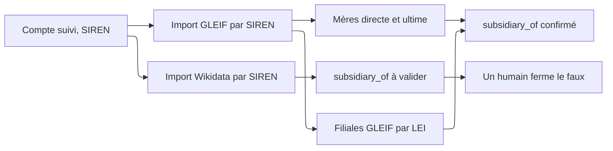

Les imports par objet prennent les objets à tour de rôle (`per_object_cursor`). Les filiales sont lues seulement depuis les comptes suivis. Une mère étrangère sans SIREN devient une `organization` de clé `lei` ou `wikidata`.

La couverture se calcule à la lecture, à une date, comme la hiérarchie (D330). Une hiérarchie de pack déclare `sums`, `coverage` et `tallies`. La vue rend les totaux, les nombres par valeur colorée et l'espace blanc. Un rôle masqué voit le total sans la répartition par persona.

Une propriété d'énumération peut porter `colors` : valeur vers un jeton de la palette fermée (`schema::COLORS`, D339). La hiérarchie, le graphe et la carte (points isolés) prennent la couleur de la première propriété colorée renseignée. `prospecting_b2b` colore `account_status` et `establishment_status`.

### 3.3 Ingestion et organisation (D998)

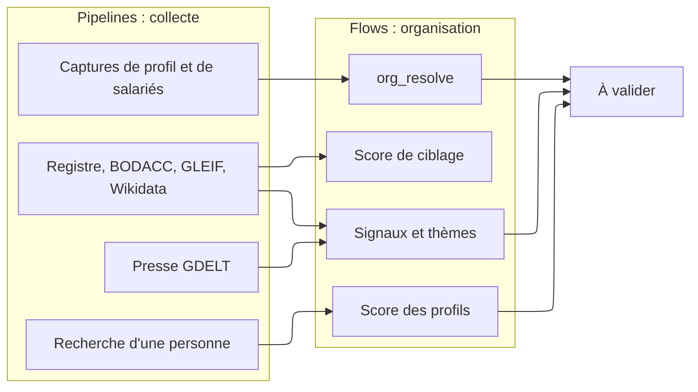

Les pipelines des deux packs collectent et stockent le brut. Les flows du pack rapprochent, notent et proposent sur l'état courant. Le tableau dit où tourne chaque décision d'organisation aujourd'hui.

| Décision | Où | Déclencheur |
|---|---|---|
| Score de ciblage (D336) | flow `Prospecting · target score` | toutes les 15 min, 500 organisations non notées du jour |
| Société d'un contact de liste (D332) | flow `Prospecting · list contacts to companies` (`org_resolve`) | toutes les 15 min, 100 contacts |
| Employeur d'un profil capturé (D538) | flow `Prospecting · captured profiles` | toutes les heures, 20 personnes |
| Employeur d'un export réseau | flow `Prospecting · network export to companies` | toutes les 15 min, 100 personnes |
| Employeur d'après l'entreprise du profil | flow `Prospecting · employers from profiles` (nom replié, sans LLM) | `ontology_trigger` sur `profile_company` |
| Profil d'une personne (D788) | flows `identify people`, `score profiles`, `follow decisions` | action `find_profile`, `ontology_trigger`, horaire |
| Thème d'une actualité (D539) | flow `Prospecting · news to topics` | toutes les heures |
| Signal d'une page suivie (D335) | flow `Prospecting · watched pages to signals` | toutes les heures |
| Nouvel établissement | flow `Prospecting · new establishments` | chaque matin |
| Article rattaché à un compte | pipeline `press_gdelt` (filtre par nom) | écart justifié par le volume, au tableau D998 |
| Relations d'un contact (D976) | pipeline du pack `prospecting_b2b` (PE5.4, en cours) | filtre à la collecte justifié par la minimisation, au tableau D998 |

Le pipeline de recherche d'une personne collecte. Les trois flows du pack notent le profil, proposent ou capturent, puis relancent la requête suivante (`pipeline_ask`, D999). Rescorer veut dire relancer la collecte.

### 3.4 Listes de ciblage, de salon et score

- **Ciblage** (D337) : l'import `targeting_list` de `prospecting_b2b_fr` lit une recherche enregistrée du registre, paginée jusqu'à 10 000 résultats. L'org remplace l'URL exemple par son profil de client idéal. Un nouveau SIREN entre en `target` par `defaults`, appliqués seulement à la création : le statut d'un compte connu ne change pas.
- **Listes de salon ou d'association** : un fichier donne des `list_contact` (colonnes `list`, `name`, `job_title`, `company`, `city`, `postal_code`, `email`). Un flow cherche le SIREN de chaque société (`org_resolve`) et propose `contact_of`.
- **Rapprochement** (D332) : le nœud `org_resolve` prend un nom et une ville ou un code postal. Il rend 0 à 5 candidats notés (nom 70, même code postal 20, siège dans la ville 15, autre site 5, société active 10). Il n'écrit rien. Ports : *trouvée* (80 au moins et 10 points d'avance), *à revoir*, *échec*. Plafond : 2 000 appels par jour et par org. L'adresse du registre est le réglage `company_register_url` du pack `prospecting_b2b_fr`. Sans ce pack, le nœud échoue (`org-resolve-unavailable`).
- **Score** (D336) : les critères sont des objets `targeting_criterion` de l'org (propriété, opérateur, valeur, points). Le pack n'en livre aucun. Les fonctions Starlark `pb_criteres` et `pb_score` écrivent `target_score`, `score_detail` (une ligne par critère) et `scored_on`. Pas de ML : le score s'explique ligne par ligne.

Le score porte sur les organisations seulement. `map_pin` est un type système qu'un flow n'écrit pas : l'explorateur filtre les sites sur leur effectif.

### 3.5 Signaux, actualités et établissements

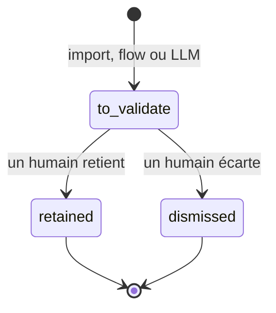

Un signal garde sa source et l'extrait cité. Un import pose `to_validate` à la création seulement : une décision humaine n'est jamais écrasée. Sources :

- **Annonces légales** : import BODACC par SIREN des comptes suivis, dépôts de comptes exclus. *Créations* donne `new_establishment`, *Radiations* `establishment_closure`, le reste `legal_notice`.
- **Nouvel établissement** : l'import `company_establishments` lit les sites ouverts des comptes suivis par leur nom (`per_object.by_title`), car le registre n'en rend aucun par SIREN. Un site créé depuis moins de 30 jours devient un signal, une fois (clé `siret:<siret>`).
- **Pages suivies** (`watched_page`) : le crawl marque une page dont le texte a changé. Le LLM de l'org choisit un thème de la liste de l'org et écrit un signal `page_changed`. Les pages d'un concurrent passent par le même chemin.
- **Changement de poste** (D334) : un lien `manages` ouvert ou fermé au registre crée un signal `executive_change`. Une recapture qui donne une autre société propose de fermer l'ancien `employs`. `review_on` rappelle au suiveur de revérifier à la main.

Les actualités de presse sont des `news_item` du pack `watch`, liées par `item_about` (D539, amendée par D972–D973). L'import `press_gdelt` lit les fichiers GKG des dernières 26 heures, une fois pour toutes les orgs. Il garde un article par compte et par jour quand son titre nomme le compte. Il écrit le crédit de la source sur chaque item. Le flow `news to topics` donne un thème ou écarte l'item. La couche France 4.1.0 écrit aussi des actualités depuis d'autres sources publiques (`decp_awards`, `sitadel_permits`, `amf_releases`, `icpe_inspections`, `boamp_tenders`).

Le flow `Prospecting · signals digest` fait chaque matin un texte des signaux non notifiés. L'org ajoute son nœud de notification.

### 3.6 Personnes : captures, listes de salariés, relations

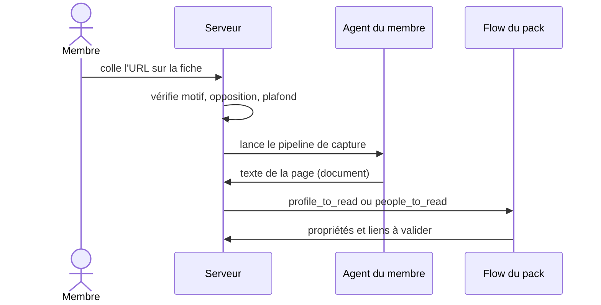

PneX ne surveille aucun profil et ne parcourt aucun graphe social (D254). Chaque capture part d'un humain, une page à la fois, dans la session déjà connectée de son agent.

- **Profil d'une personne** (D333) : six réseaux déclarés par le pack `prospecting_b2b` (`networks/*.yaml`, D951). Toute autre page reçoit `ext-target-not-profile`. Plafond compilé : 30 captures par jour, par org et par réseau (`ext-profile-daily-cap`). Le texte va dans un document `captured_text` lié à la personne. L'adresse devient un `identifier` relié par `uses_identifier`.
- **Lecture du profil** (D538) : le flow `captured profiles` écrit poste et société sur la personne (`personal`). Il propose `employs` quand le registre trouve la société. Il ne crée aucune personne.
- **Liste des salariés** (D779) : seule la page des salariés d'une entreprise est admise (`browser_agent::people_page_of`, sinon `ext-target-not-people-page`). L'agent fait défiler 5 écrans. Plafond : 10 listes par jour et par org (`ext-people-daily-cap`). Le flow `captured employee lists` écrit un `list_contact` par personne nommée et propose `contact_of`. Aucune `person` n'est créée.
- **Export de profils réseau** : l'import *Network profiles export (file)* crée une personne par `profile_url` (unique, point de contact). Un flow cherche l'employeur au registre et le propose.
- **Relations du membre connecté** : un pipeline du pack lit les relations directes du membre qui déploie le flow, 50 pages par jour. Chaque relation devient une personne de clé `profile_url`. Le flow `employers from profiles` la rattache à sa société.
- **Partage des relations du membre (D999, choix de Shan du 2026-11-20 et du 2026-11-21)** : les relations restent par défaut dans l'org où le flow du membre les lit (son org personnelle). Un interrupteur par réseau, sur la page Profil, les partage avec l'org courante. Seul LinkedIn existe. Le pipeline déclare `share: linkedin` sur son écriture `objects`. Le fonctionnement est le suivant :
  - **Activer** : PneX trouve la personne qui utilise l'adresse mail du membre comme identifiant. Sinon, PneX crée une personne au nom du membre. La table `connection_shares` garde l'interrupteur et cette personne.
  - **Pendant le partage** : chaque ligne du run du membre arrive aussi dans l'org d'équipe, avec la même clé, et un lien `knows` part de la personne du membre. Une personne déjà là garde ses valeurs. Le serveur relit à chaque écriture que le membre a `ontology:write` dans l'org (R2). Ces liens nourrissent les chemins d'introduction.
  - **Couper** : les liens `knows` du partage se ferment, historique gardé. Une personne amenée par un partage reçoit une proposition d'effacement si trois conditions sont vraies : aucun lien ouvert, aucun lien fermé hors partage, aucune modification depuis sa création (version 1).
- **Recherche d'une personne** (D788, `agents.md`) : action `find_profile` sur la fiche, ou flow horaire pour les comptes cibles et prospects.

Le texte capturé est purgé après 30 jours. Une personne opposée n'est ni capturée ni lue (`prospecting-opposed`).

**Relations d'un contact (D976–D977) : gardées (Shan, 2026-11-20).** Le retrait du 2026-11-18 est annulé. La capture passe de la règle `connections_capture` à un pipeline du pack `prospecting_b2b` (PE5.4, en cours, `pipelines.md`). Le code lit les relations d'un contact déclaré en relation avec le membre. Il garde seulement les personnes d'une organisation qui porte l'étiquette du réglage `connections_keep_label`. Il écrit `knows` et propose `employs`. Le code actuel, avant PE5.4 :

- la table `network_connections` (migration `m20261114_000152_network_connections`) et `services/network_connections.rs`, `services/connection_shares.rs`.
- les routes `GET`/`PUT /api/v1/extension/people/{id}/connection` et `GET`/`POST …/connections-captures`.
- la règle par défaut `connections_capture` (`pnex-core` `default_rules.rs`, code `ext-connections-hidden`).
- le réglage `connections_keep_label` de `prospecting_b2b` et le panneau de la fiche (`pages/ontology/profile_capture.rs`).

### 3.7 Chemin d'introduction, rendez-vous et pages

**Chemin d'introduction** (D338) : `GET /api/v1/ontology/path` avec `links` suit seulement les liens donnés, dans la marche récursive. `INTRODUCTION_LINKS` vaut `knows`, `recommended`, `employs`, `manages`, `member_of`, sur 4 sauts au plus. `from_links` donne plusieurs départs : les sources des liens ouverts de ce type (500 au plus), par exemple `follows_account`. Le chemin s'affiche surligné dans le graphe.

**Rendez-vous** : `meeting` (date, `purpose`, `status` `planned`/`held`/`cancelled`, lieu, suite). Liens `meeting_with`, `takes_part_in` (côté `internal` ou `customer`), `recording_of` (média) et `covered` (critère du playbook). Un mail d'invitation crée ou déplace un rendez-vous par son `invitation_uid` (D484, `mail.md`). L'enregistrement suit le chemin des médias. L'étape `summarize` accepte un `focus` saisi par l'utilisateur. La hiérarchie `coaching` compte les rendez-vous par critère, jamais par personne.

**Pages remplies depuis un objet** (D340, D452, D516) : un modèle de page de pack déclare `subject` et `link`. Ses balises (`{{prop:…}}`, `{{links:…}}`, `{{tree:…}}`, `{{coverage:…}}`, `{{white_space:…}}`) sont remplies à la création (`pnex_core::ontology::page_render`). La page est un instantané : pour la rafraîchir, on la recrée. Modèles : `account_plan`, `competitor_sheet`, `meeting_prep`, `meeting_debrief`, `opportunity_sheet`, `quote_sheet`. Export PDF par `page_pdf`.

### 3.8 Pistes et opportunités

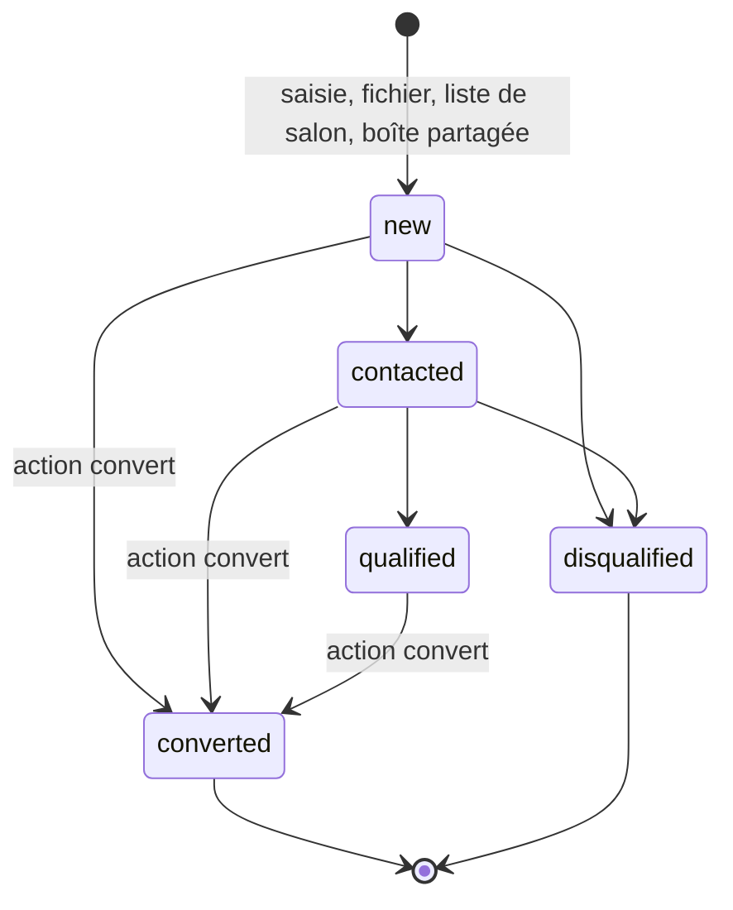

Une piste (D514) porte `company`, `contact_name`, `email`, `phone`, `message`, `source`. Son titre et ses coordonnées sont `personal`. Elle entre par :

- la saisie ou un import.
- une liste de salon (D590) : le salon (`show` du pack `watch`) nomme sa liste (`list`). Le flow `leads from trade show lists` crée une piste `new` par contact, liée par `from_list`. Être sur une liste n'est pas avoir été rencontré (`met_at`).
- une boîte partagée choisie (D591) : un mail authentifié d'un inconnu crée une piste. Une personne connue ne fait pas de piste. Le texte va dans `message`, sans LLM.

Une piste par adresse (D611) : les deux flows cherchent d'abord une piste à cette adresse. `lead.email` n'est pas `unique`, pour ne pas bloquer la saisie à la main.

L'action `convert` (D515) appelle le flow modèle `CRM · convert a lead`. L'humain choisit le compte. Le flow crée une opportunité en `discovery`, de `ref` `lead:<id>`, et ne recopie aucune donnée personnelle. Une seconde conversion retrouve la même opportunité.

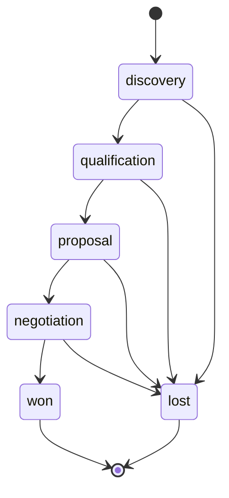

Un humain change l'étape (D449). L'org renomme les étapes par D370. La qualification est une donnée de l'org : objets `qualification_criterion` et lien `qualified_on` (`unknown`, `partial`, `valid`). Le flow `missing criteria` écrit `missing_criteria`. Rien n'est bloqué.

### 3.9 Activités, relances et digest

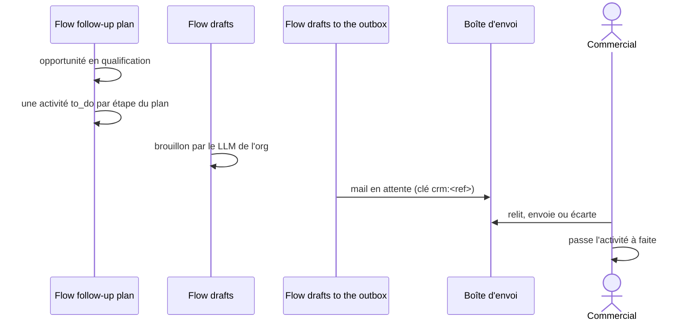

- **Plan de relance** (D450) : une activité `to_do` par étape active, due au jour de lancement plus le jour de l'étape. Une opportunité dont tous les contacts se sont opposés est sautée.
- **Brouillons** : une activité `mail` ou `network_message` due d'ici demain reçoit un brouillon du LLM de l'org. Les messages réseau restent sur l'activité.
- **Boîte d'envoi** (D522) : un brouillon de mail devient un mail en attente de la boîte choisie, 20 par heure au plus. Destinataires : les adresses des personnes impliquées, sauf les personnes opposées. Rien ne part sans un humain, sauf une boîte partagée réglée sur l'envoi direct (D520).
- **Réponses** : le flow `replies to follow-ups` marque une relance faite quand une activité entrante arrive sur la même opportunité.
- **Dernière activité** : une activité faite met à jour `last_activity` de son opportunité.
- **Ma journée** (D451) : chaque matin, un texte avec les relances dues, les opportunités sans activité depuis 14 jours et les pistes `new`. Les jetons `$today-<n>` et `$today+<n>` (0 à 3650 jours) servent dans les filtres.

### 3.10 Devis et factures

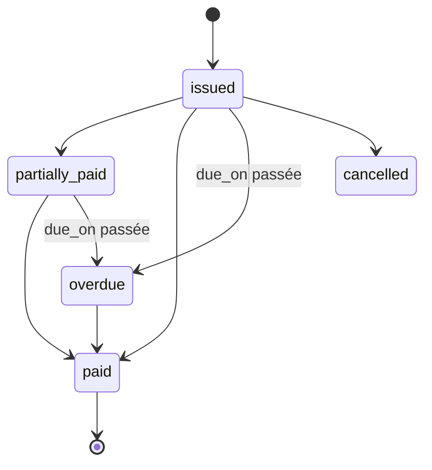

L'outil de facturation de l'org émet la facture légale (D516). PneX suit le numéro, les montants et les dates. Un devis (`quote` : `draft`, `sent`, `accepted`, `refused`, `expired`) peut naître dans PneX par le modèle `quote_sheet`. Le flow `quotes and invoices due` (D517) marque un devis `sent` expiré et une facture en retard. Il crée une tâche par facture en retard (`ref` `invoice:<id>:overdue`). Rien ne lie devis, facture et étape : un devis accepté ne fait pas gagner l'opportunité.

### 3.11 Données personnelles

`PropertyDef.classification` et `ObjectTypeDef.title_classification` prennent `public`, `internal` (défaut), `personal` ou `sensitive` (D442). Deux permissions de lecture masquent les valeurs (D443) :

| Permission | Plus bas rôle | Ce qu'elle laisse voir |
|---|---|---|
| `ontology.personal:read` | Lecteur | propriétés, attributs et titres `personal` |
| `ontology.sensitive:read` | Administrateur | propriétés, attributs et titres `sensitive` |

Sans la permission, l'objet arrive caviardé : valeurs retirées, titre `•••• <8 caractères de l'id>`, liste `redacted`. Le masque s'applique à toutes les lectures d'ontologie, aux dossiers, aux ensembles d'objets, aux propositions et aux outils de l'assistant. Une écriture ne touche jamais une valeur que son auteur ne peut pas lire (SEC-55).

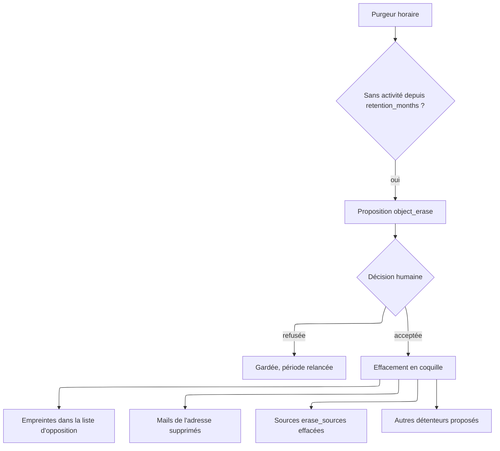

- **Rétention** (D444, D445) : réglages `legal_basis` et `retention_months` (36 par défaut, de 6 à 120) de `prospecting_b2b`. Une personne, une piste ou un contact de liste sans activité devient une proposition `object_erase`. Aucune règle d'org ne l'accepte.
- **Effacement** (D446, D610) : `POST /ontology/objects/{id}/erase`. Les valeurs classées partent, `objects.erased_at` est posée, la coquille refuse toute écriture (`ontology-erased`). L'historique est relu caviardé. Le journal O2 garde l'ancien contenu jusqu'à sa rétention, sans le servir.
- **Opposition** (D447, D610) : empreintes nom + compte (`title:<nom replié>@<id>`), `person:<uuid>`, adresses de profil et `contact:<sha256(org:valeur)>`. Le moteur refuse un lien qui recrée la même personne chez le même compte (`prospecting-opposed`). `object_upsert` ne crée pas un objet qui porte un point de contact opposé. Un import laisse la ligne de côté dès l'aperçu (`opposed_contact`).
- **Repli des noms** : une seule table (`pnex_core::fold`) sert aux empreintes, à la recherche globale et à la requête D185.
- **Rendez-vous** : effacer un participant propose le rendez-vous à l'effacement (`propose_erase_targets`). Accepté, il garde sa date, son statut et `invitation_uid`.

Un membre garde la main : la saisie et la réponse à quelqu'un qui écrit restent possibles. L'empreinte est une pseudonymisation salée par l'id de l'org, sans clé secrète. PneX ne génère pas le registre des traitements : l'org le tient pour tous ses outils.

### 3.12 Tableaux de bord

L'application « Suivi commercial » du pack `crm` porte les écrans Pipeline, Chiffres, Résultats, Prévision, Passage par étape, Prospection, Salons, Opportunité, Pistes, Activités, Devis et factures. Ils utilisent le moteur d'agrégats (D580, D584).

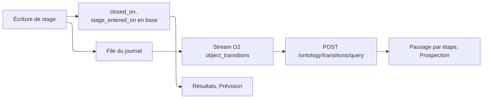

- **Historique d'étape** (D722) : l'option `history` d'une énumération interne (`opportunity.stage`, `lead.status`) écrit chaque changement dans le stream O2 `object_transitions`. L'écriture est au mieux. Le suivi commence à la version qui l'a livré, sans reprise. Plafond : 10 000 transitions sur trois ans, sinon `truncated`.
- **Dates en base** (D723) : le serveur écrit `closed_on` (à l'entrée en `won` ou `lost`) et `stage_entered_on`. Elles rendent le CA et le taux de gain par période exacts sans O2.
- **Prévision** (D724) : métrique `sum` avec `weight: probability`. Une opportunité sans probabilité n'est pas comptée, et le widget le dit.
- **Objectifs** (D725) : type `sales_target` au niveau de l'org. Le flow `CRM · target progress` écrit chaque heure le CA gagné de la période.
- **Définitions** (D726) : taux de gain = gagnés / (gagnés + perdus) sur les opportunités clôturées dans la période. Bloquée = ouverte et sans activité depuis 30 jours. Un clic sur une barre de Prospection remplit un tableau du même écran par une variable `enum`.
- **Motifs de perte** (D727) : `loss_category` (prix, concurrent, pas de budget, pas de décision, timing, autre) à côté du texte `loss_reason`.

La période de l'écran Résultats est un filtre de session (D509, 365 jours par défaut). Il n'existe ni filtre par propriétaire ni écran Équipe.

## 4. Exigences

1. Aucun envoi automatique de mail ni de message réseau ne doit partir sans un humain, sauf une boîte partagée réglée sur l'envoi direct (D520).
2. Le moteur ne doit contenir aucune clé propre au CRM (D441). Le métier vit dans les packs.
3. Un pack ne doit livrer aucun contenu de playbook : critères de score, personas visés, thèmes, étapes de relance et critères de qualification sont des données de l'org.
4. Une capture de profil ou de liste de salariés doit partir d'un humain, une URL à la fois, sous un plafond compilé que l'org peut seulement baisser.
5. Un fait extrait par un LLM doit rester à valider (D316).
6. Un effacement ne doit jamais être automatique et ne doit pas être exposé au MCP.
7. Une coquille doit refuser toute écriture et tout nouveau lien (`ontology-erased`, 409).
8. Le contenu effacé ne doit pas entrer dans le journal d'audit.
9. Une personne opposée ne doit être ni recréée, ni capturée, ni relancée.
10. Une lecture doit masquer les valeurs `personal` et `sensitive` pour un rôle sans la permission.
11. Chaque chiffre d'un tableau de bord doit afficher sa définition et sa période réelle.
12. Les sources GLEIF, Wikidata, BODACC, GDELT et le registre doivent passer la garde de sortie réseau (R8).
13. Chaque route doit prendre l'org du principal (R1) et figurer au registre IAM (R2).

## 5. Décisions

| # | Décision | Choix actuel |
|---|---|---|
| D329 | Pack `prospecting_b2b` : étendre, ne pas créer | statut, utilisateurs, persona d'achat ; liens `recommended`, `follows_account`, `uses_solution` ; hiérarchie `sales_group` ; `subsidiary_of` passé au socle |
| D330 | Couverture calculée à la lecture | `sums`, `coverage`, `tallies` d'une hiérarchie ; espace blanc |
| D331 | Liens de groupe GLEIF et Wikidata | côte à côte, provenance par source, Wikidata à valider, pas de fusion |
| D332 | Rapprochement nom vers SIREN | nœud `org_resolve`, candidats notés, n'écrit rien |
| D333 | Capture ponctuelle d'un profil | humaine, six réseaux, 30 par jour par org et par réseau, texte purgé à 30 jours |
| D334 | Changement de poste | registre, recapture humaine, rappel `review_on` ; aucune surveillance |
| D335 | Signal commercial | `kind` × `topic` de l'org, imports et flows du pack, LLM à valider |
| D336 | Score de ciblage | fonction Starlark sans critère, critères objets de l'org, flow du pack |
| D337 | Listes de ciblage et de salon | recherche enregistrée du registre ; fichier en `list_contact` |
| D338 | Chemin d'introduction | K51 restreint aux liens humains, 4 sauts, départs multiples |
| D339 | Coloration par valeur de propriété | `colors` au noyau ; surcharge par l'org non faite |
| D340 | Modèles de pages | plan de compte, fiche concurrent, préparation et compte rendu de rendez-vous |
| D341 | Données personnelles de la prospection | fini par D442–D447 et D610 |
| D342 | Assistant et MCP sans outil nouveau | ni capture ni changement de statut par l'assistant |
| D343 | Socle mondial, une couche par pays | `companies` + `companies_fr` ; passation `hands_over` |
| D442 | Classification D298 codée | propriétés, attributs, titre |
| D443 | Masquage par rôle | `ontology.personal:read`, `ontology.sensitive:read` |
| D444 | Base légale et rétention | réglages de `prospecting_b2b` |
| D445 | File de rétention | propositions `object_erase`, jamais acceptées par une règle |
| D446 | Effacement en coquille | lecture seule, historique relu caviardé |
| D447 | Opposition au moteur | empreinte nom + compte, `opposed_on`, repli `fold` |
| D448 | Le CRM est un pack | `crm`, hors du noyau |
| D449 | Opportunité et qualification | étapes stables, critères de l'org, passage humain |
| D450 | Activités et plan de relance | activités par étape, brouillons relus |
| D451 | Digest « ma journée » | jetons `$today±n` |
| D452 | Modèle `opportunity_sheet` | fiche remplie depuis l'opportunité |
| D514 | Piste avant l'opportunité | type `lead`, coordonnées `personal` |
| D515 | Convertir une piste | action `convert`, flow modèle, clé `lead:<id>` |
| D516 | Devis et factures suivis | émission légale hors PneX, modèle `quote_sheet` |
| D517 | Échéances | devis expirés, factures en retard avec tâche, pistes au digest |
| D522 | Brouillons vers la boîte d'envoi | sans les personnes opposées |
| D537 | Actualités par moteur de recherche | abandonnée, remplacée par D539 |
| D538 | Lecture d'un profil capturé | poste et société sur la personne, `employs` proposé |
| D539 | Actualités par GDELT | une lecture pour toutes les orgs ; items `news_item` du pack `watch` depuis D972–D973 |
| D590 | Liste de salon en pistes | le salon nomme sa liste, lien `from_list` ; salon = `show` du pack `watch` (D973) |
| D591 | Mail d'un inconnu en piste | boîte partagée choisie, expéditeur authentifié |
| D610 | Ce qu'un effacement emporte | activités, mails, clés, `contact_point` haché, autres détenteurs proposés |
| D611 | Une piste par adresse | entre listes de salon et boîtes mail |
| D721 | Douze indicateurs | écrans du pack, pas de constructeur en plus |
| D722 | Historique d'étape dans O2 | option `history`, stream `object_transitions`, sans reprise |
| D723 | Deux dates en base | `closed_on`, `stage_entered_on` écrites par le serveur |
| D724 | Prévision pondérée | `weight` sur `sum`, aucune probabilité inventée |
| D725 | Objectifs | type `sales_target` au niveau de l'org |
| D726 | Définition affichée | taux de gain, conversion, bloquée ; clic de barre sur le même écran |
| D727 | Motifs de perte | `loss_category` + texte libre |
| D779 | Liste des salariés d'une entreprise | une page, demandée par un humain, 10 par jour par org |
| D976 | Relations d'un contact | gardée le 2026-11-20 ; capture par un pipeline de pack (PE5.4, en cours, §3.6) |
| D977 | État de relation et règle `connections_capture` | gardée avec D976 ; la règle devient un pipeline de pack (PE5.4) |

## 6. Interfaces

Routes (sous `/api/v1`) :

| Route | Permission | Effet |
|---|---|---|
| `POST /ontology/objects/{id}/erase` | `ontology:delete` | effacer en coquille ; exclue du MCP |
| `POST /ontology/objects/{id}/pages` | `docs:write` | page depuis un modèle du pack |
| `GET /ontology/path` (`links`, `from_links`) | `ontology:read` | chemin, chemin d'introduction |
| `POST /ontology/transitions/query` | `ontology:read` | historique d'une énumération (O2) |
| `GET`/`POST /extension/people/{id}/profile-captures` | `extension:read` / `extension:write` | captures de profil |
| `GET`/`POST /extension/organizations/{id}/people-captures` | `extension:read` / `extension:write` | listes de salariés |
| `GET`/`POST /extension/people/{id}/opposition` | `extension:read` / `extension:write` | opposition |
| `GET`/`PUT /extension/people/{id}/connection`, `GET`/`POST …/connections-captures` | `extension:read` / `extension:write` | D976–D977 |
| `GET`/`PUT /extension/connection-shares/{network}` | `ontology:read` / `ontology:write` | partage des relations du membre (D999) |

- **Packs** : `crates/pnex-backend/packs/{companies,companies_fr,prospecting_b2b,prospecting_b2b_fr,crm}.yaml`. Pipelines dans `packs/prospecting_b2b/pipelines/` et `packs/prospecting_b2b_fr/pipelines/`.
- **Noyau** : `pnex_core::{fold, org_resolve, browser_agent}`, `ontology::{schema, page_render, aggregate, flow, api}`.
- **Backend** : `services/ontology/{redact, erase, opposition, transitions, changes}.rs`, `services/profiles.rs`, `services/org_resolve.rs`, `services/network_connections.rs`, `services/connection_shares.rs`.
- **Tables** : `objects.erased_at` (migration 000057), `prospecting_oppositions` (000041), `object_imports.per_object_cursor` (000045), `network_connections` (000152), `connection_shares` (000165). Stream O2 `object_transitions`.
- **Erreurs** : `prospecting-opposed`, `ontology-erased`, `ext-target-not-profile`, `ext-profile-daily-cap`, `ext-target-not-people-page`, `ext-people-daily-cap`, `ext-login-required`, `ext-challenge`, `ext-connections-hidden`.
- **Assistant** : fiches `assistant-kb/sales-follow-up.md`, `personal-data.md`, `company-groups.md`, `profile.md`.
- **Tests** : `tests/crm.rs`, `tests/personal_data.rs`, `tests/partner_watch.rs`, `tests/org_resolve.rs`, `tests/extension.rs`, `tests/mail.rs`, `pnex-node-starlark/tests/pack_rules.rs`, `e2e/tests/crm.spec.ts`.

## 7. Reste à faire

- **Registres étrangers** : couches pays après la France (registres gratuits avec dirigeants), à confirmer par source.
- **Prospection** : score par site, surcharge des couleurs par l'org (D339), proposition des critères abordés depuis la transcription, temps de parole par côté, profil capturé au-delà du haut de la page.
- **Établissements** : 100 sites par société au plus avec l'API du registre. L'API de l'INSEE lèverait ce plafond, avec une clé.
- **Presse** : environ 1 Go lu par run et par org, sans partage entre orgs.
- **Pistes** : la reprise de l'historique d'étape et de statut n'est pas faite (décidé : pas de reprise).

Choix de Shan :

- **Filtre par propriétaire et écran Équipe** : seulement après l'avis d'un juriste sur le suivi de l'activité de salariés. Objectifs par personne avec l'écran Équipe.
- **Formulaire public de pistes** : reporté (2026-11-04), avec sa protection contre les abus.
- **Q-CRM1** : purger du journal O2 les lignes d'un objet effacé avant sa rétention. Défaut tenu : pas de purge.
- **Q-CRM2** : masquer les titres `personal` dans le graphe et les chemins avant la visibilité par objet (I5). Défaut tenu : masquage actuel.
- **Clé secrète d'empreinte** par org : écartée, à rouvrir sur une demande de conformité.
- **Q-CC1** : source payante en option pour les groupes sans LEI.
- **Q-CC2** : personne interne = type dédié ou propriété sur `person`.
- **Q-CC4** : la coquille suffit-elle au droit à l'effacement, ou faut-il réécrire les extraits cités dans les preuves et les signaux ?
- **Q-CC6** : l'org peut-elle étendre une énumération du pack (`persona`), ou faut-il une taxonomie ?
