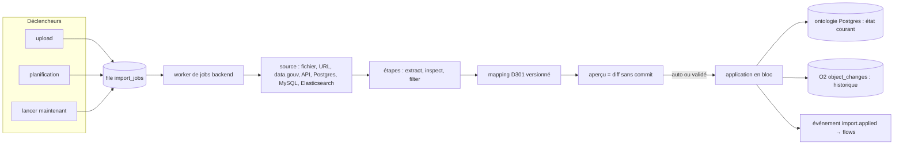
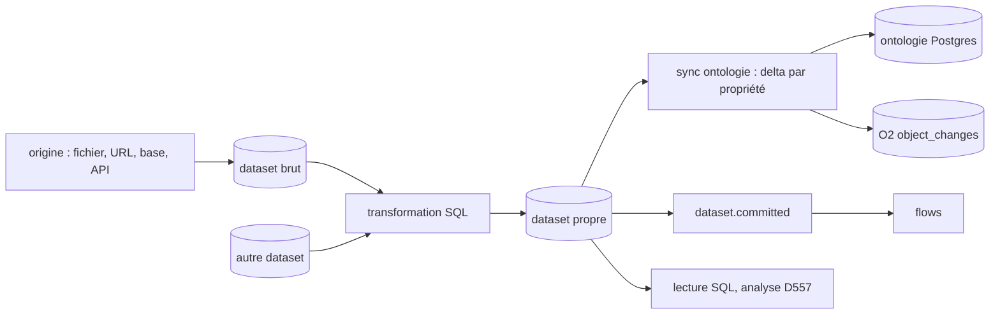

# Pipelines de données en masse (D344–D358)

> **Statut : proposé (2026-10-22), questions Q-P1–Q-P4 tranchées le même jour.** Demande de la
> session `pnex-quali-watch` après l'incident du 2026-10-21 (flow 9,
> org 4, dev.pnex.io). Étend D301/D303 (`partner-watch.md`) et remplace à
> terme la chaîne `ingest` D317–D322 (`ingestion.md`). Liens :
> `ontology.md` (D176–D191), `secrets.md` (D110–D118), `security.md`
> (R1, R2, R8), `system-admin.md` (D72), `editor-shell.md`.
>
> Contrainte posée par Shan : **tout en Rust, dans pnex**. dlt, Airbyte,
> Meltano, Starlake, Kestra, Superset servent
> d'inspiration pour le modèle, jamais de dépendance ni de service à côté
> (ni Python, ni JVM).
>
> **Évolution proposée le 2026-11-04 : §9 (D569–D578), PRD du lot OP1.** Le
> pipeline ne se termine plus forcément dans l'ontologie : il écrit des
> datasets versionnés, et l'import devient sa dernière étape. Les §1 à §8 restent
> la référence de ce qui est livré.

## 1. Constat mesuré

### 1.1 Débits réels (dev.pnex.io, org 4)

| Run | Volume | Durée | Débit |
|---|---|---|---|
| `fc_certifications` (aperçu → appliqué, 2026-10-20) | 6 536 créations | 8 min 22 s | ≈ 13 objets/s |
| `fc_partners` (préparé) | 3 583 créations + 14 413 liens | 8 min 39 s | ≈ 35 écritures/s |
| `fc_certifiers` (préparé) | 1 771 créations + 17 151 liens | 12 min 33 s | ≈ 25 écritures/s |
| `fc_certifiers` (flow 9, 2026-10-21) | 42 730 lignes | coupé à 1 h, `failed`, rien écrit | — |
| test local après f46f748 | 2 000 objets + 2 000 liens | 7 s | ≈ 570 écritures/s |

### 1.2 Ce que fait f46f748 (et ce qu'il ne fait pas)

- **Fait** : l'étape `ontology_import` survit à son appel HTTP (tâche
  détachée, `pending` puis rappels, battement `heartbeat_at`, run mort →
  `import-run-interrupted`) ; schéma chargé une fois ; clés déjà prises
  vérifiées par lots de 1 000 ; `find_by_key` par l'index GIN.
- **Ne fait pas** : l'écriture reste **ligne à ligne à travers les
  services** (`objects::create_with`, `update_in_with`, `links::create_with`,
  `archive`, `close` dans `imports::write`), donc plusieurs requêtes par
  objet, dans une seule transaction tenue des minutes. Pas de `COPY`, pas
  de diff ensembliste en SQL.

### 1.3 Ce qui existe déjà et qu'on garde

- `object_imports` : mapping YAML D301 (le langage de transformation
  déclaratif), `version`, `mode` incrémental / snapshot, `recurrence` +
  `next_run_at`, sources `file` / `url` / `api` (`per_object`).
- `imports::run_now()` : un run complet (lecture, contrôles D303, diff,
  écriture). Le planificateur l'appelle ; **aucune route ne l'expose**.
  Le « lancer maintenant » est donc presque gratuit.
- Contrôles D303 (forme changée, chute suspecte, snapshot avec erreurs) et
  `max_closures_pct` D322.
- Zone de transit S3, sha256 au vol, `skip_if_unchanged`, quota, purge
  (D318) ; `archive_extract` gardé (D319) ; `table_inspect` (D320) ;
  `rows_filter` (D321).
- `TenantLock` (`ns::ONTOLOGY_IMPORT`) : une seule écriture d'import par
  org à la fois.
- `action_trigger` : un flow réagit déjà à un événement de l'ontologie.
- `services/geo` (géocodage) et la création de `map_pin` depuis un mapping
  (`location: {lat, lon}`).

## 2. Contre-analyse

### 2.1 D'accord

- Un traitement par lots ne doit pas vivre dans le moteur de flows : le
  runtime exécute du code utilisateur multi-org et ne voit pas les
  octets (D317). Le flow 9 ne fait que relayer des appels au backend.
- Il faut une reprise par étape, un lancement à la main et un événement de
  fin pour les règles du pack.
- On étend `object_imports` au lieu d'ouvrir un deuxième système.

### 2.2 Points mal posés, ou à recadrer

1. **La lenteur ne vient pas du moteur de flows.** Depuis f46f748 l'étape
   est détachée : le délai de 35 min ne coupe plus rien. Ce qui reste, c'est
   l'écriture ligne à ligne : 42 730 lignes à ≈ 25 écritures/s, c'est
   environ 30 min de transaction ouverte. **L'écriture en bloc est le
   vrai gain** ; l'orchestration hors flow règle l'ergonomie (relance,
   reprise), pas la durée.
2. **E — « Postgres va saturer » : non, à cette échelle.** Voir §2.3. Le
   risque réel est ailleurs : le journal de provenance.
3. **C — DuckDB, DataFusion ou Polars : pas pour les premiers lots.** Le
   mapping D301 est déjà le langage de transformation (conversions,
   `each`, `when`, `needs`, `on_conflict`), et `rows_filter` fait le
   filtre. Un moteur SQL ne se justifie que pour une **jointure ou une
   agrégation entre fichiers qui dépasse la mémoire**, et aucun cas actuel
   n'en a besoin. Voir D353.
4. **D — l'éditeur glisser-déposer « comme l'éditeur de flows ».** Un
   pipeline est **linéaire** (source → étapes → mapping) et un mapping est
   un **arbre** (objets, propriétés, liens). Un canevas de graphe n'apporte
   rien et coûte cher. Il vaut mieux un écran de correspondance
   (colonnes ↔ propriétés) et une liste d'étapes, dans la coquille
   d'éditeur commune (D222), avec un onglet YAML synchronisé. Voir D355.
5. **F — migrer les objets quand le mapping change.** C'est sûr tant que la
   **clé** ne change pas : on rejoue la dernière source gardée avec le
   nouveau mapping. Quand la clé change, c'est l'identité des objets qui
   change. Ça ne se migre pas en silence (sinon on ferme tout et on recrée
   tout). Voir D354.
6. **B — sources « à la Superset » vers des bases internes au client.**
   Elles sont presque toujours sur des adresses privées, que R8 refuse par
   défaut. Il faut une liste d'hôtes autorisés par org, décidée par
   l'admin plateforme, et non un contournement du garde (D352).

### 2.3 E — historique et volume, mesurés dans le code

**Le chemin est le bon** : chaque écriture d'import passe par
`objects`/`links`, qui appellent `changes::submit` → stream O2
`object_changes` (avant/après, `source_ref = import:<id>@<n>`). Postgres ne
garde que l'état courant : `objects.version` est un compteur, il n'y a pas
de table de versions. Une fermeture snapshot pose `valid_to` et garde la
ligne : c'est l'historique interrogeable (`as_of`) des liens et des
objets.

**Volume FC (ordre de grandeur, org 4)** : ≈ 50 000 objets (6,5 k
certifications, 38 k compétences, quelques milliers d'organisations) et
≈ 70 000 liens (`holds`, `accredited_for`, `skill_of`).

- Postgres : ≈ 50 k lignes `objects` (JSONB + index GIN) + 70 k `links`,
  de l'ordre de 100 à 200 Mo. Une fermeture ajoute 0 ligne (elle met à
  jour `valid_to`). Une réouverture ou une recréation en ajoute une. Avec
  un import quotidien FC où presque rien ne change, la croissance est
  négligeable. **Pas de risque de saturation.**
- O2 : un document par objet et **deux par lien** (un par extrémité),
  soit ≈ 190 000 documents au premier chargement, de 0,5 à 2 Ko chacun
  avant compression (100 à 400 Mo bruts, une fraction en Parquet). Les
  jours suivants : le delta seulement.

**Ce qui ne va pas (à corriger avant tout, D350)** :

1. **Le journal part avant le commit.** `changes::submit` est appelé
   dans `create_with` / `update_in_with` / `close`, *dans* la transaction
   d'import. Si la transaction échoue, comme le run du 2026-10-21 coupé
   après une heure, O2 garde des créations qui n'ont jamais eu lieu.
   Historique fantôme : probable sur org 4, à vérifier dans O2.
2. **Un appel HTTP O2 par document, à la suite, dans une file non
   bornée.** 190 000 documents, c'est 190 000 requêtes en série. La file
   gonfle en mémoire et `_timestamp` vaut l'heure d'envoi, pas celle du
   changement. Pourtant `Client::ingest_json` prend déjà un tableau.
3. **Rétention** : la réconciliation D72 ne règle que les streams
   *metrics*. `object_changes` est un stream *logs* : il suit le défaut de
   l'instance O2 (`ZO_COMPACT_DATA_RETENTION_DAYS`), et personne ne l'a
   décidé. Pour suivre l'évolution des entreprises dans le temps, ce
   défaut doit être explicite et long.
4. Les aperçus jamais appliqués gardent leur diff complet en JSON dans
   `object_import_runs.diff` (exemple : `fc_competences`, 38 253 lignes,
   état `preview`). Je n'ai trouvé aucune purge. C'est la seule croissance
   Postgres réelle, et elle disparaît avec D348.

## 3. Modèle

Un seul modèle, quel que soit le déclencheur :

**Pipeline = `object_import` étendue** : une source (et sa connexion
éventuelle), une liste d'étapes, un mapping versionné, un mode, une
récurrence. Les runs restent dans `object_import_runs` ; le journal des
étapes reprend `ingest_steps` (manifestes ≤ 64 Ko), rattaché au run de
l'import au lieu du nœud de flow.

## 4. Décisions

### D344 — Le pipeline est une import étendue, pas un second système

> **Remplacement proposé le 2026-11-04 (D571)** : le pipeline devient le
> contenant, l'import sa dernière étape.

`object_imports` gagne `steps` (YAML, même fichier que le mapping :
`source:`, `steps:`, `objects:`, `links:`) et une référence de connexion
(D352). Les étapes reprennent celles de D317 sans `ontology_import` (c'est
la fin naturelle du pipeline) ni `staging_cleanup` (automatique en fin de
run) : `source_resolve`, `file_download`, `archive_extract`,
`table_inspect`, `rows_filter`. Les packs déclarent des imports complètes
(étapes comprises). Le kind de nœud `ingest` est retiré une fois le flow 9
migré : on est en beta, on casse sans couche de compatibilité.

### D345 — Exécution par un worker de jobs du backend, file Postgres

> **Non codée. Amendement proposé le 2026-11-04 (D573)** : la file reste,
> les transformations partent dans un binaire séparé.

- Table `import_jobs` (`id`, `org_id`, `import_id`, `run_id`, `trigger`
  `upload|schedule|manual|replay`, `from_step`, `state`, `heartbeat_at`,
  `attempts`). Prise par `SELECT … FOR UPDATE SKIP LOCKED`, sur n'importe
  quel pod. Le battement de 60 s et la mort à 10 min reprennent le
  mécanisme de 000042 : seul le battement fait foi.
- Un job à la fois par org (`TenantLock` existant), N orgs en parallèle,
  plafonné par pod (`PNEX_IMPORT_WORKERS`, défaut 2).
- Le planificateur actuel (`sweep`) n'appelle plus `run_now` : il insère
  un job. La route `POST /api/v1/ontology/imports/{id}/runs` (« Lancer
  maintenant ») insère un job `manual`. Elle répond 202 avec le run, que
  le client interroge comme pour un aperçu.
- La fabric de workers (`worker-fabric.md`) n'est **pas** utilisée : le
  travail est d'abord de l'I/O vers S3 et Postgres, il reste dans le
  backend. On la reconsidérera si un moteur SQL lourd arrive (D353).

### D346 — Reprise par étape, sorties identifiées par empreinte

Chaque étape écrit sa sortie en staging et journalise
`input_sha` + `config_sha` → `output_key` + `output_sha`. « Reprendre
depuis l'étape N » (bouton sur l'étape en échec) crée un job
`from_step = N` qui réutilise les sorties des étapes < N, tant que leurs
objets existent encore en staging (`keep_raw_days`). Sinon : refus codé
`import-step-output-purged`. Une étape dont `input_sha` + `config_sha`
sont déjà connus et réussis dans ce run est sautée.

### D347 — Écriture en bloc : validation en Rust, diff en SQL

1. Le diff D301 (`diff::compute`) reste la validation : types de
   propriétés, `unique`, cardinalités, conversions. On ne réécrit pas les
   règles du schéma en SQL.
2. Les lignes valides partent par `COPY` dans des tables temporaires
   (`tmp_objects`, `tmp_links`), dans la transaction d'application.
3. Le diff s'applique par des requêtes ensemblistes :
   `INSERT … ON CONFLICT DO UPDATE … WHERE properties IS DISTINCT FROM`
   (aucune écriture si rien ne change), puis une jointure inverse pour les
   fermetures snapshot (`UPDATE … SET valid_to = now() WHERE NOT EXISTS`).
   Chaque requête renvoie `RETURNING` id, version, avant/après pour le
   journal.
4. **Prérequis** : une colonne `natural_key text` sur `objects`, remplie
   depuis la propriété `unique` du type (D302), avec l'index unique
   partiel `(org_id, type_key, natural_key) WHERE valid_to IS NULL`.
   Aujourd'hui l'unicité D302 est vérifiée seulement dans le service :
   `ON CONFLICT` a besoin d'un index. Même chose pour les liens ouverts
   (`(org_id, link_type, source_id, target_id) WHERE valid_to IS NULL`),
   à vérifier dans la migration ontologie.
5. Les `map_pin` (POI natif + identité par trigger) gardent le chemin
   ligne à ligne : ils sont peu nombreux par run. Raccourci assumé, à
   revoir si une source crée des dizaines de milliers d'établissements.
6. Tout ou rien par run, comme D301 : `COPY` et les opérations
   ensemblistes tiennent 100 000 lignes en secondes. **Q-I3 (appliquer par
   lots, perte du tout-ou-rien) est retirée.**

Objectif d'acceptation : `fc_certifiers` (42 730 lignes) appliqué en
moins d'une minute sur dev.

### D348 — L'aperçu est le même calcul, sans commit

L'aperçu exécute D347 dans une transaction qu'on annule
(`ROLLBACK`) : les comptes viennent des mêmes requêtes que
l'application. Le run garde les comptes et un échantillon de 500
changements, **plus le diff complet**. L'application relance le calcul
sur la même entrée (même `input_sha`). Si les comptes diffèrent de ceux
de l'aperçu, le run est refusé (`import-preview-stale`) et un nouvel
aperçu est proposé. La colonne `object_import_runs.diff` est retirée.

### D349 — Ne rien refaire si la source n'a pas changé

`skip_if_unchanged` (sha256 du brut) devient une option de toute import
(fichier, URL, data.gouv, upload compris), avec en plus l'`ETag` ou le
`Last-Modified` quand la source les donne (requête conditionnelle, aucun
téléchargement). Au niveau des lignes, il n'y a rien à ajouter : la
clause `IS DISTINCT FROM` de D347 n'écrit et ne journalise que ce qui
change. Une colonne d'empreinte par ligne serait du stockage en plus pour
le même résultat.

### D350 — Journal de provenance : après le commit, par lots, rétention décidée

- Les changements sont collectés pendant l'application (le `RETURNING` de
  D347, ou un tampon côté service pour le chemin ligne à ligne) et
  **soumis seulement après `commit`**. Une transaction annulée ne
  journalise rien. La même correction vaut pour toutes les écritures
  d'ontologie, pas seulement les imports.
- Le writer O2 envoie par lots (jusqu'à 1 000 documents ou 1 s), et la
  file est bornée (si elle déborde : compteur et `warn`, jamais de blocage
  d'écriture). `_timestamp` = l'instant du commit.
- `object_changes` reçoit une rétention explicite, séparée de la
  rétention télémétrie D72 : réglage plateforme
  `history_retention_days`, défaut 3 650 jours, réglable par l'admin
  plateforme seulement (Q-P1, tranchée). Valeur à part, y compris en
  SaaS : elle ne suit pas le `data_retention_secs` du tier. La
  réconciliation D72 la pose aussi sur les streams logs concernés.
- L'évolution d'une entreprise se lit dans O2 (SQL O2 sur `object_id`,
  `type_key`, période), pas dans Postgres. Une vue « évolution » sur la
  page objet (frise des valeurs d'une propriété) se branche sur
  `history_of`, qui existe déjà.

### D351 — Upload : zip, mapping à l'upload, carto

- Upload = déclencheur `upload` du même pipeline. Le fichier va en staging
  (plus de corps brut de 50 Mo dans `dry-run`), puis les étapes de
  l'import s'exécutent.
- **Zip** : `archive_extract` (D319) s'applique à l'upload. Si plusieurs
  fichiers sont retenus, l'écran demande lequel va à quel mapping (glob
  `entry`), au lieu de « le premier fichier » (`import_read::unzip`).
- **Mapping à l'upload** : sans import existante, l'upload ouvre l'écran
  de correspondance (D355), prérempli à partir de `table_inspect` :
  colonnes ↔ propriétés du type choisi, par nom normalisé, puis par
  libellé. L'utilisateur valide, l'import est créée avec ce mapping,
  l'aperçu suit.
- **Carto** : nouvelle conversion D301 `geocode` (adresse → `lat`/`lon`)
  sur un objet `location`, via `services/geo` (fournisseur de l'org).
  Cache par adresse normalisée, débit plafonné par le fournisseur, un
  échec donne un avertissement (pas une erreur) et un objet sans POI.

### D352 — Sources connectées, identifiants au coffre

- Ressource **connexion** (`import_connections`) : `kind`
  `postgres|mysql|elasticsearch|http`, hôte, port, base ou index,
  utilisateur, `SecretRef` (D113) pour le mot de passe, la clé ou le
  jeton. Une import référence une connexion et porte sa **requête** (SQL
  ou corps `_search`).
- Exécutées **par le backend uniquement** (le runtime ne voit ni
  connexion ni secret, D115). Postgres et MySQL via sqlx (déjà là par
  sea-orm ; il manque la feature `sqlx-mysql`, à vérifier avec `cargo
  deny`). Elasticsearch via `reqwest` (`_search` + `search_after`, sans
  crate ES).
- Garde-fous : transaction `READ ONLY`, `statement_timeout`, plafond de
  lignes ou d'octets, une seule requête par import (pas de `;` multiples,
  vérifié par le pilote en mode simple). Le résultat est matérialisé en
  CSV dans le staging : la suite du pipeline est la même que pour un
  fichier.
- Réseau : connexion TCP passée au filtre `egress::check_host` /
  `filter_addrs`, résolution DNS comprise. Les adresses privées restent
  refusées, sauf la **liste d'hôtes autorisés de l'org**, posée par l'admin
  plateforme seulement, jamais par l'admin d'org (Q-P2, tranchée : tout
  inscrit est owner de son org perso).
- IAM : `import_connections:read|write` (admin d'org pour l'écriture,
  comme le coffre D117) ; le test de connexion est une opération à part,
  sans retour de données.

### D353 — Transformations : le mapping D301 d'abord, un moteur SQL plus tard

> **Levée par D557 (`operational-platform.md`)** : le moteur est retenu, son
> choix se fait par la mesure de D572.

- Lots 1 à 5 : les étapes D317–D321 et les conversions D301 suffisent à
  tous les cas connus (FC, SIRENE, réseau de partenaires).
- Un moteur SQL arrive **sur un besoin mesuré** (jointure entre deux
  fichiers d'un même zip, agrégation qui dépasse la mémoire, Parquet en
  entrée). Candidat proposé : **Apache DataFusion** (Apache-2.0, Rust
  pur, SQL, `object_store` pour S3/RustFS ; O2 est lui-même construit
  dessus). Face à **Polars** (MIT, moteur lazy et streaming solide, mais
  pensé d'abord pour Python, avec une API Rust qu'il ne garantit pas
  stable) et **DuckDB** (C++ derrière des bindings : écarté par la
  contrainte « Rust pur »).
- **Non mesuré ici** : poids du binaire, temps de build, mémoire en
  streaming. La mesure se fait dans un lot à part (L7, build sous
  `scripts/guarded.sh`, un seul à la fois), avec le même fichier
  `Partenaires` (32 Mo, 400 798 lignes) pour les deux moteurs. Le moteur
  irait de préférence dans un binaire à part du workspace, pour ne pas
  alourdir `pnex-server`.
- Ni DataFusion ni Polars ne lisent un zip : l'extraction en staging
  (D319) reste en amont. Le crate `zip` exige `Read + Seek` (répertoire
  central en fin d'archive). Le streaming direct depuis S3 demanderait des
  lectures par plages : sans intérêt sous 200 Mo.

### D354 — Mapping versionné, migration par rejeu

- `object_import_versions` garde chaque version du YAML (`version` existe
  déjà sur l'import), avec auteur et date. Les runs portent la version
  appliquée (`import_version`, déjà là).
- Sauvegarder une nouvelle version propose un **rejeu** : aperçu du
  dernier brut gardé avec le nouveau mapping, en mode snapshot sur le
  périmètre de l'import. On voit ce qui sera mis à jour, fermé ou créé
  avant d'appliquer.
- **Changement de clé** (`key`, ou la conversion de la propriété clé) :
  refusé sans une table de correspondance explicite `rekey` (ancienne
  valeur → nouvelle, ou conversion), appliquée à `natural_key` et aux
  propriétés dans la même transaction. Sans cela, le rejeu fermerait tout
  et recréerait tout (`import-key-changed`).
- Le brut n'est gardé que `keep_raw_days` : au-delà, le rejeu demande une
  nouvelle source.

### D355 — Studio du pipeline : celui des sites web, pas un nouvel éditeur

> **Amendé le 2026-11-03 (`operational-platform.md` §9)** : canevas de graphe
> admis pour les pipelines à plusieurs étapes (OP1).

Le studio des règles de navigation (`site-recipes.md` D324, `pages/web_sites/`)
a déjà tout ce qu'il faut : coquille D222, blocs glissés ou cliqués et
édités sur place, onglet Code en YAML écrit depuis la structure, tiroir
Versions D221 avec diff YAML et Rétablir, lecteur commun D220 avec frise
par exécution, « Reprendre à l'étape N ». Le studio `/pipelines/:id`
reprend cette mise en page à l'identique, avec les mots du lexique D358 :

- **scène** : la sortie du traitement choisi (table d'échantillon, comptes,
  colonnes de `table_inspect`, fichiers d'une archive), là où le studio des
  sites montre la capture de l'étape ;
- **lecteur** dessous : sélecteur d'exécution tiré de `object_import_runs`,
  frise `components/timeline` avec un couloir **Traitements** (une barre par
  traitement, longue de sa durée, colorée par son résultat) et un couloir
  **Écritures** (créations, mises à jour, fermetures) ;
- **colonne de droite**, trois onglets :
  - **Traitements** : origine puis traitements en blocs (même école que
    `blocks.rs` : bande d'actions, glisser pour insérer ou réordonner,
    inspecteur sur place), vérifiés côté client par la même `validate`
    que le serveur ;
  - **Correspondance** : colonnes de l'origine (exemples de
    `table_inspect`) face aux types, propriétés et liens ; on glisse une
    colonne sur une propriété, la conversion se choisit sur la flèche ;
  - **Code** : le pipeline en YAML, écrit depuis la structure (aller-retour
    serde, aucun second modèle) ; on ne quitte l'onglet qu'avec un YAML
    accepté par le serveur, comme pour les règles ;
- barre de la coquille : Versions (D354, même `VersionsDrawer`), **Aperçu**,
  **Lancer**, Enregistrer ; « Reprendre au traitement N » sur une exécution
  terminée (D346), comme « Reprendre à l'étape N ».

Ce qui se partage plutôt que se copier : le glisser-déposer de `blocks.rs`
(`Drag`, `drop_at`) et `VersionsDrawer` sont aujourd'hui liés au type
`Recipe` ; on les rend génériques sur la liste d'éléments au moment où le
deuxième usage arrive (L6), pas avant. Liste `/pipelines` sur le socle CRUD,
dans le groupe de menu **Sources** (un pipeline alimente PNeX) ; l'onglet
Imports de l'ontologie disparaît au profit de cette page.

Pas de canevas de graphe en V1 (§2.2, point 4).

### D358 — Lexique dédié (design-system.md §7)

Les mots naturels sont déjà pris : « flux » (streams), « flow », « règle »
et « étape » (navigation), « passage » (exécution d'une règle), « source »
(groupe de menu), « connexion » (se connecter), « import » (verbe de partout :
modèles, grilles, types). Une notion = un mot :

| Notion | FR | EN | N'est pas |
|---|---|---|---|
| Chaîne déclarative qui charge des données dans l'ontologie (D344) | Pipeline | Pipeline | pas « import » (le verbe reste pour un fichier), pas « flux », pas « flow » |
| Ce que lit le pipeline : fichier, URL, data.gouv, base, index | Origine | Origin | pas « source » (= groupe de menu), pas « provenance » (= journal) |
| Opération entre l'origine et la correspondance (extraire, inspecter, filtrer, géocoder…) | Traitement | Transform | pas « étape » (= règle de navigation), pas « nœud » (= flow) |
| Colonnes de l'origine → types, propriétés, liens (D301) | Correspondance | Mapping | pas « mapping » en français |
| Accès enregistré à une base ou une API, identifiants au coffre (D352) | Connecteur | Connector | pas « connexion » (= se connecter), pas « source » |
| Un passage du pipeline, de l'origine à l'écriture | Exécution | Run | pas « passage » (= règle de navigation), pas « job » |
| Calcul complet sans écriture (D348) | Aperçu | Preview | pas « simulation », pas « dry-run » |
| Rejouer une version de la correspondance sur l'origine gardée (D354) | Rejeu | Replay | pas « migration » |

Garde : règles ajoutées à `lexicon_guard.rs` (« import » comme nom d'entité
hors clés exemptées, « mapping » et « dry-run » en français, « connexion »
hors connexion utilisateur) **dans le lot qui affiche le concept** (L2 pour
Pipeline, Origine, Traitement ; L5 pour Connecteur), en même temps que la
ligne au lexique §7. Côté code, les noms techniques restent
(`object_imports`, `steps`, `import_connections`) : le lexique est celui de
l'interface et des fiches de l'assistant.

### D356 — Événement `import.applied` vers les flows

> **Remplacée par D578**, codée (§9.6) : `dataset.committed` et `dataset_trigger`.

Un run appliqué publie `import.applied` : `{import, run, version,
counts, changed: [ids]}`, ids plafonnés à 10 000 (au-delà, le flow
interroge par `source_ref`). Nœud **`import_trigger`** (config : import ou
import du pack par nom), sur le modèle d'`action_trigger`. C'est lui qui
lance les règles du pack (écarts, alertes). `NodeDoc` + fiche
`assistant-kb` dans le même commit.

### D357 — Ce qu'on garde de D317–D322

| Décision | Sort |
|---|---|
| D317 nœud `ingest` | **retiré** après migration du flow 9 ; le backend qui exécute l'étape reste (`services/ingest`), appelé par le worker |
| D318 staging + journal + quota + purge | **gardé**, journal rattaché au run d'import |
| D319 `archive_extract` | **gardé**, aussi à l'upload |
| D320 `table_inspect` | **gardé**, alimente l'écran de correspondance |
| D321 `rows_filter` | **gardé** (`in_objects` en particulier) |
| D322 `ontology_import` | **absorbé** : c'est la fin du pipeline ; `max_closures_pct` devient un contrôle de toute import snapshot |
| f46f748 pending / rappels | **retiré** avec le nœud ; le battement `heartbeat_at` passe au job |

## 5. Migration du flow 9 (org 4)

1. Lot 1 livré : le flow 9 continue tel quel, en plus rapide (écriture en
   bloc). Rien à faire côté org.
2. Lot 2 livré : le pack `quali_watch` (version suivante) déclare une
   import « France Compétences » avec ses étapes (`source_resolve`
   data.gouv → `file_download` → `archive_extract` → `table_inspect` →
   `rows_filter`) pour chacun des mappings `fc_*`. La montée de pack les
   crée sans toucher aux imports existantes (D301 : jamais écrasées).
3. Shan lance un run à la main, compare les comptes à ceux du dernier run
   du flow, puis désactive le flow 9 (désactivation humaine : aucun outil ne
   l'arrête, D144).
4. Le kind `ingest` est retiré du registre de nœuds. Un flow encore
   déployé avec ce kind est isolé au deploy (même école que les onglets
   ignorés).

## 6. Sécurité (grille `security.md` §6)

- **R1** : org tirée du principal (routes) ou de l'import (worker) ; clés
  de staging hors du préfixe de l'org ignorées (inchangé, D318).
- **R2** : nouvelles opérations au registre IAM
  (`ontology_imports:run`, `import_connections:read|write|test`) ; le
  worker écrit avec le rôle de l'auteur de l'import, revérifié au début de
  chaque run (D303). Test sans la permission → 403 pour chaque route.
- **R4 / R16** : une connexion en lecture ne renvoie jamais le secret ni
  l'URL avec identifiants. `SecretRef` uniquement, et les champs de
  connexion vont dans `REDACTED` (MCP).
- **R8** : HTTP via le client gardé ; TCP Postgres, MySQL et ES via
  `egress::filter_addrs` après résolution, et liste d'hôtes privés
  autorisés par org (admin plateforme seulement).
- **Requête externe hostile ou coûteuse** : `READ ONLY`, timeout, plafond
  de lignes et d'octets, requête unique. Le résultat est une donnée non
  fiable, qui passe par les mêmes plafonds que D319/D320.
- **Exécution** : aucun code utilisateur dans le worker (le YAML est
  déclaratif). Le moteur SQL éventuel (D353) n'exécute que des requêtes
  sur le staging de l'org, sans accès réseau ni système de fichiers.
- **MCP** : lecture des imports, runs, étapes et connexions exposée ;
  « lancer maintenant », « reprendre » et les connexions en écriture sont
  `EXCLUDED` (déclenchement d'une écriture en masse ; secret).
- **Assistant** : peut proposer un mapping (via le service partagé, sur la
  version lue), jamais lancer un run ni toucher une connexion.

## 7. Lots

| Lot | Contenu | Valeur | Taille |
|---|---|---|---|
| **L0** | D350, première partie : journal soumis après le commit, writer O2 par lots et borné | corrige l'historique fantôme et la file non bornée ; prérequis de tout le reste | S (`fix(ontology)`) |
| **L1** | D347 + D348 : `natural_key` + index, `COPY` + diff ensembliste, aperçu sans diff stocké ; route « Lancer maintenant » sur `run_now` | 42 k lignes en < 1 min ; le flow 9 tient sans rien changer ; Q-I3 retirée | M |
| **L2** | D344–D346 : étapes sur l'import, `import_jobs` + worker, reprise par étape ; migration du flow 9 (§5) | relance et reprise sans re-télécharger | M |
| **L3** | D351 : upload en staging, zip à plusieurs fichiers, mapping à l'upload (écran minimal), `geocode` | chemin manuel unifié | M |
| **L4** | D354 + D356 : versions de mapping, rejeu, `rekey` ; `import.applied` + `import_trigger` | règles du pack déclenchées en fin d'import | M |
| **L5** | D352 : connexions Postgres, MySQL, ES, coffre, egress | sources externes | M |
| **L6** | D355 : studio `/pipelines/:id` sur le modèle du studio des sites web (blocs, correspondance glissée, Code, Versions) ; `Drag`/`drop_at` et `VersionsDrawer` rendus génériques | confort d'édition | M (la mise en page existe) |
| **L7** | D353 : mesure DataFusion contre Polars (binaire, build, mémoire) sur `Partenaires`, puis décision | seulement si un cas réel le demande | S (étude) |

**Avancement (2026-10-22, non commité)** — lot **L1+**, le plus petit qui fait
passer France Compétences de bout en bout sans flow (décision de Shan : plus
de rustines sur le flow 9) :

- **L0** : `changes::deferred` tient les changements d'une transaction,
  `changes::flush` les envoie juste après son `commit` ; une transaction
  annulée ne journalise rien. Câblé sur les écritures transactionnelles
  d'objets et de liens (contrôleurs d'ontologie, `imports::write`, dossiers,
  attributions média, preuves). Writer O2 : file bornée à 100 000
  (débordement compté, `warn`), lots de 1 000 documents ou 1 s, une requête
  par org. Rétention `history_retention_days` (Q-P1) : reste à faire.
- **D347, écriture en bloc** : `objects::create_many_with` /
  `update_many_with`, `links::create_many_with` / `update_many_with`. Mêmes
  contrôles que le chemin unitaire (rôle, titre, valeurs, `ref`, unicité
  D302, cardinalités), faits par lots ; écriture par `jsonb_to_recordset`
  (5 000 lignes par requête). Restent unitaires : `map_pin` (POI), `claim` et
  dossiers (règles de statut), liens `measures`/`depicts`, fermetures.
  Migration 000043 : le trigger `pnex_edge_objects` ne cherche plus une
  extrémité déjà fournie. Sans cela, chaque lien relisait `objects` sans
  statistiques sur les lignes de la même transaction (60 000 liens :
  313 s). Pas de colonne `natural_key` : la recherche par clé du diff tient
  sans elle. Mesuré en build debug : 60 000 créations + 60 000 liens en
  59 s (341 s avant), 60 000 mises à jour en 9,6 s.
  `ROWS_MAX` porté à 250 000 sur ce chemin (Q-I3 close).
- **D344, une partie** : `steps:` dans le YAML de l'import (étapes D317 sauf
  `ontology_import` et `staging_cleanup`, 10 au plus). Exécutées par le
  serveur (`services/ingest/pipeline.rs`), journalisées dans `ingest_steps`
  sous le run (`node_id` = `import:<id>`), staging du run nettoyé à la fin,
  puis application du fichier obtenu (contrôles D303 et `max_closures_pct`
  par défaut). Pas encore de file `import_jobs` ni de reprise (L2) : le run
  bat toutes les 30 s et tourne dans le pod qui l'a lancé.
- **Lancer maintenant** : `POST /ontology/imports/{id}/runs` (202, run
  `running`), permission `ontology:write` (celle de l'application d'un
  aperçu, pas de permission `ontology_imports:run` à part), `EXCLUDED` côté
  MCP (motif « bulk »), bouton « Lancer maintenant » sur la liste des imports.
  La planification passe par le même chemin. Une import fichier sans étapes
  → 409 `ingest-entry-missing`.
- **Erreurs des runs appliqués** : un run appliqué ou en échec garde ses
  lignes en erreur et ses avertissements (500 au plus) dans `diff`.

Je ne reprends pas l'ordre proposé (« lancer maintenant + reprise +
écriture en bloc » ensemble) : la route « lancer maintenant » tient en
quelques lignes, puisque `run_now` existe, et l'écriture en bloc règle à
elle seule l'incident. L0 et L1 sont donc le plus petit lot utile. La file
de jobs et la reprise (L2) viennent ensuite, quand le pipeline sort du
flow.

## 7 bis. Retour du 2026-10-23 (retest France Compétences, dev.pnex.io, org 4)

Le flow 9 est supprimé : les cinq imports FC tournent sur leurs propres
étapes, appliquées en snapshot avec `invalid: skip`, zéro erreur. Ce qui a
coûté du temps, avec ce que je propose pour chaque point. Rien n'est codé
au-delà de la récurrence (point 6). Tout le reste est à arbitrer.

1. **Un run meurt avec son pod.** C'est arrivé deux fois : un `helm upgrade`
   a remplacé les pods API en plein run, puis un « Lancer maintenant » est
   tombé sur un ancien pod en `Terminating` juste après `rollout status`.
   Chaque déploiement met en danger un import en cours. Depuis le 23, un
   tel run passe `failed` + `import-run-interrupted` au bout de 10 min sans
   battement, mais il faut le relancer à la main.
   → **Faire L2 (`import_jobs` + reprise par étape, D345–D346) avant L4 et
   L6.** En attendant, un arrêt propre : sur SIGTERM, le pod ne prend plus de
   run, et `terminationGracePeriodSeconds` laisse finir celui en cours
   (borné, un run FC dure moins de 2 min).
2. **Deux versions côte à côte.** Seule l'API a été redémarrée sur la
   nouvelle image. Le flow-worker (même binaire) est resté sur l'ancienne et
   tenait le singleton `object-imports` : la nouvelle logique de balayage ne
   tournait pas, et rien ne montre qui tient un singleton ni dans quelle
   version.
   → Journaliser la version à la prise du bail (`singleton::my_turn`), et
   lister dans `system_status` (page Système) chaque singleton avec son pod,
   sa version et l'âge de son bail. Côté procédure, l'image `latest`
   redémarre l'API **et** le flow-worker ensemble : une ligne dans le
   runbook de dev.
3. **Des erreurs sans contexte.** `import-source-too-large` avec 0 ligne et
   sans `args` ; le premier run tué par OOM passé `failed` sans code une
   heure après (corrigé le 23 : `import-run-interrupted`). Il a fallu
   deviner, puis reproduire en local.
   → Ajouter une colonne `state_args jsonb` à `object_import_runs`
   (migration), alimentée par tous les refus (le chemin des étapes jette
   aujourd'hui ses `args`). `ReadError::TooLarge` porte `{rows, max}` et
   `{bytes, max}`. L'historique affiche le message rendu (`err-*` avec ses
   arguments). Taille S, une demi-heure gagnée dès la première fois.
4. **Mémoire.** 1 Gi ne suffisait pas pour 400 k lignes. Corrigé le 23
   (0e58824e) : pic de 1,6 Go ramené à ~340 Mio en prod (≈ 0,95 Go mesuré
   en debug pour 100 k objets + 140 k liens), mémoire rendue après le run.
   Le diff reste construit en entier en mémoire, et les étapes `table_inspect`
   et `rows_filter` lisent la table entière.
   → Rien tant qu'aucune source ne grossit. Le seuil à surveiller : 500 k
   lignes après filtre ou un pic au-delà de 50 % de la limite du pod. Le
   remède est alors un diff et une écriture par lots de clés, plus des
   étapes en flux (lecture CSV ligne à ligne). Le banc
   `partners_import_memory` (ignoré) sert de mesure.
5. **Snapshot et données ouvertes sales.** Cinq valeurs fausses côté France
   Compétences (deux SIREN, trois descriptions trop longues) refusaient tout
   le run. Corrigé par `invalid: skip` (3d086a8e).
   → Règle de pack : un import d'une source publique livre `invalid: skip`
   dès le premier jour, sur sa clé et sur ses textes libres. À écrire dans la
   doc des packs, et à vérifier en revue de pack plutôt que par une garde,
   car « source publique » ne se déduit pas du YAML. Limite connue : une
   ligne écartée par sa clé fige les fermetures de liens de l'autre
   extrémité pour ce run (la certification).
6. **Planification.** La récurrence était refusée sur une import fichier à
   étapes (corrigé le 23, non commité). `RUN_HOUR` est fixe à 03:00 pour
   tous et il n'y a pas d'enchaînement : les cinq imports sont étalés sur la
   semaine (certificateurs lundi … RS vendredi) pour garder leur ordre.
   → C'est le travail de L4 (`import.applied` → `import_trigger`) : on n'y
   ajoute rien avant. Si L4 tarde, une heure par import dans la récurrence
   est le plus petit palliatif.
7. **Visibilité.** Aucun écran ne montre les étapes d'un run :
   `ingest_steps` existe, mais rien ne l'affiche. Shan cherchait un menu
   « Pipelines ».
   → Avant le studio (L6) : dans Ontologie › Imports › Historique, déplier
   un run montre ses étapes (`ingest_steps` du run : statut, durée, lignes
   entrées et sorties, code). Réutilise le panneau « Derniers passages » des
   nœuds d'ingestion. Taille S.
8. **Outillage.** Le MCP ne crée, ne modifie, ne lance ni ne supprime une
   import (`EXCLUDED`, 415) : tout est passé par `pnex raw` et des scripts
   Python. `pnex raw` imprime du JSON avec des caractères de contrôle bruts
   (lecture en `strict=False`).
   → Corriger la sortie de `pnex raw` (JSON échappé). Ajouter
   `pnex import run <id> --wait`, qui lance le run, suit son état et rend le
   code de sortie. Création et modification d'une import via le MCP :
   envisageable (lecture et écriture JSON, droits de l'appelant), mais le
   lancement reste exclu (motif « bulk »).
9. **Limites croisées.** `FILTER_VALUES_MAX` = 1 000 bloquait un filtre
   `in` sur ~7 500 codes actifs, contourné par `only` (859d2b89). `left:9`
   doit précéder `luhn`, sinon la clé de contrôle du SIRET compte (corrigé
   dans le pack).
   → Documenter `only` comme la réponse aux longues listes de valeurs. Pas
   de hausse de la limite.

**Ordre proposé** : 1 (arrêt propre tout de suite, L2 ensuite), 3, 2, 7, 8,
puis L4 pour 6 ; 4 et 5 sont des règles à tenir, 9 est fait.

**Fait le 2026-10-23 (go de Shan)** :

- **Point 1, arrêt propre** (`imports/stop.rs`). Sur SIGTERM (`on_shutdown`),
  le pod ne lance plus de run : 503 `import-server-stopping` sur
  « Lancer maintenant », l'aperçu et l'application ; balayage suspendu,
  pour ne pas avancer `next_run_at` sans lancer ; une étape de flow répond
  `pending` et sera reprise ailleurs. Les runs du pod ont
  `PNEX_SHUTDOWN_GRACE_SECS` (270 s par défaut) pour finir, puis passent
  `failed` + `import-run-interrupted` ; sans run en cours, l'arrêt est
  immédiat. `terminationGracePeriodSeconds` : **300** pour l'API et le
  flow-worker, qui lance les runs planifiés (chart pnex-deploy).
- **Point 3, `state_args`** (migration 000051). Remplie par chaque refus ou
  échec qui a des arguments : `{rows, max}` ou `{bytes, max}` pour
  `import-source-too-large` (lecture du fichier, staging, téléchargement),
  `{columns}` pour `import-schema-changed`, `{previous, rows}` pour
  `import-suspicious-drop`, `{closed, held, max_pct}` pour les fermetures
  suspectes. Les sources URL et API gardent le code seul. L'historique
  rend le message avec ses chiffres (FR + EN).
- **Point 7, étapes dans l'historique**. `GET …/runs/{run_id}` renvoie
  `steps`, les `ingest_steps` du run dans l'ordre. Dans Ontologie › Imports
  › Historique, « Étapes » déplie chaque étape avec son statut, sa durée,
  les lignes lues et gardées, et son code.

**Fait le 2026-11-05** :

- **Point 2, versions côte à côte** (migration 000079). Un bail porte la version de
  son porteur et l'heure de sa prise ; prendre un bail est journalisé. La page Système liste
  chaque bail en vigueur (pod, version, âge) et passe la topologie en `degraded` quand l'un
  d'eux tourne sur une autre version que le serveur interrogé : c'est vrai aussi pendant un
  déploiement normal, le temps du déploiement. Ligne de runbook : `helm/README.md` du dépôt
  `pnex-deploy`, section Scaling.
- **Point 8, outillage**. `pnex import run <id> --wait` (`cli.md` §3). La sortie de `pnex
  raw` passe par `serde_json`, qui échappe les caractères de contrôle : le défaut relevé le
  23 n'existe plus pour une réponse JSON. Création et modification d'un import par le MCP :
  non faites, aucun besoin depuis.

## 8. Questions tranchées (Shan, 2026-10-22)

- **Q-P1** — Rétention de `object_changes` : **3 650 jours par défaut,
  réglable par l'admin plateforme**, séparée de D72 et du tier SaaS (D350).
- **Q-P2** — Hôtes privés des sources connectées : **liste par org, posée
  par l'admin plateforme** (D352).
- **Q-P3** — Run planifié : **application directe, comme aujourd'hui**
  (refus D303 et `max_closures_pct` seulement). L'aperçu reste obligatoire
  pour l'upload et le rejeu d'un mapping (D351, D354).
- **Q-P4** — Historique fantôme du 2026-10-21 (org 4, `import:8b027b8a…@1`) :
  **ignoré** (données de dev), ni vérifié ni purgé. L0 empêche qu'il se
  reproduise.

## 9. Datasets et pipelines de transformation (D569–D578, lot OP1)

> **Statut : accepté (2026-11-04), OP1.0 mesuré (§9.7 bis), OP1.1 à OP1.4 codés.** PRD
> du lot OP1 de `operational-platform.md` (D554, D557, D561). Questions du §9.8
> tranchées par Shan le même jour.

### 9.1 Constat, relevé dans le code

- **Les données lourdes ne passent plus par les flows.** Le nœud `ingest` est
  retiré (D359) ; le serveur exécute les étapes
  (`services/ingest/pipeline.rs`). Le problème n'est donc plus le moteur de
  flows.
- **La seule sortie possible est l'ontologie.** Les fichiers intermédiaires
  sont supprimés en fin de run : ni jointure entre sources, ni réutilisation
  d'un résultat par un autre pipeline, ni historique de la donnée brute
  au-delà de `keep_raw_days`.
- **Tout passe en mémoire.** Le fichier final est lu entier (`get_bytes`), sous
  les plafonds `UNZIPPED_MAX` (200 Mo), `ROWS_MAX` (250 000 lignes) et
  `PLANNED_MAX` (500 000 objets). Le pack `quali_watch` filtre déjà
  `Partenaires` pour tenir sous `ROWS_MAX` (`ingestion.md`, pack 3.3.0).
- **Rien n'enchaîne les imports.** `import_jobs`, la reprise par étape et
  `import_trigger` ne sont pas codés (L2, L4). Les cinq imports France
  Compétences sont étalés sur la semaine pour garder leur ordre (§7 bis).
- **Aucune brique colonnaire utile.** `arrow` n'arrive au `Cargo.lock` que par
  `sea-orm-arrow` ; ni `parquet`, ni `object_store`, ni moteur de calcul.

### 9.2 Modèle

Trois systèmes, trois rôles :

| Système | Fait | Ne fait pas |
|---|---|---|
| Pipeline | Calcule des ensembles de lignes, sans code utilisateur en V1 | Aucune action, aucun effet externe |
| Ontologie | Porte les entités, leurs liens et les éditions humaines | Ne stocke pas chaque ligne d'une source |
| Flow | Réagit à un événement, message par message, et peut agir | Ne transporte ni ne transforme de volume |

### D569 — Dataset : table versionnée par transactions

Fichiers Parquet sur S3 (`S3Store`, préfixe `org_{id}/datasets/{id}/`),
catalogue dans PostgreSQL :

- `datasets` : `id`, `org_id`, `name`, `schema` ;
- `dataset_transactions` : `kind` `snapshot|append|delete`, `state`
  `open|committed|aborted`, `heartbeat_at`, comptes, résultats des contrôles ;
- `dataset_files` : fichiers de chaque transaction (`key`, `bytes`, `rows`,
  `sha256`).

**Vue courante** : on part du dernier `snapshot` commité, puis on applique les
transactions suivantes dans l'ordre. Le commit est une écriture PostgreSQL :
une transaction ouverte ou annulée reste invisible. Lire « au temps T », c'est
calculer la même vue à T.

- **Pas d'`update`** : il casserait l'incrémental en aval, et `snapshot` couvre
  le besoin.
- **Purge** : `delete` retire un fichier de la vue, pas de S3. La rétention et
  l'effacement à la demande (`services/ontology/erase.rs`) suppriment
  réellement les fichiers et réécrivent ceux qui contiennent une personne
  effacée. Quota par tier, séparé du staging (D318).
- **Orphelins** : une transaction sans battement depuis 10 min passe `aborted` ;
  ses fichiers sont purgés comme les orphelins de D318.

Catalogue maison plutôt qu'Iceberg : trois tables, et le commit transactionnel
de PostgreSQL. La mesure de D572 peut renverser ce choix ; un export Iceberg
reste possible, le format de fichiers étant le même. Les branches (D556, OP4)
s'ajouteront au catalogue, rien n'est prévu d'avance.

### D570 — Une ligne n'est pas forcément un objet

Une entité utile aux écrans, aux droits et aux liens monte dans l'ontologie. Le
reste demeure dans un dataset, lu en SQL (D557). `Partenaires` (400 798 lignes)
reste un dataset ; seules les habilitations des fiches actives (140 758 lignes)
deviennent des liens. Précise D554 : « adossé » veut dire **alimenté par sync**
dans ce lot. Un type d'objet lu directement dans un dataset, sans copie, n'est
pas prévu tant qu'aucun besoin réel ne le demande.

### D571 — Le pipeline devient le contenant, l'import sa dernière étape

Un pipeline est un document YAML versionné (D354) : des origines, des
transformations qui lisent et écrivent des datasets, et zéro ou plusieurs
`ontology_sync`. **Le pipeline peut s'arrêter à un dataset.** Remplace D344.

- Le mapping D301 ne change pas : `ontology_sync` le porte tel quel.
- `object_imports` est migrée (beta : sans couche de compatibilité, packs
  compris). Les runs deviennent ceux du pipeline ; `ingest_steps` reste le
  journal.
- `source_resolve`, `file_download` et `archive_extract` alimentent l'origine.
  `table_inspect` devient le profil de colonnes d'un dataset. `rows_filter`
  devient un `WHERE` ou une jointure, sans la limite `FILTER_VALUES_MAX`.
- L'enrichissement API `per_object` reste sur le chemin d'import actuel : il
  appelle une API objet par objet, ce n'est pas un calcul d'ensemble. À reprendre
  en lot séparé si le besoin apparaît.

### D572 — Moteur : DataFusion candidat, SQL seul en V1

Choix tranché par la mesure de OP1.0 (Q-O1), sur `Partenaires` et sur un jeu
synthétique de 50 M de lignes, dans un pod plafonné : poids du binaire, temps de
build sous `scripts/guarded.sh`, pic mémoire, débordement disque, lecture sur
RustFS. Polars en comparaison ; DuckDB reste écarté (D353). Licence et
maintenance vérifiées avant ajout, `task security:deps` vert.

Le SQL utilisateur est une entrée hostile :

- une session par exécution, où seuls les datasets déclarés en entrée sont
  enregistrés, après vérification des droits ;
- aucun DDL, DML ni instruction de session, donc ni table externe ni lecture de
  fichier par chemin ; refus vérifié sur le plan logique, pas sur le texte ;
- mémoire bornée avec débordement disque, délai et plafond d'octets écrits ;
- fonctions en liste blanche : celles du moteur retenues une par une, plus les
  conversions D301 (`digits`, `left`, `luhn`…) exposées en fonctions SQL, depuis
  le même code.

Les fonctions JS et Starlark ne s'exécutent pas ici en V1. Elles viendront, si un
cas le demande, comme un job de bac à sable (D561).

### D573 — Exécution : deux jobs, deux zones de confiance

File `pipeline_jobs` (`SELECT … FOR UPDATE SKIP LOCKED`, battement, D345). Un
job à la fois par org, plafond par pod.

| Job | Exécuté par | Voit | Ne voit pas |
|---|---|---|---|
| Origine et `ontology_sync` | Worker du backend, services partagés | Coffre, egress gardé, ontologie | Le SQL utilisateur |
| Transformation | Binaire `pnex-pipeline-worker`, pod à part | S3, tables du catalogue | Secrets, tables métier, réseau externe |

Le moteur n'entre pas dans `pnex-server`. Le pod du worker a son propre rôle
PostgreSQL, limité au catalogue et à la file, et une `NetworkPolicy` qui
n'ouvre que S3 et PostgreSQL. Ses identifiants S3 couvrent tous les préfixes :
l'isolation entre orgs repose sur D572 (les seules tables de la session),
**limite à revoir** si un code utilisateur entre un jour dans ce binaire. Il
s'exécutera à terme comme job de la fabric (D561), qui n'est pas codée ; on ne
l'attend pas.

La reprise (D346) réutilise les transactions commitées au lieu des sorties de
staging : reprendre, c'est relancer ce qui n'a pas de transaction valide.

### D574 — Lignage écrit par l'exécution

`dataset_transaction_inputs` (`transaction_id`, `input_transaction_id`,
`pipeline_version`), remplie au commit. Elle donne :

- le lignage amont et aval, jamais déclaré à la main (D554) ;
- la **péremption** : une entrée a une transaction plus récente que celle lue ;
- le **saut** : mêmes entrées et même version, rien à recalculer ;
- la provenance : `source_ref` des objets synchronisés pointe vers la
  transaction, ce qui relie un objet à ses lignes d'origine.

Pas de lignage par colonne en V1 : le plan DataFusion pourrait le fournir,
aucun cas ne le demande.

### D575 — Ordonnanceur à dépendances

On planifie une **cible**. L'ordonnanceur remonte le lignage déclaré par les
versions de pipeline, et recalcule ce qui est périmé jusqu'aux origines
planifiées, dans l'ordre. Un cycle est refusé à l'enregistrement. Une entrée en
échec bloque l'aval, qui garde sa dernière version valide. Une seule exécution
par cible à la fois ; une demande pendant un run est fusionnée avec la suivante.
Répond au point 6 du §7 bis : plus d'étalement sur la semaine.

### D576 — Contrôles au commit

Un contrôle bloquant échoue : la transaction passe `aborted`, l'aval continue sur
la dernière version valide, l'org est notifiée. Reprend les contrôles D303 (forme
changée, chute suspecte) et `max_closures_pct`, en y ajoutant : clé unique, taux
de valeurs vides, bornes de lignes. La fraîcheur (pas de transaction depuis N
heures) est vérifiée par un balayage, puisqu'aucun run n'a lieu. Résultats sur la
transaction, affichés dans l'historique.

### D577 — Sync ontologie : delta par propriété

**Aujourd'hui** (`imports/diff.rs`), le diff compare la source à l'**état
courant** de l'objet. Une édition humaine sur une propriété mappée est donc
écrasée au run suivant, même si la source n'a pas changé. Les propriétés non
mappées survivent.

**Proposé** : le delta compare deux transactions du dataset, celle de la dernière
sync appliquée et la nouvelle, par clé puis par propriété. Il est calculé par le
worker, écrit en Parquet, puis appliqué par le backend avec `create_many_with` et
`update_many_with` (mêmes validations, D347).

- **Volume** : seul le delta atteint PostgreSQL. `ROWS_MAX` et le chargement
  complet en mémoire ne concernent plus la taille de la source. Le premier
  chargement reste limité par ce que tiennent `objects` et `links` : le plafond
  sera fixé par la mesure de OP1.3.
- **Lecture du delta** : par lots dans le backend, avec le crate `parquet` seul,
  sans moteur.
- **Éditions** : une propriété n'est écrite que si sa valeur **change dans la
  source** (Q-P6).
- **Fermetures snapshot** : une clé absente de la nouvelle transaction est fermée,
  sous `max_closures_pct`.
- **Aperçu** (D348) : le delta est l'aperçu, et l'application le rejoue sur les
  mêmes transactions ; sinon `import-preview-stale`.
- **Mapping modifié** (D354) : pas de transaction de référence valable, donc
  comparaison complète à l'état courant, avec aperçu obligatoire : c'est le seul
  chemin qui écrase une édition, et l'écran le dit.
- **Journal** : après le commit, par lots (L0).

### D578 — Batch, puis incrémental ; les flows reçoivent un événement

- **Batch d'abord** : `snapshot` à chaque run.
- **Incrémental ensuite** (OP1.6), sur besoin mesuré : une entrée en `append`
  n'est lue que depuis la dernière transaction traitée. Un `snapshot` ou un
  `delete` en amont force un recalcul complet.
- **Pas de streaming** : la télémétrie et les flows couvrent le temps réel. Pas
  de décision tant qu'aucun cas de latence à la minute n'existe sur un calcul
  d'ensemble.
- **Pont unique vers les flows** : `dataset.committed` (`{dataset, transaction,
  counts}`) et nœud `dataset_trigger`, sur le modèle d'`action_trigger`, à la
  place de D356. Une sync appliquée publie aussi les ids changés (10 000 au plus).
  Un flow ne lance ni n'écrit jamais un dataset.

### 9.3 Contrats

Chaque lot suit dans le même commit les règles du dépôt :

- **API** : routes annotées, `task openapi`, `Paginated<T>`, `ErrorDetail`,
  nouveaux codes dans `err_codes::ALL` et les deux `.ftl` ;
- **IAM** (`pipelines:read|write|run`, `datasets:read|write`) : plus bas rôle
  géré, test sans permission → 403 ;
- **MCP** : lecture exposée (catalogue, lignage, runs, contrôles, échantillon
  sous droits) ; lancement et écriture `EXCLUDED` (motif « bulk ») ;
- **Assistant** : fiches `assistant-kb`, proposition de mapping ou de SQL sur la
  version lue, jamais de lancement. `dataset_trigger` : `NodeDoc` ;
- **UI** : `t!`, lexique et garde dans le lot qui affiche le concept.

### 9.4 Sécurité (grille `security.md` §6)

- **R1** : org tirée du principal ou du job ; le worker n'enregistre que des
  datasets de l'org du job, y compris pour les préfixes S3.
- **R2** : le run écrit avec le rôle de l'auteur du pipeline, revérifié au début
  de chaque run (D303), et lit seulement les datasets qu'il a le droit de lire.
- **R4 / R16** : ni secret ni identifiant dans le catalogue, le manifeste ou le
  journal. Un connecteur matérialise son résultat avant le worker, qui n'y a
  jamais accès.
- **R8** : le worker n'a aucun accès externe (`NetworkPolicy`) ; origines par le
  client gardé du backend.
- **Fichier d'entrée hostile** : plafonds D319 et D320 à la conversion Parquet ;
  un Parquet fourni par l'utilisateur est refusé en V1, le format étant une
  surface de parsing de plus.
- **Contournement des droits** : un dataset copie des données hors des règles de
  l'ontologie. **Tant qu'OP3 (droits par ligne, marquages) n'est pas livré, un
  dataset se protège en entier, par permission d'org**, et le sync vers un type à
  colonnes sensibles (D442) exige que le dataset source ait le même niveau d'accès.
  Le lignage servira à propager les marquages.

### 9.5 Studio

D355 amendée : canevas de graphe pour les pipelines à plusieurs entrées, avec la
coquille D222, le lecteur commun D220 et le tiroir Versions D221. Colonne de
droite inchangée (traitement sélectionné, correspondance, code). Une liste et une
page de lignage réutilisent le graphe existant plutôt qu'un second composant. La
scène montre l'échantillon et le profil de colonnes du nœud sélectionné.

### 9.6 Lots

Le premier lot est une mesure. Ces lots remplacent L2, L4, L6 et L7 ; L5
(connecteurs) passe à OP2, sur ce socle.

| Lot | Contenu | Livre | Taille |
|---|---|---|---|
| **OP1.0** | Mesure D572 : DataFusion et Polars, binaire, build, mémoire, RustFS ; catalogue maison ou Iceberg | Q-O1 tranchée, ou arrêt du PRD | S |
| **OP1.1** | D569 : catalogue, transactions, conversion CSV → Parquet en flux, lecture d'un échantillon, purge | Fichier de 500 Mo chargé sans passer en mémoire | M |
| **OP1.2** | D571–D574 : file, worker, SQL, garde-fous, lignage | Jointure entre deux fichiers France Compétences | L |
| **OP1.3** | D577 : delta, sync, migration des packs | `Partenaires` complet accepté ; une édition survit à un run | L |
| **OP1.4** | D575, D576, D578 : ordonnanceur, contrôles, `dataset_trigger` | Une seule planification pour les cinq imports France Compétences | M |
| **OP1.5** | §9.5 : studio en canevas, page de lignage | Autonomie sans YAML | M |
| **OP1.6** | D578 : incrémental `append` | Sur besoin mesuré seulement | M |

**Avancement OP1.1 (2026-11-04, non commité)** : catalogue et transactions
(migration 000070, `services/datasets/`), routes `/api/v1/datasets` (liste, création,
lecture, suppression, transactions, chargement CSV, échantillon, `as_of`), purge.
Acceptance tenue : 500 Mo de CSV (8,5 M de lignes, 94 Mo de Parquet) en 22 s en
build debug, pic mémoire + 50 Mo. Le chargement passe par un lecteur CSV incrémental
à nous (`csv-core`, sans inférence) et le crate `parquet`, sans moteur. Écarts
assumés au regard de D569, à reprendre :

- **Pas de transaction `delete`** : rien ne l'appelle. L'effacement, lui, est livré
  (ci-dessous) ;
- **Quota (20 Go) et conservation (90 jours) sont des constantes**, pas des réglages
  par tier ou par dataset ;
- **Types** : un fichier chargé est tout en texte ; les types viennent des
  transformations (OP1.2) ;
- **Un seul fichier par transaction**, écrit pendant la requête : la file de jobs
  arrive en OP1.2. Un client coupé ou un pod tué laisse une transaction `open`,
  retirée après 10 min sans battement, puis purgée. L'upload multipart d'un processus tué
  n'apparaît dans aucune liste d'objets et garde sa place sur le disque (vérifié sur RustFS) :
  la passe de purge annule ceux de plus de 24 h sous `org_*`, média compris (2026-11-05) ;
- **Encodage** : UTF-8, sinon Latin-1 valeur par valeur (`text_of`), comme les imports ;
- **Pas d'écran ni de fiche `assistant-kb`** : rien de visible avant OP1.5, qui
  apporte l'écran, la fiche, la ligne de lexique « Table » et sa garde.

**Avancement OP1.2 (2026-11-04, non commité)** : binaire
`crates/pnex-pipeline-worker` (DataFusion, image à part, service compose sous profil
`pipelines`, `task pipeline-worker:up`), routes `/api/v1/pipelines` (document YAML,
versions, exécutions) et `/datasets/{id}/lineage`, migration 000071. Acceptance tenue
de bout en bout : `Partenaires` et `Standard` réels envoyés par l'API, joints par le
binaire du worker, 142 880 lignes, soit le décompte calculé à part en Python ; le
serveur relit la sortie et le lignage nomme les deux entrées. Tests : SQL hostile,
autre org, rôle sans accès aux tables métier, délai, saut quand rien n'a changé.
Écarts assumés :

- **Origines** : un pipeline lit des datasets déjà chargés ; `source_resolve`,
  `file_download` et `archive_extract` restent sur le chemin des imports. `ontology_sync`
  vient avec OP1.3. Les imports (`object_imports`) ne sont donc pas encore migrés
  (D571, Q-P5) ;
- **Un seul déclencheur** : le lancement manuel, vérifié à l'enfilement. La
  planification (D575) revérifiera les droits de l'auteur au début du run ;
- **Rôle et réseau** : le rôle `pnex_pipeline_worker` est créé par la migration, sans
  mot de passe. En local il est pris par `SET ROLE`, ce qui prouve les droits mais ne
  protège pas : le compte de connexion reste celui de l'application. En production, le chart
  `pnex-deploy` (`pipelineWorker.enabled`, faux par défaut, 2026-11-05) lui donne un login par
  l'opérateur CloudNativePG et une `NetworkPolicy` limitée à Postgres, RustFS et DNS. Rendu
  vérifié (`helm template`), droits d'un vrai login vérifiés à la main, **jamais déployé sur un
  cluster** : à essayer avant toute mise en service ;
- **Auteur des versions** (D354) : enregistré depuis le 2026-11-05 (migration 000080), affiché dans
  le tiroir Versions. Rien pour les exécutions ;
- **`prefer_hash_join=false` pour tout le SQL** : fiable en mémoire, plus lent sur les
  grosses jointures (§9.7 bis) ; à revoir si un cas réel en souffre ;
- **Le quota n'est lu qu'au début de chaque transformation**, comme pour un chargement.

**Effacement dans les datasets (2026-11-04, non commité)**, prérequis d'OP1.3 : une
ligne de dataset n'a aucun lien avec un objet tant qu'on ne le déclare pas. `PUT
/datasets/{id}/identity` dit donc quelle colonne identifie quel type d'objet, par quelle
propriété ou par son titre (migration 000072). OP1.3 écrira cette déclaration depuis le
mapping de `ontology_sync`.

- **Déroulé** : `erase.rs` inscrit les valeurs dans `dataset_erasures` dans la même
  transaction que l'objet ; une passe serveur (60 s) réécrit tout fichier d'une version
  encore lisible qui contient la valeur, comparaison sans casse ni accents, remplace la
  référence par une écriture PostgreSQL, puis retire de S3 ce que le catalogue ne nomme
  plus. Une passe morte reprend sans perte. La valeur n'est jamais stockée : la file ne
  garde que son empreinte (sha256 de la forme pliée), et elle la garde après la passe,
  pour que tout chargement ultérieur de la table écarte la personne, même d'une source qui
  la contient encore. Une empreinte sans sel se retrouve par dictionnaire sur un nom
  connu : elle sert à reconnaître, pas à cacher, comme l'empreinte D447.
- **En aval** : si des lignes ont été retirées, tout dataset qui en dépend par le lignage
  et ne déclare pas ce type perd toutes ses versions et son pipeline est relancé
  (déclencheur `erasure`). Il répond 410 jusqu'au recalcul.
- **Concurrence** : une org avec un run en cours attend, un dataset avec un chargement
  ouvert aussi ; le worker ne prend aucun run d'une org qui a un effacement en attente.
  Il voit seulement `org_id` et `done_at` de cette table. Un fichier illisible
  bloque donc les pipelines de l'org jusqu'à correction : c'est voulu, et journalisé en
  erreur.

Revue de sécurité du 2026-11-04 (SEC-58 à SEC-61 au registre). Corrigé : échantillon qui
pouvait tenir 3 Go en mémoire, valeurs effacées conservées dans les aperçus d'import,
sortie de pipeline qui ramenait une personne effacée (le worker lit les empreintes et
filtre), colonnes sensibles lisibles par un viewer, élévation en éditant l'import d'un
admin, texte d'infrastructure ou cellule dans les erreurs de run, file monopolisée par une
org, table supprimée pendant un effacement.

Limites assumées, à trancher avant de promettre un effacement complet :

- **Non déclaré = non atteint** : un fichier chargé à la main sans déclaration et sans
  lignage garde la personne. Une recherche de la valeur partout supprimerait des
  homonymes et, sur une propriété courante (ville), des lignes sans rapport ;
- **Homonymes** : déclarer le titre retire toute ligne au même nom. Préférer un
  identifiant (e-mail, SIRET) quand la source en a un ;
- **Déclaration tardive** : les effacements antérieurs à la déclaration ne sont pas
  rejoués ;
- **Durée** : chaque fichier touché est relu deux fois. Mesuré le 2026-11-05 en build debug, un
  seul fichier, 8,5 M de lignes (500 Mo de CSV, 94 Mo de Parquet) : 2 min 02, sans hausse notable du
  pic mémoire. Un ordre de grandeur, pas une promesse ;
- **Table supprimée** : les empreintes partent avec elle, si bien qu'une table recréée sous le
  même nom et rechargée ramène la personne ;
- **Colonne convertie** : `digits`, `left` ou `concat` laissent en base une valeur que la colonne
  ne contient pas ; le mapping ne la déclare donc pas. Si cette clé était personnelle, un
  run de comparaison complète ne retrouve plus la coquille effacée et peut recréer l'objet ;
- **Version amont purgée** : une table n'ayant plus la personne ne déclenche pas la voie aval,
  et une sortie calculée avant reste en l'état tant qu'elle n'est pas recalculée.

**Avancement OP1.3, première partie (2026-11-04, non commité)** : la synchro par
entités planifiées (D577, §9.7 ter). Un import peut avoir pour source une table
(`source: dataset`, l'id de la table dans `source_url`, migration 000073). Chaque run
planifie les transactions de la vue courante et celles du dernier run appliqué, avec
`plan_row` et l'agrégation désormais isolée dans `diff::Planned` ; ne vont vers
l'ontologie que les objets et liens dont une valeur a changé entre les deux. Une édition
survit donc jusqu'à ce que la source change cette valeur (Q-P6), et une ligne retirée ne
ferme pas ce que ses lignes sœurs portent encore. Sans référence valable (mapping
modifié, version purgée), la comparaison se fait à l'état courant et le run s'arrête à un
aperçu ; un aperçu dont la table a bougé est `import-run-stale`. Le mapping déclare
lui-même les colonnes d'identité de l'effacement, quand la colonne garde sa forme.

Écarts assumés au regard de D571 et D577, à reprendre :

- **La synchro reste un import**, pas une étape `ontology_sync` du document de pipeline :
  runs, aperçu, seuils, planification et écran existent déjà. Enchaîner pipeline puis
  synchro attend `dataset_trigger` (OP1.4). `object_imports` n'est donc pas supprimée ;
  retirer cette table reste à décider une fois les origines migrées ;
- **Calcul dans le serveur, pas dans le worker** : le crate `parquet` et `plan_row`
  suffisent, sans moteur. Deux plans complets tiennent en mémoire pendant le run ; voir la
  mesure ci-dessous ;
- **Origines portées par l'import** : un import dont les étapes laissent un CSV remplit à
  chaque run une table du nom de la clé de son mapping, puis se synchronise depuis elle ;
  les YAML des packs ne changent pas, et un pipeline peut lire ces tables. `rows_filter`
  reste une étape serveur, car il lit les réglages et les objets, que le worker ne voit
  pas. Le plafond de 200 Mo par fichier extrait reste en place. Les autres formats
  (`fc_rs_xml`, en XML imbriqué) gardent l'ancien chemin et `ROWS_MAX`, et n'ont donc pas
  la protection des éditions ;
- **La table d'un import lui appartient** (`datasets.import_id`) : ni un chargement ni un
  pipeline ne peuvent l'écrire (`dataset-reserved`), et un nom déjà pris fait échouer le run
  plutôt que de partager la table ;
- **Une table chargeable n'hérite pas des droits de l'auteur** (R2) : une synchro `source:
  dataset` écrit avec les droits d'un membre, puisque tout membre peut alimenter la table.
  Un type réservé aux admins exige un import à étapes ;
- **Une synchro à la fois par serveur** : un run tient environ 1 Go (limite du pod API :
  3 Gi), les autres attendent ;
- **Un `update` humain reste écrasé dans un cas** : l'aperçu appliqué après un changement
  de mapping, comme D577 le prévoit ;
- **La source_url porte l'id de la table** : pas de clé étrangère. Une table supprimée
  fait échouer le run en `dataset-not-found`.

Acceptance tenue sur `Partenaires` complet, fiches inactives comprises (402 489 lignes,
au-delà de `ROWS_MAX`) : 25 793 organisations et 315 803 liens, soit les décomptes
calculés à part en Python. Premier run 60 à 79 s, pic mémoire du processus de 308 à
1 069 Mo ; nouvelle version avec une ligne de moins 34 s, une seule fermeture, une édition
conservée, pic 1 310 Mo. Build debug, deux mesures : un ordre de grandeur, pas un plafond.
`PLANNED_MAX` de la
synchro est fixé à 5 M d'objets planifiés sans mesure à ce niveau.

Corrections trouvées en branchant les packs :

- **Un plan ne dépend pas que de la source.** Une entrée `create: false` dépend aussi de
  l'ontologie : si l'objet apparaît après le run, la source n'a pas changé et le delta
  n'aurait jamais rien écrit. Chaque run note ce qu'il a laissé de côté faute d'objet
  (`skipped_keys`, migration 000074), et le run suivant le replanifie. Ce qu'une personne a
  archivé n'en fait pas partie ;
- **Le même fichier n'est pas une nouvelle version** : à 90 jours de rétention, une source
  quotidienne aurait rempli le quota de copies identiques. Le snapshot dont le fichier a
  le sha256 de la version courante passe `aborted` (`dataset-unchanged`). Si le découpage
  en groupes de lignes diffère, le fichier est conservé : le cas raté coûte de la place,
  pas de la donnée ;
- **Un run planifié en attente d'aperçu notifie l'org** (`import-preview-required`) : une
  mise à jour de pack qui change un mapping arrête ses imports jusqu'à un humain.

Bug corrigé en route, sur tous les imports en mode liste complète : archiver un objet
ferme ses liens, et fermer ensuite le même lien échouait en annulant tout le run.

**Avancement OP1.4 (2026-11-04, non commité)** : ordonnanceur, contrôles au commit,
événements (migration 000077, `services/data_builds.rs`, routes `/api/v1/data-builds` et
`PUT /pipelines/{id}/schedule`, `PUT /datasets/{id}/freshness`, nœud `dataset_trigger`).
Acceptance tenue de bout en bout (`france_competences_from_one_schedule`, faux data.gouv.fr,
vrais runs) : le pack 3.4.0 ne planifie plus que son dernier import, les cinq s'exécutent
dans l'ordre, et un fichier disparu ne bloque que ce qui en dépend, qui garde ses données.

- **D575** : une `build` porte une cible et ses étapes, dépendances d'abord, avec son état
  dans PostgreSQL : un autre pod la reprend. Dépendances calculées depuis les documents de
  pipeline et les imports : une entrée d'une part, la table remplie ou lue d'autre part.
- **D576** : `checks:` sur une transformation (`min_rows`, `max_rows`, `unique`,
  `max_empty_pct`, `max_drop_pct`, `same_columns`), mesurés par le worker sur le fichier
  écrit, avant le commit ; résultats sur la transaction. Fraîcheur : `max_age_hours` par
  table, balayage du serveur, une alerte par dépassement.
- **D578** : `dataset.committed` et `dataset.synced` sur `pnex:ds:v1:{org}`, publiés par le
  serveur depuis une marque en base (`published_at`) : le worker n'a ni Valkey ni
  notifications (D573), et un pod perdu entre commit et publication ne perd rien.

Choix laissés ouverts par le PRD, tranchés au plus prudent en l'absence de Shan, à relire :

- **Dépendance entre imports : `after:` déclaré dans le mapping.** Rien ne relie deux imports
  par une table (un import attend les objets d'un autre). Le déduire de `create: false` aurait
  ordonné en silence, avec de faux cycles ;
- **« Jusqu'aux origines planifiées » : tout amont exécutable tourne**, qu'il ait ou non sa
  propre planification, sinon un seul horaire ne suffirait pas. Un amont non exécutable (import
  fichier sans étapes) est sauté et lu tel quel. Conséquence : un import d'API cité dans `after`
  consomme son quota à chaque passage ;
- **Une étape à la fois par build.** Une org n'écrit déjà qu'un import et ne calcule qu'un
  pipeline à la fois : le parallèle gagnerait peu. À revoir si des branches lentes et
  indépendantes se bloquent ;
- **Contrôles sur demande** : une transformation sans `checks:` n'en a aucun. Les imports gardent
  leurs contrôles D303 et `max_closures_pct`. Un chargement CSV manuel n'a pas de contrôle ;
- **Rien ne se relance tout seul, sauf un run perdu avec son serveur** : un échec attend le prochain
  horaire ou un lancement à la main. Un run d'import perdu avec son pod (`import-run-interrupted`) repart
  **une fois** dans sa build (2026-11-05, §7 bis point 1) : l'appliquer deux fois est sans risque, le second
  compare à ce que le premier a écrit. Il retélécharge sa source, et une source d'API consomme donc son quota
  une fois de plus. Une fois seulement : un import qui fait tomber son serveur ne doit pas recommencer sans
  fin. Un lancement à la main hors build ne repart pas. La reprise à l'étape où le run s'est arrêté (D346)
  n'est pas faite : aucun run réel ne dure assez pour la justifier ;
- **Une étape a 12 h** (`build-timeout`), pour ne pas bloquer une cible quand aucun worker
  ne prend la file ;
- **Droits à chaque déclenchement** : `pipelines:run`, plus `datasets:*` et `ontology:write`
  selon les étapes, sur le **rôle géré** de la personne qui a posé l'horaire. Un droit venu
  d'un rôle assigné ne suffit pas sans personne connectée : l'horaire échoue
  (`build-author-forbidden`) plutôt que d'écrire ;
- **Montée du pack** : horaire et mode restent ceux de l'org (D424). Une org déjà installée
  garde donc ses cinq horaires : **à retirer à la main sur dev.pnex.io (org 4)**, sinon cinq
  builds se recouvrent chaque nuit (sans dégât, un run actif fait attendre l'autre) ;
- **`changed`** : les ids d'objets dont le dernier auteur est ce run (`source_ref`), pas les
  liens ;
- **Écran** : la liste des builds, les horaires et la fraîcheur restent à l'API jusqu'à OP1.5 ;
  seul le nœud de flow est visible. Historique gardé 90 jours.

`fc_rs_xml` reste sur l'ancien chemin (hors table) : il prend part à la build comme les autres.

**Connecteurs, premier lot (2026-11-05, non commité)** : D352 sur ce socle (OP2), pour
PostgreSQL seul. Routes `/api/v1/connectors` (admin d'org), migration 000078,
`services/connectors.rs`, étape `connector_query` d'un import : le résultat part en CSV dans le
staging, puis suit le chemin de tout fichier (table versionnée, synchro, planification,
événements). Tests : `tests/connectors.rs`, requêtes hostiles comprises.

- **Lecture seule à deux niveaux** : `default_transaction_read_only` posé au démarrage de la
  session, qu'un `COMMIT` dans la requête ne lève pas ; et la requête est d'abord préparée
  seule (protocole étendu), ce qui refuse deux instructions et l'évasion de la parenthèse du
  `COPY`, avant de partir par `COPY … TO STDOUT` ;
- **Réseau (Q-P2)** : une adresse privée reste refusée, même sous la politique `lan`, sauf hôte
  listé pour l'org par l'admin plateforme (`/system/orgs/{id}/connector-hosts`) ; boucle locale et
  métadonnées cloud restent refusées même listées. La connexion part vers l'adresse vérifiée ;
- **Droits (R2)** : `connectors:read|write|use|test|delete`, admin d'org. Écrire un import avec
  cette étape demande `connectors:use`, revérifié à chaque run sur l'auteur, car le résultat
  atterrit dans une table lisible par tout viewer ;
- **Secret (R4, R16)** : mot de passe au coffre, jamais dans une réponse ni le journal des
  étapes ; un connecteur déplacé (hôte ou port) exige de redonner son mot de passe, pour qu'il
  ne parte pas vers un hôte que son auteur n'a pas choisi. Tout le connecteur est `EXCLUDED`
  du MCP (motif secret), lecture comprise, ce que §6 ne prévoyait pas : hôte et utilisateur sont
  des identifiants d'infrastructure.

Écarts à relire :

- **MySQL et Elasticsearch non faits**. MySQL passe par `sqlx-mysql`, qui tire `rsa` côté
  chiffrement du mot de passe : l'exception `RUSTSEC-2023-0071` de `deny.toml` est justifiée par
  une vérification de signature seule, et ne couvre donc pas ce cas. À décider avant d'ajouter
  ce pilote. Elasticsearch attend un besoin réel ;
- **TLS sans vérification du certificat** : `Require`, puisque la connexion part vers l'IP vérifiée
  et non vers le nom. Protège d'une écoute passive, pas d'un homme du milieu actif. À renforcer
  (`sslrootcert` par connecteur) quand un client le demande. Sans TLS : hôte listé seulement ;
- **Pas d'écran** : API seule, lexique « Connecteur » à poser avec l'écran. Aucun plafond de lignes,
  seul celui d'octets (500 Mo par défaut, `max_bytes` jusqu'à 2 Go), et 30 min par requête ;
- **Conversion de types** : le CSV de `COPY` met tout en texte, comme tout chargement.

**Rétention de l'historique (Q-P1, 2026-11-05, non commité)** : `history_retention_days`, 3 650
jours par défaut, `PUT /system/retention/history` (admin plateforme), posé sur le flux
`object_changes` par la réconciliation horaire, vérifié sur OpenObserve local (`type=logs`). Un flux
créé entre deux passes suit le défaut de l'instance jusqu'à la passe suivante.

**Avancement OP1.5 (2026-11-05, non commité)** : `/pipelines` (onglets Pipelines, Tables, Exécutions
enchaînées, Connecteurs), `/pipelines/:id` (studio), `/pipelines/tables/:id` (page d'une table), nouvelle
route `POST /pipelines/validate`, `PipelineDocument::to_yaml` et `starter`, `VersionsDrawer` devenu un
composant partagé avec les règles de navigation. Un pipeline se crée, s'édite, se lance et se planifie
sans écrire de YAML.

Écarts assumés au regard de §9.5 et de D355, à relire :

- **Graphe SVG en colonnes, lecture seule** : un nœud par table, les traitements sont les flèches qui
  entrent dans leur table écrite. On n'y dessine pas de liaison à la souris : les tables lues se règlent dans
  le traitement. Le graphe Sigma des dossiers montre une force, pas un sens de lecture ;
- **Pas de lecteur commun D220** : une exécution de pipeline n'enregistre ni étape ni durée par traitement,
  il n'y a rien à mettre sur une frise. Les exécutions sont une liste ;
- **Profil de colonnes** : type et taux de remplissage lus dans le pied des fichiers Parquet (`GET
  /datasets/{id}/profile`, 2026-11-05), sans lire de valeur. Pas de valeurs distinctes ni d'exemples au-delà de
  l'échantillon. Un texte fait d'espaces compte comme rempli ;
- **L'onglet Imports de l'ontologie reste** : les imports ne sont pas migrés (voir OP1.3), le supprimer
  retirerait leur historique et leur aperçu. Pas de « Correspondance » dans le studio pour la même raison.
  Un import avec `connector_query` s'écrit encore en YAML ;
- **Pas de « Reprendre au traitement N »** : un pipeline se recalcule en entier ;
- **Lancer passe toujours par une exécution enchaînée**, avec la liste des étapes affichée s'il y en a plus d'une.

**Envoi par parties (2026-11-05, migration 000096, `services/datasets/uploads.rs`)** : Cloudflare limite une
requête à 100 Mo (constaté sur dev.pnex.io le 2026-10-31) et coupe une réponse trop lente (environ 100 s). Envoyer
le fichier en flux n'y change donc rien. `POST /datasets/{id}/uploads`, `PUT …/parts/{n}` (64 Mio au plus, 1 000
parties, 5 Gio au total, dans n'importe quel ordre, renvoyable), `POST …/complete` (annonce le nombre de parties : 409
s'il en manque), puis lecture de l'état jusqu'à `done` ou `failed`. L'interface et `pnex dataset load` passent par là,
par parties de 32 Mio ; `POST …/transactions/csv` reste pour ce qui ne passe pas par un proxy.

- **Parties sur S3, un objet par partie** : n'importe quel pod convertit, par la même `load_csv` (mêmes contrôles,
  même filtre d'effacement). Elles sont retirées à la fin, réussie ou non : des lignes brutes ne restent pas à côté de
  la table. Inachevées, elles partent après 24 h : c'est aussi la durée pendant laquelle une personne effacée peut
  y figurer ;
- **Quota** : les parties n'y comptent pas tant qu'elles attendent ; d'où 4 envois en cours par org ;
- **Un envoi par table** : en ouvrir un nouveau remplace celui encore ouvert. Deux personnes qui envoient en même temps :
  la première perd le sien (409) ;
- **Conversion en tâche de fond, un fichier à la fois par pod**, sondage toutes les 5 s. Perdue avec son pod, elle repart
  après 10 min sans battement, trois tentatives au plus (`dataset-upload-lost`) ;
- **Pas de reprise après coupure du client** : une partie est retentée, mais un client arrêté recommence depuis le début.
  `GET` donne le nombre de parties reçues, pas lesquelles ;
- **Autres uploads** : média (2 Gio annoncés), modèles et imports de fichier passent encore en une requête, donc bornés
  à 100 Mo derrière Cloudflare. Non traité.

**Pannes réelles (2026-11-05)** : deux tests `ignored` tuent de vrais processus en `SIGKILL`, seuls les
10 min de silence sont sautés en SQL. `dataset_sync::a_killed_worker_loses_nothing` (worker tué une fois
son upload visible sur RustFS) : rien de lisible, le run repart (2 tentatives), le fichier et l'upload morts
sont retirés. `server_kill` (`pnex-server` tué pendant un import de 150 000 lignes) : 0 objet écrit, la build
repart sur le serveur suivant (`retries` = 1), tout est là, puis `SIGTERM` donne une sortie propre. L'image
du worker construite ici a fait la jointure France Compétences (142 880 lignes). **Pas sur un cluster** : un
vrai pod, le chart, la `NetworkPolicy` et `images.yml` restent à essayer.

**Échecs intermittents des suites (2026-11-05, cause établie)** : le routeur gardé dans
`ctx.shared_store` pour rejouer les outils MCP tient lui-même `ctx` : ce cycle empêchait toute
libération du contexte, donc du pool. Sans effet en production (un contexte par processus), mais
chaque test d'un binaire gardait ses connexions : plus de 60 sur `partner_watch`, jusqu'au refus de
Postgres (limite de 100, partagée entre sessions), que `sqlx` retente jusqu'au délai du pool, d'où
le 503 `server-busy` sur les derniers tests. Les requêtes portent maintenant le routeur (`Extension`).
Garde : `tests/pool_release.rs`. Mesuré après correction : 9 connexions au plus sur `partner_watch`, trois passages verts sur trois.

### 9.7 Non mesuré

Hors §9.7 bis, aucun chiffre de ce PRD ne vient d'un test du moteur : 50 M de
lignes est une cible d'essai, pas une promesse. Le coût de la conversion Parquet, le temps de
diff de deux snapshots et la tenue de `objects` au-delà de quelques centaines de
milliers de lignes restent à établir. Si OP1.0 échoue, D569 et D577 tiennent sans
moteur pour les fichiers ; seul le SQL de D572 est à revoir.

### 9.7 bis Mesure OP1.0 (2026-11-04, banc `benches/op1-engines`)

DataFusion 55.2 contre Polars 0.55.2, hors du workspace, dans un scope plafonné
(mémoire, 4 CPU). Lignes de sortie vérifiées ; les durées sont bruitées (un
build d'image tournait à côté) et tiennent lieu d'ordre de grandeur. RustFS en
local seulement. Rejouer : `run.sh <dossier-csv> "5000000 50000000"`, puis
`OP1_ONLY=$PWD/tuning.sh run.sh <dossier-csv>`, puis `memory.sh` et `memory2.sh`
de la même façon. Les colonnes DataFusion du tableau sont au pool mémoire par
défaut ; les causes et les réglages qui lèvent ces échecs sont dans « Causes ».

| Mesure | DataFusion | Polars |
|---|---|---|
| Binaire release, strippé, sans LTO | 129 Mo | 91 Mo |
| Build complet (4 jobs) | ≈ 7 min | ≈ 5 min 30 |
| CSV réel `Partenaires` → Parquet (402 489 lignes) | ok, 60 Mo de pic | ok, 123 Mo de pic |
| CSV réel `Standard` (30 750 lignes, retours à la ligne dans les champs) | refusé à l'inférence ; ok sans inférence | ok, compte confirmé |
| Jointure réelle fiches actives (142 880 lignes, 2 Go) | ok, 73 Mo | ok, 64 Mo |
| 50 M lignes, 3,9 Go CSV → Parquet | 9 s, 294 Mo de pic | 27 s, 3,9 Go de pic |
| 50 M, jointure + agrégat, 2 Go | ok, 122 Mo | ok, 759 Mo |
| 50 M, `GROUP BY` 4,5 M valeurs avec tri | 2 Go : refus propre ; 8 Go : ok | 2 Go : ok, 1,8 Go de pic |
| 5 M, diff de deux snapshots, 2 Go | ok, 686 Mo | ok, 1,1 Go |
| 50 M, diff de deux snapshots | défaut : échec à 8 Go ; **réglé : ok à 2 Go, 71 à 132 s** | 2 Go : tué ; 8 Go : ok, au plafond, 8,5 s |
| Lecture S3 (RustFS), 5 M, 2 Go | ok | ok |
| `read_csv('<chemin>')` en SQL | refusé | **lit le fichier** |
| DDL, DML, `SET` | refusés sur le plan | refus partiel, `DROP TABLE` accepté |

**Ce que la mesure établit :**

- **DataFusion tient D572, Polars non** : `SQLOptions` refuse sur le plan logique,
  et le débit de conversion en mémoire bornée est nettement meilleur. Polars lit
  un fichier arbitraire depuis le SQL et n'a pas de plafond mémoire propre.

**Causes des échecs de DataFusion (établies le même jour) :**

1. **Refus du CSV `Standard` : bug d'`object_store` 0.13.2, pas du moteur.**
   `LineDelimiter::push` appelle `next_back()` sur un itérateur à état : il
   balaie le morceau à l'envers avec l'état des guillemets du sens normal. Si un
   morceau de 8 Ko finit dans un champ entre guillemets, la parité s'inverse et la
   coupe tombe sur un retour à la ligne **dans** un champ. Seule l'inférence de
   schéma découpe ainsi. Corrigé dans 0.14 (`last()`, issue #650) ; DataFusion 55.2
   reste sur 0.13.2, sa branche principale passe à 0.14.2. Sans inférence, les
   30 750 lignes sont lues (compte vérifié, pas le contenu). **Conséquence : on
   n'infère jamais avec le moteur** ; le schéma vient du catalogue D569 (profil de
   colonnes, tout en texte puis conversions). Test du bug : `df/src/main.rs`.
2. **`GROUP BY` et jointure par fusion refusés à 2 Go : le pool par défaut.**
   `with_memory_limit` pose un `GreedyMemoryPool` : le premier arrivé prend tout et
   le suivant échoue. Avec `FairSpillPool`, à plafond égal, le `GROUP BY` à 4,5 M de
   valeurs passe à 2 Go (517 Mo, 4,8 s) et la jointure par fusion aussi. Vérifié une
   variable à la fois. **Conséquence : `FairSpillPool` obligatoire.**
3. **Diff par hachage à 50 M : limite du moteur, par construction.** La table de
   hachage d'une jointure ne déborde jamais sur disque (`can spill: false`), quel
   que soit le pool. **Conséquence : `prefer_hash_join=false` pour le diff D577.**
   Résultat à 50 M sous 2 Go : 1 M de différences, dont 250 000 ajouts, 250 000
   retraits et 500 000 changements, conformes au jeu généré ; 1,7 Go de pic, 5,8 Go
   de débordement, 71 à 132 s. Effet sur le SQL utilisateur non mesuré : une
   jointure par hachage trop grosse y rend une erreur propre.
4. **OOM killer : marge du pod, cause exacte non établie.** Le diff par
   `UNION ALL` + `GROUP BY` (plan qu'on ne retient pas) est tué à 2 Go avec un pool
   à 75 % et à 50 %. Il passe à 2 Go avec un pool à 25 % (1,3 Go de pic, 388 s) et à
   4 Go avec un pool à 75 % (3,1 Go, 168 s). Le moteur alloue donc hors de son pool,
   et je n'ai pas isolé quoi ; `MALLOC_ARENA_MAX=2` réduit le pic sans lever le
   problème, et `spill_compression=lz4_frame` est tué lui aussi à 2 Go sur le diff
   par fusion. **Conséquence : pod de 4 Go au moins, pool à 75 %, et un job tué est
   un échec ordinaire (D573).**
5. **Un job tué laisse ses fichiers de débordement** (20 Go observés, ce qui a
   faussé la colonne du banc avant correction ; les seuls chiffres de débordement
   cités ici viennent de répertoires propres). **Conséquence : `emptyDir` par pod,
   vidé au démarrage de chaque job.**

- **Limite à annoncer** : diff de snapshots mesuré jusqu'à 50 M sous 2 Go, sur des
  lignes courtes et une seule forme de clé. Les durées restent des ordres de
  grandeur, et rien n'est mesuré sur RustFS à ce volume.
- **Identifiants** : DataFusion met en minuscules ce qui n'est pas entre
  guillemets. Le SQL utilisateur et les propositions de l'assistant doivent citer
  les colonnes à casse mixte (`"Numero_Fiche"`).

- **Dépendances** : `cargo deny check advisories` échoue pour les deux moteurs :
  RUSTSEC-2026-0194 et -0195 sur `quick-xml` 0.39.4, tiré par `object_store`
  0.13.2. `object_store` 0.14.2 tire `quick-xml` ^0.41, version corrigée pour -0195
  (non vérifié pour -0194) : la montée de DataFusion règlerait donc aussi le point 1
  des causes. Sa branche principale (57-dev) y est ; 55.2 est la dernière publiée.
  D'ici là, exception justifiée dans `deny.toml` (`task security:deps` doit rester
  vert) : ce XML ne vient que de notre S3. Aucune licence copyleft imposée
  relevée par un filtre sur les licences de l'arbre, sans audit crate par crate.

**Non mesuré** : Iceberg (`iceberg` 0.11), liste blanche de fonctions, binaire
DataFusion réduit aux seules fonctionnalités utiles, RustFS en réseau réel, tenue
de `objects` au-delà de quelques centaines de milliers de lignes.

### 9.7 ter Écart de D577 relevé dans le code

D577 compare deux transactions « par clé puis par propriété », ce qui suppose une
ligne pour une entité. Ce n'est pas le cas : `fc_partners` tire de chaque ligne
une organisation (clé SIREN, plusieurs SIRET par SIREN) et un lien
`accredited_for`, dont `scope` est agrégé entre lignes (`on_conflict`), sur une
certification `create: false`. Retirer une ligne ne doit pas fermer
l'organisation si une autre ligne la porte encore, et le `scope` d'un lien dépend
de ses lignes sœurs. Un delta de lignes ne suffit donc pas.

**Proposition** : le delta porte sur les **entités planifiées**. `plan_row` et
l'agrégation de `diff::compute` produisent, pour chaque transaction, les objets et
liens planifiés par clé d'entité ; on compare ceux de la dernière sync appliquée à
ceux de la nouvelle. `plan_row` est déjà dans `pnex-core`, l'agrégation reste à y
déplacer. Voir Q-P8.

### 9.8 Questions ouvertes

Toutes tranchées par Shan le 2026-11-04 :

- **Q-O1** — Moteur : **DataFusion**, avec les réglages du §9.7 bis. Format :
  **catalogue maison D569** (Iceberg non mesuré, export possible plus tard).
- **Dépendance** — `quick-xml` (RUSTSEC-2026-0194, -0195) : **exception justifiée
  dans `deny.toml`**, ajoutée avec DataFusion (OP1.2) et retirée à sa montée vers
  `object_store` 0.14.
- **Q-P5** — D571 remplace D344 : **oui**, en beta, sans compatibilité.
- **Q-P6** — Édition humaine contre source : **la dernière modification gagne, par
  propriété** (D577). Une édition survit tant que la source ne change pas cette
  valeur, sans table de suivi.
- **Q-P7** — Mot de l'interface : **« Table » / « Table »**, `datasets` reste le nom
  technique. Lexique et garde dans le lot qui l'affiche.
- **Q-P8** — Niveau du delta D577 : **entités planifiées** (§9.7 ter).

### 9.9 Décisions non prises (relevé du 2026-11-05)

Rien ici ne bloque ce qui est livré. Chaque ligne renvoie au détail du §9.6.

| Sujet | Question | Recommandation | Bloque |
|---|---|---|---|
| Identifiant S3 du worker (SEC-61) | Identité limitée à `org_*/datasets/*` au lieu de la racine RustFS ? Non vérifié que RustFS le permet | Oui | Mise en production du worker |
| Média derrière Cloudflare | Envoi par parties aussi : 2 Gio annoncés, une seule requête, tout en mémoire | Oui, revoir détection de format et hachage | Média de plus de 100 Mo |
| Effacement : non déclaré | Un fichier sans déclaration ni lignage garde la personne | À trancher avant de promettre un effacement complet | Promesse d'effacement |
| Effacement : table supprimée | Les empreintes partent avec elle : recréée et rechargée, la personne revient | Garder les empreintes par org | Promesse d'effacement |
| Effacement : colonne convertie | `digits`, `left`, `concat` ne sont pas déclarées | À trancher avec le cas réel | Promesse d'effacement |
| MySQL | `sqlx-mysql` tire `rsa` en chiffrement, que l'exception `deny.toml` ne couvre pas | Attendre un client | Connecteur MySQL |
| Elasticsearch | Aucun besoin réel | Attendre | Rien |
| TLS des connecteurs | `Require` sans vérifier le certificat : pas de protection contre un homme du milieu actif | `sslrootcert` par connecteur à la première demande | Client exigeant |
| `object_imports` | Retirer la table une fois les origines migrées ? | Plus tard | Rien |
| `fc_rs_xml` | XML imbriqué hors du chemin des tables, donc sans protection des éditions | À concevoir | Rien |
| Quota et rétention | 20 Go et 90 jours en constantes, au lieu de réglages par tier | Avec la vente du stockage | Offre payante |
| Exécutions en parallèle | Une étape à la fois par build | Sur branche lente mesurée | Rien |
| Reprise d'envoi | Un client arrêté recommence son fichier | Sur demande | Très gros fichiers sur lien instable |
| `pin-utils` | Exception ajoutée à `deny.toml` (RUSTSEC-2026-0441), via `async-imap` | Accepter, sans correctif amont | Rien |

À faire à la main, sans décision : retirer les quatre horaires de l'org 4 sur dev.pnex.io. À essayer : chart `pipelineWorker`, `NetworkPolicy` et `images.yml`, jamais exécutés.
