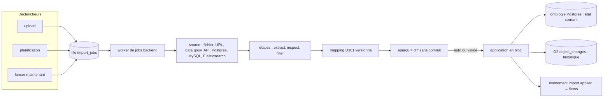

# Pipelines de données en masse (D344–D358)

> **Statut : proposé (2026-10-22), questions Q-P1–Q-P4 tranchées le même jour.** Demande de la
> session `pnex-quali-watch` après l'incident du 2026-10-21 (flow 9,
> org 4, dev.pnex.io). Étend D301/D303 (`partner-watch.md`) et remplace à
> terme la chaîne `ingest` D317–D322 (`ingestion.md`). Liens :
> `ontology.md` (D176–D191), `secrets.md` (D110–D118), `security.md`
> (R1, R2, R8), `system-admin.md` (D72), `editor-shell.md`.
>
> Contrainte posée par Shan : **tout en Rust, dans pnex**. dlt, Airbyte,
> Meltano, Starlake, Foundry Pipeline Builder, Kestra, Superset servent
> d'inspiration pour le modèle, jamais de dépendance ni de service à côté
> (ni Python, ni JVM).

## 1. Constat mesuré

### 1.1 Débits réels (dev.pnex.io, org 4)

| Run | Volume | Durée | Débit |
|---|---|---|---|
| `fc_certifications` (aperçu → appliqué, 2026-10-20) | 6 536 créations | 8 min 22 s | ≈ 13 objets/s |
| `fc_partners` (préparé) | 3 583 créations + 14 413 liens | 8 min 39 s | ≈ 35 écritures/s |
| `fc_certifiers` (préparé) | 1 771 créations + 17 151 liens | 12 min 33 s | ≈ 25 écritures/s |
| `fc_certifiers` (flow 9, 2026-10-21) | 42 730 lignes | coupé à 1 h, `failed`, rien écrit | — |
| test local après f46f748 | 2 000 objets + 2 000 liens | 7 s | ≈ 570 écritures/s |

### 1.2 Ce que fait f46f748 (et ce qu'il ne fait pas)

- **Fait** : l'étape `ontology_import` survit à son appel HTTP (tâche
  détachée, `pending` puis rappels, battement `heartbeat_at`, run mort →
  `import-run-interrupted`) ; schéma chargé une fois ; clés déjà prises
  vérifiées par lots de 1 000 ; `find_by_key` par l'index GIN.
- **Ne fait pas** : l'écriture reste **ligne à ligne à travers les
  services** (`objects::create_with`, `update_in_with`, `links::create_with`,
  `archive`, `close` dans `imports::write`), donc plusieurs requêtes par
  objet, dans une seule transaction tenue des minutes. Pas de `COPY`, pas
  de diff ensembliste en SQL.

### 1.3 Ce qui existe déjà et qu'on garde

- `object_imports` : mapping YAML D301 (le langage de transformation
  déclaratif), `version`, `mode` incrémental / snapshot, `recurrence` +
  `next_run_at`, sources `file` / `url` / `api` (`per_object`).
- `imports::run_now()` : un run complet (lecture, contrôles D303, diff,
  écriture). Le planificateur l'appelle ; **aucune route ne l'expose**.
  Le « lancer maintenant » est donc presque gratuit.
- Contrôles D303 (forme changée, chute suspecte, snapshot avec erreurs) et
  `max_closures_pct` D322.
- Zone de transit S3, sha256 au vol, `skip_if_unchanged`, quota, purge
  (D318) ; `archive_extract` gardé (D319) ; `table_inspect` (D320) ;
  `rows_filter` (D321).
- `TenantLock` (`ns::ONTOLOGY_IMPORT`) : une seule écriture d'import par
  org à la fois.
- `action_trigger` : un flow réagit déjà à un événement de l'ontologie.
- `services/geo` (géocodage) et la création de `map_pin` depuis un mapping
  (`location: {lat, lon}`).

## 2. Contre-analyse

### 2.1 D'accord

- Un traitement par lots ne doit pas vivre dans le moteur de flows : le
  runtime exécute du code utilisateur multi-org et ne voit pas les
  octets (D317). Le flow 9 ne fait que relayer des appels au backend.
- Il faut une reprise par étape, un lancement à la main et un événement de
  fin pour les règles du pack.
- On étend `object_imports` au lieu d'ouvrir un deuxième système.

### 2.2 Points mal posés, ou à recadrer

1. **La lenteur ne vient pas du moteur de flows.** Depuis f46f748 l'étape
   est détachée : le délai de 35 min ne coupe plus rien. Ce qui reste, c'est
   l'écriture ligne à ligne : 42 730 lignes à ≈ 25 écritures/s, c'est
   environ 30 min de transaction ouverte. **L'écriture en bloc est le
   vrai gain** ; l'orchestration hors flow règle l'ergonomie (relance,
   reprise), pas la durée.
2. **E — « Postgres va saturer » : non, à cette échelle.** Voir §2.3. Le
   risque réel est ailleurs : le journal de provenance.
3. **C — DuckDB, DataFusion ou Polars : pas pour les premiers lots.** Le
   mapping D301 est déjà le langage de transformation (conversions,
   `each`, `when`, `needs`, `on_conflict`), et `rows_filter` fait le
   filtre. Un moteur SQL ne se justifie que pour une **jointure ou une
   agrégation entre fichiers qui dépasse la mémoire**, et aucun cas actuel
   n'en a besoin. Voir D353.
4. **D — l'éditeur glisser-déposer « comme l'éditeur de flows ».** Un
   pipeline est **linéaire** (source → étapes → mapping) et un mapping est
   un **arbre** (objets, propriétés, liens). Un canevas de graphe n'apporte
   rien et coûte cher. Il vaut mieux un écran de correspondance
   (colonnes ↔ propriétés) et une liste d'étapes, dans la coquille
   d'éditeur commune (D222), avec un onglet YAML synchronisé. Voir D355.
5. **F — migrer les objets quand le mapping change.** C'est sûr tant que la
   **clé** ne change pas : on rejoue la dernière source gardée avec le
   nouveau mapping. Quand la clé change, c'est l'identité des objets qui
   change. Ça ne se migre pas en silence (sinon on ferme tout et on recrée
   tout). Voir D354.
6. **B — sources « à la Superset » vers des bases internes au client.**
   Elles sont presque toujours sur des adresses privées, que R8 refuse par
   défaut. Il faut une liste d'hôtes autorisés par org, décidée par
   l'admin plateforme, et non un contournement du garde (D352).

### 2.3 E — historique et volume, mesurés dans le code

**Le chemin est le bon** : chaque écriture d'import passe par
`objects`/`links`, qui appellent `changes::submit` → stream O2
`object_changes` (avant/après, `source_ref = import:<id>@<n>`). Postgres ne
garde que l'état courant : `objects.version` est un compteur, il n'y a pas
de table de versions. Une fermeture snapshot pose `valid_to` et garde la
ligne : c'est l'historique interrogeable (`as_of`) des liens et des
objets.

**Volume FC (ordre de grandeur, org 4)** : ≈ 50 000 objets (6,5 k
certifications, 38 k compétences, quelques milliers d'organisations) et
≈ 70 000 liens (`holds`, `accredited_for`, `skill_of`).

- Postgres : ≈ 50 k lignes `objects` (JSONB + index GIN) + 70 k `links`,
  de l'ordre de 100 à 200 Mo. Une fermeture ajoute 0 ligne (elle met à
  jour `valid_to`). Une réouverture ou une recréation en ajoute une. Avec
  un import quotidien FC où presque rien ne change, la croissance est
  négligeable. **Pas de risque de saturation.**
- O2 : un document par objet et **deux par lien** (un par extrémité),
  soit ≈ 190 000 documents au premier chargement, de 0,5 à 2 Ko chacun
  avant compression (100 à 400 Mo bruts, une fraction en Parquet). Les
  jours suivants : le delta seulement.

**Ce qui ne va pas (à corriger avant tout, D350)** :

1. **Le journal part avant le commit.** `changes::submit` est appelé
   dans `create_with` / `update_in_with` / `close`, *dans* la transaction
   d'import. Si la transaction échoue, comme le run du 2026-10-21 coupé
   après une heure, O2 garde des créations qui n'ont jamais eu lieu.
   Historique fantôme : probable sur org 4, à vérifier dans O2.
2. **Un appel HTTP O2 par document, à la suite, dans une file non
   bornée.** 190 000 documents, c'est 190 000 requêtes en série. La file
   gonfle en mémoire et `_timestamp` vaut l'heure d'envoi, pas celle du
   changement. Pourtant `Client::ingest_json` prend déjà un tableau.
3. **Rétention** : la réconciliation D72 ne règle que les streams
   *metrics*. `object_changes` est un stream *logs* : il suit le défaut de
   l'instance O2 (`ZO_COMPACT_DATA_RETENTION_DAYS`), et personne ne l'a
   décidé. Pour suivre l'évolution des entreprises dans le temps, ce
   défaut doit être explicite et long.
4. Les aperçus jamais appliqués gardent leur diff complet en JSON dans
   `object_import_runs.diff` (exemple : `fc_competences`, 38 253 lignes,
   état `preview`). Je n'ai trouvé aucune purge. C'est la seule croissance
   Postgres réelle, et elle disparaît avec D348.

## 3. Modèle

Un seul modèle, quel que soit le déclencheur :

**Pipeline = `object_import` étendue** : une source (et sa connexion
éventuelle), une liste d'étapes, un mapping versionné, un mode, une
récurrence. Les runs restent dans `object_import_runs` ; le journal des
étapes reprend `ingest_steps` (manifestes ≤ 64 Ko), rattaché au run de
l'import au lieu du nœud de flow.

## 4. Décisions

### D344 — Le pipeline est une import étendue, pas un second système

`object_imports` gagne `steps` (YAML, même fichier que le mapping :
`source:`, `steps:`, `objects:`, `links:`) et une référence de connexion
(D352). Les étapes reprennent celles de D317 sans `ontology_import` (c'est
la fin naturelle du pipeline) ni `staging_cleanup` (automatique en fin de
run) : `source_resolve`, `file_download`, `archive_extract`,
`table_inspect`, `rows_filter`. Les packs déclarent des imports complètes
(étapes comprises). Le kind de nœud `ingest` est retiré une fois le flow 9
migré : on est en beta, on casse sans couche de compatibilité.

### D345 — Exécution par un worker de jobs du backend, file Postgres

- Table `import_jobs` (`id`, `org_id`, `import_id`, `run_id`, `trigger`
  `upload|schedule|manual|replay`, `from_step`, `state`, `heartbeat_at`,
  `attempts`). Prise par `SELECT … FOR UPDATE SKIP LOCKED`, sur n'importe
  quel pod. Le battement de 60 s et la mort à 10 min reprennent le
  mécanisme de 000042 : seul le battement fait foi.
- Un job à la fois par org (`TenantLock` existant), N orgs en parallèle,
  plafonné par pod (`PNEX_IMPORT_WORKERS`, défaut 2).
- Le planificateur actuel (`sweep`) n'appelle plus `run_now` : il insère
  un job. La route `POST /api/v1/ontology/imports/{id}/runs` (« Lancer
  maintenant ») insère un job `manual`. Elle répond 202 avec le run, que
  le client interroge comme pour un aperçu.
- La fabric de workers (`worker-fabric.md`) n'est **pas** utilisée : le
  travail est d'abord de l'I/O vers S3 et Postgres, il reste dans le
  backend. On la reconsidérera si un moteur SQL lourd arrive (D353).

### D346 — Reprise par étape, sorties identifiées par empreinte

Chaque étape écrit sa sortie en staging et journalise
`input_sha` + `config_sha` → `output_key` + `output_sha`. « Reprendre
depuis l'étape N » (bouton sur l'étape en échec) crée un job
`from_step = N` qui réutilise les sorties des étapes < N, tant que leurs
objets existent encore en staging (`keep_raw_days`). Sinon : refus codé
`import-step-output-purged`. Une étape dont `input_sha` + `config_sha`
sont déjà connus et réussis dans ce run est sautée.

### D347 — Écriture en bloc : validation en Rust, diff en SQL

1. Le diff D301 (`diff::compute`) reste la validation : types de
   propriétés, `unique`, cardinalités, conversions. On ne réécrit pas les
   règles du schéma en SQL.
2. Les lignes valides partent par `COPY` dans des tables temporaires
   (`tmp_objects`, `tmp_links`), dans la transaction d'application.
3. Le diff s'applique par des requêtes ensemblistes :
   `INSERT … ON CONFLICT DO UPDATE … WHERE properties IS DISTINCT FROM`
   (aucune écriture si rien ne change), puis une jointure inverse pour les
   fermetures snapshot (`UPDATE … SET valid_to = now() WHERE NOT EXISTS`).
   Chaque requête renvoie `RETURNING` id, version, avant/après pour le
   journal.
4. **Prérequis** : une colonne `natural_key text` sur `objects`, remplie
   depuis la propriété `unique` du type (D302), avec l'index unique
   partiel `(org_id, type_key, natural_key) WHERE valid_to IS NULL`.
   Aujourd'hui l'unicité D302 est vérifiée seulement dans le service :
   `ON CONFLICT` a besoin d'un index. Même chose pour les liens ouverts
   (`(org_id, link_type, source_id, target_id) WHERE valid_to IS NULL`),
   à vérifier dans la migration ontologie.
5. Les `map_pin` (POI natif + identité par trigger) gardent le chemin
   ligne à ligne : ils sont peu nombreux par run. Raccourci assumé, à
   revoir si une source crée des dizaines de milliers d'établissements.
6. Tout ou rien par run, comme D301 : `COPY` et les opérations
   ensemblistes tiennent 100 000 lignes en secondes. **Q-I3 (appliquer par
   lots, perte du tout-ou-rien) est retirée.**

Objectif d'acceptation : `fc_certifiers` (42 730 lignes) appliqué en
moins d'une minute sur dev.

### D348 — L'aperçu est le même calcul, sans commit

L'aperçu exécute D347 dans une transaction qu'on annule
(`ROLLBACK`) : les comptes viennent des mêmes requêtes que
l'application. Le run garde les comptes et un échantillon de 500
changements, **plus le diff complet**. L'application relance le calcul
sur la même entrée (même `input_sha`). Si les comptes diffèrent de ceux
de l'aperçu, le run est refusé (`import-preview-stale`) et un nouvel
aperçu est proposé. La colonne `object_import_runs.diff` est retirée.

### D349 — Ne rien refaire si la source n'a pas changé

`skip_if_unchanged` (sha256 du brut) devient une option de toute import
(fichier, URL, data.gouv, upload compris), avec en plus l'`ETag` ou le
`Last-Modified` quand la source les donne (requête conditionnelle, aucun
téléchargement). Au niveau des lignes, il n'y a rien à ajouter : la
clause `IS DISTINCT FROM` de D347 n'écrit et ne journalise que ce qui
change. Une colonne d'empreinte par ligne serait du stockage en plus pour
le même résultat.

### D350 — Journal de provenance : après le commit, par lots, rétention décidée

- Les changements sont collectés pendant l'application (le `RETURNING` de
  D347, ou un tampon côté service pour le chemin ligne à ligne) et
  **soumis seulement après `commit`**. Une transaction annulée ne
  journalise rien. La même correction vaut pour toutes les écritures
  d'ontologie, pas seulement les imports.
- Le writer O2 envoie par lots (jusqu'à 1 000 documents ou 1 s), et la
  file est bornée (si elle déborde : compteur et `warn`, jamais de blocage
  d'écriture). `_timestamp` = l'instant du commit.
- `object_changes` reçoit une rétention explicite, séparée de la
  rétention télémétrie D72 : réglage plateforme
  `history_retention_days`, défaut 3 650 jours, réglable par l'admin
  plateforme seulement (Q-P1, tranchée). Valeur à part, y compris en
  SaaS : elle ne suit pas le `data_retention_secs` du tier. La
  réconciliation D72 la pose aussi sur les streams logs concernés.
- L'évolution d'une entreprise se lit dans O2 (SQL O2 sur `object_id`,
  `type_key`, période), pas dans Postgres. Une vue « évolution » sur la
  page objet (frise des valeurs d'une propriété) se branche sur
  `history_of`, qui existe déjà.

### D351 — Upload : zip, mapping à l'upload, carto

- Upload = déclencheur `upload` du même pipeline. Le fichier va en staging
  (plus de corps brut de 50 Mo dans `dry-run`), puis les étapes de
  l'import s'exécutent.
- **Zip** : `archive_extract` (D319) s'applique à l'upload. Si plusieurs
  fichiers sont retenus, l'écran demande lequel va à quel mapping (glob
  `entry`), au lieu de « le premier fichier » (`import_read::unzip`).
- **Mapping à l'upload** : sans import existante, l'upload ouvre l'écran
  de correspondance (D355), prérempli à partir de `table_inspect` :
  colonnes ↔ propriétés du type choisi, par nom normalisé, puis par
  libellé. L'utilisateur valide, l'import est créée avec ce mapping,
  l'aperçu suit.
- **Carto** : nouvelle conversion D301 `geocode` (adresse → `lat`/`lon`)
  sur un objet `location`, via `services/geo` (fournisseur de l'org).
  Cache par adresse normalisée, débit plafonné par le fournisseur, un
  échec donne un avertissement (pas une erreur) et un objet sans POI.

### D352 — Sources connectées, identifiants au coffre

- Ressource **connexion** (`import_connections`) : `kind`
  `postgres|mysql|elasticsearch|http`, hôte, port, base ou index,
  utilisateur, `SecretRef` (D113) pour le mot de passe, la clé ou le
  jeton. Une import référence une connexion et porte sa **requête** (SQL
  ou corps `_search`).
- Exécutées **par le backend uniquement** (le runtime ne voit ni
  connexion ni secret, D115). Postgres et MySQL via sqlx (déjà là par
  sea-orm ; il manque la feature `sqlx-mysql`, à vérifier avec `cargo
  deny`). Elasticsearch via `reqwest` (`_search` + `search_after`, sans
  crate ES).
- Garde-fous : transaction `READ ONLY`, `statement_timeout`, plafond de
  lignes ou d'octets, une seule requête par import (pas de `;` multiples,
  vérifié par le pilote en mode simple). Le résultat est matérialisé en
  CSV dans le staging : la suite du pipeline est la même que pour un
  fichier.
- Réseau : connexion TCP passée au filtre `egress::check_host` /
  `filter_addrs`, résolution DNS comprise. Les adresses privées restent
  refusées, sauf la **liste d'hôtes autorisés de l'org**, posée par l'admin
  plateforme seulement, jamais par l'admin d'org (Q-P2, tranchée : tout
  inscrit est owner de son org perso).
- IAM : `import_connections:read|write` (admin d'org pour l'écriture,
  comme le coffre D117) ; le test de connexion est une opération à part,
  sans retour de données.

### D353 — Transformations : le mapping D301 d'abord, un moteur SQL plus tard

- Lots 1 à 5 : les étapes D317–D321 et les conversions D301 suffisent à
  tous les cas connus (FC, SIRENE, réseau de partenaires).
- Un moteur SQL arrive **sur un besoin mesuré** (jointure entre deux
  fichiers d'un même zip, agrégation qui dépasse la mémoire, Parquet en
  entrée). Candidat proposé : **Apache DataFusion** (Apache-2.0, Rust
  pur, SQL, `object_store` pour S3/RustFS ; O2 est lui-même construit
  dessus). Face à **Polars** (MIT, moteur lazy et streaming solide, mais
  pensé d'abord pour Python, avec une API Rust qu'il ne garantit pas
  stable) et **DuckDB** (C++ derrière des bindings : écarté par la
  contrainte « Rust pur »).
- **Non mesuré ici** : poids du binaire, temps de build, mémoire en
  streaming. La mesure se fait dans un lot à part (L7, build sous
  `scripts/guarded.sh`, un seul à la fois), avec le même fichier
  `Partenaires` (32 Mo, 400 798 lignes) pour les deux moteurs. Le moteur
  irait de préférence dans un binaire à part du workspace, pour ne pas
  alourdir `pnex-server`.
- Ni DataFusion ni Polars ne lisent un zip : l'extraction en staging
  (D319) reste en amont. Le crate `zip` exige `Read + Seek` (répertoire
  central en fin d'archive). Le streaming direct depuis S3 demanderait des
  lectures par plages : sans intérêt sous 200 Mo.

### D354 — Mapping versionné, migration par rejeu

- `object_import_versions` garde chaque version du YAML (`version` existe
  déjà sur l'import), avec auteur et date. Les runs portent la version
  appliquée (`import_version`, déjà là).
- Sauvegarder une nouvelle version propose un **rejeu** : aperçu du
  dernier brut gardé avec le nouveau mapping, en mode snapshot sur le
  périmètre de l'import. On voit ce qui sera mis à jour, fermé ou créé
  avant d'appliquer.
- **Changement de clé** (`key`, ou la conversion de la propriété clé) :
  refusé sans une table de correspondance explicite `rekey` (ancienne
  valeur → nouvelle, ou conversion), appliquée à `natural_key` et aux
  propriétés dans la même transaction. Sans cela, le rejeu fermerait tout
  et recréerait tout (`import-key-changed`).
- Le brut n'est gardé que `keep_raw_days` : au-delà, le rejeu demande une
  nouvelle source.

### D355 — Studio du pipeline : celui des sites web, pas un nouvel éditeur

Le studio des règles de navigation (`site-recipes.md` D324, `pages/web_sites/`)
a déjà tout ce qu'il faut : coquille D222, blocs glissés ou cliqués et
édités sur place, onglet Code en YAML écrit depuis la structure, tiroir
Versions D221 avec diff YAML et Rétablir, lecteur commun D220 avec frise
par exécution, « Reprendre à l'étape N ». Le studio `/pipelines/:id`
reprend cette mise en page à l'identique, avec les mots du lexique D358 :

- **scène** : la sortie du traitement choisi (table d'échantillon, comptes,
  colonnes de `table_inspect`, fichiers d'une archive), là où le studio des
  sites montre la capture de l'étape ;
- **lecteur** dessous : sélecteur d'exécution tiré de `object_import_runs`,
  frise `components/timeline` avec un couloir **Traitements** (une barre par
  traitement, longue de sa durée, colorée par son résultat) et un couloir
  **Écritures** (créations, mises à jour, fermetures) ;
- **colonne de droite**, trois onglets :
  - **Traitements** : origine puis traitements en blocs (même école que
    `blocks.rs` : bande d'actions, glisser pour insérer ou réordonner,
    inspecteur sur place), vérifiés côté client par la même `validate`
    que le serveur ;
  - **Correspondance** : colonnes de l'origine (exemples de
    `table_inspect`) face aux types, propriétés et liens ; on glisse une
    colonne sur une propriété, la conversion se choisit sur la flèche ;
  - **Code** : le pipeline en YAML, écrit depuis la structure (aller-retour
    serde, aucun second modèle) ; on ne quitte l'onglet qu'avec un YAML
    accepté par le serveur, comme pour les règles ;
- barre de la coquille : Versions (D354, même `VersionsDrawer`), **Aperçu**,
  **Lancer**, Enregistrer ; « Reprendre au traitement N » sur une exécution
  terminée (D346), comme « Reprendre à l'étape N ».

Ce qui se partage plutôt que se copier : le glisser-déposer de `blocks.rs`
(`Drag`, `drop_at`) et `VersionsDrawer` sont aujourd'hui liés au type
`Recipe` ; on les rend génériques sur la liste d'éléments au moment où le
deuxième usage arrive (L6), pas avant. Liste `/pipelines` sur le socle CRUD,
dans le groupe de menu **Sources** (un pipeline alimente PNeX) ; l'onglet
Imports de l'ontologie disparaît au profit de cette page.

Pas de canevas de graphe en V1 (§2.2, point 4).

### D358 — Lexique dédié (design-system.md §7)

Les mots naturels sont déjà pris : « flux » (streams), « flow », « règle »
et « étape » (navigation), « passage » (exécution d'une règle), « source »
(groupe de menu), « connexion » (se connecter), « import » (verbe de partout :
modèles, grilles, types). Une notion = un mot :

| Notion | FR | EN | N'est pas |
|---|---|---|---|
| Chaîne déclarative qui charge des données dans l'ontologie (D344) | Pipeline | Pipeline | pas « import » (le verbe reste pour un fichier), pas « flux », pas « flow » |
| Ce que lit le pipeline : fichier, URL, data.gouv, base, index | Origine | Origin | pas « source » (= groupe de menu), pas « provenance » (= journal) |
| Opération entre l'origine et la correspondance (extraire, inspecter, filtrer, géocoder…) | Traitement | Transform | pas « étape » (= règle de navigation), pas « nœud » (= flow) |
| Colonnes de l'origine → types, propriétés, liens (D301) | Correspondance | Mapping | pas « mapping » en français |
| Accès enregistré à une base ou une API, identifiants au coffre (D352) | Connecteur | Connector | pas « connexion » (= se connecter), pas « source » |
| Un passage du pipeline, de l'origine à l'écriture | Exécution | Run | pas « passage » (= règle de navigation), pas « job » |
| Calcul complet sans écriture (D348) | Aperçu | Preview | pas « simulation », pas « dry-run » |
| Rejouer une version de la correspondance sur l'origine gardée (D354) | Rejeu | Replay | pas « migration » |

Garde : règles ajoutées à `lexicon_guard.rs` (« import » comme nom d'entité
hors clés exemptées, « mapping » et « dry-run » en français, « connexion »
hors connexion utilisateur) **dans le lot qui affiche le concept** (L2 pour
Pipeline, Origine, Traitement ; L5 pour Connecteur), en même temps que la
ligne au lexique §7. Côté code, les noms techniques restent
(`object_imports`, `steps`, `import_connections`) : le lexique est celui de
l'interface et des fiches de l'assistant.

### D356 — Événement `import.applied` vers les flows

Un run appliqué publie `import.applied` : `{import, run, version,
counts, changed: [ids]}`, ids plafonnés à 10 000 (au-delà, le flow
interroge par `source_ref`). Nœud **`import_trigger`** (config : import ou
import du pack par nom), sur le modèle d'`action_trigger`. C'est lui qui
lance les règles du pack (écarts, alertes). `NodeDoc` + fiche
`assistant-kb` dans le même commit.

### D357 — Ce qu'on garde de D317–D322

| Décision | Sort |
|---|---|
| D317 nœud `ingest` | **retiré** après migration du flow 9 ; le backend qui exécute l'étape reste (`services/ingest`), appelé par le worker |
| D318 staging + journal + quota + purge | **gardé**, journal rattaché au run d'import |
| D319 `archive_extract` | **gardé**, aussi à l'upload |
| D320 `table_inspect` | **gardé**, alimente l'écran de correspondance |
| D321 `rows_filter` | **gardé** (`in_objects` en particulier) |
| D322 `ontology_import` | **absorbé** : c'est la fin du pipeline ; `max_closures_pct` devient un contrôle de toute import snapshot |
| f46f748 pending / rappels | **retiré** avec le nœud ; le battement `heartbeat_at` passe au job |

## 5. Migration du flow 9 (org 4)

1. Lot 1 livré : le flow 9 continue tel quel, en plus rapide (écriture en
   bloc). Rien à faire côté org.
2. Lot 2 livré : le pack `quali_watch` (version suivante) déclare une
   import « France Compétences » avec ses étapes (`source_resolve`
   data.gouv → `file_download` → `archive_extract` → `table_inspect` →
   `rows_filter`) pour chacun des mappings `fc_*`. La montée de pack les
   crée sans toucher aux imports existantes (D301 : jamais écrasées).
3. Shan lance un run à la main, compare les comptes à ceux du dernier run
   du flow, puis désactive le flow 9 (désactivation humaine : aucun outil ne
   l'arrête, D144).
4. Le kind `ingest` est retiré du registre de nœuds. Un flow encore
   déployé avec ce kind est isolé au deploy (même école que les onglets
   ignorés).

## 6. Sécurité (grille `security.md` §6)

- **R1** : org tirée du principal (routes) ou de l'import (worker) ; clés
  de staging hors du préfixe de l'org ignorées (inchangé, D318).
- **R2** : nouvelles opérations au registre IAM
  (`ontology_imports:run`, `import_connections:read|write|test`) ; le
  worker écrit avec le rôle de l'auteur de l'import, revérifié au début de
  chaque run (D303). Test sans la permission → 403 pour chaque route.
- **R4 / R16** : une connexion en lecture ne renvoie jamais le secret ni
  l'URL avec identifiants. `SecretRef` uniquement, et les champs de
  connexion vont dans `REDACTED` (MCP).
- **R8** : HTTP via le client gardé ; TCP Postgres, MySQL et ES via
  `egress::filter_addrs` après résolution, et liste d'hôtes privés
  autorisés par org (admin plateforme seulement).
- **Requête externe hostile ou coûteuse** : `READ ONLY`, timeout, plafond
  de lignes et d'octets, requête unique. Le résultat est une donnée non
  fiable, qui passe par les mêmes plafonds que D319/D320.
- **Exécution** : aucun code utilisateur dans le worker (le YAML est
  déclaratif). Le moteur SQL éventuel (D353) n'exécute que des requêtes
  sur le staging de l'org, sans accès réseau ni système de fichiers.
- **MCP** : lecture des imports, runs, étapes et connexions exposée ;
  « lancer maintenant », « reprendre » et les connexions en écriture sont
  `EXCLUDED` (déclenchement d'une écriture en masse ; secret).
- **Assistant** : peut proposer un mapping (via le service partagé, sur la
  version lue), jamais lancer un run ni toucher une connexion.

## 7. Lots

| Lot | Contenu | Valeur | Taille |
|---|---|---|---|
| **L0** | D350, première partie : journal soumis après le commit, writer O2 par lots et borné | corrige l'historique fantôme et la file non bornée ; prérequis de tout le reste | S (`fix(ontology)`) |
| **L1** | D347 + D348 : `natural_key` + index, `COPY` + diff ensembliste, aperçu sans diff stocké ; route « Lancer maintenant » sur `run_now` | 42 k lignes en < 1 min ; le flow 9 tient sans rien changer ; Q-I3 retirée | M |
| **L2** | D344–D346 : étapes sur l'import, `import_jobs` + worker, reprise par étape ; migration du flow 9 (§5) | relance et reprise sans re-télécharger | M |
| **L3** | D351 : upload en staging, zip à plusieurs fichiers, mapping à l'upload (écran minimal), `geocode` | chemin manuel unifié | M |
| **L4** | D354 + D356 : versions de mapping, rejeu, `rekey` ; `import.applied` + `import_trigger` | règles du pack déclenchées en fin d'import | M |
| **L5** | D352 : connexions Postgres, MySQL, ES, coffre, egress | sources externes | M |
| **L6** | D355 : studio `/pipelines/:id` sur le modèle du studio des sites web (blocs, correspondance glissée, Code, Versions) ; `Drag`/`drop_at` et `VersionsDrawer` rendus génériques | confort d'édition | M (la mise en page existe) |
| **L7** | D353 : mesure DataFusion contre Polars (binaire, build, mémoire) sur `Partenaires`, puis décision | seulement si un cas réel le demande | S (étude) |

**Avancement (2026-10-22, non commité)** — lot **L1+**, le plus petit qui fait
passer France Compétences de bout en bout sans flow (décision de Shan : plus
de rustines sur le flow 9) :

- **L0** : `changes::deferred` tient les changements d'une transaction,
  `changes::flush` les envoie juste après son `commit` ; une transaction
  annulée ne journalise rien. Câblé sur les écritures transactionnelles
  d'objets et de liens (contrôleurs d'ontologie, `imports::write`, dossiers,
  attributions média, preuves). Writer O2 : file bornée à 100 000
  (débordement compté, `warn`), lots de 1 000 documents ou 1 s, une requête
  par org. Rétention `history_retention_days` (Q-P1) : reste à faire.
- **D347, écriture en bloc** : `objects::create_many_with` /
  `update_many_with`, `links::create_many_with` / `update_many_with`. Mêmes
  contrôles que le chemin unitaire (rôle, titre, valeurs, `ref`, unicité
  D302, cardinalités), faits par lots ; écriture par `jsonb_to_recordset`
  (5 000 lignes par requête). Restent unitaires : `map_pin` (POI), `claim` et
  dossiers (règles de statut), liens `measures`/`depicts`, fermetures.
  Migration 000043 : le trigger `pnex_edge_objects` ne cherche plus une
  extrémité déjà fournie. Sans cela, chaque lien relisait `objects` sans
  statistiques sur les lignes de la même transaction (60 000 liens :
  313 s). Pas de colonne `natural_key` : la recherche par clé du diff tient
  sans elle. Mesuré en build debug : 60 000 créations + 60 000 liens en
  59 s (341 s avant), 60 000 mises à jour en 9,6 s.
  `ROWS_MAX` porté à 250 000 sur ce chemin (Q-I3 close).
- **D344, une partie** : `steps:` dans le YAML de l'import (étapes D317 sauf
  `ontology_import` et `staging_cleanup`, 10 au plus). Exécutées par le
  serveur (`services/ingest/pipeline.rs`), journalisées dans `ingest_steps`
  sous le run (`node_id` = `import:<id>`), staging du run nettoyé à la fin,
  puis application du fichier obtenu (contrôles D303 et `max_closures_pct`
  par défaut). Pas encore de file `import_jobs` ni de reprise (L2) : le run
  bat toutes les 30 s et tourne dans le pod qui l'a lancé.
- **Lancer maintenant** : `POST /ontology/imports/{id}/runs` (202, run
  `running`), permission `ontology:write` (celle de l'application d'un
  aperçu, pas de permission `ontology_imports:run` à part), `EXCLUDED` côté
  MCP (motif « bulk »), bouton « Lancer maintenant » sur la liste des imports.
  La planification passe par le même chemin. Une import fichier sans étapes
  → 409 `ingest-entry-missing`.
- **Erreurs des runs appliqués** : un run appliqué ou en échec garde ses
  lignes en erreur et ses avertissements (500 au plus) dans `diff`.

Je ne reprends pas l'ordre proposé (« lancer maintenant + reprise +
écriture en bloc » ensemble) : la route « lancer maintenant » tient en
quelques lignes, puisque `run_now` existe, et l'écriture en bloc règle à
elle seule l'incident. L0 et L1 sont donc le plus petit lot utile. La file
de jobs et la reprise (L2) viennent ensuite, quand le pipeline sort du
flow.

## 7 bis. Retour du 2026-10-23 (retest France Compétences, dev.pnex.io, org 4)

Le flow 9 est supprimé : les cinq imports FC tournent sur leurs propres
étapes, appliquées en snapshot avec `invalid: skip`, zéro erreur. Ce qui a
coûté du temps, avec ce que je propose pour chaque point. Rien n'est codé
au-delà de la récurrence (point 6). Tout le reste est à arbitrer.

1. **Un run meurt avec son pod.** C'est arrivé deux fois : un `helm upgrade`
   a remplacé les pods API en plein run, puis un « Lancer maintenant » est
   tombé sur un ancien pod en `Terminating` juste après `rollout status`.
   Chaque déploiement met en danger un import en cours. Depuis le 23, un
   tel run passe `failed` + `import-run-interrupted` au bout de 10 min sans
   battement, mais il faut le relancer à la main.
   → **Faire L2 (`import_jobs` + reprise par étape, D345–D346) avant L4 et
   L6.** En attendant, un arrêt propre : sur SIGTERM, le pod ne prend plus de
   run, et `terminationGracePeriodSeconds` laisse finir celui en cours
   (borné, un run FC dure moins de 2 min).
2. **Deux versions côte à côte.** Seule l'API a été redémarrée sur la
   nouvelle image. Le flow-worker (même binaire) est resté sur l'ancienne et
   tenait le singleton `object-imports` : la nouvelle logique de balayage ne
   tournait pas, et rien ne montre qui tient un singleton ni dans quelle
   version.
   → Journaliser la version à la prise du bail (`singleton::my_turn`), et
   lister dans `system_status` (page Système) chaque singleton avec son pod,
   sa version et l'âge de son bail. Côté procédure, l'image `latest`
   redémarre l'API **et** le flow-worker ensemble : une ligne dans le
   runbook de dev.
3. **Des erreurs sans contexte.** `import-source-too-large` avec 0 ligne et
   sans `args` ; le premier run tué par OOM passé `failed` sans code une
   heure après (corrigé le 23 : `import-run-interrupted`). Il a fallu
   deviner, puis reproduire en local.
   → Ajouter une colonne `state_args jsonb` à `object_import_runs`
   (migration), alimentée par tous les refus (le chemin des étapes jette
   aujourd'hui ses `args`). `ReadError::TooLarge` porte `{rows, max}` et
   `{bytes, max}`. L'historique affiche le message rendu (`err-*` avec ses
   arguments). Taille S, une demi-heure gagnée dès la première fois.
4. **Mémoire.** 1 Gi ne suffisait pas pour 400 k lignes. Corrigé le 23
   (0e58824e) : pic de 1,6 Go ramené à ~340 Mio en prod (≈ 0,95 Go mesuré
   en debug pour 100 k objets + 140 k liens), mémoire rendue après le run.
   Le diff reste construit en entier en mémoire, et les étapes `table_inspect`
   et `rows_filter` lisent la table entière.
   → Rien tant qu'aucune source ne grossit. Le seuil à surveiller : 500 k
   lignes après filtre ou un pic au-delà de 50 % de la limite du pod. Le
   remède est alors un diff et une écriture par lots de clés, plus des
   étapes en flux (lecture CSV ligne à ligne). Le banc
   `partners_import_memory` (ignoré) sert de mesure.
5. **Snapshot et données ouvertes sales.** Cinq valeurs fausses côté France
   Compétences (deux SIREN, trois descriptions trop longues) refusaient tout
   le run. Corrigé par `invalid: skip` (3d086a8e).
   → Règle de pack : un import d'une source publique livre `invalid: skip`
   dès le premier jour, sur sa clé et sur ses textes libres. À écrire dans la
   doc des packs, et à vérifier en revue de pack plutôt que par une garde,
   car « source publique » ne se déduit pas du YAML. Limite connue : une
   ligne écartée par sa clé fige les fermetures de liens de l'autre
   extrémité pour ce run (la certification).
6. **Planification.** La récurrence était refusée sur une import fichier à
   étapes (corrigé le 23, non commité). `RUN_HOUR` est fixe à 03:00 pour
   tous et il n'y a pas d'enchaînement : les cinq imports sont étalés sur la
   semaine (certificateurs lundi … RS vendredi) pour garder leur ordre.
   → C'est le travail de L4 (`import.applied` → `import_trigger`) : on n'y
   ajoute rien avant. Si L4 tarde, une heure par import dans la récurrence
   est le plus petit palliatif.
7. **Visibilité.** Aucun écran ne montre les étapes d'un run :
   `ingest_steps` existe, mais rien ne l'affiche. Shan cherchait un menu
   « Pipelines ».
   → Avant le studio (L6) : dans Ontologie › Imports › Historique, déplier
   un run montre ses étapes (`ingest_steps` du run : statut, durée, lignes
   entrées et sorties, code). Réutilise le panneau « Derniers passages » des
   nœuds d'ingestion. Taille S.
8. **Outillage.** Le MCP ne crée, ne modifie, ne lance ni ne supprime une
   import (`EXCLUDED`, 415) : tout est passé par `pnex raw` et des scripts
   Python. `pnex raw` imprime du JSON avec des caractères de contrôle bruts
   (lecture en `strict=False`).
   → Corriger la sortie de `pnex raw` (JSON échappé). Ajouter
   `pnex import run <id> --wait`, qui lance le run, suit son état et rend le
   code de sortie. Création et modification d'une import via le MCP :
   envisageable (lecture et écriture JSON, droits de l'appelant), mais le
   lancement reste exclu (motif « bulk »).
9. **Limites croisées.** `FILTER_VALUES_MAX` = 1 000 bloquait un filtre
   `in` sur ~7 500 codes actifs, contourné par `only` (859d2b89). `left:9`
   doit précéder `luhn`, sinon la clé de contrôle du SIRET compte (corrigé
   dans le pack).
   → Documenter `only` comme la réponse aux longues listes de valeurs. Pas
   de hausse de la limite.

**Ordre proposé** : 1 (arrêt propre tout de suite, L2 ensuite), 3, 2, 7, 8,
puis L4 pour 6 ; 4 et 5 sont des règles à tenir, 9 est fait.

**Fait le 2026-10-23 (go de Shan)** :

- **Point 1, arrêt propre** (`imports/stop.rs`). Sur SIGTERM (`on_shutdown`),
  le pod ne lance plus de run : 503 `import-server-stopping` sur
  « Lancer maintenant », l'aperçu et l'application ; balayage suspendu,
  pour ne pas avancer `next_run_at` sans lancer ; une étape de flow répond
  `pending` et sera reprise ailleurs. Les runs du pod ont
  `PNEX_SHUTDOWN_GRACE_SECS` (270 s par défaut) pour finir, puis passent
  `failed` + `import-run-interrupted` ; sans run en cours, l'arrêt est
  immédiat. `terminationGracePeriodSeconds` : **300** pour l'API et le
  flow-worker, qui lance les runs planifiés (chart pnex-deploy).
- **Point 3, `state_args`** (migration 000051). Remplie par chaque refus ou
  échec qui a des arguments : `{rows, max}` ou `{bytes, max}` pour
  `import-source-too-large` (lecture du fichier, staging, téléchargement),
  `{columns}` pour `import-schema-changed`, `{previous, rows}` pour
  `import-suspicious-drop`, `{closed, held, max_pct}` pour les fermetures
  suspectes. Les sources URL et API gardent le code seul. L'historique
  rend le message avec ses chiffres (FR + EN).
- **Point 7, étapes dans l'historique**. `GET …/runs/{run_id}` renvoie
  `steps`, les `ingest_steps` du run dans l'ordre. Dans Ontologie › Imports
  › Historique, « Étapes » déplie chaque étape avec son statut, sa durée,
  les lignes lues et gardées, et son code.

## 8. Questions tranchées (Shan, 2026-10-22)

- **Q-P1** — Rétention de `object_changes` : **3 650 jours par défaut,
  réglable par l'admin plateforme**, séparée de D72 et du tier SaaS (D350).
- **Q-P2** — Hôtes privés des sources connectées : **liste par org, posée
  par l'admin plateforme** (D352).
- **Q-P3** — Run planifié : **application directe, comme aujourd'hui**
  (refus D303 et `max_closures_pct` seulement). L'aperçu reste obligatoire
  pour l'upload et le rejeu d'un mapping (D351, D354).
- **Q-P4** — Historique fantôme du 2026-10-21 (org 4, `import:8b027b8a…@1`) :
  **ignoré** (données de dev), ni vérifié ni purgé. L0 empêche qu'il se
  reproduise.
