# Système de design de l'UI

## Résumé

Ce document fixe l'identité visuelle, les primitives et le vocabulaire de l'interface PNeX. Il s'adresse à toute personne qui écrit un écran du front Dioxus. Le code porte les règles (`style/tailwind.css`, `components/ui.rs`, socle `components/crud/`). Trois gardes bloquent la dérive : `design_guard.rs`, `lexicon_guard.rs` et le formatage gardé du `rsx!` (§9). Le document couvre aussi la coquille d'éditeur (§8) et l'affichage sur téléphone (§4, règle 11).

## 1. Concepts : un poste d'instrumentation pour les données

PNeX suit le principe ISA-101 des IHM haute performance. Le fond est calme et neutre. La couleur porte seulement une information.

- **Signal** (cyan, le point du logo) : ce qui est interactif, sélectionné ou vivant (lien, focus, sélection, donnée qui bouge).
- **Repère** (croix vermillon, le X du logo) : l'endroit où l'utilisateur est dans la navigation. Il ne sert à rien d'autre.
- **Encre** : l'action principale d'un écran. Un écran a un seul bouton plein.
- **État** : normal, inactif, alerte ou alarme. Une forme (rond, losange, triangle) double la couleur, pour une lecture sans vision des couleurs.
- **Socle** : les composants partagés d'une liste CRUD (`ListLayout`, `FilterBar`, `ListStates`, `DataTable`, `ListPager`, `FormDialog`).
- **Coquille d'éditeur** : `EditorShell`, le chrome commun des éditeurs plein écran (§8).

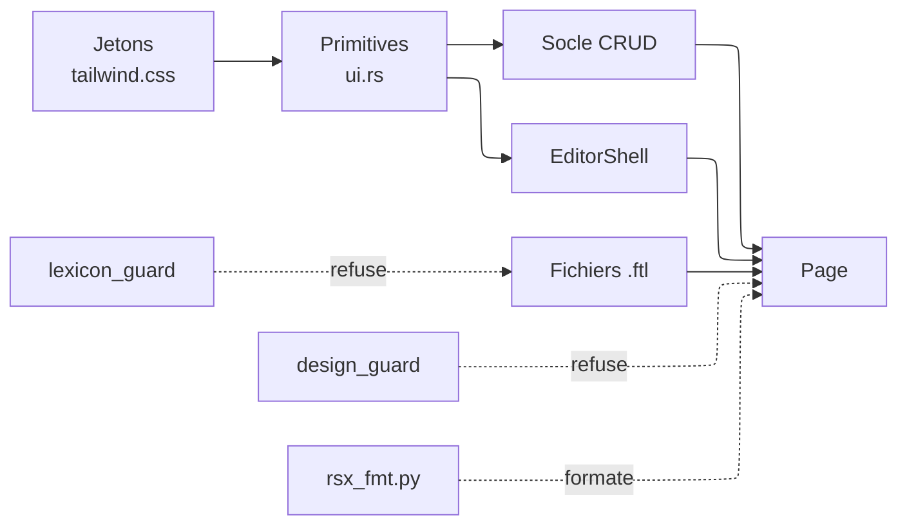

## 2. Jetons (`style/tailwind.css`, bloc `@theme`)

| Jeton | Clair | Rôle |
|---|---|---|
| `ink` | `#16212b` | texte, bouton principal |
| `slate` | `#4c5966` | texte secondaire, aides |
| `line` / `line-strong` | `#d5dbe1` / `#c3cbd3` | bordures, séparateurs / champs |
| `ground` | `#eef1f4` | fond de l'application |
| `rail` | `#e4e9ee` | barre latérale |
| `surface` | `#ffffff` | surfaces de travail |
| `signal` / `signal-soft` | `#0e7c9c` / `#e3f2f6` | interactif, sélection |
| `mark` | `#e5482d` | repère de navigation |
| `ok` / `idle` / `warn` / `alarm` | `#2b7a4b` / `#8793a0` / `#c77700` / `#b42318` | états |

- **Gris** : l'échelle `gray-*` de Tailwind est réaccordée sur le gris acier. Les classes existantes suivent l'identité sans réécriture.
- **Cyan** : le signal a son échelle `signal-50` … `signal-950`. `design_guard` refuse toute classe `blue-*`.
- **Typographie** : IBM Plex Sans (400/500/600) et IBM Plex Mono (400/500). Un sous-ensemble latin est embarqué en data URI dans `style/fonts.css`, pour un rendu identique sur web, desktop et APK hors ligne. Le mono sert seulement au code, aux clés et aux identifiants.
- **Licence des polices** : SIL OFL 1.1 (`style/fonts-OFL.txt`). C'est l'exception à la règle MIT/BSD/Apache, propre aux polices. L'OFL est permissive et non contaminante.
- **Tailles** : 12 / 14 / 16 / 20 / 24 / 32 px (`text-xs` … `text-3xl`). `design_guard` refuse une taille arbitraire (`text-[11px]`), un libellé en majuscules et un espacement de lettres.
- **Rayons** : 6 px pour les contrôles (`rounded-md`), 8 à 10 px pour les surfaces et les modales. La pastille ronde sert seulement aux états.

## 3. Mode sombre

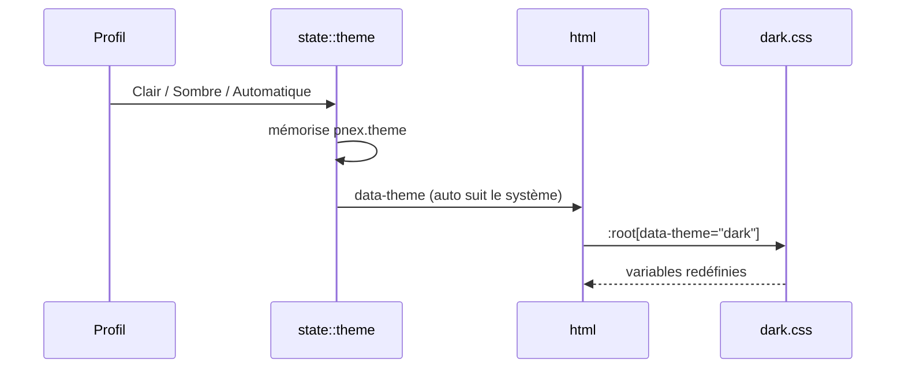

`style/dark.css` redéfinit les variables. Les échelles de Tailwind sont miroitées (50 ↔ 950) : une teinte `-50` reste la plus discrète. Le gris acier passe en gris de nuit, le cyan s'éclaircit et `white` devient la surface sombre. La clé `pnex.theme` évite un flash au démarrage. La variante `dark:` suit l'attribut `data-theme` (`@custom-variant`). Toutes les pages suivent sans modification.

## 4. Primitives (`crates/pnex-frontend/src/components/ui.rs`)

| Primitive | Usage |
|---|---|
| `BTN_PRIMARY` / `_SM` | action principale (encre) ; variante compacte pour barres d'outils et lignes |
| `BTN_SECONDARY` / `_SM` | annuler, exporter, actions secondaires |
| `BTN_GHOST` | action discrète dans une ligne |
| `BTN_DANGER` | suppression avant confirmation |
| `BTN_DANGER_SOLID` | suppression confirmée (dans la modale de confirmation seulement) |
| `INPUT`, `FIELD_LABEL`, `FIELD_HELP`, `FIELD_ERROR` | champs de formulaire, libellé en casse de phrase |
| `PANEL` | surface plate à filet (pas d'ombre) |
| `TAB_BAR`, `TAB`, `TAB_ACTIVE` | onglets soulignés (filet cyan sur l'onglet ouvert), `role="tablist"` / `tab` + `aria-selected` ; un onglet est une vue, jamais une action |
| `LabelTag` | étiquette D42 en forme « clé \| valeur » |
| `StateMark` | état ISA-101 (forme + couleur + texte) |

Le socle CRUD et les modales consomment ces primitives. Une page qui compose le socle hérite de l'identité.

- **Modale** : titre de 20 px, pied sur fond `gray-50`. Le bouton de validation porte le nom de l'action (« Créer », « Ajouter », « Enregistrer » en édition). Sur téléphone, la modale est une feuille qui monte du bas.
- **Page vide** : une seule forme (cadre pointillé, ce qui manque, à quoi ça sert). Le message distingue « rien dans l'org » de « rien ne correspond aux filtres ».
- **Étiquettes** : la saisie et les filtres proposent les noms et valeurs déjà utilisés dans l'org (`<datalist>` natif). Sur une fiche, le type et les propriétés d'ontologie passent avant les étiquettes (D218).

### Mouvement

Le mouvement répond seulement à un geste de l'utilisateur. Il n'apparaît jamais sur un geste répété cent fois par jour.

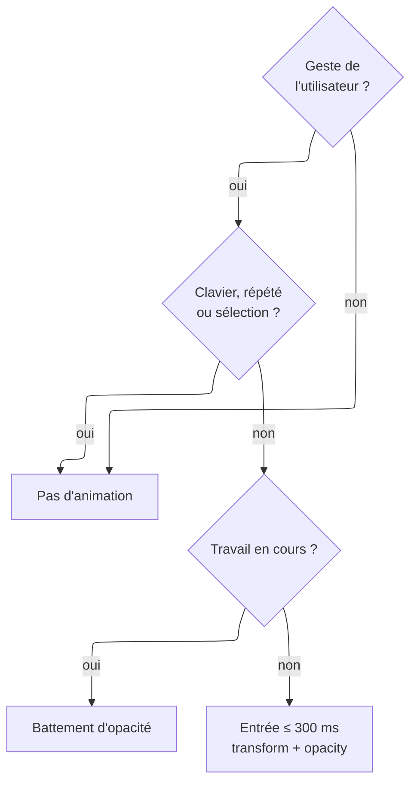

| Cas | Traitement |
|---|---|
| Animé | entrée des modales et de la confirmation (fondu + `scale(0.96)` 250 ms, feuille du bas sous `sm` 300 ms) ; tiroirs mobiles (glissement 300 ms) ; toasts (entrée et sortie par le bord droit) ; appui des boutons (`scale(0.97)` 150 ms) ; panneaux droits ouverts par un bouton (`.pnex-drawer-in-right`) ; menus de barre d'outils (`.pnex-pop-in` 150 ms, `-up` pour le sélecteur d'org) ; `+` qui tourne en × ; coche de flash réussi (`.pnex-success-in`) ; morph de l'explorateur de dossier (400 ms) |
| En cours | battement `pnex-beat` (points de l'assistant, `.pnex-live-dot`), jamais un texte qui clignote ; spinner de liste `.pnex-spinner-delayed` invisible pendant 250 ms |
| Jamais animé | recherche globale, raccourcis clavier, navigation entre pages, repli du rail, valeurs live, graphiques, lignes de tables, accordéons d'inspecteur, panneaux ouverts par une sélection, onglets, filtres, pager |

- **Ingrédients** : courbes `--ease-out-ui` et `--ease-drawer` du `@theme`, classes `.pnex-*-in` de `tailwind.css` (`@starting-style`, sans JS). Seuls `transform` et `opacity` bougent, jamais `transition-all`.
- **Mouvement réduit** : `prefers-reduced-motion` garde les fondus et retire les déplacements.
- **Sortie** : Dioxus démonte tout de suite, donc les sorties ne sont pas animées. Seul le toast reste monté 200 ms (`.pnex-toast-leaving`).

### Chargement : la gerbe

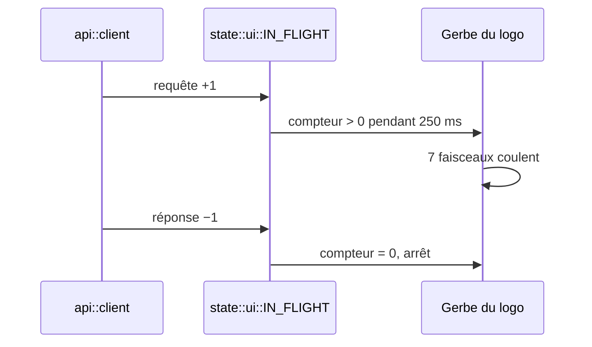

La gerbe (`components/gerbe.rs`) est la seule marque de chargement. C'est une miniature de la gerbe de faisceaux du login (SVG + CSS). Elle est immobile sous `prefers-reduced-motion` et prend `inherit` sur fond sombre ou dans un bouton plein. Au-delà de 32 px, elle apparaît après 250 ms. Derrière le logo de la barre latérale, la vraie gerbe du login (`assets/tron-gerbe.js`, attribut `data-pnex-gerbe`) coule à couleur atténuée (`--gerbe-glow` 0,38 en clair, 0,65 en sombre). La barre repliée montre la petite gerbe. Garde : `design_guard` (`no_hand_made_spinner`).

### Téléphone

Le socle tient sur un écran de 392 px de large sans changer le rendu desktop. Les variantes `sm:` et `md:` retombent sur le rendu desktop.

| Composant | Sous le point de rupture |
|---|---|
| `DataTable` | défile en largeur (`overflow-x-auto`) ; `Column::secondary()` masque la colonne sous `md` ; `Column::actions()` colle la colonne à droite sous `md` |
| Table maison | `ACTIONS_TH_CLASS` / `ACTIONS_TD_CLASS` (`crud/table.rs`) collent ses actions de la même façon |
| `.th` / `.td` | `px-3 py-2` sous `md`, en-tête sans retour à la ligne |
| `ListLayout` | `p-4 pb-24`, titre `text-2xl` sous `md` |
| `FilterBar` | recherche seule sur la première ligne sous `sm`, sélecteurs sur les lignes suivantes (8rem au moins) ; même classe `FILTER_BAR_CLASS` pour le slot `filters` |
| `Modal` | jamais plus haute que l'écran ; le corps défile, `MODAL_FOOTER` épingle les actions |
| `EditorShell` | barre sur deux lignes sous `sm` ; `#id` et version masqués ; actions secondaires en icône seule |
| En-tête de l'app | masqué tant qu'un éditeur est monté (`state::ui::EDITORS_OPEN`) ; l'éditeur prend `100dvh` |

## 5. Navigation par tâche

Le menu regroupe les pages par tâche. Les URL ne dépendent pas des groupes.

| Groupe | Entrées |
|---|---|
| (tête) | Accueil |
| Opérer | Applications, Tableaux de bord, Carte, Dossiers d'enquête, Calendrier, Pièces détachées, Scanner, Étiquettes QR |
| Connaissance | Pages, Ontologie, À valider, Décisions de modèles, Sites |
| Médias | Bibliothèque, Caméras, Flux, Empreintes vocales, Vision Lab, Studio de visites, Annotations |
| Sources | Appareils et agents, Catalogue d'appareils, Firmware custom, Référentiels, Agents navigateur, Sites web, Pipelines, Boîtes mail |
| Automatisation | Agents, Flows, Fonctions, Contrôles, Notifications, Règles, Événements, Modèles, Mélanges fluides |
| Réglages (sous un filet) | Organisations, Accès, Secrets, Système, Statut plateforme (admin) |
| Pied de barre | Assistant IA, sélecteur d'org, identité (ouvre le profil), rail, déconnexion |

Une entrée sans route n'apparaît pas dans le menu. Le drawer mobile porte aussi la recherche globale (D69). Il se ferme quand l'utilisateur ouvre un résultat.

### Rail d'icônes

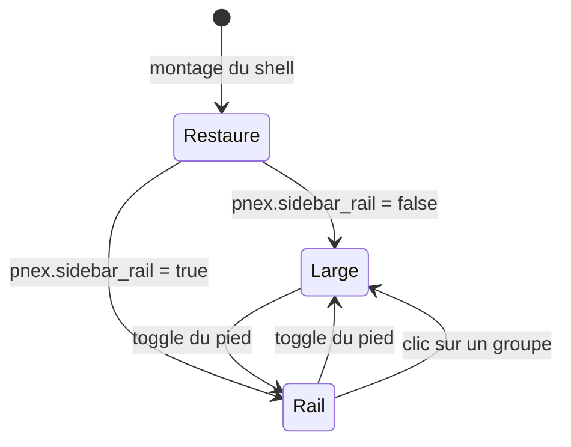

`state::ui::RAIL` est un `GlobalSignal<bool>` persisté dans `pnex.sidebar_rail`. La barre passe de `lg:w-64` à `lg:w-16`, le contenu de `lg:pl-64` à `lg:pl-16`. Les classes sont littérales et complètes, choisies par un `match`, car Tailwind scanne le source. En rail, la barre montre les icônes seules avec une infobulle `title`. Un clic sur un groupe rouvre la barre sur ce groupe : le rail ne rend jamais les enfants. Le drawer mobile ne change pas.

## 6. Règles pour une nouvelle page

Ces règles sont des exigences. Une revue refuse une page qui en viole une.

1. Une page doit composer le socle (`ListLayout`, `ListStates`, `DataTable`, `FormDialog`). Elle n'écrit jamais son en-tête ni son état vide à la main.
2. Boutons et champs doivent venir des constantes de `ui.rs`. Une page ajoute seulement des classes de mise en page (`w-*`, `flex-1`, marges). Pour battre le `w-full` d'`INPUT`, une largeur prend le suffixe `!` (`w-32!`).
3. Les couleurs doivent venir des jetons. Une couleur vive dit un état.
4. Une page doit être vérifiée en clair et en sombre, en desktop et à 390 px.
5. Un texte secondaire doit être en `text-gray-500` au plus clair. `gray-400` échoue au contraste dans les deux thèmes : il reste pour les placeholders et les états désactivés.
6. Une couleur de canevas SVG (nœud, grille, câble) doit s'écrire `var(--color-…, #hex)`, pour que le mode sombre l'inverse. Une couleur choisie par l'utilisateur reste telle quelle.
7. Un écran a un seul bouton plein. Dans un éditeur, c'est « Enregistrer » tant qu'il y a des modifications, puis l'action suivante (« Déployer »).
8. **Toutes les listes CRUD se ressemblent.** Une page qui liste des entités compose `ListLayout` + `FilterBar` + `ListStates` + `DataTable` + `ListPager`. Références : `pages/devices.rs`, `pages/ontology/mod.rs`, `pages/cases/mod.rs`. Le diagramme ci-dessous montre la composition.
   - Une liste n'utilise jamais de tuiles ni de cartes. Une vignette (média, caméra) se met dans une colonne du tableau.
   - La pagination est toujours présente : requête `limit`/`offset` de `PAGE_SIZE`, `count` total renvoyé par l'API. Une liste chargée en entier (`api::client::request_all`) est paginée côté client par `crud::pager::page_slice`. Un `limit` ne dépasse jamais 100, car le serveur tronque sans le dire (O64).
   - La barre de filtres suit cet ordre : sélecteurs propres à la page, `SearchInput` (« Rechercher par nom… »), `LabelFilterInput`. Garde : `design_guard` (`list_filter_bars_are_complete`).
   - Les actions (importer, exporter) vont dans le slot `actions` de l'en-tête, jamais dans la barre de filtres.
   - Les onglets vont dans le slot `tabs`, jamais dans `filters` ni dans le corps.
   - Le bouton Rafraîchir a une seule place : `ListLayout { on_refresh }`, dernier bouton de l'en-tête. Le contrôle de cadence automatique (accueil, vue d'un tableau de bord) est la seule exception.
   - La création passe par le bouton « Ajouter » et un `FormDialog`, jamais par un formulaire en ligne. Le bouton reste visible pour qui peut écrire. Si plusieurs types sont créables, il ouvre d'abord « Que voulez-vous créer ? ». Si rien n'est créable, ce sélecteur dit quoi faire (installer un pack…).
   - Réglages, fiche détail, éditeur, rendu d'un tableau de bord et calendrier ne sont pas des listes CRUD.
9. **Tout ce qui se lit dans le temps a le même lecteur.** Audio, vidéo, enregistrement de caméra, replay d'un flux et frise d'un dossier passent par `components/transport.rs`. Ce module fournit `PlayButton`, `Clock` (heure en mono), `ScrubBar` (plages, repères en losange, curseur `signal`) et `SpeedPicker` (`×N`), dans une barre `BAR`. Un fichier audio ou vidéo passe par `MediaPlayer`, jamais par `controls: true`. Références : `pages/cameras/player.rs`, `pages/cases/workspace/timeline.rs`.
   - **Frise à couloirs** : ce qui a plusieurs pistes dans le temps (événements, détections, acteurs, images d'une vidéo) passe par `components/timeline` (`Timeline` + `Lane` + `Item`). L'axe `TimeBase` est l'heure murale, le temps du média ou le rang. Jamais une liste « 00 s / 03 s » ni une frise faite main. Références : `pages/cases/workspace/timeline.rs`, `pages/lab/timeline.rs`.
10. **Tout se fait aussi au doigt.** Chaque geste a un équivalent tactile visible.
    - Le clavier accélère, il n'est jamais le seul chemin. Un champ validé par Entrée a son bouton (référence : `ClassAdd` dans `pages/lab/workspace.rs`). Une bulle fermée par Échap a sa croix.
    - Une action révélée au survol (`hover:`) reste visible sous `lg`, ou s'atteint par un appui.
    - Une cible touchée en travaillant mesure au moins 36 px (`h-9`) : palette, outils d'un éditeur, navigation d'images.
    - Un glisser passe par les événements `pointer*`, jamais par `mouse*` seuls.
11. **Rien hors d'atteinte sur téléphone.** À 392 px, la page ne défile jamais en largeur. Une action de ligne et les actions d'un éditeur restent à l'écran (§4 « Téléphone »). Garde : `e2e/tests-android/layout.spec.ts` (sonde `e2e/src/mobile-layout.ts`) parcourt toutes les routes dans les deux langues.

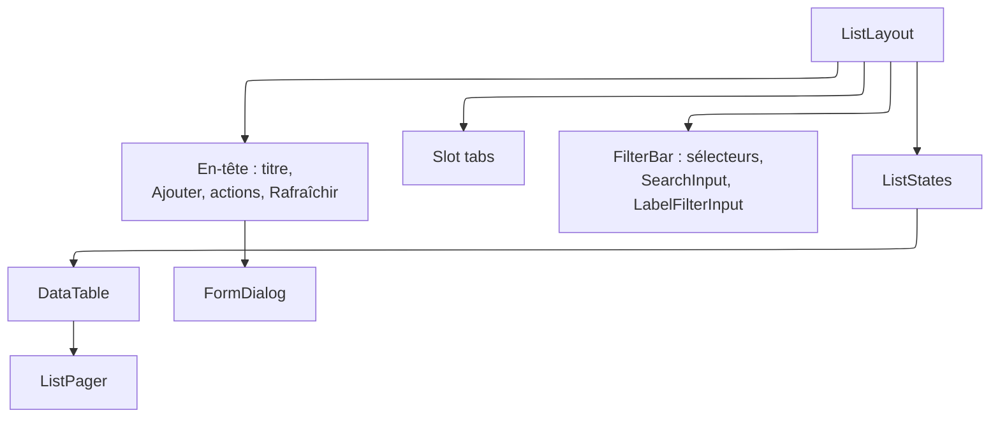

## 7. Lexique et décisions D218–D224

Chaque concept a un seul nom dans chaque langue, un seul composant et une seule place. Les décisions D218–D224 priment sur les règles plus anciennes qui les contredisent.

### Lexique (une notion = un mot)

| Notion | FR | EN | N'est pas |
|---|---|---|---|
| Nombre, somme ou répartition calculés sur des objets (D579) | Calcul sur des objets | Calculation on objects | — |
| Événement commercial avec un coût, où l'on rencontre des prospects (Q-AG1) | Salon | Trade show | — |
| Liste des pièces d'un modèle d'appareil, bornée par série, date et variante (parts-docs.md D960) | Nomenclature | Parts list | pas « BOM » ni « bill of materials » |
| Écriture d'une pièce chez un fabricant ou un distributeur, gardée normalisée (D961) | Référence de pièce | Part reference | pas le numéro interne de l'org (« Référence interne ») |
| Classement libre d'un objet, pour filtrer et chercher (D42) | Étiquettes | Labels | ni une propriété d'ontologie, ni une annotation |
| Fait métier typé d'un objet | Propriété | Property | une étiquette |
| Relation typée entre deux objets | Lien | Link | une étiquette |
| Ce qui est posé sur un média visuel (D219) | Annotation | Annotation | une note de dossier, une détection |
| Unité versionnée et publiable d'annotations | Calque d'annotations | Annotation layer | — (plus « ensemble ») |
| Données vectorielles tuilées, dessinées sous les sites de la carte (geo-layers.md) | Couche géographique | Geographic layer | pas un calque d'annotations ; « couche » seul réservé à la carte |
| Cadres produits par un modèle sur une vidéo | Détections | Detections | des annotations |
| Boîtes de vérité terrain d'un jeu d'entraînement | Étiquetage | Labeling | des annotations |
| Noms des sorties d'un modèle de vision | Classes | Classes | des étiquettes |
| Clés qui découpent une série temporelle | Dimensions | Dimensions | des étiquettes |
| Voix distinguées par la diarisation | Locuteurs | Speakers | des étiquettes |
| Texte libre d'un dossier d'enquête | Note | Note | une annotation |
| Discussion sur un passage d'une Page | Commentaire | Comment | une annotation |
| Lieu sur la carte | Site / repère | Site / place | une annotation |
| Site internet parcouru par des règles de navigation (D323) | Site web | Website | pas « Site » seul (= repère de la carte) |
| Suite d'étapes YAML qui parcourt un site web (D323) | Règle (de navigation) | (Navigation) rule | pas « recette » / « recipe » |
| Groupe de menu : tout ce qui alimente PNeX (appareils, agents navigateur, sites web) | Sources | Sources | pas « Appareils » pour le groupe |
| Source continue (pistes audio et/ou vidéo : caméra IP, direct, fichier) | Flux | Stream | une caméra-appareil |
| Lignes versionnées qu'un pipeline lit et écrit (D569, Q-P7) | Table | Table | ni « jeu de données », ni « dataset » à l'écran (sauf images de Vision Lab et ressources data.gouv.fr) |
| Chaîne de traitements SQL d'une table à l'autre (D571) | Pipeline | Pipeline | pas « flux », pas « flow », pas « import » |
| Requête d'un pipeline, de ses tables lues à sa table écrite (D358) | Traitement | Transform | pas « transformation », pas « étape » (= règle de navigation), pas « nœud » (= flow) |
| Un passage d'un pipeline (D358) | Exécution | Run | pas « passage » (= règle de navigation), pas « job » |
| Fiche d'un travail exécuté dans un bac à sable, identité de service de l'org (D757) | Agent | Agent | seul dans le menu Agents ; ailleurs « agent navigateur » et « agent edge » restent qualifiés |
| Un passage d'un agent dans son bac (D731) | Exécution | Run | pas « run » en français, pas « job » (= travail du runner) |
| Fichier donné à une exécution d'agent ou laissé par elle (D729) | Entrée / Sortie | Input / Output | pas « artefact » dans l'UI |
| Où s'exécutent les exécutions d'un environnement (D763) | Isolation : Pod / Micro-VM | Isolation: Pod / Micro-VM | pas « isolement », pas « VM » seul |
| Texte versionné qu'un agent lit à chaque exécution, brouillon jusqu'à son activation par un humain (D711) | Compétence | Skill | pas « skill » en français |
| Où tourne la boucle d'un agent : dans PneX avec les outils de l'assistant, ou dans un bac à sable (D378, D785) | Niveau : Interne / Hébergé | Level: Internal / Hosted | pas « agent embarqué », pas « mode » |
| Suite d'exécutions d'agents lancées par un flow, avec un budget, un nombre de tours et au plus un sujet (D716, D718) | Chaîne d'exécutions | Chain of runs | pas « exécution enchaînée » (= pipeline, D575), pas « workflow » |
| Accès enregistré à un registre OCI, secrets de lecture et d'écriture distincts (D703) | Registre d'images | Image registry | pas « connecteur » (= base externe), pas « dépôt » (= chemin dans le registre) |
| Jeton à usage unique qui inscrit un runner | Jeton d'inscription | Join token | pas « token » en français, pas « clé » |
| Proposition de fusionner la branche poussée par un agent codeur, ouverte sur la forge ; la fusion reste humaine (D388, D775) | Demande de fusion | Merge request | pas « pull request » ni « PR » en français |
| Service démarré à côté d'un agent à chaque exécution, mot de passe `@generated` (D717) | Service de test | Test service | pas « service annexe », pas « sidecar » (= conteneur interne de PNeX) |
| Dossier gardé d'une exécution à l'autre, indexé par des fichiers de verrouillage (D730) | Cache de dépendances | Dependency cache | pas « cache de build » ; « cache live » reste la mémoire Valkey |
| Seuil et effet du scan des images de l'org (D748) | Politique de scan | Scan policy | — |
| Faille connue trouvée par le scan d'une image (D720) | Faille | Flaw | pas « vulnérabilité », pas « CVE » à l'écran |
| Lignes écrites par les conteneurs d'une exécution ou d'un build (D733) | Journal | Log | pas « logs » en français |
| Une cible et ce dont elle dépend, exécutés dans l'ordre (D575) | Exécution enchaînée | Chained run | pas « build » (= compilation de firmware) |
| Condition sur le résultat d'un traitement avant sa validation (D576) | Contrôle | Check | — |
| Accès enregistré à une base ou une API externe, ou point d'arrivée d'appels signés, identifiants au coffre (D352, D791) | Connecteur | Connector | pas « connexion » (= se connecter), pas « source » |
| Connecteur qui reçoit les appels signés d'un autre système (D795) | Webhook | Webhook | pas « crochet », pas « point de terminaison » |
| Compartiment de l'org porté par une table ou un objet : il faut une habilitation pour chacun (D798) | Marquage | Marking | pas « étiquette » (= classement libre D288), pas « label de sécurité » |
| Droit d'un membre à lire des données marquées, pour une finalité, jusqu'à une échéance (D799) | Habilitation | Clearance | pas « autorisation » (= permission d'un rôle), pas « accréditation » |
| Raison déclarée d'une habilitation, gardée au journal avec chaque lecture (D799) | Finalité | Purpose | pas « motif » (= justification d'une déclassification) |
| Retrait justifié d'un marquage (D802) | Déclassifier | Declassify | pas « démarquer », pas « retirer le marquage » |
| Condition surveillée sur des objets ou une mesure, qui prévient quand elle devient vraie (D829) | Règle | Rule | pas « règle d'alerte », pas « alarme » (= seuil d'un appareil) ; rejouer une règle = « Rejouer » |
| Bloc de page calculé à l'affichage, avec les droits du lecteur (D831) | Bloc vivant | Live block | pas « bloc dynamique », pas « widget » (= tableau de bord) |
| Caméra gérée par PNeX (matériel, firmware, réglages de capture) | Caméra | Camera | un flux |
| Réglage de transcription d'un flux : modèle, langue, détection de voix, diarisation (D164) | Profil de transcription | Transcription profile | pas « modèle » (= le fichier importé) |
| Profil de transcription pris quand rien d'autre n'est choisi, un par org | Profil par défaut | Default profile | pas « modèle par défaut », pas « profil principal » |
| Utilitaire de bureau, dans la barre des tâches, qui capte l'audio vers PNeX (media.md §3.13) | Enregistreur PNeX | PNeX recorder | pas « agent » (= agent navigateur, agent edge), pas « dictaphone » |
| Essai de 5 s qui vérifie que le serveur transcrit, depuis l'enregistreur | Test de transcription | Transcription test | pas « test STT », pas « speech to text » |
| État sauvegardé d'un objet | Version | Version | — |
| Proposition d'entrer dans une org, en attente de la réponse de la personne (SEC-72) | Invitation | Invitation | jamais « ajouter un membre » : personne n'entre sans accepter ; ≠ invitation de calendrier d'un mail |
| Programme construit sur les données d'une org : par un compte de service (D433), ou par ses écrans dans PneX (D506) | Application | Application | ni « intégration », ni « connecteur » (= fournisseur) |
| Vue d'une application, avec sa version publiée (D507) | Écran | Screen | ni « page d'application » |
| Valeur passée entre les widgets d'une application, le temps de la session (D509) | Variable | Variable | — |
| Requête nommée d'une application (D434) | Ensemble d'objets | Object set | — |
| Vue d'un dossier : chaque acteur est un fil dans le temps (storyline) | Histoire | Story | ni l'historique des versions, ni la frise |
| Événement d'un dossier qui déplace de l'argent (montant + payeur + bénéficiaire) | Versement | Payment | ni « paiement », ni « transaction » |
| Vue d'un dossier : diagramme de Sankey des versements | Argent | Money | pas « Flux » (= streams) |
| Reçu par un intermédiaire sans versement sortant documenté | Non tracé | Untraced | pas « manquant » |
| Part d'un lien « possède » ; chaînes de parts | Part détenue / Détention | Share held / Ownership | — |
| Personne au-dessus du seuil de détention calculé | Bénéficiaire effectif (calculé) | Beneficial owner (computed) | jamais présenté comme un fait |
| Espace de travail de création : vidéo, récit (D225) | Production | Production | pas « projet » (= firmware, Vision Lab) |
| Regroupement ordonné d'une production : chapitre, accroche… (D229) | Partie | Part | — |
| Événement d'une production, à sa place dans le récit (D226) | Séquence | Sequence | pas « scène » (= scène 360° du Studio) |
| Être de fiction d'une production (D230) | Personnage | Character | jamais une personne réelle |
| Unité visuelle d'une séquence : cadrage, prompt, rendu (D232) | Cadrage | Shot | pas « plan » (= plan d'étage) |
| Médias attachés à un objet : images, 3D, voix (D231) | Galerie | Gallery | pas « assets » |
| Fichier GLB d'un objet, vu dans la visionneuse 3D (D231) | Modèle 3D | 3D model | pas « modèle » seul (= modèle de vision) |
| Angles des articulations d'un modèle 3D, enregistrés sous un nom | Pose | Pose | — |
| Os d'un modèle 3D qu'on fait tourner | Articulation | Joint | pas « os », pas « bone » |
| Média produit par un fournisseur de génération (D235) | Généré | Generated | — |
| Extension de navigateur appairée qui exécute des missions, une par ordinateur (D255) | Agent navigateur | Browser agent | pas « collecteur », pas « extension » seule (= le logiciel à installer) |
| Agent navigateur qui exécute les missions de tous les membres sans le leur, posé par un admin (browser-agents.md D550) ; sinon il est personnel | Agent commun | Common agent | pas « partagé » (= mode d'exécution, D269) |
| Ce qu'un agent navigateur exécute : une page, un compte, un live (D256) | Mission | Mission | pas « règle », pas « tâche » |
| Ensemble nommé de permissions, attribuable (iam.md D287) | Rôle | Role | le rôle d'un acteur dans un dossier |
| Rôle donné à un membre ou à une équipe (D288) | Attribution | Assignment | pas « affectation », pas un partage |
| Membres de l'org regroupés pour leurs accès (D286) | Équipe | Team | pas « groupe » (groupe froid, de sociétés, de nœuds) |
| Unité d'autorisation `service:verbe` (D289) | Permission | Permission | une autorisation du navigateur ou du device |
| Écran « qui peut faire quoi » (iam.md §9) | Accès | Access | pas « Partager » (lien public d'un tour) |
| Service externe qui répond à une requête de recherche sur le web (web-presence.md D360) | Fournisseur de recherche web | Web search provider | pas « moteur de recherche » (le service tiers), pas « recherche » seule (= recherche globale D69) |
| Filiales et sites d'un groupe sans contact ni statut client (crm.md D330) | Espace blanc | White space | pas « zone blanche » (couverture réseau), pas « trou » |
| Ce qui a bougé sur un compte suivi : annonce légale, nouvel établissement, page modifiée (crm.md D335) | Signal commercial | Commercial signal | pas « alerte » (= notification envoyée), pas « signal » seul (= signaux d'un dossier) |
| Rencontre avec un compte, ses participants, son enregistrement (crm.md §3.7) | Rendez-vous | Meeting | pas « réunion commerciale » ni « RDV » |
| Point de la méthode de vente de l'org, suivi rendez-vous par rendez-vous | Critère du playbook | Playbook criterion | pas « note » ni « score » d'une personne : on agrège par critère |
| Écriture proposée par une machine (import, flow, détecteur, modèle), en attente d'un humain (proposals.md D371) | Proposition ; la page « À valider » | Proposal ; « To validate » | pas « suggestion » ni « recommandation » (= lien `recommended`) |
| Agent interne qui lit la demande d'écriture d'un autre agent et l'accepte ou la refuse (agents.md D836) | Agent validateur ; « Qui décide » ; « Réarmer » | Validator agent ; « Who decides » ; « Rearm » | pas « agent de contrôle », pas « approbateur » |
| Distribution datée (`buy`, `neutral`, `sell`) postée par le runner d'un modèle externe (markets-research.md D894) | Décision de modèle ; la page « Décisions de modèles » | Model decision ; « Model decisions » | pas « signal de trading », pas « recommandation », jamais « ordre » (aucun ordre n'est passé) ; distinct de « Décision sur texte » (nœud `text_decide`) |
| Affaire suivie avec un compte, de la découverte à la signature (crm.md D449) | Opportunité | Opportunity | pas « affaire », pas « deal » |
| Passage consigné d'un contrôle de veille sur un sujet (partners.md D426), son résultat | Vérification | Check | pas « contrôle » (= surface pilotable D123), pas « audit » |
| Ce qui est fait ou à faire pour un compte : appel, mail, message… (crm.md D450) | Activité | Activity | pas « tâche » seule (= une nature d'activité) |
| Étape du plan de relance de l'org : jour, nature, consigne (crm.md D450) | Étape de relance ; plan de relance | Follow-up step ; follow-up plan | pas « séquence » (= production), pas « cadence » (= lecture d'un pin) |
| Point exigé d'une opportunité avant une étape (crm.md D449) | Critère de qualification | Qualification criterion | pas « critère du playbook » (= rendez-vous) |
| Retrait des données personnelles d'un objet, qui reste en coquille (crm.md D446) | Effacement | Erasure | pas « suppression » (= archivage) |
| Boîte relevée par PneX (IMAP), personnelle, partagée ou d'un compte de service (mail.md D453) | Boîte mail | Mailbox | pas « compte mail », pas « email account » |

Une chaîne d'interface qui emploie un mot pour une autre notion est un défaut, comme une chaîne en dur. **Garde bloquante** : `crates/pnex-frontend/src/lexicon_guard.rs` scanne les deux `.ftl` et les fiches de l'assistant. Un concept nouveau ajoute sa ligne au lexique **et** sa règle à la garde (mot interdit, mot à employer, clés exemptées avec leur raison).

### D218 — Étiquettes : un seul mécanisme, sur tout objet, dans la recherche

- Les étiquettes D42 s'appliquent à tout objet listable. Exemples : appareils, médias, tableaux de bord, visites, flows, sites, Pages, dossiers d'enquête, objets d'ontologie, fonctions, firmwares, contrôles, flux, caméras, modèles, canaux et modèles de notification, calques d'annotations.
- L'étiquette reste un classement de travail. Les faits métier restent des propriétés et des liens.
- Le même composant sert partout : `LabelsEditor` sur la fiche, `LabelsButton` dans la barre d'un éditeur, `LabelChips` dans une colonne, `LabelFilterInput` dans la barre de filtres de chaque liste.
- La recherche globale accepte `#valeur` et `#clé:valeur` sur tous les types (`GET /api/v1/resources/search`). Une saisie libre trouve aussi les objets dont une étiquette contient le texte (groupe « Étiquettes »).
- Une étiquette appartient à l'objet qui la porte. Elle n'a pas d'héritage par dossier ni de lien avec l'ontologie ou le rangement.
- Un type hors ontologie porte des étiquettes sans devenir un objet d'ontologie (`LABEL_ONLY_KINDS`). Sa suppression purge ses étiquettes (trigger `pnex_labels_purge`).

### D219 — Annotations : ce qui est posé sur un média visuel

- Une annotation est toujours ancrée sur une photo, un plan, un panorama 360, une visite ou un splat. Le serveur refuse un calque sans média ni visite.
- Son contenu est un repère (appareil, pin, état), une note, une lecture (valeur, sparkline, jauge) ou un contrôle d'org (D128, D147).
- Une détection, un étiquetage ou une note de dossier n'est pas une annotation.
- Le bouton « Annoter » d'une fiche de média visuel, de l'éditeur de visite et d'un splat ouvre l'éditeur d'annotations sur cet objet. La page Médias › Annotations reste l'index des calques.

### D220 — Un seul lecteur pour tout ce qui se lit dans le temps

D220 étend la règle 9 (§6) :

- Un segment de transcription s'écoute par `MediaPlayer` quand son audio est conservé. Un clic sur un horodatage positionne le lecteur.
- Une plage (programme, poste) est une barre sur `ScrubBar` avec le curseur « maintenant ».
- Une fenêtre de temps passe par un seul `WindowPicker`, avec les préréglages 1 h, 6 h, 24 h, 7 j, 30 j et personnalisé.
- Les bornes d'un extrait (imports du Vision Lab) se choisissent sur la `ScrubBar` du média.

### D221 — Versions : un composant, une frise, trois verbes

- Un composant affiche les versions de tout objet versionné. Il montre une frise (`ScrubBar`, un repère par version) puis la liste paginée.
- Trois verbes partout : « Ouvrir », « Comparer » (avec la version active), « Rétablir » (devient la version active).
- Une action de cycle de vie (« Déployer », « Publier ») reste dans la barre de l'éditeur.
- Le bouton « Versions » de `EditorShell` ouvre ce composant dans un tiroir de droite. Sur une fiche sans éditeur, il est une section de la fiche.

### D222 — Éditeurs : une seule coquille

Tout éditeur plein écran passe par `EditorShell` + `StatusChip` (§8).

### D223 — Où s'ouvre un objet

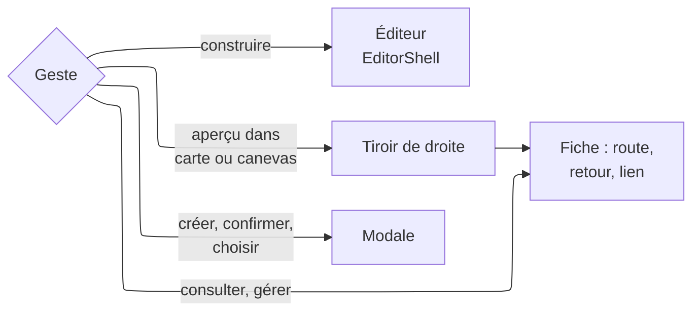

Une modale ne sert jamais à consulter. Les enregistrements et segments d'un flux sont un onglet de sa fiche. Un média et un appareil s'ouvrent sur leur route. Le tiroir des sites prend la classe de tiroir commune.

### D224 — Primitives sans copie

- Une page ne déclare aucune constante locale de bouton ou de champ (`const BTN`, `const INPUT`). Une variante manquante s'ajoute à `ui.rs`.
- Une pastille passe par un composant `Badge` (neutre, signal, succès, alerte, danger), jamais par un `span rounded-full` écrit à la main. Un état ISA-101 passe par `StateMark`.
- Le chargement passe par la gerbe (§4). Une liste vide passe par `ListStates`, jamais par un cadre pointillé écrit à la main.
- Les onglets passent par `TAB_BAR` partout, assistant et sélecteur de ressources compris.
- `design_guard` refuse les constantes locales, les classes de bouton écrites en ligne et les spinners faits main.

## 8. Coquille d'éditeur (`EditorShell`)

`EditorShell` (`components/editor_shell/`) porte le chrome des éditeurs plein écran. Chaque éditeur garde sa page, son état (`EditorCx`) et son canevas. Utilisateurs actuels : flows, tableaux de bord, visites, espace d'un dossier, compétences d'agent, studio de pipelines, studio de sites web.

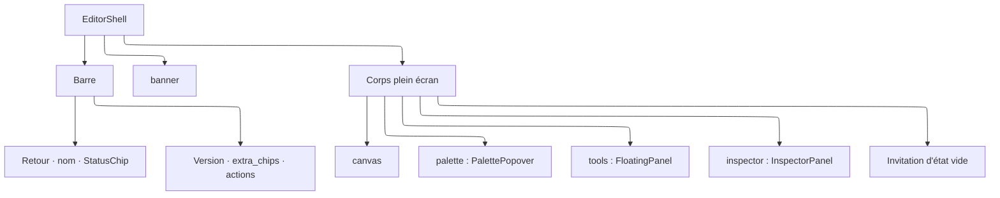

| Composant | Rôle |
|---|---|
| `EditorShell` | barre en trois zones, bandeau, corps plein écran (canevas dans `div.absolute.inset-0`, palette en `left-4 top-4`, outils en `left-[4.5rem] top-4`, inspecteur à droite) |
| `StatusChip` / `Chip` | point coloré + libellé (`StatusTone` Green/Amber/Red/Slate/Purple) ; chip de version neutre `v{n}` ; chips annexes (modifié, version ancienne avec `on_remove`) |
| `PalettePopover` | bouton `+` puis popover avec recherche ; items `PaletteItem` (clé, libellé, `PaletteIcon`) ; sans backdrop, pour que le glisser d'un modèle (D41) atteigne le canevas |
| `InspectorPanel` | absent sans sélection ; `absolute inset-y-0 right-0 w-80` ; fermeture par croix ou Échap ; le formulaire reste à l'éditeur |
| `FloatingPanel` | panneau annexe dans le slot `tools` (étages du studio, mode liaison, compteur) |

**Contrat** :

- Les slots sont des `Element` (`palette`, `tools`, `inspector`, `banner`, `extra_chips`, `actions`), jamais une struct de configuration. `#[component]` dérive `PartialEq` champ par champ, et `Element`/`Callback` le supportent.
- La page hôte monte l'éditeur hors de `ListLayout`.
- Le canevas a une racine `relative h-full w-full`. La coquille mesure `h-[calc(100dvh-4rem)] lg:h-screen`.
- Les clés `eshell-*` traduisent le chrome. L'éditeur traduit son contenu (`flows-palette-*`, `lib-kind-*`, `studio-add-*`).

### Créer et renommer

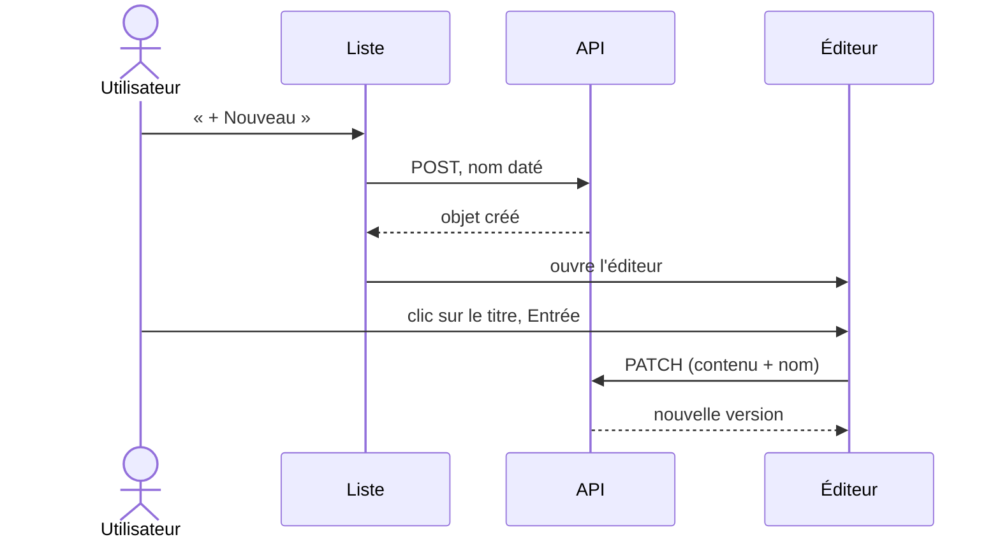

- **Création immédiate** : sans modale, « + Nouveau » crée l'objet avec un nom daté (`flows-default-name`, `db-default-name`, `studio-default-name`, heure locale par `util::now_label()`).
- **Renommage** : si l'éditeur passe `on_rename` (avec `can_write`), le titre devient éditable. Entrée ou la perte du focus valide, Échap annule.
- Renommer réutilise le PATCH de sauvegarde. Renommer enregistre donc l'état courant et crée une version. Pour un tableau de bord, c'est une publication (D24).

### Statut d'un flow

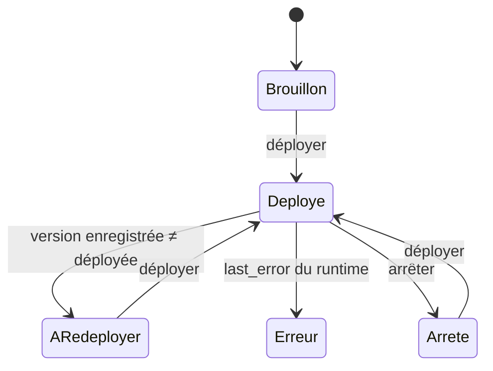

Le chip d'un flow fusionne le statut en base et la santé du runtime. Erreur est rouge, Déployé vert, « Déployé · à redéployer » ambre, Arrêté et Brouillon gris. L'infobulle montre `pid · vN — last_error`. Un tableau de bord affiche `Live`. Une visite affiche `Publié · vN` ou `Brouillon`.

### Échap

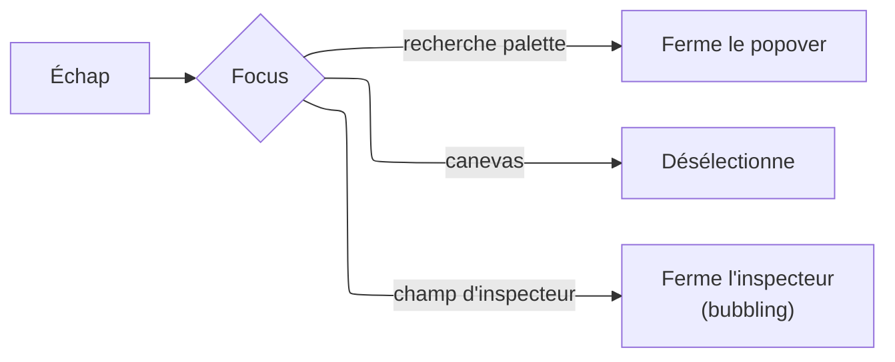

Échap n'a pas de listener global. Chaque zone gère sa propre touche.

## 9. Formatage du front

Tout le code du front est formaté par deux outils. La CI vérifie le résultat.

| Outil | Formate | Ignore |
|---|---|---|
| `cargo fmt` (rustfmt) | tout le Rust | l'intérieur des macros `rsx!` |
| `dx fmt` (dioxus-autofmt 0.7.10, épinglé en CI) | l'intérieur des `rsx!` : arbre, attributs, `x: x` → `x`, corps des closures | le Rust hors `rsx!` |

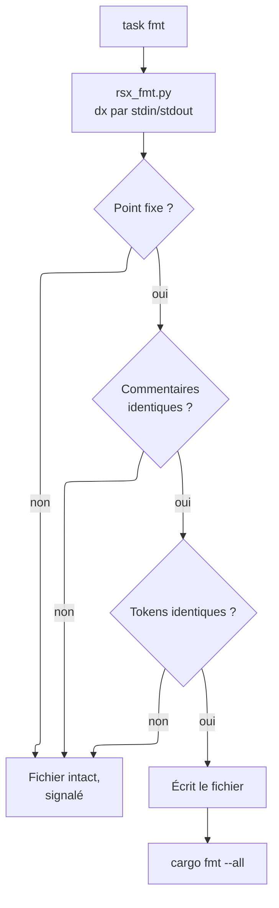

- `task fmt` formate : le `rsx!` gardé, puis `cargo fmt --all`. L'ordre converge vers un état accepté par les deux outils.
- `task fmt:check` vérifie sans modifier. C'est la garde du job CI `fmt` (bloquant).
- Le contrôle des tokens admet seulement les normalisations légitimes : virgules, `r#`, `x: x`, accolades autour d'un bras de `match` ou d'un corps de closure.

**Attention :** ne lancez jamais `dx fmt` à la main sur le dépôt. Il déplace ou duplique des commentaires, perd des tokens ou ne converge jamais. `dx fmt --check` réécrit les fichiers malgré son nom (et sort en 0 avec `-f`).

### Constructions refusées et leur réécriture

Quand `task fmt` refuse un fichier, la cause est presque toujours une construction de cette liste. `dx` doit alors réimprimer un gros morceau de Rust dans un `rsx!`. Écrite dans la forme que `dx` produirait, la construction ne bouge plus.

| # | Construction | Réécriture |
|---|---|---|
| 1 | `{match x { A => rsx! {…}, B => rsx! {…} }}` en bloc d'expression dans le balisage ; `{ if c { rsx!{…} } else { rsx!{} } }` | `if let Some(v) = x { … } else { … }` natif pour un `Option` à deux bras ; sinon un `match` au niveau du balisage, sans accolades englobantes ; `if c { … }` natif |
| 2 | Lecture d'une ressource dans le balisage (`{match &*res.read() {…}}`) | calculer la valeur dans un `let` avant le `rsx!`, puis `if`/`for` natifs |
| 3 | Expression multi-ligne en valeur d'attribut (`a \|\| b` sur plusieurs lignes, `.iter().map(…).collect()`) | extraire dans une fonction ou un `let` ; l'attribut tient sur une ligne |
| 4 | Corps de handler non canonique : `let P = e else { return; };` ou `if c { return; }` sur une ligne, tuple long dans un `let … else` | écrire sur plusieurs lignes comme rustfmt (`else {` / `return;` / `};`) |
| 5 | `sig.with_mut(\|s\| { … })` multi-ligne | `sig.write()` : `let mut set = expanded.write(); if !set.remove(&k) { set.insert(k); }` |
| 6 | Gros handler que rien ci-dessus ne débloque | le sortir dans `let on_x = move \|e\| { … };`, l'attribut devient `onx: on_x` |
| 7 | Bras de `match` dont le corps est un autre `match` multi-ligne (`A => match y { … },`) | `A => {` / `match y { … }` / `}` |

Un commentaire dans l'une de ces constructions rend le défaut visible (commentaire déplacé ou dupliqué). La construction est la cause, pas le commentaire. Ces constructions rendent aussi le balisage dur à lire : la garde pousse vers des composants plus plats.

## 10. Interfaces

| Élément | Valeur |
|---|---|
| Jetons, classes `.pnex-*`, `.th`/`.td` | `crates/pnex-frontend/style/tailwind.css`, `style/dark.css`, `style/fonts.css` |
| Primitives | `crates/pnex-frontend/src/components/ui.rs`, `components/crud/`, `components/modal.rs` |
| Coquille d'éditeur | `crates/pnex-frontend/src/components/editor_shell/` |
| Gardes | `src/design_guard.rs`, `src/lexicon_guard.rs`, `e2e/tests-android/layout.spec.ts` |
| Catalogue d'étiquettes | `GET /api/v1/resources/labels/catalog` |
| Recherche par étiquette | `GET /api/v1/resources/search` |
| Stockage local | `pnex.theme`, `pnex.sidebar_rail` |
| Formatage | `task fmt`, `task fmt:check`, `crates/pnex-frontend/scripts/rsx_fmt.py` |

## 11. Reste à faire

- D221 : le composant commun `components/versions_drawer.rs` sert seulement les documents YAML (compétences, agents hébergés, pipelines). Flows, tableaux de bord, visites, fonctions et annotations ont encore leur propre tiroir de versions. Page, média et type d'ontologie restent à couvrir.
- D220 : `WindowPicker` partagé absent. `pages/streams/review.rs` porte un raccourci.
- D224 : composant `Badge` partagé absent (`components/badges.rs` garde des badges par phase). `EmptyState` existe seulement en local dans `pages/lab/workspace.rs`.
- D222 : éditeurs à migrer sur `EditorShell` : annotations, fonctions, firmware, Pages, Studio, type d'ontologie, pinout.
- Revue sombre : visionneuses 360/splat et carte avec un fond configuré, au cas par cas.
- Captures de la documentation et du site à refaire.
- Choix de Shan : une caméra-appareil apparaîtrait aussi comme source dans « Flux », et « Caméras » garderait seulement la configuration du matériel (lié à D223).
- Choix de Shan : une liste empilée sur téléphone (un bloc par ligne) au lieu d'une table, si la règle 8 ne suffit pas sur un écran.
