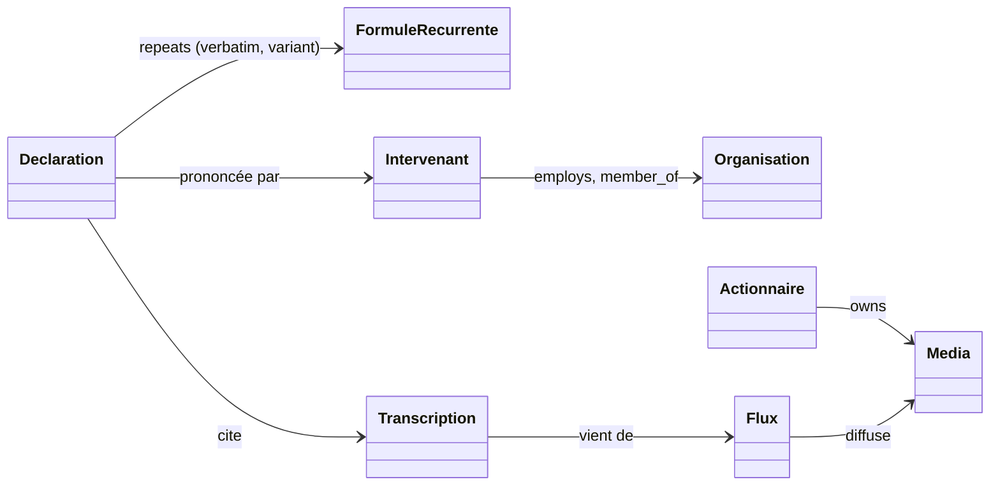
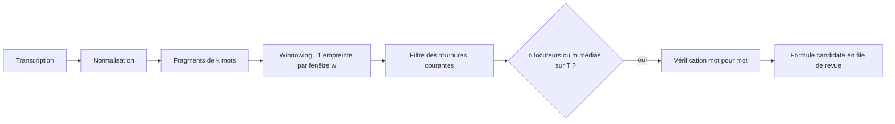
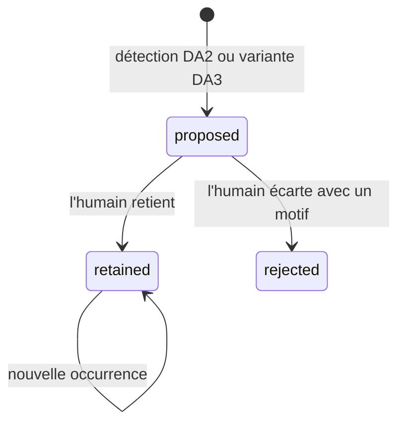

# Analyse de discours public : formules récurrentes, pluralisme, coordination (DA1–DA10)

| | |
|---|---|
| Statut | Proposé, sans code propre. Seul le socle existe : captation et transcription, pack `media_coverage`. Emplacement du composant ouvert (§7) |
| Repose sur | `media.md` (captation et transcription D159–D175), `cases.md` (enquête média §3.11, déclarations K43–K45, apparitions K17), `ontology.md` (liens temporels D179, packs D190), `doc-search.md`, `ai-assistant.md` §9 |

## Résumé

L'analyse de discours public travaille sur des émissions captées, des documents et des jeux de données
importés. Elle retrouve les formules qui reviennent mot pour mot chez plusieurs locuteurs ou plusieurs
médias, avec leur première occurrence. Elle met ces propos en regard de faits sourcés : actionnariat,
temps d'antenne, affiliations. Elle documente des indices de coordination mais ne conclut jamais à la
place de la personne qui enquête.

## 1. Concepts

- **Fait mesurable** : valeur calculée et sourcée, par exemple le temps d'antenne d'un intervenant par chaîne. PneX le calcule et l'affiche.
- **Indice** : signal calculé avec ses seuils et ses sources, par exemple une apparition synchronisée. PneX le propose. L'humain le retient ou l'écarte avec un motif.
- **Interprétation** : qualification d'une campagne, d'une stratégie ou d'une intention. PneX n'en produit jamais. L'analyste la rédige dans une page de l'enquête, sous sa signature.
- **Formule récurrente** : objet `talking_point` (DA1). Ses occurrences sont des déclarations (`statement`).
- **Empreinte** : hachage d'un fragment de *k* mots d'une transcription normalisée (DA2).
- **Variante** : occurrence de la même idée avec d'autres mots (DA3). Elle n'est jamais présentée comme une reprise mot pour mot.

## 2. Fonctionnement

### 2.1 Détection mot pour mot (DA2)

La normalisation retire la casse, la ponctuation et les élisions. Le winnowing garde l'empreinte minimale
de chaque fenêtre de *w* fragments. Le volume baisse donc d'un facteur proche de *w*. Deux textes qui
partagent un passage assez long partagent toujours une empreinte. Le filtre écarte les tournures fréquentes
dans le corpus de référence de l'org : politesse, transitions d'antenne. La vérification utilise la même
garde que K44. Les seuils sont à mesurer (DA10).

### 2.2 Cycle de vie d'une formule

Une formule retenue a une ligne « Formule » sur la frise de l'enquête. La ligne montre la première
occurrence puis la diffusion : qui, quel média, dans quel ordre. Chaque occurrence s'ouvre à la seconde.

### 2.3 Variantes (DA3)

Une recherche par similarité de sens (`pgvector`) cherche les déclarations proches d'une formule retenue.
Le LLM de l'org confirme en classifieur fermé (`same_idea | different`). Le résultat est une proposition
`similarity = variant`, marquée « rapprochement proposé par l'assistant ».

### 2.4 Mesures de pluralisme et de contexte (DA4)

| Thème | Mesure | Données |
|---|---|---|
| Actionnariat | graphe à date des liens `owns` (actionnaire, groupe, chaîne) | pack `media_coverage` (D190) |
| Présence à l'antenne | temps et nombre de passages par intervenant, chaîne, groupe, période | apparitions (K17), plages (D169), agrégat D182 |
| Affiliation non mentionnée | titre annoncé à l'antenne alors qu'un lien sourcé rattache l'intervenant au sujet | `employs`, `member_of`, `owns` et déclaration |
| Parcours | chronologie des liens « employé par » | liens temporels (D179) |
| Diversité | intervenants et sujets par chaîne et par groupe | apparitions et sujets (D168) |

Une proposition « affiliation non mentionnée » montre le titre annoncé, le lien, sa source et le sujet
de la déclaration. L'humain la retient ou l'écarte avec un motif.

### 2.5 Indices de coordination (DA5)

| Indice | Calcul | Statut |
|---|---|---|
| Synchronisation : même formule, médias sans lien apparent, fenêtre courte | DA2 et antériorité | proposé |
| Antériorité dans une source qualifiée par une étiquette documentée | étiquette du média et DA2 | proposé |
| Liens : financement, actionnariat, partenariat, emploi | liens sourcés, graphe à date | fait sourcé |
| Écart avec un fait sourcé | K44 | proposé |
| Intention, commanditaire | aucun | hors outil |

## 3. Exigences

1. Une formule candidate doit lister ses occurrences, chacune vérifiée mot pour mot dans sa transcription.
2. Une variante ne doit jamais apparaître comme une reprise mot pour mot.
3. Aucun score ne doit être attaché à une personne. Les mesures sont des agrégats ou des propositions sourcées.
4. Écarter une proposition doit demander un motif, journalisé comme en K45.
5. Une explication du LLM doit porter la marque « proposée par l'assistant » et être relue avant tout export.
6. Les libellés doivent rester descriptifs : « formule récurrente », « reprise mot pour mot », « variante proposée », « apparition synchronisée », « affiliation non mentionnée », « lien sourcé ».
7. L'outil ne doit qualifier ni les personnes, ni les médias, ni leurs intentions.
8. L'enquête doit exiger une base de traitement (K38). La lecture est journalisée (`case_reads`).
9. Sur un corpus de test, une formule injectée chez 4 locuteurs doit être trouvée avec ses 4 occurrences, sans tournure courante proposée (DL1).

## 4. Décisions

### DA1 — Une formule récurrente est un objet, ses occurrences sont des déclarations

Type `talking_point` : `phrase`, `first_seen` (`fuzzy_time`), `status` (`proposed`, `retained`, `rejected`).
Lien `repeats` (`statement` → `talking_point`) avec `similarity` : `verbatim` ou `variant`.

### DA2 — Détection mot pour mot : déterministe et vérifiable

Fragments de *k* mots, winnowing, filtre de fréquence, seuils *n* locuteurs, *m* médias, fenêtre *T* (§2.1).
Défauts à mesurer : k = 6 à 8, 3 locuteurs, 2 médias, 7 jours.

### DA3 — Variantes : rapprochement proposé par l'assistant

Similarité de sens puis classifieur fermé du LLM de l'org. Le résultat reste une proposition (§2.3).

### DA4 — Des agrégats et des propositions, pas de scores de personnes

Un chiffre unique sur un nom résume mal et se lit comme un jugement. Les mesures sont donc des agrégats ou des propositions sourcées.

### DA5 — Ce que PneX documente, et ce qu'il laisse à l'analyste

PneX documente la synchronisation, l'antériorité, les liens et l'écart avec les faits. L'intention et le commanditaire restent à l'analyste.

### DA6 — Périmètre des données

PneX couvre les flux audio et vidéo déclarés, les documents et les jeux de données importés avec leur
provenance. La collecte automatisée sur les réseaux sociaux et le moissonnage de profils sont exclus
(`cases.md` §4). Les sources publiques déclarées une par une passent par `browser-agents.md` D254.

### DA7 — Vocabulaire descriptif et contradictoire

Libellés descriptifs, motif obligatoire pour écarter, citation vérifiée côté serveur, explication du LLM marquée et relue (exigences 4 à 7).

### DA8 — Données personnelles

Des propos peuvent révéler des opinions, données sensibles (art. 9 RGPD). La base visée est l'exercice
journalistique ou documentaire (art. 85 RGPD, art. 80 loi Informatique et Libertés). Elle vaut pour des
personnes publiques dans leur rôle public et pour des médias, jamais pour des particuliers.

### DA9 — Usage borné

L'outil se limite :

- aux sources déclarées de l'org ;
- aux personnes publiques suivies explicitement dans une enquête ;
- sans collecte automatisée de personnes (DA6) ;
- sans identification par le visage ;
- avec la voix seulement par enrôlement consenti (K19).

### DA10 — Mesurer avant de mettre en avant

Les seuils (k, w, n, m, T) et le taux de faux positifs se mesurent sur un corpus réel avant toute mise en
avant. La captation de 24 h de `media.md` §3.4 sert de banc. Mesures : volume d'empreintes par jour et par
flux, part des formules candidates jugées pertinentes, temps de l'option A sur Pi 5 pour 7 jours × 4 flux.

## 5. Interfaces

### 5.1 Pack `media_watch` (proposé)

Le pack contient le type `talking_point`, le lien `repeats` et une étiquette documentée sur le média
(actionnariat, financement, statut), toujours avec sa source. Il ajoute trois modèles de page :
« Note de veille : formule récurrente », « Cartographie de l'actionnariat », « Fiche intervenant ».
Il requiert les packs `media_coverage` et `investigation`.

### 5.2 Couches de données

| Couche | Emplacement | Rôle |
|---|---|---|
| Brut | O2 `tx_<slug>` (D165, existant) | relecture par fenêtre et par flux ; `match_all` pour une formule connue, `histogram` pour sa courbe |
| Déclarations | O2 `statements`, puis objets `statement` une fois retenus (K43) | volume borné aux intervenants suivis |
| Empreintes | option A : calcul à la volée ; option B : table `phrase_fingerprints` | découverte des formules : O2 n'a ni index de fragments ni recherche vectorielle |
| Variantes | `pgvector` | similarité de sens |
| Actionnariat, liens, affiliations | ontologie PostgreSQL (existant) | contexte des propos |

O2 reste l'archive brute. La découverte et le croisement avec l'ontologie se font dans PostgreSQL et en Rust.

## 6. Lots (après l'enquête média de `cases.md` §3.11)

| Lot | Contenu | Sortie vérifiable |
|---|---|---|
| DL1 | fonction `pnex-core` de fragments et d'empreintes, testée ; outil `find_repeated_phrases` (option A) ; propositions en file de revue | exigence 9 |
| DL2 | `talking_point`, `repeats`, ligne « Formule » sur la frise | une formule retenue rejoue sa diffusion |
| DL3 | temps d'antenne par chaîne et par groupe, propositions « affiliation non mentionnée » | tableau d'une semaine, deux affiliations proposées et sourcées |
| DL4 | variantes, étiquette documentée des sources, antériorité | une variante proposée, marquée comme telle |
| DL5 | option B si DA10 la justifie | « où d'autre cette phrase a-t-elle été dite ? » en moins de 200 ms sur Pi 5 |

## 7. Reste à faire

Rien de DA1–DA10 n'est codé : `talking_point`, `repeats`, `find_repeated_phrases`, `phrase_fingerprints` et
le pack `media_watch` sont absents du code. Le pack `media_coverage` (D190) existe déjà.

**Décision de Shan : emplacement du composant.** Les trois options ne s'excluent pas :

| Option | Principe | Pour | Contre |
|---|---|---|---|
| A — à la demande | l'assistant appelle l'outil de lecture `find_repeated_phrases` depuis une page de l'enquête | aucune infrastructure, calcul borné, résultat rattaché à l'enquête | relecture d'O2 à chaque demande, une formule apparaît seulement si on la cherche |
| B — au fil de l'eau | le worker de transcription écrit les empreintes de chaque segment dans `phrase_fingerprints` | recherche instantanée, signal des formules émergentes | environ 20 000 lignes par jour et par flux (à mesurer), choix des flux indexés |
| C — flow de veille | nœud `phrase_watch` dans un flow déployé par l'humain (D123) | notifications existantes | pas d'accès au LLM de l'org dans le runtime (D168), veille sans découverte |

La proposition est A d'abord, avec le calcul DA2 en fonction pure de `pnex-core`, réutilisable par B. C
vient après B. Dans A, l'outil suit `ai-assistant.md` §9.3 : lecture seule, org du principal (R1), flux
désignés par leur id dans l'org, fenêtre et nombre de flux bornés, propositions sans objet créé d'office,
fiche `assistant-kb` et test « registre == ensemble autorisé ». Le même chemin sert à l'extraction depuis
une transcription ou une note (file de revue de K11).

Autres points :

- `pgvector` n'est pas installé : aucune migration ne le crée. DA3 et DL4 en dépendent (voir `doc-search.md` P2).
- Décision de Shan : B tout de suite pour les orgs dont la veille est le métier ?
- Décision de Shan : quelle référence fait foi pour l'étiquette documentée des sources (registre public, déclaration de l'éditeur, choix motivé de l'org) ?
- Décision de Shan : corpus de référence du filtre de fréquence, par org ou corpus français général livré avec PneX ?
- Décision de Shan : le périmètre sans réseaux sociaux (DA6) suffit-il aux usages visés ?
