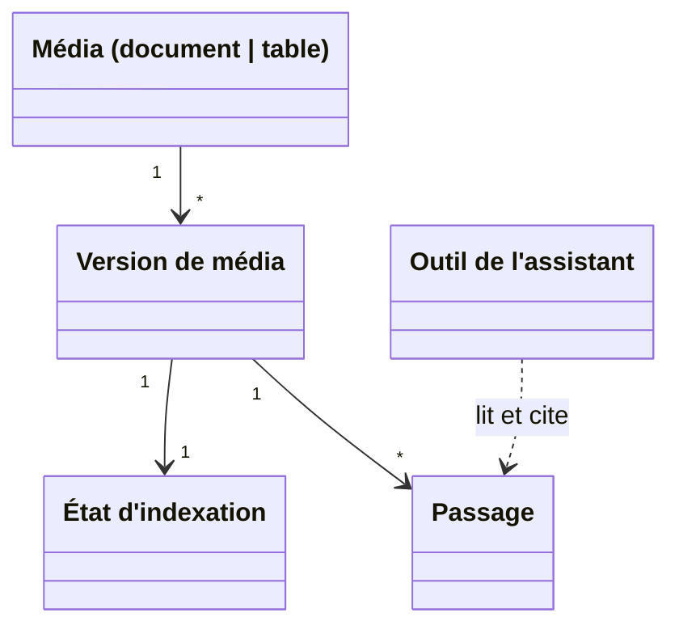
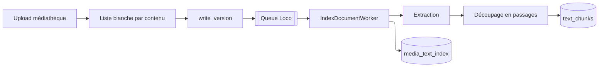
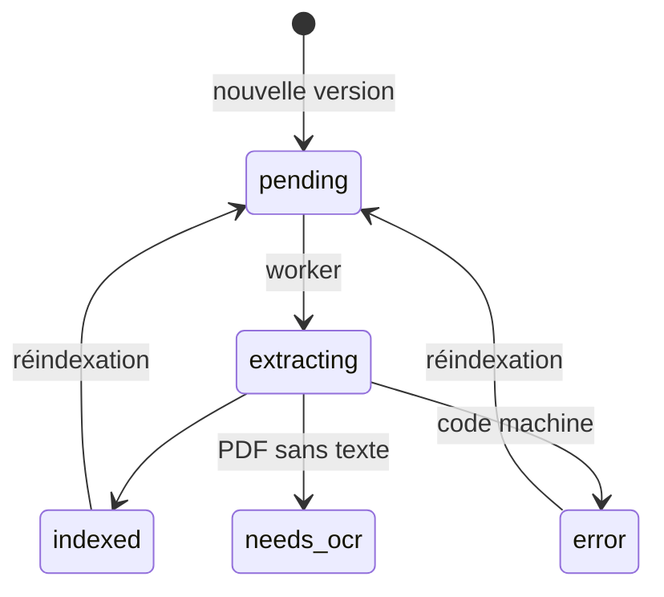
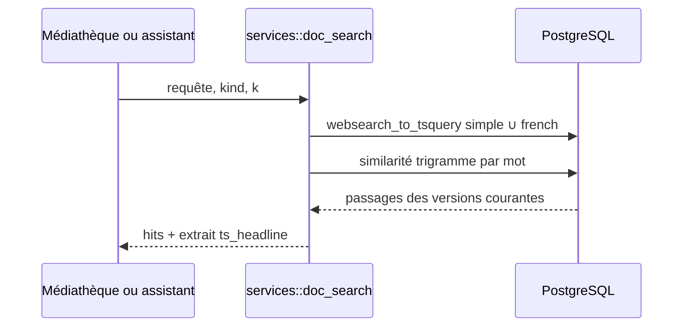

# Documents et recherche IA

Entrée roadmap P2.18, décision #22. Liens : `media.md` (bibliothèque D21, versions, MediaStore), `ai-assistant.md` (D142–D145, §9.3 règle d'extension), `security.md` (R1–R20, R8 egress, fournisseurs d'org D110, D116, D119), `ontology.md` (liens D179, provenance D184), `pages.md` (index partagé), `geo-layers.md` (image Postgres étendue), `vision.md` (inférence `tract`).

## 1. Résumé

La recherche documentaire indexe les fichiers texte et les tableurs de la médiathèque. L'utilisateur cherche dans ces fichiers depuis la médiathèque. L'assistant IA cherche aussi dans ces fichiers et cite le document et la page ou la section. Le but : le technicien trouve la documentation de l'org sans quitter PneX. Tout tient dans PostgreSQL et le MediaStore : aucune base vectorielle dédiée.

**État.** La phase P1 est codée : extraction, découpage, recherche lexicale, trois outils de l'assistant, état d'indexation dans l'UI. Les phases P2 à P5 (embeddings, tableurs en SQL, liens d'ontologie, OCR) sont seulement proposées.

## 2. Concepts

- **Document** : un média de kind `document` (txt, md, docx, pdf). Aucune table `document` séparée (D21).
- **Tableur** : un média de kind `table` (csv, xlsx, ods).
- **Extraction** : lecture du texte et de sa structure (titres, pages, feuilles) dans `pnex_core::doc_extract`.
- **Passage** : un fragment de texte d'une version, avec sa page et son titre. Table `text_chunks`.
- **État d'indexation** : le statut de l'index d'une version de média. Table `media_text_index`.
- **Recherche lexicale** : recherche plein texte (`tsvector`) plus similarité trigramme pour les codes approchés.
- **Citation** : le document plus la page ou la section d'un passage.

## 3. Fonctionnement

### 3.1 Indexation

L'upload accepte un format seulement si son contenu et son extension concordent (`services::media_sniff::identify`). Un format inconnu reçoit 400 `media-format-unsupported`. `write_version` met en file chaque version d'un `document` ou d'un `table`. Le worker extrait le texte dans `spawn_blocking`. Une panique d'un parseur donne `media-index-malformed`. Un échec d'indexation garde l'upload.

Le découpage respecte la structure. Un passage fait environ `2000` caractères, avec un recouvrement de `300`. Un passage ne chevauche jamais deux sections ni deux pages. Les PDF passent par `lopdf` (pur Rust). Un tableur est indexé comme du texte : une ligne par rangée, une section par feuille. Ainsi, la recherche trouve le fichier.

### 3.2 Cycle de vie de l'état d'indexation

Un échec de mise en file laisse la version `pending`. La réindexation manuelle (F4) la récupère. Le statut `needs_ocr` attend la phase P5.

### 3.3 Recherche

La recherche voit seulement la version courante de chaque asset. La configuration `simple` garde les codes intacts (`E-0457`, références de pièces). La configuration `french` racine la prose. L'extrait balise les correspondances entre `⟦` et `⟧`, car les guillemets « » sont fréquents en français. Le contrôleur HTTP et l'outil de l'assistant appellent le même service.

### 3.4 Assistant

L'assistant décide seul quand chercher. Il reçoit les passages comme **donnée**, jamais comme instruction. Le prompt système (`services::ai::context`) lui ordonne de citer chaque fait et de dire quand il ne trouve rien. La fiche `assistant-kb/documents.md` décrit la fonctionnalité.

## 4. Exigences

Les identifiants F1–F15 sont stables (cités par `pages.md`).

| Id | Exigence | État |
|---|---|---|
| F1 | La médiathèque doit accepter `txt`, `md`, `csv`, `xlsx`, `ods`, `docx`, `pdf`, détectés par leur contenu. | codé |
| F2 | L'org doit pouvoir fixer une taille maximale par fichier, sous `PNEX_MEDIA_MAX_BYTES`. | proposé |
| F3 | La fiche doit montrer l'état d'indexation et le code d'erreur traduit. | codé |
| F4 | L'utilisateur avec `media:write` doit pouvoir réindexer. Supprimer le média doit supprimer ses passages. | codé |
| F5 | L'org doit dédupliquer par `media_versions.sha256`. | codé (bibliothèque) |
| F6 | L'API et la médiathèque doivent offrir la recherche. | codé (lexicale) |
| F7 | La recherche doit filtrer par type, date, étiquettes et objet rattaché. | type seul codé |
| F8 | Chaque hit doit donner le document, la page ou section, et un extrait balisé. | codé |
| F9 | Le lecteur PDF doit ouvrir le document à la page citée. | proposé |
| F10 | L'assistant doit chercher avec ses outils dédiés (§6.4). | codé |
| F11 | L'assistant doit citer chaque fait tiré d'un document. | codé (prompt) |
| F12 | L'assistant doit dire qu'il ne trouve rien, au lieu d'inventer. | codé (prompt) |
| F13 | Un document doit pouvoir être lié à des objets par un lien d'ontologie (D179). | proposé |
| F14 | La fiche d'un objet doit lister ses documents liés. | proposé |
| F15 | L'assistant doit filtrer sur l'objet en contexte (`PageContext`). | proposé |

Exigences transverses :

1. Chaque requête doit filtrer par `org_id` pris du principal (R1). Chaque route d'écriture doit exiger sa permission (R2).
2. L'extraction doit tourner dans le worker, jamais dans le handler HTTP.
3. L'extraction doit refuser une bombe zip avant toute décompression (limites au §6.3).
4. Les statuts et les erreurs doivent passer par `t!` et `err_codes::ALL`.
5. Toute dépendance doit compiler pour aarch64 et passer `deny.toml`.
6. La recherche doit répondre en moins de 300 ms (p95) sur 100k passages, sur un Pi 5. Non mesuré.

## 5. Décisions

- **Décision #22** (registre de `roadmap.md`) : documents et recherche IA dans PostgreSQL, sans base vectorielle dédiée.
- **Gel 0.2.0** : P1 seul passe en exception au gel. P2 et les phases suivantes viennent après la 0.2.0.
- **Runtime des embeddings** : `tract` (déjà dans `pnex-vision`), à valider sur `multilingual-e5-small` au début de P2. `fastembed-rs` et `ort` sont écartés, sauf échec mesuré.
- **Index partagé avec les pages** : oui. `text_chunks` est générique et `pages.md` doit ajouter sa propre colonne source. Pas encore codé.
- **D21** : le fichier est un média. L'index s'accroche à `media_versions`.
- **D119** : pas de LLM plateforme. L'assistant utilise le LLM de l'org. Des embeddings cloud passent par un fournisseur d'org, avec son secret en coffre (D110, D116) et l'egress R8.
- **D179** : le rattachement aux objets est un lien d'ontologie (type système `documents`), pas une table de liens ad hoc.
- **D188** : les droits fins par document suivent cette décision (question ouverte).
- **Tableurs indexés en texte** : écart assumé de P1. `query_table` et Parquet restent en P3.

## 6. Interfaces

### 6.1 Routes

| Route | Permission | Effet |
|---|---|---|
| `GET /api/v1/media/search?q=&kind=&k=` | `media:read` | recherche lexicale, `k` ≤ `50` |
| `GET /api/v1/media/chunks/{chunk_id}?context=` | `media:read` | un passage et ses voisins |
| `GET /api/v1/media/{id}/index` | `media:read` | état d'indexation de la version courante |
| `POST /api/v1/media/{id}/index` | `media:write` | réindexation (F4) |

### 6.2 Schéma

Migration `m20261011_000003_doc_search` : extension `pg_trgm`, tables `media_text_index` (statut, `error_code`, `page_count`, `chunk_count`) et `text_chunks` (`media_version_id` nullable, `ord`, `page`, `heading`, `content`, `tsv` généré). Index GIN sur `tsv` et sur `content gin_trgm_ops`. Aucune colonne `embedding` (P2).

Statuts : `pending`, `extracting`, `indexed`, `error`, `needs_ocr`.

Codes d'erreur : `media-index-unsupported`, `media-index-too-large`, `media-index-malformed`, `media-index-unreadable`, `media-index-not-a-document`, `media-format-unsupported` (upload).

### 6.3 Limites d'extraction

| Limite | Valeur |
|---|---|
| Décompressé (docx, xlsx, ods) | 256 Mo |
| Entrées zip | 10 000 |
| Texte extrait | 32 Mo |
| Pages | 2000 |
| Durée d'une extraction | 300 s |
| Passage / recouvrement | 2000 / 300 caractères |

Feature Cargo `doc-extract` de `pnex-core` (backend seul) : `zip`, `quick-xml`, `lopdf`, `calamine`, `lzma-rs`.

### 6.4 Outils de l'assistant

| Outil | Permission | Rôle | État |
|---|---|---|---|
| `search_docs` | `docs:read` | recherche, passages + citation | codé |
| `read_chunk` | `docs:read` | un passage et `0` à `3` voisins | codé |
| `open_page` | `docs:read` | texte d'une page PDF ou d'une feuille | codé |
| `list_tables` | — | tableurs et leurs schémas | proposé (P3) |
| `query_table` | — | SQL en lecture seule sur un tableur | proposé (P3) |

Code : `services::ai::doc_tools`, en lecture seule, service partagé avec le contrôleur (`ai-assistant.md` §9.3).

## 7. Reste à faire

Phases proposées, aucune codée :

| Phase | Contenu |
|---|---|
| P1 (reste) | lecteur PDF à la page (F9), taille par org (F2), métriques d'indexation vers OpenObserve, essai des outils avec un vrai LLM |
| P2 | embeddings `multilingual-e5-small` (384 dim) dans `pgvector`, fusion RRF lexicale + sémantique, cache Valkey des embeddings de requête |
| P3 | tableurs en Parquet, outils `list_tables` et `query_table` (DataFusion, lecture seule, timeout) |
| P4 | liens d'ontologie (F13–F15), filtres date, étiquettes, objet (F7) |
| P5 | OCR des PDF `needs_ocr`, avec la transcription média |

Questions ouvertes (choix de Shan) :

1. BM25 par `pg_search` contre `ts_rank_cd` : gain réel contre une extension de plus (licence à vérifier). À trancher avec un jeu de test d'environ 50 questions.
2. Rerank après RRF : utile ou trop lourd sur un Pi ?
3. Documents partagés entre orgs (bibliothèque publique de datasheets) ?
4. Indexer seulement la version courante, ou toutes les versions ? Le code indexe chaque version et cherche dans la courante.
5. Droits fins par document dès P1 ? Suit D188.
6. DataFusion sur Pi : poids binaire et mémoire, ou une solution plus légère pour `query_table` ?
7. Image Postgres commune pgvector + PostGIS, multi-arch (`geo-layers.md`).
