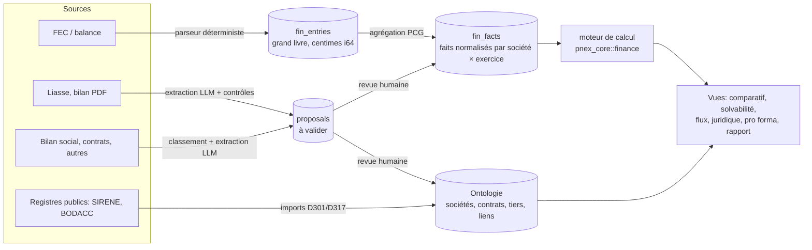

# Due diligence, fusion-acquisition et solvabilité — PRD

> Statut : **proposé** (2026-10-21, versé au dépôt le 2026-10-27) · Décisions **D468–D483** · Lots **DD0–DD7**
> Dépend de : ontologie 0.2.0 (D176–D191), dossiers (K1–K64), `companies_fr` (D304–D306), imports déclaratifs (D301), recherche documentaire P1 (P2.18), orchestrateur d'analyses média (D212–D214), revue « à valider » (D316), propositions (D367, D371–D377).
> Numérotation : rédigé à l'origine en D329–D344, plage déjà prise par `account-mapping.md` ; renuméroté à l'identique (D329 → D468 … D344 → D483).

---

## 1. Le besoin

Un utilisateur ouvre un **dossier de transaction** (fusion, acquisition, ou simple évaluation de solvabilité) portant sur **1 à N sociétés** — 2 pour une fusion, 10 pour un screening de cibles, sans plafond de principe. Il dépose **n'importe quel document** : FEC, balance générale, liasse fiscale, bilan et compte de résultat en PDF, bilan social / BDESE, registre du personnel, contrats, baux, notes de frais, relevés bancaires, Kbis, statuts, pacte d'actionnaires…

PNEX doit en tirer, pour chaque société et pour l'ensemble :

| Sortie | Contenu |
|---|---|
| **Ontologie** | sociétés, groupe et actionnariat, dirigeants, établissements, contrats et parties, tiers (clients, fournisseurs, prêteurs), litiges, actifs |
| **Flux financiers** | qui paie qui, combien, quand ; concentration clients/fournisseurs ; flux intra-groupe et entre les sociétés du dossier ; trésorerie |
| **Rentabilité** | SIG (marge, VA, EBE, résultat d'exploitation, RCAI), marges, ROE/ROCE, évolution N/N-1/N-2 |
| **Solvabilité** | structure financière, endettement, liquidité, BFR en jours, capacité de remboursement, scores transparents |
| **Social** | effectifs, masse salariale, turnover, ancienneté — agrégés uniquement |
| **Juridique** | clauses sensibles (changement de contrôle, exclusivité, garanties, résiliation), procédures collectives, litiges, sûretés |
| **Comparaison / simulation** | tableau N sociétés × exercices × indicateurs ; entité combinée pro forma avec éliminations explicites |
| **Signaux** | red flags expliqués, chacun relié à sa source (document + page/ligne) |

Chaque chiffre affiché doit pouvoir **remonter à sa source** en un clic (D184).

> Avertissement produit à afficher : les indicateurs sont des aides à l'analyse, pas un avis d'expert-comptable, d'avocat ni une notation de crédit.

---

## 2. Ce qui existe déjà et qu'on réutilise

| Brique existante | Où | Réutilisation |
|---|---|---|
| Ontologie typée, liens temporels à attributs, `as_of` | `pnex_core::ontology`, D176–D185 | sociétés, contrats, tiers, liens `owns`/`manages`/`partie_a` bornés dans le temps |
| Packs YAML (`requires`, `extends`, imports, hiérarchies) | `crates/pnex-backend/packs/`, D190, D306 | nouveau pack `finance` (= K60 reporté) + pack `due_diligence` |
| `organization` + SIREN, établissements, dirigeants, import SIRENE | `packs/companies_fr.yaml`, D304–D305 | identité des sociétés du dossier, arbre de groupe |
| Actionnariat effectif, bénéficiaires > 25 % | `pnex_core::ontology::ownership` (K56) | contrôle et périmètre de consolidation |
| Vue Argent (Sankey), cycles, « non documenté » | `pnex_core::ontology::money`, `pages/cases/workspace/money.rs` (K57) | rendu des flux agrégés depuis les grands livres |
| Dossier (`case`), timeline, graphe Sigma, gel + export SHA-256 | K1–K47, K12/K33, GS | le dossier de transaction **est** un `case` |
| Extraction texte docx/pdf/csv/xlsx/ods, découpage par page | `pnex_core::doc_extract`, P2.18 P1 | texte des documents, localisation page/section |
| LLM par usage (`assistant` / `extraction` / `vision`) | `llm_usages`, D212 | extraction structurée, lecture de tableaux scannés |
| Orchestrateur d'analyses par média | `media_analyses`, D213 | ajouter les étapes `classify` et `extract_facts` |
| Imports déclaratifs + dry-run | `pnex_core::ontology::import`, D301 | balances et exports tabulaires simples |
| Nœud `ingest` (data.gouv, téléchargement, archive) | D317–D322 | BODACC, données publiques |
| Pages + export PDF | P2.17, D209 | rapport de due diligence |
| File Loco sur Postgres | `pg_loco_queue` | imports longs, extraction, calculs |

## 3. Ce qui manque (constat sur le code au 2026-10-21)

- **Aucun modèle comptable** : pas de grand livre, de plan de comptes, d'exercice, de balance.
- **Aucun parseur FEC ni liasse fiscale.** Rien ne connaît les formulaires 2050–2059.
- **Montants en `f64`** (`Money` dans `schema.rs`) : acceptable pour un montant d'enquête estimé, **inacceptable pour une comptabilité** (arrondis sur des centaines de milliers d'écritures).
- **Plafond 50 000 lignes par import** (D301) : un FEC de PME dépasse souvent ce volume.
- **Pas d'extraction structurée de documents vers des objets** (K11/C6 non construit), pas d'OCR (P5), pas d'embeddings (P2).
- **Pas de conversion de devises** (exclue par K54/§14).
- **Pas d'ACL par objet** (D188, prévu 0.3) : les données d'un deal sont visibles de toute l'org.

---

## 4. Principe d'architecture

Trois niveaux de stockage, chacun pour ce qu'il fait bien :



1. **Ontologie** = ce qui a une identité et des relations : sociétés, personnes, contrats, clauses, litiges, tiers, exercices. Quelques centaines à quelques milliers d'objets par dossier.
2. **`fin_entries`** = le volume brut (lignes de grand livre). Jamais transformées en objets.
3. **`fin_facts`** = la couche pivot : un fait = *(société, exercice, concept, valeur, origine, source)*. Tous les calculs et toutes les vues lisent ici, quelle que soit l'origine du chiffre (FEC, liasse PDF, saisie manuelle).

C'est ce pivot qui permet le « n'importe quel document » : un CA peut venir d'un FEC pour la société A et d'une liasse scannée pour la société B, et la comparaison reste possible, avec l'origine affichée.

---

## 5. Décisions

### D468 — Le dossier de transaction est un `case`
Extension du type `case` (pack `due_diligence`) : `case_kind` (`investigation` | `due_diligence`), `deal_kind` (`acquisition` | `fusion` | `solvabilite` | `screening`), `reference_currency`, `as_of_date`. Les sociétés analysées sont liées au dossier par `analyse` (attribut `role` : `cible`, `acquereur`, `absorbante`, `absorbee`, `comparable`). Pas de limite de nombre. On garde timeline, graphe, gel/export, purge (K12, K16).

### D469 — Montants comptables en centimes entiers
Toute valeur comptable stockée hors ontologie est un `i64` en unités mineures + code ISO 4217. Le type ontologique `Money` (f64) reste pour les montants d'enquête et d'affichage ; la conversion `i64 → Money` n'a lieu qu'à la frontière d'affichage. Ratios en `f64` (sans unité).

### D470 — Exercice comptable = objet ontologique
Type `fiscal_period` (pack `finance`) : `start`, `end`, `months`, `framework` (`pcg` | `ifrs` | `autre`), `status` (`provisoire` | `arrete` | `certifie`), `currency`. Lien `exercice_de` → `organization`. Les exercices de durée ≠ 12 mois sont **annualisés explicitement** dans les calculs, avec un marqueur visible.

### D471 — Taxonomie de concepts dans le code
`pnex_core::finance::concepts` : liste fermée de concepts (`revenue`, `purchases_goods`, `external_charges`, `payroll`, `ebitda`, `equity`, `financial_debt`, `cash`, `trade_receivables`, `trade_payables`, `inventory`, `headcount_avg`…), chacun avec :
- son **mapping PCG** (plages de comptes, ex. `70*` → produits d'exploitation, `401*` → dettes fournisseurs) ;
- son **mapping liasse** (codes de lignes cerfa 2050–2059, ex. `FL` CA net, `DL` capitaux propres, `HN` résultat) — table à établir depuis la notice officielle et testée sur fixtures ;
- un alias IFRS/XBRL optionnel pour plus tard.
Même logique que les types système (D176) : extensible par pack, jamais modifiable en base. Garde de test : tout concept a au moins une source de mapping.

### D472 — `fin_facts`, un fait = une origine
Table `fin_facts(org_id, case_id, company_id, period_id, concept, value_minor i64 NULL, value_ratio f64 NULL, currency, origin, status, source_ref, locator, confidence, created_at)`.
- `origin` : `ledger` | `trial_balance` | `liasse` | `statement_pdf` | `manual` | `computed`.
- `status` : `proposed` | `validated` | `rejected` ; seul `validated` (ou `computed` depuis du validé) alimente les vues.
- Plusieurs faits peuvent coexister pour un même (société, exercice, concept) ; **règle d'élection** : manuel > liasse > grand livre > PDF extrait, et **écart signalé** si deux origines divergent de plus de 1 % — c'est un contrôle de cohérence gratuit et très parlant.
- `locator` : page + cellule/ligne + extrait verbatim (même règle que `sourced_by.locator`).

### D473 — Grand livre : table dédiée, import en flux
`fin_ledger_imports` (run) + `fin_entries(import_id, company_id, period_id, journal, entry_no, date, account, aux_account, aux_label, label, debit_minor, credit_minor, currency, piece_ref, line_no)`, partitionnée par `import_id` (suppression d'un import = `DROP PARTITION`). Chargement par `COPY` en flux depuis le worker, **plafond propre de 5 M lignes** par fichier (le plafond 50 000 de D301 ne s'applique pas : ce ne sont pas des objets). Index `(company_id, period_id, account)`.

### D474 — Parseurs déterministes d'abord, LLM ensuite
- **FEC** (format réglementaire 18 colonnes, séparateur `|` ou tabulation, encodages ISO-8859-15/UTF-8) : parseur Rust strict dans `pnex_core::finance::fec`. Contrôles bloquants : colonnes, dates, équilibre débit = crédit par écriture et global. Contrôles avertissants : comptes hors PCG, écritures hors exercice, numérotation non continue.
- **Balance générale** CSV/XLSX : mapping D301 assisté (détection des colonnes compte / libellé / débit / crédit / solde).
- **Tout le reste** (liasse PDF, bilans, bilan social, contrats) : extraction LLM (D476).
Un chiffre qui peut être calculé de façon déterministe ne passe jamais par le LLM.

### D475 — Classement automatique des documents déposés
Nouvelle étape `classify` dans `media_analyses` : détection par contenu (signature FEC, en-têtes cerfa, mots-clés) puis LLM usage `extraction` si ambigu. Classes : `fec`, `trial_balance`, `liasse`, `financial_statements`, `bank_statement`, `hr_report`, `payroll_register`, `contract`, `lease`, `bylaws`, `shareholders_agreement`, `kbis`, `invoice`, `expense_report`, `other`. Le classement est une **proposition** modifiable ; la société et l'exercice rattachés aussi (déduits du SIREN, de la raison sociale, des dates).

### D476 — Extracteurs déclaratifs dans les packs
Clé `extractors:` dans le YAML de pack : pour une classe de document, le schéma JSON attendu (faits financiers, clauses, parties, effectifs…). Le LLM rend du JSON validé contre ce schéma ; chaque élément porte `page` + `quote` (verbatim ≤ 300 caractères). Rejet automatique si la citation n'est pas retrouvée dans le texte de la page. Puis **contrôles arithmétiques avant revue** : total actif = total passif, somme des lignes = sous-total, résultat bilan = résultat CR. Un document qui échoue aux contrôles arrive en revue marqué en rouge, pas en silence.
PDF scannés : rendu de la page en image → usage `vision` (D212) en attendant l'OCR (P5).

### D477 — File de propositions générique
Construire enfin K11/C6 : table `proposals(case_id, kind, payload JSONB, source_ref, locator, status, reviewer, reviewed_at)` qui généralise `case_proposals` (aujourd'hui réservée aux détecteurs). Revue en lot : valider tout ce qui a passé les contrôles, revoir un par un le reste. Rien n'entre en `fin_facts.validated` ni dans l'ontologie sans passage par cette file (D316).

### D478 — Moteur de calcul pur dans `pnex_core::finance`
Compilé natif + wasm (même code côté UI et serveur), sans I/O. Entrée : faits validés d'un (société, exercice). Sortie : faits `computed` + leur formule.
- **SIG** : marge commerciale, production, valeur ajoutée, EBE, résultat d'exploitation, RCAI, résultat net.
- **Rentabilité** : marge EBE, marge nette, ROE, ROCE.
- **Structure / solvabilité** : autonomie financière, gearing, dette nette / EBE, capacité d'autofinancement, capacité de remboursement (dettes financières / CAF), couverture des intérêts.
- **Liquidité / cycle** : liquidité générale et réduite, BFR, DSO, DPO, rotation des stocks (en jours).
- **Scores** : uniquement des formules publiées et affichées terme à terme (Conan-Holder, Altman Z″ pour non cotées), présentés comme indicatifs.
Chaque indicateur expose sa formule et les faits utilisés ; un fait manquant donne « non calculable », jamais un zéro. Tests sur jeux de comptes publiés.

### D479 — Flux : agrégation du grand livre vers l'ontologie
- Les comptes auxiliaires clients/fournisseurs (`411*`/`401*`) deviennent des **tiers** : rapprochement avec une `organization` par SIREN/SIRET s'il apparaît, sinon par libellé (proposition à valider, jamais automatique).
- Le volume par tiers et par exercice devient un lien temporel `client_de` / `fournisseur_de` avec attributs `amount` et `share` (borné à l'exercice, D179).
- Trésorerie : flux reconstitués depuis les contreparties des comptes `512*`.
- Rendu : la vue Argent existante (K57) alimentée par ces agrégats (un nœud = une société ou un tiers, pas une écriture).
- **Intra-dossier** : flux où le tiers est une autre société du dossier → mis en évidence (base des éliminations, D481).
- Indicateurs : part des 1/5/10 premiers clients et fournisseurs, dépendance > 20 % signalée.

### D480 — Social agrégé, jamais nominatif
Bilan social, BDESE, registres : on ne garde **que des agrégats** (effectif par catégorie, ETP, masse salariale, entrées/sorties, ancienneté et âge par tranches, absentéisme). Les fichiers sources nominatifs restent dans la médiathèque, soumis à la purge K16, et ne créent **aucun objet `person`** pour les salariés. Seuls dirigeants et mandataires sont des personnes (déjà le cas avec `companies_fr`).

### D481 — Pro forma : somme explicite, éliminations listées
Vue « entité combinée » sur les sociétés choisies du dossier : somme par concept et par devise, puis **éliminations proposées** à partir des flux intra-dossier (D479) et des participations croisées (K56), chacune visible, justifiée et désactivable. Pas de consolidation normée (IFRS 10 / règlement ANC) en v1 : c'est une simulation, affichée comme telle.

### D482 — Devises
v1 : une devise de référence par dossier ; un fait dans une autre devise est affiché mais exclu des totaux combinés avec un avertissement (cohérent avec K54). v2 : taux de référence BCE importés comme objets datés (`fx_rate`), conversion toujours affichée avec le taux et la date utilisés.

### D483 — Confidentialité et IA
- Tant que les ACL par objet (D188) n'existent pas : **une org par transaction** (K9), documenté dans l'UI à la création du dossier.
- Permissions IAM nouvelles : `finance:read`, `finance:write`, `finance:import`, `finance:review` ; `finance:hr_read` séparée pour les agrégats sociaux.
- L'usage `extraction` peut pointer vers un fournisseur différent de l'assistant (D212) : l'org choisit un modèle local `openai_compat` si les documents ne doivent pas sortir. Avertissement à la première extraction si le fournisseur est externe.
- L'assistant **ne calcule jamais lui-même** : tout chiffre dans sa réponse vient d'un outil (`fin_facts`, moteur D478) et porte sa source.

---

## 6. Ontologie : pack `finance` et pack `due_diligence`

Esquisse (syntaxe des packs existants) :

```yaml
key: finance
version: "0.1.0"
requires: [investigation, entreprises_fr]
types:
  - key: fiscal_period          # D470
  - key: third_party            # tiers issu d'un compte auxiliaire, fusionnable avec une organization
  - key: financial_debt         # emprunt, crédit-bail, compte courant d'associé : prêteur, montant, échéance, taux, sûretés
  - key: asset                  # immobilier, fonds de commerce, marque, brevet, logiciel
link_types:
  - { key: exercice_de,    from_types: [fiscal_period],   to_types: [organization], one_target: true }
  - { key: client_de,      from_types: [organization, third_party], to_types: [organization], attributes: [amount, share] }
  - { key: fournisseur_de, from_types: [organization, third_party], to_types: [organization], attributes: [amount, share] }
  - { key: emprunte_a,     from_types: [organization], to_types: [organization, third_party], attributes: [amount, rate, maturity] }
  - { key: garantit,       from_types: [organization, person], to_types: [financial_debt, contract] }
  - { key: detient,        from_types: [organization], to_types: [asset] }

---
key: due_diligence
version: "0.1.0"
requires: [finance]
extends:
  - type: case               # D468
types:
  - key: contract            # type, objet, durée, reconduction, préavis, valeur
  - key: clause              # kind: change_of_control | exclusivite | non_concurrence | resiliation | garantie | penalite | autre ; risk; quote
  - key: litigation          # juridiction, objet, montant en jeu, provision, statut
  - key: insolvency_event    # procédure collective (BODACC) : sauvegarde, RJ, LJ, date
  - key: red_flag            # signaux : règle, gravité, explication, faits liés
link_types:
  - { key: analyse,   from_types: [case], to_types: [organization], attributes: [role] }
  - { key: partie_a,  from_types: [organization, person], to_types: [contract], attributes: [role] }
  - { key: contient,  from_types: [contract], to_types: [clause] }
  - { key: concerne,  from_types: [litigation, insolvency_event], to_types: [organization] }
extractors:                  # D476
  - document_class: liasse
  - document_class: financial_statements
  - document_class: hr_report
  - document_class: contract
```

Rendu attendu : le graphe du dossier montre les sociétés analysées, leur groupe (D305), leurs dirigeants, leurs grands clients/fournisseurs (épaisseur = montant), leurs prêteurs, leurs contrats avec clauses à risque, et les liens entre sociétés du dossier. Avec `as_of`, on voit l'état à une date.

---

## 7. Signaux (red flags)

Détecteurs sur le modèle des détecteurs de dossiers (K30) : ils écrivent des propositions `red_flag`, avec la règle, les faits et la source. Première liste :

| Domaine | Signal |
|---|---|
| Cohérence | écart > 1 % entre deux origines d'un même chiffre ; FEC déséquilibré ; liasse dont les totaux ne bouclent pas ; exercice manquant |
| Solvabilité | capitaux propres < ½ capital social ; dette nette / EBE > seuil ; trésorerie nette négative 2 exercices de suite ; CAF négative |
| Cycle | DSO ou DPO en hausse > 30 % ; stocks en hausse plus vite que le CA |
| Dépendance | client > 20 % du CA ; fournisseur > 30 % des achats |
| Juridique | clause de changement de contrôle dans un contrat significatif ; procédure collective (BODACC) sur la société ou un client/fournisseur majeur ; litige non provisionné |
| Groupe | flux intra-dossier non symétriques entre les deux comptabilités ; compte courant d'associé important |
| Social | turnover ou absentéisme en forte hausse ; masse salariale / VA > seuil |

Seuils réglables par dossier, valeurs par défaut documentées.

---

## 8. Expérience utilisateur

1. **Créer le dossier** (type due diligence), ajouter les sociétés par SIREN → import SIRENE immédiat (D304).
2. **Data room** : une seule zone de dépôt, multi-fichiers et zip. Chaque fichier passe par *déposé → classé → extrait → à valider → intégré*, avec la classe, la société et l'exercice proposés et modifiables.
3. **À valider** : file de revue (D477), validation en lot de ce qui a passé les contrôles.
4. **Synthèse** : une carte par société (CA, EBE, résultat, capitaux propres, dette nette, trésorerie, effectif, sur 3 exercices) + signaux.
5. **Comparatif** : matrice sociétés × indicateurs × exercices, tri, export ; chaque cellule ouvre sa formule puis sa source.
6. **Flux** : vue Argent + concentration clients/fournisseurs + flux intra-dossier.
7. **Juridique** : contrats et clauses à risque, litiges, procédures.
8. **Pro forma** (fusion) : entité combinée, éliminations activables.
9. **Rapport** : Page générée (P2.17) avec sections et citations, exportable en PDF, gelable avec empreinte (K33).

Le tout dans l'espace dossier existant (onglets du workspace), conforme au lexique (§7 de `design-system.md`) : à ajouter au lexique — Exercice, Grand livre, Fait, Indicateur, Signal, Data room / Pièces du dossier.

---

## 9. Assistant IA

Outils en lecture : `fin_company_summary`, `fin_facts_query`, `fin_compare`, `fin_ledger_aggregate` (agrégats seulement, jamais d'écritures brutes en masse), `fin_flags`. Outil d'écriture : `propose_facts` (va dans la file D477, jamais en direct). Fiches `assistant-kb` pour chaque page. Questions visées : « pourquoi la marge EBE de B baisse en 2025 ? », « quels contrats ont une clause de changement de contrôle ? », « quels clients sont communs à A et C ? ».

---

## 10. Volumétrie

| Élément | Ordre de grandeur pour 10 sociétés × 3 exercices |
|---|---|
| Lignes de grand livre | 0,5 à 10 M → `fin_entries` partitionnée, agrégats en SQL ; DataFusion (P3) seulement si besoin |
| Faits | ~ 10 × 3 × 150 concepts ≈ 5 000 |
| Objets ontologiques | quelques centaines (sociétés, tiers majeurs, contrats, clauses) — on ne crée un tiers que s'il dépasse un seuil de volume |
| Pages extraites par LLM | quelques centaines → coûts et temps affichés avant lancement |

Les extractions passent par la file Loco (`num_workers` bas) ; la fabric de workers (`worker-fabric.md`) prendra le relais pour le SaaS.

---

## 11. Lots

| Lot | Contenu | Valeur livrée |
|---|---|---|
| **DD0** | Pack `finance` + extension `case` (D468, D470), `pnex_core::finance::concepts` (D471), tables `fin_facts` / `fin_ledger_imports` / `fin_entries` (D469, D472, D473), IAM (D483) | le modèle |
| **DD1** | Parseur FEC + import balance (D474), agrégation PCG → faits | un FEC déposé donne bilan et CR reconstitués |
| **DD2** | Moteur de calcul (D478) + synthèse et comparatif N sociétés | rentabilité et solvabilité, comparables |
| **DD3** | Tiers, liens client/fournisseur, vue Argent, intra-dossier (D479) | flux financiers |
| **DD4** | Classement (D475), extracteurs (D476), file de propositions (D477) — liasse et états financiers PDF d'abord | « n'importe quel document » côté chiffres |
| **DD5** | Extracteurs contrats, bilan social (D480), BODACC via `ingest`, signaux (§7) | juridique, social, red flags |
| **DD6** | Pro forma (D481), rapport + gel | fusion simulée, livrable |
| **DD7** | Outils assistant + fiches KB (§9), devises v2 (D482) | questions en langage naturel |

Ordre justifié : DD1–DD2 donnent de la valeur sans aucun LLM et posent `fin_facts` ; DD4 se branche ensuite sur un pivot déjà testé.

## 12. Hors périmètre v1

Consolidation normée, évaluation d'entreprise (DCF, multiples), prévisionnel, notation de crédit, rapprochement bancaire ligne à ligne, OCR natif (attend P5), ACL par objet (attend D188/0.3), lecture XBRL/ESEF (prévu via les alias D471).

## 13. Questions ouvertes

1. Dossier = `case` étendu (proposé) ou type système dédié `deal` ?
2. Taille max réaliste d'un FEC chez les utilisateurs visés (pour figer le plafond de D473) ?
3. Modèle d'extraction par défaut : cloud (actuel) ou local obligatoire pour ce module ?
4. Faut-il un mode « screening » léger (SIRENE + comptes publiés INPI uniquement, sans data room) pour comparer 50+ sociétés ?
5. Lecture des comptes annuels déposés au RNE/INPI (publics quand non confidentiels) : à intégrer dès DD4 comme source gratuite ?

## 14. Relecture au versement (2026-10-27)

Le PRD date du 2026-10-21 ; une partie du constat (§2–§3) a bougé depuis. À reprendre avant DD0 :

- **D477 est déjà en grande partie construit** : la proposition est un objet du noyau (`proposals.md`, D367, D371–D377, livré 2026-10-22/23), et `object_upsert` sait proposer au lieu d'écrire (D375). D477 se réduit à brancher `fin_facts.proposed` et les extracteurs sur cette file, sans nouvelle table `proposals`.
- **BODACC** : un import « Annonces légales (BODACC) » par SIREN existe dans `prospecting_b2b_fr` (`account-mapping.md` §10, CC4). DD5 le réutilise ou le déplace dans un pack commun plutôt que d'en écrire un second via `ingest`.
- **Groupe et filiales** : `subsidiary_of` (GLEIF + Wikidata) est dans le socle `companies` (D331, D343) ; `finance` devrait dépendre de `companies`, pas seulement d'`companies_fr`.
- **Lien `concerns`** : la clé est déjà prise par `quali_watch` (une seule cible, départ `finding`) ; `due_diligence` doit choisir un autre nom (même cas que `signal_about` en CC4).
- **Lexique** : « Signal » est déjà employé (« Signal commercial », CC4) ; `red_flag` demande sa propre ligne au lexique pour ne pas créer deux sens.
- **Données personnelles** : la classification D298, le masquage par rôle et l'effacement en coquille sont codés (`crm.md` D442–D447) ; D480 s'appuie dessus pour les fichiers sociaux.
