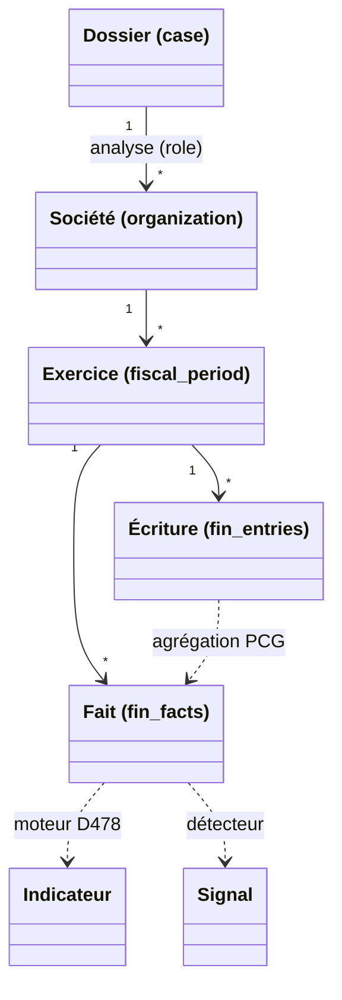
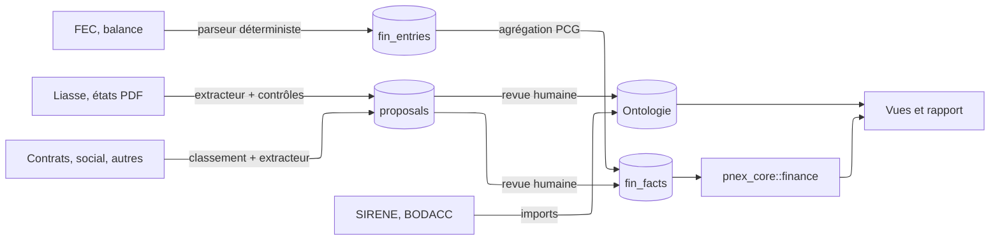
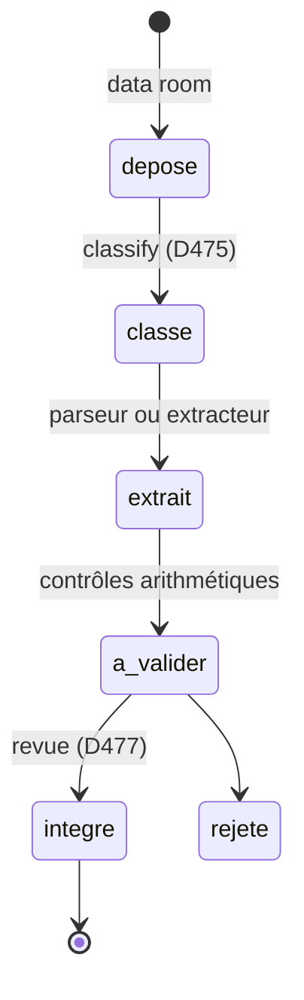
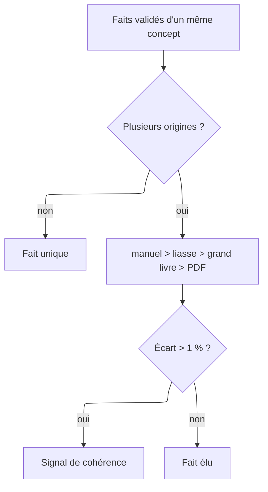
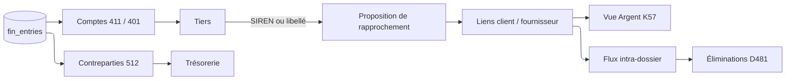
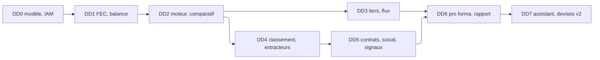

# Due diligence, fusion-acquisition et solvabilité

Décisions D468–D483, lots DD0–DD7, entrée roadmap P2.32. Liens : `ontology.md` (D176–D191, provenance D184), `cases.md` (K1–K64), `companies_fr` (D304–D306), imports déclaratifs (D301), `doc-search.md` (extraction), `media.md` (analyses D212–D214), `proposals.md` (D367, D371–D377), revue « à valider » (D316), `markets-research.md` (extracteurs D841), `crm.md` (BODACC, données personnelles D442–D447).

## 1. Résumé

Un utilisateur ouvre un dossier de transaction sur 1 à N sociétés : fusion, acquisition, évaluation de solvabilité ou screening. Il dépose n'importe quel document : FEC, balance, liasse fiscale, états financiers, bilan social, contrats, statuts. PneX en tire l'ontologie des sociétés, les flux financiers, la rentabilité, la solvabilité, le social agrégé, le juridique, un comparatif, un pro forma et des signaux. Chaque chiffre remonte à sa source en un clic (D184).

**État.** Ce document est un PRD **proposé**. Un seul mécanisme est codé : les extracteurs de pack à citation vérifiée (`pnex_core::extractor`, livrés pour les marchés en D841). Aucune table `fin_*`, aucun module `pnex_core::finance`, aucun pack `finance` ni `due_diligence` n'existe.

L'UI doit afficher cet avertissement : les indicateurs aident l'analyse. Ils ne sont ni un avis d'expert-comptable, ni un avis d'avocat, ni une notation de crédit.

## 2. Concepts

- **Dossier de transaction** : un `case` de `case_kind = due_diligence` (D468).
- **Exercice** : un objet `fiscal_period` lié à une société (D470).
- **Grand livre** : les écritures brutes d'un FEC, table `fin_entries` (D473). Jamais des objets.
- **Concept** : un poste comptable normalisé (`revenue`, `ebitda`, `equity`…) avec ses mappings (D471).
- **Fait** : une valeur pour (société, exercice, concept), avec son origine et sa source. Table `fin_facts` (D472).
- **Origine** : `ledger`, `trial_balance`, `liasse`, `statement_pdf`, `manual` ou `computed`.
- **Indicateur** : un fait `computed` par le moteur de calcul, avec sa formule (D478).
- **Tiers** : un client ou un fournisseur issu d'un compte auxiliaire (D479).
- **Signal** : un red flag expliqué et sourcé (§3.5). Le nom au lexique reste à choisir (§7).
- **Pro forma** : la somme des sociétés choisies, moins des éliminations listées (D481).



## 3. Fonctionnement

### 3.1 Trois niveaux de stockage



L'ontologie porte ce qui a une identité : sociétés, personnes, contrats, clauses, litiges, tiers. Un dossier compte quelques centaines à quelques milliers d'objets. `fin_entries` porte le volume brut. `fin_facts` est le pivot : chaque calcul et chaque vue lit cette table. Ainsi, un chiffre d'affaires peut venir d'un FEC pour une société et d'une liasse scannée pour une autre. La vue affiche l'origine.

### 3.2 Cycle de vie d'un document déposé



La classe, la société et l'exercice sont des propositions modifiables. Un document qui échoue aux contrôles arrive en revue marqué en rouge. Il n'est jamais écarté en silence.

### 3.3 Élection d'un fait



Seul un fait `validated`, ou `computed` depuis du validé, alimente les vues.

### 3.4 Du grand livre aux flux



Un nœud de la vue Argent est une société ou un tiers, jamais une écriture. Un tiers devient un objet seulement au-dessus d'un seuil de volume.

### 3.5 Signaux

Les détecteurs suivent le modèle des détecteurs de dossiers (K30). Ils écrivent des propositions avec la règle, les faits et la source. Les seuils sont réglables par dossier.

| Domaine | Signal |
|---|---|
| Cohérence | écart > 1 % entre deux origines ; FEC déséquilibré ; liasse qui ne boucle pas ; exercice manquant |
| Solvabilité | capitaux propres < ½ capital social ; dette nette / EBE > seuil ; trésorerie nette négative 2 exercices ; CAF négative |
| Cycle | DSO ou DPO en hausse > 30 % ; stocks plus rapides que le CA |
| Dépendance | client > 20 % du CA ; fournisseur > 30 % des achats |
| Juridique | clause de changement de contrôle ; procédure collective (BODACC) ; litige non provisionné |
| Groupe | flux intra-dossier non symétriques ; compte courant d'associé important |
| Social | turnover ou absentéisme en forte hausse ; masse salariale / VA > seuil |

### 3.6 Écrans

Le dossier garde son espace actuel. Les onglets proposés : data room, à valider, synthèse par société (3 exercices), comparatif sociétés × indicateurs × exercices, flux, juridique, pro forma, rapport. Chaque cellule du comparatif ouvre sa formule, puis sa source. Le rapport est une page (P2.17) exportable en PDF et gelable avec empreinte (K33). Les sociétés s'ajoutent par SIREN, avec import SIRENE immédiat (D304).

## 4. Exigences

1. Chaque chiffre affiché doit ouvrir sa source (document, page, ligne).
2. Un montant comptable stocké doit être un `i64` en unités mineures, avec un code ISO 4217.
3. Un chiffre calculable de façon déterministe ne doit jamais passer par un LLM.
4. Le parseur FEC doit refuser un fichier aux colonnes ou dates invalides, ou déséquilibré.
5. Un extracteur doit rejeter une valeur dont la citation ne figure pas mot pour mot dans la source.
6. Aucun fait ni objet ne doit entrer sans passer par la file de propositions (D316).
7. Un fait manquant doit donner « non calculable », jamais zéro.
8. Un exercice de durée différente de 12 mois doit être annualisé avec un marqueur visible.
9. Le module social ne doit créer aucun objet `person` pour un salarié.
10. L'assistant ne doit jamais calculer lui-même : chaque chiffre vient d'un outil et porte sa source.

## 5. Décisions

Toutes proposées, aucune codée sauf mention.

### D468 — Le dossier de transaction est un `case`

Le pack `due_diligence` étend `case` : `case_kind`, `deal_kind` (`acquisition`, `fusion`, `solvabilite`, `screening`), `reference_currency`, `as_of_date`. Le lien `analyse` (attribut `role`) relie les sociétés, sans limite de nombre. Timeline, graphe, gel, export et purge restent ceux du dossier (K12, K16).

### D469 — Montants comptables en centimes entiers

Hors ontologie, une valeur comptable est un `i64` en unités mineures. Le type `Money` de l'ontologie (`f64`) reste pour les montants d'enquête et l'affichage. Les ratios sont des `f64`.

### D470 — Exercice comptable = objet ontologique

Type `fiscal_period` : `start`, `end`, `months`, `framework`, `status`, `currency`, lié à une `organization`.

### D471 — Taxonomie de concepts dans le code

`pnex_core::finance::concepts` : liste fermée de concepts, chacun avec un mapping PCG (plages de comptes) et un mapping liasse (lignes cerfa 2050–2059). Un pack peut l'étendre. Un test doit vérifier que chaque concept a au moins un mapping.

### D472 — `fin_facts`, un fait = une origine

Un fait porte `origin`, `status` (`proposed`, `validated`, `rejected`), `source_ref` et `locator` (page, ligne, extrait). L'élection suit §3.3.

### D473 — Grand livre : table dédiée, import en flux

`fin_ledger_imports` + `fin_entries`, partitionnée par import. Le worker charge par `COPY` en flux, avec un plafond de 5 M lignes par fichier. Le plafond des imports d'ontologie ne s'applique pas.

### D474 — Parseurs déterministes d'abord, LLM ensuite

Parseur FEC strict dans `pnex_core::finance::fec` (18 colonnes, `|` ou tabulation, ISO-8859-15 ou UTF-8). Balance CSV ou XLSX par le mapping assisté de D301. Le reste passe par les extracteurs (D476).

### D475 — Classement automatique des documents déposés

Une étape `classify` dans `media_analyses` détecte la classe par le contenu, puis par le LLM d'usage `extraction` si besoin. Classes : `fec`, `trial_balance`, `liasse`, `financial_statements`, `bank_statement`, `hr_report`, `payroll_register`, `contract`, `lease`, `bylaws`, `shareholders_agreement`, `kbis`, `invoice`, `expense_report`, `other`.

### D476 — Extracteurs déclaratifs dans les packs

**Mécanisme codé** (`pnex_core::extractor`, D841) : clé `extractors:` de pack, réponse JSON, citation de 300 caractères au plus retrouvée mot pour mot. Reste à faire pour la due diligence : les extracteurs des classes financières, les contrôles arithmétiques (actif = passif, sous-totaux, résultat bilan = résultat CR) et le rendu image vers l'usage `vision` (D212) pour un PDF scanné.

### D477 — File de propositions générique

La file existe : `proposals.md` (D371–D377). D477 se réduit au branchement de `fin_facts.proposed` et des extracteurs sur cette file. Aucune nouvelle table.

### D478 — Moteur de calcul pur dans `pnex_core::finance`

Code pur, natif et wasm, sans I/O. Il calcule les SIG, la rentabilité, la structure, la liquidité et des scores publiés (Conan-Holder, Altman Z″). Chaque indicateur expose sa formule et ses faits. `markets-research.md` s'appuie sur ce moteur.

### D479 — Flux : agrégation du grand livre vers l'ontologie

Comptes auxiliaires → tiers, rapprochement proposé, jamais automatique. Volume par tiers et exercice → lien temporel avec `amount` et `share` (D179). Concentration des 1, 5, 10 premiers clients et fournisseurs. Voir §3.4.

### D480 — Social agrégé, jamais nominatif

PneX garde seulement des agrégats : effectifs, ETP, masse salariale, entrées et sorties, tranches d'âge et d'ancienneté, absentéisme. Les fichiers nominatifs restent dans la médiathèque, soumis à la purge K16 et à la classification D298.

### D481 — Pro forma : somme explicite, éliminations listées

Somme par concept et par devise, puis éliminations proposées depuis les flux intra-dossier et les participations croisées (K56). Chaque élimination est visible et désactivable. C'est une simulation, pas une consolidation normée.

### D482 — Devises

v1 : une devise de référence par dossier. Un fait dans une autre devise est affiché, mais exclu des totaux (K54). v2 : taux BCE en objets `fx_rate` datés, taux et date toujours affichés.

### D483 — Confidentialité et IA

Sans ACL par objet (D188), une transaction doit vivre dans sa propre org (K9). L'UI le dit à la création. Permissions : `finance:read`, `finance:write`, `finance:import`, `finance:review`, `finance:hr_read`. L'usage `extraction` peut pointer vers un modèle local. L'UI avertit à la première extraction si le fournisseur est externe.

## 6. Interfaces

### 6.1 Tables proposées

| Table | Colonnes clés |
|---|---|
| `fin_facts` | `org_id`, `case_id`, `company_id`, `period_id`, `concept`, `value_minor i64`, `value_ratio f64`, `currency`, `origin`, `status`, `source_ref`, `locator`, `confidence` |
| `fin_ledger_imports` | un run d'import |
| `fin_entries` | `import_id`, `company_id`, `period_id`, `journal`, `entry_no`, `date`, `account`, `aux_account`, `label`, `debit_minor`, `credit_minor`, `currency`, `piece_ref`, `line_no`. Index `(company_id, period_id, account)` |

### 6.2 Packs proposés

```yaml
key: finance
requires: [investigation, companies]   # companies carries subsidiary_of
types: [fiscal_period, third_party, financial_debt, asset]
link_types: [exercice_de, client_de, fournisseur_de, emprunte_a, garantit, detient]
---
key: due_diligence
requires: [finance]
extends: [{ type: case }]
types: [contract, clause, litigation, insolvency_event, red_flag]
link_types: [analyse, partie_a, contient, concerne]
extractors: [liasse, financial_statements, hr_report, contract]
```

### 6.3 Outils de l'assistant

Lecture : `fin_company_summary`, `fin_facts_query`, `fin_compare`, `fin_ledger_aggregate` (agrégats seulement), `fin_flags`. Écriture : `propose_facts`, vers la file de propositions. Chaque page reçoit sa fiche `assistant-kb`.

### 6.4 Volumétrie (10 sociétés × 3 exercices)

| Élément | Ordre de grandeur |
|---|---|
| Écritures | 0,5 à 10 M, agrégées en SQL |
| Faits | environ 5 000 |
| Objets | quelques centaines |
| Pages lues par LLM | quelques centaines, coût affiché avant lancement |

## 7. Reste à faire

Lots, aucun commencé :



DD1 et DD2 apportent de la valeur sans LLM et posent `fin_facts`. DD4 se branche ensuite sur un pivot testé.

Hors périmètre v1 : consolidation normée, évaluation (DCF, multiples), prévisionnel, notation de crédit, rapprochement bancaire ligne à ligne, OCR natif, ACL par objet, XBRL et ESEF.

À corriger avant DD0 :

- Les clés de lien de l'esquisse (`exercice_de`, `client_de`, `analyse`, `concerne`…) sont en français. CLAUDE.md exige des identifiants anglais. La clé `concerns` est déjà prise par `quali_watch`. Les noms restent à choisir.
- « Signal » a déjà un sens au lexique (« Signal commercial »). `red_flag` doit recevoir sa propre ligne au lexique de `design-system.md` §7, avec Exercice, Grand livre, Fait, Indicateur et Data room.
- DD5 doit réutiliser l'import BODACC de `prospecting_b2b_fr` (`crm.md`), ou le déplacer dans un pack commun.

Questions ouvertes (choix de Shan) :

1. Dossier = `case` étendu (proposé), ou type système `deal` ?
2. Taille maximale réaliste d'un FEC chez les utilisateurs visés (pour figer le plafond de D473) ?
3. Modèle d'extraction par défaut : cloud, ou local obligatoire pour ce module ?
4. Mode « screening » léger (SIRENE + comptes publiés, sans data room) pour comparer plus de 50 sociétés ?
5. Lecture des comptes annuels publics déposés au RNE dès DD4 ?
6. Extracteurs : mécanisme commun livré avec les marchés (Q-MK20 de `markets-research.md`) ou lot propre ?
