# Edge : devices, firmware, agent, TLS, OTA et M2M (D44–D48, D70, D95–D99)

## 1. Résumé

Ce document décrit la partie edge de PneX : tout ce qui tourne hors du serveur et lui envoie des données. Il couvre la taxonomie des devices, le firmware en couches, les collecteurs, l'agent edge `pnex-agent`, le TLS de bout en bout et la mise à jour firmware par le réseau (OTA). Il s'adresse aux développeurs firmware, backend et aux exploitants d'une instance. Le mode M2M résilient est un PRD : il n'est pas codé. Le build firmware, les cartes de régulation et le banc de pins sont décrits dans `firmware-build.md`, `control-cards.md` et `pin-selftest.md`.

## 2. Concepts

### 2.1 Taxonomie (D44)

- **Plateforme** : le hardware et sa façon de lire GPIO, ADC et I2C (esp8266, esp32, esp32-s3).
- **Capacité** : contrat sémantique versionné `{id, famille, unité, schéma de config}`. Un id suit le canon D16 (`[a-z0-9_:]`).
- **Famille de capacité** : `measurement` (valeur continue, `temperature`), `state` (valeur discrète, `relay_state`, `counter`) ou `actuator` (configurable, `relay_cmd`, `regulation`).
- **Driver** : code qui implémente une ou plusieurs capacités (SHT31 → `temperature` + `humidity`). La plateforme existe seulement dans le driver.
- **Profil** : qui porte la boucle de décision, avec ou sans buffer, et ses obligations (§3.2).
- **Manifeste** : liste des capacités qu'un firmware déclare dans son `Announce` (D47, §3.4).

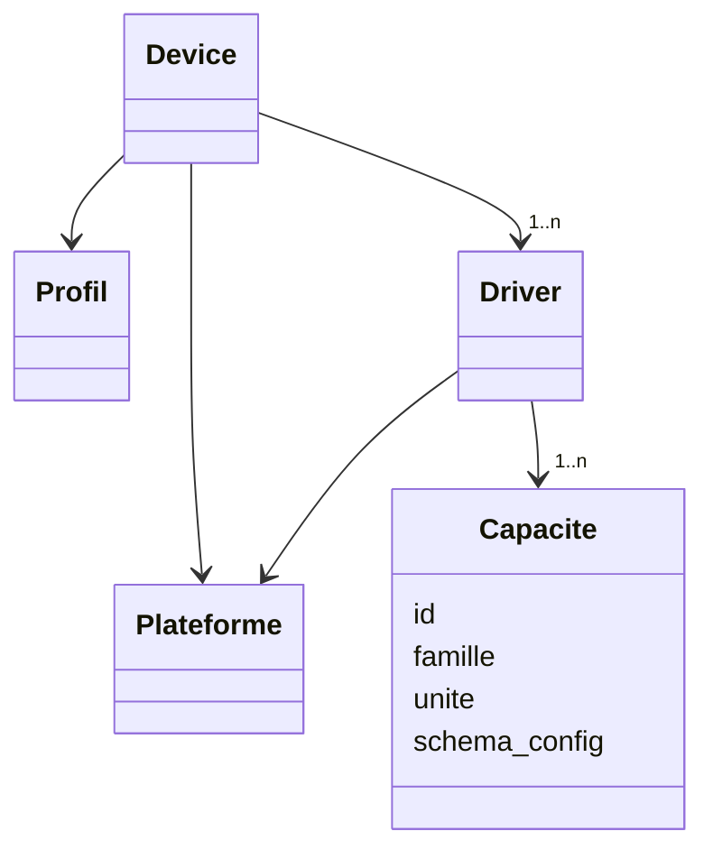

La série O2 d'une capacité suit `{org}/{device}/{capacité}`. Le GPIO devient un détail : recâbler un pin ne casse ni les courbes ni les dashboards. Les capacités suivent un versioning additif (`capabilities.v1`) : jamais de renommage.

### 2.2 Familles produit de devices

La taxonomie décrit le contenu d'un firmware. Dans l'UI, l'utilisateur choisit d'abord une famille. La source unique est `pnex_core::DeviceFamily` (front et back).

| Famille | Ce que fait l'utilisateur | Firmware | Modèles du catalogue |
|---|---|---|---|
| `Generic` | Configure ses pins depuis l'UI (modes, write, subscribe, PWM) | Firmware générique compilé par device, ou projet de l'IDE custom (D87–D94) | `generic_esp8266`, `generic_esp32c3`, `generic_esp32`, `generic_esp32s3`, `generic_esp32c6` (`GENERIC_IO_PREDEFS`) |
| `Predefined` | Branche une carte typée, aux fonctions fixes | Firmware maintenu par PneX, fixé par le modèle | `generic_esp32cam` (vidéo) |
| `Agent` | Installe un binaire sur un PC ou un Raspberry Pi | Pas de firmware (§3.5) | `edge_agent` |
| `Browser` | Installe une extension (D255, `browser-agents.md`) | Pas de firmware | `browser_agent` |

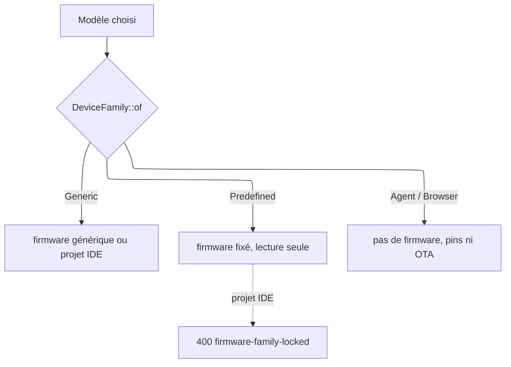

Règles de famille :

- Un projet de firmware custom peut remplacer seulement le firmware générique (`accepts_custom_firmware`). Sinon, le serveur répond `400 firmware-family-locked`.
- Un device à firmware custom est admis par les pins de son sketch, jamais par l'overlay du modèle générique.
- Le firmware d'une carte prédéfinie n'est pas géré par l'utilisateur. L'assistant de création n'offre aucun choix de firmware pour ce modèle.
- Un agent logiciel (`is_software`) n'a ni firmware, ni pins, ni OTA. Le catalogue lui donne la carte `GENERIC` (D121), et `board_id` reste nullable.

### 2.3 Collecteurs (D48)

Un **collecteur** est un client qui envoie des données sans être une carte : pas de pins, pas de build firmware, pas de safe-states. Il suit le même modèle qu'un device : identité, config poussée (desired-state), ingestion vers les séries, diagnostics.

| | Firmware | Agent edge | Extension | App mobile |
|---|---|---|---|---|
| Contexte | MCU non supervisé | machine de l'utilisateur | navigateur de l'utilisateur | téléphone de l'utilisateur |
| Confiance | totale au serveur | jeton device | déléguée par l'utilisateur | utilisateur via OIDC |
| Présence | WS permanent | daemon + file disque | navigateur ouvert | à l'usage |
| Survit à une coupure | profils autonomes | oui | non | sans objet |

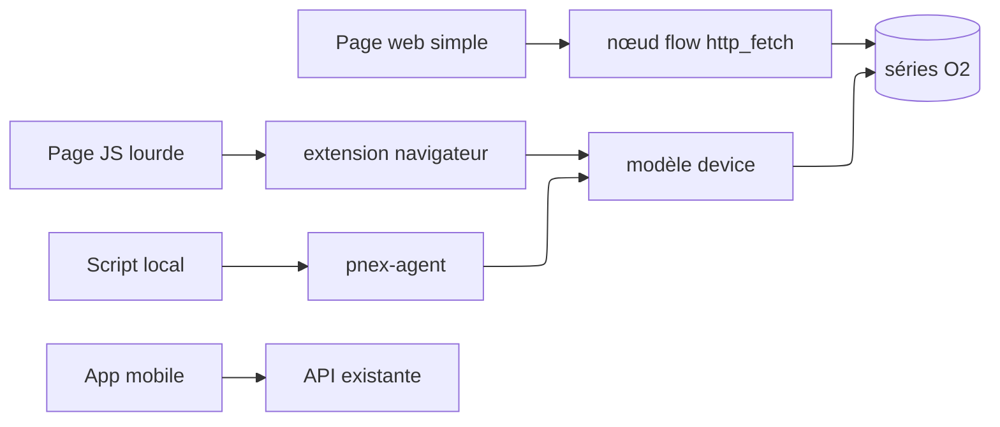

Le modèle « source ≠ binding » de la doctrine initiale a été remplacé. Une page web simple passe par le nœud de flow `http_fetch` (crate `pnex-node-http-fetch`). Une page JS lourde passe par l'extension « type device » de `browser-agents.md`. L'agent edge est un device (D95). L'app mobile est un client OIDC de l'API existante, pas un collecteur push.

Règles qui restent valides pour tout collecteur :

- Un collecteur ne porte jamais le JWT d'un utilisateur. Il porte un jeton device révocable.
- L'extension rapporte ce que le navigateur de l'utilisateur affiche. Le serveur ne lui délègue jamais une collecte massive.
- Une config poussée est une donnée, jamais du code. L'extension n'exécute aucun script distant.
- Un échec répété met la tâche en pause et lève une alerte. Il n'y a jamais de réactivation silencieuse.

## 3. Fonctionnement

### 3.1 Firmware en couches

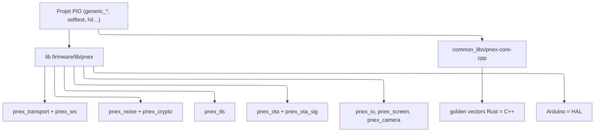

La lib `firmware/lib/pnex/` porte la mécanique commune : Wi-Fi, WebSocket, lien Noise (D156), TLS, OTA, écran, caméra, banc de pins. Le serveur l'embarque dans chaque build. Chaque projet garde sa politique : backoff, safe-states, announce, affichage.

Règles :

1. **Arduino est la HAL.** GPIO, I2C et ADC sont identiques sur toutes les plateformes. Une couche HAL contient seulement les divergences (ADC, WDT, deep sleep, stockage flash, wrap de `millis()`).
2. **`pnex-core-cpp` est le miroir de `pnex_core`.** `crates/pnex-core/tests/golden_vectors.rs` génère les vecteurs (`PNEX_REGEN_GOLDENS=1`). `firmware/core-cpp-tests` les rejoue sur l'hôte (`pio test -e native`, étape de CI). Le miroir ne peut pas dévier sans casser la CI.
3. **La composition se fait à la compilation.** Un env PIO = plateforme × profil × config device. Il n'y a pas de plugin au runtime. Le manifeste est compilé dans le `.bin`.
4. **`config.h` est inclus par `pnex_transport.cpp` seulement.** Ses globales non `const` seraient dupliquées au link.

Résilience de la boucle (O71) :

- Sur ESP32, un watchdog de 60 s surveille la tâche de la boucle. Les attentes longues le nourrissent (backoff, Wi-Fi, téléchargement OTA). L'ESP8266 garde son WDT matériel de 4 s.
- Sur les deux cœurs, le device redémarre après 10 min sans session.
- Sur ESP32, la poignée de main TLS est bornée à 20 s.
- Le serveur journalise le refus 4003 (bail tenu par une session vivante).

### 3.2 Profils et autonomie (D45)

| Profil | Boucle | Buffer | Config persistée | Obligations | État |
|---|---|---|---|---|---|
| `pin_slave` | serveur | non | non (re-cast à l'announce) | safe-states à chaque perte de lien, backoff | codé (`generic_*`) |
| `regulator` | device | oui | oui (D45) | safe-state si capteur muet, golden vectors `pnex_core::control`, buffer + flush | non codé |
| `logger` | aucune | oui | sans objet | buffer + flush, cadence locale | point d'extension |

Le `pin_slave` ne garde rien en flash : le serveur lui renvoie sa config à chaque announce. Un profil autonome ne peut pas suivre cette règle. Un reboot pendant une coupure internet le laisserait sans config, donc en safe-state (chauffage coupé en hiver).

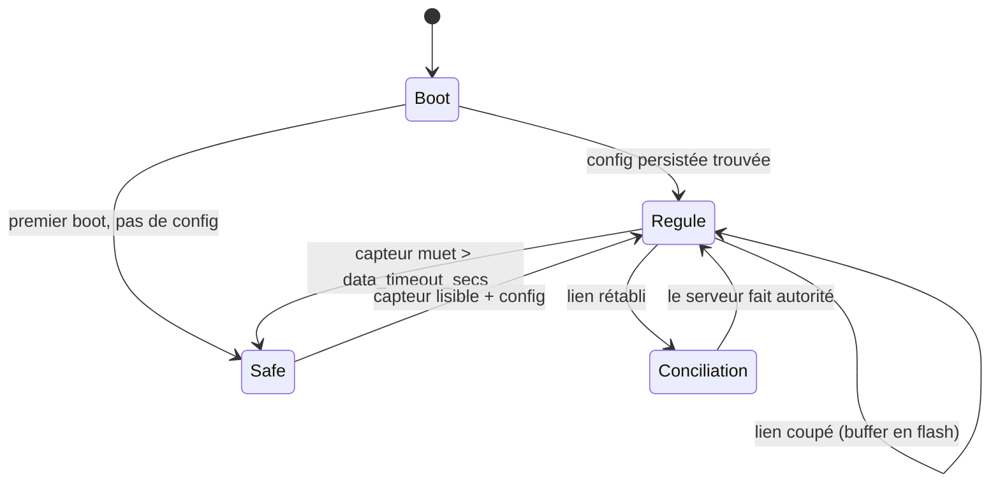

Règles du profil autonome :

- Le device doit persister son `ControlConfig` en flash (NVS sur ESP32, LittleFS sur ESP8266). Il reprend la régulation avant toute reconnexion.
- Au retour du lien, l'announce fait une conciliation par version de config. Le serveur fait autorité.
- Le buffer est un anneau en flash borné : 24 h à 1 min ≈ 1 440 échantillons × 30 o ≈ 43 Ko. Le flush est idempotent (D46) et limité quand le lien est faible.
- L'horloge est `millis()`, monotone et sûre au wrap. RTC et SNTP ne sont pas obligatoires.
- Un lien WS coupé n'arrête pas la régulation. Le safe-state vient d'un capteur illisible ou d'un premier boot sans config (`control-cards.md`).

### 3.3 Datation des échantillons bufferisés (D46)

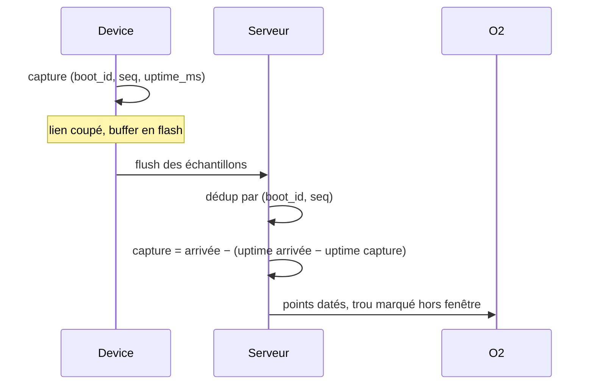

- `boot_id` est tiré au boot, `seq` croît dans le boot. Un flush rejoué ne crée pas de doublon.
- Le serveur reconstruit l'heure de capture depuis l'uptime transporté dans chaque échantillon. Il vérifie la cohérence avec la cadence souscrite.
- Au-delà de la fenêtre de confiance, le serveur marque un trou. Il n'invente jamais de courbe.
- Le serveur reste le point de datation. D46 s'appuie sur D12 (timestamp device optionnel, `ts_source`).

### 3.4 Manifeste de capacités (D47)

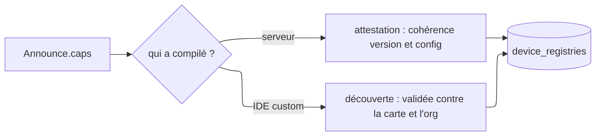

- Quand le serveur compile le firmware, il connaît déjà le manifeste. L'announce est alors une attestation, et le serveur fait autorité.
- Pour un firmware custom, le manifeste est la source. Le serveur le valide contre la carte et l'org.
- L'overlay de carte reste l'autorité du `pin_slave`. Le manifeste est l'autorité du sémantique et du custom.

Le contrat fil (`crates/pnex-core/src/proto.rs`) est additif :

- `Announce.caps` : liste de `CapDesc{id, family, unit?, version}`.
- `StateReport` : ajoute `cap_id`, `uptime_ms`, `boot_id` et `seq` au couple `{gpio, value}`. Avec `cap_id`, le serveur route vers la série `{org}/{device}/{capacité}` (`source_type = generic_cap`). Le `pin_slave` n'émet pas `cap_id`.
- `RegState` est routé vers O2 (`<node>_sensor`, `_out`, `_cycles`). Une valeur `null` devient NaN, donc pas de point.
- Un écran de debug n'est pas une capacité de mesure. C'est un périphérique device (`device_registries.peripherals`). L'announce peut l'attester par la cap `{"id": "screen", "family": "display"}`.
- La cap `ota` atteste que le firmware accepte l'OTA (§3.7).

### 3.5 Agent edge `pnex-agent` (D95–D99)

L'agent est un binaire Rust (crate `crates/pnex-edge-agent`, bin `pnex-agent`). Il tourne sur un PC, un serveur ou un Raspberry Pi. Il sert une API HTTP locale aux scripts, garde les points sur disque et les envoie au serveur. Les exemples d'ingestion sont dans `examples/edge-agent/`.

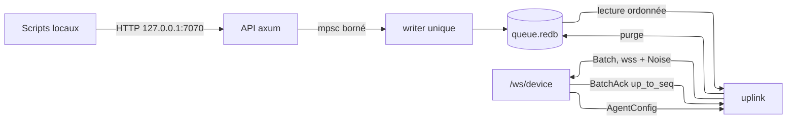

- `202` signifie que le point est écrit sur disque (fsync).
- Le writer fusionne les requêtes concurrentes en une transaction redb. L'uplink lit en parallèle (MVCC).
- Si le disque ne suit pas, l'API répond `503` avec `Retry-After`.
- L'uplink garde 4 lots en vol. Un lot fait 500 points au plus (`AgentConfig.max_batch`) et 64 KiB au plus.
- Le backoff est exponentiel avec jitter, de 1 s à 60 s.

Ingestion (D96) :

- L'agent accepte toute clé et toute valeur JSON, avec une unité optionnelle. La clé est normalisée (`normalize_measurement_name`, D16) et découverte à la première vue (`agent_keys`, `discovered_measurements`).
- Un quota de clés distinctes (`max_unique_measurements`, 1000 par défaut, modifiable dans l'UI) bloque l'explosion de cardinalité.
- Toute valeur va dans le cache live Valkey. L'historique O2 est activé par clé (`record_o2`, décoché par défaut) ou par point (`"record": true`).
- Un nombre ou un booléen devient une série métrique (`source_type = edge_agent`). Un texte ou un objet va dans `pnex:lastj:v1:…` et, s'il est enregistré, dans le stream O2 `ev_agent_events`.
- Une clé non enregistrée a un TTL Valkey de 7 jours.

Protocole (D97) : `DeviceMsg::Batch{epoch, points[{seq, key, value, ts_ms, unit?, record?}]}`, `ServerMsg::BatchAck{epoch, up_to_seq}` et `ServerMsg::AgentConfig`. Ces variantes ont un `Deserialize` manuel (piège `arbitrary_precision`).

- `epoch` identifie le fichier de file. `seq` croît et n'est jamais réutilisé.
- Le serveur déduplique par high-water mark `(device, epoch)` dans Valkey (`pnex:agent:hwm:v1:…`). Livraison au moins une fois + dédup = effet exactement une fois.
- `ts_source = device` : le serveur garde l'heure de capture, bornée à +5 min dans le futur. L'écriture Valkey est « set if newer » : un point rejoué ne remplace jamais une valeur plus fraîche.
- L'ack part après l'enqueue dans le sink, avant le flush O2. C'est une limite assumée.

Enrôlement (D98) :

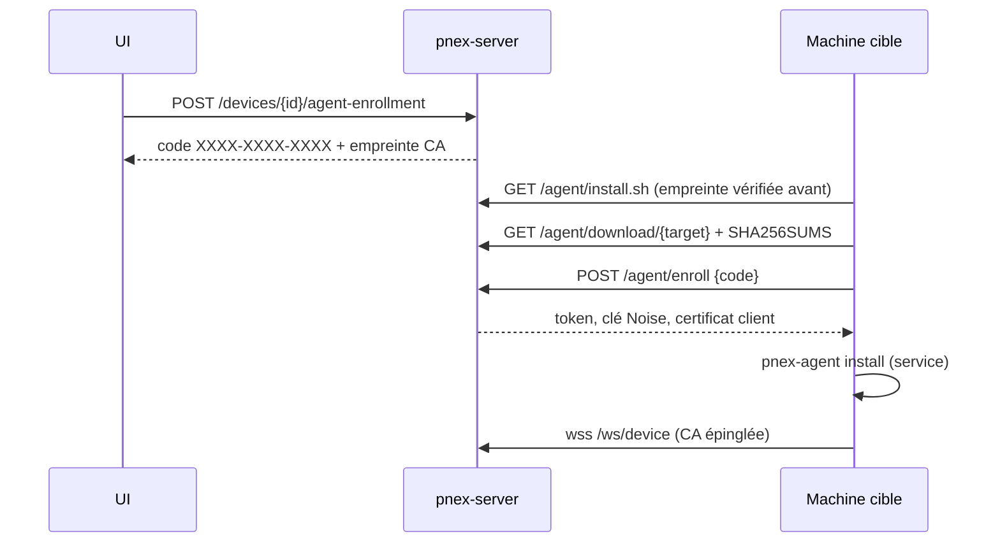

- Le code a 60 bits, vit 15 min et un seul est actif par agent. Le serveur stocke seulement son SHA-256.
- `POST /api/v1/agent/enroll` est public et limité à 10/min par adresse (§3.6). Il consomme le code de façon atomique.
- L'enrôlement fait tourner le jeton et la clé. Une réinstallation déconnecte l'ancienne machine (4005).
- `--ca-sha256` donne l'empreinte de `/api/v1/meta/ca`. L'agent télécharge la CA, compare l'empreinte, puis accepte seulement cette CA (rustls). Sans empreinte, il utilise les racines web publiques (mode cloud).
- Fichiers : `config.toml`, `secrets.json` (0600, ou ACL SYSTEM + Administrators), `ca.pem`, `queue.redb`, `logs/`.

Distribution (D99) :

- `pnex-server` sert les binaires (`/api/v1/agent/download/{target}`, `SHA256SUMS`, `PNEX_AGENT_DIST_DIR`). Cibles : Linux x86_64, aarch64 et armv7 en musl statique, Windows x86_64.
- `task build:agent` construit la distribution (`deploy/agent/build-dist.sh`, zig épinglé). L'image a un stage `agent-dist`.
- `pnex-agent install` crée un service systemd (utilisateur `pnex-agent`), un service `--user` sans root ou un service Windows LocalSystem.
- L'API locale écoute `127.0.0.1:7070`. L'ouverture LAN est un opt-in (`--listen 0.0.0.0:7070 --allow 192.168.1.0/24`), sans mot de passe.

Capture média : un agent Linux avec `media_capture = true` et ffmpeg annonce la capability `media_capture`. Il devient un lieu de capture et envoie ses segments sur `/ws/media`, avec la même identité que `/ws/device` (`media.md`, D159–D160).

### 3.6 TLS edge (D70)

Un reverse proxy nginx termine tout le TLS (navigateurs, APK, devices) sur une seule origine `https://<domaine>`. Cela supprime CORS, le port 8443 et les cookies non sûrs.

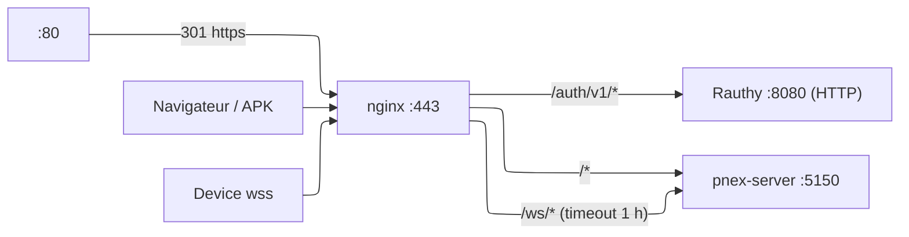

nginx est choisi parce qu'OpenSSL acquitte l'extension MFLN (RFC 6066). L'ESP8266 (BearSSL) a un tampon de réception de 2 Ko et exige des records TLS courts.

| Serveur | MFLN acquitté | Plus gros record | ESP8266 |
|---|---|---|---|
| nginx, HAProxy (OpenSSL) | oui | ≤ 512 o négocié | OK |
| Traefik, Caddy (Go) | non | 16 Ko | KO |
| rustls brut | non | 8 216 o | KO |

Règles de nommage :

- Le domaine par défaut est `<hostname>.<domaine de recherche>` quand le DNS de la box le connaît. Sinon, le repli est mDNS `<hostname>.local`.
- Une fois choisi, `PNEX_DOMAIN` est relu dans `edge.env` à chaque `edge:up`. L'auto-détection se fait seulement au premier lancement.
- Une origine par IP est possible (`PNEX_DOMAIN=<ip>`). WebAuthn refuse un `rp_id` IP : `apply-edge.sh` pose `PNEX_RP_ID=localhost`, et les passkeys sont indisponibles.
- En mode `local`, le certificat porte chaque IPv4 de la machine en `IP:` et en `DNS:` (mbedTLS 2.x compare seulement les dNSName). Les devices s'enregistrent par IP. Une réservation DHCP est recommandée pour la machine edge.
- L'alias `<hostname>.local` est redirigé (301) vers le domaine canonique.
- Rauthy publie son port HTTP en loopback seulement, avec `DEV_MODE=false` et `TRUSTED_PROXIES` = bridge docker.
- TLS 1.2 reste actif : BearSSL n'a pas TLS 1.3.

Certificats :

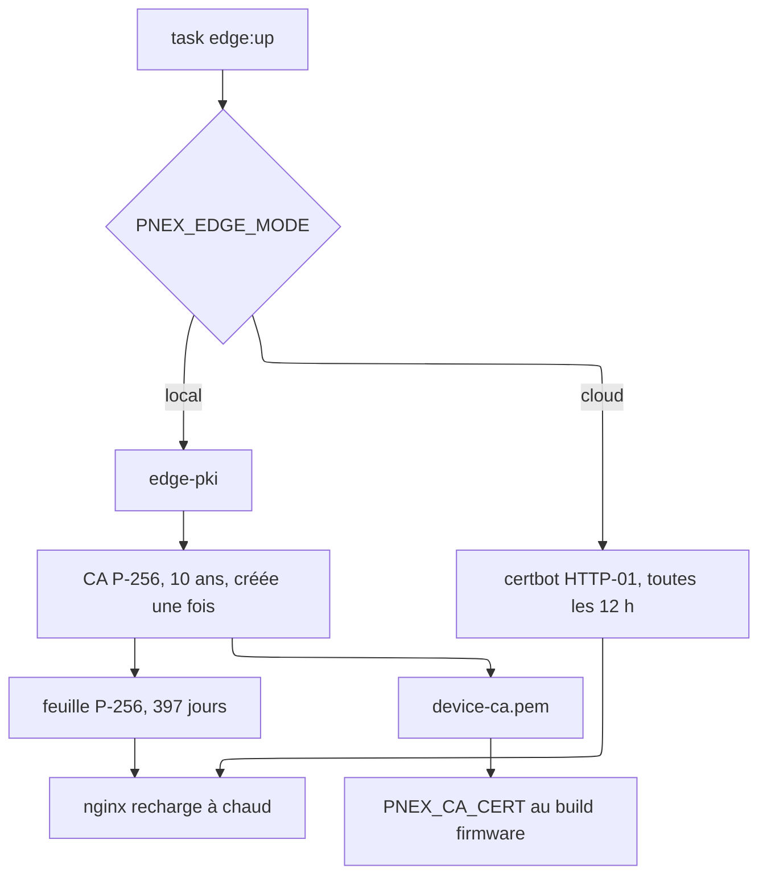

- **Danger :** ne régénérez pas la CA locale. Les firmwares l'épinglent, et un device sans la nouvelle CA reste hors ligne jusqu'à un reflash USB.
- La feuille est réémise si elle manque, expire dans moins de 30 jours, change de SAN ou de CA. `40-cert-watch.sh` recharge nginx (md5 toutes les 30 s).
- `fullchain.pem` contient la feuille seule. La racine est l'ancre de confiance.
- Le mode `cloud` exige `ACME_EMAIL`. Il n'a pas été validé en réel.
- Le build firmware lit la CA par `PNEX_CA_CERT_FILE` (CA locale, ou ISRG Root X1 en cloud). Le firmware n'a plus de `setInsecure` : sans CA, toute poignée de main échoue (D154).
- Sur ESP8266, BearSSL vérifie les dates : `pnex_tls` lance SNTP et passe `setX509Time` (heure NTP, sinon date de build). Sur ESP32, mbedTLS ne vérifie pas les dates.

Confiance des apps natives (TOFU) :

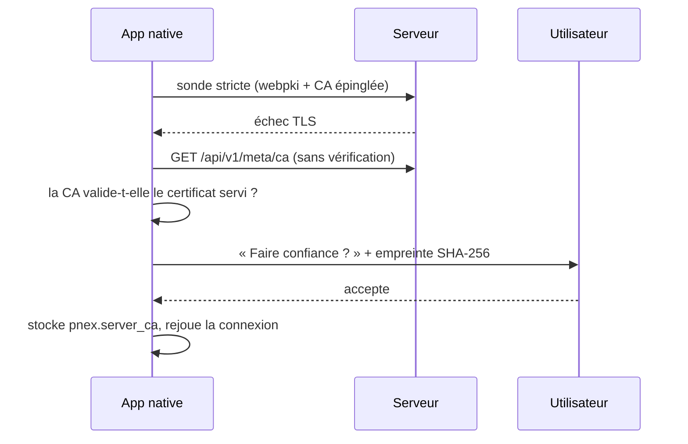

- Le scan LAN sonde chaque hôte du /24 en `https://{ip}` puis en `http://{ip}:5150`. La sonde https lit la carte d'identité publique seulement, jamais un jeton.
- L'utilisateur compare l'empreinte avec Profil → À propos. Une CA changée relance le dialogue, jamais une bascule silencieuse.
- La page Rauthy s'ouvre dans le navigateur système. L'utilisateur doit y installer aussi la CA.
- `patch-android-manifest.py` ajoute un `<base-config>` system + user pour la WebView.

Limitation de débit (`services/rate_limit.rs`) :

| Route | Limite par minute |
|---|---|
| `/api/v1/oauth2/*` | 60 (sondage du pont natif : 240) |
| `/api/v1/agent/enroll` | 10 (`agent-enroll-rate-limited`) |
| `/ws/device`, `/ws/camera*` | 300 |
| `/api/v1/public/tours/*` | 600 |

- La fenêtre est fixe. Les compteurs sont dans Valkey (script Lua, partagés entre pods). Sans Valkey, chaque pod compte localement.
- Un refus donne `429 rate-limited` avec `Retry-After`.
- L'IP client est l'adresse socket du pair. Si le pair est un proxy de confiance, c'est le saut le plus à droite non fiable de `X-Forwarded-For`. Une IPv6 est regroupée par /64.
- **Danger :** si le backend est exposé sur un LAN sans proxy, posez `PNEX_TRUSTED_PROXIES=none`. Sinon, un hôte du LAN peut forger `X-Forwarded-For` et contourner sa limite.

### 3.7 OTA

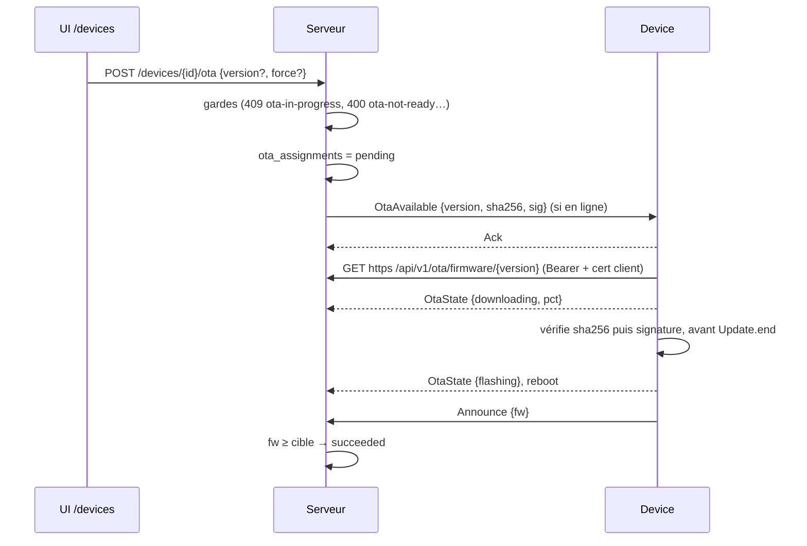

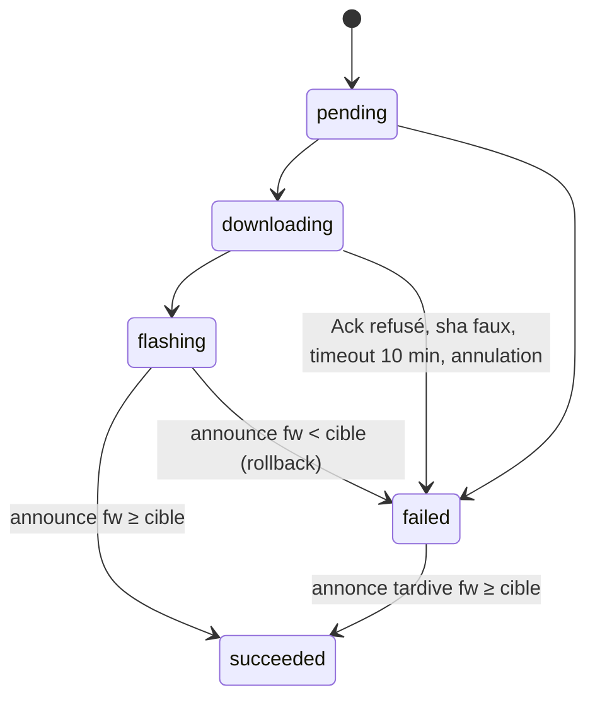

Fonctionnement :

- Un device hors ligne reçoit son ordre à l'announce suivant (`pushed: false`).
- Le serveur décide `succeeded` seulement par la comparaison de version à l'announce après reboot.
- Un watchdog serveur (toutes les 60 s) passe en `failed("timeout")` un téléchargement ou un flash sans trame depuis 10 min.
- Le device enregistre la demande dans le callback WS. `loop()` lance le téléchargement après. Un HTTPS imbriqué dans le handler de trame fait déborder la pile sur ESP32.
- La version est l'id du build record. Le build l'injecte (`-D PNEX_FW_VERSION`), le device l'annonce (`Announce.fw`), le serveur la garde (`device_registries.fw_version`).
- Un build produit deux artefacts : l'image fusionnée pour le flash USB, et l'image app `org_{id}/ota/{device}/{version}.bin` avec `ota_sha256`.
- La rétention des builds garde les 5 derniers records d'un device (`KEEP_PER_DEVICE`), plus le build qui tourne et la cible d'une OTA active.

Sécurité (SEC-18) :

- Le téléchargement exige le jeton en `Authorization: Bearer` et le certificat client du device, en HTTPS (même `authenticate_device` que `/ws/device`). Le chemin doit nommer le device du jeton.
- Le serveur signe chaque ordre avec la clé Ed25519 de l'instance. La graine est dans le coffre (secret plateforme `pnex-ota-signing-key`), créée au premier usage sous verrou de cluster.
- La signature couvre `"PNEX-OTA-1" ‖ len ‖ device_id ‖ len ‖ version ‖ sha256(image)` (`pnex_core::ota_sig`, miroir `pnex_ota_sig.cpp` + Monocypher). Elle empêche de rejouer l'image d'un autre device ou une vieille version.
- Chaque build compile la clé publique (`PNEX_OTA_PUBKEY`). Un build qui ne lit pas la clé échoue (`build_ota_key`).
- Le device refuse avant tout téléchargement un firmware sans clé ou un ordre sans signature. Il refuse une signature fausse avant `Update.end`.
- Le device refuse une version strictement inférieure sur toutes les puces. Une version égale passe (redéploiement forcé).
- **Danger :** ne perdez pas la clé de signature. Sa perte impose un reflash USB de tous les devices, car il n'y a jamais de rotation automatique.

ESP8266 (modèle eboot) :

- L'OTA écrit la nouvelle image après le sketch courant. Au reboot, eboot la recopie en 0x0. Le layout `eagle.flash.4m1m.ld` reste inchangé.
- L'image actuelle + la nouvelle image doivent tenir dans environ 1 Mo. Le serveur refuse une image trop grande (`ota-too-large`). Sinon, `Update.begin` échoue proprement et le vieux firmware reste.
- Pendant le téléchargement, le WS est fermé pour libérer la RAM. L'UI ne voit pas la progression : l'announce après reboot donne le résultat.

UI : la page Devices affiche `build #N`. Le bouton « Mettre à jour (OTA) » est actif si la cap `ota` est présente et le dernier build a réussi. La progression vient d'un poll de 5 s. Une notification in-app signale la fin. Sur un site sans internet, la même stack installée sur le LAN (laptop ou Pi) suffit.

### 3.8 Mode M2M résilient (PRD, non codé)

Ce mode n'est pas codé : aucun code zenoh ni OpenThread n'existe dans le dépôt. Il vise une boucle sonde → décision → actionneur qui survit à la perte du serveur.

Le mode flex existant fait passer la décision par le moteur de flows central. Si le moteur ou le lien tombe, la boucle s'arrête et les devices passent en safe-state. Le mode M2M place la décision dans le nœud qui porte l'action.

| Axe | Doctrine serveur (reste de PneX) | École M2M |
|---|---|---|
| Décision | serveur ou moteur de flows | dans le nœud actionneur |
| Boucle terrain | passe par le serveur | pair-à-pair, sans hub |
| Config | le serveur fait autorité (D45) | le hub détient la config, envoi au changement + sync périodique |
| Transport | WSS + Noise vers le serveur | mesh IPv6 (OpenThread) + pub/sub zenoh-pico |
| Contrat | `proto.rs`, versioning additif | contrat M2M distinct (clés zenoh, schéma) |
| Perte du serveur | événement de sécurité | perte de l'observation, pas du contrôle |
| Ouverture | tout device | devices spécialisés, contrat strict |

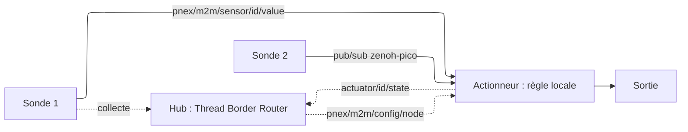

Principes du PRD :

- Le réseau est un mesh IPv6 auto-cicatrisant (OpenThread sur 802.15.4). L'applicatif est un pub/sub pair-à-pair sans broker (zenoh-pico).
- L'actionneur calcule avg, min ou max sur ses sondes et applique une règle simple (métrique, opérateur, seuil, action).
- Chaque nœud a un fail-safe choisi : timeout par source, puis dernière valeur (`hold_last`) ou état sûr (`safe_state`).
- La sync hub ↔ nœud porte la version de config (hash + seq). Le hub renvoie la config seulement en cas d'écart.
- Un device non conforme au contrat est refusé au provisioning.
- Hors périmètre : bus de sécurité certifié (SIL/PL), temps réel dur, UI dans le POC.

Phases :

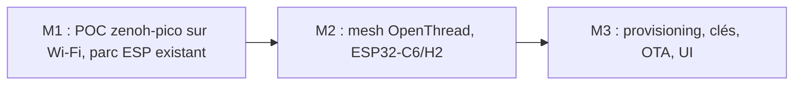

Critères de succès du POC : la boucle tourne sans centre, continue après la coupure du hub, applique le fail-safe à la perte d'une source et refuse un device non conforme. En M2, la perte d'un nœud relais ne coupe pas la communication.

## 4. Exigences

1. Une capacité doit garder son id. Une évolution doit être additive (`capabilities.v1`).
2. Un projet de firmware custom doit être refusé sur une famille autre que `Generic` (`400 firmware-family-locked`).
3. Le miroir `pnex-core-cpp` doit passer les golden vectors en CI.
4. Un firmware ESP32 doit redémarrer après 10 min sans session.
5. Un profil autonome doit persister sa config et reprendre la régulation avant toute reconnexion.
6. Un flush rejoué ne doit créer aucun doublon (`(boot_id, seq)` ou `(device, epoch)`).
7. Le serveur ne doit jamais inventer de point dans un trou de données.
8. L'API locale de l'agent doit répondre `202` seulement après fsync.
9. Un code d'enrôlement doit être à usage unique, valable 15 min, stocké en SHA-256.
10. Un agent doit refuser toute CA autre que celle de l'empreinte donnée.
11. Un firmware ne doit jamais se connecter sans vérifier le certificat serveur.
12. Une OTA doit vérifier le sha256 et la signature avant le basculement.
13. Une OTA vers une version strictement inférieure doit être refusée.
14. Un téléchargement OTA doit exiger le jeton et le certificat du device nommé dans le chemin.
15. Une app native ne doit jamais accepter une nouvelle CA sans dialogue de confiance.

## 5. Décisions

### D44 — Taxonomie orthogonale, firmware en couches

Plateforme × capacité × profil, drivers sémantiques, composition à la compilation (§2.1, §3.1).

### D45 — Autonomie = profil, `ControlConfig` persisté en flash

Le profil autonome persiste sa config et bufferise. Le re-cast devient une conciliation (§3.2).

### D46 — Datation par reconstruction serveur

Dédup `(boot_id, seq)`, reconstruction par uptime, trou marqué (§3.3).

### D47 — Manifeste de capacités, attestation ou découverte

Contrat fil additif : `Announce.caps`, `StateReport` étendu, `RegState` vers O2 (§3.4).

### D48 — Collecteurs = sources, pas des cartes

Le modèle source ≠ binding est remplacé par le nœud `http_fetch` et par le modèle device pour l'extension et l'agent (§2.3).

### D70 — TLS partout, nginx en edge

Une origine HTTPS, nginx pour MFLN, CA locale ou Let's Encrypt (§3.6).

### D95 — Un agent est un device

`edge_agent`, même tunnel `/ws/device`, mêmes gardes 4003 et 4005. Pas de pins ni de manifeste. Build, OTA et commandes de pins donnent `400 agent-unsupported-action`.

### D96 — Ingestion libre, Valkey toujours, O2 par clé

Aucun catalogue, quota de clés distinctes, historique O2 en opt-in (§3.5).

### D97 — Protocole `Batch` / `BatchAck`, horodatage d'origine, dédup

High-water mark `(device, epoch)`, « set if newer » dans Valkey (§3.5).

### D98 — Enrôlement par code à usage unique + CA épinglée

Code 60 bits, rotation du jeton et de la clé, empreinte de CA (§3.5).

### D99 — Distribution servie par l'instance, API locale en loopback

Binaires musl et Windows servis par `pnex-server`, API sur `127.0.0.1:7070` (§3.5).

Renvois : D12 (`ts_source`), D16 (canon des noms), D20 (`control-cards.md`), D42–D43 (organisation, placements), D87–D94 (IDE custom, `custom-firmware.md`), D121 (catalogue en code), D153–D157 (identité device, Noise, `security.md`), D159–D160 (capture média, `media.md`), D254–D265 (`browser-agents.md`).

## 6. Interfaces

| Route | Effet |
|---|---|
| `POST /api/v1/devices/{id}/ota` | crée une assignation OTA |
| `GET /api/v1/devices/{id}/ota` | état de l'OTA |
| `DELETE /api/v1/devices/{id}/ota` | annule l'OTA active |
| `GET /api/v1/ota/firmware/{version}` | téléchargement par le device (jeton + certificat) |
| `GET`, `PATCH /api/v1/devices/{id}/agent` | réglages de l'agent |
| `GET /api/v1/devices/{id}/agent-keys` | clés découvertes |
| `PATCH`, `DELETE /api/v1/devices/{id}/agent-keys/{key_id}` | règle `record_o2` d'une clé, ou la retire |
| `POST /api/v1/devices/{id}/agent-enrollment` | génère un code d'enrôlement |
| `POST /api/v1/agent/enroll` | consomme le code (public, limité) |
| `GET /api/v1/agent/download/{target}` | binaire de l'agent ou `SHA256SUMS` |
| `GET /api/v1/agent/install.sh`, `install.ps1` | scripts d'installation |
| `GET /api/v1/meta/ca` | CA racine de l'edge (404 sans edge ou en cloud) |

API locale de l'agent : `POST /v1/points`, `POST /v1/points/{key}`, `GET /v1/status`, `GET /v1/metrics`, `GET /healthz`.

| Tâche | Effet |
|---|---|
| `task edge:up` | génère `deploy/edge/edge.env`, lance pki, nginx (et certbot), recrée Rauthy derrière le proxy |
| `task edge:trust` | importe la CA sur la machine locale |
| `task edge:down` | retire l'edge et `edge.env` |
| `task app:up` | passe par `apply-edge.sh` si `edge.env` existe |
| `task build:agent` | construit la distribution de l'agent |

Variables : `PNEX_DOMAIN`, `PNEX_EDGE_MODE` (`local`, `cloud`), `PNEX_EDGE_BACKEND` (`host`, `container`, D71), `PNEX_EXTRA_SANS`, `ACME_EMAIL`, `ACME_STAGING`, `PNEX_BACKEND_UPSTREAM`, `PNEX_CA_CERT_FILE`, `PNEX_TRUSTED_PROXIES`, `PNEX_RATE_LIMIT`, `PNEX_AGENT_DIST_DIR`. Fichiers : `compose.edge.yaml`, `deploy/edge/`, `deploy/agent/`.

## 7. Reste à faire

1. Firmware `regulator` (D45, D46) : persistance, buffer en flash et boucle autonome. Il exige du hardware.
2. Couches `pnex-caps` et `pnex-hal` : elles n'existent pas. La HAL reste Arduino.
3. Attestation stricte du manifeste et `ControlConfig` comme cas d'un Config par capacité.
4. Palette du flow editor par (device, capacité) au lieu du label de pin.
5. Page `/firmware` : lister aussi le firmware générique et les firmwares prédéfinis, en lecture seule.
6. Famille d'un modèle : liste en dur (`GENERIC_IO_PREDEFS`). Une colonne `family` au catalogue est possible. Choix de Shan.
7. Nommage : `generic_esp32cam` porte « Generic » mais relève de la famille `Predefined`. Choix de Shan.
8. App mobile en collecteur : appairage par QR `{host, device_id, pair_code}` non codé (jamais de jeton device dans un QR).
9. Agent : test sur une vraie machine Windows, service launchd et distribution macOS, pont WS pour les devices LAN, commandes descendantes (`Command`, D88).
10. O2 rejette les points plus vieux que `ZO_INGEST_ALLOWED_UPTO` (5 h par défaut). La compose de dev passe à 168 h. À reporter dans `pnex-deploy`.
11. TLS : E2E réel ESP8266 en WSS (heap BearSSL). Mode `cloud` à valider avec un domaine public. `nameConstraints` sur la CA locale à étudier (support mbedTLS et BearSSL).
12. OTA : test matériel d'une signature invalide (il exige de remplacer la clé du coffre). Progression ESP8266 en TLS non planifiée. Signature hors builder = EX-B7 (`security.md`).
13. M2M : prototyper zenoh-pico sur 6LoWPAN (MTU 1280 o), mesurer la découverte pair-à-pair et la latence. Fréquence de boucle et fréquence de sync à arbitrer par Shan.
