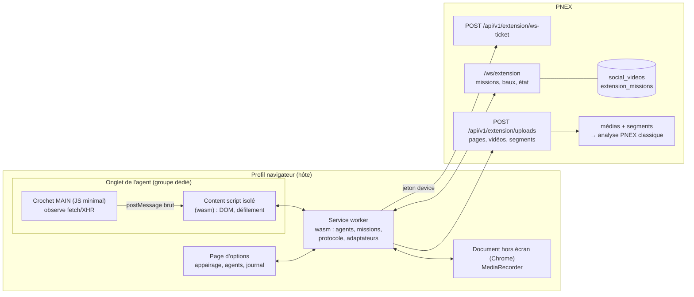

# Agents navigateur (extension Chrome/Firefox) — spécification v2 (C1b)

> Statut : **proposition v2 (2026-10-18)**, décisions D254–D270, D281–D284.
> **v2 validée et codée** (L0–L5, avancement en §14) ; reste les campagnes
> de test et les points à trancher O89–O94 (`observations.md`).
>
> La v1 (2026-09-15, 10 décisions) visait une collecte basique : un
> sélecteur CSS rafraîchi, une valeur vers une série O2. La directive du
> 2026-10-18 élargit l'objet à des **agents de veille** : suivre des
> comptes (X, TikTok), des lives, capturer vidéos et métadonnées, collecter
> du HTML, plusieurs agents déployés, chacun verrouillé sur une seule
> page. La collecte basique devient une mission parmi d'autres (§5).

Liens : `edge-model.md` §8 (doctrine edge), `security-tiers.md` §6 bis
(identité device D153–D158), `media-ingest.md` (flux, segments, D159),
`media.md` (médias), `doc-search.md` (indexation), `cases.md` §4 et
`discourse-analysis.md` DA6 (périmètre, rouvert par D254),
`api-contract.md`, `mcp.md`, `ai-assistant.md` §9, `security.md`.

## 1. Ce qui change par rapport à la v1

| | v1 | v2 |
|---|---|---|
| Rôle | un capteur « type device » | un **agent** : un onglet, des missions, un rythme |
| Sortie | valeur → série O2 | valeur → O2 ; **page HTML, vidéo, métadonnées → médias PNEX** |
| État | aucun | **registre des vidéos** vues/capturées, curseur par compte suivi |
| Concurrence | une extension | **N agents**, bail serveur par cible, une page par agent |
| Transport | `/ws/device` (devenu mTLS depuis D153 : inaccessible au navigateur) | ticket device → `/ws/extension` (contrôle) + **upload HTTP** (binaire) |
| Règles | `extension_rules` / `RuleSpec` (CSS) | `extension_missions`, typées (§5) |
| Navigateurs | Chrome, Firefox « plus tard » | Chrome d'abord, **chemin commun Firefox dès la conception** (§11) |

Ce qui reste de la v1 : identité device (pas de JWT user dans le plan de
données), deux plans gestion/données, config-as-data sans eval,
consentement par origine, journal local des exécutions.

## 2. Périmètre et position

**D254 — Périmètre étendu : sources publiques déclarées, une par une.**
Rouvre `cases.md` §4 et `discourse-analysis.md` DA6 pour l'extension :

- l'utilisateur **déclare** chaque cible (un compte, un live, une page) ;
  aucune découverte automatique, aucune recherche de profils, aucun
  parcours de graphe social (abonnés, réponses, mentions) : PNEX ne
  devient pas un collecteur de personnes ;
- l'agent lit ce que le navigateur affiche **à un humain connecté**, au
  rythme d'un humain (D258) : pas d'API privée appelée directement, pas de
  parallélisme, pas de contournement (captcha, mur de connexion, limite de
  débit, DRM : la mission passe en `blocked`, jamais de contournement) ;
- la position de `media-ingest.md` §13 reste vraie : PNEX est un outil
  générique, l'utilisateur répond de ses sources et des conditions des
  plateformes qu'il utilise (les CGU de plusieurs plateformes interdisent
  l'accès automatisé, quel que soit le rythme ; le risque de suspension
  porte sur le compte utilisé, rappelé à la création d'une mission) ;
- YouTube : **live et métadonnées** dans le périmètre ; la capture de VOD
  reste exclue tant que Q1 (§15) n'est pas tranchée (§13 de
  `media-ingest.md` : pas de préréglage de téléchargeur).

> **Amendé le 2026-10-19 (`partner-watch.md` D307–D310, proposition)** :
> la cible déclarée peut être un **site** (`web:site:<origine>`) ;
> l'agent (ou le crawl serveur) découvre ses pages **dans cette origine
> seulement** (`robots.txt`, `sitemap.xml`, liens internes, plafonds).
> Aucune découverte hors du site déclaré. Une page pertinente reçoit une
> **preuve** : capture pleine page, HTML nettoyé, texte, manifeste
> horodaté (amende l'amendement L1 de D261).

## 3. Vocabulaire

- **Agent** : un device de classe `extension` (une ligne `device_registries`,
  jeton device), qui possède **au plus un onglet par plateforme**.
- **Plateforme** : X, TikTok, YouTube, Facebook… ; pour le web générique,
  le site (origine). Clé de l'onglet de l'agent.
- **Hôte** : une installation de l'extension dans un profil navigateur.
  Un hôte porte un seul agent (D255).
- **Mission** : ce qu'un agent fait, typée (§5), déclarée dans l'UI PNEX.
- **Cible** : ce que vise une mission, normalisée (`x:@handle`,
  `tiktok:@handle`, `youtube:live:<id>`, `web:<url>`). Clé du bail (D257).
- **Adaptateur** : le code propre à une plateforme (§8), livré avec
  l'extension, jamais téléchargé.
- **Registre des vidéos** : ce que l'org a déjà vu ou capturé (D259).

## 4. Architecture

Le crochet MAIN reste en JS : la CSP des sites cibles bloque en général
l'instanciation wasm dans le contexte de la page. Il ne fait que relayer
les réponses brutes ; tout le décodage est en wasm, côté isolé ou worker.

## 5. Missions

**D256 — Missions typées, remplacent `extension_rules`.** Entité org
`extension_missions` (CRUD `can_write`, §9) :

| Type | Cible | Ce que fait l'agent | Sortie |
|---|---|---|---|
| `collect_value` | URL + sélecteur CSS + `attr` | refresh à intervalle, lit une valeur | `StateReport` → série O2 (v1 inchangée) |
| `collect_page` | URL | refresh à intervalle, instantané HTML + texte lisible | `media_asset` `document` (D261) |
| `follow_account` | compte X / TikTok | ouvre le profil, défile jusqu'au curseur, relève les nouveaux posts | métadonnées → registre ; vidéos neuves → capture (D260) |
| `watch_live` | URL d'un live (X, TikTok, YouTube) | ouvre le live, enregistre tant qu'il dure | segments → flux média (D260) |

Champs communs : `id`, `org_id`, `kind`, `target` (normalisée),
`params` (jsonb validé par type), `interval_secs` (≥ 60, jitter côté
agent), `agent_id` (option : épingler sur un agent), `enabled`,
`state` (`idle | running | blocked | failed`), `state_code`,
`cursor` (jsonb, dernier élément vu, écrit par le serveur), `version`.

`collect_value` sert de **mission de recette** du socle (L0) : elle
valide appairage, onglet, bail, transport avant toute plateforme.

## 6. Agents, onglet, verrou, rythme

**D255 — Un PC = un agent ; un onglet par plateforme, jamais deux.**
L'installation de l'extension porte un seul agent (consigne : un agent
par machine). L'agent ouvre ses onglets dans un groupe à son nom et
n'agit sur aucun autre onglet. Il tient **au plus un onglet par
plateforme** (un X, un Facebook, un YouTube, un TikTok, un par site web)
et ces onglets travaillent **en parallèle** ; jamais deux onglets X.
Les missions d'une même plateforme passent **l'une après l'autre** dans
son onglet ; un live occupe l'onglet de sa plateforme tant qu'il dure,
les autres missions de cette plateforme attendent, celles des autres
plateformes continuent. Plus de débit sur une plateforme = plus de
machines. Exception : une plateforme qui exige un onglet visible (TikTok)
prend le PC pour elle seule (D269). L'extension ne peut pas empêcher deux profils d'un même PC
d'être appairés : la règle est affichée, pas imposée (aucune API ne
donne d'identifiant matériel).

**D269 — Plateformes exclusives : un agent dédié à une seule plateforme.**
*Statut : note de conception, à régler finement par les mesures du
§16.1 ; aucune valeur `needs_foreground` n'est figée avant sa mesure.*

*Le problème.* Un navigateur ne montre qu'un onglet par fenêtre ; les
autres sont « cachés » (`document.visibilityState = hidden`). Deux
choses se produisent alors :

- le **site** réagit : certaines plateformes mettent la vidéo en pause
  dès que l'onglet est caché (événement `visibilitychange`) et ne
  chargent plus la suite du fil. C'est le cas signalé pour **TikTok**
  (à confirmer par mesure) : en
  arrière-plan, la vidéo s'arrête, l'enregistrement temps réel capte une
  image figée et le défilement ne charge plus rien ;
- le **navigateur** ralentit les onglets cachés (minuteries réduites à une
  par seconde puis par minute, rendu suspendu) ; une fenêtre réduite, ou
  entièrement recouverte par une autre, compte aussi comme cachée
  (détection d'occlusion de Chrome), de même qu'une session verrouillée.

Une plateforme qui fonctionne en arrière-plan (lecture des réponses
réseau, fichier direct) se partage sans problème ; une plateforme qui
exige d'être visible ne peut pas partager le PC avec une autre.

*La règle.* Chaque adaptateur déclare `needs_foreground` (constante
compilée, revue à chaque version de l'adaptateur) :

- `false` (X, Facebook, web générique, YouTube hors live selon mesure) :
  l'onglet tourne en parallèle des autres (D255) ;
- `true` (TikTok attendu, et toute plateforme dont la mesure montre
  une pause en arrière-plan) : **1 agent = 1 PC = 1 plateforme**. L'agent
  passe en mode `dedicated:<plateforme>`, n'ouvre que cet onglet, dans
  une fenêtre à lui gardée au premier plan ; aucune autre plateforme ne
  tourne sur ce PC.

Le mode de l'agent (`shared` ou `dedicated:<plateforme>`) se choisit
dans PNEX (page de l'agent) ; le serveur n'assigne une mission d'une
plateforme exclusive qu'à un agent dédié à cette plateforme, et
n'assigne rien d'autre à un agent dédié. Sans agent dédié en ligne, la
mission reste `blocked`, code `ext-needs-dedicated-agent` (geste dans
l'UI : dédier un agent). L'agent vérifie lui-même, à chaque pas, que
son onglet est visible ; s'il ne l'est plus (fenêtre réduite,
recouverte, écran verrouillé), il met la mission en pause,
code `ext-tab-hidden`, plutôt que d'enregistrer du vide.

Consigne d'exploitation affichée : un PC dédié reste allumé, session
ouverte, écran non verrouillé, fenêtre de l'agent au premier plan.

**D257 — Bail serveur par cible.** Côté agent, la règle « un onglet par
plateforme » est tenue localement (file par plateforme). Côté serveur,
une mission ne s'exécute que si son
agent tient le bail `pnex:ext:v1:{org}:lease:{target}` (script Lua, école
D108 `device_liveness` : prise, renouvellement, libération par
propriétaire). Le serveur assigne une mission à un agent en ligne,
sans bail actif ailleurs ; perte de connexion = bail
expiré = réassignation. Deux agents ne suivent jamais la même cible.

**D258 — Rythme d'humain, borné des deux côtés.** Budget par agent :
une action de navigation au plus toutes les N s (défaut 20 s, jitter
±30 %), défilement progressif, pause longue aléatoire entre deux
missions, plafond de vidéos capturées par heure. Valeurs fixées par le
serveur (réglage org), **bornes dures compilées** dans l'extension
(impossible de descendre sous le plancher). Mur de connexion, captcha,
message de limite → mission `blocked` + code (`ext-login-required`,
`ext-challenge`, `ext-rate-limited`), notification à l'org, reprise
manuelle seulement.

## 7. Registre des vidéos et capture

**D259 — Registre `social_videos`.** `(org_id, platform, platform_id)`
unique ; `account`, `url`, `published_at`, `metadata` jsonb (texte,
auteur affiché, compteurs, durée, langue : ce que l'adaptateur relève),
`state` (`seen | captured | skipped | failed`), `state_code`,
`media_asset_id` (option), `transcript_source` (`platform | pnex | none`),
`first_seen_at`, `captured_at`, `mission_id`.
Avant toute capture, l'agent envoie la liste des `platform_id` relevés
(`known?`) et ne capture que les inconnus : on ne repasse jamais sur une
vidéo déjà prise, quel que soit l'agent.

**D267 — Sous-titres de la plateforme d'abord.** Quand la plateforme
publie une piste de sous-titres pour une vidéo (fréquent sur TikTok et
YouTube, rare sur X ; jamais garanti pour un live), l'adaptateur la
relève (WebVTT/JSON, langue, origine auto/manuelle) et l'envoie comme
transcription horodatée de la vidéo (`transcript_source = platform`),
indexée comme une transcription PNEX. Paramètre de mission
`media_policy` :

- `if_no_transcript` (défaut) : sous-titres trouvés → pas de
  téléchargement ni d'ASR chez nous ; absents → téléchargement + ASR ;
- `always` : on télécharge toujours (vision, preuve, sous-titres jugés
  peu fiables) ; les sous-titres de la plateforme sont gardés à côté ;
- `metadata_only` : registre et sous-titres seulement.

Un **live est toujours enregistré** (D260) : aucune plateforme ne
garantit une transcription ni une rediffusion. Limite assumée : une
vidéo non téléchargée peut disparaître de la plateforme ; seuls le texte
et les métadonnées restent.

**D260 — Capture : fichier direct si observé, sinon temps réel.**

- **Fichier direct** : si l'adaptateur observe une URL progressive (mp4)
  dans les réponses que la page reçoit déjà, l'agent la récupère dans la
  session du navigateur et l'envoie par upload (§9) → `media_asset`
  `video` lié à la ligne du registre.
- **Temps réel** : sinon (flux segmenté, live), `captureStream()` sur
  l'élément `<video>` + `MediaRecorder` (webm), à vitesse 1×, découpé en
  segments.
- **Jamais de déchiffrement** : élément protégé (EME/DRM) → `skipped`,
  code `ext-drm-protected`.
- **Live** : `watch_live` ouvre un flux média (`media_streams`) de kind
  `browser`, porté par l'agent (`capture_on = device:<agent>`, école
  D159) ; les segments suivent la chaîne existante (transcription,
  plages, vision). Le contrôle d'upload actuel n'accepte que du WAV
  (`segments::accept_upload`) : il s'étend au webm (vidéo) avec
  extraction audio côté serveur (lot L4).

**D268 — Rétention portée par la mission, vocabulaire D161.** La durée
de conservation appartient à la source, pas au flow (un flow traite ce
qui arrive ; il ne possède pas le blob). Chaque mission porte
`media_retention` : `none` (blob supprimé dès la transcription réussie,
école D161), `days:N` (glissante, même pruner horaire), `keep` ; défaut
= réglage d'org « rétention des captures navigateur ». Un live hérite
de la mission sur son flux `browser` (`audio_retention` existant, plus
une rétention vidéo du même vocabulaire). Le texte (transcriptions,
métadonnées, registre) est durable, comme D165. `AudioRetention` de
`pnex-core` est généralisé en `MediaRetention` (même format filaire).

**D261 — Collecte HTML = document, jamais rendu.** `collect_page` envoie
le DOM sérialisé (scripts, iframes, gestionnaires d'événements retirés
côté extension **et** re-nettoyé côté serveur) + le texte lisible.
Stocké comme `media_asset` `document` versionné (une version par
changement de texte, pas par refresh), indexé par `doc-search`. Le HTML
n'est jamais servi sur l'origine de l'app (R11–R13) : téléchargement ou
texte seulement.

**D281 — Vidéos capturées = médias relus (articulation avec
`media-review.md`, D271–D280, accord du 2026-10-18).**

- Une vidéo capturée est un média `video` de la médiathèque, donc une
  source D271 V1 sans travail en plus ; la capture lance D213
  `transcribe` selon la `media_policy` de la mission (D267).
- Sous-titres de la plateforme = une **passe** de transcription (D211
  Q-B) d'origine `platform` (`run.origin` : `pnex` | `platform`) :
  horodatée par sous-titre, ni diarisation ni `S#`, texte non fiable
  (D208). Conséquences côté relecture : pas de couloir Locuteurs,
  « Réidentifier les voix » grisé (« retranscrire d'abord »),
  attribution manuelle par plage possible (D273). « Retranscrire » crée
  une passe `pnex` à côté, montrée par défaut.
- Un live est un flux `browser` (D159), source D271 V2 : la relecture et
  « Réidentifier » demandent une rétention ≠ `none` (D268), le formulaire
  de mission le dit.
- Provenance commune dans `media_assets.metadata` : `source`
  (`browser_agent`), `mission_id`, `source_url`, `platform`,
  `platform_id`, `author_handle`, `published_at`, `captured_at` (L1 écrit
  déjà les trois premières).
- Compte suivi ↔ ontologie : une mission `follow_account` peut pointer la
  personne ou l'organisation du compte ; le média capturé la porte comme
  **éditeur** (« publié par »), distinct de « qui parle dedans » (un
  compte qui reposte un extrait n'est pas l'intervenant). Elle alimente
  les « intervenants attendus » (D274). Forme à trancher (question 5) :
  lien neuf `published_by` (pièce ou média → personne/organisation) ou,
  tant que le média n'est pas un objet d'ontologie
  (`media-import-pipeline.md` Q6), propriété `published_by_object` de la
  provenance.

**D282 — Enregistrer les vidéos est possible, YouTube compris (décision
de l'utilisateur, 2026-10-18).** Remplace l'exclusion de YouTube VOD
(D254, question 1) : un agent peut récupérer le fichier d'une vidéo (fichier
direct si la plateforme l'expose, sinon enregistrement en temps réel,
D260), sur X, YouTube (vidéos et shorts) et ensuite TikTok. Restent
intangibles : jamais de contenu protégé (DRM → `ext-drm-protected`),
jamais de contournement (connexion, vérification, limite), rythme humain.
La position de `media-ingest.md` §13 est mise à jour : l'utilisateur
répond de ses sources et des conditions des plateformes ; PNEX ne publie
ni préréglage ni connecteur hors de cette extension.

**D283 — Suivre un compte = toute son histoire, automatiquement.** Une
mission `follow_account` collecte les publications récentes **et**
remonte l'historique jusqu'au début du compte, sans réglage. Le serveur
garde la progression dans `extension_missions.cursor` (`history_depth`,
`history_done`) et dit à l'agent jusqu'où descendre à chaque visite : la
profondeur augmente de 20 défilements par visite, au rythme humain
habituel (3–6 s par défilement), jusqu'à ce que le fil ne charge plus
rien (`end_reached`). Ensuite, chaque visite ne lit que le haut du fil.
Le registre (D259) garantit qu'un post déjà connu n'est ni re-téléchargé
ni retraité, quel que soit l'agent.

**D284 — Une mission = un compte à suivre ; le reste est automatique.**
L'utilisateur saisit la plateforme et le compte. Par défaut : métadonnées
du post, texte, et transcription au mieux (sous-titres de la plateforme
quand ils existent, passe `platform`, D281) ; **aucun fichier vidéo**.
Une case **« Forcer la collecte vidéo »** télécharge ou enregistre toutes
les vidéos du compte (puis transcription PNEX, D213). Remplace
`media_policy` (D267) par ce booléen `force_video`.

## 8. Adaptateurs

Un adaptateur par plateforme, en Rust, compilé dans le wasm :

- `matches(url)` : l'adaptateur s'applique-t-il à cet onglet ;
- `observe(response)` : décode une réponse relayée par le crochet MAIN
  (JSON de la plateforme) → posts, vidéos, URLs média ;
- `scan(dom)` : repli DOM quand rien n'est observé ;
- `next_step(state)` : défiler, attendre, arrêter (curseur atteint).

Les formats des plateformes changent sans prévenir : un décodage en
échec n'est **jamais silencieux** (code `ext-adapter-outdated` + version
de l'adaptateur dans l'état de la mission) ; la correction passe par une
nouvelle version de l'extension (pas de code distant, MV3). Fixtures de
réponses réelles anonymisées en tests unitaires par adaptateur.

Ordre : web générique (L1), X (L2), TikTok (L3), lives (L4), YouTube
(selon Q1).

## 9. Identité, transport, API

**D262 — Plan données : ticket device → `/ws/extension` + upload HTTP.**

- Appairage (plan gestion) : la page d'options fait un login OIDC PKCE
  (`identity.launchWebAuthFlow`, Chrome et Firefox) ; c'est le seul
  geste de l'utilisateur. L'extension crée l'agent
  (`POST /api/v1/devices`, classe `extension`, D266) et reçoit le jeton
  device dans le 201. Le JWT user est ensuite oublié.
- Un navigateur ne peut ni présenter de certificat client (mTLS D153)
  ni poser d'en-tête `Authorization` sur un websocket. Donc :
  `POST /api/v1/extension/ws-ticket` (jeton device en en-tête, `fetch`)
  → ticket à usage unique (école `ws-ticket`, lié au device et à l'org)
  → `/ws/extension?ticket=…`. Admission refusée à tout device qui n'est
  pas de classe `extension` ; les devices `extension` sont refusés sur
  `/ws/device`, `/ws/camera`, `/ws/media`.
- Messages (JSON) : serveur → agent `missions` (desired-state complet à
  la connexion puis à chaque changement), `lease` (accordé/perdu),
  `known` (réponse registre) ; agent → serveur `state` (mission, état,
  code), `seen` (posts relevés), `known?`, `report` (`collect_value`),
  `ping`.
- Binaire : `POST /api/v1/extension/uploads` (jeton device), multipart
  `{mission_id, kind: page|video|segment, ref}` ; mêmes contrôles que
  l'upload média (type réel, plafonds, dédup) ; débit borné par device
  (`RateLimiter`, compteur Valkey partagé entre pods).
- Org et device viennent toujours de l'identité du jeton (R1) ; tout ce
  que l'agent envoie est non fiable et revalidé (missions qui ne sont pas
  les siennes → 404).

**Noise** : la couche Noise des devices (D156) n'est gardée que si `snow`
compile et tient en wasm32 (vérification au lot L0). Sinon, TLS seul pour
la classe `extension`, écart consigné au registre `security.md` §7 :
l'agent ne transporte aucune commande physique, seulement des données
lues sur le web.

**D266 — Identité de l'installation sans geste de l'utilisateur.** Une
extension n'a accès ni au nom de la machine ni à un identifiant
matériel. À l'installation, elle génère une **paire de clés WebCrypto
non extractible** (ECDSA P-256, gardée en IndexedDB de l'extension :
utilisable, jamais exportable). À l'appairage elle envoie la clé
publique + une empreinte descriptive relevée automatiquement
(navigateur et version, OS et architecture via
`navigator.userAgentData`, langue, fuseau, écran, version de
l'extension) ; le serveur stocke la clé publique dans les métadonnées de
l'agent et propose un nom par défaut (« Chrome · Linux · Paris »),
renommable dans PNEX. Chaque demande de ticket est **signée** (défi
serveur) : un jeton copié ailleurs, sans la clé, n'ouvre rien.
Réappairer depuis la même installation remplace l'agent existant au lieu
d'en créer un second. C'est l'équivalent navigateur du certificat client
D153, au niveau que permet un navigateur.

**D263 — Jeton persistant, révocable.** Un agent tourne longtemps : la v1
(`storage.session`, re-appairage à chaque redémarrage) est abandonnée.
Jeton en `storage.local` de l'extension (inaccessible aux pages),
révocable depuis PNEX (`is_active`, suppression), rotation à chaque
appairage. Aucun identifiant de plateforme n'est stocké par PNEX ni par
l'extension : l'agent utilise la session déjà ouverte dans le profil
(D265).

API, contrat et MCP : chaque route suit `api-contract.md` (annotation,
`ErrorDetail`, `Paginated`), le CRUD `extension-missions` et la lecture
du registre (`GET /api/v1/extension/videos`) sont des routes org
`can_write`/lecture ; les routes `ws-ticket`, `uploads`, `ws` sont
`EXCLUDED` du MCP (motif runtime). Créer une mission déclenche une
collecte sortante : `EXCLUDED` (motif sortant), lecture des missions et
du registre `EXPOSED`.

## 10. Compte et profil

**D265 — Profil dédié recommandé, jamais imposé.** L'agent agit avec la
session déjà connectée dans son profil navigateur. Recommandé (affiché à
l'appairage) : un profil navigateur dédié, avec un compte dédié aux
plateformes, sur une machine ou une VM allumée en continu. L'extension
ne remplit jamais de formulaire de connexion.

## 11. Rust → wasm, Chrome puis Firefox

**D264 — Un crate `pnex-extension` (wasm-bindgen), JS réduit au strict.**

- Rust : agents, missions, protocole, registre, adaptateurs, budget,
  dans le service worker (`wasm-unsafe-eval` dans la CSP de l'extension)
  et le content script isolé. Types partagés avec le serveur via
  `pnex-core` (features wasm-safe seulement).
- JS : manifest, chargeurs wasm, crochet MAIN (§4).
- Page d'options : Dioxus web, textes par `t!` (fluent fr-FR/en-US,
  mêmes gardes de parité et de lexique que le front).
- **Chemin commun Chrome/Firefox** : `captureStream()` +
  `MediaRecorder` sur l'élément `<video>` (`mozCaptureStream` sous
  Firefox), pas de `tabCapture` ni de `pageCapture`. Seule différence :
  Chrome enregistre dans un document hors écran (le service worker n'a
  pas `MediaRecorder`), Firefox dans sa page de fond.
- Permissions : `tabs`, `tabGroups` (Chrome ; Firefox : onglets dans une
  fenêtre dédiée), `storage`, `alarms`, `identity`, `offscreen`
  (Chrome) ; `optional_host_permissions` demandées **par plateforme** à
  la première mission qui la vise, jamais `<all_urls>`.

## 12. Assistant, UI, i18n

- UI PNEX : page **Agents navigateur** (liste des agents, en ligne,
  missions, état, codes), CRUD missions (socle CRUD, tableau + pager),
  vue du registre des vidéos (filtres plateforme/compte/état, lien vers
  le média capturé). Mots au lexique (`design-system.md` §7) : « Agent
  navigateur », « Mission », « Cible », « Registre des vidéos ».
- Codes d'erreur `ext-*` dans `err_codes::ALL` + clés `err-*` dans les
  deux `.ftl`.
- Assistant : fiche `assistant-kb` (agents, missions, codes `blocked` →
  geste dans l'UI), lecture des missions et du registre ; aucun outil
  qui crée ou lance une mission (collecte sortante, même logique que
  deploy, D144).

## 13. Sécurité (grille `security.md` §6, points saillants)

- R1/R2 : org depuis l'identité (jeton device ou principal), garde de rôle
  sur le CRUD + test viewer → 403.
- Contenu collecté = non fiable : jamais exécuté, jamais rendu en HTML,
  texte traité comme injection potentielle par l'assistant et les
  synthèses.
- Plafonds : taille par upload, débit par device, nombre d'agents par
  org, missions par agent.
- Extension : pas de code distant, missions = données validées par
  schéma, crochet MAIN sans privilège (il ne voit que la page).
- Révocation : désactiver l'agent coupe ticket, websocket et uploads à
  la prochaine requête.

## 14. Lots

| Lot | Contenu | Sortie |
|---|---|---|
| L0 | crate `pnex-extension`, appairage OIDC, identité d'installation (D266), classe `extension`, ticket signé + `/ws/extension`, onglet/groupe, bail, `collect_value` ; vérif `snow` wasm32 | valeur lue visible en Visualisation |
| L1 | upload, `collect_page`, adaptateur web générique | page versionnée et cherchable |
| L2 | registre `social_videos`, `follow_account` X, capture fichier direct, sous-titres plateforme (D267), rétention (D268) | vidéos X dans les médias, sans doublon |
| L3 | adaptateur TikTok, mode d'agent `dedicated` (D269), contrôle de visibilité | idem TikTok, sur un PC dédié |
| L4 | `watch_live`, flux `browser`, upload webm + extraction audio | live transcrit dans la chaîne média |
| L5 | portage Firefox (fond en page, fenêtre dédiée) | mêmes e2e sous Firefox |
| L6 | YouTube : vidéos + shorts, historique, sous-titres (D282–D284) | une chaîne suivie, son historique au registre, texte des sous-titres |
| L8 (proposé, `partner-watch.md`) | Mission `crawl_site` (D307), registre `site_pages` (D309), tâche `capture_proof` : capture pleine page + HTML nettoyé + manifeste chaîné (D308, D310) | un site parcouru, ses pages pertinentes prouvées et datées |
| L7 (plus tard) | Mission `search` : recherche sur une plateforme (mots-clés, hashtag) ; chaque résultat passe par le registre (D259) : déjà connu → ignoré, nouveau seulement relevé, collecté selon la mission. Objectif : ne pas noyer l'org sous ce qu'elle a déjà | une recherche relancée ne relève que les nouveautés |

**Avancement.** L0 se découpe en L0a (serveur), L0b (extension wasm) et
L0c (page « Agents navigateur »).

- **L0a livré le 2026-10-18** : modèle de catalogue `browser_agent`
  (famille `Browser`, ni firmware, ni pins, ni OTA, refusé par l'assistant
  de device) ; tables `extension_agents` (clé d'installation, **hash** du
  jeton, clé Noise, empreinte) et `extension_missions` (migration 000025) ;
  le jeton d'un agent ne vit pas dans `device_tokens`, aucun autre lien
  device ne l'accepte ; appairage signé (preuve de possession de la clé,
  liée à l'org), rotation au réappairage, refus d'une installation appairée
  ailleurs ; ticket signé à usage unique (signature rejouée refusée) ;
  `/ws/extension` sous Noise NNpsk0 (vérifié compilable en wasm32 avec le
  backend `wasm_js` de getrandom : la question 2 est close), bail de
  présence D108 et bail par cible D257 ; mission `collect_value` →
  série O2 ; CRUD des missions avec `expected_version`.

- **L0b livré le 2026-10-18** : crate `pnex-extension` (wasm 490 Ko,
  Noise compris) ; connexion par le pont natif du serveur
  (`/api/v1/oauth2/sso` → `/oauth2/native/{state}`, PKCE), donc aucune
  configuration Rauthy propre à l'extension ; appairage signé, clé
  d'installation WebCrypto non extractible en IndexedDB ; boucle de
  l'agent dans le service worker (websocket + ping 20 s, alarme d'une
  minute pour relancer) ; une mission à la fois par plateforme, 20 s entre
  deux navigations, intervalle ±15 % ; site non autorisé → `blocked`
  `ext-permission-missing` et bouton « Autoriser » dans la page d'options.
  Essai réel Chromium : zip téléchargé, appairage, valeur lue et reçue
  par le serveur, mission bloquée sur un site non autorisé.
  **Écart à D264** : la page d'options est en HTML simple, ses textes
  passent par les `_locales` du navigateur (fr/en, parité testée), pas
  par Dioxus : une page de quatre écrans ne justifie pas un second build
  dx.

- **L0c livré le 2026-10-18** : page `/edges/browser-agents` (menu
  Appareils) : étapes d'installation et bouton « Télécharger l'extension »,
  onglet Agents navigateur (en ligne, navigateur, renommer, supprimer =
  révocation), onglet Missions (état traduit, pause/reprise, création et
  édition sur la version lue) ; fiche assistant `browser-agents` ; lexique
  « Agent navigateur » / « Mission » + règle « collecteur » dans la garde.
  Vérifiée dans Chromium (fr).

- **L1 livré le 2026-10-18** : mission `collect_page` ; l'agent lit le
  texte lisible de la page (`innerText`, 1 Mo au plus) et l'envoie à
  `POST /api/v1/extension/uploads/page`, signé par la clé d'installation
  (horodatage, mission et SHA-256 du corps, signature à usage unique),
  limité à 30 captures par minute et par agent. Le serveur range le texte
  en document Markdown de la mission (titre, source, texte), indexé par la
  recherche documentaire ; un texte inchangé n'ajoute pas de version
  (empreinte dans `extension_missions.cursor`, migration 000026). Essai
  réel Chromium : document créé avec le texte de la page.
  **Amendement D261** : aucun HTML ne quitte la page en v1 (la liste
  blanche d'upload le refuse et un texte suffit à la recherche) ; un
  instantané HTML nettoyé reviendra si un besoin de preuve visuelle
  l'exige.

- **L2 (X) codé le 2026-10-18, essai réel X à faire** : mission
  `follow_account` (X, nom du compte, politique vidéo) ; registre
  `social_videos` (migration 000027, unique par org × plateforme × post) ;
  sur le lien, `seen` (posts relevés) → `capture` (les vidéos nouvelles à
  télécharger) : un post n'est capturé qu'une fois pour toute l'org ;
  `POST /api/v1/extension/uploads/video` (mp4 signé avec la mission, le
  post et l'empreinte du fichier) → média `video` avec la provenance de
  D281 ; `GET /api/v1/extension/videos` ; onglet « Registre des vidéos ».
  Adaptateur X : crochet `hook_x.js` (monde MAIN, aucune requête propre)
  qui relaie les réponses `UserTweets` / `UserMedia`, lecture structurelle
  en Rust (`adapters/x.rs`, testée sur une réponse enregistrée), trois
  défilements lents par visite, une vidéo téléchargée à la fois (5–10 s
  d'écart), les octets restent côté JS, seul leur SHA-256 est signé ;
  aucune réponse relayée → `blocked` (`ext-login-required` si X demande
  une connexion). Les sous-titres de la plateforme et le lien éditeur
  (question 5) attendent D211 et la décision.

- **D282–D284 codés le 2026-10-18 (essais réels X / YouTube à faire)** :
  plateforme YouTube (vidéos puis shorts de la chaîne, lus dans
  `ytInitialData` et les réponses `youtubei/v1/browse`, anciens et
  nouveaux formats de carte) ; crochet unique `hook.js` (X + YouTube) ;
  historique automatique (profondeur +20 défilements par visite,
  progression dans `cursor`, fin du fil = 4 défilements sans rien de
  neuf) ; `force_video` remplace `media_policy` (par défaut aucun fichier).
  Restent : sous-titres plateforme (`store_platform_run`, côté
  `media-review`), enregistrement temps réel des vidéos YouTube (webm,
  avec le lot live L4) — d'ici là une vidéo YouTube forcée reste `seen`.

- **L3–L5 codés le 2026-10-18 (à éprouver en campagne de test)** :
  - **sous-titres plateforme** : le serveur demande les sous-titres de
    chaque nouvelle vidéo ; YouTube = piste de la page de lecture (humaine
    de préférence, sinon automatique), TikTok = WebVTT listé avec le post ;
    rangés en passe `platform` (`store_platform_run`, `media-review.md`)
    sur le média du post, créé sans fichier au besoin ; état `captioned`
    au registre ;
  - **enregistrement temps réel** (`recorder.js`, `captureStream` +
    `MediaRecorder` WebM ~600 kb/s, morceaux de 4 s vers le service
    worker) quand aucun fichier direct n'est accessible (YouTube, TikTok
    si l'adresse de lecture refuse) ; 40 min au plus par vidéo ; vidéo
    protégée → `ext-drm-protected` ;
  - **TikTok** (L3) : adaptateur `item_list`, onglet mis au premier plan
    pendant la lecture (D269 ; le mode `dedicated` reste à faire selon
    les mesures §16.1) ;
  - **lives** (L4, `watch_live`) : l'onglet de la plateforme enregistre le
    direct en parties de 30 min ; **écart à D260** : chaque partie est un
    média `video` (`POST /api/v1/extension/uploads/live`, provenance
    `live`, `part`, `started_at`) plutôt qu'un flux `browser` segmenté —
    la relecture et la transcription D211 s'appliquent partie par partie ;
  - **Firefox** (L5) : `manifest.firefox.json` (fond en page d'événements,
    pas de groupes d'onglets, Firefox 128+), zip à
    `GET /api/v1/extension/download?browser=firefox`, chargement
    temporaire par about:debugging tant que la signature AMO
    (question 4) n'est pas faite.

- **D269 codée le 2026-10-18** : `extension_agents.mode` (migration
  000031) : `shared` (tout sauf les plateformes exclusives) ou
  `dedicated:<x|youtube|tiktok>` ; le serveur ne confie une plateforme
  exclusive (TikTok aujourd'hui, liste à régler par §16.1) qu'à un agent
  dédié ; l'agent met l'onglet au premier plan et met la mission en pause
  (`ext-tab-hidden`) s'il reste caché. Mode réglé dans la page (Modifier).
- **Éditeur d'un compte (question 5 tranchée, D278)** : une mission
  `follow_account` peut nommer la personne ou l'organisation du compte ;
  chaque média capturé reçoit le lien d'ontologie `published_by` (pack
  `investigation` ≥ 1.8.0 ; sans le pack, pas de lien), plus
  `metadata.published_by_object`.
- **Fin du lot, 2026-10-18** : revue de sécurité (SEC-44 à SEC-46 :
  anti-rejeu sur `r`, 60 lots `seen`/min par lien), plafonds §13 (20
  agents, 200 missions par org, `extension-limit-reached`), scénario
  Chromium réel dans `e2e/tests/browser-agent.spec.ts` (`@extension`).
  Ensuite, sur décision de l'utilisateur : registre plafonné à 500 000
  posts par org (O89), `collect_page` sans restriction sur X/YouTube
  (O90), vidéo sans fichier enregistrée par parties de 30 min, 16 au plus
  (O92). D268 (rétention) est reportée à une phase « rétention et limites
  d'usage » (O91).

**D270 — L'extension est livrée avec PNEX.** L'image serveur la construit
(`crates/pnex-extension/build-dist.sh`, étape `web` du Dockerfile) et la
sert à `GET /api/v1/extension/download` (public, aucun secret) : un zip
avec `server.json`, l'adresse du serveur telle que le navigateur l'a
jointe, donc l'utilisateur n'a qu'à se connecter. Installation v1 :
« charger l'extension non empaquetée » en mode développeur. Publication
sur le Chrome Web Store et signature Mozilla (AMO, non listée) pour
Firefox : question 4.

## 15. Questions ouvertes

1. ~~**YouTube VOD**~~ : tranché par D282 (enregistrement possible).
2. ~~**Noise en wasm32**~~ : compile (getrandom 0.2 `js` + 0.3
   `wasm_js`) ; taille du wasm à mesurer au L0b.
3. **Liste des plateformes exclusives** (D269) : réglée par les mesures
   du §16.1, plateforme par plateforme.

4. **Publication** : Chrome Web Store (installation en un clic, mises à
   jour automatiques) et signature AMO pour Firefox (obligatoire hors
   mode développeur), ou chargement non empaqueté seulement ?
5. ~~**Éditeur d'un média capturé**~~ : lien `published_by` (D278),
   codé.

Tranchées le 2026-10-18 : un agent par PC (D255) ; téléchargement quand
c'est possible, enregistrement en direct pour les lives (D260) ;
sous-titres de la plateforme d'abord (D267) ; rétention par mission
(D268).

## 16. Tests et acceptation

- Unitaires : adaptateurs sur fixtures de réponses, budget (planchers),
  normalisation des cibles, décodeurs du protocole (golden vectors
  partagés avec le serveur).
- Backend : ticket (usage unique, classe), bail (deux agents, une cible),
  registre (`known?`), upload (type, plafond, dédup, org), viewer → 403.
- E2E Chrome (Playwright + extension chargée) : appairer, créer une
  mission `collect_page` sur une page de test locale, voir le document ;
  `follow_account` sur un faux site de test qui imite la forme des
  réponses (jamais une vraie plateforme en CI).

### 16.1 Mesures d'arrière-plan (réglage de D269)

Avant de figer `needs_foreground` d'un adaptateur, mesurer sur un profil
de test, compte de test, pour chaque plateforme et chaque usage (fil,
vidéo, live), dans quatre états de l'onglet : visible, autre onglet de
la même fenêtre au premier plan, fenêtre recouverte, fenêtre réduite.
Relever :

- la vidéo continue-t-elle (`currentTime` avance, images non figées dans
  l'enregistrement) ;
- le fil charge-t-il de nouveaux éléments au défilement ;
- les réponses réseau observées par le crochet arrivent-elles encore ;
- le rythme réel des pas de l'agent (minuteries ralenties).

Le contrôle de visibilité de l'agent (`ext-tab-hidden`) et le mode
`dedicated` sont codés quel que soit le résultat ; seule la valeur par
plateforme dépend des mesures. Tableau à remplir au fil des lots, revu à
chaque version d'adaptateur (les plateformes changent) :

| Plateforme | Usage | Onglet caché | Fenêtre recouverte | Fenêtre réduite | `needs_foreground` | Date |
|---|---|---|---|---|---|---|
| X | fil + vidéo | à mesurer | à mesurer | à mesurer | — | — |
| X | live | à mesurer | à mesurer | à mesurer | — | — |
| TikTok | fil + vidéo | pause signalée | à mesurer | à mesurer | — | — |
| TikTok | live | à mesurer | à mesurer | à mesurer | — | — |
| YouTube | live | à mesurer | à mesurer | à mesurer | — | — |
| Facebook | fil + vidéo | à mesurer | à mesurer | à mesurer | — | — |
| Web générique | page | à mesurer | à mesurer | à mesurer | — | — |

## 17. Récapitulatif des décisions

| # | Décision | Choix |
|---|---|---|
| D254 | Périmètre | sources publiques déclarées une par une, rythme humain, aucun contournement ; YouTube VOD exclu (Q1) |
| D255 | Agent | un PC = un agent ; ≤ 1 onglet par plateforme, plateformes en parallèle, missions d'une plateforme en série |
| D256 | Missions | `collect_value`, `collect_page`, `follow_account`, `watch_live` ; entité `extension_missions` |
| D257 | Verrou | bail Valkey par cible (école D108) |
| D258 | Rythme | budget serveur, planchers compilés, `blocked` sur tout obstacle |
| D259 | Registre | `social_videos` unique `(org, platform, platform_id)`, `known?` avant capture |
| D260 | Capture | fichier direct si observé, sinon `captureStream` 1× ; live = flux `browser` ; jamais de DRM |
| D261 | HTML | document versionné, nettoyé deux fois, jamais rendu |
| D262 | Transport | ticket device → `/ws/extension` + upload HTTP ; Noise si wasm32 le permet |
| D263 | Jeton | `storage.local`, révocable, rotation à l'appairage |
| D264 | Code | crate wasm `pnex-extension`, JS minimal, chemin commun Chrome/Firefox |
| D265 | Compte | session du profil, profil dédié recommandé, aucun identifiant stocké |
| D266 | Identité | paire de clés WebCrypto non extractible + empreinte auto, tickets signés |
| D267 | Transcription | sous-titres de la plateforme d'abord, `media_policy`, live toujours enregistré |
| D281 | Vidéos capturées | média `video` relu (D271), sous-titres = passe `platform`, live = flux à audio conservé, provenance commune, éditeur ↔ ontologie |
| D282 | Vidéos | enregistrement possible sur toutes les plateformes (YouTube compris), jamais de DRM ni de contournement |
| D283 | Historique | toute l'histoire du compte, profondeur croissante par visite, automatique |
| D284 | Mission | un compte à suivre ; texte au mieux par défaut, case « forcer la collecte vidéo » |
| D270 | Distribution | construite avec l'image, `GET /api/v1/extension/download` (zip + `server.json`), chargement non empaqueté en v1 |
| D269 | Plateformes exclusives (note, réglée par §16.1) | `needs_foreground` par adaptateur, fixé par mesure ; `true` = 1 agent = 1 PC = 1 plateforme, mode `dedicated:<plateforme>`, pause si l'onglet devient caché |
| D268 | Rétention | par mission, vocabulaire D161 (`none`/`days:N`/`keep`), défaut d'org |
| D307–D310 | Site et preuve (`partner-watch.md`, proposé) | `crawl_site` borné à l'origine déclarée (amende D254) ; registre `site_pages` ; preuve = capture pleine page + HTML nettoyé + manifeste horodaté, chaîne d'empreintes (amende L1/D261) |
