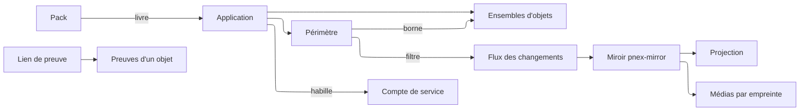
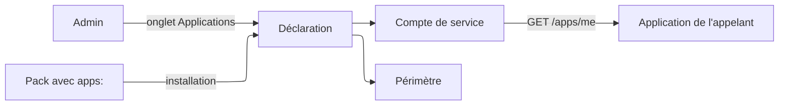
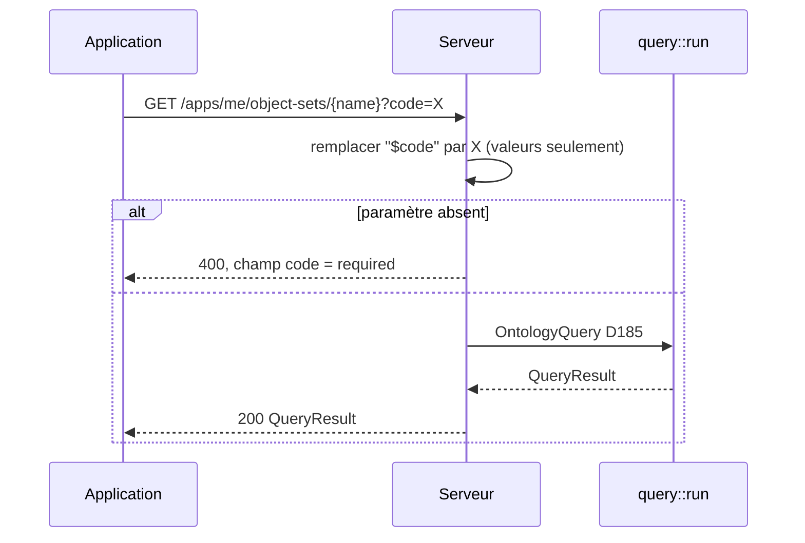
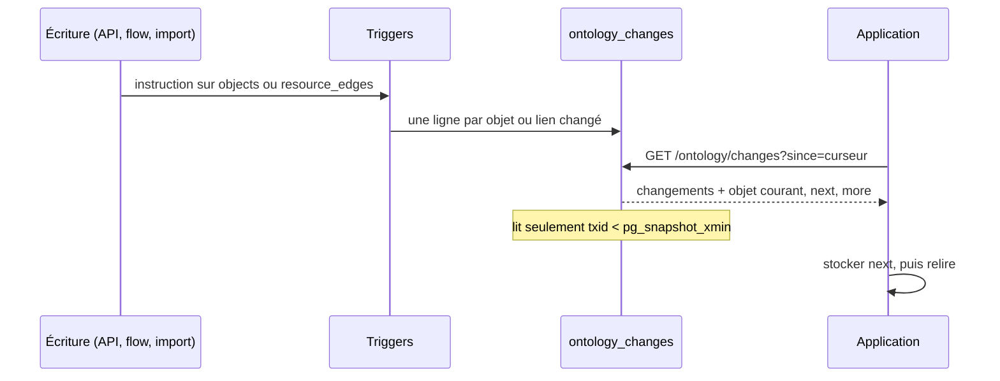
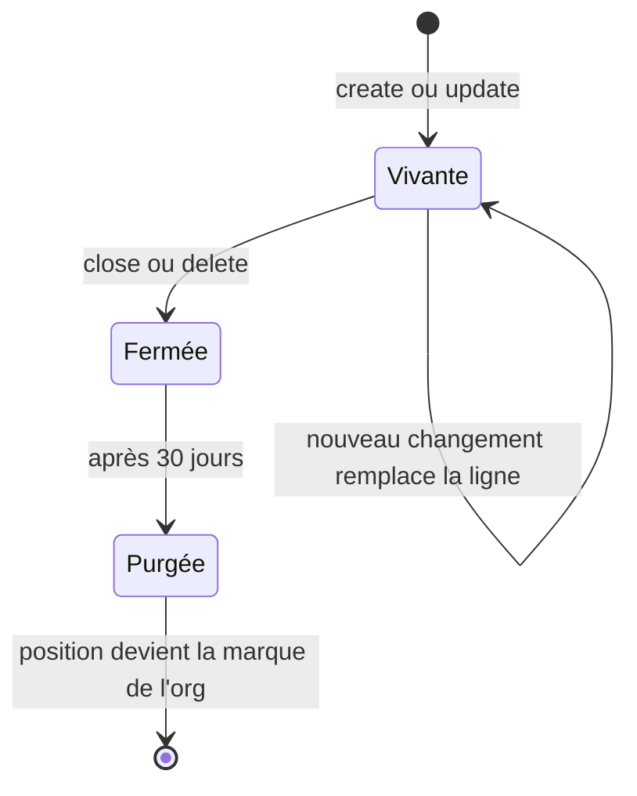
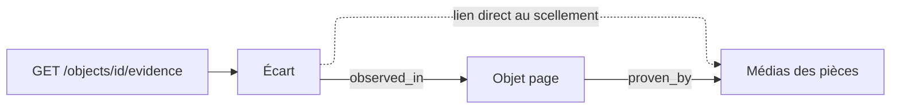
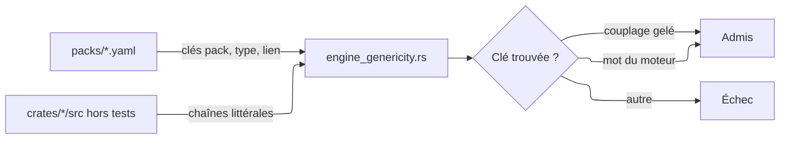

# Applications sur PneX : SDK d'applications (D432–D441)

Liens : `ontology.md` (D176–D190, dont D183 actions, D184 journal, D185 requêtes, D190 packs), `iam.md` (comptes de service), `media.md`, `partners.md` (D408 preuves serveur, D421 documents d'une page), `api.md` (D238–D253), `app-builder.md` (écrans d'une application), `operational-platform.md` (D560).

## 1. Résumé

PneX est une plateforme de données générique. Le moteur ne connaît aucun métier. Le métier vit dans les packs et dans les applications. Une application est un programme hors de PneX qui lit l'ontologie d'une org par le SDK d'applications. Ce document décrit ce SDK : identité, ensembles d'objets, flux des changements, médias, preuves, miroir hors ligne et garde de généricité. Les écritures par actions (D440) et les SDK typés (D560) sont seulement proposés.

## 2. Concepts

- **Application** : déclaration d'un programme externe dans l'org. Elle porte une clé, un compte de service et un périmètre.
- **Compte de service** : identité machine de `iam.md`, avec une clé `pnex_sk_…`. Il lit (`*:read`) et écrit seulement les permissions de `SERVICE_WRITES` (`iam.md`).
- **Périmètre** : types d'objets, types de liens, genres de médias et taille maximale de pièce que l'application peut lire.
- **Ensemble d'objets** : requête D185 enregistrée sous un nom dans l'application.
- **Flux des changements** : table `ontology_changes`, lue par un curseur sans trou.
- **Curseur** : position `<txid>.<seq>` dans le flux. `0` veut dire « le début ».
- **Lien de preuve** : type de lien déclaré `evidence: true` par son pack.
- **Rôle** : concept partagé qu'un pack déclare sur un type d'objet ou un type de lien (`role: person`). Le moteur cherche le type par son rôle, jamais par sa clé. Un rôle désigne un seul type d'une org.
- **Miroir** : copie locale SQLite du périmètre, tenue par la crate `pnex-mirror`.
- **Projection** : code de l'application, appelé par le miroir à chaque page appliquée.
- **Ontologie inventée** : types `article`, `auteur` et lien `ecrit_par`. Les exemples et les tests du SDK l'utilisent, jamais un pack livré.



## 3. Fonctionnement

### 3.1 Déclarer une application



Un admin déclare l'application dans la page Accès, onglet « Applications ». Un pack peut aussi livrer une déclaration (`apps:` dans le YAML, exemple : `crm.yaml`). L'installation du pack la crée. Le serveur contrôle la clé unique et le compte de service de l'org. Un compte de service sert une seule application. Les types, types de liens et genres de médias du périmètre doivent exister. La taille maximale va de 1 octet à 2 Gio.

Le serveur applique le périmètre au flux et aux ensembles d'objets. Une application reçoit seulement ce qu'elle a déclaré, même si son rôle IAM permet plus. Les routes génériques (`/ontology/query`, `/media/{id}/content`) restent gouvernées par le rôle IAM du compte.

### 3.2 Lire un ensemble d'objets



Un ensemble d'objets est une `OntologyQuery` nommée. Le moteur l'exécute par `query::run`, comme `/ontology/query`. Une valeur de filtre ou un `text` égal à `"$code"` reçoit le paramètre `code` de la requête HTTP, en texte. Une clé, un opérateur ou une traversée ne reçoit jamais de paramètre. `"$$x"` reste littéral.

Le serveur vérifie le périmètre à l'enregistrement. Le `type_key` doit être dans le périmètre. Chaque saut de `traverse` doit suivre un type de lien du périmètre, et ses types atteints doivent tous y être. Sinon, le serveur répond 400 `out-of-scope`. Une application a 50 ensembles au plus. Les écrans de `app-builder.md` lisent aussi des agrégats d'un ensemble (`count`, somme, moyenne, découpage).

### 3.3 Suivre le flux des changements



Des triggers d'instruction sur `objects` et `resource_edges` écrivent le flux. Toutes les voies d'écriture passent donc par lui : API, flows, imports en masse, objets natifs. Un import paie un appel par instruction, pas par ligne. Une mise à jour sans changement n'écrit rien.

Un `seq` est pris avant le commit. Un tri par `seq` seul peut donc sauter une transaction longue. Le flux trie par (transaction, `seq`). Il lit seulement les transactions plus anciennes que toutes celles en cours. Prix : une transaction longue retient le flux jusqu'à sa fin.

Le serveur joint à chaque entrée l'objet ou le lien courant. Il replie plusieurs changements d'un même objet sur le dernier de la page. Une page courte avance `next` jusqu'à la tête.



Une tâche horaire compacte le journal. Elle garde seulement la dernière ligne de chaque objet et de chaque lien. Ainsi, `since=0` donne une copie complète de l'état courant. Un lecteur en retard reçoit l'état courant, jamais les états manqués. Un `since` plus ancien que la marque (`ontology_change_marks`) reçoit 410 `changes-cursor-expired`. L'application vide alors sa copie et repart de `0`.

### 3.4 Lire les preuves d'un objet



Chaque objet et chaque lien porte `source_ref` (`import:<id>@<run>`, `flow:<id>@<version>`, `user:<id>`, `pack <key> <version>`). Le flux et les ensembles d'objets le rendent tel quel.

`GET /api/v1/ontology/objects/{id}/evidence` rend les médias atteints par des liens de preuve ouverts, en deux sauts au plus. Chaque média porte sa version courante, son SHA-256, sa taille, son type, les liens suivis (`via`) et sa pièce (`screenshot`, `html`, `text`). Une pièce de preuve web porte aussi son scellement (`seq`, SHA-256 du manifeste et du précédent).

Au scellement d'une preuve web, `proofs::link_parts` relie aussi aux pièces les objets qui pointent la page par un lien de preuve sans pièce. Ainsi, un écart pointe vers la preuve de sa détection, pas vers les captures suivantes. Le type de lien doit admettre `media_asset` comme cible. Le lien reçoit `captured_at` et `sha256_manifest` si le type les déclare. Le pack `quali_watch` déclare `observed_in` et `proven_by` en `evidence`.

### 3.5 Tenir un miroir hors ligne

```mermaid
stateDiagram-v2
  [*] --> Sync: Mirror::open, sync
  Sync --> Sync: page appliquée + curseur, une transaction
  Sync --> Reset: 410
  Reset --> Sync: copie vidée, Projection::reset, since=0
  Sync --> Médias: fetch_media
  Médias --> Sync: fichiers vérifiés par SHA-256
```

La crate `crates/pnex-mirror` est membre du workspace. Elle ne dépend ni du backend ni de `pnex-core`. Ses types de contrat sont les siens, et un test les vérifie contre `docs/contracts/openapi.json`. Les applications l'importent par git.

`Config::new(url, clé, dossier).from_app()` prend le périmètre de `GET /apps/me`. `sync` applique chaque page et son curseur dans une seule transaction SQLite. La boucle est donc reprenable. La `Projection` (`object`, `link`, `reset`) tient les vues de l'application dans cette transaction. L'application peut aussi lire le miroir en SQL par `connection()`.

`fetch_media` télécharge les médias filtrés par genre et taille. Le miroir range chaque fichier par empreinte (`<dir>/ab/cd/<sha256>`), sans doublon. Il revalide par `If-None-Match` à chaque passe. Il refuse un fichier dont l'empreinte diffère de la version courante. Il écrit à côté, puis renomme. Le dernier fichier valide reste servi si le moteur tombe (`Mirror::media`).

**Attention :** une nouvelle version de média ne change pas l'objet `media_asset`. Elle n'arrive donc pas par le flux. La revalidation de chaque passe la rattrape, au prix d'un 304 par média.

### 3.6 Garder le moteur générique



Le test bloquant `crates/pnex-backend/tests/engine_genericity.rs` lit les clés de tous les packs livrés. Il parcourt le code non test des `crates/*/src`, avant le premier `#[cfg(test)]`. Il échoue sur toute chaîne littérale égale à une clé. Deux listes motivées admettent des exceptions :

- `ENGINE_WORDS` : mots du moteur qu'un pack emploie aussi (`media`, `site`, `line`…).
- `COUPLED` : couplages existants, gelés, avec fichier, clés et raison. Chaque ligne est une dette.

Les rôles (D441) ont remplacé les couplages des concepts partagés : personnes, organisations, lieux, identités, déclarations, affirmations, hypothèses, pièces, et les liens entre eux. Le vocabulaire vit dans `pnex_core::ontology::roles`. Le front lit les rôles de l'org par `state::roles`. Les couplages restants appartiennent à une fonction d'un seul pack (marchés, maintenance, fabrique). Un second test (`engine_names_no_data_source_host`) refuse un hôte de source de données dans le moteur.

## 4. Exigences

1. Le code non test du moteur et du SDK ne doit contenir aucune clé d'un pack livré, hors exception motivée (D441).
2. Les exemples et les tests du SDK doivent utiliser l'ontologie inventée, jamais un pack livré.
3. Le serveur doit filtrer le flux et les ensembles d'objets par le périmètre de l'application appelante.
4. Un paramètre d'ensemble doit remplacer une valeur seulement, jamais une clé, un opérateur ni une traversée.
5. Le flux ne doit jamais sauter une transaction validée, même longue.
6. Un curseur plus ancien que la marque doit recevoir 410 `changes-cursor-expired`.
7. Le miroir doit écrire une page et son curseur dans la même transaction SQLite.
8. Le miroir doit refuser un média dont le SHA-256 diffère de la version courante.
9. Une application ne doit jamais écrire hors d'une action déclarée (D440).

## 5. Décisions

### D432 — Le moteur ne connaît aucun métier, les applications passent par le SDK

Le métier vit dans les packs (D190) et dans les applications. Une fonctionnalité demandée par une application est conçue pour toutes, avec un exemple sur l'ontologie inventée.

### D433 — Une application est un objet de l'org qui habille un compte de service

Livrée. Le serveur applique son périmètre au flux et aux ensembles d'objets. Les autres lectures restent gouvernées par le rôle IAM.

### D434 — Un ensemble d'objets est une requête D185 nommée

Livrée, avec paramètres en valeur seulement et contrôle du périmètre. Les agrégats d'ensemble existent pour les écrans de `app-builder.md`.

### D435 — Un journal des changements en base, à curseur monotone

Livrée. Journal compacté, rétention de 30 jours, puis copie complète. Le journal O2 (D184) reste la provenance détaillée, sans servir à synchroniser.

### D436 — Les médias se recopient par leurs routes existantes

Livrée pour la lecture. Aucun genre de média n'est codé en dur dans le SDK. Le dépôt par l'action `media.upload` est proposé avec D440.

### D437 — Toute donnée dit d'où elle vient, les preuves d'un objet se lisent depuis lui

Livrée. Un type de lien se déclare `evidence: true`. Pas d'objet natif pour la preuve : un lien direct est posé au scellement.

### D438 — Le SDK est le client OpenAPI générique, plus des exemples par cas d'usage

Livrée en partie. Le client est celui de `task sdk`. Seul l'exemple `offline_copy` existe. D560 amende D438 : SDK typés par ontologie, proposés (lot OP8, non commencé).

### D439 — `pnex-mirror` : la copie locale générique

Livrée. Types propres à la crate, vérifiés contre le spec OpenAPI.

### D440 — Une application écrit seulement par des actions déclarées

Proposée, non codée. Les actions D183 et des actions de base (`object.create`, `object.update` sur `expected_version`, `link.open`, `link.close`, `media.upload`) passent par `POST /api/v1/apps/me/actions/{action}`. La règle « un compte de service ne fait que lire » s'assouplit pour ces seules actions. Aucune action physique ni de déploiement (D123, D144).

### D441 — Une garde refuse le métier dans le moteur

Livrée. Le pack déclare un rôle sur un type d'objet ou de lien (`role`), et le moteur lit ce rôle au lieu d'une clé, comme `evidence`. Les rôles reprennent les mots des clés (choix de Shan, 2026-11-21). Un rôle inconnu ou déjà porté par un autre type de l'org est refusé (`role: invalid`, `role: unique`). La migration 000163 a posé les rôles sur les types déjà installés. Une fonction propre à un seul pack garde ses clés, avec sa raison, dans `COUPLED`.

## 6. Interfaces

| Route | Permission | MCP |
|---|---|---|
| `GET/POST /api/v1/apps` | `apps:read` / `apps:write` (Admin) | lecture exposée, création exclue |
| `GET/PUT/DELETE /api/v1/apps/{id}` | `apps:read` / `apps:write` / `apps:delete` | PUT exclu (accès), DELETE exclu |
| `GET /api/v1/apps/me` | `apps:read` | exposé |
| `GET /api/v1/apps/me/object-sets/{name}` | `ontology:read` | exposé |
| `GET /api/v1/apps/{id}/object-sets/{name}` | `ontology:read` | exposé |
| `POST /api/v1/apps/{id}/object-sets/{name}/aggregate/query` | `ontology:read` | exposé |
| `GET /api/v1/ontology/changes?since=&limit=&types=&link_types=` | `ontology:read` | exposé |
| `GET /api/v1/ontology/changes/head` | `ontology:read` | exposé |
| `GET /api/v1/ontology/objects/{id}/evidence` | `ontology:read` | exposé |

Codes : `app-not-found` (404), `app-version-conflict` (409, PUT sur `expected_version`), `out-of-scope` (400), `changes-cursor-expired` (410). `limit` du flux : 1 à 1000, 500 par défaut.

Tables :

- `apps (id, org_id, key, name, description, service_account_id unique, scope jsonb, version, …)`, migration 000055. `object_sets` ajouté en 000056.
- `ontology_changes (seq, org_id, txid xid8, at, kind, id, type_key, action)`, migration 000054. `kind` : `object` ou `link`. `action` : `create`, `update`, `close`, `delete`. Index `(org_id, txid, seq)` et `(org_id, kind, id)`.
- `ontology_change_marks (org_id, txid, seq)` : marque de rétention par org.

Miroir SQLite : `objects`, `links`, `media`, état du curseur. `rusqlite` 0.32 (`bundled`), seule version compatible avec le `libsqlite3-sys` du verrou.

## 7. Reste à faire

- D440 : route d'actions, assouplissement des comptes d'application, exemple `upload_by_action`.
- Push du flux en SSE (`/ontology/changes/stream`, curseurs seulement) : proposé, non codé.
- D438 : exemples `follow_changes`, `object_evidence` et `object_set` dans `crates/pnex-mirror/examples/`.
- Connecteurs propres à un pays (`org_resolve`, mode d'import `datagouv`) : à ranger en connecteurs déclarés, chantier séparé.
- Des tests dans `src` et un test du front incluent `quali_watch.yaml` : à migrer vers l'ontologie inventée au prochain passage.
- Nouvelle version de média hors du flux : à reprendre si le nombre de médias le justifie.
