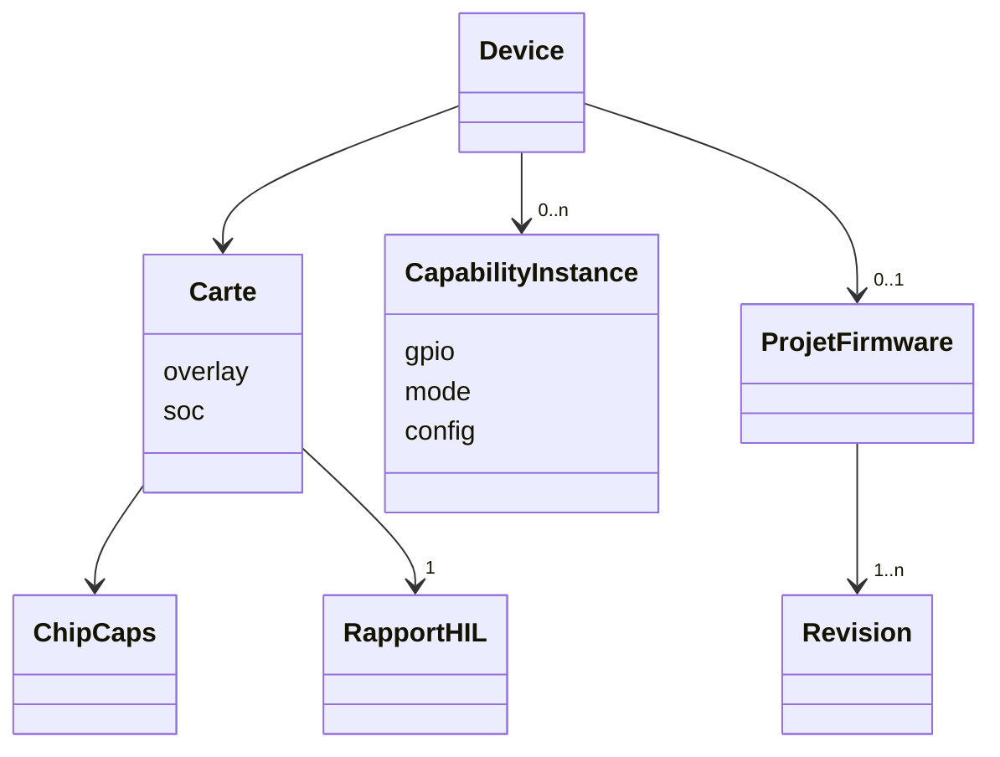
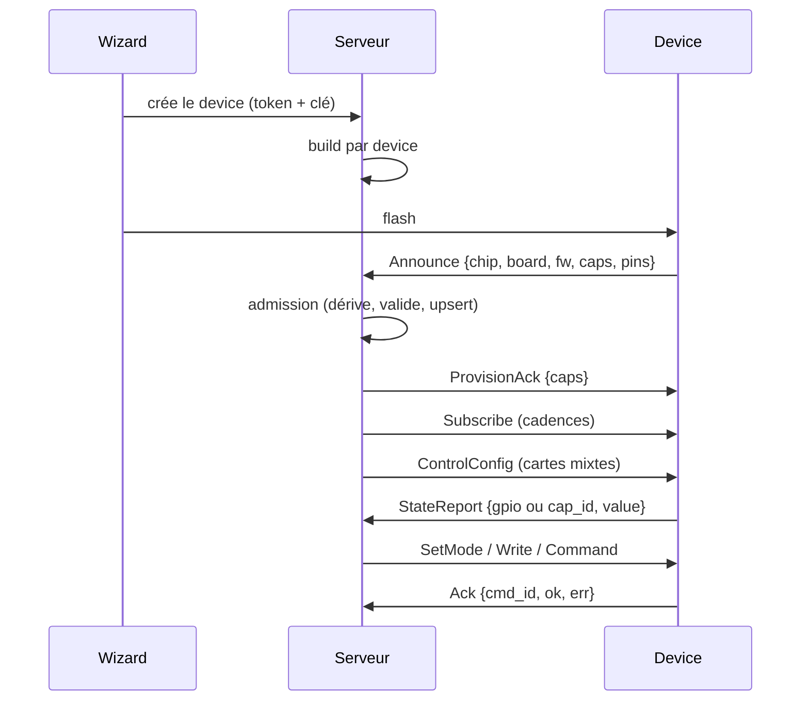
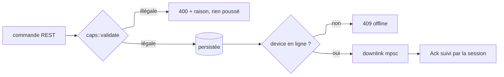
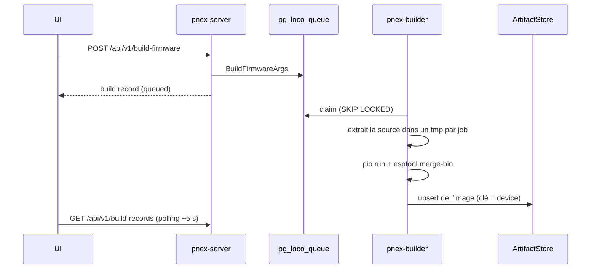
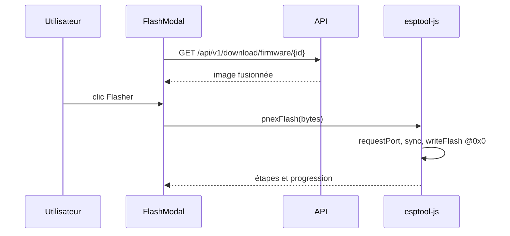
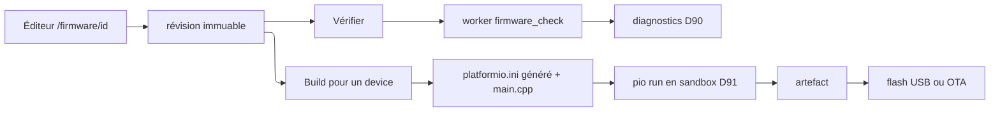
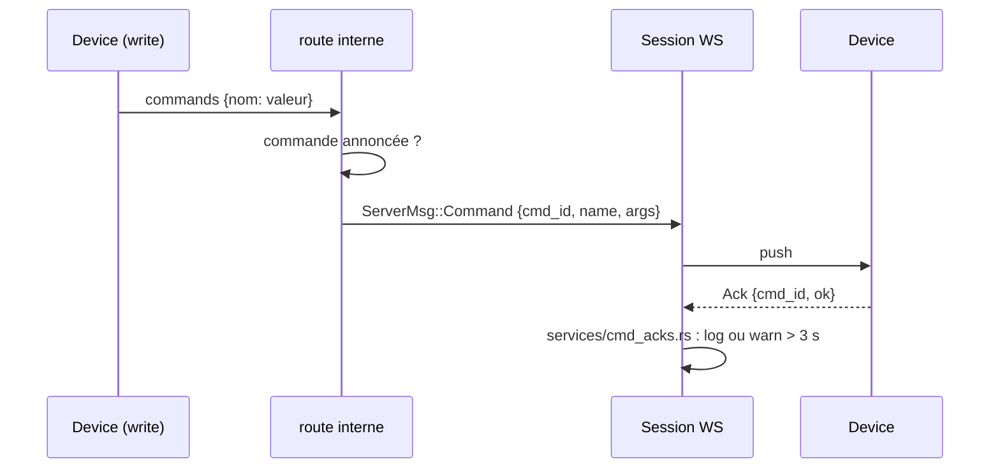
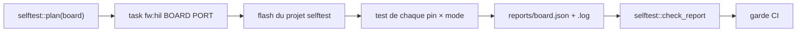
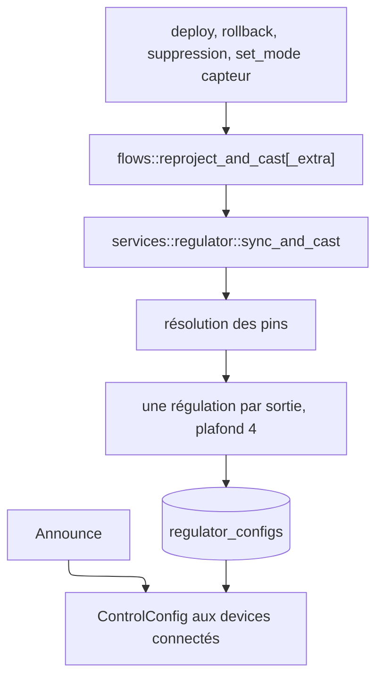

# Firmware : générique, build serveur, IDE custom, banc de pins, cartes de régulation (D20, D87–D94, D121–D122, D146)

## 1. Résumé

Ce document décrit le firmware ESP de PneX et sa fabrication côté serveur. Il couvre le firmware générique piloté par le serveur, le build par device, le flash navigateur, l'IDE de firmware custom, le banc de pins obligatoire par carte et les cartes de régulation mixtes. Il s'adresse aux développeurs firmware et backend. La taxonomie des devices, le firmware en couches, l'OTA, le TLS et l'agent edge sont décrits dans `edge.md` : ce document y renvoie sans les répéter.

## 2. Concepts

- **Firmware générique** (nom historique « Brick 0 ») : projets `firmware/generic_*` dont le `main.cpp` appelle seulement `pnex.begin()` et `pnex.loop()`. Le serveur pilote chaque pin depuis l'UI.
- **Chip-caps** : contraintes du silicium par SoC, en code (`pnex_core::caps`).
- **Overlay de carte** : câblage d'une carte (labels, LED, pull, safe-states), stocké en `mcu_boards.details`.
- **Capability instance** : état live d'un pin d'un device (mode, config, contraintes validées), table `device_capability_instances`.
- **Catalogue de cartes** : registre typé `pnex_core::catalog` (D121).
- **Projet firmware** : un `main.cpp` écrit dans l'IDE, versionné en révisions immuables (D89).
- **Banc HIL** : test de chaque pin × mode sur la carte réelle, avec un rapport commité (D122).
- **Carte de régulation mixte** : un seul device qui lit son capteur et pilote sa sortie avec un régulateur embarqué (D20).

### 2.1 Modèle des pins

| Niveau | Contenu | Où il vit |
|---|---|---|
| Chip-caps | Interdits et limites du SoC (exemples ESP8266 : GPIO6–11 flash SPI, strapping GPIO0/2 HIGH et GPIO15 LOW au boot, GPIO16 pulldown seul, A0 unique 10 bits). Console UART0 GPIO1/3 interdite sur ESP8266 et ESP32 classique (`caps-console-pins`) | Code, `pnex-core` |
| Overlay de carte | Labels (D0…D8, A0) → GPIO, LED de carte, pull par défaut, flag `pull_down`, safe-states | `mcu_boards.details`, seedé depuis le catalogue |
| Capability instance | Mode courant, config, `constraints_snapshot` | `device_capability_instances`, unique `(device_registry_id, gpio)` |

Le rôle capteur ou actionneur se déduit du mode : `digital_in` et `adc_in` donnent un capteur, `digital_out` et `pwm_out` un actionneur. La table ne porte pas de colonne de rôle.

### 2.2 Catalogue de cartes (D121)

Une carte est un fichier `catalog/boards/<variante>.rs` (nom, `Soc`, `pio_board`, profil v2) plus sa ligne dans `boards::ALL`. `catalog/products.rs` déclare les modèles prédéfinis avec une référence typée vers la carte. `catalog/types.rs` déclare `DeviceType` et `Capability`.

Le seed au boot (`tasks/seed.rs`) upserte les tables depuis le registre, par nom, sans purge. Le profil reste figé par device dans `mcu_boards.details`. Les conversions, formules et paliers d'abonnement restent en YAML.

### 2.3 Trois familles de firmware

| Firmware | Code utilisateur | Admission des pins |
|---|---|---|
| Générique (`generic_esp8266`, `generic_esp32`, `generic_esp32c3`, `generic_esp32s3`, `generic_esp32c6`) | aucun | overlay de la carte |
| Projet de l'IDE custom | un `main.cpp` | pins déclarées par le sketch (`Announce.pins`), jamais l'overlay |
| Prédéfini (`generic_esp32cam`) | aucun | fixé par le modèle |

Les familles produit et leurs règles sont dans `edge.md` §2.2.

## 3. Fonctionnement

### 3.1 Protocole `/ws/device`

Le contrat fil vit dans `crates/pnex-core/src/proto.rs` (enums taggées `t`). Le firmware C++ le reproduit en ArduinoJson. Le lien est chiffré par Noise (D156) sur TLS (`edge.md` §3.6).

- Le device est toujours pré-créé par le wizard. Une annonce ne crée jamais de device (B0.2).
- L'admission (policy `Validated`, `services/provisioning.rs`) fait un upsert : les modes choisis survivent, un pin nouveau prend le défaut.
- Un device lié à un projet firmware est admis par ses pins déclarées. Zéro pin déclarée donne une pin map vide.
- `StateReport` va vers `telemetry::sink()`, puis O2. Avec `cap_id`, la série suit `{org}/{device}/{capacité}` (`edge.md` §3.4).
- Anti-clone et bail : `SessionGuard`, repli `device_states`, reaper. Le registre `DEVICE_SESSIONS` porte un canal mpsc par device : c'est le downlink.

### 3.2 Validation et safe-states

`caps::validate` est le point unique de validation. Le backend l'appelle à l'admission et avant chaque push de commande. Il refuse par exemple GPIO6–11, `safe_state: high` sur GPIO15 et un pull-up sur GPIO16.

Une commande est persistée avant le push. Le prochain `Announce` renvoie donc le mode persisté : la config survit au hors-ligne.

Côté firmware, toute perte de lien remet chaque sortie dans son `safe_state` : fermeture, timeout PONG, Wi-Fi coupé. L'admission refuse aussi un safe-state qui casserait le boot par strapping. Le device fait confiance au serveur mais garde ses safe-states.

Les écritures sont bornées par D17 : un `Write` vient d'un clic de l'utilisateur ou d'un flow qu'il a déployé. Le serveur ne fait jamais de boucle de régulation (D13, D20).

### 3.3 Build serveur

- Tout firmware est compilé par device (B0.1). Les secrets du device sont compilés dans le `.bin`.
- La source `firmware/` est embarquée dans le binaire serveur (`pnex_firmware_builder::embedded`, `include_dir!`). Une version du serveur compile exactement le firmware qui l'accompagne.
- Le handler HTTP ne compile jamais. Le worker `BuildFirmwareWorker` tourne dans l'image `pnex-builder` (cible `builder` de `deploy/docker/Dockerfile`), avec PlatformIO et les libs préchargés : les builds marchent hors ligne.
- Le tmp par job est effacé au drop. `.pio` n'écrit jamais dans la source, et deux builds sont isolés.
- Le token et la clé sont relus en base par le worker, jamais mis en queue. Les paramètres Wi-Fi et hôte passent dans le `task_data` de la queue, visible de l'admin DB.
- L'artefact vit dans `firmware_artifacts` (backend `db`, plafond 50 Mo) ou sur S3 via opendal (`PNEX_STORAGE_BACKEND=s3`, `PNEX_S3_*`). Un upsert par device borne le volume : il n'y a pas de rétention (D6).
- Le job CI `.github/workflows/firmware.yml` compile les projets prédéfinis à chaque changement de `firmware/`.

**Attention :** n'essayez pas de changer de backend d'artefacts après l'installation. Aucune migration entre `db` et `s3` n'existe.

### 3.4 Variables de build

Chaque `platformio.ini` lit sa config en `${sysenv.*}` dans ses `build_flags` (`-D NAME=\"…\"`). Le worker doit passer ces valeurs en variables d'environnement du sous-process `pio run`, jamais en argv. `pnex_config.h` les consomme (`#ifndef` + défauts). Une valeur avec espaces casserait un flag `-D` : d'où le base64.

| Variable | Encodage | Rôle |
|---|---|---|
| `WIFI_SSID`, `WIFI_PASSWORD`, `HOST`, `TOKEN`, `DEVICE_ID` | base64 | config device |
| `ENCRYPTION_KEY` | base64 | `device_tokens.encryption_key`, clé du lien Noise (D156). Vide ou invalide : le device ne se connecte jamais |
| `PNEX_FW_VERSION` | clair | id de build, annoncé, clé de l'artefact OTA (`edge.md` §3.7) |
| `PNEX_CA_CERT` | base64 (PEM) | racine épinglée, lue dans `PNEX_CA_CERT_FILE` à chaque build (D70). Vide : le serveur refuse le build (`build_no_ca`) |
| `PNEX_CLIENT_CERT`, `PNEX_CLIENT_KEY` | base64 (PEM) | identité TLS client du device (D153). Sans elle, le serveur ferme en 4014 |
| `PNEX_OTA_PUBKEY` | hex (64) | clé Ed25519 de l'instance, vérifie chaque image OTA |
| `PNEX_OTA_ENABLE` | `0`/`1` | `1` sur les génériques : cap `ota` à l'announce |
| `PNEX_PIO_BOARD`, `PNEX_BOARD_NAME` | clair | variante de carte figée au register |
| `PNEX_SCREEN_SSD1306`, `PNEX_SCREEN_ST7735` | `0`/`1` | active le driver d'écran de debug |
| `PNEX_SCREEN_SDA` `SCL` `SCK` `MOSI` `CS` `DC` `RST` | gpio ou `-1` | câblage de l'écran tiré du profil de carte |

Le firmware parle seulement `wss://` et `https://` (D154) : il n'existe aucun build en clair. Le builder pousse toujours les 9 variables d'écran, car `${sysenv.*}` échoue sur une variable absente. L'écran est choisi par device (`device_registries.peripherals`), et un écran soudé est imposé.

Le moniteur série montre au boot le SSID compilé. Un réglage serveur correct ne prouve rien sur l'image flashée.

### 3.5 Flash navigateur

- L'image servie est toujours fusionnée : un seul `writeFlash` à `0x0` (`dio`, `40m`, `4MB`, `eraseAll: false`, 921600 bauds).
- La glue `crates/pnex-frontend/js/flasher.js` importe `esptool-js` (épinglé). esbuild la bundle en `assets/flasher.js`, consommé par `src/flash.rs`.
- Web Serial exige HTTPS ou localhost et un geste utilisateur. Le modal télécharge donc les octets à l'ouverture, puis tout se fait au clic.
- Web Serial existe sur Chrome, Edge et Opera seulement. Sur un autre navigateur, le modal propose le téléchargement et esptool.

### 3.6 Serveur imposé (`PNEX_PROD_HOST`)

`PNEX_PROD_HOST` (hôte nu, port optionnel) a deux lectures :

- **Serveur** : chaque build vise cet hôte, quel que soit l'hôte envoyé. Le référentiel « Serveurs PNeX » passe en lecture seule (`409 edge-host-locked`). `GET /api/v1/edge/hosts/locked` l'expose et l'UI affiche « imposé par ce déploiement ».
- **Apps natives** : la variable lue à la compilation fige l'URL du serveur (`api::config::locked_server`). L'app n'offre alors plus de choix de serveur. Le web n'est pas concerné.

Vide ou absente, la variable laisse le choix libre.

### 3.7 IDE de firmware custom (D87–D94)

L'utilisateur écrit un seul `main.cpp` qui inclut `<Pnex.h>`. Il dispose de toute la lib PneX dans la version du serveur. La carte vient de la variante figée du device. Le serveur génère le `platformio.ini` : l'utilisateur ne l'édite jamais, car il porte les secrets et la politique de libs.

API de la lib pour le code custom :

- `addMetric(id, unit)` : déclare une métrique dans le manifeste, avant `begin()`. Plafond `PNEX_MAX_METRICS` (16).
- `publish(id, value)` : publie un `StateReport` par `cap_id`. Un id inconnu est ignoré, et le serveur jette une métrique non annoncée.
- `onCommand(name, cb)` : annonce une commande. Le retour du callback produit l'`Ack`. Plafond `PNEX_MAX_COMMANDS` (8).
- `pnex.loop()` doit tourner à chaque itération. Un `delay()` long fait tomber le lien et met les sorties en safe-state.

Le squelette d'un projet neuf est l'exemple `firmware/lib/pnex/examples/CustomMetrics`.

Le device choisit son projet au provisioning (étape Modèle du wizard, projets filtrés par puce). Un projet sert N devices. Chaque build compile la dernière révision et estampille `build_records.firmware_revision_id`. Un OTA vers une révision antérieure sert de rollback.

Deux modes de compilation :

- **Vérifier** : passe par la file de jobs (worker `firmware_check`, table `firmware_checks`), avec des défines factices et sans artefact.
- **Compiler pour le device** : chemin du §3.3, avec les vrais secrets.

Isolation du build (D91) :

- `pio run` ne reçoit que les défines du device ciblé, jamais `DATABASE_URL` ni clé S3.
- La sandbox `bwrap` coupe le réseau et le PID (`sandbox_argv`). Les libs viennent du semis préchargé.
- Une garde lexicale refuse les `#include` absolus, avec `..` ou expansés par macro, et `#embed` (codes `firmware-include-*`, `firmware-incbin`).
- Le `main.cpp` est plafonné à 256 Ko (`MAX_MAIN_CPP_BYTES`).

**Danger :** n'activez pas l'IDE sans sandbox sur une instance multi-org. Compiler du C++ utilisateur exécute son code sur le worker. Un include peut copier un fichier du worker dans le binaire.

La stack de dev (`compose.app.yaml`) active l'IDE sans sandbox (`PNEX_FIRMWARE_SANDBOX=none`) : l'image n'a pas bubblewrap et le seccomp Docker bloque les user namespaces. Cet usage est mono-utilisateur.

Catalogue de libs (D92) : `pnex_core::firmware::LIB_CATALOG` fixe les versions exactes. L'image builder précharge les `lib_deps` de chaque projet et les entrées compatibles du catalogue (`deploy/docker/prewarm/seed_libdeps.sh`, liste `lib_catalog.txt` vérifiée par le test `prewarm_lib_list_matches_the_catalog`). Le worker copie ce semis dans le `.pio/libdeps` de chaque build, jamais un dossier partagé. Deux cores PlatformIO coexistent : le core officiel et pioarduino (core Arduino 3.x pour le C6), choisi d'après la `platform` de l'ini.

### 3.8 Commandes custom et acquittement (D88, D146)

- Le nœud Device (write) cible des pins et des commandes du manifeste (`DeviceWriteConfig.commands`). Il n'existe pas de nœud `device-command`.
- Une commande non annoncée donne `ok:false`, et rien n'est poussé. Un firmware qui ne connaît pas la commande répond `unknown_command`.
- Une commande n'est pas un pin : elle échappe à la règle « une source d'écriture par sortie » (D128).
- La session suit chaque `Write` et `Command` poussé. Au-delà de 3 s sans `Ack`, elle journalise « command not acknowledged ».
- Un `Write` sans `Ack` est repoussé une fois, car sa valeur est absolue. Une `Command` n'est jamais repoussée : la lib ne déduplique pas `cmd_id`.

### 3.9 Banc de pins HIL (D122)

En production, `firmware/lib/pnex/src/pnex_io.{h,cpp}` est le seul chemin d'E/S des pins. Le banc l'exerce tel quel :

- chaque `StateReport` journalise `[IO] GPIOn mode=… value=…` ;
- après un `write`, le firmware relit le pad. Un écart journalise `[IO] MISMATCH`, et le `StateReport` porte la valeur relue ;
- la lib gère les canaux LEDC (ESP32, C3, S3). Sans canal libre, `set_mode pwm_out` répond `pwm_channels_exhausted` et le pin repasse en `digital_in`.

La console de banc vit dans le projet `firmware/selftest/` (`PNEX_TEST_MODE=1`, hors ligne, série 115200). Elle accepte `info`, `mode`, `write`, `pwm`, `read`, `release` et `test`. Elle répond une ligne `PNEXT {json}` avec des valeurs brutes : le firmware ne juge jamais. Elle refuse les pins qui tueraient le banc (`protected_pin`). Le builder serveur ne peut pas produire ce binaire, et `PNEX_TEST_MODE` avec `PNEX_OTA_ENABLE` donne un `#error`.

`pnex_core::selftest` porte les règles :

- `plan` dérive les étapes `(gpio, mode)` du profil et des chip-caps. Il exclut la console, les pins d'un écran soudé et les pins sans mode.
- `evaluate` juge les valeurs : niveaux logiques, pull-up à 1 (ou à 0 si le profil déclare `pull_down`), ADC dans `0..=adc_max`, sortie `w0=0, w1=1`, PWM mesurée ≤ 5 / 35–65 / ≥ 95.
- `check_report` exige que le rapport couvre exactement le plan.

Le harnais `firmware/hil/pnex_hil.py` exige un port explicite. Il vérifie que la puce annoncée correspond au SoC du plan. `firmware/hil/serial_tail.py` capture la série sans reset pour l'E2E matériel (`e2e/tests/hw/pins.ts`). Il ouvre RTS avant DTR : l'ordre inverse reset un C3.

La garde `selftest::tests::every_board_has_a_passing_bench_report` exige un rapport valide pour chaque carte à `soc`. `HIL_PENDING` liste les cartes antérieures à D122 sans rapport. Cette liste ne fait que décroître (cliquet `HIL_PENDING_MAX`).

Procédure pour une carte neuve :

1. Ajoutez `catalog/boards/<variante>.rs` et sa ligne dans `ALL`.
2. Lancez `task fw:hil BOARD=<name> PORT=<port>` sur la carte réelle.
3. Si une étape est rouge, corrigez le firmware ou le profil. Ne changez jamais les règles pour passer.
4. Commitez le rapport et le journal, puis lancez `cargo test -p pnex-core selftest`.
5. Lancez `task e2e:hardware` si la carte y est déclarée.

### 3.10 Cartes de régulation mixtes (D20)

| Carte | Kind | La sortie passe à ON quand | Paramètres propres |
|---|---|---|---|
| `pnex-reg-tt-heat` | `tt_heat` | mesure < consigne − deadband | `deadband`, `min_on_secs`, `min_off_secs` |
| `pnex-reg-tt-cool` | `tt_cool` | mesure > consigne + deadband | idem |
| `pnex-reg-pid` | `pid` | duty % sur le cycle relais | `kp`, `ki`, `kd`, `cycle_time_secs` |

Champs communs : `device_id`, `sensor_pin` et `actuator_pin` (labels), `setpoint`, `sample_ms` (200..=60 000), `data_timeout_secs`, `safe_state`. Une carte référence un seul device : le formulaire et `validate_graph` rendent un second device impossible.

**État actuel :** aucun firmware de `firmware/` n'exécute ces cartes. Le serveur caste le contrat, et le firmware générique ignore `ControlConfig` sans `Ack`. Le contrat est testé par un device WS simulé (`tests/regulator.rs`). Le firmware autonome est le profil `regulator` de `edge.md` §3.2.

- `ControlConfig { cmd_id, configs }` remplace tout le jeu du device. `configs: []` vide le jeu, et chaque sortie régulée revient au safe-state.
- L'ordre est garanti : `ProvisionAck`, puis `Subscribe`, puis `ControlConfig`.
- Le sync précède la reprojection ETL : il ne dépend pas du runtime et ne répond jamais 503.
- Un device hors ligne reçoit son cast à la prochaine annonce.
- Avant une suppression, le contrôleur capture les devices du flow et les passe en `extra_devices`. Sinon, la cascade FK empêcherait le cast `[]`.

Résolution des pins à chaque cast :

1. Les instances persistées (mode admis) passent en premier.
2. L'overlay complète, pour les entrées seulement : une sortie doit être admise.
3. `caps::validate` valide la sortie en `digital_out` avec le `safe_state` de la carte.
4. Le serveur n'envoie jamais de `SetMode` automatique. Un pin dans le mauvais mode fait sauter la carte avec un warn.

Un pin capteur repassé en sortie dé-déploie le flow (`stop_flows_reading_pin`). Entre plusieurs flows, le plus petit `flow_id` gagne la sortie, et les autres sont sautés avec un warn.

Sémantique imposée au firmware (golden vectors `crates/pnex-core/tests/golden_vectors.rs`, rejoués par `firmware/core-cpp-tests`) :

- **TT** : hystérésis asymétrique, anti court-cycle par `min_on_secs` et `min_off_secs`. `deadband ≤ 0` ne passe jamais à ON.
- **PID** : dérivée sur la mesure (D=0 au premier échantillon), intégrale bornée, duty 0..=100 % réparti sur le cycle relais (`relay_window`).
- **Safe-state** : un lien WS coupé n'arrête pas la régulation. La sortie passe au safe-state si le capteur est illisible au-delà de `data_timeout_secs`, ou au boot sans config.

`RegState` remonte le diagnostic (≤ 1 Hz). Il est routé vers O2 en séries `<node>_sensor`, `_out` et `_cycles` (`source_type=reg_state`). Une mesure NaN ne donne pas de point.

Le crate `pnex-node-control` enregistre les trois types dans le moteur de flows et valide par la vraie `validate_graph`. Un type inconnu échoue donc au deploy (`redeploy_failed`). Le nœud ne régule pas : sa boucle consomme et jette.

## 4. Exigences

1. Chaque firmware doit être compilé par device, avec ses secrets en variables d'environnement de `pio run`.
2. Le handler HTTP de build ne doit jamais compiler.
3. Le token et la clé d'un device ne doivent jamais passer par la queue.
4. Un build sans `PNEX_CA_CERT` doit être refusé (`build_no_ca`).
5. Toute commande de pin doit passer `caps::validate` avant persistance et push.
6. Une sortie doit revenir à son `safe_state` à toute perte de lien (firmware générique).
7. Un device lié à un projet firmware doit être admis par ses seules pins déclarées.
8. Le serveur doit refuser tout `lib_deps` hors `LIB_CATALOG`.
9. Un `main.cpp` avec un include absolu ou remontant doit être refusé.
10. Le build custom ne doit recevoir aucun secret serveur dans son environnement.
11. Chaque carte du catalogue doit avoir un rapport HIL qui passe `check_report`, sauf les cartes de `HIL_PENDING`.
12. `HIL_PENDING` ne doit jamais grandir.
13. Une carte de régulation doit référencer un seul device.
14. Le cast `ControlConfig` doit remplacer tout le jeu du device et ne jamais dépendre du runtime de flows.
15. Le serveur ne doit jamais changer le mode d'un pin pour résoudre une carte de régulation.

## 5. Décisions

Décisions générales : D5 (artefacts en base, S3 en option), D6 (pas de rétention d'artefact), D13 (M2M à l'edge), D17 (downlink borné au manuel et aux flows de l'utilisateur), D19 (Rauthy), D44–D48 (`edge.md`), D70 (TLS), D128 (une source d'écriture par pin), D153–D156 (identité device, Noise, `security.md`). Registre : `docs/journal/inventory.md`.

Décisions du firmware générique, gardées pour les renvois du code :

| # | Décision |
|---|---|
| B0.1 | Le firmware générique est compilé par device, comme les autres. L'image unique avec secteur de config est abandonnée. |
| B0.2 | Le device est pré-créé par le wizard. Une annonce ne crée jamais de device. |
| B0.3 | Seule la policy `Validated` existe. `device_profiles` et les policies `Profiled`/`Locked` ne sont pas codés. |
| B0.5 | Le `Write` reste une action de l'utilisateur. Le serveur ne fait jamais de boucle de régulation (D17). |
| B0.6 | Le modèle étend les tables existantes : chip-caps en code, overlay en data, instances en table. Amendée par D121. |

### D20 — Cartes de régulation mixtes

La régulation vit sur le device. Le serveur caste une config (`ControlConfig`) et ne relaie jamais une mesure d'un device vers un autre (§3.10).

### D87 — Métrique custom = capacité `metric` et `StateReport` par `cap_id`

Une métrique custom réutilise le routage D47. `StateReport.gpio` est devenu optionnel, sans nouveau message.

### D88 — Commande custom = `ServerMsg::Command { cmd_id, name, args }`

Nouveau message serveur additif. Le device répond par l'`Ack` existant (§3.8).

### D89 — Source firmware versionnée en base, révisions immuables

`firmware_projects` et `firmware_revisions` (append-only, dédup par `content_hash`, 409 optimiste). Un projet utilisé par un device ne peut pas être supprimé.

### D90 — Diagnostics gcc structurés, mappés sur le `main.cpp`

Le parseur lit `file:line:col: (error|warning|note)`. Les lignes de `src/main.cpp` sont projetées dans l'éditeur, les autres sont listées avec leur fichier. Le message gcc reste verbatim.

### D91 — Worker de build firmware isolé

Pas de secret serveur, réseau coupé, sandbox `bwrap`, garde lexicale, limites. L'IDE est désactivé par défaut (`409 firmware-custom-disabled`).

### D92 — Catalogue curé, versions épinglées, préchargé dans l'image builder

`LIB_CATALOG` est la source unique du front et du back. Les clients de transport (MQTT, HTTP cloud) sont exclus : le transport, c'est PneX.

### D93 — Éditeur : overlay maison, CodeMirror 6 plus tard

L'éditeur de code partagé gagne un mode C++. CodeMirror 6 viendra si l'usage le demande. Monaco est écarté (trop lourd).

### D94 — Un device suit une révision déployée, pas la tête du projet

Le device choisit son projet au provisioning. Chaque build estampille la révision compilée (§3.7).

### D121 — Catalogue devices en code

Le registre typé `pnex_core::catalog` remplace les fixtures YAML des cartes et des modèles (§2.2).

### D122 — Rapport de banc HIL obligatoire par carte

Chaque carte livre un rapport de valeurs relues sur la broche. La CI recalcule le verdict (§3.9).

### D146 — Device (write) envoie aussi les commandes du firmware

Deux nœuds device seulement, lecture et écriture. Device (write) cible pins et commandes annoncées (§3.8).

## 6. Interfaces

### 6.1 Routes

| Route | Effet |
|---|---|
| `GET /ws/device` | protocole §3.1 (`controllers/ws_device.rs`) |
| `GET /api/v1/devices/{id}/pins` | instances, overlay et dernières valeurs |
| `GET /api/v1/devices/{id}/pinout` | brochage, commandes annoncées |
| `POST /api/v1/devices/{id}/commands` | `set_mode`, `write`, `subscribe` : validés (§3.2), persistés, poussés |
| `POST /api/v1/devices/{id}/custom-commands` | commande custom annoncée (D88) |
| `POST /api/v1/build-firmware` | met un build en file |
| `GET /api/v1/build-records` | état des builds |
| `GET /api/v1/download/firmware/{id}` | image fusionnée du device |
| `GET /api/v1/edge/hosts/locked` | hôte imposé (§3.6) |
| `/api/v1/firmware-projects…` | CRUD des projets, `revisions`, `lib-catalog`, `check`, `checks/{check_id}` |

Les rôles requis sont dans le spec `docs/contracts/openapi.json` et le registre IAM.

### 6.2 UI

- Panneau « Pins » de la fiche device (`components/pins_panel.rs`) : mode par pin, toggle des sorties, dernière valeur, abonnement ADC.
- Bouton « Flasher » sur la ligne device et à la fin du wizard (§3.5).
- Pages `/firmware` et `/firmware/{id}` (menu Edges) : éditeur C++, menus « + Lib » et « + PneX API », Vérifier, Compiler, historique des révisions.

### 6.3 Configuration

| Réglage | Rôle |
|---|---|
| `settings.firmware.custom.{enabled,sandbox,bwrap_cmd,allow_network}` | IDE custom et sa sandbox |
| `PNEX_FIRMWARE_CUSTOM_ENABLED`, `PNEX_FIRMWARE_SANDBOX` (`bwrap`/`none`) | surcharges d'environnement |
| `PNEX_STORAGE_BACKEND` (`db`/`s3`), `PNEX_S3_*` | backend d'artefacts |
| `PNEX_CA_CERT_FILE` | racine injectée dans chaque build |
| `PNEX_PROD_HOST` | hôte imposé (§3.6) |

## 7. Reste à faire

1. Firmware générique : E2E complet sur `generic_esp8266` réel (pins, A0, safe-state à la coupure).
2. `Ack` de commande : suivi en session, jamais persisté. Une persistance du dernier `Ack` par pin reste possible si l'UI la demande.
3. Quota Free : `max_mixed_devices: 1` est en place pour le générique. Validation par Shan.
4. Politique de re-flash du générique quand une v2 du `.bin` existera (l'`Announce` porte `fw`).
5. Sandbox D91 réelle en production : worker dédié sans secret DB, ou `bwrap` validé sur l'hôte.
6. Fiche device : afficher le projet, la révision déployée et « mise à jour disponible » (D94).
7. Lib PneX : déduplication de `cmd_id`, puis renvoi des commandes idempotentes.
8. État réel après une commande custom : la lib pourrait publier la valeur appliquée par `cap_id`. Choix de Shan.
9. E2E matériel de l'IDE : BME280 I2C → O2 → flow → notification.
10. Plafond du nombre de révisions conservées (tout garder ou purger les révisions jamais buildées). Choix de Shan.
11. IDE plus tard : upload de lib scannée, mode « registre ouvert » admin, mode strict par org, autocomplétion clangd. Choix de Shan.
12. Banc HIL : rapports des 7 cartes de `HIL_PENDING`, gabarit de bouclage (sortie → entrée, PWM → ADC via RC).
13. Cartes de régulation : firmware de la carte mixte (profil `regulator`, `edge.md` §7), init bumpless de l'intégrale PID au remplacement de config.
14. Optimisation des gains PID depuis l'historique O2 : hors périmètre, la mesure et `output_pct` sont déjà en série.
