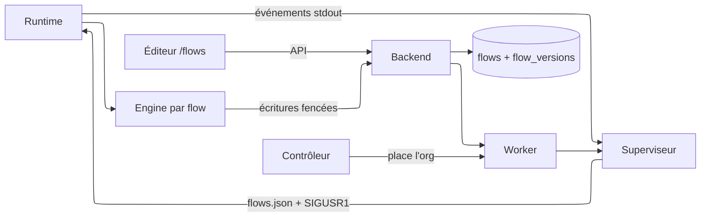
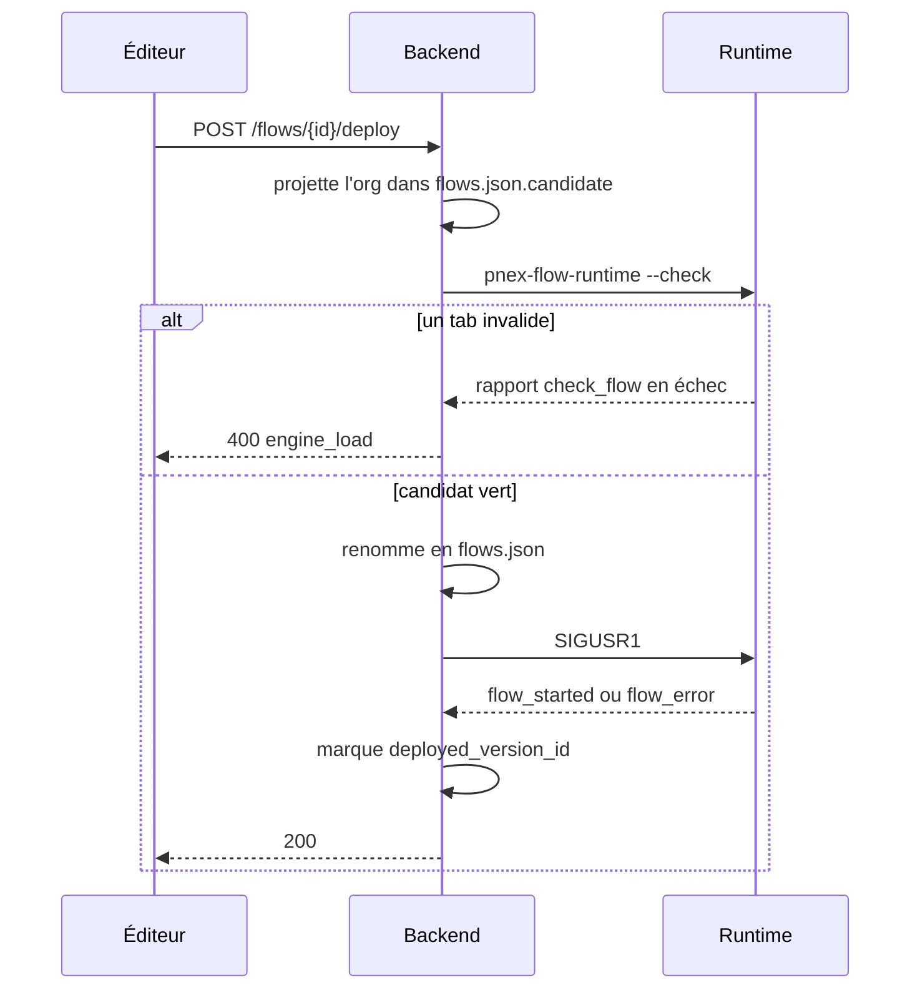
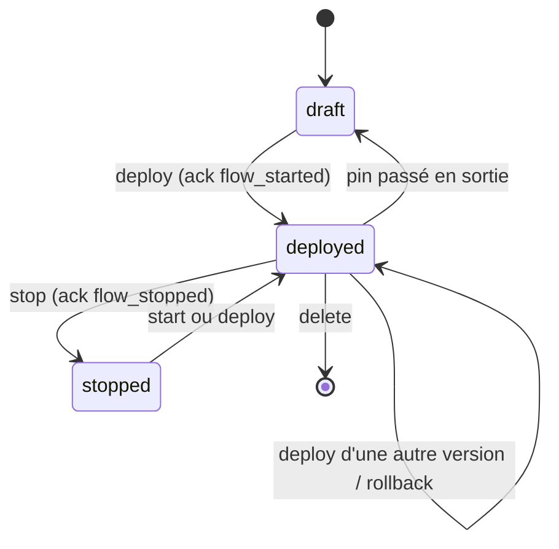
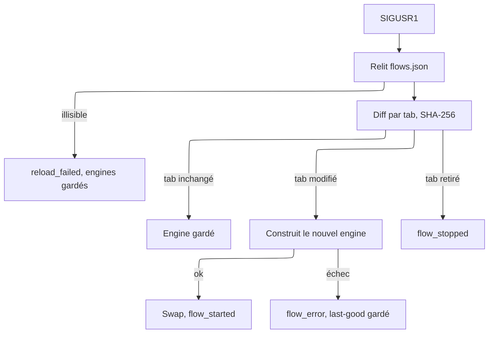
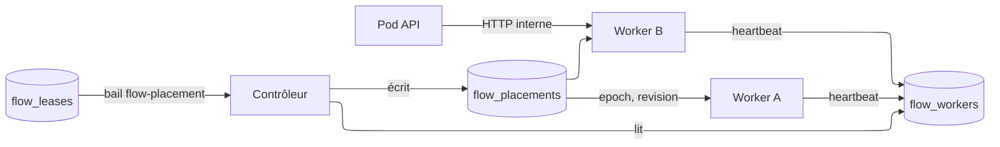
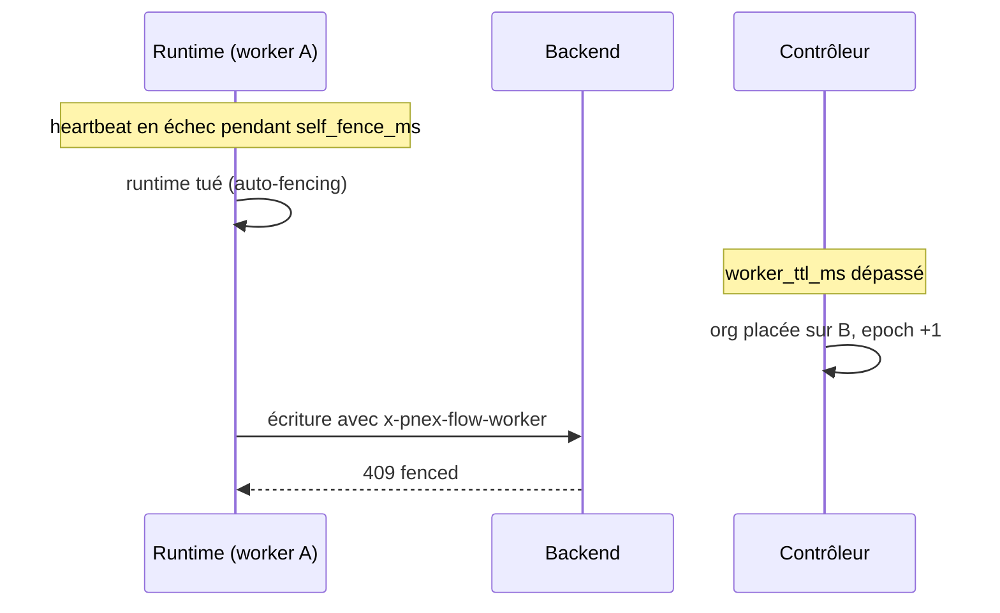
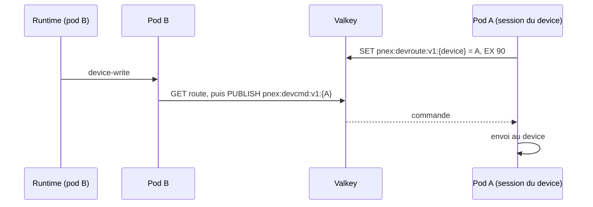
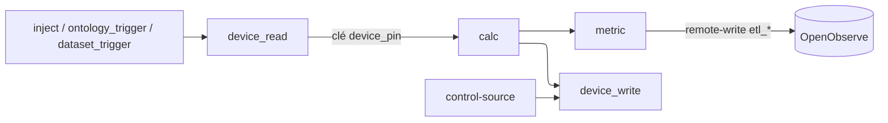
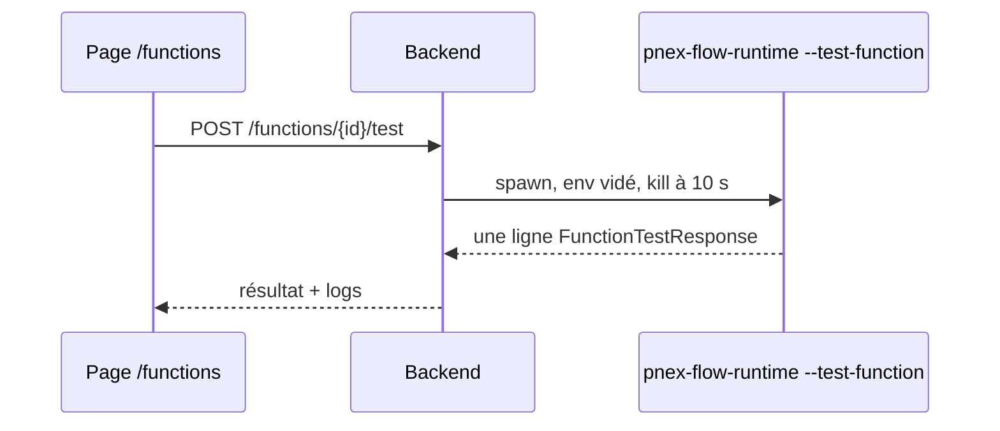

# Moteur de flows

## 1. Résumé

Un flow est un graphe de nœuds qu'une personne dessine dans l'éditeur `/flows`. Il porte les petites données et l'organisation de l'ontologie : il fait et défait les liens déduits, sur les données du moment (D998). L'ingestion en volume reste aux pipelines. Le moteur exécute les flows déployés dans `pnex-flow-runtime`, un binaire maison qui lie `edgelink-core` (D18). Le backend ne lie jamais ce moteur : il projette les flows en artefact, supervise le process et acquitte chaque déploiement.

## 2. Concepts

- **Flow** : graphe typé de nœuds (`pnex_core::flow`), stocké en base. Statut `draft`, `deployed` ou `stopped`.
- **Version** : état enregistré d'un flow (`flow_versions`, ajout seul). Enregistrer crée une version. Déployer publie une version.
- **Kind** : type d'un nœud du graphe (`inject`, `device_read`, `calc`, `function`…). La liste et la doc de chaque kind vivent dans `crates/pnex-core/src/flow/node_docs.rs`.
- **Projection** : traduction des flows déployés d'une org en tableau Node-RED (`flows.json`). Un flow donne un tab `pnexflow{id}`.
- **Runtime** : process `pnex-flow-runtime`, enfant du serveur. Il lit l'artefact et exécute les tabs.
- **Engine** : instance `edgelink-core` qui exécute un seul tab. La ferme d'engines tient un engine par flow.
- **Superviseur** : tâche du backend qui lance le runtime, lui envoie `SIGUSR1` et lit ses événements.
- **Worker** : un superviseur et son runtime. Il exécute les flows des orgs placées chez lui.
- **Contrôleur** : rôle élu qui place chaque org sur un worker. Il n'exécute aucun flow.
- **Fonction** : code utilisateur versionné (JS ou Starlark) de la page `/functions`, appelé par un nœud `function`.

## 3. Fonctionnement

### 3.1 Déploiement

La projection lit la base en lecture seule. Elle prend tous les flows `deployed` de l'org, plus la version candidate, moins les flows arrêtés. Le pré-flight construit chaque engine sans le démarrer. La base change seulement après l'acquittement du flow. Un échec d'acquittement laisse donc l'état antérieur intact.

La projection estampille `pnex_flow_id`, `pnex_version`, `pnex_org_id` et `pnex_o2_org` dans l'artefact (`FlowArtifactMeta`). L'identifiant O2 réel vient de `provisioned_credentials`. Si l'org n'a pas encore d'O2, les nœuds device et metric sautent leur lecture ou écriture avec un warn. Le provisioning O2 relance la projection, et seuls les flows avec un tel nœud redémarrent.

Un nœud appelé pendant un déploiement peut voir la base en retard. Le serveur relit alors la base tant qu'un déploiement de l'org est en cours, 5 s au plus (`flow_nodes::deployed`). Hors déploiement, un nœud périmé est refusé sans attente.

### 3.2 Contrôles runtime

- **Stop** retire le tab de l'artefact. La base garde `deployed_version_id`, donc la reprise ne reconstruit rien.
- **Start** redéploie `deployed_version_id`. **Restart** chaîne stop et start, car un tab identique ne change pas d'engine.
- **Deploy sur un flow arrêté** démarre la nouvelle version.
- **Dé-déploiement automatique** : un `set_mode` in↔out sur un pin arrête les flows déployés qui lisent ce pin. Le flow repasse en `draft` et `deployed_version_id` devient NULL. La réponse porte `flow_impacts`, que la page Pins affiche.
- L'acquittement d'un stop porte toujours la meta du flow arrêté, jamais une meta vide.

### 3.3 Ferme d'engines

Chaque flow a son engine (`crates/pnex-flow-runtime/src/engines.rs`). Un flow invalide n'arrête donc jamais les autres. Le contexte « global », le `link call` et le registre `http-response` sont intra-flow. `parse_tabs` regroupe les entrées par `z` et jette les entrées sans `z`. Un tab inchangé en erreur n'est pas retenté : il faut redéployer ce flow ou redémarrer le process.

Le runtime écrit ses événements en JSON-lines sur stdout (`started`, `flow_started`, `flow_error`, `flow_stopped`, `debug`, `redeployed`, `stopped`). Il écrit ses logs JSON sur stderr. `runtime.json` donne la santé du process (`pid`, `running`, `flow_rev`, `redeploys`), jamais une version. Si le process échoue, le superviseur le relance avec un backoff exponentiel borné.

### 3.4 Cluster d'exécution (D106)

L'unité de placement est l'org. Un deploy projette seulement l'org concernée. Un nœud unique forme un cluster d'un seul worker, avec le même code.

- `flow_workers` : un `boot` neuf à chaque démarrage. Une ancienne incarnation du même id est supplantée et s'arrête.
- `flow_placements` : `epoch` augmente à chaque déplacement (jeton de fencing). `revision` augmente à chaque changement des flows de l'org.
- **Worker** (`services/flow_cluster/worker.rs`) : le heartbeat tourne dans sa propre tâche. Le worker reprojette seulement les orgs dont la révision a changé. Un resync complet passe toutes les 5 min. Au boot, tout part de la base.
- **Contrôleur** (`controller.rs`, planificateur pur `placement.rs`) : il bascule les workers morts ou en drain. Il rééquilibre au plus `max_moves` orgs par tour. Il libère une org sans flow déployé après `release_grace_ms` et un recomptage à zéro.
- **Transport** : in-process si le worker vit dans le même process, sinon `/internal/flow-cluster/*`. Le jeton est `x-pnex-cluster-token`, le worker cible `x-pnex-cluster-worker`.
- **Sweeps** : une tâche périodique prend le bail `task:<nom>` (`services/singleton.rs`). Un seul pod l'exécute.

Le runtime reçoit `PNEX_FLOW_WORKER_FENCE=<id>:<boot>`. Il pose cet en-tête sur device-write, event, video-segment, video-annotations et notify. Le backend refuse l'écriture si le worker ne possède plus l'org (cache 1 s). Un appel sans en-tête passe, car le jeton de service authentifie. Les canaux notify externes (ntfy, SMTP) partent en direct : seul l'auto-fencing les couvre.

Le runtime reçoit `PR_SET_PDEATHSIG=SIGKILL`. Si le serveur meurt, son runtime meurt avec lui. Au shutdown, le worker passe `draining=true`, le contrôleur déplace ses orgs, puis le runtime s'arrête. Un rolling update n'exécute donc jamais un flow deux fois.

### 3.5 Bus de commandes device (D107)

Chaque pod a une seule souscription, quel que soit le nombre de devices. La session rafraîchit la route toutes les 30 s et seul son propriétaire la supprime. Un `PUBLISH` sans récepteur supprime la route périmée : le device est hors ligne. Sans Valkey, le comportement reste local.

### 3.6 Éditeur de flows

L'éditeur (`crates/pnex-frontend/src/components/flow_editor/`) parle seulement à l'API du backend, jamais au runtime.

- **Canevas** : SVG pur Dioxus, sans `view_box`. Le zoom va de 0.4 à 2.0 vers le curseur. Le drag se cale sur une grille de 20 px.
- **Validation** : `pnex_core::validate_graph` tourne dans le navigateur avant chaque save. Le serveur renvoie les mêmes violations en 400 `{"violations": [...]}`. Aucun type-check global et aucune détection de cycle.
- **Versions** : le save envoie `expected_version_number`. Un 409 ouvre le choix « Recharger » ou « Écraser ». Charger une ancienne version la rend éditable. « Déployer cette version » fait un rollback sans nouvelle version.
- **Deploy** : le bouton exige `can_write` et un graphe enregistré. Le chip runtime interroge `GET /flows/{id}/runtime` toutes les 5 s. Il distingue `stopped` (ardoise) et `error` (rouge).
- **Staleness** : un pin en sortie, un pin disparu, un device supprimé, inactif ou hors ligne colorent le nœud et le fil en rouge.
- **Palette (D109)** : chaque kind a une seule catégorie (`kind_category`, `match` exhaustif). Les sections suivent `PALETTE_CATEGORIES`. La recherche reste transverse.
- **Types sur le canevas** : chaque port de sortie prend la couleur du type émis. Chaque fil porte ce type en libellé. Un nœud de passage prend le type de son entrée.
- **Rejets visibles** : `calc` et `Device (écriture)` publient un statut. Un rejet affiche un badge ambre « Nothing written · N ok / M rejected » avec la raison.

### 3.7 Nœuds PneX

Les nœuds custom vivent dans `crates/pnex-node-*`. Ils s'enregistrent par `inventory` (`#[flow_node]`). Le runtime enregistre seulement les builtins que la projection émet et les types `pnex-*` (`runtime_type_allowed`). Un graphe enregistré avec `pnex_sql` échoue au parse avec un message explicite.

- **device_read** (`pnex-node-device`) : lit la dernière valeur des pins par PromQL `last_over_time`, sur la même série que l'ingestion. La clé du payload est `device_payload_key`. Une lecture sans donnée omet la clé, jamais un zéro inventé.
- **calc** : évaluateur maison de `pnex-core` (`calc.rs`). La même fonction valide l'expression dans l'éditeur et l'exécute au runtime. Les clés non numériques du payload sont ignorées.
- **metric** : écrit la série `etl_<nom>` avec `device_id="flow_{id}"`, `pred_dev="virtual_device"`, `source_type="etl"`. La série apparaît comme un capteur.
- **device_write** : une seule source d'écriture par pin (D128). La config `values` `{pin: valeur}` déclare une valeur fixe par sortie. La validation refuse une valeur fausse (`device_bad_fixed_value`).
- **control-source** (D127, D133) : souscrit à `pnex:ctl:v1:{org}` et sort un port par contrôle. `emit_on_start` relit les dernières valeurs après l'abonnement. Le deploy refuse un contrôle absent (`control-unknown`). Un contrôle écouté ne peut pas être supprimé (`control-in-use`).
- **display** (`pnex-node-display`) : sonde de passage qui publie la valeur brute au canal debug. L'éditeur l'affiche en badge sous le nœud.

**Exécuter maintenant** : `POST /flows/{id}/nodes/{node}/run` publie un `RunNowEvent` sur `pnex:run-now:v1:{org}`. La projection donne à chaque `inject` un compagnon `pnex-inject-now` qui émet son message. Un deploy refuse de couper une règle de navigation en cours (`flow-collecting`), sauf avec `force`.

**Panneau Debug** : seulement en mode dev (`settings.flow.debug_tools`). En mode run, `GET /flows/{id}/debug` répond 403 `flow-debug-disabled` et l'éditeur cache les boutons. Le runtime attribue chaque événement à son flow (`src/attrib.rs`). Le superviseur garde un anneau par flow : 200 entrées, 64 flows, TTL 5 min. Une entrée sans attribution est jetée.

### 3.8 Fonctions (D497)

Le code définit `handle(inputs, msg)`. L'interface est une donnée de la version (`FunctionSignature`, colonnes `function_versions.inputs/outputs`), jamais du texte dans le code. Les packs la déclarent en `inputs:` et `outputs:`.

- **Mode message** : aucune sortie déclarée. Une entrée, une sortie. `None` jette le message, un dict avec `payload` fusionne, une autre valeur devient `payload`.
- **Mode ports** : au moins une sortie. Un port par sortie, dans l'ordre. Un dict est routé par clé, une liste par position.
- **JS** : la projection génère un wrapper (`build_js_wrapper`) et l'inline dans le builtin `function` (QuickJS). Le budget du fork borne chaque appel (SEC-67, voir `vendor/README.md`). Le pré-flight ne voit pas les erreurs de syntaxe JS : le test en live les montre.
- **Starlark** : nœud `pnex-starlark`, sans I/O. Le module est évalué au build du nœud, donc le pré-flight attrape les erreurs (400 `engine_load`). L'évaluateur borne les ticks, le tas, la pile et la durée.
- **Artefact autonome** : la projection inline le code de la version épinglée. Modifier une fonction ne change pas un flow déployé avant son redeploy. Une référence non résolue au deploy donne 400 `function_unresolved`.
- **Parité** : le test en live lance le même binaire que le superviseur. Starlark utilise le même exécuteur. JS évalue le même texte de wrapper dans un miroir rquickjs.

## 4. Exigences

1. Le backend ne doit jamais lier `edgelink-core`.
2. La base doit marquer un déploiement, un stop ou un start seulement après l'acquittement du runtime.
3. Un flow invalide doit produire un `flow_error` isolé, sans arrêter les autres flows.
4. Un save avec une version périmée doit répondre 409 et ne créer aucune version.
5. Un `msg` malformé doit être rejeté à la frontière du nœud, sans panic (`pnex_core::flow::payload`).
6. Chaque flow déployé doit tourner sur exactement un worker (`tests/flow_cluster.rs`).
7. Un worker qui ne possède plus l'org doit recevoir 409 `fenced` sur ses écritures.
8. Les secrets doivent passer par l'env de l'enfant (`apply_runtime_env`), jamais par `flows.json`.
9. Le runtime ne doit enregistrer que les types de `runtime_type_allowed`.
10. Un nouveau kind doit avoir une catégorie de palette et une entrée `NodeDoc`.
11. Une fonction référencée par un flow `deployed` ne doit pas être supprimée (409 `function-in-use`).

Tests de référence : `tests/flows.rs::deploy_edit_rollback_cycle_with_runtime`, `pnex-flow-runtime/tests/inject_debug.rs`, `tests/flow_cluster.rs`, `tests/flow_cluster_e2e.rs` (`--ignored`, deux vrais `pnex-server`).

## 5. Décisions

- **D18** : moteur de flows sur `edgelink-core`, binaire maison supervisé (mode B), rechargement à chaud par `SIGUSR1` (`inventory.md`).
- **D13, D17** : frontière d'écriture device. D17 est amendé : `device_write` écrit depuis un flow déployé.
- **D102** : la demande caméra est tenue par worker source. La poussée `CameraConfig` passe par le bus D107.
- **D106** : plan de contrôle et plan d'exécution séparés, sharding par org, contrôleur élu (§3.4).
- **D107** : bus de commandes device inter-pods par Valkey, adressé par pod (§3.5).
- **D109** : chaque kind a une catégorie unique de palette (§3.6).
- **D127** : nœud `control-source`, source d'événements des contrôles d'org.
- **D128** : une seule source d'écriture par pin.
- **D130** : revue de sécurité. SEC-1, SEC-2 (liste blanche des types) et SEC-3 (env du process absent du moteur) en découlent.
- **D131, D133** : une surface enregistrée apparaît dans l'inspecteur de `control-source`. Ce nœud n'a pas d'entrée.
- **D497** : la signature d'une fonction est une donnée de sa version (§3.8).
- **D998** : les flows organisent, les pipelines ingèrent (`operational-platform.md`).

## 6. Interfaces

Routes (`crates/pnex-backend/src/controllers/flows/mod.rs`, préfixe `/api/v1/flows`) :

| Route | Effet |
|---|---|
| `GET /`, `POST /` | Liste, création |
| `GET/PATCH/DELETE /{id}` | Détail, save (nouvelle version), suppression |
| `GET /{id}/versions`, `/{id}/versions/{n}` | Historique |
| `POST /{id}/deploy`, `/{id}/rollback` | Publie une version |
| `POST /{id}/stop`, `/{id}/start`, `/{id}/restart` | Contrôles runtime |
| `GET /{id}/runtime`, `/{id}/node-status` | Santé (`engine_status`, `last_error`) |
| `GET /{id}/debug` | Feed debug (mode dev seulement) |
| `POST /{id}/nodes/{node}/run` | Exécuter maintenant un `inject` |

Contrat runtime :

| Élément | Valeur |
|---|---|
| Artefact | `<state_dir>/flows.json`, un tab `pnexflow{flow_id}` par flow déployé de l'org |
| Pré-flight | `pnex-flow-runtime --check <fichier>`, exit 0/1 |
| Erreurs deploy | 400 `engine_load`, 400 `graph_unreadable`, 400 `{"violations": [...]}`, 503 `flow-runtime` |
| Env enfant | `PATH`, `HOME`, `PNEX_FLOW_LOG`, `env_allowlist`, identifiants OpenObserve |
| Mémoire | `PNEX_FLOW_RUNTIME_MAX_MEMORY_MB`, 4096 par défaut, 0 = sans limite (SEC-67) |
| Moteur | `vendor/edgelinkd` (fork `Pnex/edgelinkd`), features `["core", "js"]` : `core` seul ne compile pas |
| Rust | `rust-version` 1.88 (let-chains de `edgelink-core` edition 2024) |
| Tables | `flows`, `flow_versions`, FK circulaire `flows.deployed_version_id` (`ON DELETE SET NULL`) |

Configuration du cluster (`settings.flow.cluster`) : un nœud unique n'a rien à régler. Pour plusieurs pods :

- `PNEX_FLOW_ADVERTISE_URL=http://$(POD_IP):5150` et le même `PNEX_FLOW_CLUSTER_TOKEN` partout.
- Valkey configurée (D107).
- `PNEX_FLOW_RUN_WORKER=false` pour un pod API seul, `PNEX_SERVES_API=false` pour un pod worker dédié.
- `worker_id` vaut `HOSTNAME` par défaut.

| Délai | Défaut |
|---|---|
| `heartbeat_ms` | 2 000 |
| `worker_ttl_ms` | 10 000 |
| `self_fence_ms` | 6 000 (doit rester sous `worker_ttl_ms`) |
| `controller_tick_ms`, `lease_ttl_ms` | 2 000, 10 000 |
| `full_resync_ms` | 300 000 |
| `release_grace_ms` | 120 000 |
| `drain_timeout_ms` | 20 000 |

Coût mesuré d'un flow résident (runtime release, 2026-10-01) :

| Flows | Variante | RSS | Par flow |
|---|---|---|---|
| 2 000 | inject → debug | 1 002 Mo | 513 Ko |
| 2 000 | inject → function JS → debug | 1 472 Mo | 753 Ko |

Un worker de 16 Go tient donc environ 20 000 flows résidents.

## 7. Reste à faire

1. **Mise en sommeil des flows inactifs** : seuls les flows actifs résident, l'état des nœuds est gardé en Valkey. C'est le levier principal au-delà de 20 000 flows par worker.
2. **Coût par engine** (environ 250 Ko par nœud) : à profiler dans le fork.
3. **Journal d'événements partitionné** par org : aujourd'hui, un message en vol pendant une bascule est perdu.
4. **`LAST_VALUES` des pins** reste local à un pod : à servir depuis le cache live Valkey.
5. **E2E avec devices physiques** sur deux pods (device sur A, flow sur B) : non joué sur matériel.
6. **Manifests k8s** dans `pnex-deploy` (`POD_IP`, secret du jeton cluster, `terminationGracePeriodSeconds` ≥ `drain_timeout`). Exigences opérationnelles : `horizontal-scaling.md`.
7. **Mesure mémoire sur Pi** : manuelle. Le job CI `arm-check` couvre seulement la compilation croisée.
8. **Nœuds `join`, `csv`, `file`** : cassés en partie en amont, non projetés. À réévaluer.
9. **Starlark** : pas de capture de `print` dans `logs`.
10. **Éditeur** (roadmap P2.21) : groupes de nœuds, valeur déclarée affichée sur le canevas.
