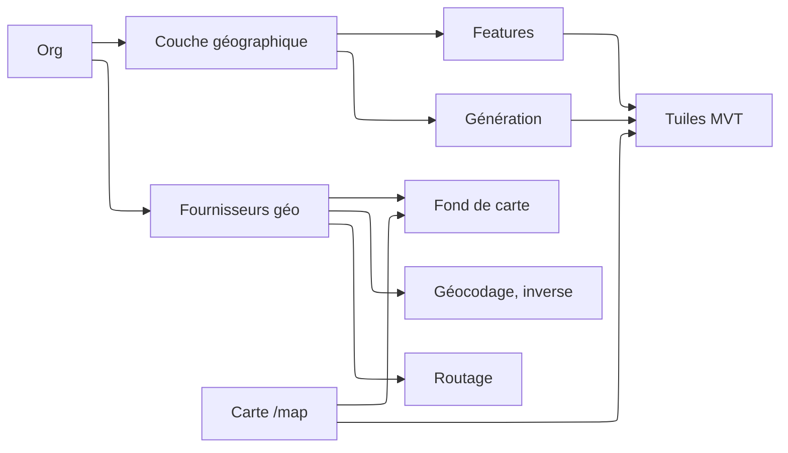
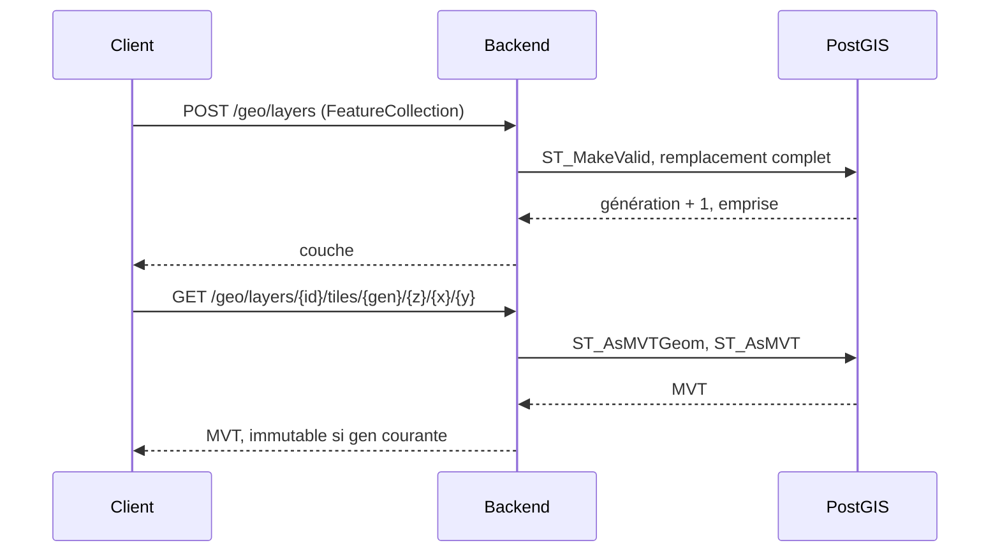
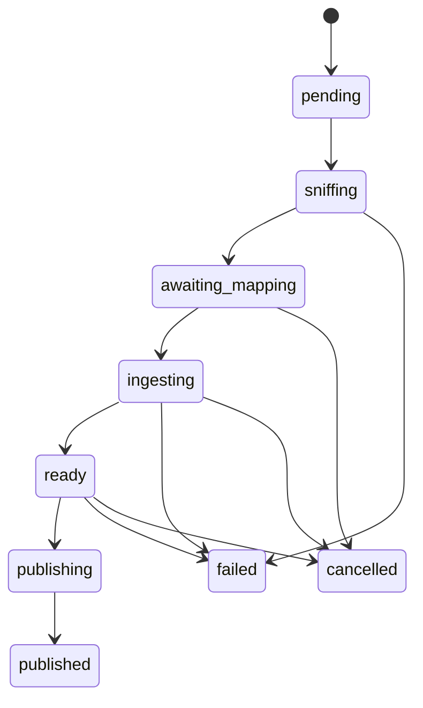
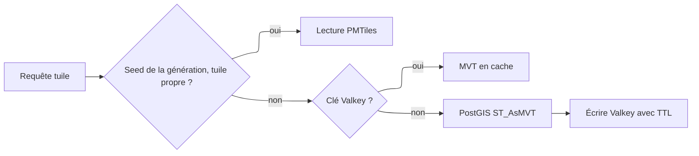
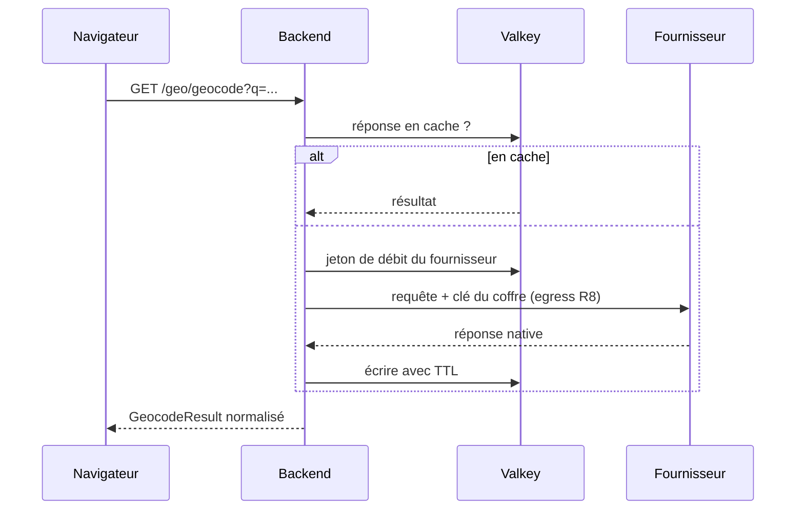

# Couches géographiques et fournisseurs géo

Liens : `viz.md` (D27 carte, D37 regroupement des sites, D38 positions GPS), `media.md` (D21 octets hors base, MediaStore), `agents.md` (jobs par capacité), `ontology.md` (D181 temps des objets, D184 provenance), `security.md` §9 (D110 coffre, D116, D119 fournisseurs d'org), `runtime.md` §3.6 (D108 Valkey), `labor-market.md` (M5, M6), `roadmap.md` (P2.16, décision #20).

## 1. Résumé

Une org affiche sur la carte ses propres données vectorielles : zones, réseaux, parcelles, emprises. Ces données forment des couches géographiques, stockées dans PostGIS et servies en tuiles MVT par le backend, sans GeoServer. L'org branche aussi ses propres fournisseurs géo : fond de carte, géocodage, géocodage inverse et routage. PneX donne l'adaptateur, le coffre, le proxy et le cache, jamais le moteur. Les fournisseurs (phase F) et le socle des couches (phase A) sont codés. L'import de fichier, le cache des tuiles, la mise à jour partielle et l'éditeur de style (phases B à E) sont proposés.

## 2. Concepts

- **Couche géographique** : ensemble de géométries d'une org, d'une seule famille (point, ligne ou polygone), servie en tuiles. Ligne de `geo_layers`.
- **Feature** : une géométrie et ses attributs (`props`). Ligne de `geo_features`.
- **Génération** : compteur de la couche. Un remplacement complet l'incrémente. Elle fait partie de l'URL des tuiles.
- **Tuile MVT** : tuile vectorielle `z/x/y`, encodée par PostGIS (`ST_AsMVT`).
- **Fournisseur géo** : moteur externe déclaré par l'org, avec une URL, une clé facultative et des capacités. Ligne de `geo_providers`.
- **Capacité** : service d'un fournisseur : `basemap`, `geocode`, `reverse`, `autocomplete`, `route`, `isochrone`, `matrix`.
- **Fond de carte** : fournisseur `basemap`, un style MapLibre v8 chargé par le navigateur.
- **Source** : version de média importée. **Dérivé** : feature, tuile en cache, seed ou staging, recalculable depuis une source (proposé).

## 3. Fonctionnement

### 3.1 Créer une couche et servir ses tuiles

Le client crée une couche depuis un FeatureCollection GeoJSON de 32 Mo au plus. La couche accepte une seule famille de géométrie. Le serveur refuse une forme dégénérée. `services::geo::layers::replace_features` remplace tout le contenu et incrémente la génération. Un pipeline peut écrire une couche par ce service (`labor-market.md` M5).

La tuile porte une couche source `features`, avec les `props` comme attributs. Elle contient 20 000 features au plus. Une nouvelle génération donne de nouvelles URL, donc aucune purge n'est nécessaire.

Sur `/map`, `pnexMap.setLayers` dessine les couches sous les zones, les traces et les marqueurs. `transformRequest` ajoute le Bearer et `X-Org-Id` aux seules URL de tuiles. Le panneau de la carte montre une case par couche. Un style vide prend le style par défaut de la famille.

### 3.2 Importer un fichier (proposé)

Le principe est : envoi, puis import, puis publication. L'envoi crée un média (genre `vector` ou `raster`). Un job `import_geo` lit cette version de média et remplit un staging. La publication bascule le staging en contenu servi, dans une transaction courte.

- **sniffing** : octets magiques, inspection d'archive avec garde contre les bombes zip, CRS, types, aperçu.
- **awaiting_mapping** : l'utilisateur confirme le CRS. Si le CRS manque, l'import attend. Le serveur ne le devine jamais.
- **ingesting** : lecture en flux, `COPY` par lots, `ST_MakeValid` et `ST_Transform` en SQL. Une feature invalide est comptée, pas bloquante.
- **ready** : le diff (« +120, ~34, −8, 2 invalides ») s'affiche avant publication.

La case « Vider avant import » choisit le mode. Cochée, le résultat est exactement le fichier, avec une nouvelle génération. Décochée, l'import met à jour par clé d'identité. Une ligne `_op = delete` supprime une feature.

### 3.3 Cache des tuiles (proposé)

La clé de cache est `pnex:{db}:tile:{org}:{layer}:{gen}:{z}:{x}:{y}`. Un verrou `SET NX PX` évite qu'une même tuile soit calculée deux fois. Une mise à jour partielle supprime les tuiles touchées (`UNLINK`) et les place dans le set dirty de la couche. Ces tuiles contournent le seed jusqu'au prochain seed. Après chaque publication, un job supprime le seed et le staging de l'ancienne génération.

### 3.4 Fournisseurs géo

L'org déclare ses fournisseurs dans sa page, comme ses fournisseurs LLM. Chaque capacité a un fournisseur par défaut. PneX ne livre aucun fond de carte. Sans fond, la carte montre un fond neutre et un message avec un lien vers la page de l'org. Les sites restent utilisables. Sans fournisseur de géocodage, la recherche s'affiche « non configurée ».

Le navigateur n'appelle jamais un fournisseur de géocodage ou de routage. Le backend relaie, avec la clé tirée du coffre et ajoutée sous `key_param`. Il garde une réponse de géocodage 7 jours et une route 10 minutes. Si `store_allowed` est faux, il garde tout 10 minutes au plus. Le débit par défaut est d'une requête par seconde (politique publique de Nominatim).

Un fond de carte est l'exception. Sa clé est une clé navigateur, présente dans l'URL du style et visible des membres. Le fournisseur la restreint par référent. L'utilisateur bascule entre les fonds depuis la carte, et son choix reste dans le navigateur (`pnex.basemap.<org id>`).

Le bouton « Tester » fait un vrai appel sans cache et rend la latence. Pour un fond, il vérifie `version: 8` du style. Pour un géocodeur, il fait un géocodage inverse connu. Pour un routeur, il calcule une route connue.

Sur `/map`, la barre de recherche géocode une adresse. La création d'un site propose l'adresse du point par géocodage inverse. La route est disponible par l'API et le MCP, pas encore dessinée sur la carte.

## 4. Exigences

1. Le backend doit lire le `org_id` depuis le principal pour chaque couche, tuile et fournisseur (D2, R1).
2. Un appel sortant vers un fournisseur doit passer par `pnex_core::egress` (R8).
3. Une clé de géocodage ou de routage ne doit jamais quitter le serveur ni apparaître dans un log.
4. Une tuile d'une génération courante doit porter `Cache-Control: private, immutable`.
5. Une couche doit contenir une seule famille de géométrie.
6. L'import ne doit jamais deviner un CRS absent (proposé).
7. Le lecteur de fichier doit tourner dans un worker, jamais dans un handler HTTP (proposé).
8. Une archive doit passer la garde contre les bombes zip et `PNEX_MEDIA_MAX_BYTES` (proposé).
9. Le cache des tuiles doit vivre dans Valkey seulement, sans cache mémoire en Rust (proposé).
10. Une publication ne doit jamais bloquer les lecteurs de tuiles (proposé).

## 5. Décisions

Les décisions de ce document gardent leurs numéros L1–L28. Elles ne sont pas renumérotées en Dn.

| # | Décision | État |
|---|---|---|
| L1 | PostGIS dans le PostgreSQL existant, image multi-arch | livrée (dev, CI, cluster CNPG) |
| L2 | Un fichier géo est un média, genres `vector` et `raster` | proposée (B) |
| L3 | Octets dans le MediaStore (`fs`, `s3`), jamais en base (D21) | proposée (B) |
| L4 | Registre `geo_layers` avec `generation` et style MapLibre en JSONB, appliqué par le client | livrée en partie (A) |
| L5 | Une table `geo_features` partagée, `geom` 4326 et `geom_3857` générée, index GiST | livrée (A) |
| L6 | Tuiles MVT des couches servies par le backend, le fond reste à Martin | livrée sans simplification par zoom (A) |
| L7 | Import par job `import_geo`, cycle d'états, annulable | proposée (B) |
| L8 | Lecteurs Rust en flux vers `geozero`, reprojection en PostGIS, pas de GDAL | proposée (B, E) |
| L9 | Case « Vider avant import » : remplacement ou mise à jour par clé, diff interne | proposée (D) |
| L10 | Publication sans coupure, bascule par génération au-delà d'un seuil | proposée (B) |
| L11 | Les données temps réel restent en GeoJSON lu en boucle, hors tuiles | appliquée |
| L12 | Cache des tuiles dans Valkey seulement, verrou anti-ruée, tuiles vides cachées | proposée (C) |
| L13 | Seed facultatif : un PMTiles par couche et génération, servi par le backend | proposée (C) |
| L14 | Nettoyage des dérivés en job, retour arrière = nouvelle génération | proposée (C) |
| L15 | Couche publique et seedée déléguable à Martin | proposée |
| L16 | Table `geo_providers` par org, un défaut par capacité, pas de repli plateforme | livrée (F) |
| L17 | Adaptateurs natifs, plus un adaptateur `generic-http` | livrée en partie : Nominatim, Photon, Valhalla, GraphHopper |
| L18 | DTO normalisés dans `pnex-core` : `GeocodeResult`, `Route` | livrée (F) |
| L19 | Une clé d'API facultative, au coffre, en paramètre d'URL (`key_param`) | livrée (F) |
| L20 | Proxy serveur obligatoire pour géocodage et routage | livrée pour `geocode`, `reverse`, `route` |
| L21 | Cache Valkey des réponses, débit par fournisseur | livrée (F) |
| L22 | `store_allowed` faux : rien de gardé au-delà d'un TTL court | livrée pour le cache |
| L23 | Bouton « Tester », statut visible | livrée (F) |
| L24 | Fond de carte = fournisseur `basemap`, variante sombre facultative | livrée pour le style par URL |
| L25 | Fond par défaut de l'org, sélecteur sur la carte, choix gardé par utilisateur | livrée (F) |
| L26 | Aucun fond fourni par PneX : fond neutre et message | livrée (F) |
| L27 | Fond en mode `direct` : clé navigateur visible des membres | livrée (F) |
| L28 | « Tester » un fond : style v8, sources, première tuile, WebGL1 | livrée pour le contrôle `version: 8` |

Choix tranchés : la phase F passe avant la 0.2.0, les phases B à E après. La phase A est avancée pour `labor-market.md` (M6). Le seed garde la génération courante seulement. La 0.2.0 reste sur PostgreSQL 18, et l'image PostGIS se construit sur 18. Les fournisseurs sont de la configuration, pas des objets de l'ontologie.

Décisions liées, tenues ailleurs : D2, D14, D21, D24, D27, D37, D38, D108, D110, D116, D119, D181, D184.

## 6. Interfaces

| Route | Permission | MCP |
|---|---|---|
| `GET/POST /api/v1/geo/layers` | `geo:read` / `geo:write` | exposé |
| `DELETE /api/v1/geo/layers/{id}` | `geo:delete` | exclu |
| `GET /api/v1/geo/layers/{id}/tiles/{generation}/{z}/{x}/{y}` | `geo:read` | exclu (binaire) |
| `GET/POST /api/v1/geo/providers` | `geo:read` / `geo:write` (Admin) | lecture exposée |
| `PUT/DELETE /api/v1/geo/providers/{id}` | `geo:write` / `geo:delete` | exclu |
| `POST /api/v1/geo/providers/{id}/test` | `geo:test` (Admin) | exposé |
| `GET /api/v1/geo/basemaps` | `geo:read` | exposé |
| `GET /api/v1/geo/geocode`, `/reverse`, `/route` | `geo:read` | exposé |

Codes : `geo-provider-not-found`, `geo-provider-name-taken`, `geo-not-configured`, `geo-rate-limited`, `geo-provider-failed`, `geo-layer-not-found`, `geo-layer-name-taken`.

Profils de route : `auto`, `bicycle`, `pedestrian`, `truck`. Une instance sert seulement les profils qu'elle a construits. Les autres répondent `geo-provider-failed`.

Tables :

- `geo_providers` (`m20261011_000005_geo_providers`) : `name`, `kind`, `capabilities`, `base_url`, `secret_id`, `key_param`, `params`, `rate_limit_per_s`, `timeout_ms`, `store_allowed`. `geo_provider_defaults (org_id, capability, provider_id)`.
- `geo_layers` et `geo_features` (`m20261114_000151_geo_layers`). Index GiST sur `geom_3857`, unicité partielle `(layer_id, fid)`.

Colonnes proposées par les phases B à D : `identity_key`, `cache_policy`, `attributes_schema`, `seed`, `source_media_version_id` sur `geo_layers`. `content_hash` et `source_media_version_id` sur `geo_features`. Tables `geo_import_jobs` et `geo_features_staging`.

Formats proposés :

| Format | Lecteur |
|---|---|
| GeoJSON | `geozero` |
| Shapefile (zip) | `shapefile` + `zip` |
| GeoPackage | sqlite + WKB via `geozero` |
| FlatGeobuf | `flatgeobuf` |
| KML / KMZ | `kml` + `zip` |
| GPX | `gpx` |
| CSV (lat/lon ou WKT) | `csv` + `wkt` |
| GeoParquet | `geoarrow` (si la crate reste légère sur Pi) |
| DXF | `dxf` (CRS local à ancrer à la main) |

Chaque licence doit être vérifiée dans `deny.toml` avant l'ajout.

## 7. Reste à faire

- Phases B à E : import de fichier, cache et seed, mise à jour partielle, éditeur de style et formats restants.
- Simplification par zoom et plafond d'octets par tuile (L6). Mesure sur Pi : import de 100 000 features et p95 d'une tuile à froid.
- `pnex-deploy` : poser `CREATE EXTENSION postgis` dans `postInitApplicationSQL` avant de déployer. Sur une base existante, un superuser crée l'extension une fois. Non vérifié depuis ce dépôt.
- Image commune PostGIS et pgvector (`doc-search.md`) : à valider ensemble.
- Fournisseurs : adaptateurs Pelias, OSRM et `generic-http`. Routes `autocomplete` et `isochrone`. Fond par gabarit de tuiles ou archive PMTiles. Contrôles de L28 au-delà de `version: 8`.
- Itinéraire dessiné sur la carte. Colonne adresse à l'import (géocodage par lots).
- Nœuds de flow `geo_geocode` et `geo_route` avec leur `NodeDoc`, et outils de l'assistant, par le même service.
- Mode `proxied` d'un fond (le backend relaie style et tuiles).
- Webview Android : tuiles cross-origin par `addProtocol` et le pont Rust.
- Questions de Shan : raster (GeoTIFF et COG), OGC API – Features en lecture, plafonds par tier, lien d'une feature à un objet (D177, D179), lecteurs comme nœud de flow.
- Routage : seulement le profil `car` sur l'instance GraphHopper de référence. Tester tous les profils et une couverture monde après le déploiement complet.
- Référentiels publics à resynchroniser (source, fréquence, clé stable, fermetures). À voir avec `pipelines.md` à l'arrivée sur ce chantier.
