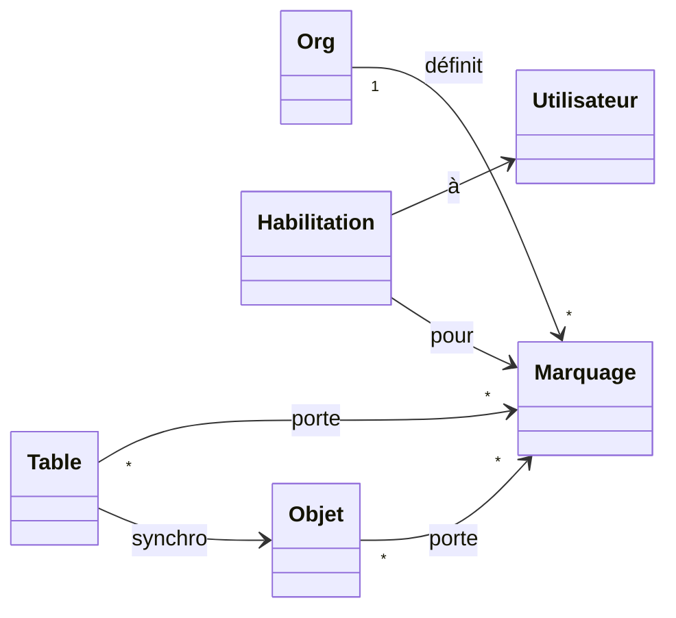
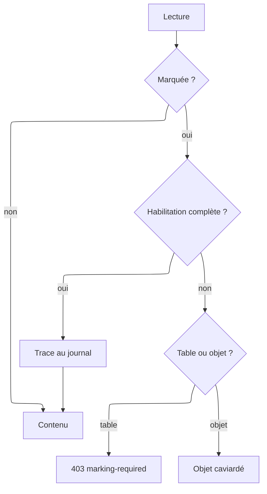
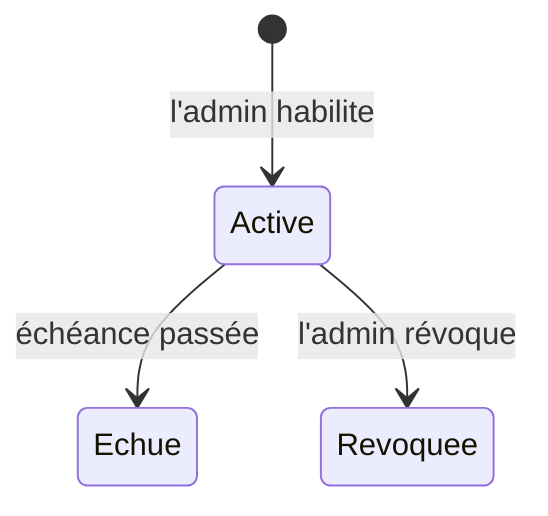
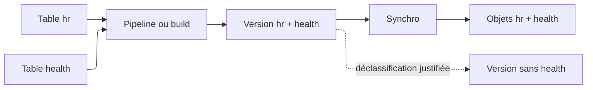
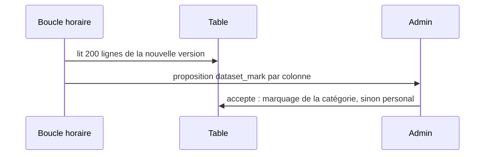
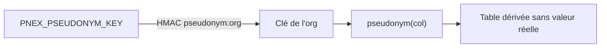

# Gouvernance des données : marquages, habilitations, finalité (OP3, D798–D806)

| | |
|---|---|
| Statut | Livré (lots G1 à G7). SAML, I4 général et I5 restent à faire (§7) |
| Repose sur | `iam.md` (D285–D299, I4, I5), `crm.md` (D442, D443 masque, D446 effacement), `pipelines.md` (D569–D578, lignage), `pipelines.md` |

## Résumé

La gouvernance protège les données sensibles d'une org : RH, santé, données d'un client. Seule une
personne habilitée lit une donnée marquée, pour une finalité déclarée. Chaque lecture laisse une
trace. Les tables et les objets dérivés d'une donnée marquée héritent de ses marquages. L'admin
d'org décide, sans rôle dédié, et le journal enregistre chaque geste.

## 1. Concepts

- **Marquage** : compartiment nommé par l'org, avec une clé anglaise (`hr`, `health`). La clé et le nom sont uniques dans l'org (le nom sans tenir compte de la casse).
- **Habilitation** : droit d'une personne à lire un marquage, pour une **finalité** (texte libre,
  200 caractères au plus), jusqu'à une échéance.
- **Habilitation complète** : une habilitation active pour **tous** les marquages de la donnée.
- **Déclassification** : retrait explicite d'un marquage, avec une justification.
- **Pseudonyme** : empreinte stable d'une valeur, calculée par `pseudonym()` dans un pipeline.
- **Journal de gouvernance** : flux O2 `governance_reads`.

## 2. Fonctionnement

### 2.1 Lire une donnée marquée

Le serveur vérifie l'habilitation à chaque lecture de contenu, jamais d'après l'UI.
- **Table** : les métadonnées restent visibles (nom, colonnes, versions, lignage). Le serveur refuse
  le contenu : échantillon, profil, lecture d'une version, export, requête d'analyse.
- **Objet** : le masque de D443 caviarde l'objet entier (titre `•••• <id>`, sans propriétés), partout
  où le masque passe. L'objet est absent des requêtes, des agrégats et des listes de marchés, car un
  filtre ou une somme révélerait ses valeurs. Mise à jour et archivage : `403 marking-required`.
- **Assistant, MCP, comptes de service** : mêmes routes, donc même refus. Un compte de service n'est
  jamais habilité (R22).

### 2.2 Cycle de vie d'une habilitation

Une habilitation échue ne vaut plus rien, sans nettoyage. Une révocation vaut dès l'appel suivant.

### 2.3 Propagation par le lignage

Le trigger `dataset_markings_inherit` donne à la version écrite l'union des marquages de ses
entrées. Une synchro lit avec les droits de son auteur : un auteur non habilité fait échouer le run
(`marking-required`). La synchro marque les objets écrits avant de déclarer le run fini. La
propagation suivante remet un marquage déclassifié seulement si une entrée le porte encore.

### 2.4 Détection de données personnelles

Le détecteur reconnaît e-mail, téléphone, IBAN (clé mod 97), carte (Luhn) et NIR (avec sa clé). Une
colonne déclenche une proposition à partir de 5 valeurs reconnues et de 60 % de la colonne. Une
table déjà marquée est ignorée. Une proposition refusée ne revient pas pour la même colonne. Seule une
personne avec `governance:write` accepte. La proposition porte le marquage dont la clé est la catégorie (`email`, `phone`, `iban`, `card`, `nir`), si l'org en a un. Sinon elle porte `personal`, que le premier accord crée.

### 2.5 Pseudonymisation

`pseudonym(text)` calcule un HMAC-SHA256 et garde 16 octets en hexadécimal. NULL reste NULL. Le
pseudonyme est stable dans l'org, donc les jointures marchent. La table dérivée peut perdre son
marquage par déclassification justifiée. PneX ne réidentifie jamais.

**Attention :** sans `PNEX_PSEUDONYM_KEY` (32 octets au moins) chez le worker, la fonction n'existe
pas et la transformation échoue. Changer la clé change tous les pseudonymes.

## 3. Exigences

1. Une lecture de contenu marqué doit exiger une habilitation complète, vérifiée côté serveur.
2. Une habilitation doit avoir une finalité et une échéance de 365 jours au plus.
3. Une déclassification doit porter une justification de 10 caractères au moins.
4. Un marquage porté par une donnée ne doit pas se supprimer (`marking-in-use`).
5. Une version dérivée doit porter l'union des marquages de ses entrées.
6. La clé de pseudonymisation ne doit jamais sortir du serveur et du worker (R4, R16).
7. Le journal doit contenir les identifiants lus, jamais les données.
8. La détection doit seulement proposer.

## 4. Décisions

### D798 — Un marquage est un compartiment de l'org
L'admin d'org crée et retire les marquages (`governance:write`). Un Lecteur voit leur liste, jamais les données.

### D799 — Une habilitation = personne × marquage × finalité × échéance
Finalité et échéance obligatoires, révocable, sans séparation des tâches (§2.2).

### D800 — Ce qui porte un marquage
Une table (toutes ses versions) et un objet. Une colonne sensible va dans une autre table ou passe par `pseudonym()`.

### D801 — Lire = être habilité pour tous les marquages
Table refusée, objet caviardé, exécutions sous les droits de leur auteur (§2.1).

### D802 — Le lignage propage, la déclassification est explicite
Union des marquages des entrées. Retrait par route dédiée, justifié, journalisé (§2.3).

### D803 — Chaque lecture marquée laisse une trace
`governance_reads` : qui, quoi, quels marquages, sous quelle habilitation, par où. Les gestes d'admin y vont aussi.

### D804 — La détection propose
Proposition D371 dans « À valider », jamais de changement seul (§2.4).

### D805 — La pseudonymisation remplace la valeur à l'écriture
HMAC par org. La clé dérive d'une clé maître du worker, qui n'a pas accès au coffre (§2.5).

### D806 — Droit d'accès d'une personne
L'admin exporte en JSON tout ce que l'org détient sur une personne. L'effacement existe déjà (D446).

## 5. Interfaces

Préfixe `/api/v1`. Permissions au registre `pnex-api-contract/src/iam.rs`.

| Route | Permission |
|---|---|
| `GET` / `POST /governance/markings`, `DELETE …/{id}` | `governance:read` / `write` / `delete` |
| `GET` / `POST /governance/clearances`, `POST …/{id}/revoke` | `governance:write` |
| `POST /datasets/{id}/markings`, `POST /datasets/{id}/declassify` | `governance:write` |
| `GET` / `POST /ontology/objects/{id}/markings`, `POST …/declassify` | `governance:read` / `write` |
| `GET /governance/journal?from&to` (CSV) | `governance:write` |
| `GET /ontology/objects/{id}/export` (JSON) | `governance:write` |

- Le MCP expose seulement `governance_markings_list` et `ontology_objects_markings`.
- Journal : 10 000 lignes au plus, récentes d'abord, 30 jours par défaut. Sans O2 :
  `503 governance-journal-unavailable`.
- Export : objet, liens passés et présents, 10 000 changements au plus, masque de l'appelant.
  `history_complete: false` signale un journal O2 absent.
- Erreurs : `marking-required`, `marking-not-found`, `marking-key-taken`, `marking-name-taken`, `marking-in-use`,
  `clearance-not-found`, `governance-journal-unavailable`.
- UI : onglet « Marquages et habilitations » de `/access` (`?tab=governance`), panneau
  `components/markings.rs` sur une table et une fiche d'objet.
- Tests : `crates/pnex-backend/tests/governance.rs`, `e2e/tests/governance.spec.ts`.

## 6. Limites assumées

- Un objet caviardé reste visible dans une lecture directe ou un lien, tant qu'I4 et I5 ne filtrent
  pas les listes. Un parcours de graphe peut passer par lui.
- Le serveur charge tous les objets cachés à chaque requête (`shortcut:` dans le code).

## 7. Reste à faire

- SAML à la première demande d'un client. I4 général et I5 : `iam.md`.
- D801, à coder (choix de Shan, 2026-11-20) : un pipeline ou une build doit vérifier l'habilitation de son auteur sur les données marquées qu'il lit.
- Hors dépôt : `PNEX_PSEUDONYM_KEY` en secret dans le chart `pipelineWorker` de `pnex-deploy`.
- L'onglet « Marquages et habilitations » n'a pas de passe axe dédiée.
