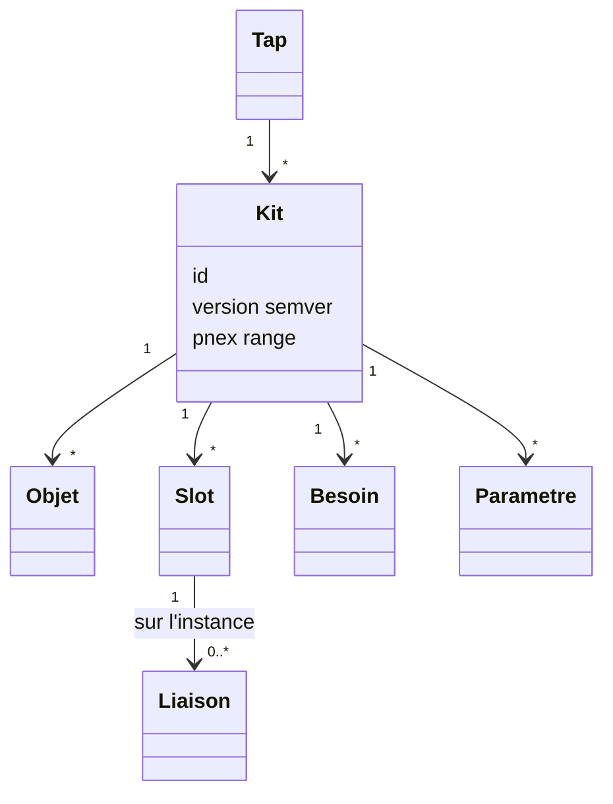
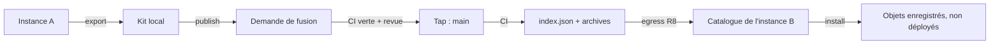
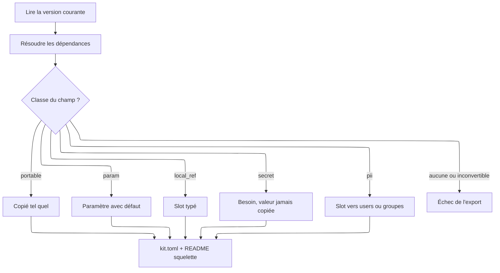
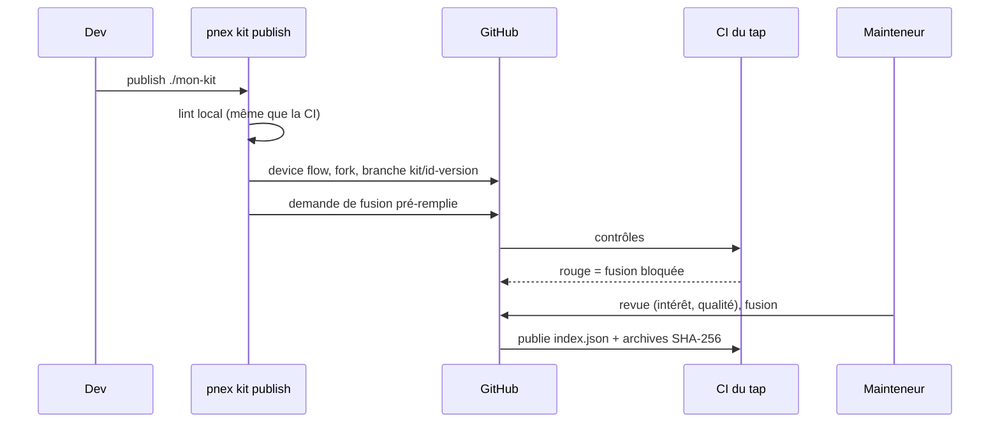
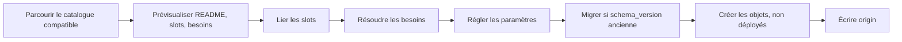
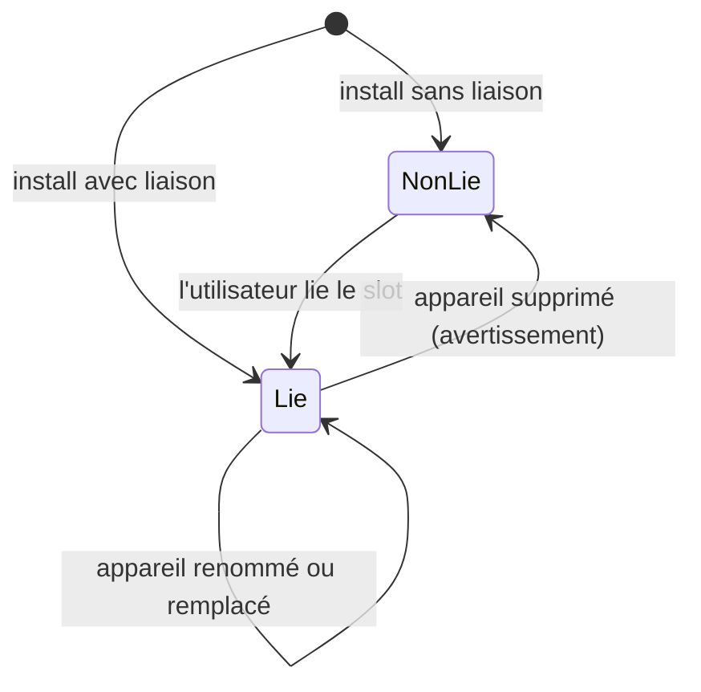

# Hub de kits : partage communautaire

| | |
|---|---|
| **Statut** | Proposé, gelé. Aucune ligne de code. Le lot OP12 dégèle le hub (D562, `operational-platform.md`). |
| **Licence** | MIT (projet), DCO sur les contributions |
| **Renvois** | `ontology.md` (D176, D184, D190), `security.md` (R1–R20, coffre D110), `firmware.md` (D87–D94), `flow-engine.md` (fonctions JS / Starlark), `pages.md` P13 (modèles de page), `api.md` (CLI `pnex`) |

## 1. Résumé

Le hub permet de partager un kit : un lot d'objets PneX prêts à l'emploi (flow, tableau de bord, fonction…). Un développeur exporte un kit depuis son instance et le publie par une demande de fusion Git. Un utilisateur installe le kit depuis l'UI et le relie à son matériel. Le hub n'a pas de backend : un dépôt Git, une CI et un index statique suffisent. Un tutoriel peut ainsi finir par « installe le kit en un clic ».

**État du code** : rien n'est codé. Aucune commande `pnex kit`, aucun format `kit.toml`, aucune classe de sensibilité dans `pnex-core`. Les packs d'ontologie existent (`services/ontology/packs.rs`, D190), mais ils ne sont pas des kits.

Hors périmètre de la v1 : notation et commentaires, lien vivant avec la source (un kit installé est une copie), télémétrie et médias lourds, fichiers KiCad (le kit donne un lien vers le dépôt matériel). Les kits payants sont admis au lot OP12 (D562).

## 2. Concepts

| Terme | Définition |
|---|---|
| **Objet partageable** | Flow, tableau de bord, synoptique, fonction (JS / Starlark), variante de carte, modèle de page. Le catalogue de cartes vit dans le code (D121) : il n'est pas partagé. |
| **Kit** | Lot versionné d'objets, avec un manifeste `kit.toml` et un `README.md`. |
| **Slot** | Rôle typé que le kit déclare (`temp_ext : analog_in, °C`). Il remplace toute référence à un objet local. |
| **Liaison** | Association locale d'un slot à un objet de l'instance, par UUID ou par sélecteur. |
| **Besoin** | Configuration locale que le kit demande (`network.wifi`, canal de notification, secret). L'instance la résout. |
| **Paramètre** | Valeur réglable (seuil, fréquence) avec une valeur par défaut. |
| **Profil réseau** | Configuration locale (SSID, identifiants, endpoints) injectée au build ou au provisioning. |
| **Tap** | Dépôt Git qui suit la structure du hub. Le hub public est un tap. |

**Principe** : un kit ne contient jamais un nom local, un ID local, une IP, un SSID ni un secret. Il contient seulement des slots, des besoins et des paramètres.



## 3. Fonctionnement

### 3.1 Cycle de vie d'un kit



### 3.2 Export



L'UI porte un bouton « Exporter en kit » sur chaque objet. L'utilisateur peut renommer les slots avant le téléchargement de l'archive. La CLI `pnex kit export <type>/<uuid> [--with-deps]` appelle le même service. Avec `--with-deps`, un tableau de bord embarque ses flows.

L'export lit les annotations de classe, pas une heuristique. Chaque champ d'un schéma `pnex-core` porte une classe, déclarée une fois par un attribut Rust. Un champ sans classe fait échouer la compilation. Un texte libre (modèle de message, description) passe en plus un lint : tokens, URLs, emails, IPs et noms d'org.

Les notifications sont le cas le plus exposé :

| Élément | Classe | Devient |
|---|---|---|
| Canal et identifiants, URL de webhook | `secret` | besoin `notification_channel{kind}` |
| Destinataires | `pii` | slot `recipients` |
| Modèle de message | `portable` | copié, variables vérifiées contre les ports du flow |
| Partial hors du kit | `local_ref` | slot, ou embarqué avec `--with-deps` |
| Seuil, fenêtre, limite d'envoi | `param` | paramètre |
| Astreinte, plages silencieuses | contexte local | besoin optionnel |

Dans un objet JSON, une référence externe s'écrit `{"$slot": "temp_ext"}` ou `{"$req": "network.wifi"}`. Une référence interne au kit s'écrit `{"$local": "flow.ingest-meteo"}`.

### 3.3 Publication et validation



| Contrôle | Détail |
|---|---|
| Schéma | Chaque objet est valide contre `schemas/`, généré depuis `pnex-core`. |
| Compatibilité | La plage `pnex` couvre la `schema_version` de chaque objet. |
| Portabilité | Aucun UUID, IP, MAC, SSID, URL interne ni chaîne à forte entropie. |
| Cohérence | Chaque `$slot`, `$req`, `$local` est déclaré. Aucun slot orphelin. |
| Scripts | Lint JS / Starlark. Pas de recherche d'objet par nom. |
| Install test | Une instance éphémère (docker compose) installe le kit avec des liaisons fictives. |
| Rendu | Une capture du tableau de bord est postée sur la demande de fusion. |
| Méta | `id` unique, version incrémentée, licence MIT, DCO signé. |

L'index contient id, versions, compatibilité, tags, slots, besoins, cover et checksum. Un bouton « Partager » dans l'UI (GitHub App) viendra plus tard pour les non-développeurs.

### 3.4 Installation



L'UI suggère une liaison par capability, unité et tags. Un slot `many` prend un sélecteur. Un slot peut rester non lié : l'objet est créé avec le statut « non lié ». Un besoin se résout par un profil réseau existant ou un secret nouveau au coffre. Un besoin optionnel peut rester vide. Une notification sans canal reste « inactive », et l'UI le signale.

Chaque objet créé garde `origin = {tap, kit_id, version, checksum}` (provenance D184). Le déploiement reste un geste explicite de l'utilisateur. La CLI `pnex kit install <id>@<version> --bind <slot>=<uuid>` sert à l'automatisation.

### 3.5 Liaison sur l'instance



Une liaison passe par l'UUID : renommer un appareil ne casse rien. Pour remplacer une carte, l'utilisateur relie le slot au nouvel appareil. Un changement de Wi-Fi modifie le profil réseau, pas le kit. Une version nouvelle du kit affiche un diff, puis crée une version locale qui garde les liaisons.

### 3.6 Taps

Une org peut ajouter un tap dans l'UI (ou `pnex tap add <nom> <url>`). Un tap suit la structure du hub et réutilise la CI publiée par PneX. Cas d'usage : hub interne d'une org, hub d'un fabricant de cartes, fork communautaire. Le tap public est actif par défaut, et une org peut le couper (air-gap).

## 4. Exigences

1. L'export doit refuser un kit dont une référence ne devient ni slot, ni besoin, ni paramètre.
2. Un champ de schéma `pnex-core` sans classe de sensibilité doit faire échouer la compilation.
3. Un kit fusionné ne doit contenir aucun UUID, IP, SSID ni secret (contrôle CI).
4. L'installation doit créer des objets enregistrés et non déployés.
5. Installer un kit doit exiger une permission d'écriture, avec l'org prise du principal (R1, R2, test 403).
6. L'installation doit vérifier le checksum SHA-256 de l'archive.
7. Le script d'un kit doit tourner dans les bacs existants (rquickjs, Starlark), sans I/O et sans droit en plus.
8. L'UI doit montrer avant l'installation ce que le kit crée et ce qu'il lit.
9. L'index doit passer par la garde de sortie (R8), avec un cache Valkey.
10. Chaque geste utilisateur (export, installation, taps) doit exister dans l'UI. La CLI sert aux contributeurs.
11. Un kit doit donner une plage `pnex`. Un changement de slots ou de besoins doit monter la version majeure.
12. Les migrations de `schema_version` doivent être montantes seulement, dans `pnex-core`.

Critères d'acceptation de la v1 (P1 à P3) : un tableau de bord multi-appareils exporté de l'instance A s'installe sur une instance B vierge et marche. Un développeur exporte et publie un kit en moins de 2 minutes.

## 5. Décisions

- **Kit = pack** (2026-10-10, ancienne question 7) : un pack métier D190 est un kit officiel. Un seul manifeste, une seule installation.
- **Identité de l'auteur** (2026-10-10) : le compte GitHub seul (demande de fusion + DCO), sans lien avec le compte Rauthy.
- **D562** : le lot OP12 dégèle le hub et admet les kits payants.
- **D184** : `origin` est la provenance de l'objet installé.
- **D110** : un besoin secret se résout au coffre de l'org.

## 6. Interfaces

Structure d'un tap :

```text
hub/
  kits/<id>/kit.toml
  kits/<id>/README.md
  kits/<id>/objects/<kind>.<nom>.json
  kits/<id>/media/cover.png
  schemas/            generated from pnex-core
  .github/workflows/
```

Manifeste :

```toml
[kit]
id      = "meteo-station-c6"
version = "1.2.0"
license = "MIT"
pnex    = ">=0.2.0, <0.3.0"
tags    = ["meteo", "c6"]
links   = { hardware = "https://…" }

[[objects]]
kind = "flow"
path = "objects/flow.ingest-meteo.json"
schema_version = 3

[[slots]]
name = "temp_ext"
capability = "analog_in"
unit = "°C"
cardinality = "one"              # one | many
selector = { tags = ["outdoor"] } # suggested binding, optional

[[requirements]]
key  = "network.wifi"
kind = "network_profile"         # network_profile | secret | notification_channel
optional = false
```

CLI prévue : `pnex kit export`, `pnex kit publish [--tap <org/dépôt>]`, `pnex kit install`, `pnex tap add`.

## 7. Reste à faire

Phasage proposé, après le dégel OP12 :

| Phase | Contenu |
|---|---|
| P1 | Format, `kit.toml`, schémas générés, classes de sensibilité, export UI et CLI |
| P2 | Dépôt `Pnex/hub`, CI sans install test, `pnex kit publish` |
| P3 | `index.json`, catalogue, installation, liaison, `origin` |
| P4 | Install test éphémère, captures en CI, mises à jour de kits |
| P5 | Bouton « Partager », taps, signature cosign / sigstore, badge « vérifié » |

Prérequis non vérifiés dans le code :

- Toutes les références entre objets passent-elles par UUID ? La conversion en slots en dépend.
- Le type d'un slot doit-il venir du vocabulaire de l'ontologie (capability, unité, type d'objet) ?
- Un kit simple doit rester possible sans modèle ontologique (slots par capability seulement).
- D190 (`ontology.md`) ne dit pas encore « kit = pack ». La décision du 2026-10-10 reste à y reporter.

Questions ouvertes à Shan :

1. Kit « matériel d'abord » : faut-il un objet `firmware_profile`, ou la variante de carte et ses capabilities suffisent-elles ? Le firmware custom (D87–D94) est candidat.
2. Un kit peut-il dépendre d'un autre kit en v1 ?
3. Fonctions en source seule. À revoir si WASM entre un jour dans la stack.
4. Modération : des co-mainteneurs par catégorie (`CODEOWNERS`) quand le volume monte ?
5. Index : GitHub Pages seul, ou un miroir (Codeberg, stockage objet) ?
