# Gestion des accès (IAM) : moteur, rôles, comptes de service (D285–D299)

| | |
|---|---|
| Statut | Lots I0–I3 livrés. I6 livré en lecture seule, I7 livré sans simulateur ni « Gérer l'accès ». I4 et I5 à faire (§16) |
| Numérotation | **D285…D299**. Rouvre D188 (`ontology.md`) |
| Repose sur | D117 (rôles d'org), D72 (admin plateforme), `security.md` (R1–R23), `api.md` (D238–D245), `ontology.md` (D183, D185, D187, D190), `design-system.md` §7 (lexique) |
| Sécurité | Chaque changement passe `security.md` §6 |

## Résumé

L'IAM de PNEX décide qui peut faire quoi sur quelle ressource, dans une org. Un moteur unique refuse
par défaut. Il couvre l'UI, le SDK, la CLI `pnex`, le serveur MCP, l'assistant et les applications
externes. Les rôles, les équipes et les attributions donnent les droits. Les comptes de service
donnent une identité aux applications externes, avec une clé d'accès côté serveur.

## 1. Périmètre

Dans le périmètre :
- le moteur d'autorisation, le registre des actions, les rôles gérés et personnalisés, les équipes,
  les attributions à portée.
- l'application de la décision à l'API HTTP, à l'assistant, aux WebSockets, à la recherche, aux
  notifications temps réel.
- les accès fins sur l'ontologie : type, objet, propriété, lien, action.
- les comptes de service et les clés d'accès (usage serveur).
- la page Accès et l'audit.

Hors périmètre :
- les principaux machine : device, agent edge, agent navigateur, runtime de flows (§5.4).
- une clé utilisable depuis un navigateur (pas de CORS).
- une autorisation venue de Rauthy : Rauthy authentifie, PNEX autorise (§14).
- un partage hors org : l'org reste la frontière (R1).

## 2. Principes

- Le moteur refuse tout ce qu'aucun énoncé n'autorise.
- La frontière plateforme, puis la frontière org, passent avant le moteur. L'org vient toujours du
  principal (R1). Le moteur restreint seulement à l'intérieur de l'org.
- Le serveur décide. Le front masque ce qu'un droit ne permet pas, mais il ne décide jamais (R2).
- Un changement de droit s'applique à l'appel suivant, sur tous les pods.

## 3. Concepts

Le lexique (`design-system.md` §7) et la garde `lexicon_guard.rs` portent ces termes.

| Notion | FR | EN | N'est pas |
|---|---|---|---|
| Ensemble nommé de permissions, attribuable | Rôle | Role | le rôle d'un acteur dans un dossier (`case-role`) |
| Liaison principal × rôle × portée | Attribution | Assignment | un partage public, une « affectation » |
| Ce que couvre une attribution (org, type, objets, étiquettes) | Portée | Scope | — |
| Regroupement de membres de l'org | Équipe | Team | un « groupe » (groupe froid, groupe de sociétés, groupe de nœuds) |
| Identité non humaine d'une org | Compte de service | Service account | un device, un agent |
| Secret d'authentification d'un compte de service | Clé d'accès | Access key | une « clé d'API » (fournisseur tiers), un « jeton » (device) |
| Unité d'autorisation (`service:verbe`) | Permission | Permission | une permission du navigateur ou du device |
| Écran « qui peut faire quoi » | Accès | Access | « Partager » (lien public d'un tour) |
| Vérification d'un accès hypothétique | Simulateur d'accès | Access checker | — |

Autres termes :
- **Principal** : celui qui appelle. Utilisateur, équipe ou compte de service (D286).
- **Rôle géré** : rôle livré par la plateforme. Propriétaire, Administrateur, Membre, Lecteur (D117).
- **Rôle personnalisé** : rôle qu'une org écrit. C'est une liste d'énoncés (D287).
- **Énoncé** : `{effet, permissions, ressources, conditions}`. L'effet est « autoriser » ou « refuser ».
- **Droits effectifs** (`Grants`) : le rôle d'adhésion, plus les rôles attribués au principal et à
  ses équipes.
- **Registre des actions** : la table `operationId` → permission de `pnex-api-contract/src/iam.rs` (D289).
- **Permission de champ** : permission qu'un handler teste dans une opération (`GATES` du registre).

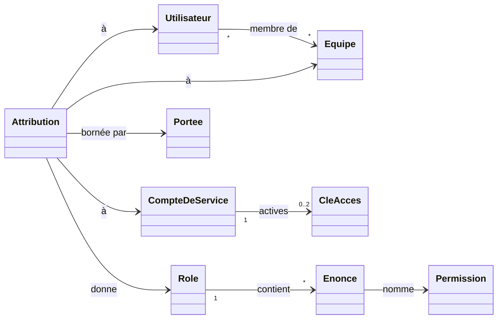

## 4. Fonctionnement : la décision d'accès

### 4.1 Points d'application (D291)

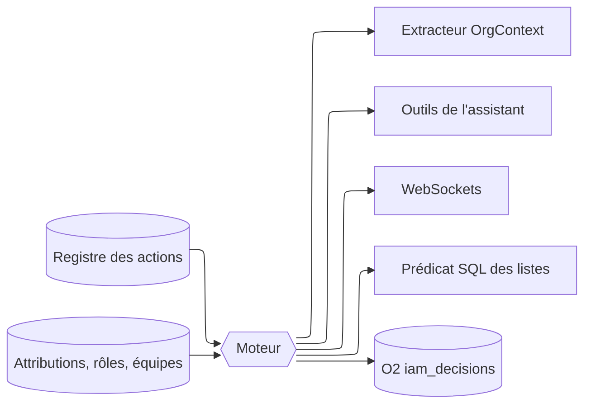

Le moteur a trois points d'application. L'extracteur `OrgContext` couvre toute l'API HTTP. Le MCP
rejoue les opérations par le routeur avec les identifiants de l'appelant : il hérite de la même
décision. Les outils de l'assistant et les WebSockets appellent le moteur hors HTTP. Le prédicat SQL
des listes est le lot I4 (à faire).

### 4.2 Une requête HTTP

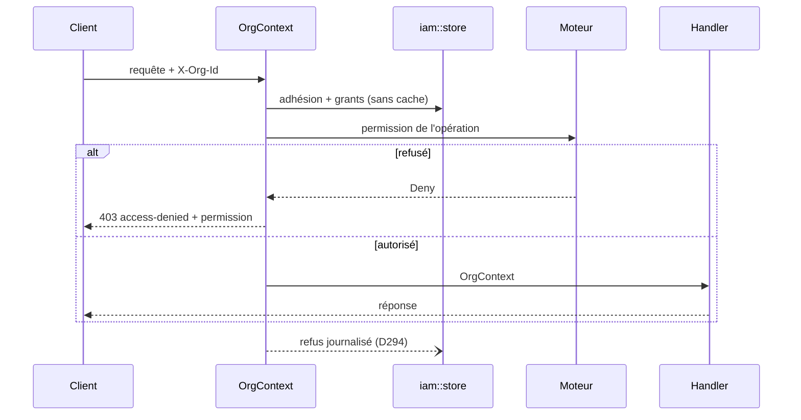

L'extracteur lit l'adhésion et les droits effectifs en une requête par appel, sans cache. La table
`operation_of(méthode, route)` vient du spec, construite une fois. Le handler peut tester une
permission de champ avec `org.can("service:verb")`. Il ne teste jamais un rôle.

### 4.3 Évaluation

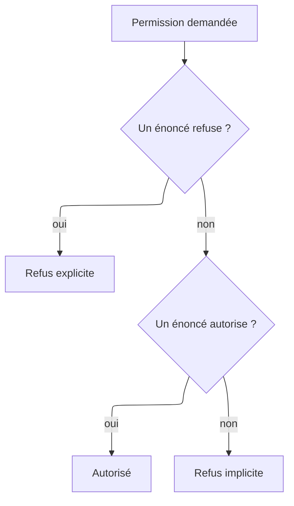

Un motif d'énoncé peut être `svc:verb`, `svc:*` ou `*`. Un rôle personnalisé n'accorde ni ne retire
jamais `iam:*` (D293). Ainsi, aucun rôle personnalisé ne peut verrouiller un propriétaire.

### 4.4 Droits effectifs

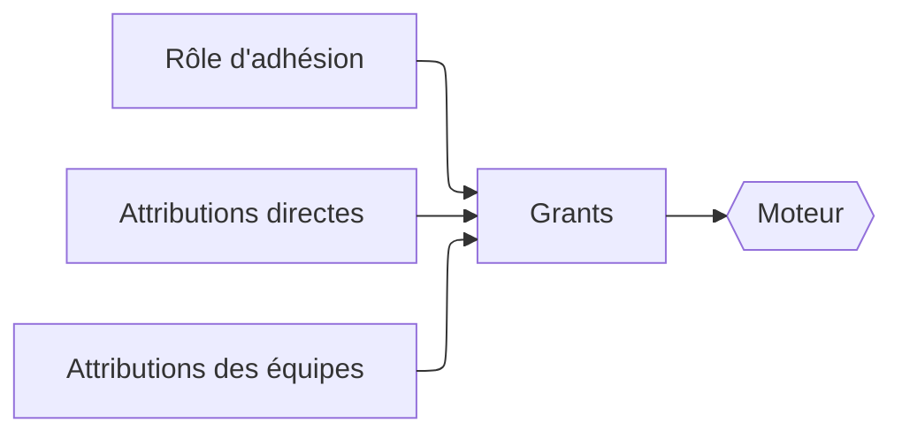

Un membre reçoit son rôle d'adhésion, puis ses attributions directes et celles de ses équipes. Un
compte de service n'a pas de rôle d'adhésion : il reçoit ses attributions seules. Le rôle géré
Propriétaire reste un rôle d'adhésion et n'est jamais attribuable. Quand un membre quitte l'org,
ses attributions directes et ses adhésions d'équipe de l'org partent avec lui.

### 4.5 Observation (lot I1)

`services/iam/observe.rs` compare la décision du moteur à la réponse du handler. Il a servi à
prouver l'équivalence D287 avant la bascule. Il reste disponible :
- `PNEX_IAM_OBSERVE=strict` : une divergence donne un 500 qui la nomme.
- `PNEX_IAM_OBSERVE_LOG=<fichier>` : une ligne par divergence.

## 5. Application par surface

### 5.1 API HTTP

- Chaque opération d'org déclare sa permission au registre. L'extracteur l'applique avant le handler.
- Le spec documente sur chaque 403 d'org la permission exigée (`openapi.rs`).
- Restent dans les handlers : la propriété d'un objet (auteur d'un commentaire), le `write_role` des
  types d'ontologie (`ontology-write-forbidden`) et les règles propriétaire de `orgs/{id}/…`.
- Les routes `orgs/{id}/…` utilisent l'extracteur `AuthUser` avec l'org du chemin. Elles sont hors
  moteur.

### 5.2 Assistant IA

`execute` appelle `tools::authorize_tool` avant chaque outil. L'outil déclare sa permission dans
`TOOLS` du registre. `ToolDeps.grants` porte les droits complets du membre. Les consignes D142–D145
restent : l'assistant n'écrit jamais d'IAM et n'agit jamais physiquement. Il peut expliquer un refus.

### 5.3 Temps réel et caches

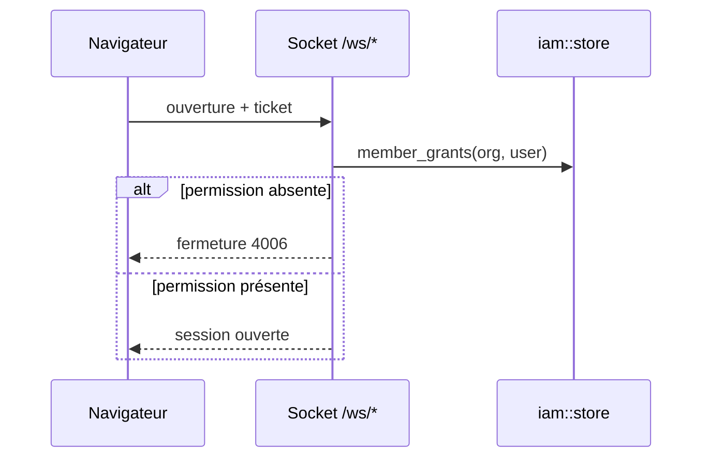

Les sockets n'ont pas d'`OrgContext`. Ils lisent les droits avec `iam::store::member_grants` (SEC-74).
`/ws/notify` exige `notify:read`, la caméra `cameras:read`, `/ws/doc` `docs:read`. `/ws/doc` relit
`docs:write` à chaque battement.

Le lot I4 doit fermer deux fuites :
- `notify::publish` diffuse une trame à toutes les sessions de l'org. Chaque session doit filtrer la
  trame par sa ressource.
- Les caches de visualisation (`services/visualization.rs`) ont une clé `org|requête`. Le filtre doit
  s'appliquer à la construction de la requête, jamais après la lecture du cache.

### 5.4 Principaux machine

Ces principaux gardent leur mécanisme. Le registre les marque `Machine`.

| Principal | Mécanisme | Portée |
|---|---|---|
| Device (jeton, X.509) | `device_link`, `device_pki` | son device |
| Agent edge, agent navigateur | enrôlement, ticket Noise | son agent |
| Runtime de flows | jeton de service `/internal/*`, `org_id` du corps | le flow déployé |
| Tour public | `share_token` en clair | le tour (SEC-47) |

## 6. Ontologie : accès fins (lot I5)

État actuel : la lecture d'un objet n'a aucun contrôle par objet. L'écriture teste `write_role` sur
le rôle d'adhésion (objets, liens, actions, purge, plages). Les propriétés `personal` et `sensitive`
sont déjà masquées sans `ontology.personal:read` ou `ontology.sensitive:read` (`crm.md` D443).

### 6.1 Où vit le filtre (D295)

Le prédicat de visibilité doit vivre dans `services/ontology/{objects,links,graph}.rs`. Au moins dix
chemins lisent aujourd'hui `objects` ou `resource_edges` en direct. Ils doivent passer par ces
modules. Une garde par grep, sur le modèle d'`i18n_guard`, doit interdire tout autre accès (R21).

### 6.2 Granularités (D296)

| Niveau | Exemple de règle | Application | Fuites à fermer |
|---|---|---|---|
| **Type** | lire `Pompe`, écrire `Intervention` | `type_key IN (…)` dans le prédicat | schéma exporté, contexte de l'assistant, comptes par type |
| **Objet** | par id, par étiquette (`site=lyon`), par propriété indexée | prédicat SQL (jointure `resource_labels`) | totaux de pagination, plafond d'arêtes du graphe, titres dans la recherche |
| **Propriété** | masquer `salaire` ou toute propriété `personal` | masquage dans `objects::view` | filtre ou tri sur propriété masquée (oracle) ; historique, séries, agrégats, exports, gels |
| **Lien** | traverser `possède` mais pas `finance` | prédicat sur `relation` | lien vers un objet invisible : supprimé ou bout caviardé |
| **Action D183** | proposer sans invoquer | `actions::invoke`, `propose_action` | — |

### 6.3 Graphe (D297)

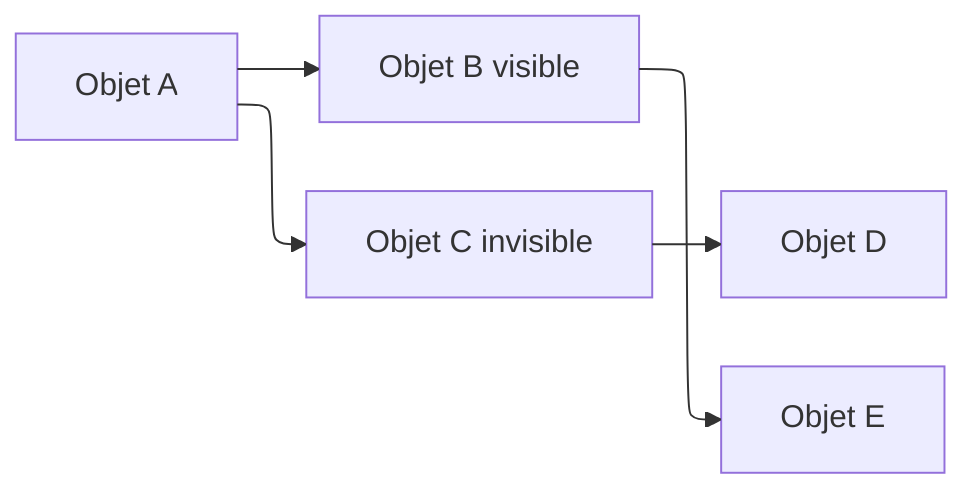

Le graphe, l'impact et le plus court chemin se calculent sur le sous-graphe visible. Le prédicat
s'applique dans la CTE récursive, pas après. Dans l'exemple, le chemin A → D n'existe pas pour un
principal qui ne voit pas C.

### 6.4 Cas particuliers

- **Gel de dossier** (`case_snapshots`) : geler, dégeler et ouvrir un gel sont des permissions du
  service `cases`. À l'ouverture, un élément refusé devient « accès non accordé », sans donnée.
  C'est une exception assumée à D297 : l'existence de l'élément est connue, pas son contenu.
- **Dashboard de type** (D187) : la liaison objet → série de device exige aussi la lecture de
  télémétrie du device.
- **Historique** (`object_changes`) : caviardé propriété par propriété.
- **Page générée depuis un objet** : elle garde le texte que son auteur pouvait lire (SEC-53). Le
  masquer pour un lecteur suivant exige la visibilité par objet.

## 7. Comptes de service et clés d'accès

Un compte de service est une ligne `users` marquée `is_service`, liée à une org
(`iam_service_accounts`). Il n'est jamais membre, jamais invité par email, jamais lié à l'IdP. Il a
une identité pour l'historique et l'audit (D299). Seuls Propriétaire et Administrateur le gèrent.

### 7.1 Cycle de vie d'une clé

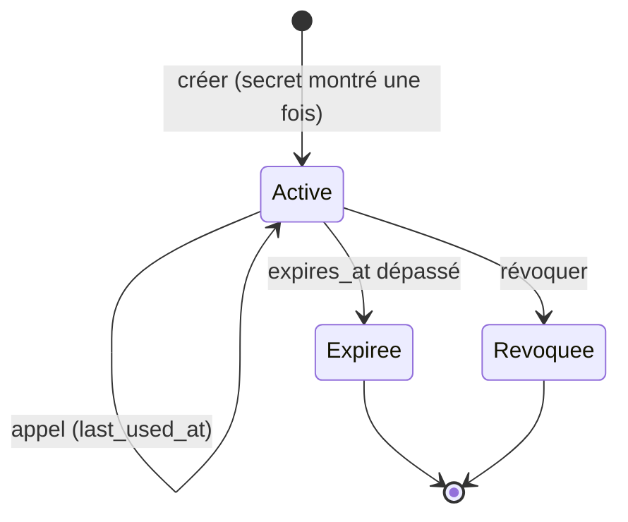

- Le secret est `pnex_sk_` + 32 octets aléatoires en hex. La base garde son sha256 et un préfixe
  d'affichage (R15, R16, R23).
- L'expiration est obligatoire, 366 jours au plus.
- Un compte a deux clés actives au plus. Ainsi, la rotation se fait sans coupure.
- Chaque appel relit la clé : une révocation s'applique à l'appel suivant.
- `last_used_at` reçoit une écriture par minute au plus.

### 7.2 Appel par clé

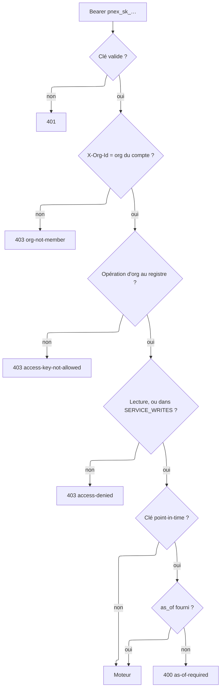

- `X-Org-Id` est facultatif. L'org est celle du compte.
- Un compte de service lit (`*:read`, jamais `iam`). Il écrit seulement les permissions de
  `SERVICE_WRITES` (aujourd'hui `market-decisions:write`, `markets-research.md` D891).
- Les extracteurs humains (`AuthUser`, `PlatformAdmin`) refusent une clé : profil, liste d'orgs, MCP,
  plateforme.
- Une clé point-in-time (`point_in_time`, `markets-research.md` D898) exige l'instant de chaque
  lecture et refuse toute écriture.
- Attribuer le rôle géré Administrateur à un compte de service est refusé (`not_for_service_account`).
- Le MCP refuse les clés d'accès.
- Les quotas sont ceux de l'org (§14).

Usage cible : un serveur seulement. Exemples : Route Handler Next.js avec une variable
d'environnement jamais `NEXT_PUBLIC_`, server function Dioxus fullstack. Une clé dans un navigateur
est publique.

### 7.3 Auteur dans l'historique (D299)

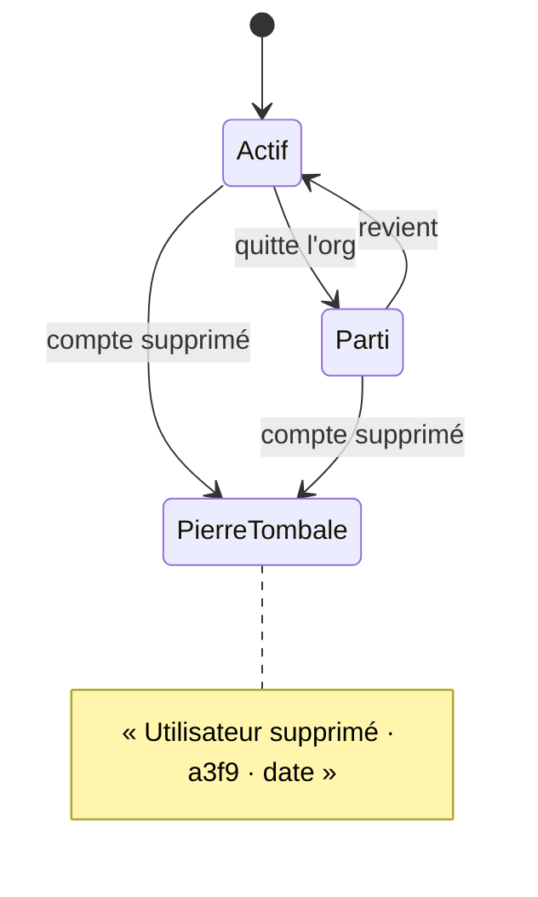

- Toute version, tout commentaire et toute trace d'audit doit porter un `author_user_id` (ou l'id du
  compte de service), tamponné par le serveur. Aucun nom ni email recopié, en base comme dans O2.
- Le nom s'affiche par résolution à la lecture.
- Un départ d'org ne change rien : le nom reste.
- Un compte supprimé devient une pierre tombale. La ligne `users` reste, avec email, nom et
  `idp_sub` effacés, `deleted_at` posé et une empreinte courte (HMAC de l'id, clé plateforme).
  Deux auteurs supprimés restent distincts.

État : pas encore codé. Les versions de flows, dashboards, tours et calques d'annotations gardent une
colonne `author` texte envoyée par le client (SEC-48).

## 8. API

Routes sous `/api/v1/iam`. Le contrat suit D238–D245. Toutes les routes `iam` sont `EXCLUDED` au MCP
(motif `access`, et `credential` pour la création de clé). La CLI `pnex` les génère et exige `--yes`.

| Route | Opérations | Permission |
|---|---|---|
| `me/permissions` | droits effectifs du principal courant | `account:read` |
| `permissions` | catalogue paginé du registre | `iam:read` |
| `roles`, `roles/{id}` | lister (gérés + personnalisés), lire, créer, modifier (`expected_version`), supprimer | `iam:read\|write\|delete` |
| `teams`, `teams/{id}`, `teams/{id}/members[/{user_id}]` | CRUD, membres | `iam:*` |
| `assignments`, `assignments/{id}` | lister, créer (doublon → 409), supprimer | `iam:*` |
| `service-accounts`, `service-accounts/{id}` | CRUD | `iam:*` |
| `service-accounts/{id}/keys[/{key_id}]` | créer (secret dans la réponse, une fois), lister sans secret, révoquer | `iam:*` |

Erreurs :
- `access-denied` (403), `args.permission` = `service:verb`. L'UI la rend par service et verbe
  (`iam-service-<s>`, `iam-verb-<v>`).
- `access-key-not-allowed` (403) : une clé sur une opération hors org.
- `iam-escalation` : création, modification ou attribution d'un rôle que l'appelant ne détient pas.
- Jetons de champ : `unknown_permission`, `iam_permission`, `not_a_member`, `not_for_service_account`.

Registre (`crates/pnex-api-contract/src/iam.rs`, partagé backend et front) :
- `PERMISSIONS` : chaque permission `service:verb` avec le plus bas rôle géré qui la détient.
- `OPERATIONS` : chaque `operationId` du spec, `Org(permission)` ou `User`, `Platform`, `Public`,
  `Machine`.
- `GATES` : les permissions de champ.
- `TOOLS` : chaque outil de l'assistant avec sa permission (`None` = aucune donnée d'org).
- `SERVICE_WRITES` : les seules écritures d'un compte de service.

Verbes : `read`, `write`, `delete`, `deploy` (flows), `operate` (commande device, OTA, écriture de
contrôle), `enroll`, `test` (sonde qui coûte ou sort), `build`, `download`, `connect`. Un service
qui mélange deux niveaux a des sous-services : `ai.conversations`, `ai.providers`, `ontology.schema`,
`orgs.members`, etc.

## 9. Page Accès

Route `/access`, menu Réglages › Accès, visible avec `iam:read`. Six onglets sur le socle CRUD
(`ListLayout`, `DataTable`, `FormDialog`) :

| Onglet | Contenu |
|---|---|
| Rôles | rôles gérés en lecture ; rôle personnalisé édité dans une grille services × verbes (un clic permet, deux refusent, trois effacent ; motifs `*` et `svc:*` gardés tels quels) |
| Équipes | membres cochés, ajout et retrait immédiats |
| Attributions | « Donner un rôle » à un membre, une équipe ou un compte de service ; « Retirer » |
| Comptes de service | clés : expiration, secret montré une fois avec copie et avertissement « côté serveur », révocation |
| Applications | applications externes (`external-apps.md` D433) |
| Gouvernance | marquages et habilitations (`governance.md` D798–D803) |

Le front lit les droits dans un seul module, `state/access.rs` (`can("service:verb")`). Il le
recharge à chaque changement d'org, à partir de `me/permissions`.

## 10. Assistant, i18n, documentation

- Fiches `assistant-kb` : `access.md`, `roles.md`, `troubleshooting-access-denied.md`. Une fiche ne
  cite jamais `/api/v1`. L'usage d'une clé depuis une application externe se documente sur le site.
- Les libellés de service et de verbe existent dans les deux `.ftl` (garde de parité
  `iam_permission_labels_en_fr`).
- `lexicon_guard` refuse « groupe d'utilisateurs », « user group » et « affectation ».

## 11. Sécurité

- **R2** : chaque opération déclare sa permission au registre, l'extracteur l'applique. Test : un
  principal sans la permission reçoit 403.
- **R21** (réservée) : aucune lecture d'objet ou d'arête d'ontologie hors des modules filtrés (D295).
- **R22** : aucune permission `iam:*` ni plateforme n'est attribuable à un compte de service.
- **R23** : secret de clé d'accès en CSPRNG, hash seul en base, montré une fois, expiration
  obligatoire.
- Registre `security.md` §7 : SEC-47 (`share_token` en clair), SEC-48 (auteur fourni par le client),
  SEC-53 (page générée), SEC-74 (sockets, corrigé).

**Danger :** Une opération absente du registre n'est pas contrôlée par l'extracteur. Seule la garde
`tests/iam.rs` empêche de la livrer. Ne désactivez jamais cette garde.

## 12. Exigences

1. Chaque `operationId` du spec doit figurer dans `OPERATIONS`, dans le même commit que la route.
2. Chaque outil de l'assistant doit figurer dans `TOOLS`, avec sa permission.
3. Une permission doit exister dans `PERMISSIONS` avant qu'un rôle, un `can("…")` ou une opération la nomme.
4. Un `POST`, `PUT` ou `PATCH` ne doit pas porter un verbe `read`, sauf `…/query` et les essais.
5. Un `DELETE` doit porter le verbe `delete` ou `operate`.
6. Aucune opération `iam_*` ne doit être exposée au MCP. L'assistant ne doit détenir aucune permission `iam`.
7. Un handler ne doit jamais tester un rôle. Il doit tester une permission avec `org.can`.
8. Le front doit lire un droit avec `state::access::can`, jamais avec un rôle.
9. Un changement d'attribution, de rôle ou d'équipe doit s'appliquer à l'appel suivant.
10. Un appelant ne doit jamais attribuer un rôle dont il ne détient pas toutes les permissions.
11. Le dernier propriétaire d'une org ne doit jamais perdre son rôle.
12. Un secret de clé ne doit jamais être relu. Une clé expirée ou révoquée doit recevoir 401.
13. Une liste filtrée doit calculer ses totaux de pagination après le filtre (I4).
14. Un filtre ou un tri sur une propriété masquée doit être refusé (I5).

## 13. Tests

| Test | Couvre |
|---|---|
| `crates/pnex-backend/tests/iam.rs` | exigences 1 à 6 ; garde `every_checked_permission_exists` |
| `custom_roles_teams_and_assignments` | rôle donné à un lecteur, refus explicite par équipe (même pour un admin), anti-escalade, conflit de version, départ |
| `service_accounts_and_access_keys` | clé montrée une fois, lecture seule, expiration, révocation |
| `tests/notify.rs` | socket refusé sans `notify:read` |
| `e2e/tests/access.spec.ts` | grille de rôle, équipe, compte de service, clé qui lit exactement son rôle |

Le lot I4 doit ajouter les tests de fuite : objet invisible absent des listes, totaux, recherche,
graphe, chemin, historique, notifications et contexte de l'assistant.

## 14. Décisions

| # | Décision |
|---|---|
| D285 | Un moteur unique, refus par défaut. Les frontières plateforme puis org passent avant lui. Rouvre D188 |
| D286 | Principaux : utilisateur, équipe (sans imbrication), compte de service, admin plateforme (D72, à part) |
| D287 | Rôle = document de permissions. Les 4 rôles gérés traduisent D117, prouvé par équivalence. `write_role` doit devenir un énoncé de rôle |
| D288 | Attribution = principal × rôle × portée (org, types, objets, étiquettes D218, types d'ontologie) |
| D289 | Registre des actions gardé : `operationId` → `service:verbe`, ressource, lecture ou écriture |
| D290 | Ressource `prn:<type>:<id>` + attributs (nom, étiquettes, type, propriétés indexées). `resource_labels` fournit l'adressage |
| D291 | Trois points d'application : extracteur, prédicat SQL des services, chemins hors HTTP |
| D292 | Évaluation compilée en mémoire, invalidée par Valkey. Aujourd'hui : une requête par appel, sans cache |
| D293 | Anti-escalade. `iam:*` réservé aux rôles gérés Propriétaire et Administrateur, jamais à un compte de service |
| D294 | Audit O2 `iam_decisions` : chaque refus, chaque écriture `iam`, chaque appel par clé. Historique des rôles par D221 |
| D295 | Le filtre ontologique vit dans les modules objets, liens, graphe. Tout accès direct est interdit |
| D296 | Cinq granularités ontologiques : type, objet, propriété, lien, action |
| D297 | Graphe, impact et chemin sur le sous-graphe visible |
| D298 | Classification des propriétés : `public`, `internal`, `personal`, `sensitive` (liste fermée, livrée par `crm.md` D442) |
| D299 | Historique : auteur = identité tamponnée par le serveur. Compte supprimé = pierre tombale pseudonyme |

Choix tranchés (2026-10-19) :
- **MCP et assistant** : ni gestion des accès, ni clé d'accès.
- **Ordre** : la CLI `pnex` d'abord (usage admin), la page Accès ensuite.
- **Équipes** : retenues pour donner un rôle à plusieurs membres d'un coup. Un rôle donné à une
  personne seule reste permis.
- **Refus explicites** : permis dans un rôle personnalisé (« tout sauf le site Paris »).
- **Clés côté navigateur** : non. Une application externe passe par son serveur.
- **Quotas** : par org, jamais par compte de service ni par clé. Ils suivent le niveau d'abonnement
  (`organizations.subscription_tier_id`). Quota et autorisation restent séparés.
- **Flow déployé** : il tourne sous une identité propre (compte de service, V2), jamais sous les droits
  de son auteur. Le départ de l'auteur ne l'arrête pas.
- **Rauthy authentifie, PNEX autorise.** Une équipe appartient à une org, Rauthy est commun à la
  plateforme. Un groupe Rauthy ne change qu'au renouvellement du jeton, ce qui casse la révocation
  immédiate. Aucune liaison de groupes Rauthy n'est prévue.

## 15. Mise en œuvre

| Élément | Emplacement |
|---|---|
| Registre | `crates/pnex-api-contract/src/iam.rs` |
| Moteur (`evaluate`, `Grants`, `operation_of`) | `crates/pnex-backend/src/services/iam/mod.rs` |
| Rôles, équipes, attributions, `grants`, `member_grants` | `services/iam/store.rs` (migration `m20261019_000035_iam_roles_teams`) |
| Comptes de service, clés | `services/iam/service.rs` (migration `m20261019_000036_iam_service_accounts`) |
| Audit | `services/iam/audit.rs` |
| Observation | `services/iam/observe.rs` |
| Extracteur | `crates/pnex-backend/src/auth/mod.rs` (`OrgContext`) |
| API | `crates/pnex-backend/src/controllers/iam.rs` |
| Droits côté front | `crates/pnex-frontend/src/state/access.rs` |
| Page Accès | `crates/pnex-frontend/src/pages/access/` |

## 16. État et reste à faire

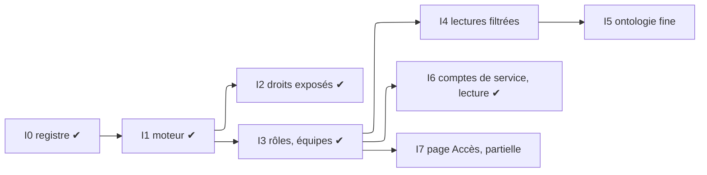

Tant qu'une opération n'a pas son filtre de liste (I4), une portée d'attribution reste « org
entière ».

Reste à faire :
- **I2** : `allowed: [verbes]` dans les DTO de détail.
- **I4** : prédicat de visibilité sur toutes les listes, les `…/query`, les recherches, les exports,
  l'assistant, `notify::publish` et les caches. Portées d'attribution par type, objet et étiquette
  (D288).
- **I5** : ontologie fine (D295–D297), gels, `write_role` replié dans les rôles (D287). L'assistant
  lit encore `write_role` sur le rôle d'adhésion (`Actor.role`).
- **I6** : limite de permissions par clé, quotas d'org appliqués aux clés, doc du site (exemples
  Next.js et Dioxus fullstack, dépôt `pnex-website`).
- **I7** : simulateur d'accès (`check`), « Gérer l'accès » depuis une fiche d'objet
  (`resources/{prn}/access`), historique des versions de rôle (D221 : seulement `version`
  aujourd'hui), équipes et attributions sur la page Organisations.
- **D292** : cache compilé avec invalidation Valkey, si la latence l'exige.
- **D294** : écran de consultation de `iam_decisions`.
- **D299** : `author_user_id` tamponné et pierre tombale (SEC-48).
- `case-role` (« Rôle dans le dossier ») doit être renommé, par exemple « Fonction » (§3).
- Les routes `orgs/{id}/…` restent hors moteur.

Questions ouvertes (choix de Shan) :
- **Compte de service qui écrit pour un SaaS tiers** (`partner-watch.md` D300) : objets, liens et
  actions bornés aux types d'un pack, sans IAM, suppression, deploy ni action physique. Aujourd'hui,
  `SERVICE_WRITES` n'ouvre que `market-decisions:write`.
