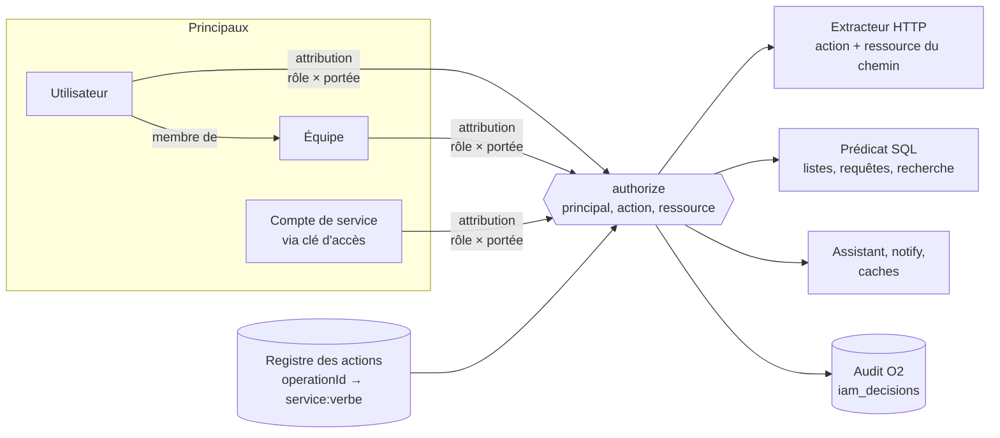

# Gestion des accès (IAM) — spécification

> Statut : **en cours (2026-10-19)** — PRD validé, lots I0, I1, I2 (sauf
> `allowed` des DTO), I3, I6 (comptes de service, lecture seule) et I7
> (page Accès, sans simulateur ni « Gérer l'accès ») livrés (§16) ; décisions D285–D299, arbitrages
> du 2026-10-19 (§14).
> Rouvre D188 (`ontology.md`) : les accès par objet ne sont plus
> repoussés.

## 1. Ce qui change

Aujourd'hui, un accès se résume à **un rôle par org** (owner, admin,
member, viewer, D117) testé à la main dans chaque handler
(`can_write()`, `can_administer()`…), plus un verrou d'écriture par type
d'ontologie (`write_role`). Toute lecture est ouverte à tout membre, et
il n'existe aucune identité non humaine pour une application externe.

PNEX est une plateforme multi-org : ses consommateurs sont l'UI, le SDK,
la CLI `pnex`, le serveur MCP, l'assistant, et demain des applications
web tierces (Next.js, Dioxus fullstack) qui lisent des données choisies.
Ce PRD pose **un modèle d'autorisation unique**, à la manière d'un IAM
de cloud : *qui* (principal) peut faire *quoi* (action) sur *quoi*
(ressource), sous quelles *conditions*, refusé par défaut.

Le besoin déclencheur — des **comptes de service** porteurs de **clés
d'accès** en lecture seule et finement restreintes — est le dernier
étage : un compte de service n'est qu'un principal de plus. Il ne vaut
rien tant que le moteur, le registre des actions et le filtrage des
lectures n'existent pas (§12).

## 2. Périmètre

**Dans le périmètre**
- Moteur d'autorisation, registre des actions, rôles gérés et
  personnalisés, équipes, attributions à portée.
- Application de la décision sur toute l'API HTTP, l'assistant, la
  recherche globale, les notifications temps réel.
- Accès fins sur l'ontologie : type, objet, propriété, lien, action.
- Comptes de service et clés d'accès (usage serveur).
- Interface « Accès » : rôles, équipes, comptes de service, simulateur,
  « Gérer l'accès » depuis un objet ; audit.

**Hors périmètre (V1)**
- Principaux machine existants : devices (jeton, X.509), agents edge,
  agents navigateur, runtime de flows (`/internal/*`). Ils sont déjà
  scopés à un device ou au flow déployé ; ils restent sur leur mécanisme
  (§5.4).
- Clés utilisables depuis un navigateur (CORS, clé « publique ») : §14.
- Toute autorisation venant de Rauthy : Rauthy authentifie, PNEX autorise (§14).
- Partage hors org : la frontière reste l'org (R1).

## 3. Vocabulaire

À reporter au lexique (`design-system.md` §7) avec sa règle dans
`lexicon_guard.rs`. Les termes ont été choisis contre les collisions
relevées dans les `.ftl` (2026-10-18).

| Notion | FR | EN | N'est pas |
|---|---|---|---|
| Ensemble nommé de permissions, attribuable | Rôle | Role | le rôle d'un acteur dans un dossier (`case-role`, à renommer « Fonction ») |
| Liaison principal × rôle × portée | Attribution | Assignment | un partage public |
| Ce que couvre une attribution (org, type, objets, étiquettes) | Portée | Scope | — |
| Regroupement de membres de l'org | Équipe | Team | « Groupe » (déjà : groupe froid, groupe de sociétés, groupes de nœuds) |
| Identité non humaine d'une org | Compte de service | Service account | un device, un agent |
| Secret d'authentification d'un compte de service | Clé d'accès | Access key | « Clé d'API » (= clé d'un fournisseur tiers : LLM, géo) ; « jeton » (= jeton device) |
| Unité d'autorisation (`service:verbe`) | Permission | Permission | une autorisation du navigateur ou du device (`permission` existant, à requalifier) |
| Écran « qui peut faire quoi » | Accès | Access | « Partager » (= lien public d'un tour) |
| Vérification d'un accès hypothétique | Simulateur d'accès | Access checker | — |

Le mot « Rôle » garde son sens actuel : les quatre rôles deviennent des
**rôles gérés**, d'où la continuité pour l'utilisateur.

## 4. Architecture

### Décisions

**D285 — Un moteur d'autorisation unique, refus par défaut.** Toute
décision d'accès d'un principal humain ou de service passe par
`authorize(principal, action, ressource) → Allow | Deny(raison)`. Ordre
d'évaluation : refus explicite > autorisation > refus implicite. Les
frontières **plateforme** puis **org** sont antérieures au moteur et
infranchissables : l'org vient toujours du principal (R1), aucune règle
ne peut nommer une autre org. Le moteur ne fait que **restreindre à
l'intérieur** de l'org.

**D286 — Principaux.** Utilisateur (membre d'une org), équipe
(ensemble d'utilisateurs d'une org, sans imbrication), compte de service
(principal d'org sans connexion interactive), administrateur plateforme
(D72, inchangé, orthogonal). Les droits effectifs d'un utilisateur =
union de ses attributions directes et de celles de ses équipes, moins
les refus explicites.

**D287 — Rôles = documents de permissions.** Un rôle est une liste
d'énoncés `{effet, permissions, ressources, conditions}`.
- **Rôles gérés** par la plateforme : Propriétaire, Administrateur,
  Membre, Lecteur. Leur contenu traduit **exactement** D117 ; un test
  d'équivalence opération par opération le prouve avant toute bascule.
  Non modifiables, versionnés avec la plateforme.
- **Rôles personnalisés** par org (owner/admin), versionnés (historique
  commun D221).
- Le `write_role` des types d'ontologie disparaît : il devient un énoncé
  de rôle (« écrire les objets de type Pompe »). Bêta : pas de
  rétrocompatibilité, migration des types existants vers les rôles gérés.

**D288 — Attribution = principal × rôle × portée.** La portée restreint
le rôle : org entière (défaut), types de ressource, objets nommés,
étiquettes (D218), types d'ontologie. Exemple : *Lecteur* sur
`étiquette site=lyon` ; *Membre* sur `type d'ontologie = Pompe`. Les
droits d'une attribution = rôle ∩ portée. C'est la forme que l'UI
manipule ; le document JSON reste accessible pour les cas avancés.

**D289 — Registre des actions, gardé.** Chaque `operationId` du spec
(449 au 2026-10-18) déclare dans `pnex-api-contract/src/iam.rs` :
permission `service:verbe` (`flows:read`, `flows:deploy`,
`ontology.objects:write`…), type de ressource, lecture ou écriture, et
**d'où vient la ressource** (paramètre de chemin, corps, filtre de
liste, aucune). Les actions hors HTTP y figurent aussi (outils de
l'assistant, actions d'ontologie D183, sessions WebSocket). Garde
bloquante `tests/iam.rs` sur le modèle de `tests/mcp.rs` : couverture
exacte du spec, aucune écriture marquée lecture, toute permission
utilisée par un rôle géré existe. Le verbe est la granularité vue par
l'humain ; l'`operationId` reste disponible dans le JSON.

**D290 — Nom de ressource.** `prn:<type>:<id>` (org implicite), plus
des attributs évaluables : nom, étiquettes, type d'ontologie,
propriétaire/auteur, valeurs de propriétés indexées. Motifs : glob sur
l'id et le nom (`prn:dashboard:name/prod-*`), conditions sur étiquettes
(`labels.site = lyon`). La table `resource_labels` (D42) fournit déjà
l'adressage `(kind, id)` et les étiquettes.

**D291 — Trois points d'application, un seul moteur.**
1. **Extracteur HTTP** (`OrgContext` devient porteur du principal) :
   permission de l'opération + ressource du chemin (`/{id}`). Couvre
   toute l'API d'un coup.
2. **Services** : un prédicat SQL partagé `visible(principal, type)`
   appliqué à chaque liste, requête, recherche, graphe. Les totaux de
   pagination sont calculés **après** filtrage.
3. **Hors HTTP** : outils de l'assistant (`ToolDeps` porte le principal,
   plus le booléen `can_write`), recherche globale D69, diffusion
   `notify::publish` (filtrage par session), caches de visualisation
   (filtre avant la clé de cache).

Les gardes de rôle actuelles (R2) restent en défense en profondeur
jusqu'à la fin de la migration, puis sont retirées handler par handler.

**D292 — Évaluation compilée, révocation immédiate.** Les attributions
d'un principal sont compilées en mémoire par (principal, org) ; cache
invalidé par Valkey pub/sub à chaque changement d'attribution, de rôle
ou d'équipe (aujourd'hui le rôle n'est jamais mis en cache : on garde
cette immédiateté). Objectif : décision en microsecondes côté
extracteur, prédicat SQL généré une fois par requête.

**D293 — Anti-escalade.** On ne peut attribuer qu'un rôle dont on
détient soi-même toutes les permissions sur la portée visée. Les
permissions `iam:*` ne sont détenues que par Propriétaire et
Administrateur (gérés) et ne peuvent jamais être données à un compte de
service. Protection du dernier propriétaire conservée.

**D294 — Audit.** Chaque refus et chaque écriture IAM sont journalisés
dans un stream O2 `iam_decisions` (principal, permission, ressource,
raison, origine : UI, MCP, clé d'accès, assistant). Les autorisations
de lecture ne sont pas toutes journalisées (volume) ; elles le sont
pour les clés d'accès. Les changements de rôles et d'attributions
suivent l'historique commun (D221).

## 5. Application par surface

### 5.1 API HTTP

- 446 paramètres `OrgContext` dans 62 contrôleurs ; 449 `operationId`.
- Gardes actuelles : `can_write` 127, `require_write` 84,
  `require_admin` 17, `can_manage_secrets` 14, `can_administer` 8,
  ~15 `match OrgMemberRole` (orgs.rs, ws_doc.rs), ~15 helpers
  `forbidden()` locaux à codes propres.
- **89 réponses `Paginated`** et **8 `…/query`** à filtrer, plus les
  lectures agrégées : recherches (`global_search`, `resources/search`,
  `media/search`), graphe, exports (lab, cases, ontology, ai, camera),
  résumé de tableau de bord.
- Post-traitement OpenAPI (`openapi.rs:134-197`) : point d'injection de
  la réponse 403 `access-denied` sur chaque opération.
- **MCP** : rejoue les opérations via le routeur avec les identifiants
  de l'appelant (`services/mcp/mod.rs:196`) → hérite de tout ce que
  l'HTTP applique, sans travail propre.

### 5.2 Assistant IA

~57 outils appelés **en processus**, sans passer par le routeur ;
lecture scopée à l'org seulement, écriture sur un booléen `can_write`
(`services/ai/tools.rs:78`). Chaque outil déclare sa permission dans le
registre (D289) et appelle `authorize`. Les consignes D142–D145 restent :
l'assistant n'écrit jamais d'IAM, n'agit jamais physiquement. Le schéma
d'ontologie injecté dans son contexte (`ai/context.rs:167`) est filtré
par principal.

### 5.3 Temps réel et caches

- `notify::publish(org_id, frame)` diffuse à toutes les sessions de
  l'org : chaque trame porte sa ressource, chaque session est filtrée.
- WebSockets navigateur : le ticket Valkey porte l'utilisateur ; les
  droits sont réévalués à l'ouverture et à l'invalidation (D292).
- Caches TTL de visualisation (`services/visualization.rs:122`) clés
  `org|requête` : le filtre s'applique à la construction de la requête,
  jamais après lecture du cache.

### 5.4 Principaux machine (inchangés en V1)

| Principal | Mécanisme actuel | Décision V1 |
|---|---|---|
| Device (jeton, X.509) | `device_link`, `device_pki` | inchangé, scopé à son device |
| Agent edge, agent navigateur | enrôlement, ticket Noise | inchangé |
| Runtime de flows | jeton de service `/internal/*`, `org_id` du corps | inchangé ; « les flows déployés de l'org » deviendra un principal en V2 (§14) |
| Tour public | `share_token` 32 hex en clair | inchangé ; finding au registre (SEC-47) |

## 6. Ontologie : accès fins

### 6.1 Constat (2026-10-18)

- Le point unique de lecture D185 (`services/ontology/query.rs:114`)
  n'est **pas** le seul : au moins dix chemins lisent `objects` ou
  `resource_edges` directement — objet par id, résolution native, liens
  et références, graphe/impact/chemin (CTE récursive `graph.rs:24`),
  séries et liaisons, historique O2, recherche globale, dossiers
  (workspace, relations, signaux, board, export, gels), voice ID,
  plages temporelles, outils de l'assistant.
- Lecture : **aucun contrôle** ; écriture : `role_allows` sur
  `write_role` (objets, liens, actions, purge, plages).
- Les propriétés n'ont aucun marquage de sensibilité.

**D295 — Le filtre descend d'un niveau.** Le prédicat de visibilité vit
dans `services/ontology/{objects,links,graph}.rs` (pas seulement dans
D185) et tout accès direct à `objects`/`resource_edges` hors de ces
modules devient interdit (garde par grep en test, sur le modèle
d'`i18n_guard`).

### 6.2 Granularités

**D296 — Cinq niveaux, tous exprimés comme portées et conditions.**

| Niveau | Exemple de règle | Application | Fuites à fermer |
|---|---|---|---|
| **Type** | lire `Pompe`, écrire `Intervention` | `type_key IN (…)` dans le prédicat | schéma exporté, contexte de l'assistant, comptes par type |
| **Objet** | par id, par étiquette (`site=lyon`), par valeur de propriété indexée (`statut = public`) | prédicat SQL (jointure `resource_labels`) | totaux de pagination, plafond de 5000 arêtes du graphe, titres dans la recherche |
| **Propriété** | masquer `salaire`, `telephone` ; ou toute propriété classée `personal` | masquage dans `objects::view` (`objects.rs:25`) | filtre ou tri sur propriété masquée = oracle → refusé ; historique O2 caviardé ; séries, agrégats, exports, gels |
| **Lien** | traverser `possède` mais pas `finance` | prédicat sur `relation` dans les liens, la CTE, les sauts de D185 | lien vers un objet invisible : supprimé ou bout caviardé (« objet non accessible ») |
| **Action D183** | proposer sans invoquer | `actions::invoke` (`actions.rs:100`) et `propose_action` | — |

**D297 — Le graphe ne traverse jamais l'invisible.** Graphe, impact et
plus court chemin sont calculés sur le **sous-graphe visible** : le
prédicat est appliqué dans la CTE récursive, pas après. Un chemin qui
n'existe qu'à travers un objet invisible n'existe pas pour le principal.

**D298 — Classification des propriétés.** `PropertyDef` gagne un champ
`classification` (`public`, `internal`, `personal`, `sensitive`, liste
fermée). Un rôle peut masquer une classification entière plutôt que
nommer chaque propriété ; les packs (D190) livrent leurs types classés.
La base légale des données personnelles des dossiers (existante) s'y
rattache.

### 6.3 Cas particuliers

- **Gels de dossier** (`case_snapshots`) : geler, dégeler et ouvrir un
  gel sont des permissions du service `cases` comme les autres. Un gel
  est une copie : le filtre par objet s'applique à l'ouverture, chaque
  élément refusé étant remplacé par « accès non accordé » (§14).
- **Dashboards de type** (D187) : la liaison objet → série de device
  passe par la lecture de télémétrie du device ; les deux droits sont
  exigés.
- **Historique** (`object_changes`) : caviardé propriété par propriété.

## 7. Comptes de service et clés d'accès

Livrés en dernier (§12), sur le socle.

- **Compte de service** : principal d'org, nom, description, étiquettes,
  attributions comme un membre ; créé et géré par Propriétaire et
  Administrateur ; ne reçoit jamais `iam:*` ni de permission plateforme
  (D293).
- **Clé d'accès** : `pnex_sk_<32 octets CSPRNG>`, montrée une seule fois,
  stockée en sha256 (R15, R16) avec un préfixe d'affichage ; expiration
  **obligatoire** (1 an max) ; deux clés actives au plus par compte
  (rotation sans coupure) ; `last_used_at` ; révocation immédiate (D292).
  Aucun quota propre à la clé : les quotas sont ceux de l'org (§14).
- **Limite de permissions** optionnelle sur la clé : plafond
  supplémentaire (ex. « lecture seule ») qui intersecte les rôles du
  compte.
- **Usage cible** : côté serveur seulement — Next.js (Route Handler,
  Server Component, variable d'environnement jamais `NEXT_PUBLIC_`),
  Dioxus fullstack (server functions). Pas de CORS en V1 : une clé
  présente dans un navigateur est publique.
- `Authorization: Bearer pnex_sk_…` + `X-Org-Id` facultatif (l'org est
  celle du compte).
- **Jamais par le MCP** (arbitrage 2026-10-19, risque lié à l'IA) : le
  MCP refuse les clés d'accès, et aucune opération `iam` n'est exposée au
  MCP ni à l'assistant.

### 7.1 Auteurs dans l'historique et suppression de compte

Constat (2026-10-19) : les versions de flows, dashboards, tours et calques
d'annotations stockent leur auteur en **texte libre envoyé par le
client** (`flow_versions.author` ← `session::user().username`, en
pratique l'email). Deux défauts : n'importe quel membre peut inscrire un
autre nom dans l'historique (R3 : le serveur tamponne), et l'email
recopié échappe à l'effacement d'un compte. Les commentaires de documents
(`doc_comments.author_id`), les streams O2 `case_reads` et
`object_changes` référencent déjà un identifiant : c'est le bon modèle.

**D299 — L'historique référence une identité, jamais un nom.**
- Toute version, tout commentaire, toute trace d'audit porte un
  `author_user_id` (ou l'id du compte de service) **tamponné par le
  serveur** ; aucun nom ni email recopié, en base comme dans O2 (O2 ne
  sait pas effacer un enregistrement isolé, D145). Le nom s'affiche par
  résolution à la lecture.
- **Suppression de compte = pierre tombale** : la ligne `users` reste,
  email, nom et `idp_sub` effacés, `deleted_at` posé, plus une empreinte
  courte stable et non réversible (HMAC de l'id, clé plateforme).
  L'historique affiche alors « Utilisateur supprimé · `a3f9` · date » ;
  deux auteurs supprimés restent distincts, aucune version n'est perdue
  ni réécrite.
- **Départ d'une org** : rien ne change dans l'historique, le nom reste
  (le compte existe).
- Bêta (pas de compatibilité) : les colonnes `author` texte sont
  remplacées ; les versions existantes sans correspondance gardent un
  auteur vide.

## 8. API

Routes sous `/api/v1/iam`, contrat D238–D245 dans le même commit.

| Ressource | Opérations |
|---|---|
| `roles` | lister (gérés + personnalisés), lire, créer, modifier (`expected_version`), supprimer, versions |
| `teams` | CRUD, membres |
| `assignments` | lister (par principal, par ressource), créer, supprimer |
| `service-accounts` | CRUD ; `…/{id}/keys` : créer (réponse = secret, une fois), lister (sans secret), révoquer |
| `permissions` | catalogue du registre (services, verbes, types de ressource) |
| `me/permissions` | droits effectifs résumés du principal courant (pour l'UI) |
| `check` (`GET …/check` ou `…/check/query`) | simulateur : principal × permission × ressource → décision + énoncé déterminant |
| `resources/{prn}/access` | qui a accès à cette ressource (« Gérer l'accès ») |

- Les DTO de détail gagnent `allowed: [verbes]` pour que l'UI n'ait plus
  à deviner.
- **Erreur unique** `access-denied` (403) avec `args {permission,
  resource}` ; l'UI la rend par service et verbe (`iam-service-<s>`,
  `iam-verb-<v>`, ~50 clés au lieu d'une par opération). Les ~27 codes
  `err-*-forbidden` actuels (« réservé aux administrateurs ») deviennent
  faux dès qu'il existe des rôles personnalisés : ils sont remplacés.
- MCP : toutes les routes `iam` en `EXCLUDED` motif `access` (déjà dans
  `DANGEROUS` de la CLI).

## 9. Interface

Nouvelle entrée **Réglages › Accès** (`pages/shell.rs:559`), après
Organisations ; la page Organisations garde l'identité de l'org.

- **Membres** : la liste actuelle (`pages/orgs.rs`) enrichie des équipes
  et des attributions de chaque membre.
- **Équipes**, **Rôles**, **Comptes de service** : socle CRUD (tableau +
  pager, `ListLayout`, `DataTable`, `FormDialog`).
- **Éditeur de rôle** : formulaire guidé — services en lignes, niveaux
  Lire / Écrire / Administrer en colonnes, détail par verbe dépliable ;
  portée avec `ResourcePicker`, étiquettes avec `LabelChipsInput`,
  types et classifications d'ontologie ; onglet JSON (`JsonEditor`).
  Historique de versions commun (D221 : composant `VersionHistory` à
  construire, pas encore livré).
- **Simulateur d'accès** : choisir un principal, une permission, une
  ressource → décision et énoncé qui l'a produite.
- **« Gérer l'accès »** sur toute fiche d'objet listable : qui y a accès
  et par quelle attribution ; ajouter une attribution à portée objet.
  Jamais nommé « Partager ».
- **Droits côté front** : un seul module (`state/access.rs`) alimenté par
  `me/permissions` et les `allowed` des DTO ; remplace les 14 copies de
  `current_role()` et les helpers `current_can_write`/`administer`
  (~48 fichiers appelants). Le front masque ; le serveur décide (R2).
- **Clé d'accès créée** : dialogue unique montrant le secret, bouton
  copier, avertissement « usage serveur uniquement ».

## 10. Assistant, i18n, documentation

- Fiches `assistant-kb` : `access.md` (page Accès), `service-accounts.md`,
  `troubleshooting-access-denied.md` (symptôme → cause → geste dans
  l'UI) ; `roles.md` réécrite. La garde interdit de citer `/api/v1` :
  l'usage d'une clé d'accès depuis une application externe se documente
  sur le site, pas dans les fiches.
- L'assistant peut **expliquer** un refus (simulateur en lecture) mais
  n'écrit jamais d'attribution, de rôle ni de clé.
- Clés `.ftl` dans les deux langues ; lexique §3 ; `case-role` renommé.

## 11. Sécurité (grille `security.md` §6)

- **R2 réécrite** : « chaque opération déclare sa permission au registre
  IAM ; l'extracteur l'applique ; chaque liste passe par le prédicat de
  visibilité ». Point 1 de la grille §6 adapté (test : principal sans la
  permission → 403, autre org → 404).
- **Nouvelles règles** proposées : R21 (aucune lecture d'objet ou d'arête
  d'ontologie hors des modules filtrés), R22 (aucune permission `iam:*`
  ni plateforme attribuable à un compte de service), R23 (secret de clé
  d'accès : CSPRNG, hash seul en base, montré une fois, expiration
  obligatoire).
- **Registre §7** : SEC-47 `tours.share_token` stocké en clair (inscrit
  le 2026-10-18). La diffusion `notify::publish` à toute l'org n'est pas
  une fuite aujourd'hui (tout membre voit tout) ; elle le devient au lot
  I4 et doit y être filtrée (§5.3).
- Test d'équivalence des rôles gérés = garde de non-régression de toute
  la bascule.

## 12. Lots

L'ordre suit la dépendance : les comptes de service n'ont de sens qu'une
fois les lectures filtrables.

| Lot | Contenu | Effet visible |
|---|---|---|
| **I0** | Ce PRD validé ; registre des actions `iam.rs` rempli pour les 449 opérations + outils de l'assistant ; garde `tests/iam.rs` | aucun |
| **I1** | Moteur, rôles gérés, test d'équivalence ; `authorize` appelé **en observation** à côté des gardes R2 (divergences journalisées), puis bascule | aucun (par construction) |
| **I2** | `me/permissions`, `allowed` dans les DTO, module front unique ; erreur `access-denied` | messages de refus exacts |
| **I3** | Rôles personnalisés, équipes, attributions à portée org/type/étiquette ; API `iam` ; gestion par la **CLI `pnex`** (générée du spec, motif `access` ⇒ `--yes`) ; audit O2 | premier IAM utilisable, par un admin en ligne de commande |
| **I4** | Prédicat de visibilité sur les 89 listes, 8 requêtes, recherches, exports, assistant, notify, caches | portées appliquées en lecture partout |
| **I5** | Ontologie fine : objet, propriété (classification), lien, action ; graphe sur sous-graphe visible ; gels | D188 refermé |
| **I6** | Comptes de service, clés d'accès, limite de permissions ; quotas d'org appliqués aux clés ; gestion par la CLI ; doc site (exemples Next.js, Dioxus) | **besoin déclencheur** |
| **I7** | Page Accès (§9) : membres, équipes, rôles, comptes de service, simulateur, « Gérer l'accès » depuis un objet | gestion à la main par les utilisateurs de la plateforme |

**Chemin court vers le besoin déclencheur** : I0 → I1 → I3 → I4
restreint aux services lus par les applications externes (dashboards,
télémétrie, objets d'ontologie) → I6, le tout géré par la CLI
(arbitrage 2026-10-19 : la CLI d'abord, affaire d'admin ; l'interface
I7 ensuite). I5 et le reste d'I4 suivent ; tant
qu'une opération n'a pas son filtre de liste, le registre la marque
**non appelable par un compte de service** (refus par défaut).

## 13. Tests et acceptation

- `tests/iam.rs` : couverture exacte du registre, cohérence lecture /
  écriture, rôles gérés n'utilisant que des permissions existantes.
- Équivalence : pour chaque opération et chaque rôle géré, la décision
  du moteur = le comportement actuel (rejoué sur la suite de tests
  existante : ~31 tests de rôles, 118 assertions 403 dans 36 fichiers).
  Helpers de test communs (`tests/common`) pour créer membre, équipe,
  compte de service et clé.
- Fuites : objet invisible absent des listes, totaux, recherche, graphe,
  chemin, historique, notify, contexte de l'assistant ; filtre sur
  propriété masquée → refus.
- Clés : secret jamais relu, expirée → 401, révoquée → 401 au plus tard
  à l'invalidation, compte de service avec `iam:*` → refus à
  l'attribution.
- e2e : un rôle personnalisé « Lecteur site Lyon » ne voit que Lyon dans
  l'UI ; une application Next.js de démonstration lit un dashboard avec
  une clé et rien d'autre.

## 14. Arbitrages et questions ouvertes

### Tranché le 2026-10-19

- **MCP** : ni gestion des accès, ni clé d'accès par le MCP (risque lié
  à l'IA). L'assistant non plus.
- **Ordre de gestion** : d'abord la CLI `pnex` (usage admin), ensuite la
  page Accès pour les utilisateurs de la plateforme (I7).
- **Équipes** : retenues pour le traitement en masse (donner un rôle à
  toute une équipe d'un coup).
- **Gels de dossier** : geler, dégeler, ouvrir un gel = permissions
  ordinaires du service `cases`.
- **Rôle donné à une personne seule** : permis, comme via une équipe ;
  les deux coexistent, l'usage réel n'est pas connu d'avance.
- **Contenu gelé et objets cachés** : la personne voit que le dossier et
  ses gels existent ; ce qu'elle n'a pas le droit de voir y est remplacé
  par la mention « accès non accordé », sans aucune donnée. Exception
  assumée à D297 : dans un gel, l'existence d'un élément caché est
  connue, pas son contenu.
- **Flow déployé et départ de son auteur** : le flow continue de tourner.
  Il s'exécute sous une identité propre (compte de service choisi ou créé
  au déploiement, V2), jamais sous les droits de la personne qui l'a
  déployé ; celle-ci n'est qu'une trace d'audit. Affichage de l'auteur :
  - départ de l'org, compte toujours existant → nom conservé ;
  - compte supprimé (cascades RGPD, `ai-assistant.md` §9) → données
    personnelles effacées, l'auteur devient « Utilisateur supprimé ·
    `<empreinte courte>` · `<date>` » (empreinte stable non réversible,
    pour distinguer deux auteurs supprimés).

- **Refus explicites** dans les rôles personnalisés (« tout sauf le site
  Paris ») : permis ; le simulateur affiche l'énoncé qui a refusé.
- **Classification** : liste fermée `public`, `internal`,
  `personal`, `sensitive` (D298), étendue seulement si un pack métier
  en a besoin.
- **Clés côté navigateur** : non en V1 ; une application externe passe
  toujours par son serveur (Next.js, Dioxus fullstack).
- **À trancher (2026-10-19, `partner-watch.md` D300)** : un SaaS tiers
  (Quali-Watch) a besoin d'un compte de service qui **écrit** :
  objets, liens et invocation d'actions, bornés aux types d'un pack
  (portée D296), sans IAM, suppression, deploy ni action physique. Les
  comptes de service V1 sont en lecture seule : ajout proposé au lot I4.
- **Quotas** : par **org**, jamais par compte de service ni par clé.
  Tous les principaux d'une org (membres, comptes de service) consomment
  les mêmes quotas, rattachés au niveau d'abonnement de l'org
  (`organizations.subscription_tier_id`). Quota et autorisation restent
  deux mécanismes séparés.
- **Rauthy authentifie, PNEX autorise** : Rauthy reste la seule source
  de l'**identité** (qui est la personne) ; PNEX est la seule source des
  **droits** (équipes, rôles, attributions). Raisons :
  - une équipe appartient à une org, alors que Rauthy est commun à toute
    la plateforme : y créer des groupes exigerait de donner aux owners
    d'org (tout inscrit) un accès à l'API d'administration de l'IdP ;
  - un groupe arrive dans le jeton et ne change qu'au renouvellement du
    jeton : la révocation immédiate (D292) serait perdue ;
  - la CLI et la page Accès gèrent tout au même endroit.

  Aucune liaison de groupes Rauthy n'est prévue : complexité sans besoin
  actuel. À rouvrir seulement si un client arrive avec son annuaire
  d'entreprise.

### Ouvertes

Aucune au 2026-10-19 : le PRD est prêt pour la validation finale, puis
le lot I0.

## 15. Récapitulatif des décisions

| # | Décision |
|---|---|
| D285 | Un moteur unique, refus par défaut, frontières plateforme puis org infranchissables (rouvre D188) |
| D286 | Principaux : utilisateur, équipe, compte de service, admin plateforme |
| D287 | Rôles = documents de permissions ; 4 rôles gérés = D117 prouvé par équivalence ; `write_role` remplacé |
| D288 | Attribution = principal × rôle × portée (org, types, objets, étiquettes, types d'ontologie) |
| D289 | Registre des actions gardé (`operationId` → `service:verbe`, ressource, lecture/écriture) |
| D290 | Ressources `prn:<type>:<id>` + attributs (nom, étiquettes, type, propriétés indexées) |
| D291 | Application : extracteur, prédicat SQL des services, chemins hors HTTP ; R2 en défense jusqu'à la fin |
| D292 | Évaluation compilée en mémoire, invalidation Valkey immédiate |
| D293 | Anti-escalade ; `iam:*` jamais à un compte de service |
| D294 | Audit O2 `iam_decisions` ; historique des rôles (D221) |
| D295 | Filtre ontologique dans les modules objets/liens/graphe, accès direct interdit |
| D296 | Cinq granularités ontologiques : type, objet, propriété, lien, action |
| D297 | Graphe, impact, chemin sur le sous-graphe visible |
| D298 | Classification des propriétés |
| D299 | Historique : auteur = identité tamponnée par le serveur, jamais un nom ; compte supprimé = pierre tombale pseudonyme |

## 16. Avancement

### I0 — registre des actions (livré 2026-10-19)

- `crates/pnex-api-contract/src/iam.rs` (partagé backend + front, wasm-safe) :
  - `PERMISSIONS` : 130 permissions `service:verb`, chacune avec le
    **plus bas rôle géré** qui la détient (`Level`) ;
  - `OPERATIONS` : les 469 `operationId` du spec, chacun `Org(permission)`
    ou le type d'appelant hors moteur (`User`, `Platform`, `Public`,
    `Machine`) ;
  - `TOOLS` : les 56 outils de l'assistant, avec leur permission (`None` =
    aucune donnée d'org : catalogues statiques, validations pures).
- Verbes : `read`, `write`, `delete`, `deploy` (start/stop/restart/
  rollback/deploy de flows), `operate` (commandes device, OTA, écriture de
  contrôle), `enroll`, `test` (sondes et essais qui coûtent ou sortent),
  `build`, `download`, `connect`. Sous-services quand un service mélange
  deux niveaux : `ai.conversations`, `ai.providers`, `ai.settings`,
  `ontology.schema`, `orgs.members`.
- Classement initial : gardes R2 détectées dans le corps des handlers et
  leurs helpers locaux, recoupées avec les descriptions du spec, puis
  revue à la main des cas mixtes. **Le code fait foi** quand la
  description diverge (constat : les `media_*` annoncent « Owner/admin
  only » alors que le code exige `can_write` ; à corriger dans les
  descriptions).
- Garde bloquante `crates/pnex-backend/tests/iam.rs` : couverture exacte
  du spec et de la table de dispatch de l'assistant, permissions
  existantes et toutes utilisées, aucun `POST/PUT/PATCH` sous un verbe
  `read` (hors `…/query` et essais), tout `DELETE` en `delete`/`operate`,
  aucune opération `iam_*` exposée au MCP ni permission `iam` à
  l'assistant.

### I1 — moteur et bascule (livré 2026-10-19)

- `crates/pnex-backend/src/services/iam/` : `evaluate` (refus explicite >
  autorisation > refus implicite, motifs `svc:verb`, `svc:*`, `*`),
  rôles gérés construits depuis le registre, `authorize(rôle,
  permission)`, `operation_of(méthode, route)` (table construite une fois
  depuis le spec).
- **Observation** (`services/iam/observe.rs`, couche HTTP) : compare la
  décision du moteur à la réponse du handler ; `PNEX_IAM_OBSERVE=strict`
  (500 nommant l'écart) ou `PNEX_IAM_OBSERVE_LOG=<fichier>`. Passe
  complète de la suite backend avant bascule : **675 tests, une seule
  divergence** (`boards_list` prend un `OrgContext`, marqué `User` par
  erreur ; corrigé). Équivalence D287 tenue sur tout ce que la suite
  exerce.
- **Bascule** : l'extracteur `OrgContext` refuse avant le handler, 403
  `access-denied` + `args.permission`. Suite complète après bascule :
  677 tests, 0 divergence.
- **Gardes R2 retirées** (même soir) : avec les rôles personnalisés, une
  garde testant le rôle d'adhésion refuserait ce qu'une attribution donne.
  207 gardes égales à la permission de l'opération supprimées
  (`can_write`, `require_write`, `require_admin`, `require_manage`…), les
  méthodes `can_write` / `can_administer` / `can_manage_secrets` /
  `is_viewer` / `is_owner` d'`OrgContext` aussi ; ce qui gardait un champ
  ou un cas devient `org.can("service:verb")` (attacher un secret :
  `secrets:write` ; jeton device et lien de partage d'une visite visibles
  des rédacteurs ; modérer un commentaire : `docs:moderate` ; destinataires
  dynamiques : `notify:broadcast` ; usages d'un secret : `secrets:usage`).
  Ces permissions de champ sont listées dans `GATES` du registre. 40 codes
  `*-forbidden` / `ontology-admin-required` devenus inatteignables retirés
  (`err_codes`, `.ftl`, fiches, réponses 403 du spec).
- Restent dans les handlers (voulu) : la propriété (auteur d'un
  commentaire), le `write_role` des types d'ontologie
  (`ontology-write-forbidden`, à replier dans les rôles avec les portées
  par type, lot I4/I5) et les règles propriétaire de `orgs/{id}/…`.
- Hors moteur pour l'instant : les routes `orgs/{id}/…` (extracteur
  `AuthUser`, org du chemin, règles propriétaire), les WebSockets, les
  principaux machine (§5.4).

### I2 — droits exposés (livré 2026-10-19, sauf `allowed` des DTO)

- `GET /api/v1/iam/me/permissions` (`account:read`, tout membre) et
  `GET /api/v1/iam/permissions` (catalogue paginé, `iam:read`,
  owner/admin) ; MCP : `EXCLUDED` motif `access`.
- Code unique `access-denied` (`err_codes::ALL`, clés `.ftl` FR/EN) ; le
  spec documente sur chaque 403 d'org la permission exigée.
- Assistant : `execute` appelle le moteur avec la permission de l'outil
  (`tools::authorize_tool`) avant tout outil ; `ToolDeps` porte le rôle,
  `require_write` et `ai-write-forbidden` supprimés.
- Front : module unique `state/access.rs` (`can("service:verb")`,
  `role_can`) alimenté par `me/permissions` (rechargé à chaque changement
  d'org, repli sur le rôle d'adhésion le temps de la réponse) ; les 14
  copies de `current_role()` et les helpers `current_can_write` /
  `current_can_administer` supprimés, ~45 appels migrés vers une
  permission explicite. Refus rendu par service et verbe (`iam-service-*`,
  `iam-verb-*`, garde de parité `iam_permission_labels_en_fr`).
- Garde `every_checked_permission_exists` : tout `can("…")` du backend et
  du front nomme une permission du registre.
- Fiches : `troubleshooting-access-denied.md`, `roles.md` mise à jour.

### I3 — rôles personnalisés, équipes, attributions (livré 2026-10-19)

- Migration `m20261019_000035_iam_roles_teams` : `iam_roles` (clé unique
  par org, énoncés JSON, `version`), `iam_teams`, `iam_team_members`,
  `iam_assignments` (membre **ou** équipe × rôle géré **ou** personnalisé ;
  owner jamais attribuable : il reste un rôle d'adhésion).
- `services/iam/store.rs` + `controllers/iam.rs` : CRUD rôles (concurrence
  optimiste `expected_version`), équipes et membres, attributions
  (doublon → 409) ; tout en `iam:read|write|delete` (owner/admin) ;
  gérable par la CLI `pnex` (générée du spec, motif `access` ⇒ `--yes`) ;
  `EXCLUDED` au MCP.
- Moteur : `Grants` = rôle d'adhésion + rôles attribués (direct et par
  équipe), une requête par appel d'org, sans cache (*raccourci* : le cache
  compilé D292 viendra si la latence l'exige ; révocation immédiate par
  construction). Un rôle personnalisé n'accorde ni ne retire jamais
  `iam:*` (D293 : pas d'escalade, pas de verrouillage d'un owner) ; motifs
  validés (`unknown_permission`, `iam_permission`) ; anti-escalation à la
  création, à la modification et à l'attribution (`iam-escalation`).
- Départ d'un membre : ses attributions directes et ses équipes de l'org
  partent avec lui.
- Portée des attributions : **org entière** en I3 ; types, objets et
  étiquettes (D288) arrivent avec les lectures filtrées (I4).
- Test `custom_roles_teams_and_assignments` : rôle donné à un lecteur,
  refus explicite par équipe y compris pour un admin, anti-escalation,
  conflit de version, départ.

### I6 — comptes de service et clés d'accès (livré 2026-10-19, lecture seule)

- Migration `m20261019_000036_iam_service_accounts` : `users.is_service`,
  `iam_service_accounts` (une org, nom unique), `iam_access_keys` (sha256
  seul, préfixe d'affichage, `expires_at` obligatoire, `last_used_at`,
  `revoked_at`).
- Un compte de service est une ligne `users` marquée service (identité pour
  l'historique et l'audit, D299) **sans adhésion** : jamais listé parmi
  les membres, jamais ajouté par email, jamais relié à un compte de l'IdP ;
  ses droits = ses attributions seules (aucun rôle de base).
- Clé : `pnex_sk_` + 32 octets aléatoires (hex), montrée une fois, au plus
  366 jours, deux actives au plus (rotation), révocation immédiate (requête
  à chaque appel, pas de cache), `last_used_at` au plus une écriture par
  minute.
- Authentification : `Authorization: Bearer pnex_sk_…`, `X-Org-Id`
  facultatif (seule l'org du compte est acceptée, sinon `org-not-member`).
  **V1 en lecture seule** : l'extracteur n'accepte que les permissions
  `*:read`, jamais `iam`, jamais une opération hors registre d'org
  (sockets, routes internes). Les extracteurs humains (`AuthUser`,
  `PlatformAdmin` : profil, liste d'orgs, MCP, plateforme) refusent une
  clé (`access-key-not-allowed`). Attribuer le rôle géré admin à un compte
  de service est refusé (`not_for_service_account`, D293).
- API : `/api/v1/iam/service-accounts` (CRUD) et `…/{id}/keys` (créer =
  réponse avec le secret, lister sans secret, révoquer) ; attribution avec
  `service_account_id` ; MCP : `EXCLUDED` (`access`, et `credential` pour
  la création de clé) ; CLI `pnex` générée (⇒ `--yes`).
- Test `service_accounts_and_access_keys`.
- **Reste I6** : limite de permissions par clé (inutile tant que tout est
  en lecture), quotas
  d'org appliqués aux clés, doc site (exemples Next.js et Dioxus
  fullstack, dépôt `pnex-website`), écriture bornée pour un SaaS tiers
  (`partner-watch.md` D300, à trancher).

### I7 — page Accès (livrée 2026-10-19, première version)

- Route `/access`, Réglages › Accès (visible avec `iam:read`) ; quatre
  onglets sur le socle CRUD : **Rôles** (gérés en lecture, personnalisés
  édités dans une grille services × verbes : un clic permet, deux
  refusent, trois effacent ; motifs avancés `*`/`svc:*` conservés tels
  quels), **Équipes** (membres cochés, ajout/retrait immédiat),
  **Attributions** (« Donner un rôle » à un membre, une équipe ou un
  compte de service ; « Retirer »), **Comptes de service** (clés : date
  d'expiration, secret montré une fois avec copie et avertissement
  « côté serveur », révocation).
- Lexique (`design-system.md` §7) : Rôle, Attribution, Équipe, Permission,
  Accès ; garde `lexicon_guard` (« groupe d'utilisateurs », « user
  group », « affectation » refusés).
- Fiche `assistant-kb/access.md`.
- e2e `e2e/tests/access.spec.ts` (rôle par la grille, équipe, compte de
  service, clé montrée une fois, rôle donné, la clé lit exactement ce rôle),
  route `/access` au smoke (fr/en) et à l'a11y stricte ; collections `iam`
  balayées par le harnais.
- **Reste I7** : simulateur d'accès, « Gérer l'accès » depuis une fiche
  d'objet (avec les portées d'I4), historique des versions de rôle
  (D221), équipes et attributions affichées sur la page Organisations.

### Audit D294 (livré 2026-10-19)

- `services/iam/audit.rs` : flux O2 `iam_decisions` par org (écrivain de
  fond, au mieux) : chaque refus du moteur (HTTP et outils de l'assistant),
  chaque écriture `iam:*` réussie, et **chaque appel par clé d'accès**
  (lectures comprises) ; champs `operation`, `permission`, `allowed`,
  `status`, `origin` (`ui`, `access-key`, `assistant`), `user_id`,
  `service_account_id`. Les lectures des membres ne sont pas journalisées
  (volume). Pas encore d'écran de consultation (page Événements ou Accès).
- `/ws/doc` relit `docs:write` avec les attributions ; premier battement
  décalé d'une période (le droit vient d'être lu à l'ouverture).

### Reste

- I2 : `allowed: [verbes]` dans les DTO de détail.
- Assistant : il prend les droits complets du membre (`ToolDeps.grants`) ;
  le `write_role` d'ontologie reste lu sur le rôle d'adhésion
  (`Actor.role`).
- Routes `orgs/{id}/…` (extracteur `AuthUser`) : hors moteur.
- WebSockets : `/ws/doc` décide `docs:write` avec les attributions (relu à
  chaque battement) ; les autres sockets restent sur l'appartenance (lecture
  pour tout membre).
- Historique des versions de rôles (D221) : seulement `version`.
- I4 (lectures filtrées, portées d'attribution) et I5 (ontologie fine)
  inchangés (§12).
