# Ingestion des open data — chaîne visible dans un flow (D317–D322)

> Adopté le 2026-10-20 depuis la proposition `pnex-quali-watch/ingestion.md`
> v0.1. Remplace l'import Excel du réseau d'un certificateur : le réseau
> déclaré est dans l'open data France Compétences (fichier `Partenaires`).
> Liens : `partner-watch.md` (D301 imports, D303 synchronisations, D312 nœuds
> ontologie), `security.md` (R8 egress), `flow-engine.md`.

## 1. Problème

L'import déclaratif D301 ne lit pas la source France Compétences : un zip →
le premier fichier ; `source_url` fixe alors que le nom change chaque jour ;
`ROWS_MAX = 50 000` contrôlé avant tout filtre (`Partenaires` = 400 798
lignes) ; `when` sur une seule valeur ; tout en mémoire, sans rien montrer.
PNeX ingère seul, sans script externe, et chaque étape se voit.

## 2. Principe

Une chaîne de nœuds d'un flow, une étape = un nœud, chaque nœud publie un
**manifeste** (≤ 64 Ko) : panneau « Dernières exécutions » du nœud et
journal du run. Les octets vivent dans une **zone de transit S3**
(`org_{id}/staging/{flow}/{run}/{raw|x|f}/{nom}`), jamais sur disque local
ni dans les messages : les messages ne portent que des clés.

```mermaid
flowchart LR
  T[inject 03:30] --> R[source_resolve]
  R --> D[file_download]
  D -->|port 2 inchangé| STOP((fin))
  D --> X[archive_extract]
  X --> I1[table_inspect Certificateurs] --> F1[rows_filter SIRET client] --> M1[ontology_import fc_certificateurs]
  M1 --> I2[table_inspect Standard] --> F2[rows_filter fiches connues] --> M2[ontology_import fc_fiches]
  M2 --> I3[table_inspect Partenaires] --> F3[rows_filter fiches connues] --> M3[ontology_import fc_partenaires]
  M3 --> S[ontology_import SIRENE] --> C[staging_cleanup]
```

## 3. Décisions

### D317 — Un nœud `ingest`, une étape par nœud, le runtime ne tient rien

Un seul kind de nœud, `ingest`, dont `step` choisit l'étape
(`source_resolve`, `file_download`, `archive_extract`, `table_inspect`,
`rows_filter`, `ontology_import`, `staging_cleanup`) ; la palette en montre
sept entrées (section « Ingestion de données »). Config plate (pas d'enum
tagué : `arbitrary_precision`), `pnex_core::ingest`.

Le runtime de flows exécute du code utilisateur multi-org : il ne voit ni
octets ni identifiants S3. Chaque message appelle
`POST /internal/flow/ingest` en nommant son nœud déployé ; le backend relit
la config dans la version **déployée** (jamais la requête, école D312),
exécute l'étape et répond `{port, msg, manifest, code, args}`. Ports :
0 terminé, 1 erreur (`msg.error = {code, args}`), 2 inchangé
(`file_download` seulement). Une étape en échec répond 200 sur le port 1 :
une source cassée est un résultat de flow, pas une erreur de transport.

`source_resolve` : `url` fixe, ou `datagouv` (`dataset` + `resource_match`,
glob sur le titre ; la ressource la plus récente gagne). API
`PNEX_DATAGOUV_API_URL` (défaut `https://www.data.gouv.fr/api/1`). URL de
l'API et URL résolue passent le garde egress (R8).

### D318 — Zone de transit S3, journal `ingest_steps`

- `file_download` : corps HTTP → upload multipart S3 (`S3Store::writer`,
  parts de 8 Mo), sha256 au vol, `max_bytes` (500 Mo par défaut),
  `skip_if_unchanged` : même sha256 que le dernier téléchargement d'un run
  **sans erreur** → port 2, l'objet est supprimé tout de suite.
- **Journal** `ingest_steps` (migration 000037) : une ligne par étape avec
  manifeste, code, clés écrites et octets, `keep_until` du brut. Il porte le
  panneau du nœud (`GET /api/v1/flows/{id}/ingest-steps`, `flows:read`,
  outil MCP en lecture), `skip_if_unchanged`, le quota et la purge.
- **Quota** 2 Go par org (somme des octets non purgés) → `ingest-staging-quota`.
- **Conservation** : `staging_cleanup` supprime extraits et filtrés du run ;
  le brut reste `keep_raw_days` (30 par défaut). Purge horaire
  (`ingest::purge`, un seul pod) : lignes de plus de 7 jours sans
  `keep_until`, `keep_until` dépassé, puis objets orphelins du préfixe
  (étape tombée entre écriture et journal) de plus d'un jour. Le rapport
  `storage_reconcile` traite les préfixes staging comme possédés.
- **Règle de cycle de vie S3** : infra (chart/RustFS), pas du code. Si on la
  pose sur `*/staging/`, sa durée doit dépasser `keep_raw_days` (sinon elle
  efface la preuve) ; la purge backend reste la garantie.

### D319 — `archive_extract`

zip, tar, tar.gz, gz seul, reconnus aux octets magiques. **Pas de rar**
(seule lib `unrar`, licence non libre). Gardes `zip_guard` : 10 000 entrées,
taille décompressée réelle plafonnée à 200 Mo, chemin qui sort du dossier
(`..`, absolu, lecteur) → archive refusée entière (`ingest-unsafe-path`).
Manifeste = table des matières complète, retenues ou non. Un seul message en
sortie, `msg.ingest.entries = [{name, staging_key, bytes}]` ; les étapes
suivantes choisissent leur fichier par le glob `entry` (pas de mode « un
port par motif » : il entrerait en conflit avec le port d'erreur).

### D320 — `table_inspect`

Format (csv, xlsx, json, xml), encodage (UTF-8 / Latin-1), BOM,
séparateur (`;` `,` tabulation `|`), lignes exactes, par colonne
`filled_pct`, `distinct_estimate` (exact jusqu'à 100 000), 3 exemples ;
5 lignes d'échantillon. `expected_columns` : une absente →
`import-schema-changed`, rien n'est importé.

### D321 — `rows_filter`

Avant le plafond de l'import. `equals`, `in`, `in_objects`
(`{object_type, property}` : valeurs des objets vivants de l'org) ;
conversions D301 sur la colonne avant comparaison (`digits` pour les SIRET
précédés d'une tabulation). Écrit un CSV filtré en staging (même
séparateur). Manifeste `{rows_in, rows_out, distinct_kept, staging_key}`.

### D322 — `ontology_import`

Exécute une import D301 **existante** sur la clé reçue
(`imports::run_from_flow`, synchrone) : mêmes contrôles qu'un run planifié
(D303 : forme changée, snapshot avec erreurs), plus le garde-fou
`max_closures_pct` (20 % par défaut) : refus si le run fermerait plus que
cette part des objets et liens vivants de l'import (`ingest-suspicious-closures`).
`preview` laisse un aperçu applicable depuis l'onglet Imports ; `apply`
écrit avec le rôle de l'auteur de l'import (R2), provenance
`import:<id>@<n>` (les fermetures snapshot en dépendent). Une import API
`per_object` (SIRENE) s'exécute sur sa propre source. Un refus notifie l'org
(D303).

Un pack référence une import par son nom (`import_name`, résolu à
l'installation comme `function_name`).

## 4. France Compétences dans le pack `quali_watch` (1.1.0)

Imports `fc_certificateurs` (incrémental), `fc_fiches` (incrémental,
`create: false`), `fc_partenaires` (snapshot) et le flow brouillon
« Ingestion France Compétences ». Conversions : répertoire = `left:2` puis
enum `RN → rncp`, `RS → rs` (aucune conversion nouvelle) ;
`date_enregistrement` = `concat [Date_Effet, Date_Decision]` +
**`before:|`** (nouvelle conversion D301 générique : texte avant le premier
séparateur, donc la première colonne non vide — `Date_Effet` est vide sur
les fiches RS) ; périmètre `ORGA_FORM → les_deux`, `FORMER → preparation`,
`ORGANISER → evaluation`. Le brouillon ne se déploie pas tant que le filtre
« Certificateurs » n'a pas de SIRET (Q-I1).

### Contenu des fiches (pack 1.2.0, 2026-10-20)

`fc_blocs` (CSV `Blocs_De_Compétences` du même zip, filtré sur les
certifications de l'org) crée les blocs RNCP (`competence`, nature
`bloc`, clé `RNCP183BC02`, rang = chiffres après `BC`). `fc_rs_xml` lit
l'export XML RS (`export-fiches-rs-v4-1-*.zip`, second téléchargement du
même dataset, ~130 Mo décompressés, 4 920 fiches) **sans filtre** :
`rows_filter` ne sait pas réécrire un XML, et le registre entier tient
sous le plafond de 50 000 enregistrements. Les certifications sont des
lookups `missing: skip`, les compétences portent `needs: cert` : rien
n'est écrit pour une fiche hors de l'org. Une compétence par paragraphe
de `CAPACITES_ATTESTEES` (`split_spaces:3`, vérifié sur RS0101 : C1–C6),
clé `RS0101-C<rang>` (`#`). `habilite_pour` est seulement complété
(`create: false`) : `etat_fc`, `date_actif`, `date_etat` ; plusieurs
SIRET d'un SIREN → `actif` si l'un l'est. Le `<ACTIF>` du XML n'est pas
fiable : le statut reste celui du CSV Standard. Les deux imports sont en
`snapshot` : un référentiel révisé ferme les compétences disparues.

Limites : le XML est lu entier en mémoire (arbre JSON, plusieurs fois
sa taille ; 128 Mo décompressés, à mesurer sur dev) ; `EACH_MAX` =
5 000 éléments par fiche (mesuré : 951 partenaires au plus sur une fiche
active, 4 267 toutes fiches) et 500 000 objets planifiés par run ; une
ligne en erreur refuse tout le run snapshot (D303) — mesuré le
2026-10-20 : seuls `Actif`/`Inactif`, dates toutes au format jj/mm/aaaa.
`nb_certifies` = l'année la plus récente (`max_by:ANNEE`) : l'ordre des
promotions n'est pas fiable. Programmes, modules, `couvre` et l'action `programme.analyser`
(tableau croisé, écarts PROG-*) : schéma seul, calcul hors de ce lot (Q8,
Q9 du PRD).

## 5. Sécurité (grille `security.md` §6)

- R1 : org et config tirées du nœud déployé ; toute clé reçue hors du
  préfixe staging de l'org est ignorée avant lecture.
- R2 : lecture du journal = `flows:read` ; écriture d'import = rôle de son
  auteur, comme un run planifié.
- R8 : client gardé (résolveur, redirections revérifiées) pour l'API
  data.gouv, l'URL résolue et le téléchargement.
- Entrée hostile : plafonds de taille, d'entrées et de décompression ;
  parsing sur thread bloquant ; manifeste borné à 64 Ko ; affiché en texte.
- Pas de secret dans un manifeste ni dans le journal (URL publique, clés
  logiques, compteurs).

## 6. Questions ouvertes (à trancher par Shan)

- **Q-I1** — Certificateur client : SIRET dans le filtre du flow livré
  (fait en V1, faute de mieux) ou objet `organization` marqué « client » ?
- **Q-I2** — Granularité de l'habilitation : France Compétences habilite un
  SIRET, le pack relie `habilite_pour` au SIREN (un lien par paire). V1 :
  plusieurs SIRET d'un même SIREN sur une fiche → un seul lien ; périmètres
  différents → `les_deux` (nouvelle option D301 générique `on_conflict` d'un
  lien d'import : valeur prise quand des lignes d'une même paire divergent ;
  sans elle la première ligne gagne, avec un avertissement « conflict »).
  Proposition : attribut `sirets` + périmètre le plus
  large, ou lien depuis `map_pin` en V2.
- **Q-I3** — Volume : un gros réseau (> 50 000 lignes filtrées) reste refusé.
  Mesuré sur dev (org #4 chargée à la main, toutes fiches actives) : une
  application de 17 000 liens ≈ 10 min en une transaction ; les partenaires
  FC de toutes les fiches ≈ 104 000 liens après dédoublonnage SIREN. Au-delà
  de la cible « un certificateur client », il faudrait appliquer par lots
  (perte du tout-ou-rien D301) et publier une progression : à trancher.
- **Q-I4** — rar : pas en V1.

## 7. État (2026-10-20, non commité)

I1–I5 codés, test bout en bout `tests/partner_watch.rs::open_data_ingestion_chain`
(mock data.gouv, S3 RustFS : résolution, téléchargement, inchangé, extraction,
inspection, filtres, trois imports, fermeture d'un partenaire retiré, refus
de fermetures massives, forme changée, nœud forgé, clé d'une autre org,
purge). Reste : test d'acceptation sur dev.pnex.io org #4 ;
`only_created_since_run` (enrichir d'abord les nouvelles organisations)
non fait — l'import `per_object` prend déjà les moins récemment mises à jour.

Raccourcis assumés (commentés `shortcut:` dans le code) : archive et table
lues entières en mémoire (≤ 200 Mo) au lieu d'un flux S3.
