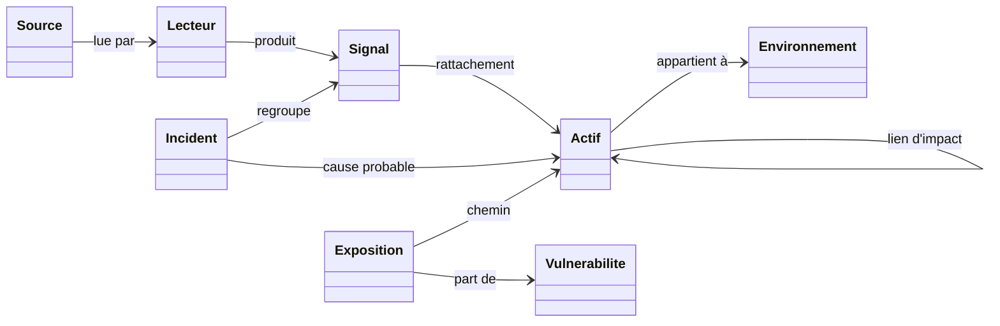
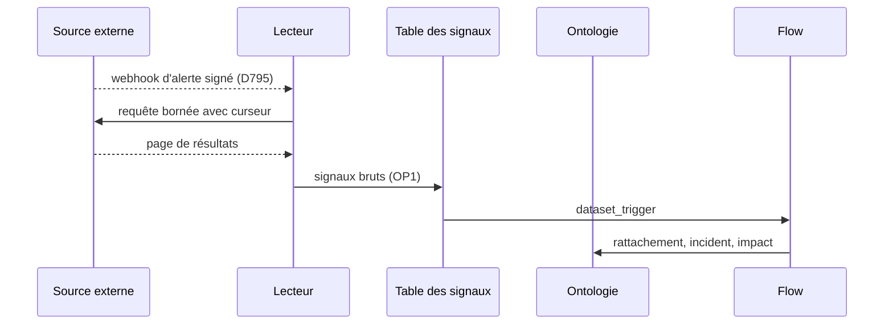
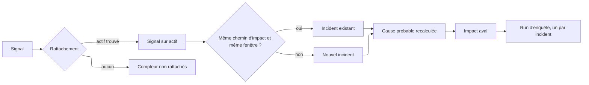
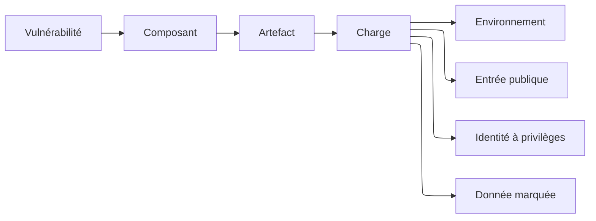

# Exploitation IT et sécurité : topologie, impact, exposition (D1001–D1030)

| | |
|---|---|
| **Statut** | **Proposé, rien n'est codé.** D1001–D1016 sont proposées. Q-IT2 et Q-IT3 sont tranchées, les autres questions attendent Shan. |
| **Numérotation** | D1001–D1030 réservées (D1001–D1016 utilisées), lots IT0–IT7, questions Q-IT1–Q-IT7. |
| **Renvois** | `software-delivery.md` (D850–D866 : code → artefact → déploiement → CVE), `ontology.md` (D179 liens datés, D184 provenance, D190 packs), `pipelines.md` (OP1, OP2 connecteurs D791–D797), `cases.md` §3.6 (chaînes causales D904–D911), `analysis.md` (OP5), `agents.md` (D780–D786, porte D833–D840), `operational-platform.md` (D998), benchmark `docs/journal/bench/agents-ops-correlation.md` et ses fiches (Coroot, Keep, HolmesGPT, Cartography, NetBox) |

## Résumé

Une organisation a déjà ses journaux d'audit, ses logs applicatifs, son SIEM, sa supervision réseau et son inventaire. Chaque outil voit sa couche. Aucun ne dit « ce lien réseau est tombé, voici les applications et les services métier touchés ». Aucun ne dit non plus « cette faille tourne en production, mais seulement en test ailleurs ». PneX doit lire ces outils sur place, relier leurs objets dans une topologie datée (physique, réseau, plateforme, application, service), puis calculer l'impact, la cause probable et l'exposition. Les deux publics avancent en parallèle : l'exploitation et la sécurité partagent le même socle.

## Concepts

| Terme | Définition |
|---|---|
| **Actif** | Objet de l'ontologie qui représente une chose de l'infrastructure : site, équipement réseau, lien, hôte, VM, cluster, charge, service, application, base, identité. |
| **Couche** | Niveau d'un actif : `physical`, `network`, `platform`, `application`, `business`. |
| **Topologie** | Ensemble des actifs et de leurs liens datés (D179), à un instant. |
| **Lien d'impact** | Type de lien marqué `propagates_failure`, avec un sens : la panne va de la cible vers la source (`depends_on`, `runs_on`, `connected_to`…). |
| **Environnement** | `production`, `staging`, `testing` ou `development`. Un actif y appartient par un lien daté. |
| **Source externe** | Outil du client que PneX lit : store de logs, SIEM, supervision, API Kubernetes, forge, inventaire réseau. |
| **Lecteur** | Connecteur en lecture seule vers une source externe, avec un curseur par source. |
| **Signal** | Alerte ou événement lu dans une source externe. Un signal reste une ligne de Table, jamais un objet. |
| **Rattachement** | Règle qui donne l'actif d'un signal à partir de ses attributs (hôte, IP, pod, `service.name`). |
| **Incident** | Objet qui regroupe des signaux reliés par la topologie dans une fenêtre de temps. |
| **Cause probable** | Actif le plus en amont, sur les liens d'impact, qui porte un signal de l'incident. C'est une déduction, jamais un fait. |
| **Exposition** | Chemin du graphe qui relie une faille, un environnement, une entrée publique, une identité et une donnée marquée. |

## Fonctionnement

### Lire sur place

PneX ne copie pas les logs. Le lecteur envoie à la source une requête que l'org écrit (SPL, DSL, LogQL, SQL), bornée dans le temps. Seuls les résultats entrent dans une Table. Le curseur de chaque source tient la reprise :

| Source | Lecture | Curseur et pièges |
|---|---|---|
| Elasticsearch, OpenSearch | `_search` | PIT + `search_after`, tri avec départage. `from + size` plafonné à 10 000. |
| Loki | `query_range` | Pas de curseur : fenêtre de temps glissante, doublons au même horodatage. 5 000 entrées par requête. En-tête `X-Scope-OrgID`. |
| OpenObserve externe | `POST /api/{org}/_search` | Fenêtre en microsecondes, `from` et `size`. |
| Splunk | Job de recherche, puis résultats paginés | Quota de recherches par rôle, troncature au-delà de 50 000 lignes : découper par temps. Port 8089 à ouvrir. |
| Kubernetes | List puis watch | `continue`, `resourceVersion`, relist sur 410, 429 sous charge. |
| Forge | Webhooks, puis lecture pour rattraper | Commun avec `software-delivery.md` SD1 et D858. |
| Inventaire réseau | API de lecture, webhooks | Sites, baies, câbles, interfaces, adresses. |

### Du signal à l'incident

Le regroupement suit la topologie d'abord. Deux signaux vont au même incident si un chemin de liens d'impact les relie. La fenêtre de temps départage seulement. La cause probable reprend le cœur causal de `cases.md` §3.6 (`rca.rs`, liens `propagates_failure`, couples appris). L'impact parcourt les liens d'impact vers l'aval, jusqu'aux services métier.

### Exposition

Une faille seule n'est pas un risque. Une règle d'exposition est une requête nommée (OP5) sur un chemin. Elle classe chaque chemin par environnement. Le même digest d'artefact en production et en test donne deux expositions distinctes. La chaîne faille → artefact vient de `software-delivery.md` SD3 et SD6.

### Run d'enquête

Un flow réagit à la création d'un incident (`ontology_trigger`). Il lance un seul run par incident avec le nœud `agent_run`. L'org choisit l'agent, son environnement (donc son harnais), ses compétences et ses secrets, comme pour tout agent (`agents.md` §3.2). Le run lit la topologie, les signaux et les sources. Il rédige une explication et propose des actions. Toute écriture passe la porte de validation (D833). Aucune écriture vers une source externe n'est autonome (D850, D838).

## Exigences

1. PneX ne doit jamais écrire vers une source externe, sauf par une action gouvernée D563.
2. Un lecteur doit être en lecture seule, avec un jeton du coffre (D113), derrière la politique de sortie R8.
3. Un lecteur doit borner chaque requête dans le temps et en nombre de lignes, et reprendre depuis son curseur.
4. Un signal doit rester une ligne de Table. Seuls les incidents et les actifs sont des objets (D855).
5. Un signal non rattaché doit être compté et visible, jamais jeté en silence.
6. Chaque lien de topologie doit porter sa provenance (D184) : déclaré, découvert ou déduit.
7. Un lecteur ne doit fermer aucun lien d'un périmètre dont la liste est incomplète (erreur 403, 5xx ou délai dépassé sur une page).
8. Un lien déduit doit passer par une proposition (D367), sauf au-dessus d'un seuil sûr (D998).
9. Une cause probable, un impact et une exposition doivent s'afficher comme des déductions, avec le chemin qui les fonde.
10. Un incident doit lancer un run d'enquête au plus.
11. Le LLM doit expliquer un chemin trouvé par le graphe, jamais en inventer un (D119, D785).
12. La topologie doit se rejouer à toute date passée (D179).
13. Les données personnelles des logs (utilisateurs, adresses IP de clients) doivent pouvoir être pseudonymisées (OP3, G5).

## Décisions

Toutes proposées le 2026-11-24, aucune tranchée.

### D1001 — Lire sur place, jamais copier les logs (proposée)

PneX interroge les stores de logs et le SIEM du client. Seuls les résultats des requêtes de l'org entrent dans une Table.

### D1002 — Des lecteurs par genre de source, avec curseur (proposée)

Nouveaux genres de connecteur (D555) : `elasticsearch` (couvre OpenSearch), `loki`, `openobserve`, `splunk`, `kubernetes`, `network_inventory`. La forge est commune avec SD1.

### D1003 — Un pack `it_topology` (proposée)

Types par couche et liens d'impact au §Interfaces. Les types `cluster`, `namespace`, `workload`, `environment` et `service` sont partagés avec `software_delivery` (Q-IT4).

### D1004 — Déclaré et découvert, les deux gardés (proposée)

L'inventaire du client déclare. Kubernetes, les traces et les flux découvrent. Un écart est un fait daté, comme une dérive (D853).

### D1005 — Le rattachement est une règle, pas un catalogue (proposée)

Une règle de rattachement donne l'actif d'un signal par ses attributs. Elle vit dans le pack et se règle par org.

### D1006 — La topologie d'abord, le temps pour départager (proposée)

Regroupement et cause probable suivent les liens d'impact. La fenêtre de temps et les couples appris (`causal_pairs`) départagent.

### D1007 — Le LLM explique, il ne décide pas (proposée)

Un run d'enquête reçoit le chemin calculé. Il rédige l'explication et les propositions.

### D1008 — L'impact remonte jusqu'aux services métier (proposée)

L'impact d'un actif en panne est le parcours aval des liens d'impact, jusqu'à la couche `business`.

### D1009 — Une exposition est un chemin, classé par environnement (proposée)

Les règles d'exposition sont des requêtes nommées OP5. Elles réutilisent les marquages (D188) pour les données sensibles.

### D1010 — Un incident, un run d'enquête au plus (proposée)

Le flow lance le run à la création de l'incident. Un signal nouveau sur le même incident enrichit le run suivant, il n'en lance pas un autre.

### D1011 — Une vue topologique en couches (proposée)

Une vue du graphe range les actifs par couche, de `physical` à `business`. Elle colore l'impact et la cause probable d'un incident. Elle réutilise la vue graphe des dossiers.

### D1012 — Hors périmètre (proposée)

PneX n'est pas un SIEM ni un store de logs. Il ne fait ni scan réseau actif ni sonde eBPF. Il ne remédie pas de façon autonome.

### D1013 — Cycle de l'incident (proposée)

Le dédoublonnage a deux niveaux. L'empreinte du signal dit « même alerte ». Le hachage du contenu, sans les champs ignorés, dit « même contenu ». Un doublon complet met à jour la date de réception seulement. Chaque règle de rattachement laisse une trace par signal : appliquée ou ignorée. Une règle de corrélation déclare ses clés de regroupement, sa fenêtre glissante, son seuil et sa condition de clôture (premier signal résolu, dernier, tous, jamais). Une fenêtre de maintenance, datée et liée à des actifs, retient la création d'incidents sur ces actifs.

### D1014 — Sortie du run d'enquête (proposée)

Le run rend un JSON strict avec une confiance. L'impact range chaque actif dans un des quatre groupes suivants :
- touché, avec la preuve citée
- vérifié sain
- changé pour une autre raison
- non vérifié.

Une inférence n'élargit jamais l'impact. Le run reçoit la liste des sources indisponibles avec leur erreur. Une carte de propagation donne un état par lien, pour la vue D1011.

### D1015 — Réseau : lire l'inventaire, orienter par le rôle (proposée)

Le lecteur `network_inventory` lit NetBox et Nautobot, avec un import CSV au format d'export NetBox. Il lit l'extrémité connectée de chaque câble, sans refaire le chemin. Un panneau de brassage se replie en un seul `network_link`. Le suivi passe par le journal des changements, car la date de mise à jour ne montre pas les suppressions. L'inventaire ne dit pas quel bout est en amont. Un flow oriente donc `connected_to` par une règle de l'org sur le rôle de l'équipement (cœur, distribution, accès, serveur). C'est un lien déduit (D998).

### D1016 — Forme des règles d'exposition (proposée)

Une règle produit des faits, puis des constats. Chaque fait déclare un actif d'ancrage et une clé stable d'un passage à l'autre. Un lien ingéré et un lien déduit restent distincts. Les risques de disponibilité (instance unique, nœud ou zone unique, base non répliquée) s'affichent à côté de l'exposition.

## Interfaces

Modèle proposé du pack `it_topology` (D1003). Rien n'existe dans `crates/pnex-backend/packs/`.

| Couche | Types | Identité |
|---|---|---|
| `physical` | `site`, `rack`, `network_device`, `cable` | Nom d'inventaire, numéro de série |
| `network` | `interface`, `network_link`, `subnet`, `vlan`, `ip_address` | Équipement + nom, CIDR, adresse |
| `platform` | `host`, `vm`, `cluster`, `namespace`, `workload`, `database` | FQDN, identifiant cloud, (cluster, namespace, nom) |
| `application` | `service`, `application`, `endpoint` | `service.name`, URL |
| `business` | `business_service`, `team` | Nom |
| Sécurité | `identity`, `exposure` | Compte, chemin |
| Exploitation | `incident`, `signal_source` | Identifiant PneX, connecteur |

Liens d'impact (`propagates_failure`) : `connected_to`, `hosted_on`, `runs_on`, `depends_on`, `served_by`, `stored_in`. Autres liens : `member_of_env`, `owned_by`, `exposes`, `has_access_to`, `caused_by` (inféré), `impacts` (inféré).

Connecteurs : mêmes routes que les connecteurs OP2 (`pipelines.md`). Un lecteur a un test de connexion et un aperçu de requête.

## Reste à faire

Lots proposés. IT0 → IT2 forment le socle commun, puis deux pistes en parallèle (choix de Shan du 2026-11-24 : exploitation et sécurité ensemble).

| Lot | Contenu | Preuve |
|---|---|---|
| IT0 | Pack `it_topology`, liens d'impact, vue en couches (D1011) | Une topologie de démo rejouée à une date passée |
| IT1 | Lecteurs `elasticsearch`, `loki`, `openobserve`, `splunk` (D1002) | Une requête de l'org lue avec reprise sur curseur |
| IT2 | Lecteur `kubernetes` et inventaire réseau, orientation des liens réseau, découverte contre déclaré (D1004, D1015) | Une dérive détectée et datée |
| IT3 | Table des signaux, rattachement, dédoublonnage, fenêtres de maintenance, webhooks d'alertes (D1005, D1013) | Taux de signaux rattachés affiché |
| IT4 (exploitation) | Incidents, cause probable, impact (D1006, D1008) | Panne d'un lien réseau → services métier touchés |
| IT5 (sécurité) | Exposition par environnement et risques de disponibilité (D1009, D1016), avec SD3 et SD6 | « Cette faille tourne en production ? » répondu |
| IT6 | Run d'enquête par incident, sortie en quatre groupes (D1007, D1010, D1014) | Une explication sourcée et une proposition dans « À valider » |
| IT7 | Mesure sur un jeu d'incidents étiquetés (critère de `cases.md` §3.6) | Précision mesurée avant d'activer par défaut |

Questions pour Shan :

- **Q-IT1** : premier store de logs à lire ? Elasticsearch/OpenSearch (le plus répandu), Splunk (grands comptes) ou Loki.
- **Q-IT2** (tranchée par Shan le 2026-11-24) : les deux. Lecteur NetBox et Nautobot, plus import CSV (D1015).
- **Q-IT3** (tranchée par Shan le 2026-11-24) : plus tard, en lecture seule (LLDP, SNMP par l'agent edge). La comparaison du découvert avec le déclaré reste la valeur de PneX (D1004).
- **Q-IT4** : un seul pack pour les types partagés avec `software_delivery`, ou deux packs reliés ?
- **Q-IT5** : réception d'alertes en webhook (Alertmanager, SIEM) dès IT3, ou lecture seule d'abord ?
- **Q-IT6** : règles Sigma lues comme format de règle de signal, ou hors périmètre ?
- **Q-IT7** : contenu des logs envoyé au LLM du run d'enquête : jamais, extrait marqué, ou au choix de l'org ?
