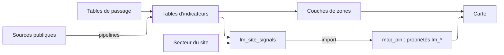
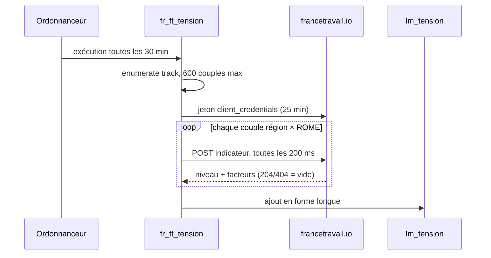
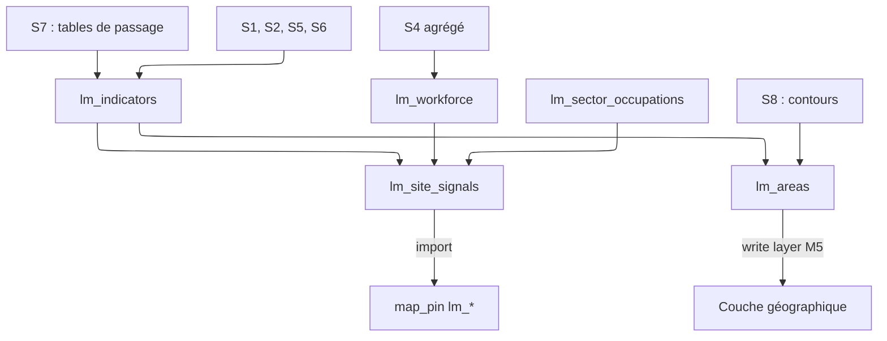

# Marché du travail territorial : ingestion et carte

| | |
|---|---|
| **Statut** | Codé : moteur LM0, pack `labor_market_fr` 1.2.0 (BMO, tension). Proposé : le reste (pivots, offres, âges, score, zones). |
| **Repose sur** | `pipelines.md` (D344–D358, D569–D578, D937), `crm.md` (D329–D343, score D336), `geo-layers.md` (phase A), `security.md` (R1, R2, R4, R8, R16, coffre D110), `ontology.md` (D184) |
| **Numérotation** | Décisions **M1–M18 provisoires**, sources **S1–S8**, lots **LM0–LM5**. Le code cite ces numéros. |

## 1. Résumé

Ce module charge les données publiques du marché du travail : tension par métier, besoins de recrutement, âge des actifs, départs en fin de carrière. Il rattache ces chiffres aux territoires et aux établissements (`map_pin`). Il les montre sur la carte : zones colorées au fond, sites scorés au-dessus. Une org s'en sert pour cibler des sites selon les métiers que leur territoire a du mal à pourvoir. Tout passe par des pipelines de pack, sans flow ni nœud (M2).

**État du code (vérifié)** :

- Moteur (LM0) : `read.format: xlsx` avec `sheet`, jeton `client_credentials`, `fetch.json_from` (POST JSON), `pages.size` (pagination par plage), `fetch.skip_if_unchanged`. Aucun nom de source dans le Rust.
- Pack `labor_market_fr` 1.2.0 : pipelines `fr_bmo` et `fr_ft_tension`, tables `lm_bmo` et `lm_tension`, requêtes nommées `bmo` et `tension`, fixtures et tests de rejeu.
- Absents : le pack générique `labor_market`, les pivots ISCO / NUTS, `lm_indicators`, les offres, les données INSEE, le score, les propriétés `lm_*` et les couches de zones.

Hors périmètre : métiers cibles ou poids fixés par le pack (ce sont des réglages d'org, école D336). Pas de donnée personnelle. Pas de chiffre par entreprise que le public n'a pas : âge et catégorie sociale restent agrégés au territoire, et le secret statistique est la frontière.

## 2. Concepts

| Terme | Définition |
|---|---|
| **Métier** | Code d'une nomenclature : FAP 2021 ou ROME en France. Le pivot proposé est ISCO-08. |
| **Maille** | Découpage territorial : région, département, zone d'emploi, bassin BMO. Le pivot proposé est NUTS. |
| **Indicateur** | Valeur d'une métrique pour un métier, une maille et une édition. |
| **Forme longue** | Une ligne par métier, maille, édition et métrique (M16). Les deux tables codées l'emploient. |
| **Table de passage** | Table qui relie un code local à un code pivot, avec un poids (M15). |
| **Couche pays** | Pack `<générique>_<pays>` : ses pipelines et ses tables de passage seulement (M1). |
| **Score de site** | Somme pondérée, en percentiles, des composantes d'un établissement (M12, M17). |

## 3. Fonctionnement

### 3.1 Sources

| # | Source | Producteur | Grain | État |
|---|---|---|---|---|
| S1 | Tension par métier et facteurs | France Travail, API Marché du travail | ROME × région, niveau 1–5 | Codé (`fr_ft_tension`) |
| S2 | Besoins en main-d'œuvre (BMO) | France Travail, open data | FAP 2021 × département | Codé (`fr_bmo`) |
| S3 | Offres d'emploi une à une | — | offre | Aucune source ouverte |
| S4 | Recensement : actifs au lieu de travail, par âge et PCS 2020 | INSEE | commune → zone d'emploi | Proposé |
| S5 | « Les métiers en 2030 » : départs, postes à pourvoir | DARES / France Stratégie | FAP × région | Proposé |
| S6 | Mouvements de main-d'œuvre | DARES | secteur × territoire | Proposé |
| S7 | Tables de passage ROME, FAP, PCS, communes | DARES, INSEE, France Travail | — | Proposé |
| S8 | Contours des départements et zones d'emploi | IGN / INSEE | polygones | Proposé |

Les établissements (SIRET, NAF, effectif, position) viennent des packs `companies_fr` et `prospecting_b2b_fr`.

Pour S1, le site de la DARES refuse les accès automatisés. S1 vient donc de l'API Marché du travail (choix de Shan, 2026-11-15), sans les composantes détaillées de la DARES. Pour S3, l'API « Offres d'emploi v2 » est écartée : elle a quitté le catalogue de francetravail.io. Le pack 1.2.0 a retiré `fr_ft_offers`, `lm_offers_seen` et leurs requêtes.

### 3.2 Pipelines codés

`fr_ft_tension` suit chaque couple (D937) et le demande une fois par année civile. La liste complète compte environ 1 900 codes ROME. Les 13 régions demandent environ 24 800 appels, soit une quinzaine d'heures une fois par an. Le moteur ne renouvelle pas le jeton pendant une exécution : `per_run` borne donc chaque exécution.

`fr_bmo` tourne toutes les 24 h. Il relit le fichier seulement s'il a changé (`skip_if_unchanged`). La valeur `*` (secret statistique) est lue comme vide, et une somme peut donc être basse. Le nom de colonne du bassin change chaque année : le pipeline somme par département et ne garde pas le bassin.

Deux tables d'indicateurs existent, pas une seule `lm_indicators`. Deux pipelines qui remplacent la même table s'effaceraient l'un l'autre. L'union viendra avec les pivots (LM1).

### 3.3 Chaîne proposée

L'ordonnanceur à dépendances (D575) lance `lm_site_signals` après les autres pipelines. Le SQL de `lm_site_signals` et de `lm_areas` est générique : il ne lit aucune table propre à un pays. S4 est gros : le pipeline agrège dans son `sql` et écrit seulement l'agrégat.

### 3.4 Structures génériques proposées (M15, M16)

| Axe | Code local (France) | Pivot |
|---|---|---|
| Métier | FAP 2021, ROME | ISCO-08 à 4 chiffres (repli 3 ou 2) |
| Maille | région, département, zone d'emploi, bassin | NUTS 1–3, sinon pays + ISO 3166-2 |
| Secteur | NAF | NACE rév. 2 |
| Catégorie sociale | PCS 2020 | grand groupe ISCO + code local |
| Âge | tranches de la source | `<30`, `30–49`, `50+`, `55+` |
| Période | année, édition | `period_start`, `period_end`, `edition` |

Le code local reste à côté du pivot, jamais à sa place. Une couche pays ajoute des lignes, pas des colonnes ni des propriétés. Elle fournit ses tables de passage, ses pipelines d'indicateurs, ses contours (option) et ses fixtures.

Le vocabulaire `metric` est fermé dans le pack générique : `tension_index`, `hiring_projects`, `hiring_difficulty_pct`, `seasonal_projects_pct`, `vacancy_rate`, `hires_rate`, `separations_rate`, `retirements_expected`, `replacement_demand`, `employed`, `seniors_share`… Chaque métrique porte sa définition, son sens et sa normalisation. Une couche pays propose une métrique nouvelle au pack générique : elle ne l'invente pas localement.

### 3.5 Carte proposée

- **Fond** : une couche de zones, remplissage gradué sur l'indicateur choisi, une palette séquentielle. La légende donne la définition et l'édition (M14).
- **Sites** : les `map_pin` de l'org au-dessus d'un seuil de `lm_score`. La taille suit `headcount_band`, la couleur suit `lm_score`.
- **Filtres** : métier (ISCO, libellé local affiché), maille, seuil de score. Un seul métier à la fois par défaut.
- **Fiche du site** : chaque composante avec sa source et son année.

La phase A de `geo-layers.md` dessine déjà les couches sous les marqueurs des sites. Les marqueurs (D37) varient seulement par la couleur de statut (D339). La taille par effectif demande un ajout au rendu des marqueurs.

## 4. Exigences

1. Chaque source doit être un pipeline YAML de pack, planifié, sans flow ni nœud.
2. Le Rust du moteur ne doit contenir aucun nom de source ni de pays.
3. Un pipeline doit déclarer chaque hôte qu'il appelle dans `hosts` (R8).
4. Les identifiants France Travail (`lm_ft_client_id`, `lm_ft_client_secret`) doivent rester au coffre de l'org (D110). Ils ne doivent apparaître dans aucun DTO, sortie MCP ou journal (R4, R16).
5. Une org doit employer ses propres identifiants France Travail (licence de l'API).
6. Tables, couches et propriétés `lm_*` doivent appartenir à une org (R1).
7. Un pipeline ne doit lire aucune colonne de contact d'un recruteur. Un test de pipeline doit le vérifier.
8. Chaque propriété `lm_*` doit porter sa source et son édition (M14, D184).
9. Le score doit comparer des percentiles par pays et par édition, jamais des valeurs brutes (M17).
10. Chaque pipeline doit avoir un test de rejeu sur fixtures.

## 5. Décisions

| # | Décision | État |
|---|---|---|
| M1 | Deux packs : `labor_market` (générique : types, propriétés `lm_*`, schémas, score) et `labor_market_<pays>`. | Seul `labor_market_fr` existe, `requires: []`. |
| M2 | Pipelines seulement, planifiés. Aucun flow, aucun `NodeDoc` (demande de Shan, 2026-11-14). | Appliqué |
| M3 | Lecture xlsx dans un pipeline (`read.format: xlsx`, `sheet`), lecteur de `pnex-core`, garde zip-bomb. | Codé |
| M4 | Jeton OAuth2 `client_credentials` : le coffre remplit `client_id` et `client_secret`. Jeton en mémoire seulement. | Codé |
| M5 | Écriture d'un pipeline vers une couche géographique (`write.layer`), par `replace_features`. | Proposé |
| M6 | Prérequis carte = phase A de `geo-layers.md` (PostGIS, `geo_features`, tuiles MVT). `geo_area` (K29) ne suffit pas. | Livré |
| M7 | Archive des offres : premier et dernier jour vus, clôture. | En attente d'une source (S3) |
| M8 | Collecte des offres découpée par maille et lot de métiers suivis. | En attente d'une source (S3) |
| M9 | Rapprochement offre → établissement en SQL : nom et commune, puis nom proche et distance < 3 km. Sous le seuil (0,8), lien `to_validate` (école D337). | En attente d'une source (S3) |
| M10 | Une offre d'intérim (NAF 78.xx) ou anonyme ne se rattache jamais à un site. | En attente d'une source (S3) |
| M11 | Motif de l'offre par mots-clés SQL, puis par le LLM de l'org (D116) sur les offres rapprochées. | En attente d'une source (S3) |
| M12 | Score de site en SQL, poids en réglages d'org. Chaque composante est aussi publiée seule (D726). | Proposé |
| M13 | Métiers d'un site par `lm_sector_occupations` (secteur → ISCO, part), corrigeable par l'org. | Proposé |
| M14 | Provenance : source et édition sur chaque propriété `lm_*` (D184). | Proposé |
| M15 | Pivots ISCO-08, NUTS, NACE ; codes locaux à côté. | Proposé |
| M16 | Indicateurs en forme longue, `metric` en vocabulaire fermé. | Codé pour `lm_bmo` et `lm_tension` |
| M17 | Score sur percentiles par pays et par édition. | Proposé |
| M18 | Réglages de métiers en ISCO, chaque couche pays en dérive ses codes. | Proposé. Le réglage codé est `rome_codes`. |

## 6. Interfaces

Réglages du pack `labor_market_fr` :

| Clé | Rôle |
|---|---|
| `regions` | Codes INSEE de région suivis. Vide : pas de tension. |
| `rome_codes` | Codes ROME suivis (12 000 caractères max). Vide : pas de tension. |
| `bmo_url` | Fichier BMO de l'édition lue. Vide : pas de BMO. |

| Pipeline | Table | Rythme | Hôtes |
|---|---|---|---|
| `fr_bmo` | `lm_bmo` (remplacement) | 24 h, si le fichier change | `www.francetravail.org` |
| `fr_ft_tension` | `lm_tension` (ajout) | 30 min, 600 couples par exécution | `entreprise.francetravail.fr`, `api.francetravail.io` |

Requêtes nommées (D948) : `POST /api/v1/analysis/named/labor_market_fr/{bmo|tension}`, permission `analysis:run`. `bmo` prend `department`, `tension` prend `region`.

Propriétés proposées sur `map_pin` : `lm_main_occupations`, `lm_tension_pct`, `lm_hiring_difficulty_pct`, `lm_open_offers`, `lm_oldest_offer_days`, `lm_replacement_pct`, `lm_seniors_share`, `lm_score` (0–100), `lm_sources`.

Tables proposées : `lm_indicators`, `lm_workforce`, `lm_occupation_crosswalk`, `lm_area_crosswalk`, `lm_sector_crosswalk`, `lm_sector_occupations`, `lm_site_signals`. Couches proposées : `lm_areas_<maille>` (`lm_areas_fr_dept`, `lm_areas_fr_ze`, `lm_areas_nuts2`).

## 7. Reste à faire

| Lot | Contenu | Fini quand |
|---|---|---|
| LM1 | Pack `labor_market`, tables de passage (S7), réglage ISCO (M18), union dans `lm_indicators` | Tension et BMO lisibles par ISCO et par code local |
| LM2 | Offres une à une (M7–M11) | Bloqué : aucune source ouverte |
| LM3 | S4 agrégé, S5, S6 | Part des seniors par zone d'emploi et départs par FAP disponibles |
| LM4 | `lm_site_signals`, propriétés `lm_*`, poids, rendu des sites, fiche | Sites scorés d'une région test, fiche sourcée |
| LM5 | M5 et pipeline `lm_areas` | Fond par département ou zone d'emploi, coloré par indicateur |

Chaque lot inclut : clés dans les deux `.ftl`, lexique (`design-system.md` §7), codes d'erreur, fiche `assistant-kb`, tests de rejeu, revue `security.md` §6, contrat d'API et IAM si une route s'ajoute. Les lots LM4 et LM5 passent les skills de design.

Points ouverts :

1. Les fixtures France Travail sont synthétiques. Il faut les comparer au premier passage réel.
2. S5 et S6 viennent du site de la DARES, qui refuse les accès automatisés. Il faut une autre voie.
3. Le jeton n'est pas renouvelé pendant une exécution. `per_run` contourne cette limite.
4. FAP 2021 → ISCO n'est pas publiée directement. Le chemin probable passe par PCS 2020, avec `weight` < 1.
5. Licence et format des contours NUTS (GISCO) : à vérifier.
6. La fixture `ft_token.json` porte encore le scope des offres retiré en 1.2.0.
7. Les numéros M1–M18 attendent leur numéro `Dxxx`. Les citations du code (S1, S2, M16) suivront.

Questions à Shan :

1. Offres une à une : quelle source, sachant qu'aucune source ouverte ne les liste ?
2. Métiers suivis par défaut : liste vide, ou une sélection proposée par l'assistant depuis les secteurs des comptes ?
3. Historique d'offres acheté à un agrégateur : hors périmètre tant que LM2 est bloqué ?
4. Couches pays suivantes (`labor_market_eu`, `_de`, `_us`…) : lesquelles, et quand ?
