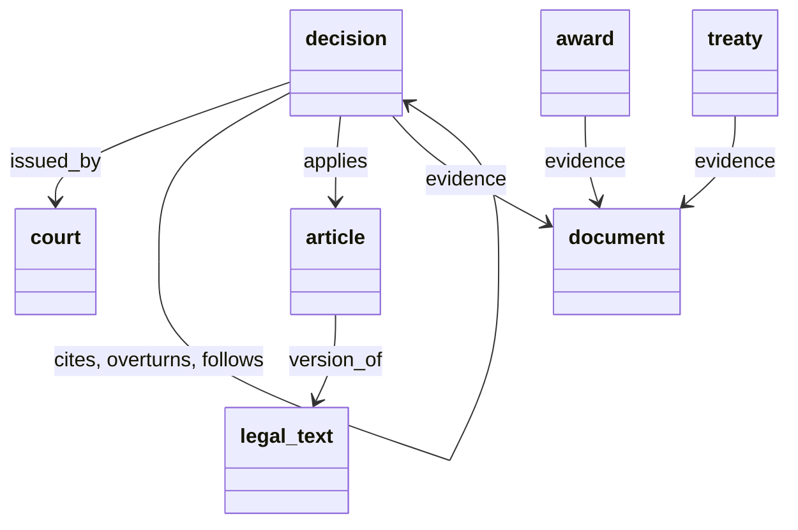
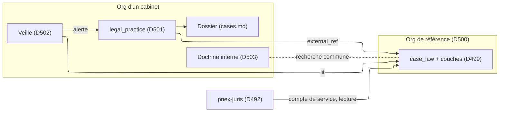
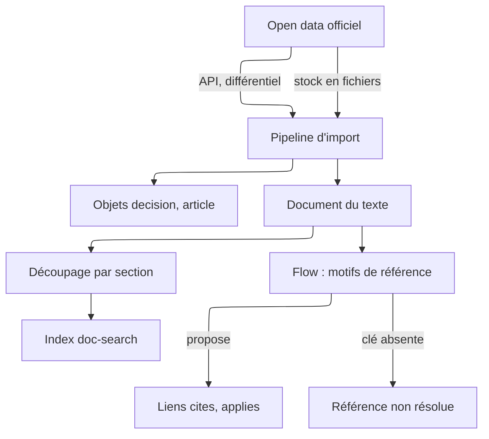
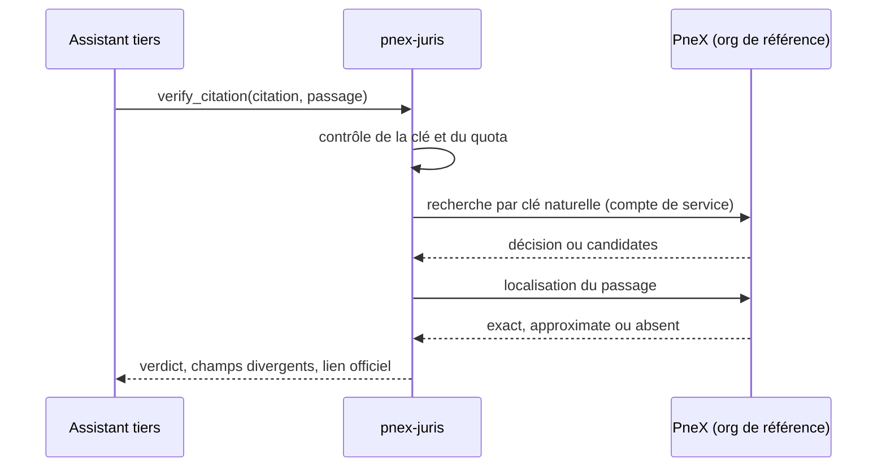
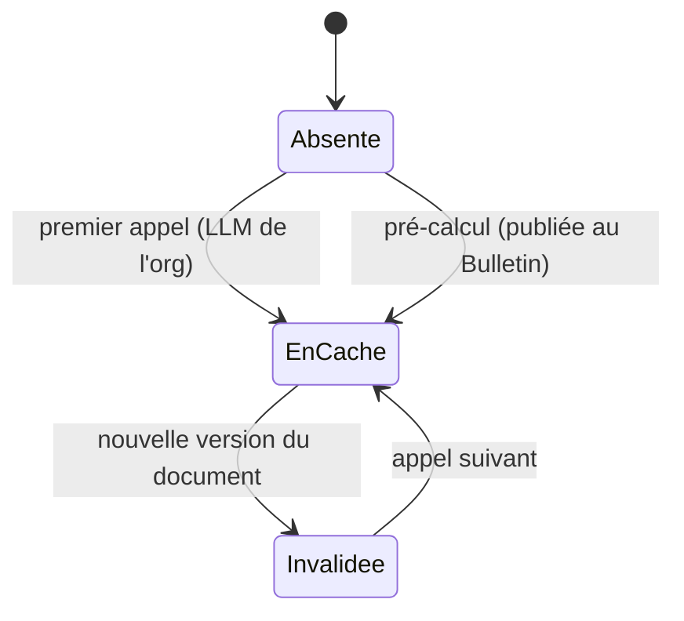
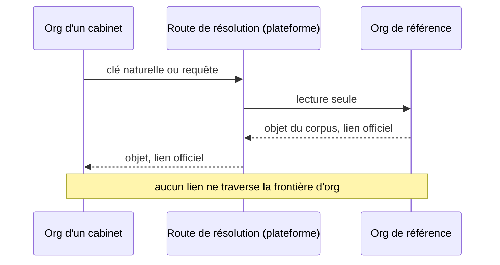
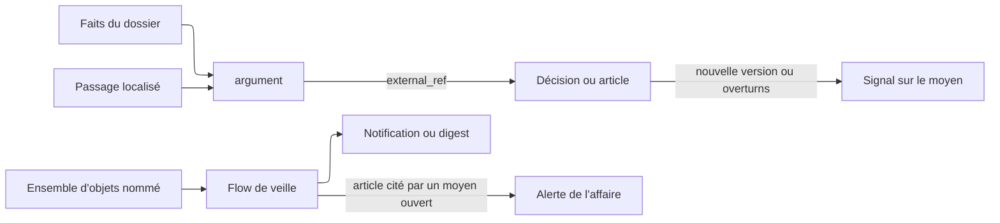

# Recherche juridique composable (D485–D496, D498–D505)

| | |
|---|---|
| **Statut** | Proposé. Aucune ligne de code : pas de pack `case_law` ni `legal_practice`, pas de brique `external_ref`, pas de localisation de passage, pas de façade `pnex-juris` (vérifié par `git grep`, 2026-11-20). |
| **Lots** | LR0–LR6 (vérification de citations), LR7–LR11 (famille de packs) |
| **Périmètre** | Droit français d'abord, puis UE, CEDH et international (D499) |
| **Repose sur** | `external-apps.md` (D432–D441), `pipelines.md`, `ontology.md` (D176, D184, D185, D190), `doc-search.md`, `cases.md`, `notifications.md`, `analysis.md` (D829), `iam.md`, `api.md`, `ai-assistant.md` (D119, D145), `security.md` |

## 1. Résumé

Des avocats emploient des assistants conversationnels généralistes. Ces assistants citent parfois une décision qui n'existe pas, ou une décision réelle avec un numéro, une date ou un passage faux. PneX ne fournit pas d'assistant. Il fournit une source vérifiable que chacun branche sur son assistant (MCP ou API), et un vérificateur de citations. La vérification de citations est la première brique d'une famille de packs : corpus public, pratique d'un cabinet, veille et doctrine interne.

## 2. Concepts

| Terme | Définition |
|---|---|
| **Corpus** | Décisions et textes publiés en open data officiel, typés par le pack `case_law` et ses couches. |
| **Couche** | Pack `case_law_<ordre>` : ce qui est propre à un ordre juridique (`_fr`, `_eu`, `_echr`, `_intl`). Le suffixe désigne un ordre juridique, pas toujours un pays. |
| **Org de référence** | Org désignée par l'admin plateforme. Elle porte le corpus et seulement des données publiques (D500). |
| **Référence externe** | Propriété `external_ref` d'un objet d'org : type cible, clé naturelle (ECLI, CELEX, ELI, numéro de requête), libellé figé. |
| **Motif de référence** | Expression déclarée par un pack, qui trouve une référence dans un texte et donne son type cible et sa clé (D489). |
| **Localisation** | Recherche d'un passage dans un document, avec un verdict `exact`, `approximate` ou `absent` (D490). |
| **Synthèse** | Résumé calculé par le LLM de l'org, stocké comme champ dérivé. Une synthèse n'est jamais une source (D491). |
| **Façade** | Application `pnex-juris`, hors dépôt, seule surface publique (D485). |
| **Méthode de calcul** | Façon de calculer la fin d'un délai, déclarée par une couche (jours francs, jours fériés, prorogation). |

Le pack générique `case_law` déclare ces types et ces liens, sans juridiction. Un objet `article` est une version d'article, avec son intervalle de vigueur. Le texte intégral d'une décision est un document (média) relié par un lien `evidence` (D437). L'objet porte les métadonnées, jamais le texte.

La famille compte trois étages indépendants : corpus, pratique, veille. Chaque étage s'installe seul. L'interface du cabinet est l'UI de PneX. La façade n'est qu'un consommateur du corpus.

## 3. Fonctionnement

### 3.1 Collecte et découpage du corpus

Le stock en fichiers passe avant les API : il consomme moins de quotas et sa reprise est simple. Les API servent au différentiel quotidien. Chaque objet garde sa source, sa date de collecte et son lien officiel. Le corpus ne sert pas une décision sans lien officiel.

Le découpage emploie un parseur déterministe déclaré par la couche. Il produit des sections (en-tête, faits et procédure, moyens, motifs, dispositif) et des paragraphes numérotés. Une section non reconnue reste un bloc « texte ». Le découpage ne perd et ne réécrit aucun texte.

Un lien trouvé par un motif est un lien déduit : un flow le propose (D998). Une référence vers un objet absent reste non résolue. Le prochain import la résout. Le flow ne crée jamais d'objet « au cas où ».

### 3.2 Vérification d'une citation

`verify_citation` ne corrige rien en silence. Il dit ce qui diffère (date, juridiction, numéro) et propose les candidates les plus proches. L'avocat tranche. Chaque réponse porte le lien officiel et la date de dernière synchronisation de la source.

La localisation applique une normalisation déclarée : espaces, apostrophes, guillemets, casse, ligatures. Elle n'applique aucune normalisation sémantique : un mot changé reste un écart. Un verdict `approximate` donne la similarité et les écarts mot à mot. La brique sert aussi ailleurs : citation d'un document, preuve d'une page collectée.

### 3.3 Cycle de vie d'une synthèse

Le LLM de l'org opératrice calcule la synthèse (D119). La synthèse garde sa provenance : `ai`, modèle, date, version du document source. Elle garde aussi les passages qui la fondent. La façade la renvoie toujours à part du texte, avec la mention « synthèse générée ». Chaque phrase renvoie à un passage du texte.

### 3.4 Résolution d'une référence externe

La route ne reçoit rien d'autre de l'org appelante. Elle ne journalise ni la clé ni la requête, sauf pour le comptage. Une référence non résolue reste affichée comme telle. Cette lecture est une exception à la frontière d'org : lecture seule, une seule org désignée, aucune donnée d'org à l'intérieur.

### 3.5 Pratique d'un cabinet et veille

Une `matter` (affaire) ouvre un dossier de `cases.md` et s'y rattache : pièces, chronologie, argent, preuves. Un `argument` (moyen) relie des faits du dossier à des sources. Une source qui change signale chaque moyen et chaque modèle d'acte qui la citent.

Un `deadline` (délai) porte une date de départ, une durée et sa méthode de calcul. La date calculée affiche sa méthode. Elle reste à confirmer par l'avocat et n'est jamais présentée comme certaine.

Une recherche couvre l'org et le corpus. Chaque résultat porte sa source : officiel, interne ou synthèse générée. Un extrait ne mélange jamais deux sources.

## 4. Exigences

1. Le moteur ne doit gagner que des briques génériques : motifs de référence, localisation, `external_ref`, méthodes de calcul de dates, recherche multi-sources. Le vocabulaire juridique doit vivre dans les packs (garde D441).
2. Une couche ne doit contenir que ce qui est propre à son ordre juridique.
3. Seul l'open data officiel doit entrer au corpus : pas de site éditorial, pas de base sous licence.
4. La licence et les conditions de réutilisation d'une source doivent être consignées dans ce document avant sa première collecte.
5. Le corpus ne doit servir aucune décision sans lien officiel.
6. Le découpage ne doit perdre ni réécrire aucun texte (test sur des décisions réelles).
7. Les tests des motifs de référence doivent employer une ontologie inventée, pas `case_law`.
8. Aucun type, propriété, lien, agrégat, filtre ni outil ne doit porter sur un magistrat ou un greffier (loi n° 2019-222, art. 33). Un test du pack et un test de la façade doivent le vérifier.
9. Aucune partie ne doit être ré-identifiée, rattachée à un objet `person` ni croisée avec un autre pack.
10. Une occultation reçue de la source doit retirer la version précédente de l'index et de la façade au différentiel suivant.
11. La façade doit lire PneX par un compte de service en lecture seule, sur un réseau privé. PneX ne doit pas être joignable depuis Internet pour ce service.
12. La façade ne doit journaliser ni les questions ni les passages, sauf pour compter les quotas.
13. La façade doit borner la longueur des passages et des requêtes. Elle ne doit renvoyer aucun texte utilisateur en HTML.
14. Les clés des utilisateurs doivent être stockées hachées. La clé du compte de service doit rester sur le serveur de la façade (R4, R16).
15. La collecte doit passer par l'egress gardé, avec la liste blanche des hôtes des sources (R8).
16. Aucune donnée de cabinet ne doit entrer dans l'org de référence.
17. Une instance auto-hébergée doit chercher dans son corpus sans appel sortant.

## 5. Décisions

### D485 — PneX moteur, `pnex-juris` seule surface publique

`pnex-juris` est une application au sens de D432 : dépôt à part, compte de service en lecture seule (D433). Aucun utilisateur de la façade n'a de compte PneX.

### D486 — Pack `case_law`, couche pays `case_law_fr`

`case_law_fr` porte les formations, le numéro de pourvoi, le numéro de requête, le Bulletin, les codes, le NOR et l'ELI. La clé naturelle est l'ECLI, sinon l'identifiant de la source.

### D487 — Sources V1 : open data officiel seulement

Ordre des lots : Cour de cassation (Judilibre, CASS / INCA), textes consolidés (LEGI, API Légifrance), juridictions administratives (JADE), Conseil constitutionnel (CONSTIT), puis cours d'appel et tribunaux selon le calendrier de l'open data judiciaire.

### D488 — Découpage d'une décision

Parseur déterministe déclaré par la couche, index par section (§3.1).

### D489 — Références déclarées par un pack → liens

Un flow applique les motifs et propose les liens `cites` et `applies` (§3.1).

### D490 — Localisation d'un passage

Brique générique, verdict `exact`, `approximate` ou `absent`, normalisation déclarée sans sémantique (§3.2).

### D491 — Synthèse par IA : à la demande, en cache, marquée

Calcul au premier appel, pré-calcul pour le Bulletin seulement, invalidation à chaque nouvelle version (§3.3).

### D492 — Façade : outils MCP et API en lecture seule

Cinq outils (§6). API REST et MCP viennent du même contrat, comme dans `api.md`.

### D493 — Accès : clé API gratuite, quotas

Une clé par utilisateur, inscription par e-mail, quotas par jour, par clé et par outil. OAuth vient au lot suivant. Pas de journalisation du contenu (secret professionnel).

### D494 — Page de connexion

Page statique : obtenir sa clé, brancher MCP ou API sur les assistants courants, connaître la couverture et la date de synchronisation. Pas de chat ni de LLM côté façade.

### D495 — Pas d'analyse des magistrats

Exigence 8.

### D496 — Données des parties

Exigences 9 et 10.

### D498 — Le juridique est une famille de packs, pas un produit

Corpus, pratique et veille s'installent séparément. `pnex-juris` est un consommateur parmi d'autres.

### D499 — Ordres juridiques en couches

`case_law` gagne `treaty` et `award`. Couches `case_law_fr`, `case_law_eu` (EUR-Lex, CJUE, Tribunal, clé CELEX ou ECLI), `case_law_echr` (numéro de requête, ECLI), `case_law_intl` (traités, organes internationaux, sentences publiées par leur institution). D487, D495 et D496 s'appliquent à chaque couche.

### D500 — Corpus de référence : une org de plateforme lue par toutes

L'admin plateforme (D72) désigne l'org. Seuls ses imports l'écrivent. Les autres orgs la référencent par `external_ref` (§3.4).

### D501 — Pack `legal_practice` : affaires, délais, actes, moyens

Types `matter`, `party_role`, `deadline`, `filing`, `argument`. Une `matter` ouvre un dossier, un `argument` relie faits et sources, un `deadline` reste à confirmer (§3.5).

### D502 — Veille composable

Un abonnement est un ensemble d'objets nommé (D434) sur le corpus. Un flow le lit et produit une notification ou un digest. Le pack fournit des flows d'exemple.

### D503 — Doctrine interne et recherche multi-sources

Notes, consultations et modèles d'actes sont des documents de l'org. Une recherche couvre org et corpus, avec la source de chaque extrait (§3.5).

### D504 — Composer sans développer

Le cabinet ajoute ses types, liens, vues et flows depuis l'UI (D176, D190). Son pack se partage comme tout pack, par le hub quand le hub sortira du gel.

### D505 — Secret professionnel et auto-hébergement

Rien du cabinet dans l'org de référence. Une instance auto-hébergée remplit son corpus par `pnex-mirror` (D439) ou par les mêmes imports. LLM de l'org seulement (D119), conversations privées (D145).

## 6. Interfaces

Outils de la façade (D492), tous en lecture seule :

| Outil | Entrée | Sortie |
|---|---|---|
| `search_decisions` | requête, juridiction, période, article visé | décisions, extraits, lien officiel |
| `get_decision` | ECLI, pourvoi ou requête | métadonnées, texte par section, lien officiel, synthèse à part |
| `verify_citation` | citation libre, passage cité (option) | décision ou non, champs divergents, verdict du passage, candidates |
| `get_citing_decisions` | identifiant | suite de la procédure (`overturns`, `follows`), décisions qui la citent |
| `get_article` | référence, date | version en vigueur à la date, lien officiel |

Un quota dépassé renvoie 429.

Lots :

| Lot | Contenu | Tests |
|---|---|---|
| LR0 | Conditions de réutilisation et volumes de chaque source | — |
| LR1 | `case_law` + `case_law_fr`, stock Cour de cassation, texte en document | import idempotent, clé naturelle, garde D495 |
| LR2 | Découpage, index par section | aucune perte de texte |
| LR3 | Motifs de référence, LEGI, `applies` / `cites` | ontologie inventée, références résolues plus tard |
| LR4 | Localisation d'un passage | exact, approché, absent, normalisation |
| LR5 | `pnex-juris` : outils, clés, quotas, page | lecture seule, 429, pas de journal du contenu |
| LR6 | Synthèse, JADE, CONSTIT, différentiels quotidiens | invalidation, synthèse à part |
| LR7 | Org de référence, `external_ref`, route de résolution | lecture seule, pas de journal du contenu, référence non résolue |
| LR8 | `legal_practice` : affaire et dossier, moyens, signal de source | moyen signalé sur `overturns` |
| LR9 | Veille, recherche multi-sources | notification, source de chaque extrait |
| LR10 | `case_law_eu`, `case_law_echr` | clés CELEX, ECLI, numéro de requête |
| LR11 | `deadline` et méthodes de calcul, `case_law_intl` | jours francs, fériés, prorogation |

Le premier lot utile sans LLM va de LR1 à LR5, avec `verify_citation` sur la Cour de cassation.

## 7. Reste à faire

- **LR0** : vérifier et consigner ici la licence et les volumes de chaque source.
- **Q-LR1 — Volumes** : chiffrer le stock judiciaire et administratif (décisions, taille, coût de l'index) avant de choisir l'org et le stockage.
- **Q-LR2 — Recherche sémantique** : la V1 fait du plein texte et des références exactes. Choix de Shan : vecteurs sur tout le corpus ou sur les motifs seulement.
- **Q-LR3 — Copie locale** : servir la façade depuis `pnex-mirror` (D439) isole mieux, mais demande la recherche plein texte côté miroir. Choix de Shan.
- **Q-LR5 — Corpus copié** : chiffrer la copie complète contre une copie filtrée (juridictions, période) pour une instance auto-hébergée.
- **Q-LR6 — Délais** : fixer la couverture minimale (appel, pourvoi, opposition) avant de proposer `deadline`.
- **Q-LR7 — Sentences arbitrales** : trouver les institutions qui publient sous une licence réutilisable.
- **Q-LR8 — Frontière d'org** : inscrire l'exception D500 au registre `security.md` §7 et la valider en revue avant LR7.
- **Veille et règles** : D502 précède les règles D829 (`analysis.md`). Choix de Shan : la veille devient-elle une règle, ou reste-t-elle un flow ?
- **`external_ref`** : D369 (`ontology.md`) prévoit aussi un `external_ref` de premier rang, au démarrage du CRM ou de l'ERP. Choix de Shan : une seule brique pour les deux usages, ou deux.
