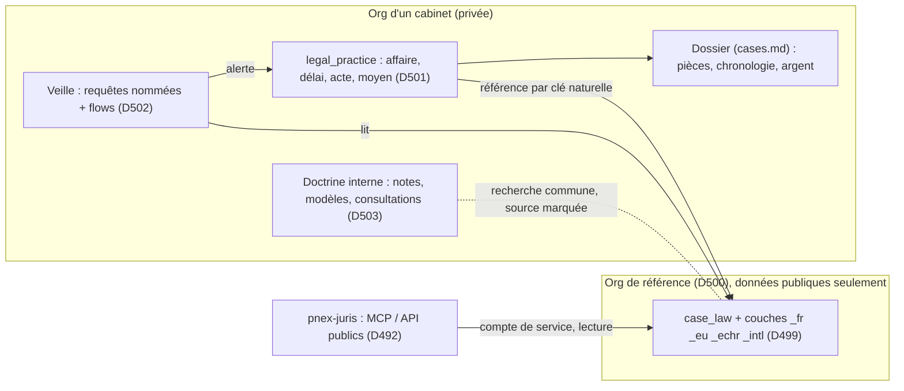

# Recherche juridique composable (D485–D496, D498–D505)

> Statut : **proposé** (2026-10-28, élargi le 2026-10-29), rien
> d'implémenté · Décisions **D485–D496** (vérification de citations) et
> **D498–D505** (famille de packs, §7) · Lots **LR0–LR11** · Périmètre
> V1 : **droit français**, puis UE, CEDH, international (D499).
>
> Le 2026-10-29, la cible s'élargit : la vérification de citations
> (§1–§6) n'est plus le produit mais la **première brique** d'une famille
> de packs composables : corpus public de référence, pratique d'un
> cabinet (affaires, délais, moyens reliés aux faits et aux sources),
> veille par flows, doctrine interne. Chaque étage s'installe seul ;
> l'utilisateur assemble son outil (§7).
>
> Le besoin : des avocats emploient des assistants conversationnels
> généralistes, qui citent parfois des décisions inexistantes, ou des
> décisions réelles avec un numéro, une date ou un passage faux. On ne
> fournit pas d'assistant : on fournit une **source vérifiable** que
> chacun branche sur le sien (MCP ou API), et un **vérificateur de
> citations**. PneX est le moteur (collecte, ontologie, pipeline,
> synthèse) ; une application séparée, `pnex-juris`, est la seule
> surface publique.
>
> Liens : `external-apps.md` (D432–D441, SDK d'applications, garde de
> généricité), `ingestion.md` (D317–D322), `partner-watch.md` (D303
> synchronisations), `ontology.md` (D176–D191, D184 provenance, D185
> requêtes, D190 packs), `doc-search.md` (index plein texte et
> vectoriel), `iam.md` (comptes de service), `mcp.md`, `api-contract.md`,
> `ai-assistant.md` (D119 : LLM de l'org seulement), `security.md`.

## 1. Le besoin en une phrase

Rassembler les décisions de justice et les textes publiés en open data,
les relier entre eux, et répondre à un assistant tiers par le texte
officiel, son lien et un verdict sur la citation qu'il s'apprête à faire.

## 2. Ce qui existe et ce qui manque

| Besoin | Existant | Manque |
|---|---|---|
| Collecte planifiée de gros fichiers publics | nœud `ingest`, zone de transit, `ontology_import` (D317–D322), synchronisations (D303) | connecteurs des sources juridiques (§4) |
| Objets typés et liens datés | ontologie, packs, liens à intervalle de validité | pack `case_law` + couche `case_law_fr` |
| Texte intégral cherchable | doc-search (chunks, plein texte, vecteurs), versions de médias | découpage par section d'une décision |
| Retrouver un passage cité | — | **localisation d'un passage** dans un document, exacte ou approchée (D490) |
| Références dans un texte → liens | — | **motifs de références déclarés par un pack** (D489) |
| Synthèse par IA | assistant, LLM de l'org (D119), provenance (D184) | **champ dérivé par IA, à la demande, mis en cache** (D491) |
| Application externe | SDK d'applications, comptes de service (D433) | la façade publique (`pnex-juris`, hors dépôt) |

## 3. Décisions

### D485 — PneX moteur, `pnex-juris` seule surface publique

- `pnex-juris` est une **application** au sens de D432 : un dépôt à part,
  sa propre interface, qui lit PneX par le SDK avec un **compte de
  service en lecture seule** (D433) sur l'org qui porte le corpus.
- PneX n'est **pas joignable depuis Internet** pour ce service : la
  façade l'appelle sur un réseau privé. Aucun utilisateur de la façade
  n'a de compte PneX.
- Rien d'avocat ni de jurisprudence n'entre au moteur (garde D441) : le
  métier vit dans les packs (D486) et dans la façade (D492–D494).

### D486 — Pack `case_law`, couche pays `case_law_fr`

- `case_law` (générique) : types `court`, `decision`, `legal_text`,
  `article` (une version d'article = un objet, intervalle de vigueur) ;
  liens `cites`, `applies` (décision → article), `overturns`
  (cassation, annulation), `follows` (renvoi, suite de la procédure),
  `version_of`, `issued_by`.
- `case_law_fr` : ce qui est propre à la France seulement (formations
  de la Cour de cassation, numéro de pourvoi, numéro de requête,
  publication au Bulletin, codes, NOR, ELI), clé naturelle = ECLI quand
  la source le fournit, identifiant de la source sinon.
- Le texte intégral d'une décision est un **document** (média) rattaché
  à l'objet `decision` (lien `evidence`, D437), indexé par doc-search.
  L'objet porte les métadonnées, jamais le texte.

### D487 — Sources V1 : open data officiel seulement

Par ordre de lot :

1. **Cour de cassation** : décisions (Judilibre, API PISTE ; base CASS
   / INCA de la DILA en fichiers).
2. **Textes consolidés** : codes et lois (base LEGI de la DILA ; API
   Légifrance sur PISTE pour le différentiel).
3. **Juridictions administratives** : Conseil d'État, cours
   administratives d'appel (base JADE ; open data de la justice
   administrative).
4. **Conseil constitutionnel** (base CONSTIT).
5. **Cours d'appel et tribunaux judiciaires**, au rythme du calendrier
   de l'open data des décisions judiciaires.

- Les fichiers en masse (stock) passent avant les API (différentiel
  quotidien) : moins de quotas, reprise simple.
- Chaque objet garde sa source, sa date de collecte et le **lien
  officiel** (D437) ; une décision sans lien officiel n'est pas servie.
- Licence et conditions de réutilisation de chaque source vérifiées et
  consignées au lot LR0 avant toute collecte.
- Pas de collecte de sites éditoriaux ni de bases sous licence : seul
  l'open data public entre au corpus.

### D488 — Découpage d'une décision

- Un parseur déterministe, déclaré par la couche pays, découpe le texte
  en sections (en-tête, faits et procédure, moyens, motifs, dispositif)
  et en paragraphes numérotés ; doc-search indexe par section.
- Une section non reconnue reste un bloc « texte » : jamais de perte de
  texte, jamais de texte réécrit.

### D489 — Références déclarées par un pack → liens

- Brique générique : un pack déclare des **motifs de référence**
  (expression, type cible, gabarit de clé naturelle). Un nœud de flow
  les applique à un document et propose les liens vers les objets
  trouvés (`cites`, `applies`).
- Référence vers un objet absent : gardée comme référence non résolue,
  résolue au prochain import, jamais d'objet créé « au cas où ».
- Exemple et tests sur une ontologie inventée (`article`, `auteur`), pas
  sur `case_law` (D432).

### D490 — Localisation d'un passage

- Brique générique du moteur : pour un document et un passage, renvoyer
  la ou les positions où le passage figure, avec un **verdict** :
  `exact`, `approximate` (similarité et écarts mot à mot), `absent`.
- Normalisation déclarée (espaces, apostrophes, guillemets, casse,
  ligatures) ; aucune normalisation sémantique : un mot changé reste un
  écart.
- Réutilisable ailleurs (citation d'un document, preuve d'une page
  collectée).

### D491 — Synthèse par IA : à la demande, en cache, marquée

- Une synthèse se calcule au premier appel avec le **LLM de l'org
  opératrice** (D119), puis se stocke comme champ dérivé, avec sa
  provenance (`ai`, modèle, date, version du document source) et les
  passages sur lesquels elle s'appuie.
- Pré-calcul pour les décisions publiées au Bulletin uniquement.
- Une synthèse n'est **jamais une source** : la façade la renvoie
  toujours séparée du texte, avec la mention « synthèse générée », et
  chaque phrase renvoie à un passage du texte.
- Nouvelle version du document source → synthèse invalidée.

### D492 — Façade : outils MCP et API en lecture seule

| Outil | Entrée | Sortie |
|---|---|---|
| `search_decisions` | requête, juridiction, période, article visé | décisions, extraits, lien officiel |
| `get_decision` | identifiant (ECLI, pourvoi, requête) | métadonnées, texte par section, lien officiel, synthèse séparée |
| `verify_citation` | citation libre, passage cité facultatif | décision trouvée ou non, champs divergents (date, juridiction, numéro), verdict sur le passage (D490), candidates les plus proches |
| `get_citing_decisions` | identifiant | suite de la procédure (`overturns`, `follows`), décisions qui la citent |
| `get_article` | référence, date | version en vigueur à la date, lien officiel |

- Chaque réponse porte le lien officiel et la date de dernière
  synchronisation de la source.
- `verify_citation` ne « corrige » rien en silence : il dit ce qui
  diffère et propose des candidates, l'avocat tranche.
- API REST et MCP sont générés du même contrat que la façade publie
  (même discipline que `api-contract.md`).

### D493 — Accès : clé API gratuite, quotas

- Inscription par e-mail, une **clé par utilisateur**, quotas
  journaliers par clé et par outil, tenus par la façade.
- OAuth (connecteurs en un clic des assistants grand public) au lot
  suivant.
- La façade ne journalise ni les questions ni les passages envoyés
  au-delà du comptage des quotas : ils peuvent contenir le secret
  professionnel d'un client.

### D494 — Page de connexion

- Une page statique de la façade : obtenir sa clé, puis la marche à
  suivre pour brancher le serveur MCP ou l'API sur les assistants
  courants, et les limites (couverture des sources, date de
  synchronisation).
- Pas de chat, pas de LLM côté façade.

### D495 — Pas d'analyse des magistrats

- L'article 33 de la loi n° 2019-222 interdit de réutiliser l'identité
  des magistrats et des greffiers pour évaluer, analyser, comparer ou
  prédire leurs pratiques professionnelles.
- Aucun type, propriété, lien, agrégat, filtre ni outil par magistrat
  ou greffier, dans le pack comme dans la façade. Les textes restent tels
  que publiés ; la recherche ne propose aucun critère de personne.
- Garde : test du pack (aucune clé de ce domaine) et test de la façade
  (aucun paramètre de ce domaine).

### D496 — Données des parties

- Les sources publient des décisions pseudonymisées : on ne les
  ré-identifie jamais, on ne rattache aucune partie à un objet
  `person`, on ne les croise avec aucun autre pack.
- Une demande d'occultation reçue de la source (décision retirée ou
  modifiée) est appliquée au prochain différentiel : la version
  précédente sort de l'index et de la façade.

## 4. Lots

| Lot | Contenu | Tests |
|---|---|---|
| **LR0** | Conditions de réutilisation et volumes de chaque source (D487), consignés ici | — |
| **LR1** | Pack `case_law` + `case_law_fr` (D486, D495), import du stock Cour de cassation, texte en document | import idempotent ; clé naturelle ; garde D495 |
| **LR2** | Découpage (D488), index doc-search par section | sections d'un jeu de décisions réelles ; aucune perte de texte |
| **LR3** | Motifs de référence (D489), textes consolidés LEGI, `applies` / `cites` | ontologie inventée ; références non résolues puis résolues |
| **LR4** | Localisation d'un passage (D490) | exact, approché, absent ; normalisation |
| **LR5** | `pnex-juris` : outils D492, clés et quotas D493, page D494 | compte de service en lecture seule ; quota dépassé → 429 ; aucune journalisation du contenu |
| **LR6** | Synthèse à la demande (D491), JADE, CONSTIT, différentiels quotidiens | invalidation sur nouvelle version ; synthèse séparée du texte |

Premier lot de valeur sans LLM : LR1 → LR5 avec `verify_citation` sur la
Cour de cassation.

## 5. Sécurité (grille `security.md` §6, points saillants)

- R1/R2 : la façade n'a qu'un compte de service en lecture sur une org ;
  aucune écriture, aucune action (D485).
- R8 : collecte par l'egress gardé ; liste blanche des hôtes des sources.
- R4/R16 : la clé de compte de service reste côté serveur de la façade ;
  les clés des utilisateurs sont hachées.
- Entrées de la façade non fiables : longueur bornée des passages et des
  requêtes, quotas, aucun texte utilisateur renvoyé en HTML.
- D493 (pas de journalisation du contenu) et D495–D496 sont opposables.

## 6. Questions ouvertes

- **Q-LR1 — Volumes** : stock judiciaire et administratif (nombre de
  décisions, taille du texte, coût de l'index) ; à chiffrer au LR0 avant
  de choisir l'org et le stockage.
- **Q-LR2 — Recherche sémantique** : V1 = plein texte + références
  exactes ; vecteurs (doc-search) sur tout le corpus ou seulement les
  motifs, au lot suivant ?
- **Q-LR3 — Copie locale** : la façade appelle PneX sur réseau privé ;
  servir depuis `pnex-mirror` (D439) isolerait davantage, mais demande
  la recherche plein texte côté miroir.
- ~~**Q-LR4 — Droit de l'UE**~~ : tranché par D499 (couches `case_law_eu`,
  `case_law_echr`, après la France).
- **Q-LR5 — Corpus partagé ou copié** : D500 propose une org de
  référence lue par toutes les orgs d'une instance ; une instance
  auto-hébergée la remplit par synchronisation (D505). Reste à chiffrer
  la copie complète contre une copie filtrée (juridictions, période).
- **Q-LR6 — Calcul des délais** : règles déclarées par la couche pays
  (D501) ; quelle couverture minimale (délais d'appel, de pourvoi,
  d'opposition) avant de proposer le type `deadline` ?
- **Q-LR7 — Sentences arbitrales** : peu sont publiées ; quelles
  institutions publient sous une licence réutilisable (LR0 étendu) ?
- **Q-LR8 — Exception à la frontière d'org** : D500 introduit une lecture
  d'une org de plateforme par les autres ; à inscrire au registre
  `security.md` §7 et à valider en revue avant LR7.

## 7. Élargissement : la famille de packs juridiques (D498–D505)

### D498 — Le juridique est une famille de packs, pas un produit

- Trois étages indépendants : **corpus** (sources publiques, §3, D499,
  D500), **pratique** (le travail d'un cabinet, D501, D503), **veille**
  (D502). Chacun s'installe seul ; aucun ne suppose les autres.
- `pnex-juris` (D485) n'est qu'un consommateur du corpus parmi d'autres ;
  l'interface du cabinet est l'UI de PneX elle-même.
- Garde D441 inchangée : le moteur ne gagne que des briques génériques
  (références externes D500, règles de calcul de dates D501, recherche
  multi-sources D503). Tout le vocabulaire juridique vit dans les packs.

### D499 — Ordres juridiques en couches

- Le pack générique `case_law` reste sans juridiction ; il gagne `treaty`
  (traité, convention) et `award` (sentence) aux côtés de `decision`.
- Couches, une par ordre juridique, chacune ne contenant que ce qui lui
  est propre : `case_law_fr` (§3), `case_law_eu` (EUR-Lex, CJUE et
  Tribunal ; clé CELEX ou ECLI), `case_law_echr` (arrêts et décisions de
  la CEDH ; numéro de requête, ECLI), `case_law_intl` (traités publiés,
  décisions d'organes internationaux, sentences arbitrales **publiées par
  leur institution**).
- Le suffixe d'une couche désigne un ordre juridique et pas toujours un
  pays (`_eu`, `_echr`, `_intl`) ; la règle « la couche ne contient que
  ce qui lui est propre » s'applique à l'identique.
- D487 (open data officiel, lien officiel obligatoire, licence vérifiée
  avant collecte), D495 et D496 s'appliquent à chaque couche.

### D500 — Corpus de référence : une org de plateforme lue par toutes

- Le corpus vit dans une **org de référence** désignée par l'admin
  plateforme (D72). Elle ne contient que des données publiques et n'est
  écrite que par ses flows d'import.
- Les autres orgs ne la voient pas comme une org : leurs objets la
  **référencent par clé naturelle** (ECLI, CELEX, ELI, numéro de
  requête), avec une propriété de type `external_ref` (brique
  générique : type cible, clé, libellé figé à la création). Aucun lien
  ne traverse la frontière d'org ; une référence non résolue reste
  affichée comme telle.
- La résolution passe par une route de lecture de plateforme : entrée =
  clé ou requête, sortie = l'objet du corpus et son lien officiel. Elle
  ne reçoit rien d'autre de l'org appelante et ne journalise ni la clé
  ni la requête au-delà du comptage (comme D493).
- Exception explicite à la frontière d'org (Q-LR8) : lecture seule, une
  seule org désignée, aucune donnée d'org à l'intérieur.

### D501 — Pack `legal_practice` : affaires, délais, actes, moyens

- Types : `matter` (affaire), `party_role` (rôle d'un objet de l'org
  dans l'affaire), `deadline` (délai), `filing` (acte, conclusions,
  mémoire), `argument` (moyen).
- Le pack ne réinvente pas le dossier : une `matter` ouvre un dossier
  `cases.md` (pièces, chronologie, argent, preuves D437) et s'y rattache.
- **Le droit et les faits au même endroit** : un `argument` relie des
  faits du dossier (événements, pièces, passages localisés D490) à des
  sources (`external_ref` vers une décision, un article à la date des
  faits). Une source modifiée (nouvelle version d'article, décision
  cassée via `overturns`) signale chaque moyen qui s'y appuie.
- `deadline` : date de départ, durée, règle de calcul **déclarée par la
  couche pays** (jours francs, jours fériés, prorogation). Brique
  générique : règles de calcul de dates déclarées par un pack. La date
  calculée affiche sa règle et reste **à confirmer par l'avocat** ;
  jamais présentée comme certaine.

### D502 — Veille composable

- Un abonnement est une **requête D185 nommée** (D434) sur le corpus :
  juridiction, article visé, motif de référence, texte, formation.
- Un flow la lit au rythme des synchronisations et produit une
  notification ou un digest (`notifications.md`). Le pack fournit des
  flows d'exemple ; le cabinet les modifie ou en compose d'autres.
- Veille liée à une affaire : une décision nouvelle qui vise un article
  cité par un `argument` ouvert alerte l'affaire.

### D503 — Doctrine interne et recherche multi-sources

- Notes, consultations, modèles d'actes du cabinet sont des documents de
  son org, indexés par doc-search.
- Une recherche couvre l'org et le corpus de référence ; chaque résultat
  porte sa source : **officiel** (corpus, lien officiel), **interne**
  (org), **synthèse générée** (D491). Les trois ne se mélangent jamais
  dans un même extrait.
- Un modèle d'acte peut citer des sources par `external_ref` : la veille
  (D502) signale le modèle quand une source change.

### D504 — Composer sans développer

- Un cabinet ajoute ses propres types, propriétés, liens, vues et flows
  depuis l'UI (ontologie D176, packs D190), au-dessus des packs
  juridiques, sans toucher au moteur.
- Un pack d'un cabinet (spécialité, procédure propre) s'exporte et se
  partage comme tout pack ; le partage public suit le hub quand il
  sortira du gel.

### D505 — Secret professionnel et auto-hébergement

- Aucune donnée de cabinet n'entre dans l'org de référence ; aucune
  requête d'un cabinet n'y laisse de trace de contenu (D500).
- Une instance auto-hébergée remplit sa propre org de référence par
  synchronisation (`pnex-mirror`, D439, ou mêmes flows d'import) et
  fonctionne sans appel sortant pour la recherche.
- LLM : celui de l'org seulement (D119) ; conversations de l'assistant
  privées utilisateur × org (D145).

### Lots de l'élargissement

| Lot | Contenu | Tests |
|---|---|---|
| **LR7** | Org de référence + `external_ref` + route de résolution (D500), revue de sécurité (Q-LR8) | lecture seule ; aucune écriture depuis une autre org ; aucune journalisation du contenu ; référence non résolue |
| **LR8** | `legal_practice` (D501) : affaire ↔ dossier, moyens reliés aux faits et aux sources, signal de source modifiée | ontologie inventée pour la brique ; moyen signalé sur `overturns` |
| **LR9** | Veille (D502) + recherche multi-sources marquée (D503) | requête nommée → notification ; source de chaque extrait |
| **LR10** | Couches `case_law_eu` et `case_law_echr` (D499) | import idempotent ; clés CELEX, ECLI, numéro de requête |
| **LR11** | `deadline` et règles de calcul de dates (D501, Q-LR6), `case_law_intl` (Q-LR7) | jours francs, fériés, prorogation ; règle affichée |

## 8. Récapitulatif des décisions

| Décision | Résumé |
|---|---|
| D485 | `pnex-juris` application séparée, compte de service en lecture seule ; PneX jamais exposé |
| D486 | Pack `case_law` + `case_law_fr` ; texte intégral = document lié à l'objet |
| D487 | Sources V1 : open data officiel français, stock en fichiers puis API ; lien officiel obligatoire |
| D488 | Découpage déterministe par section, sans perte ni réécriture |
| D489 | Motifs de référence déclarés par un pack → liens proposés (brique générique) |
| D490 | Localisation d'un passage : `exact` / `approximate` / `absent` (brique générique) |
| D491 | Synthèse IA à la demande, en cache, marquée, jamais présentée comme source |
| D492 | Cinq outils MCP/API en lecture seule, dont `verify_citation` |
| D493 | Clé API gratuite + quotas ; OAuth ensuite ; pas de journalisation du contenu |
| D494 | Page de connexion statique, pas de chat |
| D495 | Aucune analyse des magistrats (loi 2019-222, art. 33), gardée par test |
| D496 | Pas de ré-identification des parties ; occultations appliquées |
| D498 | Famille de packs : corpus, pratique, veille, installables séparément ; `pnex-juris` = un consommateur |
| D499 | Couches par ordre juridique : `_fr`, `_eu`, `_echr`, `_intl` ; `treaty`, `award` au générique |
| D500 | Org de référence lue par toutes ; objets d'org → corpus par `external_ref` (clé naturelle) |
| D501 | Pack `legal_practice` : affaire ↔ dossier, moyens reliés aux faits et aux sources, délais à confirmer |
| D502 | Veille = requête nommée + flow → notification ; alerte d'affaire |
| D503 | Doctrine interne + corpus dans une recherche, source de chaque extrait marquée |
| D504 | Le cabinet compose ses types, vues et flows depuis l'UI ; packs partageables |
| D505 | Secret professionnel : rien du cabinet dans le corpus ; instance autonome par synchronisation |
