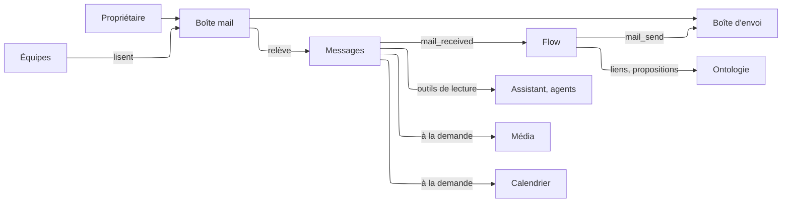
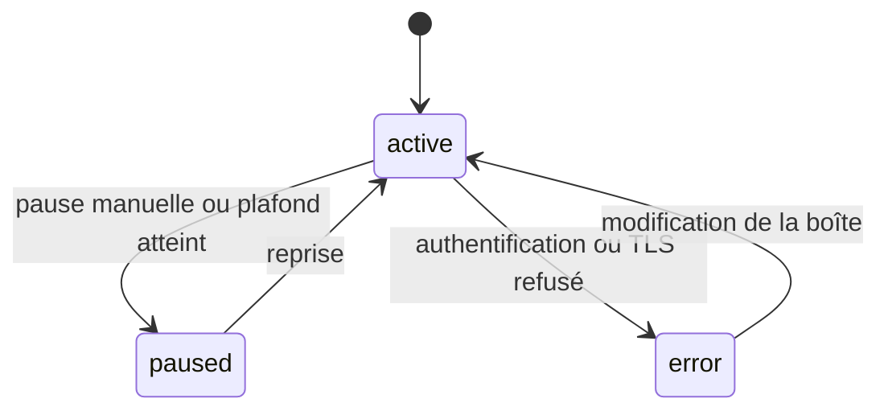
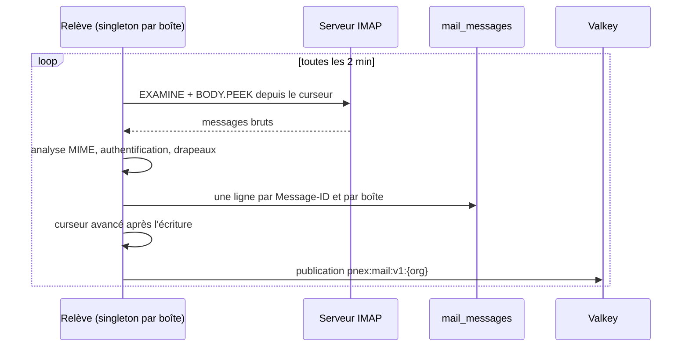
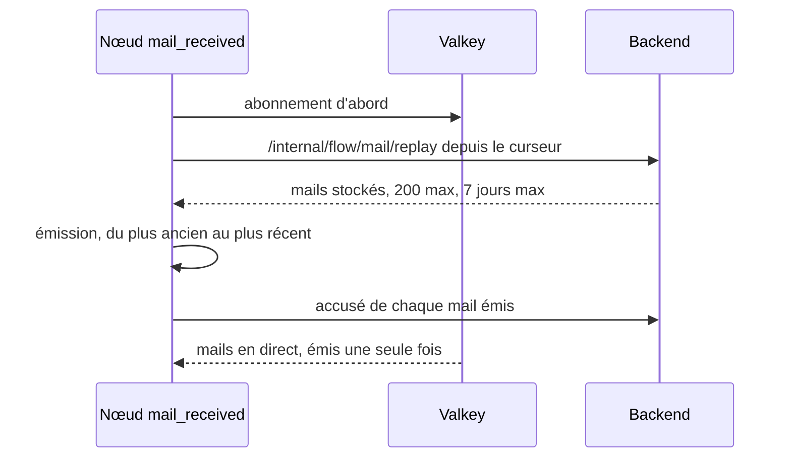
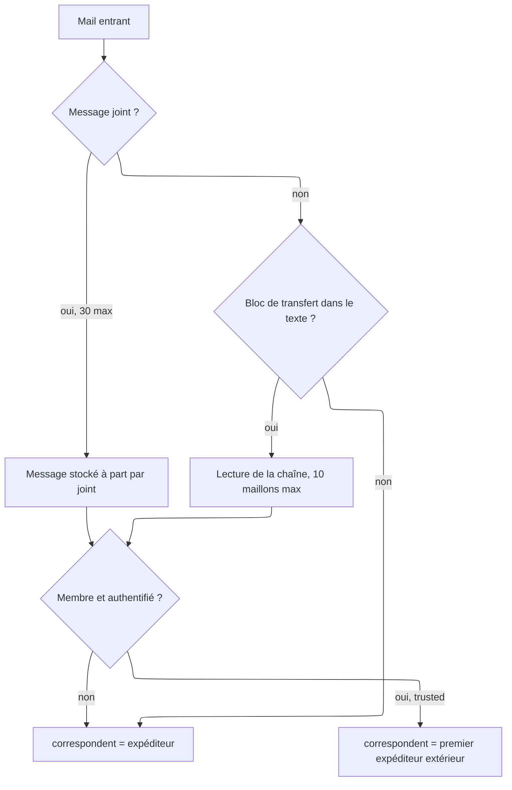
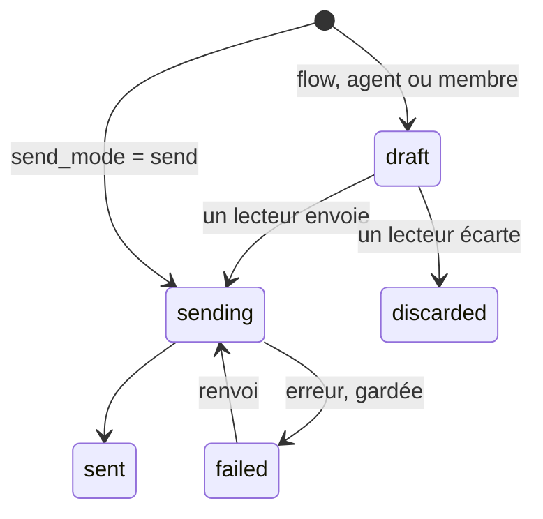
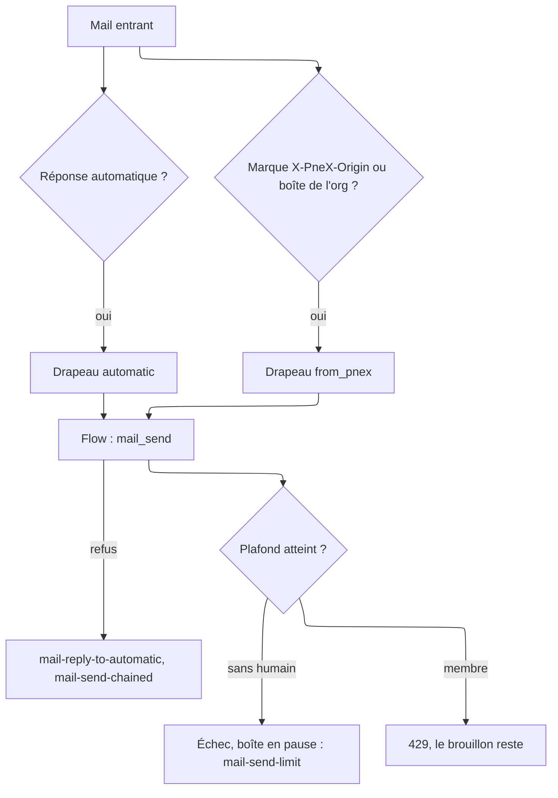
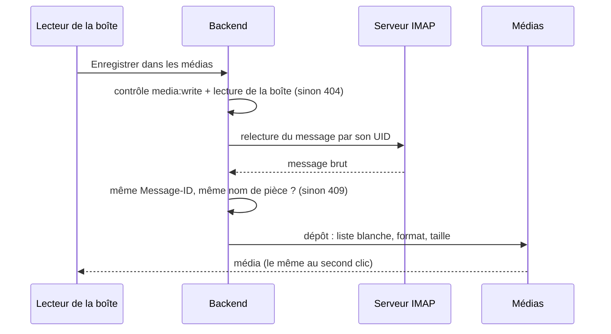
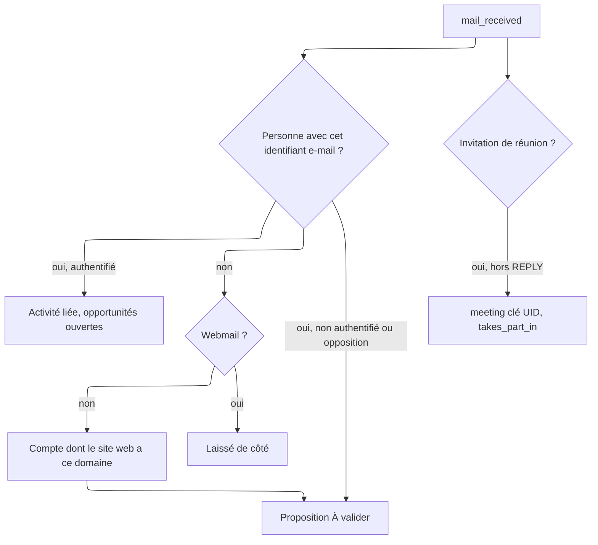

# Boîtes mail : une source générique (D453–D467, D484, D518–D521, D994)

| | |
|---|---|
| **Statut** | Codé : boîtes (M1), relève IMAP (M2), envoi SMTP (M3), pièces jointes et outils de lecture de l'assistant (M5, en partie), flows du pack `crm` (M6), rejeu, invitations de réunion, messages joints. Proposé : OAuth2 (M4), type système `mail_message` dans l'ontologie, outil `mail_reply`, flows des packs de veille et de SAV. |
| **Repose sur** | `iam.md` (principaux, comptes de service, équipes), `agents.md` (D379, D380, D381), `security.md` (coffre D110–D118, R4, R8, R9, R11–R13, R16), `ontology.md` (D176, D177, D185), `crm.md` (D442–D447, D522), `proposals.md` (D367, D371) |
| **Lots** | M1–M6 |

## 1. Résumé

PneX relève des boîtes mail comme il relève des flux et des sites web. Chaque boîte mail est une source de l'org. Ses nouveaux messages entrent dans PneX. Les flows et les agents les lisent, y répondent sous contrôle et les relient aux objets de l'ontologie. Aucun usage n'a de code propre : commercial, boîte d'équipe, SAV, veille, agent IA, factures et alertes de machines emploient la même mécanique. Seuls changent le propriétaire de la boîte et les lecteurs de son contenu.

PneX n'est pas un client mail. Il ne gère ni dossiers, ni règles, ni signatures. Il n'envoie ni masse ni campagne. Il ne rend aucun HTML et n'ouvre aucune pièce jointe.

## 2. Concepts

| Terme | Définition |
|---|---|
| **Boîte mail** | Ressource `mailbox` de l'org, rangée dans le groupe de menu Sources : serveur IMAP, serveur SMTP (option), propriétaire, équipes, état. |
| **Propriétaire** | Un membre, un compte de service, ou aucun (boîte partagée, lue par ses équipes). |
| **Lecteur** | Principal qui lit le contenu d'une boîte : propriétaire ou membre d'une équipe de la boîte, avec `mail.content:read`. |
| **Message** | Ligne de `mail_messages` : un mail relevé ou envoyé, en texte seul. |
| **Boîte d'envoi** | Table `mail_outbox` d'une boîte : brouillons, envois, échecs, mails écartés (D519). |
| **Relève** | Lecture périodique des nouveaux messages d'une boîte. |
| **Transfert** | Mail d'un membre qui fait suivre un mail reçu. PneX retrouve l'expéditeur d'origine (D463). |
| **Correspondant** | `correspondent` : l'expéditeur d'origine d'un transfert cru, sinon l'expéditeur. |
| **Invitation de réunion** | Partie `text/calendar` d'un mail (D466). À ne pas confondre avec l'invitation à entrer dans une org. |

## 3. Fonctionnement

### 3.1 Cycle de vie d'une boîte

Une erreur d'authentification ou de TLS suspend la relève jusqu'à une modification de la boîte. PneX ne martèle pas un serveur qui refuse. Une erreur réseau relance la relève avec un délai croissant. `last_error` porte un code machine et ses `args`.

### 3.2 Relève

Le curseur vaut `(UIDVALIDITY, dernier UID)` par dossier. Le premier passage lit les 7 derniers jours. Un changement d'`UIDVALIDITY` relit 7 jours, et `Message-ID` évite les doublons. La relève ne marque aucun message comme lu. Au-delà de 500 messages par heure, la boîte passe en pause (`mail-rate-exceeded`).

### 3.3 Rejeu des mails manqués (D464)

Une publication Valkey n'atteint pas un nœud arrêté ou coupé du bus. Chaque nœud garde donc un curseur dans `mail_flow_cursors`, par flow et par nœud. Le rejeu a lieu à chaque session : démarrage, redéploiement, reconnexion. Il filtre selon la configuration déployée. Le curseur avance seulement vers l'avant. Le premier déploiement pose le curseur à « maintenant » : un flow neuf ne reçoit pas l'historique.

### 3.4 Transfert et message joint (D463, D994)

Un message joint (`message/rfc822`) devient un message stocké à part, d'identifiant `<Message-ID du porteur>#<n>`. Il prend l'expéditeur, la date et l'authentification du porteur, mais le sujet et le texte du joint. Le porteur reste stocké, sans `forwarded`. Un joint dans un joint n'est pas déplié.

Sans joint, la relève lit le bloc de transfert du texte : lignes « From / De », « Date / Envoyé », « Subject / Objet », après un marqueur connu, en français et en anglais. Dans une chaîne, la relève saute les maillons écrits par des membres. Si tous les maillons sont des membres, elle garde le plus récent.

`forwarded.member` dit qu'un membre a fait le transfert, signé ou non. Seul `trusted` (membre et authentifié) range le mail sous l'expéditeur d'origine. Un flow peut accepter un transfert `member` non signé. Il doit alors inscrire dans l'ontologie que l'expéditeur n'est pas vérifié, et seulement proposer.

**Danger :** ne rangez jamais un transfert non `trusted` sous l'expéditeur d'origine. N'importe qui peut écrire un faux bloc de transfert et ranger un mail chez un client.

Une redirection côté messagerie garde l'expéditeur d'origine. Elle n'a pas besoin de cette extraction.

### 3.5 Envoi (D518–D521)

Un envoi réclame d'abord la ligne (`sending`). Deux clics, ou un clic et un flow, n'envoient donc jamais deux fois. La clé `key` de l'appelant rend l'écriture idempotente. Un lecteur peut corriger le sujet ou le texte d'un brouillon avant l'envoi.

La connexion SMTP emploie les identifiants de la relève. Elle exige TLS implicite sur le port 465, STARTTLS sur tout autre port, et jamais de clair. Le serveur et chaque adresse résolue passent la garde de sortie (R8). Changer de serveur SMTP exige de retaper le mot de passe (R9). Le mail envoyé n'est pas copié dans le dossier « Envoyés » du serveur.

### 3.6 Garde-fous contre les boucles (D457, D520)

Un membre peut répondre à n'importe quel mail. Les refus visent les flows et les agents. Le texte de D457 donne la liste des en-têtes reconnus.

### 3.7 Pièce jointe et invitation à la demande (D465, D466)

Un média et le calendrier sont vus de toute l'org. Un mail est vu de ses seuls lecteurs. Copier d'office ferait fuir le contenu d'une boîte personnelle. Un lecteur partage donc une pièce jointe ou une invitation de réunion par un geste délibéré. PneX ne garde aucun octet de pièce jointe avant ce geste.

L'invitation de réunion suit le même geste, avec `time-ranges:write`. Elle devient une plage de l'org, catégorie `meeting`, de clé `UID`. Une mise à jour déplace la plage. Une annulation (`METHOD:CANCEL` ou `STATUS:CANCELLED`) la marque annulée. Les personnes de l'org qui emploient l'adresse d'un participant comme identifiant e-mail sont gardées dans `attrs.people`. PneX ne crée aucune personne et n'envoie aucune réponse à l'organisateur.

### 3.8 Rangement par le pack `crm` (D462, D467, D484)

Le moteur connaît seulement la boîte et le message. Le pack `crm` livre les flows « CRM · mails reçus » et « CRM · réunions reçues ». Un rattachement par domaine reste toujours une proposition (confiance 50), même si l'expéditeur est authentifié. Un participant de réunion est lié si l'expéditeur est authentifié, sinon proposé (confiance 40).

Limites des réunions : une annulation envoyée à un seul participant retiré annule aussi le rendez-vous. Une invitation renvoyée après la réunion la remet `planned`. Un transfert d'invitation porte un autre `UID` et crée un second rendez-vous.

## 4. Exigences

1. Le mot de passe d'une boîte doit rester au coffre. Aucun DTO, sortie MCP ou journal ne doit le porter (R4, R16).
2. Un membre doit taper le mot de passe de sa boîte. Il ne doit jamais choisir un secret existant.
3. Un admin ne doit pas lire le contenu de la boîte personnelle d'un membre. Il voit l'existence et l'état de la boîte, et peut la mettre en pause ou la supprimer.
4. Une ligne `mail_messages` doit être visible seulement de ses lecteurs (D454).
5. Un flow doit écouter seulement les boîtes que son déployeur lit. Le contrôle doit avoir lieu au déploiement.
6. PneX ne doit rendre aucun HTML de mail. Il ne doit charger aucune image distante ni suivre aucun lien.
7. PneX doit vérifier lui-même l'expéditeur. Il ne doit jamais croire l'en-tête `Authentication-Results` du message.
8. Un message dont l'authentification échoue ne doit jamais être rattaché automatiquement à une personne ou un compte.
9. Le texte d'un mail doit passer aux modèles comme donnée, entre balises `<data>`. Aucun outil, aucune écriture ni aucun envoi ne doit dépendre du contenu.
10. La connexion IMAP et SMTP doit exiger TLS et un certificat vérifié par les CA du système.
11. Un dossier IMAP ne doit jamais entrer tel quel dans une commande.
12. `send_mode = send` doit être refusé sur la boîte personnelle d'un membre.
13. Une pièce jointe ne doit jamais être ouverte ni exécutée.

## 5. Décisions

### D453 — Une boîte mail est une source, gérée par un CRUD classique

Liste harmonisée dans le groupe de menu Sources (écran `/mailboxes`). Le bouton Tester se connecte à IMAP et à SMTP, sans envoyer de mail. Il est exclu du MCP (sortant).

### D454 — Le propriétaire est un principal ; le partage passe par les équipes

Pas de nouveau type de principal. Permissions : `mail:read`, `mail:write`, `mail:delete`, `mail.content:read`, `mail.shared:write` (Admin), `mail:send`.

### D455 — Les messages sont stockés, exposés comme type système `mail_message`

Stockage et déclencheur, pas déclencheur seul. La table `mail_messages` existe. Le type système `mail_message` de l'ontologie n'est pas codé.

### D456 — Lire, répondre, envoyer : un déclencheur, un nœud, une porte

Déclencheur `mail_received` (boîtes, dossier, expéditeur, sujet). Nœud `mail_send`. D519 remplace le brouillon en proposition. Le MCP expose la lecture, pas l'envoi.

### D457 — Pas de boucle

Garde-fous du moteur, cités par leur numéro dans le code :

1. Réponses automatiques reconnues : `Auto-Submitted` ≠ `no`, `Precedence: bulk | auto_reply | list | junk`, `X-Autoreply`, `X-Autorespond`, `List-Id`, `List-Unsubscribe`, rapports de non-remise. Le message est stocké avec le drapeau `automatic`.
2. Envois marqués : `X-PneX-Origin` toujours, `Auto-Submitted: auto-generated` seulement sans humain. Un mail entrant qui porte la marque, ou qui vient d'une boîte de l'org, porte le drapeau `from_pnex`.
3. Une seule ligne par `Message-ID` et par boîte.
4. Plafonds : 500 messages relevés par boîte et par heure, 30 envois par boîte et par heure, 3 envois sans humain par correspondant et par jour, 100 brouillons de flows par boîte et par heure. Au-delà, la boîte passe en pause, jamais une tempête silencieuse.
5. Pas d'envoi en chaîne : `in_reply_to` doit nommer un mail stocké de la boîte, et un flow ne répond pas à un mail `from_pnex` (D520).

### D458 — Le contenu d'un mail est une donnée non fiable

Texte seul : partie `text/plain`, sinon HTML converti côté serveur. Bornes : message brut de 10 Mo (au-delà, en-têtes seuls), texte de 100 000 caractères, 100 destinataires. Expéditeur vérifié par une signature DKIM alignée sur le `From:` (crate `mail-auth`). SPF reste « none ». Un message tronqué reste non vérifié.

### D459 — Connecteurs : IMAP/SMTP d'abord, OAuth ensuite

IMAP et SMTP avec mot de passe d'application sont codés. OAuth2 (XOAUTH2) sur les mêmes protocoles est proposé (M4). Une API propriétaire vient seulement si XOAUTH2 ne suffit pas.

### D460 — Relève

Toutes les 2 min, singleton par boîte, curseur par dossier (§3.2). IMAP IDLE pourra s'ajouter derrière la même interface.

### D461 — Conservation et données personnelles

`retention_days` par boîte : 90 par défaut, de 7 à 3650. Ce qu'un flow a tiré d'un message reste après sa suppression. Expéditeur, destinataires, sujet et texte sont `personal` (D442). Effacer une personne (D446) efface ses messages. Les messages d'une personne en opposition (D447) entrent, mais ne sont jamais rattachés automatiquement.

### D462 — Ce que le pack `crm` en fait

Les packs livrent leurs flows. Le moteur ne gagne rien (§3.8).

### D463 — Un mail transféré est rangé sous son expéditeur d'origine

Seulement si `trusted` : expéditeur membre de l'org et authentification qui passe (§3.4).

### D464 — Un nœud qui redémarre rejoue les mails manqués

Curseur par nœud, 200 mails et 7 jours au plus, jamais deux fois (§3.3).

### D465 — Une pièce jointe devient un média à la demande d'un lecteur

Relue sur le serveur, vérifiée, passée par la règle des dépôts (§3.7).

### D466 — Une invitation de réunion va au calendrier à la demande d'un lecteur

Calendrier de l'org, clé `UID`, mise à jour et annulation (§3.7).

### D467 — Un expéditeur inconnu est proposé sous le compte dont le site web a son domaine

Le domaine vient du site web confirmé du compte (pack `web_presence`), jamais d'une saisie. Les webmails sont exclus (§3.8).

### D484 — Une invitation reçue devient un rendez-vous de l'ontologie

Flow « CRM · réunions reçues » : un `meeting` (pack `prospecting_b2b`) de clé `invitation_uid`, statut `planned` ou `cancelled`, participants liés par `takes_part_in` (§3.8).

### D518 — SMTP sur la boîte, mode d'envoi

`smtp_host` (vide = pas d'envoi), `smtp_port` (465 par défaut), `send_mode` : `draft` par défaut, `send` sur boîte partagée ou de service seulement.

### D519 — La boîte d'envoi, pas « À valider »

La page « À valider » est lue par d'autres que les lecteurs de la boîte. Chaque boîte a donc sa boîte d'envoi, lue avec D454.

### D520 — Garde-fous d'envoi au serveur

Le runtime n'est pas cru. Le serveur applique D457.4 et D457.5. Plafond atteint : sans humain, le mail échoue et la boîte passe en pause. Avec un membre, 429.

### D521 — Droits et exposition de l'envoi

`mail:send` (Membre) pour écrire, envoyer et écarter. Le runtime du nœud `mail_send` ne porte ni boîte ni mot de passe. Il appelle `POST /internal/flow/mail/send`, qui relit la configuration déployée.

### D994 — Un message joint est un transfert à part entière ; un membre non signé est lu, marqué non vérifié

`forwarded.member` en plus de `trusted` (§3.4). Risque accepté par Shan : un usurpateur de l'adresse d'un membre fait créer des éléments à valider, jamais rangés ni liés d'office.

## 6. Interfaces

| Route | Effet | Permission | MCP |
|---|---|---|---|
| `GET /mailboxes` | Lister les boîtes | `mail:read` | exposé |
| `POST /mailboxes`, `PUT /mailboxes/{id}` | Créer, modifier | `mail:write` | exclu (secret) |
| `DELETE /mailboxes/{id}` | Supprimer | `mail:delete` | exclu (destructif) |
| `POST /mailboxes/{id}/state` | Pause, reprise | `mail:write` | exposé |
| `POST /mailboxes/{id}/test` | Tester IMAP et SMTP | `mail:write` | exclu (sortant) |
| `GET /mailboxes/{id}/messages` | Lister les messages | `mail.content:read` | exposé |
| `POST /mailboxes/{id}/messages` | Écrire un mail | `mail:send` | exclu (sortant) |
| `GET /mailboxes/{id}/outbox` | Lister la boîte d'envoi | `mail.content:read` | exposé |
| `POST /mailboxes/{id}/outbox/{mail}/send` | Envoyer | `mail:send` | exclu (sortant) |
| `POST /mailboxes/{id}/outbox/{mail}/discard` | Écarter | `mail:send` | exclu (destructif) |
| `POST /mailboxes/{id}/messages/{message}/attachments/{index}/media` | Pièce jointe → média | `media:write` | exposé |
| `POST /mailboxes/{id}/messages/{message}/invitation/calendar` | Invitation → calendrier | `time-ranges:write` | exposé |

Routes internes du runtime : `/internal/flow/mail/replay`, `/internal/flow/mail/send`.

| Brique | Où |
|---|---|
| Règles pures : drapeaux, verdict, HTML → texte, bornes, transferts, plafonds | `crates/pnex-core/src/mail.rs` |
| Service, IMAP, analyse MIME, relève, vérification, envoi, rejeu, pièces jointes, invitations | `crates/pnex-backend/src/services/mail/` |
| Outils de l'assistant et des agents : `list_mailboxes`, `list_mails`, `read_mail` | `crates/pnex-backend/src/services/ai/mail_tools.rs` |
| Nœuds `mail_received`, `mail_send` | `crates/pnex-node-ui-control/src/mail.rs`, `mail_send.rs` |
| Écrans | `crates/pnex-frontend/src/pages/mailboxes.rs`, `mailbox_outbox.rs` |
| Tests | `crates/pnex-backend/tests/mail.rs` |
| Dépendances | `async-imap`, `mail-parser`, `mail-auth`, `lettre` (licences permissives) |

## 7. Reste à faire

- **M4 — OAuth2** : les grandes messageries d'entreprise hébergées refusent le mot de passe en IMAP et SMTP. Pistes à étudier avant tout code propre à un fournisseur :
  1. un serveur MCP tiers existant, appelé comme un outil externe (vérifier maintenance, licence, sécurité des jetons, frontière D381).
  2. le flux « device code » avec XOAUTH2 sur IMAP et SMTP, jeton de rafraîchissement au coffre.
  3. une règle de transfert vers une boîte IMAP ordinaire (vérifier les politiques anti-transfert et la perte des fils).
- **Q-M4** : choix de Shan. M4 passe-t-il avant les autres lots si les premiers clients ont une messagerie d'entreprise hébergée ?
- **Choix par défaut à confirmer** par Shan : messages stockés (Q-M1), boîte personnelle illisible par l'admin (Q-M2), conservation de 90 jours (Q-M5).
- **Type système `mail_message`** (D455) : liens et recherche depuis l'ontologie.
- **Outil `mail_reply`** des agents : attend la politique `approval` (D380).
- **Flows des packs de veille et de SAV** (M6) : seul le pack `crm` livre des flows `mail_received`.
- **Dossier « Envoyés »** : copie par `APPEND` IMAP, si les utilisateurs la demandent.
- **Profil LinkedIn d'un correspondant** : ouvert. Pas de collecte automatique sur LinkedIn.
- **Calendrier par personne** : D466 emploie le calendrier de l'org, faute de calendrier par personne.
- **`mail-auth` 0.15** : demande `mail-parser` 1.0, une réécriture du parseur. Lot à part.
