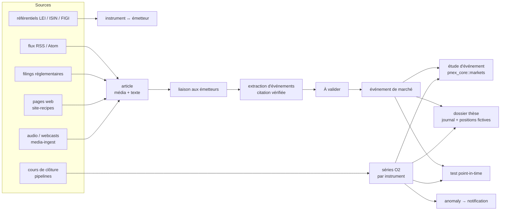

# Recherche et décision d'investissement — PRD (D523–D536)

| | |
|---|---|
| Statut | **Proposé le 2026-10-31, rien d'implémenté** |
| Numérotation | **D523…D536**, lots **MK0…MK6** |
| Repose sur | ontologie (D176–D191, séries D185, provenance D184), `companies` / `companies_fr` (D304–D306), pipelines (`data-pipelines.md` D344–D358), règles de sites (`site-recipes.md` D323–D328), ingestion média (`media-ingest.md` D159–D175), dossiers (`cases.md`), moteur financier (`due-diligence.md` D478), propositions (`proposals.md` D371–D377), nœuds `anomaly` / `forecast`, notifications (D49–D68), assistant (`ai-assistant.md` §9) |
| Sécurité | `security.md` §6 avant chaque lot ; sources sortantes via `pnex_core::egress` (R8), clés d'API au coffre (D113) |

> Avertissement produit à afficher sur chaque écran du domaine : les indicateurs, événements et tests sont des aides à l'analyse, pas un conseil en investissement ni une recommandation.

## 1. Le besoin

Outiller la démarche d'une équipe d'analyse sectorielle :

1. **Couvrir** une liste de sociétés (30 à 300) et leurs instruments cotés.
2. **Voir passer** tout ce qui les concerne : articles, communiqués, publications réglementaires, appels de résultats, données macro.
3. **Transformer** ce flux en **événements datés et sourcés** (résultats, révision de prévisions, opération sur capital, changement de dirigeant, litige, notation).
4. **Mesurer** la réaction du cours autour de chaque événement.
5. **Écrire une thèse** avant de décider (catalyseurs datés, critères d'invalidation, taille), tenir un **journal**, faire la **revue** après coup.
6. **Tester** une règle (« après une révision à la hausse, sur-performance à 20 jours ? ») sur des données **telles qu'elles étaient connues à la date** (point-in-time), sans biais d'anticipation.

Hors du besoin : prix temps réel des actions, exécution d'ordres, messagerie entre acteurs, diffusion de signaux.

## 2. Ce qui existe déjà

| Brique | Où | Rôle ici |
|---|---|---|
| Objets, liens, provenance, historique | ontologie 0.2.0 | émetteurs, instruments, événements ; `ontology_objects_changes` donne l'état à une date |
| Propriétés `series` (D185) + `telemetry/aggregate` | O2 | cours et volumes d'un instrument, lus par objet |
| Sociétés, SIREN, dirigeants, BODACC | packs `companies`, `companies_fr` | l'émetteur **est** l'organisation déjà connue |
| Imports déclaratifs et pipelines | D301, D344–D358 | référentiels (LEI, ISIN), cours de clôture, filings |
| Collecte web gardée | `site-recipes.md`, crawl | pages de communiqués, sites d'information sans flux |
| Audio / vidéo → texte | `media-ingest.md`, ASR | podcasts, webcasts de résultats |
| Recherche documentaire | `doc-search.md` | recherche plein texte des articles collectés |
| Extraction LLM à citation vérifiée | `due-diligence.md` D476 | même règle pour les événements (citation retrouvée ou rejet) |
| File « À valider » | `proposals.md` | les événements extraits sont des propositions |
| Ratios financiers | `pnex_core::finance` (D478) | fondamentaux des émetteurs (lot DD2) |
| Détection d'anomalies, prévision | nœuds `anomaly`, `forecast` | volume ou cours anormal → alerte |
| Dossier, chronologie, preuves | `cases` | support de la thèse |

## 3. Ce qui manque

- un référentiel **instrument / cotation / émetteur** avec identifiants (ISIN, LEI, FIGI, MIC) ;
- l'import des **cours de clôture** avec **opérations sur titres** (divisions, dividendes) ;
- le type **article** relié aux émetteurs, et le type **événement de marché** ;
- un calcul **d'étude d'événement** (rendement anormal) ;
- un dossier **thèse d'investissement** avec journal et positions fictives ;
- une lecture **point-in-time** pour les tests.

## 4. Principe d'architecture

## 5. Décisions

### D523 — Un pack `markets`, l'émetteur reste l'organisation

Pack `markets` (`requires: [companies]`). Types : `instrument` (action, obligation, ETF, indice, crypto-actif, devise ; ISIN, FIGI, devise de cotation), `listing` (instrument × place, MIC, ticker), lien `emet` (`organization` → `instrument`), `index_member` (instrument → indice, avec dates). Pas de type « société cotée » : une organisation devient émettrice par son lien. Couche pays éventuelle `markets_fr` (place Euronext Paris, code AMF) selon la règle des packs.

### D524 — Référentiels par imports, jamais saisis à la main

LEI (GLEIF, données ouvertes) → `organization.lei` ; ISIN ↔ LEI (fichier de correspondance GLEIF) ; FIGI et tickers (OpenFIGI, clé d'API au coffre) ; référentiel d'instruments européen (ESMA FIRDS). Chacun est une import D301 / pipeline D344 avec `skip_if_unchanged`. Rapprochement émetteur ↔ organisation existante par LEI puis SIREN, sinon proposition.

### D525 — Cours de clôture dans O2, bruts + facteurs d'ajustement

Une série par instrument et par champ (`close`, `open`, `high`, `low`, `volume`), labels `object=instrument/<id>`. On stocke le **brut** ; les opérations sur titres sont des objets `corporate_action` (date, type, ratio) et l'ajustement se calcule à la lecture. Raison : un ajustement réécrit dans la série casse le point-in-time. Granularité V1 : quotidienne. Crypto : la même chaîne, granularité minute possible (sources publiques gratuites).

### D526 — Une source = une import ou une règle de site, liste blanche par org

Pas de collecteur dédié : les flux RSS/Atom, filings et API de cours passent par les pipelines ; les pages sans flux par `site-recipes`. Liste des sources par org, chacune avec sa licence notée (champ `license_note`) et son rythme. Egress R8, `robots.txt` respecté, pas de contournement de paywall.

### D527 — L'article est un média, son texte reste privé à l'org

Un article = un `media_asset` texte (titre, source, URL, `published_at`, `fetched_at`, langue) indexé par la recherche documentaire. Jamais exposé par lien public ni par page publiée (`pages.md`, studio S5) : la conservation du texte sert l'analyse interne seulement. Purge par rétention d'org.

### D528 — Liaison article → émetteurs déterministe d'abord

Par ordre : identifiants présents (ISIN, LEI, ticker avec place), nom exact ou alias de l'organisation, puis LLM usage `extraction` sur les cas ambigus → proposition. Un lien porte son mode (`id`, `alias`, `llm`) et son score.

### D529 — L'événement de marché est un objet, toujours sourcé

Type `market_event` : `kind` (enum fermée minuscule : `earnings`, `guidance`, `capital_operation`, `m_and_a`, `management_change`, `rating`, `litigation`, `regulatory`, `macro`, `other`), `direction` (`positive`, `negative`, `neutral`, `unknown`), `event_at`, `published_at`, `known_at`, liens `concerne` → émetteur/instrument, `source` → article. Extraction : schéma JSON du pack (`extractors:`, comme D476), chaque champ porte `quote` retrouvée verbatim dans l'article, sinon rejet. La direction est celle **dite par la source**, pas un score de sentiment opaque.

### D530 — Événements : propositions, acceptation automatique possible par règle

Les événements extraits passent par la file « À valider » (D371). Pour un volume élevé, une règle d'org D377 peut accepter automatiquement une classe (`kind` + source), tracée. Un doublon (même émetteur, même `kind`, même jour, articles différents) fusionne ses sources au lieu de créer un second événement (empreinte D372).

### D531 — Trois horodatages, le test lit `known_at`

`event_at` (quand c'est arrivé), `published_at` (quand la source l'a dit), `known_at` (quand PNEX l'a su : `fetched_at` de l'article ou date d'import). Toute lecture « à la date t » filtre `known_at <= t` pour les objets et `ts <= t` pour les cours bruts. Un événement importé après coup (rattrapage d'historique) garde `known_at` = date d'import et est marqué `backfilled` : il est exclu des tests par défaut, inclus seulement sur choix explicite affiché.

### D532 — Étude d'événement : calcul pur dans `pnex_core::markets`

Fonction pure (cours, indice de référence, date, fenêtres) → rendement, rendement anormal (modèle de marché simple : rendement − β × rendement de l'indice, β estimé sur [−250, −30] jours), cumul sur fenêtres [−1, +1], [0, +5], [0, +20], et volume relatif. Agrégat sur un ensemble d'événements : moyenne, médiane, part positive, intervalle par bootstrap, effectif affiché. Testé sur des séries synthétiques à résultat connu.

### D533 — Le dossier « thèse » étend `case`

Pack `investment_thesis` (`requires: [markets, investigation]`) : `case_kind = investment`, instrument(s), sens (`long`, `short`, `watch`), date d'ouverture, **catalyseurs datés** (objets reliés, échéance), **critères d'invalidation** écrits, horizon, taille prévue. Journal = événements de dossier existants (note, décision, révision). Revue de clôture obligatoire pour fermer le dossier : résultat, ce qui était juste, ce qui ne l'était pas. Le dossier se gèle à chaque décision (snapshot existant) : la thèse d'origine ne se réécrit pas.

### D534 — Positions fictives, aucun lien vers un courtier en V1

`paper_position` (instrument, sens, quantité, prix et date d'entrée, sortie) reliée au dossier ; P&L calculé sur les clôtures. Import CSV d'un relevé de courtier possible plus tard (lecture seule). Jamais d'ordre passé par PNEX : exclu de l'API exposée à l'assistant et au MCP sous le motif `physical`/`outbound`, au même titre que les commandes de devices (D123).

### D535 — Test de règle = requête point-in-time + étude d'événement

Une règle = filtre d'événements (`kind`, `direction`, univers d'instruments, période) + fenêtre. Le moteur rejoue jour par jour avec la lecture D531, applique D532, rend la distribution et la comparaison à un tirage aléatoire de dates sur le même univers. Affichage obligatoire : effectif, période, part d'événements `backfilled`, univers (biais du survivant : un instrument radié reste dans l'univers à ses dates). Pas d'optimisation de paramètres en V1 (sur-ajustement).

### D536 — Assistant : lit, résume, propose ; ne décide pas

Outils de lecture (événements d'un émetteur, étude d'événement, état d'une thèse), synthèse quotidienne privée par notification, propositions d'événements. Jamais d'ordre, jamais de modification d'une thèse gelée, toute affirmation reliée à un article. Réponses marquées « aide à l'analyse ». Fiches `assistant-kb` à chaque lot.

## 6. Sources V1 (conditions d'usage à vérifier source par source)

| Source | Contenu | Accès |
|---|---|---|
| GLEIF | LEI, correspondance ISIN ↔ LEI | ouvert |
| OpenFIGI | FIGI, tickers | clé gratuite |
| ESMA FIRDS | référentiel d'instruments UE | ouvert |
| SEC EDGAR | filings US (8-K, 10-Q, 10-K) | ouvert, `User-Agent` déclaré, quota |
| Publications réglementées UE / FR | communiqués d'émetteurs, déclarations | ouvert |
| Banques centrales, statistiques publiques | taux, inflation, agrégats | ouvert |
| Flux RSS des médias | titre, chapô, lien | selon conditions de chaque éditeur |
| Pages de communiqués des émetteurs | texte des communiqués | `site-recipes` |
| Cours de clôture actions | OHLCV quotidien | **à choisir** : fournisseur branché par une clé au coffre (D113) |
| Places crypto | OHLCV, carnet | API publiques |

## 7. Lots

| Lot | Contenu | Valeur sans LLM |
|---|---|---|
| **MK0** | pack `markets`, imports GLEIF / OpenFIGI / FIRDS, rapprochement émetteurs | oui |
| **MK1** | cours de clôture + `corporate_action`, séries par instrument, fiche instrument (graphique, émetteur) | oui |
| **MK2** | sources d'articles (RSS, filings), type article, liaison D528 déterministe, fil par émetteur | oui |
| **MK3** | extraction d'événements à citation vérifiée, propositions, règle d'acceptation, alertes | non |
| **MK4** | `pnex_core::markets` (étude d'événement), widget sur la fiche émetteur et le dossier | oui |
| **MK5** | dossier thèse, journal, positions fictives, revue de clôture | oui |
| **MK6** | test de règle point-in-time | oui |

Premier ensemble utile : MK0 → MK2 + MK4 (suivre ses valeurs, lire leur fil, voir la réaction aux publications réglementaires), avant toute extraction LLM.

## 8. Hors périmètre V1

Prix temps réel des actions, carnet d'ordres actions, exécution, connexion courtier en écriture, options et dérivés (grecques, surfaces), données alternatives payantes, optimisation de portefeuille, diffusion ou partage de signaux hors de l'org.

## 9. Questions ouvertes

- **Q-MK1** : fournisseur de cours de clôture actions (couverture Europe + US, historique).
- **Q-MK2** : univers de départ (indices, liste personnelle) et profondeur d'historique pour MK6.
- **Q-MK3** : crypto en MK1 ou plus tard ; granularité minute = volume O2 à mesurer.
- **Q-MK4** : appels de résultats : webcasts publics par `media-ingest`, ou seulement les communiqués écrits en V1.
