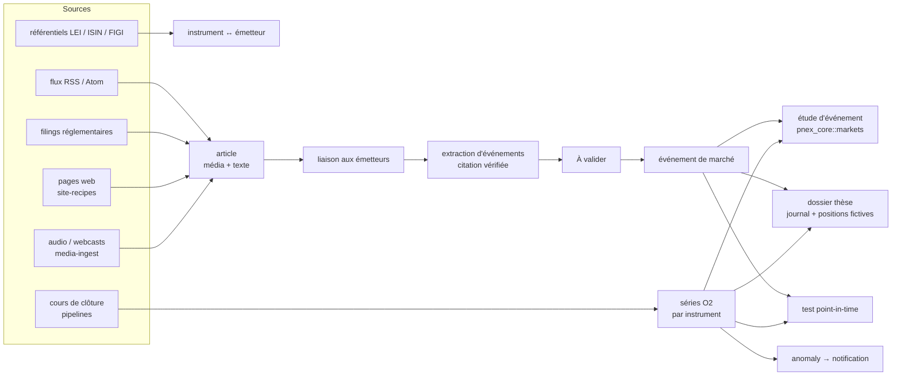

# Recherche et décision d'investissement — PRD (D523–D536)

| | |
|---|---|
| Statut | Proposé le 2026-10-31 ; **codé le 2026-11-02 : MK0 partiel, MK1, MK2 (presse = piste), MK4, MK5, MK6 sur dépôts, D536 outils de lecture**. Reste : §7 bis |
| Numérotation | **D523…D536, D540…D546, D734…D743** (appendice A), **D810…D816** (appendice B), **D807…D809, D820…D824** (appendice C), **D841…D846** (appendice D), **D847…D849** (appendice E), **D880…D889** (appendice F), lots **MK0…MK14**, **MK15…MK26** (appendice F) |
| Repose sur | ontologie (D176–D191, séries D185, provenance D184), `companies` / `companies_fr` (D304–D306), pipelines (`data-pipelines.md` D344–D358), règles de sites (`site-recipes.md` D323–D328), ingestion média (`media-ingest.md` D159–D175), dossiers (`cases.md`), moteur financier (`due-diligence.md` D478), propositions (`proposals.md` D371–D377), nœuds `anomaly` / `forecast`, notifications (D49–D68), assistant (`ai-assistant.md` §9) |
| Sécurité | `security.md` §6 avant chaque lot ; sources sortantes via `pnex_core::egress` (R8), clés d'API au coffre (D113) |

> Avertissement produit à afficher sur chaque écran du domaine : les indicateurs, événements et tests sont des aides à l'analyse, pas un conseil en investissement ni une recommandation.

## 1. Le besoin

Outiller la démarche d'une équipe d'analyse sectorielle :

1. **Couvrir** une liste de sociétés (30 à 300) et leurs instruments cotés.
2. **Voir passer** tout ce qui les concerne : articles, communiqués, publications réglementaires, appels de résultats, données macro.
3. **Transformer** ce flux en **événements datés et sourcés** (résultats, révision de prévisions, opération sur capital, changement de dirigeant, litige, notation).
4. **Mesurer** la réaction du cours autour de chaque événement.
5. **Écrire une thèse** avant de décider (catalyseurs datés, critères d'invalidation, taille), tenir un **journal**, faire la **revue** après coup.
6. **Tester** une règle (« après une révision à la hausse, sur-performance à 20 jours ? ») sur des données **telles qu'elles étaient connues à la date** (point-in-time), sans biais d'anticipation.

Hors du besoin : prix temps réel des actions, exécution d'ordres, messagerie entre acteurs, diffusion de signaux.

## 2. Ce qui existe déjà

| Brique | Où | Rôle ici |
|---|---|---|
| Objets, liens, provenance, historique | ontologie 0.2.0 | émetteurs, instruments, événements ; `ontology_objects_changes` donne l'état à une date |
| Propriétés `series` (D185) + `telemetry/aggregate` | O2 | cours et volumes d'un instrument, lus par objet |
| Sociétés, SIREN, dirigeants, BODACC | packs `companies`, `companies_fr` | l'émetteur **est** l'organisation déjà connue |
| Imports déclaratifs et pipelines | D301, D344–D358 | référentiels (LEI, ISIN), cours de clôture, filings |
| Collecte web gardée | `site-recipes.md`, crawl | pages de communiqués, sites d'information sans flux |
| Audio / vidéo → texte | `media-ingest.md`, ASR | podcasts, webcasts de résultats |
| Recherche documentaire | `doc-search.md` | recherche plein texte des articles collectés |
| Extraction LLM à citation vérifiée | `due-diligence.md` D476 | même règle pour les événements (citation retrouvée ou rejet) |
| File « À valider » | `proposals.md` | les événements extraits sont des propositions |
| Ratios financiers | `pnex_core::finance` (D478) | fondamentaux des émetteurs (lot DD2) |
| Détection d'anomalies, prévision | nœuds `anomaly`, `forecast` | volume ou cours anormal → alerte |
| Dossier, chronologie, preuves | `cases` | support de la thèse |

## 3. Ce qui manque

- un référentiel **instrument / cotation / émetteur** avec identifiants (ISIN, LEI, FIGI, MIC) ;
- l'import des **cours de clôture** avec **opérations sur titres** (divisions, dividendes) ;
- le type **article** relié aux émetteurs, et le type **événement de marché** ;
- un calcul **d'étude d'événement** (rendement anormal) ;
- un dossier **thèse d'investissement** avec journal et positions fictives ;
- une lecture **point-in-time** pour les tests.

## 4. Principe d'architecture

## 5. Décisions

### D523 — Un pack `markets`, l'émetteur reste l'organisation

Pack `markets` (`requires: [companies]`). Types : `instrument` (action, obligation, ETF, indice, crypto-actif, devise ; ISIN, FIGI, devise de cotation), `listing` (instrument × place, MIC, ticker), lien `emet` (`organization` → `instrument`), `index_member` (instrument → indice, avec dates). Pas de type « société cotée » : une organisation devient émettrice par son lien. Couche pays éventuelle `markets_fr` (place Euronext Paris, code AMF) selon la règle des packs.

### D524 — Référentiels par imports, jamais saisis à la main

LEI (GLEIF, données ouvertes) → `organization.lei` ; ISIN ↔ LEI (fichier de correspondance GLEIF) ; FIGI et tickers (OpenFIGI, clé d'API au coffre) ; référentiel d'instruments européen (ESMA FIRDS). Chacun est une import D301 / pipeline D344 avec `skip_if_unchanged`. Rapprochement émetteur ↔ organisation existante par LEI puis SIREN, sinon proposition.

### D525 — Cours de clôture dans O2, bruts + facteurs d'ajustement

Une série par instrument et par champ (`close`, `open`, `high`, `low`, `volume`), labels `object=instrument/<id>`. On stocke le **brut** ; les opérations sur titres sont des objets `corporate_action` (date, type, ratio) et l'ajustement se calcule à la lecture. Raison : un ajustement réécrit dans la série casse le point-in-time. Granularité V1 : quotidienne. Crypto : la même chaîne, granularité minute possible (sources publiques gratuites).

### D526 — Une source = une import ou une règle de site, liste blanche par org

Pas de collecteur dédié : les flux RSS/Atom, filings et API de cours passent par les pipelines ; les pages sans flux par `site-recipes`. Liste des sources par org, chacune avec sa licence notée (champ `license_note`) et son rythme. Egress R8, `robots.txt` respecté, pas de contournement de paywall.

### D527 — L'article est un média, son texte reste privé à l'org

Un article = un `media_asset` texte (titre, source, URL, `published_at`, `fetched_at`, langue) indexé par la recherche documentaire. Jamais exposé par lien public ni par page publiée (`pages.md`, studio S5) : la conservation du texte sert l'analyse interne seulement. Purge par rétention d'org.

### D528 — Liaison article → émetteurs déterministe d'abord

Par ordre : identifiants présents (ISIN, LEI, ticker avec place), nom exact ou alias de l'organisation, puis LLM usage `extraction` sur les cas ambigus → proposition. Un lien porte son mode (`id`, `alias`, `llm`) et son score.

### D529 — L'événement de marché est un objet, toujours sourcé

Type `market_event` : `kind` (enum fermée minuscule : `earnings`, `guidance`, `capital_operation`, `m_and_a`, `management_change`, `rating`, `litigation`, `regulatory`, `macro`, `other`), `direction` (`positive`, `negative`, `neutral`, `unknown`), `event_at`, `published_at`, `known_at`, liens `concerne` → émetteur/instrument, `source` → article. Extraction : schéma JSON du pack (`extractors:`, comme D476), chaque champ porte `quote` retrouvée verbatim dans l'article, sinon rejet. La direction est celle **dite par la source**, pas un score de sentiment opaque.

### D530 — Événements : propositions, acceptation automatique possible par règle

Les événements extraits passent par la file « À valider » (D371). Pour un volume élevé, une règle d'org D377 peut accepter automatiquement une classe (`kind` + source), tracée. Un doublon (même émetteur, même `kind`, même jour, articles différents) fusionne ses sources au lieu de créer un second événement (empreinte D372).

### D531 — Trois horodatages, le test lit `known_at`

`event_at` (quand c'est arrivé), `published_at` (quand la source l'a dit), `known_at` (quand PNEX l'a su : `fetched_at` de l'article ou date d'import). Toute lecture « à la date t » filtre `known_at <= t` pour les objets et `ts <= t` pour les cours bruts. Un événement importé après coup (rattrapage d'historique) garde `known_at` = date d'import et est marqué `backfilled` : il est exclu des tests par défaut, inclus seulement sur choix explicite affiché.

### D532 — Étude d'événement : calcul pur dans `pnex_core::markets`

Fonction pure (cours, indice de référence, date, fenêtres) → rendement, rendement anormal (modèle de marché simple : rendement − β × rendement de l'indice, β estimé sur [−250, −30] jours), cumul sur fenêtres [−1, +1], [0, +5], [0, +20], et volume relatif. Agrégat sur un ensemble d'événements : moyenne, médiane, part positive, intervalle par bootstrap, effectif affiché. Testé sur des séries synthétiques à résultat connu.

### D533 — Le dossier « thèse » étend `case`

Pack `investment_thesis` (`requires: [markets, investigation]`) : `case_kind = investment`, instrument(s), sens (`long`, `short`, `watch`), date d'ouverture, **catalyseurs datés** (objets reliés, échéance), **critères d'invalidation** écrits, horizon, taille prévue. Journal = événements de dossier existants (note, décision, révision). Revue de clôture obligatoire pour fermer le dossier : résultat, ce qui était juste, ce qui ne l'était pas. Le dossier se gèle à chaque décision (snapshot existant) : la thèse d'origine ne se réécrit pas.

### D534 — Positions fictives, aucun lien vers un courtier en V1

`paper_position` (instrument, sens, quantité, prix et date d'entrée, sortie) reliée au dossier ; P&L calculé sur les clôtures. Import CSV d'un relevé de courtier possible plus tard (lecture seule). Jamais d'ordre passé par PNEX : exclu de l'API exposée à l'assistant et au MCP sous le motif `physical`/`outbound`, au même titre que les commandes de devices (D123).

### D535 — Test de règle = requête point-in-time + étude d'événement

Une règle = filtre d'événements (`kind`, `direction`, univers d'instruments, période) + fenêtre. Le moteur rejoue jour par jour avec la lecture D531, applique D532, rend la distribution et la comparaison à un tirage aléatoire de dates sur le même univers. Affichage obligatoire : effectif, période, part d'événements `backfilled`, univers (biais du survivant : un instrument radié reste dans l'univers à ses dates). Pas d'optimisation de paramètres en V1 (sur-ajustement).

### D536 — Assistant : lit, résume, propose ; ne décide pas

Outils de lecture (événements d'un émetteur, étude d'événement, état d'une thèse), synthèse quotidienne privée par notification, propositions d'événements. Jamais d'ordre, jamais de modification d'une thèse gelée, toute affirmation reliée à un article. Réponses marquées « aide à l'analyse ». Fiches `assistant-kb` à chaque lot.

### D540 — Les sources primaires d'abord, la presse détecte

Un chiffre se lit à sa source : dépôts SEC, séries FRED, puis banques centrales et publications réglementées. Le socle de calcul ne contient que des sources primaires. Un article sert à repérer un événement que les chiffres ne disent pas encore (litige, enquête, négociation) ; son contenu n'alimente aucun calcul et reste non confirmé tant qu'aucune source primaire ne le recoupe. Cela précise D526 et D527 : les flux d'articles passent après.

Mise en œuvre dans l'import D301, sans collecteur dédié : `shape` lit une réponse qu'aucun chemin ne décrit (`sec_tickers`, `edgar_filings`, `xbrl_facts`, `dated_csv`) ; `contact_setting` déclare un contact dans le `User-Agent`, sans lequel la SEC répond 403 et FRED coupe la connexion ; `per_setting_code` et `rows_in_setting` limitent la lecture à la liste de l'org, un registre entier n'étant jamais voulu. Chaque requête reste derrière le garde R8.

### D541 — Valeurs datées : on ajoute, on ne remplace jamais

Table `market_observations` (objet, indicateur, unité, période, `known_at`, valeur, source, `backfilled`), en PostgreSQL et non en objets (≈ 1 700 valeurs par société) ni dans O2 (D525 reste pour les cours : la lecture « dernière valeur connue à t » par période est une requête SQL directe, et la rétention O2 ne doit pas toucher un historique financier).

- Une valeur inchangée n'ajoute rien ; une valeur différente ajoute une ligne. Lecture à la date t = pour chaque période, la dernière ligne avec `known_at <= t`.
- Dépôt : `known_at` = fin de la journée de dépôt (UTC), jamais avant que le marché ait pu le lire.
- Source sans date de publication (FRED) : `known_at` = instant de lecture, et les premières valeurs d'un indicateur sont marquées `backfilled`, exclues d'une lecture datée sauf demande (D531).
- Les valeurs restent celles de la source, sous le nom de son concept. Mesuré sur un vrai dossier : le chiffre d'affaires change de concept selon les années, et une « révision » peut être un arrondi ou une erreur de balisage. Aucun rapprochement de concepts tant qu'un calcul n'en a pas besoin.

Limite connue : seuls les 1000 derniers dépôts (`filings.recent`) sont lus. Les valeurs d'époque FRED antérieures à la première lecture ne sont pas importées (l'API ALFRED demande une clé).

### D542 — Le document d'un dépôt devient un média de l'org

Une tâche de fond lit le document principal de chaque dépôt (20 par passage de 5 minutes, 150 ms entre deux requêtes, sous le plafond de 10 requêtes par seconde de la SEC), en garde le texte lisible, en fait un média indexé par la recherche documentaire (D527) et le relie par `filing_document`. Seules les orgs ayant déclaré un contact sont lues. L'état du dépôt (`document_state`) évite de relire. Le média reste privé à l'org.

### D543 — Cours : Tiingo, clé d'org au coffre, valeurs brutes (tranche Q-MK1)

Essais du 2026-11-02 : Stooq impose un contrôle JavaScript, Yahoo n'a pas d'API autorisée : écartés (pas de contournement, D526). Tiingo a une API officielle et une offre gratuite à usage interne personnel (50 requêtes/heure, 1000/jour), une offre commerciale à 50 $/mois ; sa couverture européenne n'est pas confirmée. Le format `daily_prices` reste indépendant du fournisseur. **Aucune clé n'était disponible : le chemin est testé sur un mock, jamais sur le vrai Tiingo.**

Corrige D525 : les cours vont dans `market_observations` et non dans O2, pour une seule lecture datée et sans rétention O2. On stocke `close`, `volume`, `dividend`, `split` bruts ; l'ajustement se calcule à la lecture.

Sécurité (R9) : une import nomme une source de `KEYED_SOURCES`, jamais un secret ni un hôte. Hôte et nom de secret sont fixés dans le code, l'URL est vérifiée avant de lire le coffre, la clé part en en-tête (absente des URL et des journaux), et reqwest la retire sur redirection vers un autre hôte.

### D544 — Les événements de marché sans LLM : les rubriques des dépôts

Un 8-K déclare déjà sa nature (2.02 résultats, 5.02 dirigeants, 1.01 accord, 2.01 acquisition). L'étude et le test de règle lisent directement ces rubriques, datées par le dépôt lui-même : pas de `backfilled` possible (D531). Cela couvre MK6 et une grande part de MK3 sans LLM ; l'extraction à citation vérifiée (D529) reste à faire, le mécanisme `extractors:` de D476 n'existant pas encore dans le code.

### D545 — Test de règle : pas de paramètre, toujours face au hasard

`rule-test` : formulaire + rubrique, fenêtres fixes, distribution du rendement anormal, comparée à 20 dates tirées par instrument (tirage déterministe, résultat reproductible), effectif affiché. Limite affichée : seuls les instruments suivis aujourd'hui sont mesurés (biais du survivant, D535 non tenu en entier : pas d'univers historique).

### D546 — Thèse : extension de `case`, position fictive mesurée

Pack `investment_thesis` conforme à D533–D534. Le résultat d'une position se calcule sur les clôtures, jamais sur un prix saisi. Limite : la revue de clôture est un champ, non exigée à la fermeture ; le gel passe par les snapshots existants, à la main.

## 6. Sources V1 (conditions d'usage à vérifier source par source)

| Source | Contenu | Accès |
|---|---|---|
| GLEIF | LEI, correspondance ISIN ↔ LEI | ouvert |
| OpenFIGI | FIGI, tickers | clé gratuite |
| ESMA FIRDS | référentiel d'instruments UE | ouvert |
| SEC EDGAR | filings US (8-K, 10-Q, 10-K) | ouvert, `User-Agent` déclaré, quota |
| Publications réglementées UE / FR | communiqués d'émetteurs, déclarations | ouvert |
| Banques centrales, statistiques publiques | taux, inflation, agrégats | ouvert |
| Flux RSS des médias | titre, chapô, lien | selon conditions de chaque éditeur |
| Pages de communiqués des émetteurs | texte des communiqués | `site-recipes` |
| Cours de clôture actions | OHLCV quotidien | **à choisir** : fournisseur branché par une clé au coffre (D113) |
| Places crypto | OHLCV, carnet | API publiques |

## 7. Lots

| Lot | Contenu | Valeur sans LLM |
|---|---|---|
| **MK0** | pack `markets`, imports GLEIF / OpenFIGI / FIRDS, rapprochement émetteurs | oui |
| **MK1** | cours de clôture + `corporate_action`, séries par instrument, fiche instrument (graphique, émetteur) | oui |
| **MK2** | sources d'articles (RSS, filings), type article, liaison D528 déterministe, fil par émetteur | oui |
| **MK3** | extraction d'événements à citation vérifiée, propositions, règle d'acceptation, alertes | non |
| **MK4** | `pnex_core::markets` (étude d'événement), widget sur la fiche émetteur et le dossier | oui |
| **MK5** | dossier thèse, journal, positions fictives, revue de clôture | oui |
| **MK6** | test de règle point-in-time | oui |
| **MK7…MK10** | mouvements de marché et événements géopolitiques : voir appendice A (§A.3) | oui |
| **MK11…MK14** | historique de prix en masse (minute, tick) en tables, pour l'entraînement : voir appendice C (§C.4) | oui |

Premier ensemble utile : MK0 → MK2 + MK4 (suivre ses valeurs, lire leur fil, voir la réaction aux publications réglementaires), avant toute extraction LLM.

## 7 bis. Reste à faire (2026-11-02)

- Essai réel de Tiingo (clé à poser au coffre) et couverture européenne des cours.
- MK0 : GLEIF/OpenFIGI/FIRDS, rapprochement avec une organisation existante (aujourd'hui une société SEC est créée par CIK, un doublon est possible avec une société déjà connue par LEI ou SIREN).
- MK3 : extraction LLM à citation vérifiée (D476 absent du code), règles d'acceptation.
- Répartition du balayage des documents entre orgs ; millésimes FRED antérieurs à la première lecture ; dépôts plus anciens que `filings.recent` ; alertes `anomaly` sur volume ; synthèse quotidienne de l'assistant ; widget de fiche émetteur.
- ~~**Imports : passer sur les pipelines de données en masse**~~ (clos, appendice B.2) (`data-pipelines.md` D344–D358, prévus pour les gros volumes et les fichiers volumineux). Une partie des imports du domaine a été commencée par flow ; recenser ce qui passe encore par un flow (cours, FRED, dépôts, documents) et le transférer sur les pipelines avant de reprendre le domaine marchés. Aucun nouvel import marchés par flow, y compris pour l’appendice A (MK7–MK10). Noté le 2026-11-06, à traiter.

### 7 ter. Filiales déclarées : Exhibit 21 des 10-K (lot F6 du test grandeur nature, 2026-11-06)

- **Lecture** : pour chaque 10-K d'une société suivie, le service des documents lit l'index du dépôt (`<accession>-index.htm`), trouve le document `EX-21` / `EX-21.x` sur le même hôte, et en extrait les lignes nom + juridiction (`pnex_core::markets::exhibit21` : tableau HTML ou texte, entités décodées). Une juridiction inconnue laisse sa ligne de côté ; un État américain donne `US`.
- **Écriture** : chaque filiale devient une `organization` retrouvée par `declared_key` (pays et nom normalisés, unique). Elle porte `country` et `incorporated_in`, et un lien `subsidiary_of` vers le déclarant (nature `declared`, source = adresse de l'exhibit). Le dépôt reçoit `subsidiaries_state` (`read`, `none` ou `unreadable`) et n'est lu qu'une fois.
- **Essai réel** (un groupe suivi, 6 rapports annuels de 2021 à 2026) : toutes les listes sont lues, les noms et les pays sont justes (Pays-Bas, Chine, Maurice, îles Caïmans…). Le rapport de 2022 liste 70 filiales, les suivants seulement les principales. Une filiale qui disparaît d'une liste ferme son lien à la date du rapport qui l'omet (voir ci-dessous).
- **Datation (2026-11-08)** : le lien commence à la date du dépôt (`filed_on`, `valid_from`). Les rapports sont lus du plus ancien au plus récent ; quand le dernier rapport lu d'un déclarant ne cite plus une filiale, son lien `declared` se ferme à la date de ce rapport. Le lien dit donc « déclarée de telle date à telle date ». Limites : un rapport plus ancien lu après un plus récent (dépôt importé plus tard) ne ferme ni ne recule aucun lien ; un lien ouvert avant cette datation, daté de sa création, reste ouvert. Test : `tests/markets.rs::exhibit_21_subsidiaries_become_organizations`.
- **Reste à faire** : utiliser le LEI quand GLEIF le donne (MK0).

## 8. Hors périmètre V1

Prix temps réel des actions, carnet d'ordres actions, exécution, connexion courtier en écriture, options et dérivés (grecques, surfaces), données alternatives payantes, optimisation de portefeuille, diffusion ou partage de signaux hors de l'org.

## 9. Questions ouvertes

- **Q-MK1** : tranché pour les États-Unis (Tiingo, D543) ; Europe ouverte.
- **Q-MK2** : univers de départ (indices, liste personnelle) et profondeur d'historique pour MK6.
- **Q-MK3** : crypto en MK1 ou plus tard ; granularité minute = volume O2 à mesurer.
- **Q-MK4** : appels de résultats : webcasts publics par `media-ingest`, ou seulement les communiqués écrits en V1.

## Appendice A — Mouvements de marché et événements géopolitiques (D734–D743)

| | |
|---|---|
| Statut | Proposé le 2026-11-06 ; **MK7 à MK10 codés le 2026-11-06** (questions tranchées au §A.5, écarts au §A.6) |
| Lots | **MK7…MK10** |
| Origine | séance du 2026-11-05 (Nasdaq −5,5 %, SOX −12 %, pétrole US ≈ +3 %, or et dollar en hausse) : aucun objet PNEX ne pouvait représenter un mouvement de l'ensemble du marché, ni un événement géopolitique |
| Repose sur | D525/D541/D543 (valeurs datées), D529 (`market_event`), D531 (trois horodatages), D532 (étude d'événement), D540 (sources primaires d'abord), D545 (test face au hasard), dossiers (`cases.md`), carte, notifications (D49–D68) |

### A.1 Le besoin

1. Garder la trace, comme **fait daté et sourcé**, d'un mouvement anormal d'une série : indice, pétrole, taux, volatilité, or. La source est la série elle-même, pas la presse.
2. Garder la trace des **événements géopolitiques** (conflit, attaque, sanctions, blocus, cessez-le-feu) : un lieu, une date, une source.
3. Pouvoir **mesurer** la réaction des séries autour de ces dates, sans jamais **affirmer** de cause.

Hors du besoin : la prédiction, les scores de sentiment ou de risque pays, l'intrajournalier, toute explication générée automatiquement.

### A.2 Décisions

#### D734 — Un mouvement de série est un fait primaire : `kind = market_move`

Cela précise D529 : on ajoute la valeur `market_move` à l'enum `kind`, et deux champs.
- `asset_class` : `equity_index`, `commodity`, `rates`, `volatility`, `fx`, `crypto`.
- `move_direction` : `up` ou `down`. On n'utilise pas `direction` (`positive`/`negative`) parce qu'une hausse du pétrole n'est ni bonne ni mauvaise en soi.

L'événement porte la valeur mesurée (rendement ou écart), le seuil franchi et `sigma`. Son lien `source` pointe sur les lignes de `market_observations` qui l'ont déclenché, et non sur un article. Lien `concerne` vers l'`instrument` ou la `macro_series`.

C'est la première implémentation du type `market_event`. En V1, les autres `kind` restent alimentés par les rubriques 8-K (D544) et, plus tard, par l'extraction (MK3).

#### D735 — Un détecteur générique, fonction pure dans `pnex_core::markets`

Entrée : une série quotidienne, une date, un mode, des paramètres. Sortie : déclenché ou non, avec la valeur, `sigma` et le seuil.

- Le mode est fixé par série. `log_return` pour les prix et les indices. `diff` pour les taux, en points de base, et pour le VIX, en points. Un rendement sur un taux n'a pas de sens.
- `sigma` = écart-type de la mesure sur la fenêtre [−250, −1]. La date testée est exclue.
- Déclenchement si |mesure| ≥ `k` × `sigma` **et** si |mesure| ≥ un plancher absolu. Ce plancher évite les déclenchements sur une série presque plate. Par défaut : `k = 3`, plancher 2 % en `log_return` et 15 pb en `diff`. Les deux sont réglables par org et par série.
- Il faut au moins 60 points d'historique, sinon aucune détection. Les jours sans cotation sont ignorés, jamais interpolés.
- Tests sur des séries synthétiques à résultat connu, comme pour D532.

La détection s'exécute **après chaque import** de la série concernée, sans cron séparé. L’import est un pipeline D344, jamais un flow (voir §7 bis) : la détection s’accroche à la fin d’exécution du pipeline. Elle est idempotente : l'empreinte (série, date, mode) empêche un doublon (D372).

#### D736 — `known_at` hérité, jamais antérieur

`event_at` = date de la séance. `known_at` = le `known_at` de l'observation qui déclenche, au plus tôt. Si cette observation est `backfilled`, l'événement l'est aussi.

Une détection lancée sur un historique rattrapé, par exemple à la première activation d'une série, marque **tous** les événements produits `backfilled`. Ils restent exclus des tests par défaut (D531).

#### D737 — Les séries surveillées : un réglage, des valeurs par défaut primaires

Nouveau réglage du pack : `move_series`. C'est une liste de codes FRED ou de tickers, chacun avec son mode.

Valeurs par défaut (FRED, sans clé) :

| Code | Contenu | Mode | `asset_class` |
|---|---|---|---|
| `SP500` | S&P 500 | `log_return` | `equity_index` |
| `NASDAQCOM` | Nasdaq Composite | `log_return` | `equity_index` |
| `VIXCLS` | VIX | `diff` | `volatility` |
| `DGS10` | taux US à 10 ans | `diff` | `rates` |
| `DCOILWTICO` | pétrole WTI | `log_return` | `commodity` |
| `DCOILBRENTEU` | pétrole Brent | `log_return` | `commodity` |
| `DTWEXBGS` | dollar pondéré | `log_return` | `fx` |

Optionnel, avec la clé Tiingo de l'org (D543) : `GLD`, `USO`, `ITA`, `SMH`.

À vérifier série par série, en notant la réponse dans `license_note` (D526) :
- les séries d'indices sur FRED (S&P DJI, Nasdaq) ont des conditions propres : historique limité, redistribution restreinte ;
- les séries pétrole proviennent de l'EIA et sont publiées avec retard. `known_at` absorbe ce retard, et l'événement n'apparaît qu'au jour où la valeur est connue.

#### D738 — Pas de file « À valider » pour un `market_move`

Le calcul est déterministe sur une source primaire : l'événement est créé directement, contrairement à D530. La notification passe par une règle d'org D49 et regroupe en **un seul message** les mouvements d'une même séance, par exemple « 5/11 : NASDAQCOM −5,5 %, VIXCLS +x pts, DCOILWTICO +y % ». Une vue « Séance » liste, pour une date, tous les `market_move` en ordre de |mesure| / `sigma`.

#### D739 — Pack `world_events`, type `geo_event`, hors du pack `markets`

Un événement géopolitique se définit par un lieu, pas par un prix. Il est donc utile aussi aux dossiers d'enquête, et ne dépend pas de `markets`.

- Pack `world_events` (`requires: []`). Lien optionnel aux dossiers via `investigation`.
- Type `geo_event` :
  - `kind` (enum fermée) : `armed_conflict`, `attack`, `sanctions`, `blockade`, `ceasefire`, `natural_disaster`, `other` ;
  - horodatages `event_at`, `published_at` et `known_at` (D531) ;
  - lieu : point, code pays ISO 3166 et région administrative si connue ;
  - `actors` : texte libre en V1, rapprochement avec `organization` plus tard ;
  - `source_kind` : `gdelt`, `acled`, `ucdp` ou `manual` ;
  - `status` : `unconfirmed`, `confirmed` ou `dismissed`, même modèle que `market_news` ;
  - `counts` : nombre de sources et d'articles agrégés.
- Affiché sur la **carte** et dans la **chronologie** des dossiers.

#### D740 — GDELT Events : des pistes agrégées, jamais une ligne par enregistrement

Import des exports GDELT 2.0 Events (toutes les 15 minutes), filtré par la liste de l'org.
- Pays ou régions suivis (réglage `geo_watch`).
- Codes CAMEO racine retenus : `18` (assaut), `19` (combat), `20` (violence de masse), `163` (embargo, sanctions), `17` (coercition, sur choix explicite).
- Seuils : `NumSources` ≥ N et `GoldsteinScale` ≤ G, réglables.
- **Un `geo_event` par (pays, code racine, jour)**, et non un par ligne GDELT : le flux brut est trop bruité. Les identifiants GDELT agrégés sont gardés dans la provenance (D184).

Un événement venu de GDELT est toujours `unconfirmed` : il ne nourrit aucun calcul par défaut (règle D540 appliquée au géopolitique). Conditions d'usage GDELT à noter dans `license_note`. Egress R8.

#### D741 — Confirmation : ACLED / UCDP plus tard, ou un humain

- **UCDP** (GED et Candidate, licence ouverte, publication décalée) et **ACLED** (vérifié à la main, hebdomadaire, compte et clé exigés, conditions restrictives pour un usage commercial ou une redistribution) arrivent dans un lot séparé, **après vérification de la licence**, en particulier pour le mode SaaS. Clé au coffre (D113), même garde que D543 (R9).
- Une piste GDELT passe `confirmed` si un événement ACLED ou UCDP correspond (même pays, ±1 jour, `kind` compatible), ou si un utilisateur la confirme en citant une source. L'action est tracée.

#### D742 — Aucune causalité automatique

- Entre un `geo_event` et un `market_event`, PNEX ne **stocke** aucun lien. Il **calcule à la lecture** une concomitance : même fenêtre, ±1 séance par défaut. L'interface l'affiche comme « même fenêtre » et jamais comme « cause ».
- Un lien `attributed_to` (`market_event` → `geo_event`, ou → `market_news`) ne peut être créé **que par un utilisateur, dans un dossier**, avec une note de justification et une source. Ces deux champs sont obligatoires.
- L'assistant (D536) peut signaler une concomitance, en la marquant « concomitance, pas cause ». Il ne crée jamais `attributed_to` et ne présente jamais une explication de presse comme un fait.

#### D743 — Étude d'événement sur des dates géopolitiques

On étend `rule-test` (D545). La source des dates peut être :
- une rubrique 8-K (existant) ;
- un filtre `geo_event` (`kind`, pays, `status`, `confirmed` par défaut) ;
- un filtre `market_move` (`asset_class`, `move_direction`).

On peut alors mesurer **n'importe quelle série suivie**, y compris une `macro_series` comme le pétrole. Les règles D545 s'appliquent telles quelles : aucun paramètre à optimiser, comparaison à des dates tirées au hasard, effectif affiché.

Ajouts propres à ce cas :
- **Regroupement** : des `geo_event` qui se suivent dans la fenêtre de mesure ne comptent qu'une fois, pour ne pas compter plusieurs fois le même choc. Le nombre de regroupements est affiché.
- Les `unconfirmed` sont exclus par défaut. Si on les inclut, c'est un choix explicite et la part concernée est affichée.
- Un avertissement est affiché : une date géopolitique est souvent connue avant d'être codée, donc `event_at` ≠ `known_at`. Le test lit `known_at`.

### A.3 Lots

| Lot | Contenu | Valeur sans LLM |
|---|---|---|
| **MK7** | `market_event` `kind = market_move` (D734), détecteur pur et tests synthétiques (D735), héritage de `known_at` (D736), réglage `move_series` et séries FRED par défaut (D737), notification de séance et vue « Séance » (D738) | oui |
| **MK8** | pack `world_events`, `geo_event` sur carte et chronologie (D739), import GDELT agrégé (D740), concomitance calculée à la lecture et `attributed_to` manuel (D742) | oui |
| **MK9** | `rule-test` sur dates `geo_event` et `market_move`, séries macro mesurées, regroupement (D743) | oui |
| **MK10** | UCDP puis ACLED après vérification de licence, rapprochement de confirmation (D741) | oui |

Premier ensemble utile : **MK7 seul**. La séance du 2026-11-05 doit produire, sur données réelles, au moins `NASDAQCOM` `down`, `SP500` `down` et `VIXCLS` `up`, et `DCOILWTICO` `up` si le seuil est franchi, sans aucune intervention. C'est le test d'acceptation du lot.

### A.4 Hors périmètre

Prédiction de mouvement, score de risque pays ou de sentiment, intrajournalier, explication générée automatiquement, diffusion des événements hors de l'org, toute action déclenchée par un événement (ordre, device), cohérente avec D534 et D123.

### A.5 Questions tranchées (Shan, 2026-11-06)

- **Q-MK5** : les pages FRED de `SP500` (« Reproduction of S&P 500 in any form is prohibited except with the prior written permission of S&P Dow Jones Indices LLC ») et `NASDAQCOM` (« Copyrighted: Pre-Approval Required ») interdisent la reproduction sans accord. Ces deux séries **sortent des valeurs par défaut**. Les indices actions passent par `SPY` et `QQQ` sur Tiingo (réglage `move_tickers`, avec la clé de l'org). `VIXCLS` exige une citation (Cboe). `DCOILWTICO` et `DCOILBRENTEU` (EIA) et `DTWEXBGS` (Fed) sont du domaine public, avec une citation demandée.
- **Q-MK6** : `geo_watch` vide par défaut.
- **Q-MK7** : mesuré sur l'année 2025-11 → 2026-11, sur les données FRED réelles, avec un portage fidèle du détecteur. Déclenchements avec k = 3 :

  | Série | Déclenchements | Mois touchés | Max par mois |
  |---|---|---|---|
  | NASDAQCOM | 2 | 2 | 1 |
  | SP500 | 1 | 1 | 1 |
  | VIXCLS | 3 | 3 | 1 |
  | DGS10 | 2 | 2 | 1 |
  | DCOILWTICO | 11 | 4 | 5 |
  | DCOILBRENTEU | 13 | 6 | 7 |
  | DTWEXBGS | 0 avec un plancher de 2 %, 3 avec 0,75 % | 3 | 1 |

  Le pétrole se déclenche pendant un vrai choc (variations de 8 à 17 %, mars-avril 2026). On garde k = 3. Le plancher d'une série `fx` passe à **0,75 %** (`FX_FLOOR`) ; un plancher écrit dans l'entrée l'emporte toujours. Test d'acceptation : le 2026-11-05, `NASDAQCOM` −5,7 % en log, soit 4,8 σ, est détecté `down`. `SP500` et `VIXCLS` n'étaient pas encore publiés sur FRED le 2026-11-06.
- **Q-MK8** : pas d'événement de niveau séance ; la vue **Séance** suffit.
- **Pays** : ISO 3166 alpha-2 partout. Les codes de GDELT (FIPS 10-4), d'UCDP (Gleditsch & Ward) et d'ACLED (ISO numérique) sont convertis à la lecture.
- **Avis** : en plus de l'avis dans l'application, l'org nomme ses canaux (e-mail, Slack, ntfy…) dans le réglage `move_notify_channels`.
- **Carte** : les événements du monde s'affichent sur la carte générale (une case du panneau, 30 jours) et sur la carte des dossiers.
- **ACLED** : lu seulement avec le compte et la licence de l'org. Le CLUF ACLED (§1.2, §3.1, §3.3) interdit l'usage commercial et l'accès direct sans licence entreprise. **UCDP** : licence CC BY 4.0, jeton à demander à Uppsala, 5 000 requêtes par jour.

### A.6 Ce qui est codé (2026-11-06) et écarts au texte

| Décision | Où | Écart ou précision |
|---|---|---|
| D734 | type `market_event` du pack `markets` 1.1.0 (`kind` D529 + `market_move`), lien `event_about` → `instrument` / `macro_series` | la « source » est portée par `series_code`, `metric` et `known_at` : ils désignent les lignes de `market_observations`, qui ne sont pas des objets |
| D735 | `pnex_core::markets::moves::detect` ; `services::markets::moves::after_store`, appelé en fin d'écriture de toute import qui stocke des observations | la détection relit toute la série touchée (idempotence par `ref` = `move:<code>:<date>:<mode>`, objets archivés compris) ; un échec ne fait pas échouer l'import, le run suivant répare |
| D736 | `known_at` / `backfilled` repris de l'observation qui déclenche | — |
| D737 | réglages `move_series` (FRED) et `move_tickers` (Tiingo, `SPY`, `QQQ`), même format `CODE:mode:classe[:k[:plancher]]` ; imports « Watched series (FRED) » et « Watched prices (Tiingo) » | `PerObjectSetting::codes` ignore ce qui suit `:` ; plancher `fx` à 0,75 % (Q-MK7) |
| D738 | avis groupé par séance : websocket de l'org, plus les canaux nommés dans `move_notify_channels` (envoi direct par `pnex_notify`, journalisé avec la source `market-moves`) ; jamais pour un `backfilled`. Onglet **Séance** sur `market_event` et `geo_event`, route `GET /api/v1/markets/sessions/{date}` | la « règle d'org » D49 est un réglage du pack, pas un objet de règle |
| D739 | pack `world_events` (`geo_event`), sans dépendance. Calque de la carte générale (`GET /api/v1/markets/world-events`, 30 jours, vert si confirmé, ambre sinon) et carte des dossiers | pays en ISO alpha-2 ; le FIPS de GDELT est converti par `gdelt_events::iso_of_fips` |
| D740 | `pnex_core::gdelt_events` (pur, testé), `events_feed` d'une import, `source::fetch_events` | `known_at` = dernier `DATEADDED` agrégé, `published_at` = le premier. Fenêtre de 48 h par run quotidien : les compteurs suivent la dernière lecture, le statut n'est écrit qu'à la création (`defaults`) |
| D741 | `pnex_core::conflict_events` : lecture UCDP et ACLED, tables Gleditsch & Ward → ISO et ISO numérique → alpha-2, critère `confirms`. Une import porte un `conflict_feed` (hôte et secrets fixés par la source, R9). Imports « Verified events (UCDP) » et « Verified events (ACLED, your account) ». La passe `services::markets::world::confirm_leads` tourne après toute import à `events_feed` ou `conflict_feed` | la confirmation écrit `status = confirmed` et `confirmed_with` (la référence UCDP ou ACLED) comme une version de l'objet, faite par l'import ; un statut posé par un membre n'est jamais repris. La version UCDP Candidate est dans l'adresse de l'import, à mettre à jour à chaque publication. La table Gleditsch & Ward est partielle (les États présents dans UCDP) : un numéro inconnu est laissé de côté. **Téléchargements UCDP (2026-11-06, demande de Shan)** : GED 26.1 (`ged261-csv.zip`, 39 Mo zippé, 274 Mo, 418 000 événements 1989-2025) et Candidate de l'année (`GEDEvent_v26_01_26_09.csv`), sans jeton, lus en flux (`csv-core`). Seuls les pays surveillés sont gardés. Les événements vérifiés sont **agrégés par (pays, nature, jour)** : l'Ukraine passe de 40 434 événements à 2 929 jours, la Syrie de 88 289 à 6 935. `known_at` = fin du premier jour où une source en a parlé (`source_date`) : 100 % des jours ukrainiens et 99 % des jours syriens sont ainsi datés (délai médian de 0 à 1 jour), contre 56 % pour Israël. Un jour sans date de source n'a pas de `known_at` et reste hors des tests du passé (D531). L'API (jeton) reste pour le direct |
| D742 | concomitance calculée à la lecture (`session`, fenêtre ±1 séance, week-ends sautés, jours fériés ignorés). Le lien `attributed_to` vit dans un pack à part, `market_attribution` (qui requiert `markets` et `world_events`), avec les attributs `justification` et `source` obligatoires. Le type de lien porte **`member_only: true`**, un drapeau générique du moteur | « dans un dossier » = la source du lien est membre d'un dossier (`in_case`) ou attachée à un de ses événements (`involves`). Le lien est refusé à l'assistant, à toute import (mapping refusé) et à tout acteur non humain : `ontology-link-member-only`. Le moteur ne nomme aucun type de pack (D441) |
| D743 | `rule-test?dates=geo_events|market_moves&series=…` (`study::rule_on_dates`), regroupement `moves::cluster` (28 jours civils ≈ 20 séances), part des non confirmés | une `macro_series` est mesurée sans modèle de marché : l'« anormal » est la variation brute, comparée aux dates tirées. Le mode vient de `move_series` ou `move_tickers`, et vaut « rendement » sinon |

Assistant : outil `market_session` (lecture) et `market_rule_test` étendu ; fiche `assistant-kb/market-moves.md`. Garde D441 : les littéraux restants des services marchés et de la fiche objet sont inscrits aux deux exceptions marchés existantes de `tests/engine_genericity.rs`, ce qui reste une dette.

### A.7 Validation du 2026-11-06

**Relecture indépendante (agent sans contexte) : défauts confirmés et corrigés.**

| # | Défaut | Correctif |
|---|---|---|
| 1 | Un ticker activé lit des années de cours, chacun connu le jour même : des dizaines d'avis pour de vieilles séances | avis limités aux séances des 5 derniers jours (`NOTICE_DAYS`) |
| 2 | Le jeton UCDP (en-tête propre) et le mot de passe ACLED (corps du POST) suivaient une redirection vers un autre hôte (R9) | client `http_keyed` sans redirection pour toute requête qui porte un secret |
| 3 | Les pages de l'API UCDP commencent à 0 (vérifié dans sa doc) : la page 0 était sautée | boucle depuis 0 ; le serveur simulé du test ne répond plus qu'à `page=0` |
| 4 | `member_only` gardait la création seulement, pas la modification ni la fermeture (flow `link_upsert`, assistant `close_link`) | contrôle aussi dans `update_with` et `close` |
| 5 | Deux runs simultanés pouvaient créer deux fois le même mouvement (refs non uniques en base) | détection et confirmation sous le verrou d'import de l'org |
| 6 | `LIMIT 20000` sans ordre : test de règle tronqué en silence | une ligne par jour de connaissance, agrégée en SQL, sans limite |
| 7 | Une piste GDELT confirmée plus tard était datée de son propre `known_at` : lecture anticipée | « confirmé » = vérifié (UCDP, ACLED, saisi), les pistes GDELT seulement avec `include_unconfirmed` |
| 8 | Le mouvement déclencheur entrait dans sa propre fenêtre de mesure | mesure à partir de la séance qui suit le jour de connaissance |
| 9 | UCDP et ACLED réécrivaient `status: confirmed` à chaque run, ce qui annulait un rejet posé par un membre | statut posé à la création seulement (`defaults`) |
| 10 | La Serbie est codée 345 par UCDP (vérifié sur GED 26.1), absente de la table | ligne ajoutée ; les 126 identifiants de GED 26.1 sont couverts |
| — | Une vue de carte au-delà de ±180° ou traversant la ligne de changement de date renvoyait une erreur 400 | toutes les longitudes dans ce cas |

**Essai réel** (`world_events_real_sources`, 10 pays) :
- **FRED** : 65 956 valeurs en 46 s ; NASDAQCOM du 2026-11-05 détecté (−5,7 % en log, 4,8 σ). Les 939 mouvements historiques sont `backfilled`, aucun avis.
- **UCDP GED** : 417 968 lignes lues en flux, 220 125 gardées, 44 785 jours créés en 46 s (≈ 970 objets/s), dont 70 % datés par un article.
- **GDELT** : 189 fichiers sur 192 lus (230 674 lignes) mais 7 pistes seulement. Sur un échantillon réel, 166 lignes retenues sur 168 ont `NumSources = 1`, car une ligne naît avec une source et les reprises arrivent dans d'autres fichiers. Le seuil `min_sources` passe de 3 à 1.
- La confirmation ne peut pas se vérifier sur 48 h : le Candidate UCDP s'arrête à fin septembre. L'essai de volume (3 mois de GDELT) recouvre août-septembre.
- Le test de règle sur toutes les dates `geo_events` regroupe presque tout (391 dates gardées, 6 076 regroupées) : un conflit continu donne une date par fenêtre de 28 jours, et le résultat ne se distingue pas du hasard. Il faut filtrer par pays et par nature.
- Le test de règle sur `market_moves` est vide à la première installation : l'historique FRED est `backfilled` (pas de millésimes, §7 bis).

**Essai de volume** (`world_events_volume`, tous pays `*`, avec un O2 isolé, 9 min 35 s au total) :

| Étape | Volume | Durée |
|---|---|---|
| UCDP GED, tous pays | 417 968 lignes → 147 608 jours | 184 s (≈ 800 objets/s) |
| UCDP Candidate 2026 | 16 633 lignes → 6 499 jours | 19 s |
| GDELT 3 mois (`World events history`) | 8 830 fichiers sur 8 832, 9,1 M lignes → 41 966 pistes | 319 s |
| GDELT 48 h | 190 fichiers → 522 pistes mises à jour | 4,6 s |

- **Confirmation réelle** : sur août-septembre 2026, 2 763 des 23 152 pistes GDELT sont confirmées par UCDP. Une deuxième passe n'en confirme aucune de plus (930 ms sur 196 000 objets).
- **Lectures** : test de règle sur 154 000 jours en 0,2 à 0,4 s ; carte monde en 77 ms ; séance en 37 ms ; recherche globale en 0,64 s. Postgres : 256 Mo pour la table `objects`, 342 Mo pour la base.
- **O2** : 154 000 documents `object_changes` ingérés sans erreur.
- **Constat moteur, non corrigé ici (`ontology/changes.rs`, D184, D350)** : la file du journal est plafonnée à 100 000 changements par transaction et laisse tomber le surplus. 47 000 créations de l'import GED sont sans historique dans O2. Il faudrait un journal résumé pour les imports en masse, ou une contre-pression dans l'import, qui est asynchrone.
- **Constat** : pendant l'import, une lecture de l'API a attendu une connexion du pool (`sqlx::pool::acquire` lent). L'import monopolise des connexions.
- **Corrigé** : la carte ne montrait que les 300 événements les plus récents sur 12 883 ; elle montre désormais les 300 plus importants (morts, puis sources, puis date).

## Appendice B — Fin du domaine (D810–D816, 2026-11-08)

| | |
|---|---|
| Statut | Questions tranchées par Shan le 2026-11-08 ; avancement en §B.3 |

### B.1 Décisions

#### D810 — Volume anormal : un mode du détecteur, pas un second détecteur

Une entrée `CODE:volume:classe` de `move_tickers` surveille le volume échangé d'un ticker. La mesure est `ln(v[t])` moins la moyenne de `ln(v)` sur la fenêtre, comparée à `k` × l'écart type de cette même fenêtre, avec un plancher de `ln 2` (au moins le double du volume habituel). Seule une hausse est un mouvement : un volume faible ne dit rien. L'événement est un `market_move` de mesure `volume` (pack `markets` 1.3.0), même avis de séance, même `known_at` hérité (D736). Un volume n'a pas de fenêtre de cours : le test de règle sur une série garde le mode de cours de cette série. Valeurs par défaut : `SPY` et `QQQ` en volume, en plus de leur cours.

#### D811 — Millésimes FRED par ALFRED, clé d'org au coffre

Une import optionnelle lit les millésimes ALFRED (valeurs telles que publiées à chaque date) avec la clé FRED de l'org au coffre, sous la même garde d'hôte que D543. Sans clé, rien ne change : l'historique lu d'un coup reste `backfilled`. Chaque millésime devient une observation datée par sa date de publication (`realtime_start`), donc lisible par le test de règle.

#### D812 — Rapprochement CIK ↔ LEI : une proposition, jamais une fusion

La SEC ne publie pas le LEI. Pour une société créée par son CIK, une recherche GLEIF par nom légal et pays (`US`) qui renvoie exactement un candidat, déjà connu dans l'org par son LEI, produit une proposition « même société » (D375) qu'un humain accepte. Aucune fusion automatique.

#### D813 — Fiche émetteur : cours et événements

La fiche d'une organisation qui a un instrument montre le graphique des clôtures et, sur la même frise, ses `market_event` et ses dépôts.

#### D814 — Synthèse quotidienne : l'assistant de l'org, en lecture

Après la séance, une note de synthèse (mouvements, dépôts, événements du monde de la fenêtre) est rédigée par le fournisseur d'IA de l'org (D119 : aucun LLM plateforme), sans action ni écriture d'objet. Sans fournisseur configuré, rien n'est produit. **Placement (Shan, 2026-11-08)** : un paragraphe de l'avis de séance (application et canaux `move_notify_channels`), une fois par jour ; rien n'est stocké comme objet.

#### D815 — MK3 (extraction par LLM) après tout le reste

Les rubriques 8-K (D544) couvrent l'essentiel ; l'extraction à citation vérifiée attend le mécanisme `extractors:` (D476), en cohérence avec D780 (LLM en dernier). PRD : appendice D.

#### D816 — Cours en direct : un connecteur MetaTrader 5 maison

Shan, 2026-11-08 : « pour les cours il y aura un connecteur MT5 qui va envoyer des données en live (PneX maison, pour éviter que les gens payent) ». Cela lève en partie le hors-périmètre « prix temps réel » du §8 pour la lecture (jamais d'ordre, D534). **Forme (Shan, 2026-11-08)** : un Expert Advisor MQL5 fourni par PneX pousse les barres par `WebRequest` vers un webhook signé (CN3, `connectors.md` D795), lecture seule, jamais d'ordre. Le stockage suit l'appendice C (D824 : même forme de table que l'historique). Détail et réponses de Shan : §C.7, « D816 ».

### B.2 Imports et pipelines (§7 bis, vérifié le 2026-11-08)

Recensement : aucune import marchés ni monde ne passe par un flow. Toutes sont des imports de pack (`imports:` de `markets.yaml` et `world_events.yaml`), lues par sources `url` / `api`, la plupart `per_object` (une requête par instrument ou série). D571 garde ce chemin pour l'enrichissement `per_object`, qui n'est pas un calcul d'ensemble. Les observations vont dans `market_observations` (D541), pas dans des objets, donc pas par `ontology_sync`. Le point du §7 bis est clos sans transfert ; une source en masse (fichier GLEIF complet, MT5) passera par un pipeline.

### B.3 Avancement

| Décision | État |
|---|---|
| 7 ter datation des filiales | codé, d40f7f60 |
| D810 | codé : `pnex_core::markets::moves` (mode `Volume`), `services::markets::moves::metric_of`, pack 1.3.0, test `prices_with_a_vault_key_and_the_reaction_to_a_filing` |
| D811 | codé, b0cb1567 : forme `alfred_vintages` (`output_type=4`, premières publications), source à clé `fred` (clé en paramètre de requête ajoutée à l'envoi seulement, jamais dans l'URL stockée ni un journal), imports « Watched series first releases (ALFRED) » et « Macroeconomic series first releases (ALFRED) » chaque semaine ; un mouvement trouvé sur une valeur rattrapée prend la date d'une publication datée de même valeur. Jamais essayé sur le vrai ALFRED (pas de clé) ; test `fred_first_releases_date_the_moves` |
| D812 | codé, 54765942 : `pnex_core::markets::same_company` (clé de nom légal, candidat unique), `services::markets::identity` (10 sociétés par passage, avec le balayage des documents), réglage d'état `lei_state`, lien `same_company_as` ; test `sec_companies_are_matched_to_their_lei_by_proposal`. Jamais essayé sur le vrai GLEIF |
| D813 | codé : route `GET /api/v1/markets/issuers/{id}/chart` (9f188637, organisation ou instrument, `days` 1 à 3650, `ontology:read`, exposée au MCP), onglet **Cours** de la fiche (5bb0de44) : clôtures en encre, séances en triangles `warn`, dépôts en traits sur l'axe, marqueur choisi nommé et lié sous le graphique. Design : skills `frontend-design`, pire cas façon `break-ui` dans l'e2e `markets-chart.spec.ts` (décennie plate, 200 marqueurs, titres longs) ; corrigés en route : série plate centrée et valeur affichée une fois, libellés d'axe à taille fixe. Limite : 200 marqueurs = 200 arrêts clavier |
| D814 | codé, 62111cdb : réglage `session_summary` (`off` par défaut), `services::markets::summary` (toutes les 30 min après 12 h UTC, séance de la veille ouvrée), réclamation par org et séance (migration 000130), fournisseur `extraction` de l'org, quota IA quotidien, aucun outil ; test avec un LLM simulé. Jamais essayé avec un vrai fournisseur |
| D816 | forme tranchée, PRD de détail à écrire (avec D824) |

## Appendice C — Historique de prix en masse pour l'entraînement (D807–D809, D820–D824)

| | |
|---|---|
| Statut | Proposé le 2026-11-08 ; MK11 à MK14 codés le 2026-11-08 (§C.7) ; mesure MK13 à 10⁵ transactions faite à échelle réduite |
| Lots | **MK11…MK14** |
| Origine | volet trading de PNeX : un modèle entraîné sur des images de graphiques, du texte et la frise des événements (`geo_event`, `market_event`), puis une boucle qui cherche les meilleurs trades. Ici, **seulement la collecte de l'historique** : ni le modèle, ni l'entraînement, ni le flux continu |
| Repose sur | tables et pipelines (`data-pipelines.md` D569–D578 : Parquet sur S3, transactions `append`, worker DataFusion, ordonnanceur D575), D526 (une source = une import, liste blanche), D531 (lecture à la date t), D540 (sources primaires), D543 (sources fixées dans le code, R9), §7 bis (aucun import marchés par flow) |
| Sécurité | `security.md` §6 avant chaque lot ; hôtes fixés dans le code, egress R8 |

### C.1 Le besoin

1. Charger **l'historique complet** de prix à granularité fine (minute, tick) sur un univers choisi : crypto (Binance), forex et CFD (Dukascopy), des années d'historique par instrument.
2. Le garder **tel que la source l'a publié**, en colonnes typées, pour le relire par fenêtre de temps et le joindre aux événements datés (`known_at`) déjà dans PNeX.
3. Reprendre un chargement coupé sans tout retélécharger, puis suivre la source chaque jour.

Volume visé : de quelques Go (bougies minute) à plusieurs To (ticks, trades). Le volume ne passe ni par PostgreSQL ni par l'ontologie.

Hors du besoin : l'entraînement, les images (générées à la lecture, jamais stockées), le flux continu MT5 (D824), l'affichage de graphiques intrajournaliers.

### C.2 Ce qui bloque aujourd'hui (relevé dans le code)

| Point | Où | Effet |
|---|---|---|
| Une import lit **une** URL ou **un** fichier | `services/ingest` (`source_resolve` → `file_download`) | Binance publie un zip par symbole et par mois, Dukascopy un fichier par heure et par instrument : 10⁴ à 10⁵ fichiers par instrument |
| Format binaire | — | les `.bi5` Dukascopy sont du LZMA brut, pas du CSV |
| `QUOTA_BYTES` = 20 Go, constante | `services/datasets/mod.rs` | bloque bien avant le To (§9.9, ligne Quota) |
| `UNZIPPED_MAX` = 200 Mo par fichier extrait | `pnex_core::import_read` | un fichier mensuel de trades BTCUSDT le dépasse |
| `STAGING_QUOTA_BYTES` = 2 Go | `pnex_core::ingest` | une zone de transit par run, faite pour un fichier, pas pour une série |
| Colonnes tout en texte au chargement | D569, OP1.1 | les types viennent d'une transformation : un passage SQL de plus sur des To |
| Cours dans `market_observations` | D541, D543 | une ligne PostgreSQL par valeur quotidienne : adapté au journalier, pas à 10⁹ ticks |

### C.3 Décisions

#### D807 — L'historique fin vit dans des tables, jamais dans l'ontologie ni dans `market_observations`

Application de D570 : une bougie ou un tick n'est pas un objet. `market_observations` reste la source du journalier, des études d'événement et du test de règle (D541, D543), sans changement. L'historique fin est une **table** (D569) par (source, forme), par exemple `binance_spot_klines_1m`, `dukascopy_ticks`. L'instrument est une colonne, pas une table : un univers de 300 symboles reste une table.

Le lien avec l'ontologie passe par la colonne `instrument`, rapprochée de `listing.ticker` ou d'un code de source (`instrument.source_codes`, à ajouter au pack `markets`). Pas de déclaration d'identité (D569, effacement) : ces tables ne contiennent aucune personne.

#### D808 — Origine `partitioned_download` : un modèle d'URL, une plage, une partition = une transaction `append`

Nouvelle origine d'import, exécutée par le backend (D573 : l'origine voit l'egress, le worker non).

- **Partition** = (instrument, période). La période vaut `month`, `day` ou `hour` selon la source. Les URLs viennent d'un modèle fixé par la source (D822), jamais d'une URL saisie.
- **Univers** : liste d'instruments lue dans un réglage d'org (même école que `move_series`, D737), plage `from` / `to` (`to` absent = jusqu'à la dernière période close).
- **Registre de partitions** : table `market_history_partitions` (`org_id`, `import_id`, `instrument`, `period_start`, `state` `done|empty|failed`, `bytes`, `rows`, `sha256`, `transaction_id`, `fetched_at`). Une partition `done` n'est jamais relue. Un run reprend donc là où le précédent s'est arrêté, après un pod tué compris (D346 sans le staging).
- **404 = partition vide** (`empty`, week-end, instrument pas encore coté), pas un échec. Une partition `empty` plus récente que 7 jours est retentée (publication tardive).
- **Écriture** : chaque partition est décodée en flux (D820) et commitée en transaction `append` dans la table. La zone de transit D318 n'est pas utilisée : le fichier source est petit et lu une fois.
- **Somme de contrôle** : vérifiée quand la source la publie (`.CHECKSUM` Binance). Un écart = `failed`, partition retentée au run suivant.
- **Débit** : concurrence bornée par hôte (défaut 4) et pause entre requêtes, fixées par la source. Un 429 ou un 503 met la source en attente, sans compter d'échec.
- **Suivi quotidien** : la planification D575 relance l'import, qui ne prend que les partitions nouvelles. Pas de cron à part, pas de flow (§7 bis).

Ce qui reste à vérifier dans le lot : la vue courante d'une table à 10⁵ transactions `append` (lecture du catalogue, nombre de fichiers par requête DataFusion). Si elle ne tient pas, un compactage par mois (une transaction `snapshot` d'un mois remplace ses `append`) est le remède prévu, pas avant la mesure.

#### D809 — Deux formes de table, colonnes typées dès l'écriture

Écart assumé à « un fichier chargé est tout en texte » (OP1.1) : le décodeur est notre code, sur une source fixée, les types sont donc connus.

| Forme | Colonnes |
|---|---|
| `ohlcv` | `instrument` text, `ts` timestamp µs UTC (ouverture de la bougie), `interval` text, `open`, `high`, `low`, `close` decimal, `volume` decimal, `quote_volume` decimal null, `trades` int64 null, `source` text |
| `quote_tick` | `instrument` text, `ts` timestamp µs UTC, `bid`, `ask` decimal, `bid_volume`, `ask_volume` float64, `source` text |
| `trade_tick` (MK13) | `instrument` text, `ts` timestamp µs UTC, `price` decimal, `qty` decimal, `side` text null, `trade_id` int64, `source` text |

- **Prix en décimal**, jamais en flottant : Dukascopy publie un entier à l'échelle de l'instrument, Binance une chaîne décimale.
- **Horodatage normalisé en µs UTC** : Binance passe des millisecondes aux microsecondes sur le spot à partir du 2025-01-01 (README de `binance-public-data`). Le décodeur détecte l'unité par fichier, pas par date codée en dur.
- **Pas de `known_at`** : un prix brut est connu à `ts` (D531 : `ts <= t` pour les cours bruts). Une jointure avec un événement lit `known_at` côté événement, `ts` côté prix.
- **Valeurs brutes** : pas d'ajustement, pas de bougie reconstruite, pas de jour comblé (D525, D735). Un trou reste un trou.

#### D820 — Décodeurs natifs, purs, dans `pnex_core::market_history`

Fonctions pures (octets → lignes typées), testées sur des fichiers réels mis en fixtures, sans réseau.

- `binance_klines` et `binance_trades` : zip contenant un CSV, sans en-tête selon la période. Lecteur `csv-core` existant.
- `dukascopy_bi5` : LZMA brut (crate `lzma-rs`, pure Rust, licence à vérifier par `task security:deps`), enregistrements de 20 octets gros-boutistes : décalage en ms depuis le début de l'heure (u32), ask (u32), bid (u32), volume ask (f32), volume bid (f32). Prix = entier / échelle de l'instrument (10⁵ pour la plupart des paires, 10³ pour les paires en JPY, autre pour métaux et indices). **Table des échelles dans le code**, un instrument absent est refusé (`market-history-unknown-scale`), jamais deviné. Mois numérotés de 0 dans l'URL Dukascopy.
- Un fichier qui ne se décode pas = partition `failed` avec son code, jamais une table à moitié écrite (la transaction n'est commitée qu'entière).

#### D821 — Les plafonds deviennent des réglages plateforme

- `QUOTA_BYTES` des tables devient un réglage plateforme par org (`dataset_quota_bytes`, défaut 20 Go inchangé), posé par l'admin plateforme seulement (même école que Q-P1, Q-P2). En SaaS il suivra le tier (§9.9, ligne Quota).
- `UNZIPPED_MAX` reste à 200 Mo : il protège d'un zip hostile, et une partition le respecte si sa période est bien choisie. Les trades Binance se lisent par **jour**, pas par mois.
- Le staging (2 Go) n'est pas concerné : D808 ne l'utilise pas.
- La rétention `retain_days` ne touche que des versions remplacées : une table en `append` garde tout son historique.

#### D822 — Sources fixées dans le code, conditions notées

Comme `KEYED_SOURCES` (D543, R9) : une import nomme une source de `HISTORY_SOURCES`, jamais un hôte. Chaque source fixe son hôte, ses modèles d'URL, ses périodes, sa concurrence et son `license_note`.

| Source | Hôte | Contenu | Période | Clé |
|---|---|---|---|---|
| `binance_public` | `data.binance.vision` | spot et futures USD-M / COIN-M : klines (1s à 1mo), trades, aggTrades | mois clos, jour pour le mois en cours | non |
| `dukascopy_public` | `datafeed.dukascopy.com` | ticks bid/ask forex, métaux, CFD indices et actions | heure | non |

- **Conditions d'usage à vérifier avant MK11 et MK12** et à écrire dans `license_note` : usage interne, redistribution, SaaS. Dukascopy en particulier, dont les prix de CFD sont des cotations de courtier, pas des données de bourse.
- Les tables restent privées à l'org (même règle que D527) : jamais exposées par un lien public ni une page publiée.
- Les données de bourse en profondeur (CME, actions US L2/L3) restent hors V1 : fournisseur payant, licences d'échange, voir B.6.

#### D823 — Lecture pour l'entraînement : fenêtres, rééchantillonnage en SQL, pas d'image stockée

- Le rééchantillonnage (M1 → M5, H1, D1 ; ticks → M1) est une **transformation SQL** du pipeline (D572), sortie dans une table, avec `checks:` (D576). Pas de fonction dédiée.
- Les images de graphiques sont générées par le code d'entraînement à partir de l'OHLCV, jamais stockées dans PNeX.
- Export : lecture des fichiers Parquet de la vue courante (ou `as_of`) par une route de lecture paginée par fichier, droits `datasets:read`. Le code d'entraînement lit le Parquet directement, sans passer les lignes par l'API JSON. La route exacte se décide dans MK14.
- La jointure prix × événements respecte D531 : un événement n'entre dans une fenêtre qu'à partir de son `known_at`, un `backfilled` est exclu par défaut. La règle « mesure à partir de la séance qui suit le jour de connaissance » (A.7, point 8) vaut aussi ici.

#### D824 — Le flux continu (MT5) écrit la même forme, plus tard

Un adaptateur MT5 (agent desktop, `agent-environments.md`) écrira des transactions `append` dans une table de forme `quote_tick` ou `ohlcv`, avec `source = mt5:<courtier>`. Même schéma que l'historique : le modèle voit la même donnée à l'entraînement et en direct. PRD à part, rien n'est prévu ici au-delà du schéma commun. Aucun ordre passé par PNeX (D534, D123).

### C.4 Lots

| Lot | Contenu | Acceptance |
|---|---|---|
| **MK11** | D807, D808, D809 (`ohlcv`), D820 (`binance_klines`), D822 (`binance_public`) ; registre de partitions ; planification | BTCUSDT et ETHUSDT spot 1m depuis 2017-08 : nombre de lignes égal au nombre de minutes moins les trous publiés ; pod tué au milieu → le run suivant ne retélécharge que les partitions non `done` ; second run complet = zéro téléchargement ; une partition au `.CHECKSUM` faux reste `failed` |
| **MK12** | D809 (`quote_tick`), D820 (`dukascopy_bi5` + table des échelles), D822 (`dukascopy_public`) | EURUSD et USDJPY, une année de ticks : prix comparés à un échantillon décodé à part ; échelle JPY juste ; heure sans tick = `empty` ; débit tenu sans 429 |
| **MK13** | D821 (quota par org), `trade_tick` + `binance_trades` par jour, mesure de la vue courante à 10⁵ transactions (compactage seulement si elle échoue) | un univers de 20 symboles sur 5 ans sous un quota posé à 2 To ; temps de lecture d'une fenêtre d'un mois mesuré et noté |
| **MK14** | D823 : transformations de rééchantillonnage d'exemple dans le pack, lecture Parquet pour l'entraînement | M1 → H1 d'une année BTCUSDT, contrôle `unique` sur (`instrument`, `ts`) ; un script externe lit une fenêtre de la vue courante sans passer par l'API JSON |

Premier ensemble utile : **MK11 seul**. Il valide toute la chaîne (origine en partitions, reprise, `append`, planification) sur une source simple, avant le format binaire de Dukascopy.

### C.5 Questions ouvertes

- **Q-MK9** : univers de départ (quels symboles Binance, quelles paires Dukascopy) et profondeur d'historique.
- **Q-MK10** : klines seulement en MK11, ou aussi `aggTrades` (bien plus volumineux) ?
- **Q-MK11** : conditions d'usage Dukascopy et Binance pour le mode SaaS (B.3, D822).
- **Q-MK12** : quota par défaut d'une org self-hosted : 20 Go inchangé, ou plus haut puisque le disque est celui de l'utilisateur ?
- **Q-MK13** : table par (source, forme) avec `interval` en colonne, ou table par intervalle ? Proposé : par forme, `interval` en colonne, une table par intervalle seulement si la lecture mesurée (MK13) le demande.

### C.6 Hors périmètre

Entraînement et modèle ; génération d'images ; carnets d'ordres et profondeur de marché ; données de bourse payantes (CME, OPRA, actions US L2/L3) ; fournisseurs à clé (à ajouter plus tard sous D543) ; adaptateur MT5 (D824, PRD à part) ; toute exécution d'ordre.

### C.7 Avancement et écarts (2026-11-08)

MK11 codé, non poussé. Pièces :

- `pnex_core::markets::history` : `plan` (mois clos entiers, mois courant par jours), `binance_klines` (unité ms ou µs lue par valeur), `scaled` (décimal à 8 places, jamais arrondi), `checksum_of`, source `BINANCE_SPOT_1M` ;
- `services::markets::history` : balayage, écriture et registre ;
- `datasets::append_batch` : une transaction `append` typée ;
- migration 000133 `market_history_partitions` ;
- pack `markets` 1.4.0 : réglages `history_symbols` (vide par défaut) et `history_from` (`2017-08` par défaut) ;
- fiche `markets.md` ;
- test `minute_history_is_loaded_by_partitions_and_resumed`.

Écarts au texte :

- **Pas de nouvelle origine d'import ni de planification D575.** Les pipelines n'ont pas encore d'origine dans le code : seules les transformations existent. Une import d'ontologie, elle, finit toujours en objets. L'historique est donc lu par un balayage du service marchés, comme les documents et GLEIF : toutes les 5 minutes, 24 partitions au plus par org et par passage. Le registre n'a pas de colonne `import_id` ; sa clé est (org, source, instrument, période). À reprendre quand les pipelines auront des origines.
- **Une requête à la fois, pause de 250 ms**, au lieu d'une concurrence de 4 par hôte. Un 429, un 503 ou une source injoignable arrêtent le passage sans rien compter.
- **Un mois clos dont un jour est déjà chargé continue par jours.** Ainsi, aucune minute n'est chargée deux fois quand le mois courant se ferme.
- **Fichier publié sans `.CHECKSUM`** : il est chargé sans contrôle (marqué `shortcut:` dans le code).
- **Réponses de Shan (2026-11-08 au soir)** :
  - Q-MK9 : univers vide par défaut, l'org liste ses symboles ; acceptation MK12 sur EURUSD et USDJPY, une année ;
  - Q-MK10 : bougies seulement ;
  - Q-MK11 : table privée à l'org, `license_note` qui dit que les conditions ne sont pas vérifiées, aucun partage entre orgs ;
  - Q-MK12 : 20 Go par défaut, relevé à la main en local pour l'acceptation ;
  - Q-MK13 : une table par forme, `interval` en colonne (pris par défaut, non contredit) ;
  - LZMA de Dukascopy : `lzma-rs` ;
  - D816 : l'EA pousse les bougies M1 **et** les ticks, vers des tables dataset (`ohlcv`, `quote_tick`) ; secret du webhook collé dans les paramètres de l'EA, montré une fois par l'UI ; test par envois signés simulés ;
  - MK3 : PRD d'abord, pas de code ; pas de nouvelle UI cette nuit.
- **Pas encore mesuré** :
  - le vrai `data.binance.vision`, jamais appelé ;
  - l'acceptation MK11 sur BTCUSDT et ETHUSDT depuis 2017-08, soit environ 220 partitions, à peu près 50 minutes de remplissage ;
  - la vue courante à 10⁵ transactions (MK13).

#### MK12 (2026-11-08, nuit)

- `pnex_core::markets::history` : `DUKASCOPY_TICKS`, `fx_scale` (table des échelles : 10 devises, 3 places pour une cotation en JPY, 5 sinon ; métal, indice ou CFD refusés), `dukascopy_path` (mois comptés de 0), `plan_days`, `dukascopy_bi5` ; `import_read::unlzma` (plafond `UNZIPPED_MAX`) ; `lzma-rs` 0.3, déjà dans `Cargo.lock`.
- `services::markets::history` : `fx_pass` et `fetch_day`, `quote_tick_batch` ; `Fetched::Rows` porte désormais un `RecordBatch`, l'écriture et le registre sont communs aux sources.
- Pack `markets` 1.5.0 : réglages `history_fx_pairs` (vide) et `history_fx_from` (vide = douze mois en arrière).
- **Écart : une partition Dukascopy est un jour, pas une heure.** Les 24 fichiers horaires d'un jour forment une seule transaction `append` ; une heure illisible fait échouer le jour entier, qui est retenté. Sans cela, une année de deux paires ferait 17 500 transactions au lieu de 730. Pas de migration : `period = 'day'` existait, la colonne `source` distingue les sources.
- Une heure sans tick est un 404 ou un fichier vide ; un jour sans aucun tick est `empty` (le samedi en particulier).
- Pas de somme de contrôle publiée par Dukascopy : `sha256` est celui des fichiers du jour mis bout à bout.
- 14 jours par org et par passage, pause de 100 ms entre deux fichiers.
- Pas de fixture réelle dans le dépôt (données tierces) : le test compresse ses propres fichiers avec `lzma-rs`.

#### D821 (quota par org)

- Réglage plateforme dans `system_settings` (clé `dataset_quota_bytes:<org>`), sans migration ; absent = 20 Go (`QUOTA_BYTES`).
- `GET` et `PUT /api/v1/system/orgs/{org_id}/dataset-quota`, admin plateforme seulement (`Access::Platform`, exclus du MCP avec les hôtes de connecteurs) ; `null` revient au défaut.
- L'argument `max` de l'erreur `dataset-quota` disparaît : il donnait le défaut, faux pour une org relevée ; le message n'en dépendait pas.

#### Passes exclusives par org (constaté pendant l'acceptation MK11)

- Premier run réel : 37 partitions chargées deux fois (1,6 M de lignes en trop). La boucle de fond de l'application tournait en même temps que le balayage du test. Chaque passe lit le registre au départ, avant que l'autre n'y écrive, et recharge donc ce que l'autre vient de commiter.
- Le même cas existe en production quand une passe dure plus que son tour (`singleton::my_turn`) : un autre pod prend le tour et la double.
- Remède : verrou consultatif `db_lock::ns::MARKET_HISTORY` par org (`TenantLock`, 1 s d'attente, sinon l'org est sautée à ce passage). Le test des transactions lance deux balayages à la fois.

#### MK13 (transactions Binance)

- `binance_trades` et `binance_trades_path` (un fichier par jour, D821), table `binance_spot_trades` de forme `trade_tick` ; `side` vaut `sell` quand l'acheteur est le teneur de marché, `buy` sinon.
- Pack `markets` 1.6.0 : `history_trade_symbols` (vide) et `history_trade_from` (vide = un mois en arrière) ; 4 jours par passage.
- Le service est refait autour d'un `Job` (bougies, ticks, transactions) : réglages, plan, budget et lecture par source, une seule boucle de passage.
- **Écart à l'acceptation** : « 20 symboles sur 5 ans sous un quota de 2 To » est impossible sur la machine de dev (≈ 100 Go libres). La mesure est faite à échelle réduite, voir plus bas.
- **Mesure de la vue courante (2026-11-09, test `the_view_holds_many_appends`)** : une table, transactions `append` d'une ligne, base et stockage locaux.

  | Transactions | Liste des fichiers | Aperçu (200 lignes) | Lecture de la table |
  |---|---|---|---|
  | 1 000 | 86 ms | 129 ms | 13 ms |
  | 10 000 | 48 ms | 77 ms | 11 ms |
  | 100 000 | 431 ms | 438 ms | 30 ms |

  La vue tient à 10⁵ : **le compactage mensuel prévu par D808 n'est pas nécessaire à cette échelle**. Pour comparer : 236 partitions pour deux symboles Binance depuis 2017, 36 fichiers par paire HistData, 36 500 jours pour 20 symboles de transactions sur 5 ans. L'écriture, elle, ralentit : 37 ms par `append` sur les 10 000 premières, 54 ms en moyenne sur les 100 000 (1 h 31). La place restante (`room`) additionne à chaque écriture les octets de toutes les transactions de l'org ; à reprendre (compteur tenu au commit) si une charge réelle le montre.

#### MK14 (lecture pour l'entraînement)

- `GET /api/v1/datasets/{id}/files` (liste paginée des fichiers Parquet de la vue courante ou de `as_of`) et `GET /api/v1/datasets/{id}/files/{index}` (le fichier entier, `application/vnd.apache.parquet`, lu par morceaux de 8 Mo). Droit `datasets:read`, mêmes marquages que l'aperçu (D801, journalisé). La liste est exposée au MCP, le téléchargement exclu (binaire).
- Rééchantillonnage : `date_bin` ajouté à la liste blanche du moteur ; test `minute_bars_are_resampled` (M1 → H1 avec `date_trunc`, M1 → M5 avec `date_bin`). Le SQL d'exemple est dans la fiche `pipelines.md`, pas dans le pack : un pack ne porte pas de pipeline aujourd'hui.

#### Acceptations réelles (2026-11-08, nuit, machine de dev, base de test dédiée)

- **MK11 Binance : réussie.** BTCUSDT et ETHUSDT de 2017-08 au 2026-11-07 : 236 partitions (2 × 111 mois + 2 × 7 jours), 9 687 997 lignes pour 9 751 680 minutes (99,35 %, les trous publiés restent des trous), 327 Mo de Parquet, 16 min. Aucune partition `failed` ; lignes de la table = somme du registre ; second passage : aucun téléchargement.
- **MK12 Dukascopy : bloquée, à trancher par Shan.** `datafeed.dukascopy.com` refuse notre client (`PNEX-Import/<version>`, réponse non 2xx et non 404, donc `import-source-unreachable`) dès la première heure. Un contournement par un faux User-Agent de navigateur est exclu. Pistes : demander un accès à Dukascopy, passer par leur outil officiel d'export puis un envoi CSV, ou une autre source de ticks forex. Le code et le test simulé restent valides.
- **Fuseau des horodatages** : `+00:00` au lieu de `UTC`. L'aperçu d'une table (formatage arrow sans `chrono-tz`) échouait sur un fuseau nommé, donc sur toutes les tables d'historique.

#### D816 (pont MetaTrader 5, lecture seule)

- ~~L'org crée un connecteur `webhook` (CN3), colle son URL et son secret dans les paramètres de l'Expert Advisor `examples/mt5/PnexBridge.mq5`, et nomme le connecteur dans le réglage `mt5_connector` (pack 1.6.0).~~ Remplacé le 2026-11-09 par les terminaux enregistrés (appendice E, Q-MT6).
- Appel : `{"v": 1, "broker", "bars": [{symbol, time (s UTC), open, high, low, close, volume}], "ticks": [{symbol, time_msc (ms UTC), bid, ask}]}`, prix en texte décimal. L'EA convertit l'heure du serveur du courtier en UTC, signe le corps (HMAC-SHA256, même convention que le webhook), plafonne un appel à 3 000 bougies et 3 000 ticks, et n'avance ses curseurs que sur un `202`.
- Le balayage marchés vide la boîte du connecteur (1 000 appels par lot, dans l'org seulement) vers `mt5_ohlcv_1m` (forme `ohlcv`) et `mt5_ticks` (forme `quote_tick`), `source = mt5:<courtier>` ; un appel illisible est écarté et journalisé. Volumes absents (MT5 n'en publie pas par côté, ni en devise de cotation) = `null`, jamais zéro.
- Au moins une fois : une réponse perdue, ou un pod tué entre le commit et l'effacement, rejoue des appels (marqué `shortcut:`) ; d'où le contrôle `unique` conseillé dans la fiche.
- **Non fait** : l'EA n'est pas compilé ici (pas de MetaEditor) ; pas de téléchargement de l'EA depuis l'UI (fichier du dépôt).

## Appendice D — MK3 : événements extraits par LLM, à citation vérifiée

| | |
|---|---|
| Statut | **Proposé le 2026-11-08, rien de codé** (choix de Shan : PRD d'abord). Questions Q-MK15 à Q-MK20 à trancher avant tout code |
| Décisions | **D841…D846** |
| S'appuie sur | D476 (`extractors:`, `due-diligence.md`), D477 (file de propositions), D529 (`market_event` sourcé), D531 (`known_at`), D544 (rubriques 8-K), D119 (aucun LLM plateforme), D780 (LLM en dernier) |

### D.1 Le besoin

Les rubriques 8-K (D544) disent la nature d'un dépôt (2.02 résultats, 5.02 dirigeants…), pas son contenu : « résultats publiés » sans dire s'ils dépassent la prévision, « prévision relevée » sans le chiffre. Le texte des communiqués joints (pièces 99.x des 8-K) porte ce contenu. MK3 en tire des `market_event` (D529) dont chaque champ cite le texte, sous forme de propositions qu'un humain accepte.

### D.2 Ce qui existe (relevé dans le code le 2026-11-08)

- Le balayage des documents de marché télécharge déjà les dépôts SEC des sociétés suivies, avec le contact déclaré de l'org : aucune nouvelle sortie réseau n'est nécessaire.
- La file de propositions existe (D812 s'en sert pour les LEI) ; l'assistant de l'org (D119) sait appeler le fournisseur d'IA de l'org (D814).
- **Absent** : le mécanisme `extractors:` de D476 (aucune occurrence dans le code), la vérification de citation, tout extracteur.

### D.3 Décisions proposées

#### D841 — `extractors:` dans les packs, mécanisme commun

Implémente le cœur de D476, pour les marchés comme pour la due diligence : pour une classe de document, un schéma JSON et une consigne. Le fournisseur d'IA de l'org rend du JSON, validé contre le schéma ; chaque champ porte `quote` (≤ 300 caractères), qui doit se retrouver mot pour mot dans le texte source (espaces normalisés, rien d'autre), sinon le champ est rejeté, et l'élément entier s'il était requis. Fonctions pures de validation et de recherche de citation dans `pnex_core`, testées sans réseau ni LLM ; l'appel au fournisseur passe par le service partagé de l'assistant.

#### D842 — Extracteur `market_event` sur les communiqués SEC seulement (V1)

Entrée : les pièces 99.x des 8-K déjà téléchargées, des sociétés suivies. Pas d'article de presse (les pistes GDELT restent « non confirmées », D544), pas de 10-Q ni de document européen en V1 (voir Q-MK16). Une pièce est extraite une fois ; un changement de version du pack ne relance que sur demande.

#### D843 — Toujours une proposition, `known_at` donné par le dépôt

Le LLM propose, l'humain accepte (D477) : jamais d'objet écrit directement. À l'acceptation, `market_event` reçoit `published_at` et `known_at` = horodatage d'acceptation du dépôt à la SEC, jamais une date lue par le LLM ; `event_at` vient d'une citation. Le lien `concerne` pointe l'émetteur du dépôt, pas un nom extrait. Pas de `backfilled` : la date de connaissance est celle du dépôt.

#### D844 — La direction est celle que dit la source

`direction` (`positive`, `negative`, `neutral`, `unknown`) n'est remplie que si une citation la porte (« relève sa prévision », « en dessous des attentes ») ; sinon `unknown`. Aucun score de sentiment. Les chiffres cités (BPA, chiffre d'affaires, prévision) restent du texte cité, jamais recalculés.

#### D845 — Coût borné et visible

Rien sans fournisseur configuré. Plafond quotidien de documents extraits par org (réglage du pack), sociétés suivies seulement ; jetons et refus comptés par passage et visibles dans l'historique des runs. Un document trop long est découpé par sections du dépôt, jamais tronqué en silence.

#### D846 — Alertes sur événement accepté

Un `market_event` accepté d'une société suivie rejoint l'avis de séance (D814) et les canaux `move_notify_channels`, avec sa citation. Pas d'alerte sur une proposition non revue.

### D.4 Lots

| Lot | Contenu | Acceptation |
|---|---|---|
| **MK3a** | D841 : `extractors:` (schéma, consigne), validation et recherche de citation pures, appel au fournisseur de l'org, faux fournisseur de test | une citation inventée ou retouchée est rejetée ; un JSON hors schéma est refusé avec son chemin ; aucun appel sans fournisseur |
| **MK3b** | D842–D845 : extracteur `market_event` du pack `markets`, propositions, plafond, fiche `assistant-kb` | sur dix communiqués réels (résultats, prévision, dirigeant), chaque proposition a ses citations retrouvées ; `known_at` égal à l'acceptation SEC |
| **MK3c** | D846 : alertes, test e2e d'une acceptation | un événement accepté apparaît dans l'avis de séance avec sa citation |

### D.5 Questions pour Shan

- **Q-MK15** : acceptation toujours humaine, ou acceptation automatique possible (réglage d'org) pour un événement dont toutes les citations sont retrouvées ?
- **Q-MK16** : sources V1 : communiqués 8-K seulement, ou aussi les 10-Q (prévisions dans le rapport de gestion) et les rapports ESEF européens ?
- **Q-MK17** : plafond quotidien par défaut (proposé : 50 documents par org et par jour).
- **Q-MK18** : langue : anglais seulement en V1 (sources SEC), ou dès le départ le français et l'allemand pour l'ESEF ?
- **Q-MK19** : rattrapage de l'historique (coût en jetons) ou seulement les nouveaux dépôts à partir de l'activation ?
- **Q-MK20** : `extractors:` sert aussi la due diligence (D476) : on livre le mécanisme commun dans MK3a, ou un lot à part dans `due-diligence.md` dont MK3 dépend ?

#### MK11 bis — HistData (Shan, 2026-11-08 : « on peut démarrer sur ce site », Dukascopy en attente)

- **Pourquoi** : bougies bid d'une minute gratuites, 66 instruments (forex majeur et croisé, or, argent, WTI, Brent, indices), depuis 2000 à 2010 selon la paire ; aucun captcha ni pare-feu. Le site ne publie ni licence ni conditions (`/terms-of-use/` en 404), ne nomme pas sa source et vend l'accès automatisé (FTP 27 $ pour 15 jours, mises à jour 7 $ par mois).
- **Comment, sans scraping agressif** : la page de la période est lue, et son propre formulaire (`/get.php`, jeton `tk` et champs cachés, renvoyés tels quels, lettres et chiffres seulement) est renvoyé avec la page en referer et notre nom de client (`PNEX-Import`). **Un fichier par org et par passage de 5 minutes**, 5 s de pause ; une année close = un fichier, jamais redemandé ; l'année en cours par mois clos. EURUSD depuis 2000 ≈ 36 fichiers.
- **Données** : `histdata_ohlcv_1m` (forme `ohlcv`), heure EST fixe (UTC−5, sans heure d'été) convertie en UTC, volume publié à 0 gardé tel quel, `quote_volume` et `trades` nuls ; table privée à l'org (`license_note`).
- **Registre** : migration 000135, période `year`. Une année vide (avant la première de la paire, ou pas encore publiée) est redemandée pendant un an.
- **Correctif commun** : dans un passage, les partitions jamais demandées passent avant celles qu'on redemande (vides récentes, échecs). Sans cela, avec un budget d'un fichier, une année pas encore publiée bloquait les mois de l'année en cours.
- **À trancher par Shan** : écrire à HistData pour un accord d'usage (ou prendre leur offre payante) avant tout usage en SaaS.
- **Acceptation réelle (2026-11-08)** : EURUSD de 2000 à 2026-10 : 36 fichiers (26 années + 10 mois), 9 028 816 bougies, 120 Mo de Parquet, 4 min 30 s en boucle de test (en production : un fichier toutes les 5 minutes, ≈ 3 h). Aucun échec. 2023 n'a que 322 638 minutes (environ 372 000 les autres années pleines) : un trou publié par HistData, gardé tel quel. Analyse du fichier : 679 trous de 31 à 180 minutes, dont 587 d'exactement une heure et 85 de deux, tous finis à :00, presque tous entre 9 h et 23 h UTC et de février à juillet (8 000 à 9 500 minutes manquantes par mois). Ce sont des heures entières perdues par la source de HistData, pas un défaut de lecture. Aucun comblement (D525).

## Appendice E — MT5 comme source de données enregistrée

| | |
|---|---|
| Statut | **Proposé le 2026-11-08 au soir ; questions tranchées et MT5-1 à MT5-3 codés le 2026-11-09 (E.5) ; MT5-4 (essai dans MetaTrader) reste à Shan.** Demande de Shan : « pour MT5 c'est comme une source, donc générateur de code… idéalement on doit pouvoir tout choper (instruments depuis l'expert, ou filtrer quelques instruments) », « un peu comme les devices ». Questions Q-MT1 à Q-MT6 à trancher avant tout code |
| Décisions | **D847…D849** |
| Remplace | la sélection des symboles par les paramètres de l'EA (D816 tel que codé en 8dc9ea35) ; le chemin de données (boîte, tables `mt5_ohlcv_1m` et `mt5_ticks`) est gardé |

### E.1 Le parcours, emprunté aux devices

Un terminal MT5 **n'est pas un device** et n'entre pas dans ce domaine : ni registre de devices, ni flows, ni OTA, ni identité X.509. C'est une source de données, rangée avec les autres sources (pipelines, connecteurs). Seul le parcours est emprunté :

| Device | Terminal MT5 |
|---|---|
| Fiche créée dans l'UI | Fiche « terminal MT5 » : nom, courtier, serveur, numéro de compte (pas un secret) |
| Firmware ou code généré par device, identité intégrée (Tier 2 : code à copier) | EA généré par terminal, URL et jeton du terminal intégrés ; régénérer révoque l'ancien jeton |
| Annonce des capacités (`Announce.pins`) | Annonce du catalogue : tous les symboles du courtier, avec description, chemin, devises, décimales, taille de contrat, premier M1 et premier tick disponibles |
| Configuration décidée côté serveur | Choix dans l'UI : tout, des filtres (`EUR*`, `XAU*`) ou une liste, séparément pour les bougies et les ticks ; l'EA relit sa configuration |
| Présence (D108) | Battement de l'EA : en ligne, en retard, hors ligne ; version de l'EA, build du terminal |
| Lecture seule des mesures | Bougies M1 et ticks vers les tables ; rattrapage d'historique demandé depuis l'UI. **Jamais d'ordre** (D534, D123) |

### E.2 Décisions proposées

#### D847 — Le terminal est une source enregistrée, son EA est généré

Registre `mt5_terminals` (org, nom, courtier, serveur, compte, empreinte du jeton, version de l'EA, vu pour la dernière fois). L'EA est rendu depuis un modèle embarqué dans `pnex_core` (fonction pure, testée) avec l'URL et le jeton du terminal ; l'UI le propose au téléchargement comme le code d'un device Tier 2. Le jeton n'est lisible que dans le fichier généré à cet instant ; il n'est jamais relu (R4, R16).

#### D848 — L'EA annonce tout, PneX choisit

Au démarrage puis chaque jour, l'EA envoie le catalogue complet du courtier (`SymbolsTotal(false)`), avec la profondeur d'historique de chaque symbole (premier M1 par `SERIES_SERVER_FIRSTDATE`, premier tick trouvé par `CopyTicksRange`). Le catalogue va dans une table par terminal. L'UI y choisit les instruments ; l'EA relit sa configuration (instruments, ticks oui ou non, jours de rattrapage) toutes les quelques minutes par une route en lecture authentifiée par son jeton. **La profondeur annoncée répond aussi à la question « quel courtier a l'historique le plus large »** : il suffit de brancher un compte démo de chaque courtier et de comparer.

#### D849 — Un point d'entrée dédié, la même file, la même écriture

Route d'ingestion propre aux terminaux (accès `Machine` au registre IAM, jeton du terminal, org du terminal : R1), réponse `202` après mise en boîte comme CN3 ; le balayage marchés écrit les mêmes tables (D824). Plafonds par terminal : appels par minute, taille d'appel, ticks par symbole. Le battement est un appel sans données.

### E.3 Lots

| Lot | Contenu | Acceptation |
|---|---|---|
| **MT5-1** | D847, D849 : registre, jeton, ingestion, configuration, IAM, OpenAPI, MCP (exclu : machine) | un terminal simulé s'enregistre, envoie, reçoit sa configuration ; un jeton révoqué est refusé |
| **MT5-2** | D847 : modèle de l'EA, rendu pur, écran « terminaux MT5 » (tableau et pager, skills de design, `break-ui`), téléchargement | parcours e2e : créer un terminal, télécharger l'EA, voir le terminal en ligne (simulé) |
| **MT5-3** | D848 : catalogue, profondeur, sélection par filtres, rattrapage | 1 000 symboles annoncés, filtre `EUR*` appliqué, rattrapage de 30 jours de M1 en paquets de moins de 1 Mio |
| **MT5-4** | Compilation et essai réel dans MetaTrader 5 sur deux comptes démo | profondeur mesurée et comparée ; aucune requête refusée |

### E.4 bis Questions tranchées (Shan, 2026-11-09)

- **Q-MT1** : une page à part sous **Sources**.
- **Q-MT2** : un **jeton par terminal** (`Authorization: Bearer`, comme les devices), révocable ; la signature HMAC du webhook CN3 n'est plus utilisée.
- **Q-MT3** : un nouveau terminal envoie par défaut **les bougies M1 de tout son catalogue**.
- **Q-MT4** : les ticks **seulement pour une liste choisie** (XAUUSD d'abord).
- **Q-MT5** : le catalogue **reste une table** du terminal ; un objet `instrument` n'est créé que pour un symbole suivi.
- **Q-MT6** : le pont par webhook (8dc9ea35) est **remplacé** (installation neuve, aucune migration) ; les tables `mt5_ohlcv_1m` et `mt5_ticks` restent.

### E.4 Questions pour Shan

- **Q-MT1** : place dans l'UI, côté sources : un onglet « Terminaux MT5 » de la page Pipelines (à côté des connecteurs), ou une page à part sous Sources ?
- **Q-MT2** : authentification : jeton par terminal (comme les devices, `Authorization: Bearer`), ou garder la signature HMAC du webhook CN3 ?
- **Q-MT3** : sélection par défaut d'un nouveau terminal : rien tant qu'on n'a pas choisi, les bougies de tout le catalogue, ou la seule fenêtre Market Watch ?
- **Q-MT4** : ticks pour « tout » autorisés, avec un plafond par terminal, ou seulement sur une liste ?
- **Q-MT5** : le catalogue annoncé crée-t-il des objets `instrument` dans l'ontologie (en propositions), ou reste-t-il une table ?
- **Q-MT6** : le pont actuel par webhook (8dc9ea35) reste-t-il comme mode simple, ou est-il remplacé ?

## Appendice F — Contexte macro et flux physiques pour un trader particulier (D880–D889)

| | |
|---|---|
| Statut | **Proposé le 2026-11-09 ; MK15 à MK24 codés le même jour ; questions F.4 tranchées par Shan**, le reste à faire dans l'ordre des lots |
| Cible | Shan d'abord, trader particulier, puis d'autres clients (§1) : ce qui lui sert passe en premier ; ce qu'un client exigerait seul (gros volumes, conformité) est reporté, pas refusé |

### F.1 Le besoin

Comprendre pourquoi le marché bouge et ne pas se faire surprendre : décisions des banques centrales, publications d'inflation, chocs d'approvisionnement, cycle immobilier. Face à un trader particulier, qui lit un graphique et des titres, ces données réunies et datées (`known_at`, D531) sont un avantage réel ; face à un fonds, elles n'en sont pas un, et ce n'est pas la cible de cet appendice.

Ordre de valeur retenu : banques centrales, calendrier des publications, inflation détaillée, agrégats maritimes, immobilier ; les positions brutes de navires et d'avions en dernier.

### F.2 Décisions

#### D880 — Banques centrales : la BRI d'abord, une source pour toutes

Le jeu `WS_CBPOL` de la BRI donne le taux directeur d'une quarantaine de banques centrales, quotidien, en SDMX CSV. Une import de pack « Central bank series (BIS) » lit les clés du réglage `bis_series` (`flux.clé`, par défaut le G10 : `WS_CBPOL.D.US`, `XM` pour la zone euro, `JP`, `GB`, `CA`, `CH`, `AU`, `NZ`, `SE`, `NO`), depuis 2000, dans `market_observations` comme les séries BCE (même forme `ecb_csv` ; la BRI ne répète pas la clé, la série est celle demandée). Le réglage accepte tout autre flux BRI : il sert aussi à l'immobilier (D884). Les API propres des banques centrales (BoC Valet, BoE IADB, BoJ) ne viennent qu'au-delà du taux (courbes, bilans), une forme chacune. Conditions BRI : usage non commercial libre, BRI citée ; les statistiques ont leurs conditions propres, à relire avant tout usage hors de l'org.

#### D881 — Un mouvement de taux directeur est un `market_move`

Une décision de taux est un changement de niveau, pas une séance anormale : le détecteur D735 en mode `diff` avec un plancher (`:k:floor`) suffit, sans nouveau détecteur, avec k = 1 et un plancher de 0,05 (D888). L'étude d'événement (D743) mesure ensuite la réaction des séries surveillées à chaque décision.

#### D882 — Calendrier des publications : les dates à venir sont des faits sourcés

Les dates des prochaines réunions et publications viennent des calendriers publiés par chaque institution, jamais d'un agrégateur de presse. Elles deviennent des **plages de temps de l'org** (D182), pas des objets : la page calendrier, l'assistant et le lecteur ICS existent déjà (remarque de Shan, 2026-11-09). Sources lisibles : BLS en iCalendar, pages FOMC et BCE. BoJ, BoE et les autres viendront par la même voie quand leur page sera relue.

#### D883 — Inflation détaillée : sous-indices officiels, prix individuels plus tard

Sous-indices HICP d'Eurostat (énergie, alimentation, services, biens), IPC de l'INSEE, sous-séries CPI de FRED, indice FAO des prix alimentaires : des séries comme les autres, une forme par source (Eurostat et l'INSEE parlent aussi SDMX). Les prix produit par produit (Open Prices) attendent Q-F2.

#### D884 — Immobilier : indices d'abord

Prix résidentiels de la BRI (`WS_SPP`, même import que D880), indice Eurostat des prix des logements, Case-Shiller sur FRED (forme existante). Les transactions une par une (DVF, Land Registry) sont de gros fichiers : pipeline vers une table (D807), plus tard (Q-F3).

#### D885 — Flux maritimes : les agrégats pour les marchés, le brut pour l'enquête

Pour les marchés : escales et passages quotidiens par port et par détroit (IMF PortWatch), en séries. L'AIS brut (flux temps réel par clé, historiques NOAA ou de l'autorité maritime danoise) est un volume de table (D807) et sert d'abord les dossiers d'enquête (lien `tracks`, K25) : lot à part.

#### D886 — Flux aériens : en dernier

Peu utiles au trading hors compagnies aériennes. Si on les prend : adsb.lol (ODbL) ; OpenSky seulement après lecture de ses conditions d'usage commercial.

### F.3 Lots

| Lot | Contenu | Vérification |
|---|---|---|
| **MK15** | D880 : import BRI, réglage `bis_series`, forme SDMX sans `KEY` (pack 1.7.0) | codé, test `prices_with_a_vault_key_and_the_reaction_to_a_filing` ; essai réel à faire |
| **MK16** | D881, D888 : décisions de taux en `market_move`, valeurs par défaut de `move_series` | codé : entrées `bis:` (k 1, plancher 0,05) pour le G10, ignorées par les imports FRED ; tests `a_policy_rate_decision_is_a_move_and_a_flat_rate_none` et `prices_with_a_vault_key_and_the_reaction_to_a_filing`. Rejoué hors ligne sur les vraies séries BRI depuis 2000 : JP 14/14 décisions, NO 74/74, XM 58/59, GB 54/56, CA 74/76 ; AU 72/109 (petits ajustements avant 2008 sous le plancher) |
| **MK17** | D882 : calendrier des publications | codé : réglage `calendars` (`bls, fomc, ecb`), lus chaque jour avec le contact déclaré (le BLS refuse sans) et écrits en **plages de temps de l'org** (D182, réutilisées : page calendrier, outils calendrier de l'assistant, lecteur ICS existant), `external_id` `bls:<UID>`, `fomc:<jour>`, `ecb:<jour>` ; une publication dure une minute (le BLS donne `PT0M`). Pages réelles relues : 16 décisions FOMC 2026–2027, réunions BCE jusqu'en 2028. Test `calendars_eurostat_and_chokepoints` |
| **MK18** | D883 : sous-indices d'inflation | codé : import Eurostat (SDMX CSV, même forme que BCE et BRI), réglage `eurostat_series` (IPCH zone euro : ensemble, énergie, alimentation, services, sous-jacent) — depuis 2026 en COICOP 2018 (`prc_hicp_minr`, ensemble = `AP`), l'ancien `prc_hicp_manr` s'arrête en décembre 2025 (vu à l'essai réel du 2026-11-09), `CPILFESL` dans FRED. Écarts : INSEE laissé de côté (SDMX en XML seulement ; la France est couverte par l'IPCH Eurostat), FAO laissé de côté (le fichier à adresse fixe s'arrête en 2018, le courant change de nom chaque mois) |
| **MK19** | D884 : indices immobiliers | codé, configuration seule : BRI `WS_SPP` (US, zone euro, Royaume-Uni), Eurostat `prc_hpi_q` (zone euro, France, Allemagne), FHFA `USSTHPI` sur FRED. Case-Shiller écarté : propriété de S&P Dow Jones Indices, même règle que SP500 |
| **MK20** | D885 : agrégats maritimes PortWatch | codé : forme `portwatch_daily` (ArcGIS JSON), réglage `chokepoints` (8 passages par défaut), une série par passage (`n_total`, `n_tanker`, `n_container`, `n_dry_bulk`, `n_cargo`, `capacity`), lecture par `{since}` et 1 000 jours au plus par requête (l'historique se rattrape en quelques passages) |

#### D887 — Les flux physiques vivent dans des packs à part

Navires, avions, prix des produits et transactions immobilières servent aussi les dossiers d'enquête et la due diligence : packs `trade_flows` (navires, avions), `consumer_prices` (prix des produits) et `real_estate` (indices et transactions), hors de `markets`. Les séries d'indices officielles (D883, D884) restent dans `markets`, à côté des taux.

#### D888 — Un mouvement de série BRI se déclare dans `move_series`, préfixé

Une entrée `bis:WS_CBPOL.D.US:diff:rates:…` voisine les codes FRED dans le même réglage : une seule liste à tenir.

#### D889 — Positions brutes dès maintenant, en tables

Navires (AIS) et avions (ADS-B) : agrégats pour les marchés et positions brutes pour les dossiers dans la même vague. Les positions vont dans des tables (D807), jamais dans l'ontologie ; un navire ou un avion suivi devient un objet relié à sa trace (`tracks`, K25), à la demande.

### F.4 Questions tranchées (Shan, 2026-11-09)

- **Q-F1** : forex (MT5), indices et actions, matières premières, crypto ; horizons mixtes. Rien ne tombe : l'ordre suit l'effort, le calendrier (MK17) d'abord.
- **Q-F2** : sous-indices officiels **et** prix produit par produit (Open Prices) : lot MK21, pack `consumer_prices`.
- **Q-F3** : indices **et** transactions DVF : lot MK22, pack `real_estate`, pipeline vers une table.
- **Q-F4** : agrégats **et** positions brutes, maintenant (D889) : lots MK23 (AIS) et MK24 (ADS-B), pack `trade_flows`.
- **Q-F5** : packs à part (D887).
- **Q-F6** : même réglage `move_series`, préfixe de source (D888).
- Pousser : en fin de session.

### F.5 Lots ajoutés

| Lot | Contenu | Vérification |
|---|---|---|
| **MK21** | Open Prices : prix produit par produit, pack `consumer_prices` | codé : type `consumer_product` (EAN), réglages `tracked_products` et `source_contact`, forme `open_prices` : une série par magasin (nom, ville, pays, identifiant OpenStreetMap), devise en unité, prix remisé en série à part ; lecture par `{since}`, 100 prix par requête. Test `open_prices_give_one_series_per_shop` |
| **MK22** | DVF : transactions, pack `real_estate` | codé : réglage `dvf_from` (année), table `dvf_mutations` (une ligne par bien d'une vente), années closes, une par passage. Écart : pas un pipeline D344 mais le chargement en flux commun à MK23–MK24 (`services::bulk_history`). Essai réel : 2025 entier, 3 714 829 lignes, 75 Mo, 30 s |
| **MK23** | AIS : historiques ouverts en table, sans temps réel (Q-F7) | codé : pack `trade_flows`, réglages `ais_dk_from` et `ais_noaa_from`, tables `ais_dk_positions` et `ais_noaa_positions` (navires seulement), un jour par passage ; la NOAA attend son premier jour non publié. Essai réel : 1er et 2 novembre 2026 danois, 14,6 et 14,4 M positions, 320 Mo chacun, 2 min 15, 485 Mo de mémoire au plus |
| **MK24** | ADS-B : adsb.lol (ODbL) en table | codé : réglage `adsb_from`, table `adsb_lol_positions`, les morceaux `.aa`, `.ab`… lus comme un seul tar, une trace par avion. Essai réel : 30 décembre 2025, 87,5 M positions, 2 Go stockés, 9 min 30, 540 Mo de mémoire au plus |

### F.6 Questions tranchées ensuite (Shan, 2026-11-09)

- **Q-F7** : AIS par fichiers historiques seulement (NOAA, autorité maritime danoise), pas de temps réel pour l'instant. MK23 sans clé ni flux continu.
- **Q-F8** : tout garder, plafonné par le quota de jeux de données de l'org (D821, 20 Go par défaut) ; pas d'échantillonnage ni de zone imposés.

### F.6 bis Cas réel : l'or (2026-11-09)

Shan teste un premier cas réel sur l'or (XAUUSD), les modèles étant faits dans un projet à part : PNEX fournit les données datées. Ce qui sert à l'or et ce qui a été ajouté pour lui :

| Besoin | Source dans PNEX | État |
|---|---|---|
| Cours minute XAUUSD | HistData (`histdata_pairs` = `XAUUSD`), MT5 en direct | existant |
| Taux réel, point mort d'inflation | FRED `DFII10`, `T10YIE` | **ajoutés** aux séries macro par défaut |
| Dollar, taux directeurs | FRED `DTWEXBGS`, BRI `WS_CBPOL` (décisions en `market_move`) | existant (MK15–MK16) |
| Positionnement des spéculateurs | CFTC Commitments of Traders, rapport hebdomadaire (lot **MK25**) | **ajouté** : réglage `cot_markets` (or, argent, WTI par défaut), forme `cftc_cot`, positions du mardi connues le vendredi |
| Calendrier (Fed, BCE, IPC, emploi) | MK17 | existant |
| Géopolitique | GDELT, UCDP, ACLED (`world_events`) | existant, réglage `geo_watch` à remplir |
| Achats d'or des banques centrales | — | **non couvert** : le World Gold Council n'a pas d'accès ouvert ; les réserves du FMI (jeu `IL`, SDMX) demandent un en-tête `Accept` propre et des codes d'indicateur à résoudre, à étudier |
| Encours des ETF or | — | **non couvert** (pas de source primaire ouverte relue) |

**Essai réel du cas or (2026-11-09, test ignoré `gold_real_sources`, 52 s)** : FRED `DFII10` 5 966 valeurs (2003–2026), `T10YIE` 5 967, `DTWEXBGS` 5 222, `FEDFUNDS` 868 ; BRI taux directeurs US, zone euro, Japon 25 094 valeurs, 218 décisions en `market_move` ; COT or 1 401 semaines × 9 mesures (2000–2026) ; IPCH zone euro 298 mois jusqu'en septembre 2026 ; 387 dates au calendrier ; XAUUSD 2025 en barres minute 354 011 lignes. Corrigé en route : l'IPCH Eurostat a changé de jeu en 2026 (`prc_hicp_minr`).

#### MK26 — Statistiques pétrole et gaz de l'EIA

Pour l'étape pétrole : API v2 de l'EIA (domaine public américain) avec la clé gratuite de l'org (secret `markets_eia_key`, source à clé `eia` liée à `api.eia.gov`, clé en paramètre ajoutée à l'envoi seulement, comme FRED). Réglage `eia_series` : stocks hebdomadaires de brut hors réserve stratégique, d'essence, de distillats, production hebdomadaire de brut. Une série hebdomadaire est connue cinq jours après la fin de sa semaine (le mercredi du rapport). Jamais essayé sur la vraie API (pas de clé) ; identifiants de séries à vérifier au premier essai. Test : `calendars_eurostat_and_chokepoints`.

#### MK25 — Rapport COT de la CFTC

Données publiques (domaine public américain), API Socrata `publicreporting.cftc.gov` (jeu `6dca-aqww`, legacy futures only). Par marché : positions ouvertes, acheteuses, vendeuses et nettes des non-commerciaux et des commerciaux, non déclarées. Une valeur est de la date du rapport (mardi) et connue trois jours plus tard (vendredi) : une lecture « connu au » antérieure ne la voit pas. Écart : un vendredi décalé (jour férié, fermeture) reste daté à J+3. Essai réel : 1 401 rapports de l'or de 2000 à 2026. Test `calendars_eurostat_and_chokepoints`.

### F.7 Chargement en flux (MK22–MK24) et écarts

- **Socle** : `datasets::append_stream` reçoit des lots sur un canal et les écrit dans un seul fichier Parquet d'une seule transaction ; le lecteur envoie une marque de fin quand le fichier est lu jusqu'au bout, et seulement alors la transaction est validée. Un canal fermé avant (téléchargement coupé, ligne illisible) l'annule. `append_batch` en est le cas d'un lot. Le quota est vérifié au fil de l'écriture.
- **Téléchargement** : `source::open_large` (même garde sortante, contact déclaré, aucun délai total, 120 s par lecture) ; un pompage asynchrone passe les morceaux à un fil bloquant qui décompresse (zip en flux, tar, gzip) et décode ligne à ligne (`pnex_core::bulk`), 200 000 lignes par lot. Rien n'est tenu entier en mémoire.
- **Registre** : celui de l'historique de prix (`market_history_partitions`), source = `ais_dk`, `ais_noaa`, `adsb_lol`, `dvf` ; un fichier coupé n'est pas inscrit et revient au passage suivant, un fichier illisible est inscrit `failed`.
- **Écarts à D889** : un navire ou un avion suivi n'est pas encore relié à sa trace dans un dossier (`tracks`, K25) ; le pont table → trace reste à faire. L'autorité maritime danoise ne sert ses fichiers qu'en HTTP clair, sans somme de contrôle.
- **Revue de sécurité (2026-11-09)** : SEC-81 (AIS danois en HTTP clair, accepté), SEC-82 (chargements massifs réservés aux orgs dont un admin plateforme a fixé le quota de tables, réglage ajouté à `/admin/status`), SEC-83 (lectures bornées). Corrigé en route : une transaction de plus de 10 minutes sans battement était annulée et effacée par la purge (un jour ADS-B dure 9 min 30) ; `append_stream` bat toutes les minutes et vide ses groupes de lignes à 64 Mio comme le chemin CSV.

### E.5 Ce qui est codé (2026-11-09) et écarts

- **Registre et parcours** : migration 000136 (`mt5_terminals`, `mt5_symbols`, `mt5_inbox`), `pnex_core::mt5` (types, sélection `*` / noms / préfixes, présence en ligne < 3 min, en retard < 1 h, hors ligne ensuite, lecture de l'annonce, rendu de l'EA), `services::mt5`, `controllers::mt5`. Routes de l'UI (`metatrader:read` membre, `metatrader:write` et `metatrader:delete` admin) : liste, création, lecture, remplacement sur la version lue, suppression, génération de l'EA, demande de rattrapage, catalogue filtré. Routes de l'EA (`Machine`, jeton porteur) : `GET /api/v1/mt5/config`, `POST /api/v1/mt5/announce` (4 Mio), `POST /api/v1/mt5/ingest` (1 Mio, 202). MCP : lecture et écriture de la sélection exposées, génération de l'EA exclue (secret), suppression exclue (destructif), routes de l'EA exclues (canal machine).
- **Jeton** : `pnex_mt5_` + 32 octets aléatoires, seul son SHA-256 est gardé ; il n'apparaît que dans le fichier généré ; régénérer révoque l'ancien aussitôt.
- **EA** : modèle `crates/pnex-core/src/mt5_ea.mq5` rempli par `render_ea` (adresse publique lue de `X-Forwarded-*` / `Host`, vérifiée, jeton, nom du terminal neutralisé). Annonce le catalogue au démarrage puis chaque jour (premier M1 par `SERIES_SERVER_FIRSTDATE`), relit sa configuration toutes les cinq minutes, pousse les M1 fermées par paquets de moins de 700 Ko, les ticks de la liste choisie, un battement par minute sans données. Horloge locale pour l'ordonnancement (celle du serveur s'arrête marché fermé). Aucun appel d'ordre (test : `OrderSend` absent du rendu).
- **Rattrapage** : la demande donne `backfill_id` et `backfill_from` ; l'EA recule ses curseurs une fois par demande (variable globale du terminal). Écart : les bougies déjà présentes sont renvoyées, donc en double dans la table ; à dédoublonner à la lecture (D823).
- **Plafonds (SEC-84)** : 20 terminaux par org, 2 000 appels en attente par org ; la boîte est vidée par le balayage marchés même sans le pack.
- **UI** : pages `/mt5-terminals` (liste, création) et `/mt5-terminals/:id` (état, mise en route en trois étapes, sélection, rattrapage, catalogue avec recherche, suppression), menu Sources ; fiche de l'assistant `mt5-terminals`.
- **Pas fait** : la compilation et l'essai réel dans MetaTrader 5 (MT5-4, à Shan) ; l'e2e Playwright de l'écran ; un test 403 sans la permission (couvert par la garde du registre IAM, pas par un appel).
