# Recherche et décision d'investissement : données de marché datées

| | |
|---|---|
| **Statut** | Codé : packs `markets` 1.22.0, `world_events` 1.4.0, `prediction_markets` 2.0.0, `trading_accounts` 1.0.0, `trade_flows` 1.1.0, `real_estate`, `consumer_prices`, `investment_thesis`, `market_attribution` 1.0.0. Proposé : la suite de l'ingestion de contenus (§3.17). |
| **Numérotation** | Décisions **D523–D546**, **D734–D743**, **D807–D849**, **D880–D933**, **D986–D993**. Lots **MK0–MK45**, **MT5-1–MT5-4**, **L1–L8** (§6.4). Questions **Q-MK**, **Q-MT**, **Q-F**, **Q-MD**, **Q-PT**, **Q-BT**, **Q-PM**, **Q-TA**, **Q-IN** (§6.5). Le code cite ces numéros. |
| **Repose sur** | `ontology.md` (D176–D191), `pipelines.md` (D934–D953), `cases.md` (D904–D911), `proposals.md` (D371–D377), `iam.md`, `api.md`, `security.md` (§6, R1–R16), `ai-assistant.md`, `due-diligence.md` (D476), `media.md`, `mail.md` |

## 1. Résumé

Ce domaine collecte des données de marché publiques et les date par l'instant où elles sont devenues connues. Il sert une org qui analyse des sociétés cotées, des séries macro, des événements du monde et des flux physiques. Il sert aussi un modèle de décision externe qui lit ces données à une date passée sans voir le futur. PneX ingère, range, mesure et sert des lectures. Le modèle de prévision vit dans un projet à part (market-advisor) : PneX ne prévoit rien et ne passe aucun ordre.

Les écrans du domaine affichent : « aide à l'analyse, pas un conseil en investissement ni une recommandation ».

## 2. Concepts

| Terme | Définition |
|---|---|
| **Source primaire** | Source qui publie le chiffre elle-même : SEC, FRED, BRI, BCE, Eurostat, CFTC, EIA, UCDP. La presse détecte, elle ne nourrit aucun calcul (D540). |
| **Valeur datée** | Ligne de `market_observations` : objet, indicateur, période, valeur, `known_at`. Une valeur révisée ajoute une ligne (D541). |
| **`known_at`** | Instant où PneX pouvait savoir un fait. Toute lecture à une date `t` filtre `known_at <= t` (D531). |
| **`backfilled`** | Marque d'une valeur rattrapée sans date de publication. Les tests l'excluent par défaut. |
| **Table** | Table de l'org (`pipelines.md`) qui porte un historique fin : barres, ticks, positions, transactions. Jamais d'objet par ligne (D807). |
| **Barre** | Bougie OHLCV d'un instrument, ouverte à `ts`, connue à sa clôture `ts + interval` (D892). |
| **Mouvement de marché** | `market_event` de nature `market_move` : séance anormale d'une série, trouvée dans la série elle-même (D734). |
| **Événement du monde** | `geo_event` : un lieu, une date, une source, un statut `unconfirmed`, `confirmed` ou `dismissed` (D739). |
| **Terminal MT5** | Terminal MetaTrader 5 enregistré comme source. Son Expert Advisor (EA) généré pousse barres et ticks (D847). |
| **Décision de modèle** | Distribution datée `buy` / `neutral` / `sell` postée par le runner d'un modèle externe (D894). |
| **Clé point-in-time** | Clé d'accès qui exige l'instant `as_of` à chaque lecture et n'écrit jamais (D898). |
| **Chaîne candidate** | Suite cause → effet calculée à la lecture, jamais stockée comme cause (D742, §3.14). |

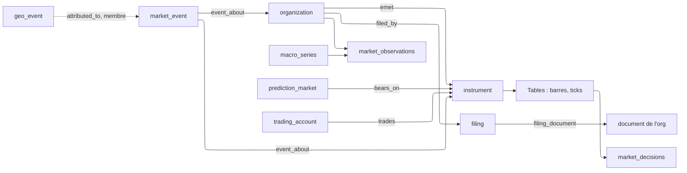

## 3. Fonctionnement

### 3.1 Sources et collecte

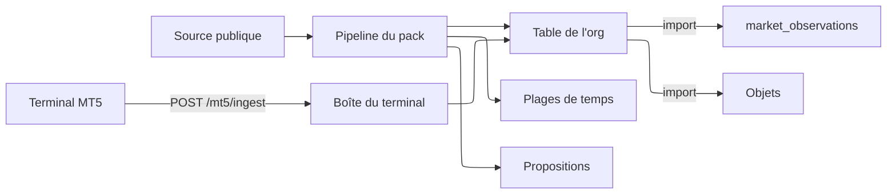

Toute collecte est un pipeline de pack (`packs/<pack>/pipelines/*.yaml`, `pipelines.md` D934–D953). Aucune collecte ne passe par un flow. Une source est fixée dans le pipeline : hôtes déclarés, cadence, garde egress (R8). Une clé d'API vient du coffre de l'org et part vers les seuls hôtes de la source (R9). Les lectures `/api/v1/markets/*` gardent leur forme sur ces tables.

| Pack | Pipelines | Contenu |
|---|---|---|
| `markets` | `sec_companies`, `edgar_filings`, `edgar_figures`, `sec_documents`, `sec_subsidiaries`, `gleif_identity`, `esef_filings`, `filing_events` | sociétés suivies, dépôts, chiffres XBRL, documents, filiales, LEI, rapports ESEF, événements extraits |
| `markets` | `fred_series`, `fred_move_series`, `alfred_series`, `alfred_move_series`, `ecb_series`, `bis_series`, `eurostat_series`, `eia_series`, `cftc_cot`, `portwatch_chokepoints` | séries macro, taux directeurs, inflation, pétrole, positions COT, détroits |
| `markets` | `tiingo_daily_prices`, `tiingo_move_tickers`, `tiingo_benchmark` | clôtures quotidiennes (clé Tiingo de l'org) |
| `markets` | `binance_klines_1m`, `binance_trades`, `dukascopy_ticks`, `dukascopy_m1`, `histdata_m1`, `histdata_ticks` | historique fin de prix |
| `markets` | `bls_calendar`, `fomc_calendar`, `ecb_calendar`, `boe_calendar`, `boj_calendar` | calendrier des publications |
| `markets` | `market_moves`, `market_press` | séances anormales, pistes de presse (GDELT) |
| `world_events` | `gdelt_events`, `gdelt_events_history`, `ucdp_events`, `ucdp_ged_file`, `ucdp_candidate_file`, `acled_events`, `lead_confirmations` | événements du monde |
| `prediction_markets` | `markets`, `prices`, `prices_fine`, `trades` | marchés de prédiction |
| `trade_flows` | `ais_dk`, `ais_noaa`, `adsb_lol` | positions de navires et d'avions |
| `real_estate` | `dvf` | ventes immobilières en France |
| `consumer_prices` | `open_prices` | prix produit par produit |

Le réglage `source_contact` déclare un contact dans chaque requête. La SEC et le BLS refusent un client sans contact. Chaque source a ses conditions d'usage. Une table d'une source aux conditions non vérifiées reste privée à l'org.

### 3.2 Valeurs datées

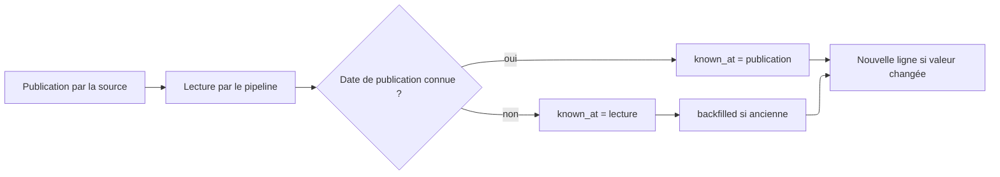

Une valeur datée se lit à une date `t` : pour chaque période, la dernière ligne avec `known_at <= t`. Un dépôt SEC est connu à la fin de son jour de dépôt (UTC). ALFRED donne à une valeur FRED sa date de première publication (D811). Sans ALFRED, une valeur FRED ou BRI de plus de 5 jours est marquée `backfilled`. Un rapport COT est connu trois jours après son mardi. Une série hebdomadaire de l'EIA est connue cinq jours après sa semaine. Les valeurs restent celles de la source, sous le nom de son concept : aucun rapprochement de concepts.

Une barre ou un tick est connu à son instant, même chargé plus tard. Sinon aucun backtest sur un historique téléchargé n'est possible.

### 3.3 Émetteurs et dépôts

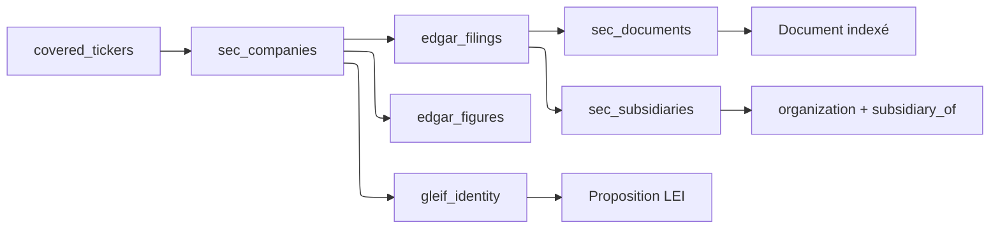

Une organisation devient émettrice par son lien vers un `instrument` (D523). Le pipeline `sec_documents` fait du document principal de chaque dépôt un document de l'org, indexé par la recherche documentaire (D542). Le texte reste privé à l'org (D527). Les rubriques d'un 8-K (2.02 résultats, 5.02 dirigeants) donnent sa nature sans LLM (D544).

Le pipeline `sec_subsidiaries` lit l'Exhibit 21 des 10-K. Chaque filiale devient une `organization` retrouvée par `declared_key` (pays et nom). Son lien `subsidiary_of` (nature `declared`) commence au premier rapport qui la cite. L'import ferme ce lien quand le dernier rapport ne la cite plus. Le pipeline `gleif_identity` cherche le LEI d'une société SEC par nom légal : un candidat unique devient une proposition, jamais une fusion (D812). Une société non trouvée est redemandée 30 jours plus tard. Le pipeline `esef_filings` lit les rapports européens des LEI du réglage `covered_leis`.

### 3.4 Mouvements de marché et séance

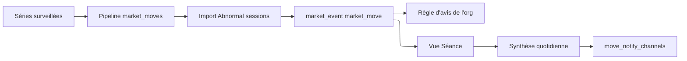

Le pipeline `market_moves` lit les séries de `move_series` (FRED, `bis:` pour la BRI) et de `move_tickers` (Tiingo). Format d'une entrée : `[bis:]CODE:mode:classe[:k[:plancher]]`. Une séance est anormale si sa variation dépasse `k` écarts types des 250 variations précédentes **et** un plancher absolu (D735). Il faut 60 points au moins. Les jours sans cotation sont ignorés, jamais interpolés.

| Mode | Mesure | Plancher par défaut |
|---|---|---|
| `log_return` | rendement logarithmique (prix, indices) | 2 % (0,75 % pour `fx`) |
| `diff` | écart en points (taux, VIX) | 15 pb |
| `volume` | `ln` du volume moins sa moyenne, hausse seulement (D810) | `ln 2` |

Valeurs par défaut : VIX, taux US à 10 ans, WTI, Brent, dollar pondéré, et les taux directeurs du G10 en `bis:` avec `k = 1` et un plancher de 0,05 (D881, D888). `SPY` et `QQQ` remplacent les indices FRED `SP500` et `NASDAQCOM`, dont la reproduction exige un accord (Q-MK5).

Le mouvement hérite le `known_at` de la valeur qui le déclenche, et sa marque `backfilled` (D736). Il est créé sans file « À valider » (D738). La vue **Séance** (`GET /markets/sessions/{date}`) liste les mouvements d'une date par |mesure| / sigma. La synthèse quotidienne (D814, réglage `session_summary`, `off` par défaut) est rédigée par le fournisseur d'IA de l'org. Elle part dans l'application et vers les canaux de `move_notify_channels`. Rien n'est stocké comme objet.

### 3.5 Événements du monde

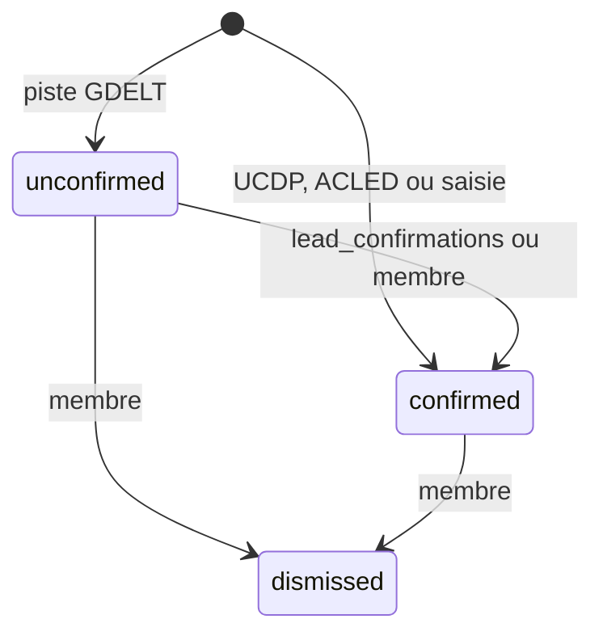

Le pack `world_events` (`geo_event`) ne dépend pas de `markets` (D739). GDELT donne une piste par (pays, code CAMEO racine, jour), jamais une ligne par enregistrement (D740). Les pays suivis sont dans `geo_watch`, vide par défaut. UCDP (CC BY 4.0) et ACLED (compte et licence de l'org) donnent des événements vérifiés, agrégés par (pays, nature, jour). Les pays sont en ISO 3166 alpha-2 partout, convertis à la lecture.

Le pipeline `lead_confirmations` confirme une piste GDELT par un événement vérifié du même pays, à un jour près, de nature compatible (D741). Un statut posé par un membre n'est jamais repris. Les événements s'affichent sur la carte générale (30 jours) et sur la carte des dossiers.

PneX ne stocke aucun lien de cause entre un `geo_event` et un `market_event` (D742). Il calcule à la lecture une concomitance (même fenêtre, ±1 séance). Seul un membre crée `attributed_to` (pack `market_attribution`), depuis un dossier, avec une justification et une source. Le type de lien porte `member_only: true` : l'assistant, un import ou un service est refusé (`ontology-link-member-only`).

### 3.6 Événements extraits des communiqués

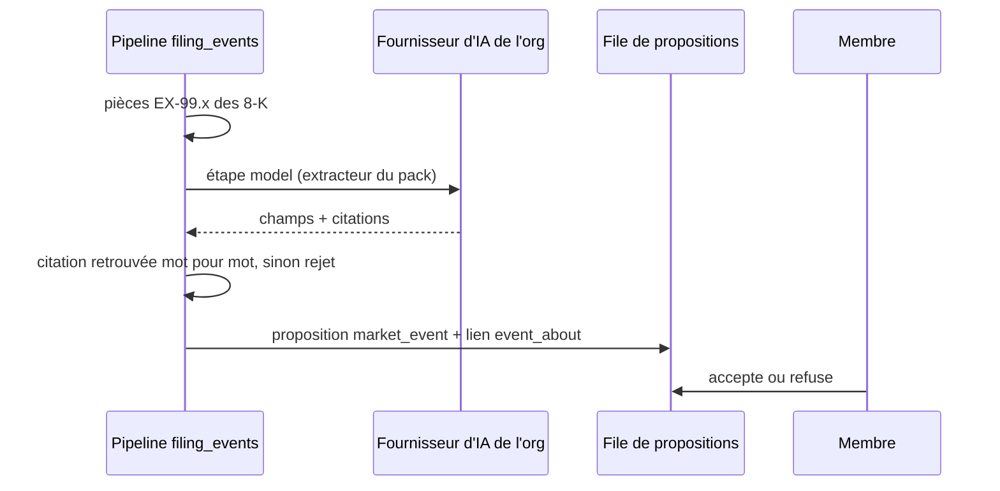

Un pack déclare ses extracteurs (`extractors:`, `pnex_core::extractor`) : un schéma et une consigne (D841). Chaque valeur porte une citation de 300 caractères au plus, retrouvée mot pour mot à espaces près. L'étape `model` lit 50 documents par org et par jour UTC, puis attend le lendemain. Sans fournisseur, elle s'arrête sur `model_unconfigured`.

Le pipeline `filing_events` lit les pièces 99.x des 8-K des sociétés suivies, en anglais, depuis `event_extraction_from` (D842). Le `market_event` proposé a `known_at` = `published_at` = acceptation SEC du dépôt (D843). Sa `direction` vient d'une citation, sinon `unknown` (D844). L'acceptation est toujours humaine (Q-MK15).

### 3.7 Étude d'événement, test de règle, thèse

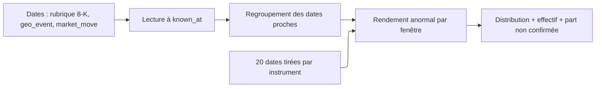

L'étude d'événement est une fonction pure (`pnex_core::market_study`, D532). Elle calcule le rendement anormal (modèle de marché, β estimé sur [−250, −30] jours) sur les fenêtres [−1, +1], [0, +5] et [0, +20]. Une `macro_series` est mesurée sans modèle de marché : la variation brute.

Le test de règle (`GET /markets/rule-test`) n'a aucun paramètre à optimiser (D545). Il compare toujours à 20 dates tirées par instrument, avec un tirage reproductible. La mesure commence à la séance qui suit le jour de connaissance. Des `geo_event` proches comptent une fois (28 jours civils, D743). Les pistes non confirmées sont exclues sauf choix explicite. Limite affichée : seuls les instruments suivis aujourd'hui sont mesurés (biais du survivant).

Le pack `investment_thesis` fait d'un dossier une thèse : instrument, sens, catalyseurs datés, critères d'invalidation (D533). Une `paper_position` se mesure sur les clôtures, jamais sur un prix saisi (D546, `GET /markets/positions/{id}/result`). La fiche d'un émetteur a un onglet **Cours** : clôtures, séances anormales, dépôts et décisions de modèle sur la même frise (D813, D897).

### 3.8 Historique fin de prix

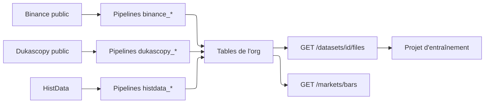

Une bougie ou un tick n'est pas un objet : il vit dans une table, l'instrument en colonne (D807). Les prix sont en décimal, les horodatages en µs UTC. Aucun ajustement, aucune bougie reconstruite : un trou reste un trou (D809).

| Table | Forme | Source | Réglages |
|---|---|---|---|
| `binance_klines_1m` | `ohlcv` | Binance spot, un mois clos par fichier, SHA-256 vérifié | `history_symbols`, `history_from` |
| `binance_trades` | `trade_tick` | Binance spot, un fichier par jour | `history_trade_symbols`, `history_trade_from` |
| `dukascopy_quotes` | `quote_tick` | Dukascopy, fichiers horaires LZMA, un jour par transaction | `history_fx_pairs`, `history_fx_from` |
| `dukascopy_ohlcv_1m` | `ohlcv` | Dukascopy, bid puis ask, un jour UTC par fichier, un fichier toutes les 10 s | `dukascopy_m1_symbols`, `dukascopy_m1_from` |
| `histdata_m1` | `ohlcv` | HistData, bid, une année close par fichier, heure de New York avec heure d'été | `histdata_pairs`, `histdata_from` |
| `histdata_quotes` | `quote_tick` | HistData, un mois clos par fichier | `histdata_tick_pairs`, `histdata_tick_from` |
| `mt5_ohlcv_1m`, `mt5_ticks` | `ohlcv`, `quote_tick` | terminaux MT5 (§3.9) | — |

L'état de chaque fichier est suivi par le registre des pipelines (`pipeline_items`, D937). Un fichier `done` n'est jamais relu. Une période vide (week-end, avant la cotation) est `empty`. Les échelles de prix Dukascopy sont fixées dans le code : 3 places pour une cotation en JPY, l'or et l'argent, 5 sinon. Une paire inconnue est laissée de côté.

Le quota de tables d'une org vaut 20 Go par défaut. L'admin plateforme le relève (`PUT /system/orgs/{org_id}/dataset-quota`, D821). Les chargements massifs exigent ce quota posé (SEC-82). Le code d'entraînement lit les fichiers Parquet de la vue courante, ou à `as_of`, sans passer par l'API JSON (D823). Le rééchantillonnage est une transformation SQL (`date_trunc`, `date_bin`).

Mesure : la vue d'une table tient à 10⁵ transactions `append` (431 ms pour lister les fichiers). Le compactage mensuel n'est donc pas nécessaire à cette échelle.

### 3.9 Terminaux MT5

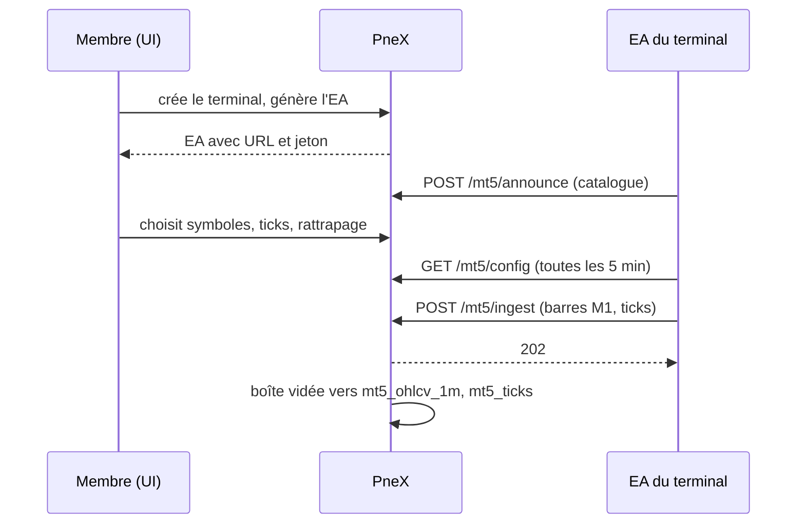

Un terminal MT5 est une source de données, pas un device (D847). Il emprunte seulement le parcours d'un device : fiche, code généré, annonce, configuration décidée côté serveur, présence. Le jeton (`pnex_mt5_` + 32 octets) n'apparaît que dans l'EA généré. Seul son SHA-256 est gardé. Régénérer l'EA révoque l'ancien jeton.

L'EA annonce tout le catalogue du courtier avec la profondeur d'historique de chaque symbole (D848). Un nouveau terminal envoie les bougies M1 de tout son catalogue, et les ticks d'une liste choisie (Q-MT3, Q-MT4). L'EA envoie un battement par minute. Le terminal est en ligne sous 3 min, en retard sous 1 h, hors ligne ensuite. L'EA ne contient aucun appel d'ordre (test : `OrderSend` absent du rendu).

Plafonds (SEC-84) : 20 terminaux par org, 2 000 appels en attente par org, 1 Mio par appel d'ingestion, 4 Mio par annonce. Un rattrapage renvoie des barres déjà présentes. La lecture des barres garde la dernière écriture d'une minute.

### 3.10 Contexte macro et flux physiques

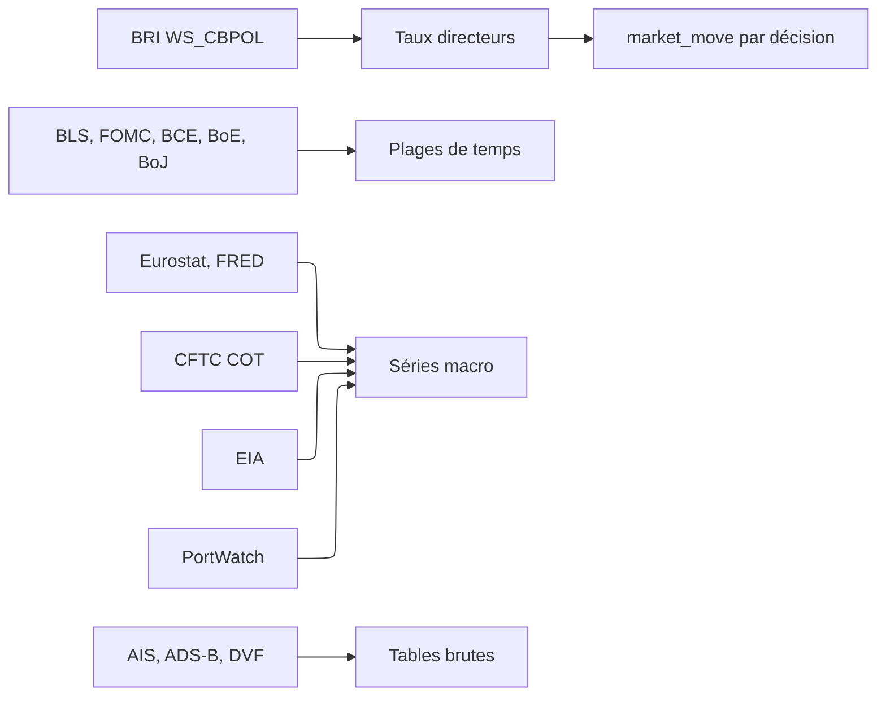

Les taux directeurs viennent de la BRI (`bis_series`, G10 par défaut, depuis 2000, D880). Chaque décision devient un `market_move` (D881). Rejeu sur l'historique réel : JP 14/14 décisions, NO 74/74, XM 58/59.

Les dates à venir viennent du calendrier publié par chaque institution, jamais d'un agrégateur (D882). Elles deviennent des **plages de temps** de l'org (D182) : page calendrier, outils de l'assistant, lecteur ICS. Le fichier `pnex-core/src/markets/fomc_2009_2020.tsv` fige 100 décisions FOMC de 2009 à 2020, chacune à son heure de New York. Une réunion non programmée est marquée « unscheduled ».

Séries par défaut : IPCH Eurostat en COICOP 2018 (`prc_hicp_minr`), indices immobiliers (BRI `WS_SPP`, Eurostat `prc_hpi_q`, FHFA sur FRED), COT de l'or, de l'argent et du WTI, stocks et production de pétrole de l'EIA (clé `markets_eia_key`), 8 détroits PortWatch (D883–D885). Un indice propriétaire est écarté, même règle que `SP500`.

Les flux physiques vivent dans des packs à part (D887) : `trade_flows`, `real_estate`, `consumer_prices`. Les positions brutes vont dans des tables, jamais dans l'ontologie (D889). Le chargement est en flux : `datasets::append_stream` écrit un seul fichier Parquet par transaction, validée seulement à la fin du fichier. Un fichier coupé revient au passage suivant. L'autorité maritime danoise sert ses fichiers en HTTP clair, sans somme de contrôle (SEC-81, accepté).

| Essai réel | Volume | Durée |
|---|---|---|
| DVF 2025 | 3 714 829 lignes, 75 Mo | 30 s |
| AIS danois, un jour | 14,6 M positions, 320 Mo | 2 min 15 |
| ADS-B adsb.lol, un jour | 87,5 M positions, 2 Go | 9 min 30 |

**Cas de l'or (XAUUSD)** : barres minute HistData et MT5, taux réel `DFII10`, point mort `T10YIE`, dollar `DTWEXBGS`, taux directeurs BRI, COT, calendrier, événements du monde. Le test ignoré `gold_real_sources` lit ces sources réelles en 52 s. Les achats d'or des banques centrales et les encours des ETF or ne sont pas couverts.

### 3.11 Barres et décisions d'un modèle externe

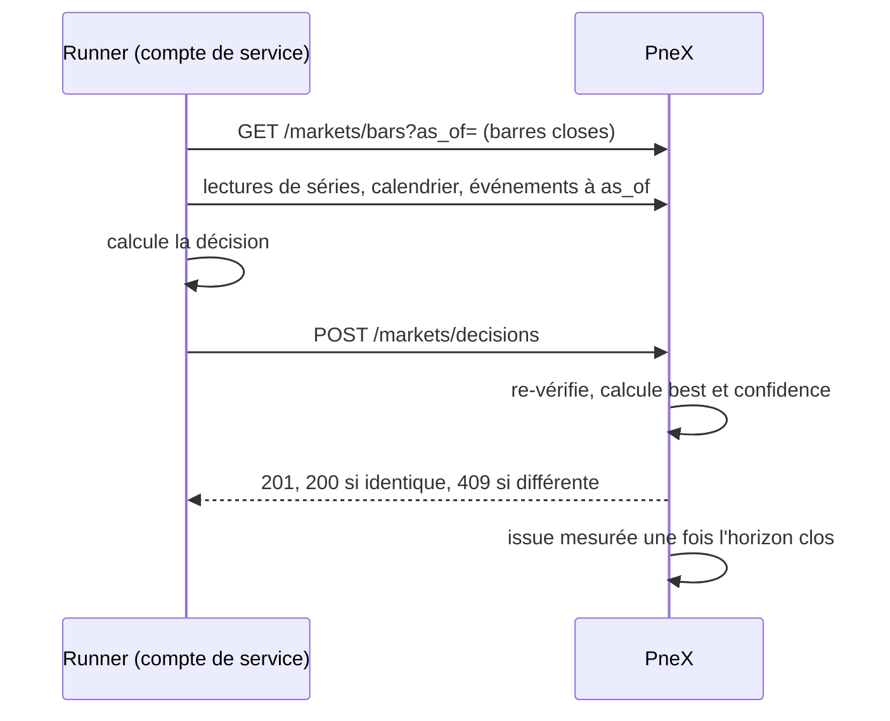

Le modèle et son runner vivent dans un projet Python privé, hors de PneX (D890). Pour PneX, c'est un client de l'API : HTTP, SDK généré, Parquet pour le volume. Le même code de features sert à l'entraînement et en direct : seule la date `as_of` change. Les alertes sont faites par le projet Python.

Le runner est un compte de service (D891). La liste blanche `SERVICE_WRITES` ne contient que `market-decisions:write` : toute autre écriture d'un compte de service est refusée (SEC-85).

`GET /markets/bars` rééchantillonne les minutes d'une seule source (`binance_public`, `histdata`, `mt5:<courtier>`) en barres alignées sur l'époque UTC (D892). Seules les barres closes à `as_of` sont rendues. Une décision porte sa `source` : l'écart entre HistData et MT5 doit être mesuré avant un usage en direct (D893).

Une décision (D894) porte le modèle, sa version, l'instrument, la source, l'intervalle, `horizon_bars`, `as_of`, trois probabilités et des barrières en ATR optionnelles. Le serveur vérifie la somme à 1 ± 1e-3 et l'âge d'`as_of` (deux intervalles au plus). Il calcule `best` et `confidence` (1 − entropie normalisée). Plafond : 2 000 décisions par jour et par org.

`pnex_core::markets::decisions::outcome` mesure l'issue sur les barres de la même source (D896). Avec barrières : triple barrière, ATR = moyenne simple du true range sur `atr_period` barres. Take-profit touché d'abord → `buy`, stop d'abord → `sell`, rien ou les deux dans la même barre → `neutral`. Cette règle est le contrat d'étiquetage du projet Python. `GET /markets/decisions/scores` donne la réussite, le score de Brier et la fiabilité par tranche de 0,1. La page **Décisions de modèles** (`/market-decisions`, groupe Connaissance) montre la liste et ces mesures (D897).

### 3.12 Point-in-time strict

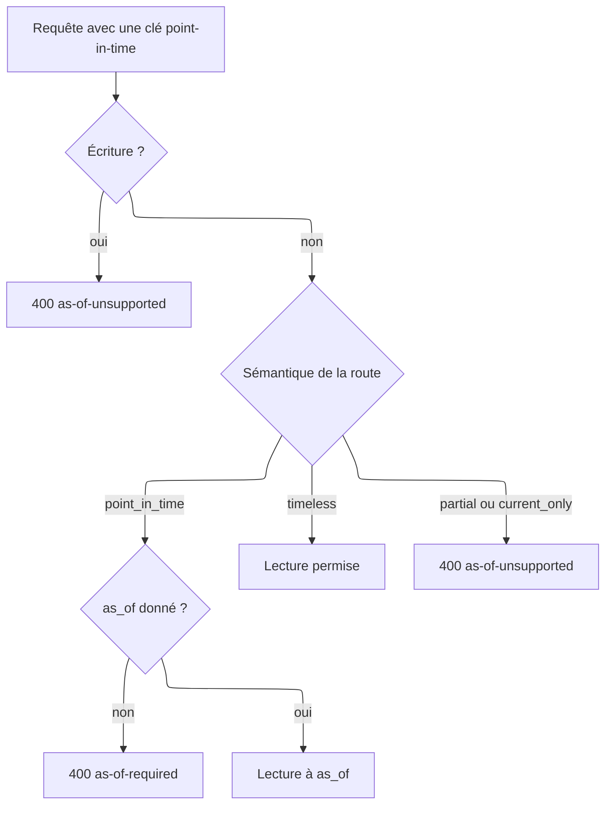

Une lecture à `as_of` doit rendre ce qui était connu à cet instant, rien de plus. L'attribut `point_in_time` est porté par une clé, pas par le compte (D898). Un même compte a donc une clé live et une clé de backtest.

L'inventaire `pnex_api_contract::as_of` classe chaque lecture : `point_in_time`, `partial`, `timeless` ou `current_only` (D899). L'OpenAPI l'expose (`x-pnex-as-of`). `POST /ontology/query` et `GET /ontology/objects/{id}` relisent titre et propriétés à `as_of` dans `object_versions` (D900). Chaque ligne porte `properties_as_of` (`exact` ou `unknown`).

Le test `point_in_time_reads_never_show_a_canary` écrit des canaris après T0 et appelle chaque route `point_in_time` à T0 (D901). L'ensemble des routes testées doit égaler l'inventaire. Une conversation de l'assistant peut être figée à un instant (D902, `frozen_at`). Les outils datés reçoivent cet instant. Un outil qui lit le présent ou écrit est retiré (`ai-frozen-tool`). Un dossier ouvert depuis une alerte propose « l'alerte + 15 min ».

Écarts voulus :

- Un objet sans `known_at` (instrument, société) reste visible à tout `as_of`. Sinon un backtest ne trouve aucun instrument importé aujourd'hui.
- Une barre, un tick ou un prix de marché de prédiction est connu à son instant, même chargé plus tard.
- Un seuil de lecture (seuil de mouvement d'un instrument) est un réglage courant, pas un fait daté.
- Étiquettes et rangement ne sont pas datés : `label` et `within` sont refusés à une clé point-in-time.

### 3.13 Ce qu'on savait : le temps de connaissance

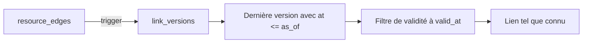

Un fait a deux dates : quand il est vrai dans le monde (« Vrai le ») et quand PneX l'a su (« Su le ») (D912). Une lecture prend `as_of` et, en option, `valid_at`, qui vaut `as_of` par défaut. `valid_at` seul lit la connaissance courante : il est refusé à une clé point-in-time.

Un trigger sur `resource_edges` remplit `link_versions` à chaque création ou changement (D913). Un lien déclaré aujourd'hui « depuis 2025 » n'existe donc pas dans un backtest de 2025. Un lien fermé après coup reste ouvert à un `as_of` antérieur. Un lien antérieur à la migration porte `history: partial`. Un lien effacé garde des versions vides (`erased = true`).

Un pack déclare `history: true` pour garder les états de ses objets (D914). Un type déclare ses deux propriétés de date (`times.event_property`, `times.known_property`, D915). Le canari couvre aussi les liens rétroactifs (D916). Les écarts voulus de §3.12 restent hors de ce mécanisme (D917).

### 3.14 Chaînes causales marchés

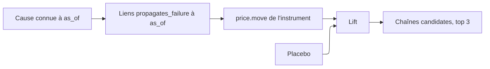

`GET /markets/chains?instrument=&source=&as_of=` sert au modèle externe une variable d'entrée, pas une proposition. Il réutilise `pnex_core::rca` (`cases.md` D904–D911). Un effet `price.move` est un rendement sur 1 h au-delà du seuil de l'instrument, sinon `price_move_threshold_pct` (1,5 %). Les causes sont :

- `world.event` : un `geo_event` posé sur le pays (type `nation`).
- `macro.release` : une valeur macro connue dans la fenêtre.
- `supply.disruption` : un `geo_event` `blockade` ou `sanctions`, ou une valeur de série au moins `disruption_drop_pct` sous la moyenne de ses 7 précédentes.

La topologie vient du lien `exposed_to` (pays, société ou série → instrument), déclaré par un membre. Aucun filtre de lift n'est appliqué : le modèle apprend le poids. Rien n'est stocké comme cause (D742). Une chaîne retenue par un humain ne sert jamais d'étiquette d'entraînement. La fenêtre fait 31 jours au plus, 7 par défaut.

### 3.15 Marchés de prédiction

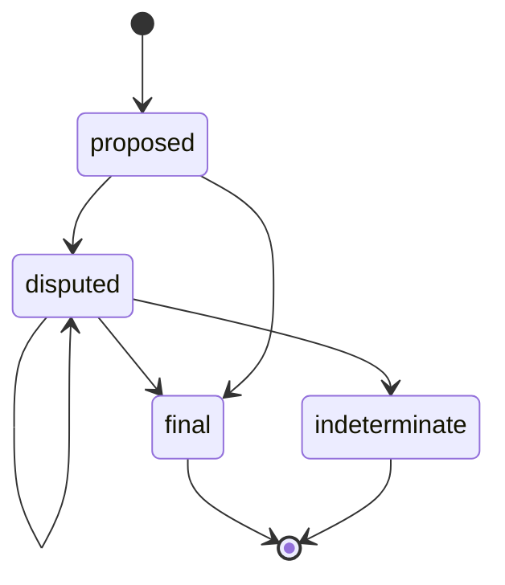

Le pack `prediction_markets` (D918, `history: true`) lit les API publiques de lecture de Polymarket. PneX ne parie pas, ne signe aucune transaction et ne détient aucune clé de wallet. Parier sur Polymarket n'est pas autorisé en France.

**Attention :** les hôtes de Polymarket sont bloqués en France (résolution DNS vers la page de l'ANJ). Une org en France doit poser son proxy dans le coffre (`polymarket_proxy`, URL http(s)). Sans ce secret, le serveur appelle les hôtes en direct.

Les probabilités et les échanges sont des lignes de table, jamais des objets (D919, D923). Le pipeline `prices` lit 1 h par jour clos depuis `history_from`. Le pipeline `prices_fine` lit la minute pour les marchés de `fine_markets`. Chaque état de résolution vu devient un `prediction_resolution` daté (D920). Un marché en litige à `as_of` n'est pas résolu.

Un membre déclare le lien `bears_on` (marché → instrument, pays ou organisation) avec une direction attendue (D921). `GET /markets/prediction-features` rend, à `as_of`, la probabilité, ses variations 1 h et 24 h et les jours restants (D922). Le détecteur `early_bet@1` propose dans un dossier un wallet jeune, concentré et misé peu avant un saut ou une résolution (D924). La proposition contient des chiffres, jamais une intention. `GET /markets/decisions/forecast-scores` compare le Brier du modèle et celui du marché au même instant (D925).

### 3.16 Comptes de trading publics

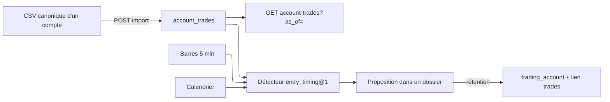

Le pack `trading_accounts` lit l'historique qu'un auteur a rendu public sur une plateforme de suivi (D926). PneX ne copie aucune position, ne passe aucun ordre et ne se connecte au compte de personne. Les transactions vont dans la table PostgreSQL `account_trades` (D927). Une transaction réimportée garde son premier `known_at`. Sans preuve de publication, `known_at` = date d'import et `backfilled = true` (D928).

L'import accepte un CSV canonique produit par le client (D929). L'API Myfxbook attend la lecture de ses conditions par Shan (Q-TA1). Les pages HTML de la plateforme ne sont jamais lues. Le détecteur `entry_timing@1` propose un compte dont les entrées précèdent les mouvements ou entourent les publications (D930). La décomposition du profit se fait dans le projet Python (D931).

**Danger :** un compte ne doit jamais être relié à une personne. Le type déclare `never_linked_to: [person]` : tout lien est refusé (`ontology-link-not-allowed`), quel que soit le chemin d'écriture (D933). Effacer le compte purge ses lignes (D932).

### 3.17 Ingestion de newsletters (contenus génériques)

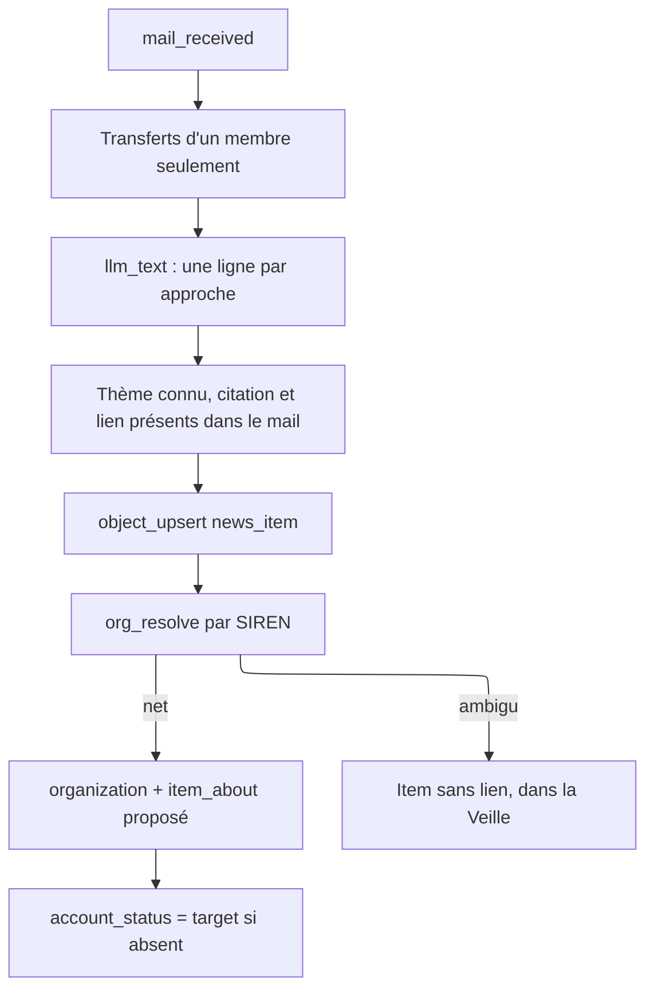

Une boîte partagée de l'org reçoit les newsletters qu'un membre transfère (D987). Le flow « Prospecting · forwarded newsletters » en tire des `news_item` (pack `watch`) : thème, résumé, extrait cité, lien (D986). Une approche dont la citation n'est pas dans le mail est jetée (D990). L'entreprise trouvée par son SIREN devient une cible si elle n'a pas de statut de compte (D992).

Le flow, le prompt et la liste des vecteurs d'accroche vivent dans le projet pnex-sales (D991). PneX ne livre que des nœuds et des types génériques. PneX ne crée ni `lead` ni piste dans le CRM externe : un commercial la crée depuis pnex-sales. Le lot L1 réutilise l'existant sans table neuve (D989). La carte des relations se construit dans pnex-sales sur `/ontology/query` et `/objects/{id}/graph` (D993).

Modèle proposé pour la suite (brouillon du 2026-11-17, non codé) :

- **Source** : une instance de configuration (`imap`, `rss`, `http_poll`, `webhook`, `file_drop`, `web_agent`), avec découverte, acquisition désactivée par défaut et politique de contenu : `retention` (`store_full`, `metadata_only`, `ephemeral`), `content_license` déclarée, `llm_scope`.
- **Item** : URL canonique, `published_at`, `ingested_at`, `content_hash`, `raw_ref` nul sauf `store_full`, analyse active.
- **ItemAnalysis** : analyse en ajout seul (modèle, `prompt_version`, `schema_version`, résumé, entités, tags). Un retraitement produit de nouvelles analyses et n'écrase rien.
- **Mode éphémère** : type `Ephemeral<T>` sans `Serialize`, mis à zéro au `Drop`, jamais en file ni en journal. Un test de conformité vérifie qu'un texte marqueur n'est nulle part après exécution.

## 4. Exigences

1. Un chiffre d'un calcul doit venir d'une source primaire. Un article ne doit nourrir aucun calcul.
2. Une valeur révisée doit ajouter une ligne. Aucune valeur datée ne doit être remplacée.
3. Toute lecture à une date `t` doit filtrer `known_at <= t`. Une valeur `backfilled` doit être exclue par défaut, et sa part affichée si incluse.
4. Une barre doit être rendue seulement si elle est close à `as_of`.
5. Une clé point-in-time doit recevoir 400 `as-of-required` sans instant et 400 `as-of-unsupported` sur une écriture ou une route non datée.
6. Chaque route `point_in_time` doit passer le test canari, liens rétroactifs compris.
7. Un lien de cause (`attributed_to`) doit être créé par un membre seulement, avec justification et source.
8. Une extraction par LLM doit produire une proposition. Chaque valeur doit citer le texte mot pour mot.
9. PneX ne doit passer aucun ordre : ni route, ni outil, ni EA, ni compte de service.
10. Un compte de service doit avoir pour seule écriture `market-decisions:write`.
11. Un `trading_account` ne doit être relié à aucune `person`.
12. Une table d'historique doit rester privée à l'org.
13. Chaque écran du domaine doit afficher l'avertissement « aide à l'analyse ».
14. Une clé d'API ou un proxy doit venir du coffre et partir vers les seuls hôtes de sa source.

## 5. Décisions

Une ligne par décision. « Remplacée » renvoie à la décision qui la remplace.

### 5.1 Socle (D523–D546)

#### D523 — Un pack `markets`, l'émetteur reste l'organisation
Types `instrument`, `listing`, lien `emet`. Une organisation devient émettrice par son lien. Codé.

#### D524 — Référentiels par imports, jamais saisis à la main
LEI, ISIN, FIGI, FIRDS par import, rapprochement par LEI puis SIREN, sinon proposition. Codé en partie : LEI par D812. OpenFIGI et FIRDS non codés.

#### D525 — Cours de clôture dans O2, bruts + facteurs d'ajustement
Remplacée par D543 : les cours vont dans `market_observations`. Le principe « brut, ajustement à la lecture » tient.

#### D526 — Une source = une import ou une règle de site, liste blanche par org
Pas de collecteur dédié, `license_note` par source, pas de contournement de paywall. Forme remplacée par les pipelines (D934).

#### D527 — L'article est un média, son texte reste privé à l'org
Jamais exposé par lien public ni page publiée. Tient.

#### D528 — Liaison article → émetteurs déterministe d'abord
Identifiants, puis nom exact, puis LLM en proposition. Non codé pour la presse (piste GDELT `market_press` seulement).

#### D529 — L'événement de marché est un objet, toujours sourcé
Type `market_event` (`kind`, `direction`, trois dates, `event_about`). Codé.

#### D530 — Événements : propositions, acceptation automatique possible par règle
Événement extrait = proposition. L'acceptation automatique est écartée par Q-MK15.

#### D531 — Trois horodatages, le test lit `known_at`
`event_at`, `published_at`, `known_at`. Rattrapage marqué `backfilled`. Codé.

#### D532 — Étude d'événement : calcul pur dans `pnex_core::markets`
Rendement anormal sur fenêtres fixes, testé sur séries synthétiques. Codé (`market_study`).

#### D533 — Le dossier « thèse » étend `case`
Pack `investment_thesis` : sens, catalyseurs, critères d'invalidation. Codé, voir D546.

#### D534 — Positions fictives, aucun lien vers un courtier en V1
`paper_position` mesurée sur les clôtures. Aucun ordre. Codé.

#### D535 — Test de règle = requête point-in-time + étude d'événement
Rejeu à `known_at`, comparaison au hasard, effectif affiché. Précisée par D545.

#### D536 — Assistant : lit, résume, propose ; ne décide pas
Outils de lecture, synthèse, aucune écriture de thèse ni ordre. Codé.

#### D540 — Les sources primaires d'abord, la presse détecte
Dépôts SEC, FRED, banques centrales. La presse donne une piste non confirmée. La forme d'import est remplacée par les pipelines (`pipelines.md` D953).

#### D541 — Valeurs datées : on ajoute, on ne remplace jamais
Table `market_observations`. Codé.

#### D542 — Le document d'un dépôt devient un média de l'org
Pipeline `sec_documents`. Codé.

#### D543 — Cours : Tiingo, clé d'org au coffre, valeurs brutes (tranche Q-MK1)
Clé `markets_tiingo_key`, valeurs brutes dans `market_observations`. Codé, jamais essayé sur le vrai Tiingo.

#### D544 — Les événements de marché sans LLM : les rubriques des dépôts
Les rubriques 8-K donnent la nature d'un dépôt. Codé.

#### D545 — Test de règle : pas de paramètre, toujours face au hasard
20 dates tirées par instrument, tirage reproductible. Codé.

#### D546 — Thèse : extension de `case`, position fictive mesurée
Résultat sur les clôtures. La revue de clôture est un champ, non exigé. Codé.

### 5.2 Mouvements et événements du monde (D734–D743, D810–D816)

#### D734 — Un mouvement de série est un fait primaire : `kind = market_move`
Champs `asset_class`, `move_direction`, mesure, seuil, sigma. Codé.

#### D735 — Un détecteur générique, fonction pure dans `pnex_core::markets`
`k` sigmas et plancher, 60 points au moins. Exécuté par le pipeline `market_moves`. Codé.

#### D736 — `known_at` hérité, jamais antérieur
Le mouvement hérite `known_at` et `backfilled` de sa valeur. Codé.

#### D737 — Les séries surveillées : un réglage, des valeurs par défaut primaires
`move_series` et `move_tickers`. Codé.

#### D738 — Pas de file « À valider » pour un `market_move`
Création directe, vue Séance, avis par règle d'org. Codé.

#### D739 — Pack `world_events`, type `geo_event`, hors du pack `markets`
Codé.

#### D740 — GDELT Events : des pistes agrégées, jamais une ligne par enregistrement
Une piste par (pays, code racine, jour), `unconfirmed`. Codé.

#### D741 — Confirmation : ACLED / UCDP plus tard, ou un humain
Pipeline `lead_confirmations`. Codé. Selon D998-T5 (`operational-platform.md`), ce rapprochement doit passer en flow.

#### D742 — Aucune causalité automatique
Concomitance à la lecture, `attributed_to` par un membre seulement. Codé.

#### D743 — Étude d'événement sur des dates géopolitiques
`rule-test` sur `geo_event` et `market_move`, regroupement. Codé.

#### D810 — Volume anormal : un mode du détecteur, pas un second détecteur
Mode `volume`, hausse seulement. Codé.

#### D811 — Millésimes FRED par ALFRED, clé d'org au coffre
Pipelines `alfred_*`, clé `markets_fred_key`. Codé, jamais essayé sur le vrai ALFRED.

#### D812 — Rapprochement CIK ↔ LEI : une proposition, jamais une fusion
Pipeline `gleif_identity`. Codé, jamais essayé sur le vrai GLEIF.

#### D813 — Fiche émetteur : cours et événements
Onglet **Cours**, `GET /markets/issuers/{id}/chart`. Codé.

#### D814 — Synthèse quotidienne : l'assistant de l'org, en lecture
Réglage `session_summary`, un paragraphe par séance, rien stocké. Codé, jamais essayé avec un vrai fournisseur.

#### D815 — MK3 (extraction par LLM) après tout le reste
Tenue : MK3 codé en dernier (§3.6).

#### D816 — Cours en direct : un connecteur MetaTrader 5 maison
EA en lecture seule. La forme par webhook est remplacée par D847–D849.

### 5.3 Historique fin et MT5 (D807–D809, D820–D824, D841–D849)

#### D807 — L'historique fin vit dans des tables, jamais dans l'ontologie ni dans `market_observations`
Tient. Forme de chargement remplacée par les pipelines (`pipelines.md` D953).

#### D808 — Origine `partitioned_download` : un modèle d'URL, une plage, une partition = une transaction `append`
Remplacée par D934 et D937 (pipelines suivis, `pipeline_items`).

#### D809 — Deux formes de table, colonnes typées dès l'écriture
Formes `ohlcv`, `quote_tick`, `trade_tick`. Tient, chargement par pipelines (D953).

#### D820 — Décodeurs natifs, purs, dans `pnex_core::market_history`
Décodeurs Binance et Dukascopy. Les pipelines lisent désormais par lecteurs de format (D939).

#### D821 — Les plafonds deviennent des réglages plateforme
Quota de tables par org, 20 Go par défaut, posé par l'admin plateforme. Codé.

#### D822 — Sources fixées dans le code, conditions notées
Hôtes fixés par la source, tables privées à l'org. Tient, dans les pipelines.

#### D823 — Lecture pour l'entraînement : fenêtres, rééchantillonnage en SQL, pas d'image stockée
`GET /datasets/{id}/files`, `date_bin`. Codé.

#### D824 — Le flux continu (MT5) écrit la même forme, plus tard
Tables `mt5_ohlcv_1m` et `mt5_ticks`. Codé.

#### D841 — `extractors:` dans les packs, mécanisme commun
Étape `model`, citation vérifiée. Codé. La due diligence s'y branchera.

#### D842 — Extracteur `market_event` sur les communiqués SEC seulement (V1)
Pièces 99.x des 8-K, en anglais. Codé.

#### D843 — Toujours une proposition, `known_at` donné par le dépôt
Codé. Une proposition `object_create` porte son lien (migration 000157).

#### D844 — La direction est celle que dit la source
Sinon `unknown`. Codé.

#### D845 — Coût borné et visible
50 documents par org et par jour. Plafond fixé dans le pipeline, pas en réglage.

#### D846 — Alertes sur événement accepté
Non codé (MK3c).

#### D847 — Le terminal est une source enregistrée, son EA est généré
Codé. Routes gardées par `pipelines.md` D950.

#### D848 — L'EA annonce tout, PneX choisit
Catalogue, profondeur, sélection par filtres. Codé.

#### D849 — Un point d'entrée dédié, la même file, la même écriture
Accès `Machine`, jeton du terminal, 202. Codé.

### 5.4 Macro et flux physiques (D880–D889)

#### D880 — Banques centrales : la BRI d'abord, une source pour toutes
Pipeline `bis_series`. Codé.

#### D881 — Un mouvement de taux directeur est un `market_move`
Mode `diff`, `k = 1`, plancher 0,05. Codé.

#### D882 — Calendrier des publications : les dates à venir sont des faits sourcés
Plages de temps de l'org. BLS, FOMC, BCE, BoE, BoJ codés.

#### D883 — Inflation détaillée : sous-indices officiels, prix individuels plus tard
Eurostat et FRED codés. Prix individuels : pack `consumer_prices` (Q-F2).

#### D884 — Immobilier : indices d'abord
Indices BRI, Eurostat, FHFA. Transactions DVF en table (Q-F3). Codé.

#### D885 — Flux maritimes : les agrégats pour les marchés, le brut pour l'enquête
PortWatch en séries, AIS en tables. Codé.

#### D886 — Flux aériens : en dernier
adsb.lol (ODbL) en table. Codé.

#### D887 — Les flux physiques vivent dans des packs à part
`trade_flows`, `consumer_prices`, `real_estate`. Codé.

#### D888 — Un mouvement de série BRI se déclare dans `move_series`, préfixé
Entrée `bis:`. Codé.

#### D889 — Positions brutes dès maintenant, en tables
Codé. Le pont table → trace d'un dossier n'est pas codé. Forme remplacée par les pipelines (D953).

### 5.5 Modèle externe, point-in-time, bitemporel (D890–D917)

#### D890 — Le modèle vit hors de PNeX ; PNeX ne voit qu'un client
Projet Python privé, alertes côté Python. Tient.

#### D891 — Le runner est un compte de service ; une seule écriture lui est ouverte
`SERVICE_WRITES` = `market-decisions:write`. Codé.

#### D892 — Barres de cours : une route de lecture, à une date donnée
`GET /markets/bars`, barre connue à sa clôture. Codé (rééchantillonnage en Rust).

#### D893 — La source lue en direct est celle de l'entraînement, ou l'écart est mesuré
Mesure HistData / MT5 non faite.

#### D894 — Une décision = une distribution datée, à la forme de `text_decide`
`POST /markets/decisions`, table `market_decisions`. Codé.

#### D895 — Conseil seulement
Aucune route entre une décision et MT5. Codé.

#### D896 — PNeX mesure les décisions après coup
Triple barrière, Brier, fiabilité. Codé.

#### D897 — Affichage
Marqueurs sur l'onglet Cours, page Décisions de modèles. Codé.

#### D898 — Clé « point-in-time »
Attribut de la clé. Codé.

#### D899 — Sémantique temporelle par route
Inventaire `pnex_api_contract::as_of`. Codé.

#### D900 — Propriétés d'objet à `as_of`
`object_versions`. Codé.

#### D901 — Test canari
Codé.

#### D902 — Assistant figé à un instant
`frozen_at`. Codé.

#### D903 — Canari côté projet Python
Hors dépôt.

#### D912 — Deux axes, deux paramètres, un défaut sûr
`as_of` et `valid_at`. Codé.

#### D913 — `link_versions` : le même mécanisme que `object_versions`
Codé.

#### D914 — L'historique devient un drapeau de pack
`history: true`. Codé.

#### D915 — Le temps de connaissance d'un objet : déclaré par son type
`times.event_property`, `times.known_property`. Codé.

#### D916 — Le canari couvre les liens
Codé.

#### D917 — Ce qui reste volontairement hors du bitemporel
Barres, seuils, étiquettes et rangement (§3.12). Tient.

### 5.6 Marchés de prédiction et comptes de trading (D918–D933)

#### D918 — Pack `prediction_markets`, à part
Codé.

#### D919 — Les probabilités sont des séries en table, jamais des objets
Tables de l'org, par pipelines. Codé.

#### D920 — La résolution est un fait daté, contestable, révisable
États datés. Codé.

#### D921 — Lien `bears_on`, déclaré par un membre
Codé. Les variables lisent seulement les liens posés sur l'instrument.

#### D922 — Variable d'entrée du modèle : niveau et variation, à `as_of`
`GET /markets/prediction-features`. Codé.

#### D923 — Wallets : brut en colonnes, objet seulement sur signalement
Codé. Aucune source de financement lue.

#### D924 — Détecteur « mise précoce », une proposition, jamais une accusation
`early_bet@1`. Codé.

#### D925 — Calibration : le marché comme point de référence
`GET /markets/decisions/forecast-scores`. Codé.

#### D926 — Pack `trading_accounts`, à part
Codé.

#### D927 — Les transactions sont des lignes de table, jamais des objets
Table PostgreSQL `account_trades`. Codé.

#### D928 — Point-in-time : connu au plus tôt à la clôture, sinon à l'import
Codé.

#### D929 — Sources : l'export CSV d'abord, l'API plus tard
CSV canonique codé. API en attente (Q-TA1).

#### D930 — Détecteur « entrée avant mouvement », une proposition, jamais une accusation
`entry_timing@1`. Codé.

#### D931 — Décomposition du profit : côté Python, pas dans PNeX
Tient.

#### D932 — Rétention des données d'un tiers
Purge à l'effacement du compte. Codé.

#### D933 — Aucun rapprochement avec une personne
Garde `never_linked_to`. Codé.

### 5.7 Ingestion de contenus (D986–D993)

#### D986 — Le résultat est un `news_item`, l'entreprise devient une cible
Lien `item_about` proposé. PneX ne crée aucune piste commerciale. Codé (flow de pnex-sales).

#### D987 — Source = une boîte partagée dédiée
Transferts d'un membre seulement. Expéditeur non signé : « expéditeur non vérifié » (`mail.md` D994). Codé.

#### D988 — Premier lot : le texte du mail seul
Article complet aux lots L2 et L5. Tient.

#### D989 — L'appendice est rattaché à l'existant
Aucune table neuve au lot L1. Tient.

#### D990 — Extrait vérifié
Citation présente mot pour mot dans le mail, lien présent. Codé.

#### D991 — Aucun vecteur d'accroche dans PneX
Prompt, vecteurs et flow dans pnex-sales. Tient.

#### D992 — Retrouver dans PneX
`org_resolve` par SIREN, cas ambigu sans lien. Codé.

#### D993 — Carte des relations
Construite dans pnex-sales. PneX fournit les liens.

## 6. Interfaces

### 6.1 Routes

| Route | Permission | MCP |
|---|---|---|
| `GET /api/v1/markets/sessions/{date}` | `ontology:read` | exposé |
| `GET /api/v1/markets/world-events` | `ontology:read` | exposé |
| `GET /api/v1/markets/rule-test` | `ontology:read` | exposé |
| `GET /api/v1/markets/instruments/{id}/event-study` | `ontology:read` | exposé |
| `GET /api/v1/markets/issuers/{id}/chart` | `ontology:read` | exposé |
| `GET /api/v1/markets/positions/{id}/result` | `ontology:read` | exposé |
| `GET /api/v1/markets/bars` | `datasets:read` | exposé |
| `GET /api/v1/markets/chains` | `datasets:read` + `ontology:read` | exposé |
| `POST /api/v1/markets/decisions` | `market-decisions:write` | exclu (machine) |
| `GET /api/v1/markets/decisions`, `…/scores`, `…/forecast-scores` | `market-decisions:read` | exposé |
| `GET /api/v1/markets/prediction-features` | `ontology:read` | exposé |
| `GET /api/v1/markets/account-trades` | `ontology:read` | exposé |
| `POST /api/v1/markets/account-trades/import` | `ontology:write` | exclu (corps CSV) |
| `GET /api/v1/datasets/{id}/files`, `…/files/{index}` | `datasets:read` | liste exposée, fichier exclu |
| `GET`, `PUT /api/v1/system/orgs/{org_id}/dataset-quota` | `Platform` | exclu |
| `/api/v1/mt5/terminals…` | `metatrader:read`, `:write`, `:delete` | lecture et sélection exposées |
| `GET /api/v1/mt5/config`, `POST /mt5/announce`, `POST /mt5/ingest` | `Machine` (jeton du terminal) | exclu |

Codes d'erreur du domaine : préfixe `market-` (`market-decision-stale`, `market-decision-conflict`, `market-decisions-quota`, `market-bars-too-many-files`), plus `as-of-required`, `as-of-unsupported`, `ai-frozen-tool`, `account-trades-csv-invalid`, `ontology-link-member-only`, `ontology-link-not-allowed`.

### 6.2 Réglages principaux

| Pack | Réglages |
|---|---|
| `markets` | `source_contact`, `covered_tickers`, `covered_leis`, `benchmark_ticker`, `macro_series`, `ecb_series`, `bis_series`, `eurostat_series`, `eia_series`, `cot_markets`, `chokepoints`, `calendars`, `move_series`, `move_tickers`, `move_notify_channels`, `session_summary`, `event_extraction_from`, `price_move_threshold_pct`, réglages d'historique (§3.8) |
| `world_events` | `geo_watch`, `gdelt_codes` |
| `prediction_markets` | `market_ids`, `fine_markets`, `history_from`, `early_bet_*` |
| `trading_accounts` | `bars_source`, `entry_window_minutes`, `entry_move_pct`, `release_window_minutes`, `entry_min_count`, `entry_min_share_pct` |
| `trade_flows` | `source_contact`, `ais_dk_from`, `ais_noaa_from`, `adsb_from` |

Secrets du coffre : `markets_tiingo_key`, `markets_fred_key`, `markets_eia_key`, `polymarket_proxy`, jeton UCDP, compte ACLED.

### 6.3 Tables PostgreSQL

`market_observations`, `market_decisions`, `account_trades`, `object_versions`, `link_versions`, `mt5_terminals`, `mt5_symbols`, `mt5_inbox`, `market_history_partitions` (à supprimer, PE9), `market_session_summaries`.

### 6.4 Lots

| Lot | Contenu | État |
|---|---|---|
| MK0 | pack `markets`, référentiels LEI / FIGI / FIRDS | partiel : LEI par D812 |
| MK1 | cours de clôture, fiche instrument | codé (Tiingo) |
| MK2 | sources d'articles, fil par émetteur | presse = piste GDELT seulement |
| MK3 (MK3a, MK3b, MK3c) | extraction à citation vérifiée | MK3a et MK3b codés, MK3c non codé |
| MK4 | étude d'événement | codé |
| MK5 | thèse, positions fictives | codé |
| MK6 | test de règle point-in-time | codé |
| MK7 | `market_move`, vue Séance | codé |
| MK8 | `world_events`, GDELT, concomitance | codé |
| MK9 | `rule-test` sur dates du monde et mouvements | codé |
| MK10 | UCDP, ACLED, confirmation | codé |
| MK11 | bougies minute Binance | codé, acceptation réelle passée (236 fichiers, 9,7 M lignes) |
| MK11 bis | bougies minute et ticks HistData | codé, EURUSD 2000–2026 chargé (9 M bougies) |
| MK12 | ticks Dukascopy | codé |
| MK13 | transactions Binance, quota par org, mesure de la vue | codé |
| MK14 | lecture Parquet, rééchantillonnage | codé |
| MK15 | taux directeurs BRI | codé |
| MK16 | décisions de taux en `market_move` | codé |
| MK17 | calendrier des publications | codé |
| MK18 | sous-indices d'inflation | codé (INSEE et FAO écartés) |
| MK19 | indices immobiliers | codé |
| MK20 | détroits PortWatch | codé |
| MK21 | Open Prices | codé |
| MK22 | DVF | codé |
| MK23 | AIS (fichiers historiques) | codé |
| MK24 | ADS-B adsb.lol | codé |
| MK25 | COT CFTC | codé |
| MK26 | EIA | codé, jamais essayé sur la vraie API |
| MK27 | `GET /markets/bars`, écriture des comptes de service | codé |
| MK28 | `POST` et `GET /markets/decisions` | codé |
| MK29 | mesure des décisions | codé |
| MK30 | affichage des décisions | codé |
| MK31 | clé point-in-time, inventaire | codé |
| MK32 | `object_versions`, canari | codé |
| MK33 | assistant figé | codé |
| MK34 | `link_versions` | codé |
| MK35 | canaris des liens | codé |
| MK36 | `valid_at`, `history: true`, dates par type | codé |
| MK37 | pack et collecte des marchés de prédiction | codé |
| MK38 | résolution datée | codé |
| MK39 | `bears_on`, variables | codé |
| MK40 | Brier et calibration face au marché | codé |
| MK41 | wallets, `early_bet` | codé |
| MK42 | pack `trading_accounts`, garde « aucune personne » | codé |
| MK43 | `account_trades`, import CSV | codé |
| MK44 | `entry_timing` | codé |
| MK45 | client API Myfxbook | en attente (Q-TA1) |
| MT5-1 | registre, jeton, ingestion, configuration | codé |
| MT5-2 | EA généré, écran « terminaux MT5 » | codé |
| MT5-3 | catalogue, profondeur, rattrapage | codé |
| MT5-4 | essai réel dans MetaTrader 5 | à faire par Shan |
| L1 | flow des newsletters sur l'existant | codé (pnex-sales) |
| L2–L8 | acquisition, analyses versionnées, retraitement, agent navigateur, frise, éphémère, carte | proposés |

### 6.5 Questions tranchées

| Question | Réponse |
|---|---|
| Q-MK1 | Cours US : Tiingo (D543). L'Europe reste ouverte (§7). |
| Q-MK5 | `SP500` et `NASDAQCOM` sortent des valeurs par défaut, remplacés par `SPY` et `QQQ`. |
| Q-MK6 | `geo_watch` vide par défaut. |
| Q-MK7 | `k = 3` gardé, plancher `fx` à 0,75 % (`FX_FLOOR`). |
| Q-MK8 | Pas d'événement de niveau séance : la vue Séance suffit. |
| Q-MK9 | Univers d'historique vide par défaut, l'org liste ses symboles. |
| Q-MK10 | Bougies seulement, sans `aggTrades`. |
| Q-MK11 | Table privée à l'org, conditions non vérifiées notées, aucun partage entre orgs. |
| Q-MK12 | Quota de 20 Go par défaut. |
| Q-MK13 | Une table par forme, `interval` en colonne. |
| Q-MK15 | Acceptation toujours humaine. |
| Q-MK16, Q-MK18 | Pièces 99.x des 8-K seulement, en anglais. |
| Q-MK17, Q-MK19 | 50 documents par org et par jour, dépôts postérieurs à l'activation, rattrapage sur demande. |
| Q-MK20 | Mécanisme `extractors:` commun livré dans MK3a. |
| Q-MT1 | Page à part sous **Sources**. |
| Q-MT2 | Un jeton par terminal (`Authorization: Bearer`). |
| Q-MT3 | Bougies M1 de tout le catalogue par défaut. |
| Q-MT4 | Ticks pour une liste choisie seulement. |
| Q-MT5 | Le catalogue reste une table. |
| Q-MT6 | Pont par webhook remplacé, tables gardées. |
| Q-F1 | Forex, indices, actions, matières premières, crypto, horizons mixtes. |
| Q-F2 | Sous-indices et prix produit par produit (MK21). |
| Q-F3 | Indices et transactions DVF (MK22). |
| Q-F4 | Agrégats et positions brutes (MK23, MK24). |
| Q-F5 | Packs à part (D887). |
| Q-F6 | Même réglage `move_series`, préfixe de source (D888). |
| Q-F7 | AIS par fichiers historiques seulement, sans temps réel. |
| Q-F8 | Tout garder, sous le quota de tables de l'org. |
| Q-MD1 | Projet Python privé, nom et licence non notés. |
| Q-MD2 | Options `buy`, `neutral`, `sell`. |
| Q-MD3 | Intervalle H4 en V1. |
| Q-MD4 | HistData à l'entraînement, MT5 en direct, écart mesuré. |
| Q-MD5 | Décisions en PostgreSQL. |
| Q-MD6 | `geo_event` lu par `POST /ontology/query` à `known_at`. Fermée par D900. |
| Q-PT1 | Versions des types marchés dans PostgreSQL. |
| Q-PT2 | Assistant figé à l'alerte + 15 min. |
| Q-PT3 | Documents indexés après l'instant masqués. |
| Q-BT1 | Fermetures antérieures à la migration rendues avec `history: partial`. |
| Q-BT2 | Lien effacé : versions vides, `erased = true`. |
| Q-PM1 | API publiques de la plateforme, hôtes fixés. |
| Q-PM2 | `fine_markets`, vide par défaut. |
| Q-PM3 | Autre plateforme plus tard. |
| Q-PM4 | Votes de l'oracle plus tard. |
| Q-TA1 | CSV seulement tant que Shan n'a pas lu les conditions de l'API. |
| Q-TA2 | 60 min avant un mouvement ≥ 1 % H1, ±30 min d'une publication, ≥ 10 entrées et ≥ 30 %. |
| Q-TA3 | Décomposition du profit côté Python. |
| Q-TA4 | Lignes purgées à la suppression du compte. |
| Q-TA5 | Compte créé par un import, un dossier ou le détecteur. |

## 7. Reste à faire

**Choix de Shan :**

- Q-MK1 : source des cours européens.
- Q-MK2 : univers de départ (indices, liste personnelle) et profondeur d'historique du test de règle.
- Q-MK3 : place de la crypto dans les cours quotidiens. Les bougies minute Binance existent en table.
- Q-MK4 : appels de résultats par webcast, ou communiqués écrits seulement.
- Accord d'usage avec HistData (ou offre payante) avant tout usage en SaaS. Conditions SaaS de Binance et Dukascopy.
- Licence ACLED pour un usage commercial.
- Q-TA1 : lecture des conditions de l'API Myfxbook (MK45).
- MT5-4 : compilation de l'EA et essai sur deux comptes démo.
- Q-IN1 : mise à jour d'un article (même URL, hash différent) : nouveau brut sous le même item, ou nouvel item ?
- Q-IN2 : modèle local de référence pour `llm_scope = local_only`.
- Q-IN3 : brut = HTML d'origine + texte, ou texte seul ?
- Q-IN4 : propriété `place` sur `news_item`, ou établissement proposé ?

**Essais réels non faits :**

- Tiingo, ALFRED, EIA (aucune clé). GLEIF pour D812. Synthèse quotidienne avec un vrai fournisseur.
- MK3b sur dix communiqués réels, avec un fournisseur configuré.
- Marchés de prédiction : formes des réponses à confirmer au premier passage par le proxy.
- D893 : écart HistData / MT5, après MT5-4.

**Code :**

- MK0 : OpenFIGI et FIRDS.
- MK3c (D846) : alerte sur événement accepté. Plafond de D845 en réglage d'org. Jetons et refus dans l'historique des runs.
- D741 : rapprochement des pistes à refaire en flow (D998-T5, `operational-platform.md`).
- D889 : pont table → trace d'un dossier pour un navire ou un avion suivi.
- D923 : source de financement des wallets, voisinage à profondeur 2. D921 : liens `bears_on` posés sur un pays ou une société exposés.
- D929 : reconnaissance de l'export brut Myfxbook, écran d'import.
- `GET /markets/bars` ne lit pas `dukascopy_ohlcv_1m` (`bar_table` ne connaît que `binance_public`, `histdata` et `mt5:`).
- « Instrument connu » d'une décision lit encore `market_history_partitions`, à supprimer (`pipelines.md` PE9). Lectures `/markets/*` à côté des requêtes nommées (PE7, PE8).
- Couverture de l'or : achats des banques centrales, encours des ETF.
- Lots L2 à L8 de l'ingestion de contenus (§3.17).
- À vérifier : le plafond de 100 000 changements par transaction du journal `object_changes` (constaté sur un import UCDP en masse).
