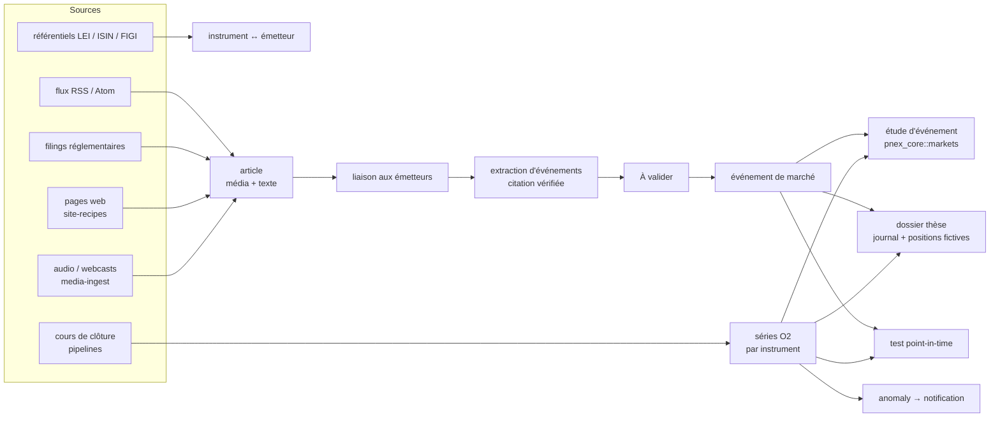

# Recherche et décision d'investissement — PRD (D523–D536)

| | |
|---|---|
| Statut | Proposé le 2026-10-31 ; **codé le 2026-11-02 : MK0 partiel, MK1, MK2 (presse = piste), MK4, MK5, MK6 sur dépôts, D536 outils de lecture**. Reste : §7 bis |
| Numérotation | **D523…D536, D540…D546, D734…D743** (appendice A), lots **MK0…MK10** |
| Repose sur | ontologie (D176–D191, séries D185, provenance D184), `companies` / `companies_fr` (D304–D306), pipelines (`data-pipelines.md` D344–D358), règles de sites (`site-recipes.md` D323–D328), ingestion média (`media-ingest.md` D159–D175), dossiers (`cases.md`), moteur financier (`due-diligence.md` D478), propositions (`proposals.md` D371–D377), nœuds `anomaly` / `forecast`, notifications (D49–D68), assistant (`ai-assistant.md` §9) |
| Sécurité | `security.md` §6 avant chaque lot ; sources sortantes via `pnex_core::egress` (R8), clés d'API au coffre (D113) |

> Avertissement produit à afficher sur chaque écran du domaine : les indicateurs, événements et tests sont des aides à l'analyse, pas un conseil en investissement ni une recommandation.

## 1. Le besoin

Outiller la démarche d'une équipe d'analyse sectorielle :

1. **Couvrir** une liste de sociétés (30 à 300) et leurs instruments cotés.
2. **Voir passer** tout ce qui les concerne : articles, communiqués, publications réglementaires, appels de résultats, données macro.
3. **Transformer** ce flux en **événements datés et sourcés** (résultats, révision de prévisions, opération sur capital, changement de dirigeant, litige, notation).
4. **Mesurer** la réaction du cours autour de chaque événement.
5. **Écrire une thèse** avant de décider (catalyseurs datés, critères d'invalidation, taille), tenir un **journal**, faire la **revue** après coup.
6. **Tester** une règle (« après une révision à la hausse, sur-performance à 20 jours ? ») sur des données **telles qu'elles étaient connues à la date** (point-in-time), sans biais d'anticipation.

Hors du besoin : prix temps réel des actions, exécution d'ordres, messagerie entre acteurs, diffusion de signaux.

## 2. Ce qui existe déjà

| Brique | Où | Rôle ici |
|---|---|---|
| Objets, liens, provenance, historique | ontologie 0.2.0 | émetteurs, instruments, événements ; `ontology_objects_changes` donne l'état à une date |
| Propriétés `series` (D185) + `telemetry/aggregate` | O2 | cours et volumes d'un instrument, lus par objet |
| Sociétés, SIREN, dirigeants, BODACC | packs `companies`, `companies_fr` | l'émetteur **est** l'organisation déjà connue |
| Imports déclaratifs et pipelines | D301, D344–D358 | référentiels (LEI, ISIN), cours de clôture, filings |
| Collecte web gardée | `site-recipes.md`, crawl | pages de communiqués, sites d'information sans flux |
| Audio / vidéo → texte | `media-ingest.md`, ASR | podcasts, webcasts de résultats |
| Recherche documentaire | `doc-search.md` | recherche plein texte des articles collectés |
| Extraction LLM à citation vérifiée | `due-diligence.md` D476 | même règle pour les événements (citation retrouvée ou rejet) |
| File « À valider » | `proposals.md` | les événements extraits sont des propositions |
| Ratios financiers | `pnex_core::finance` (D478) | fondamentaux des émetteurs (lot DD2) |
| Détection d'anomalies, prévision | nœuds `anomaly`, `forecast` | volume ou cours anormal → alerte |
| Dossier, chronologie, preuves | `cases` | support de la thèse |

## 3. Ce qui manque

- un référentiel **instrument / cotation / émetteur** avec identifiants (ISIN, LEI, FIGI, MIC) ;
- l'import des **cours de clôture** avec **opérations sur titres** (divisions, dividendes) ;
- le type **article** relié aux émetteurs, et le type **événement de marché** ;
- un calcul **d'étude d'événement** (rendement anormal) ;
- un dossier **thèse d'investissement** avec journal et positions fictives ;
- une lecture **point-in-time** pour les tests.

## 4. Principe d'architecture

## 5. Décisions

### D523 — Un pack `markets`, l'émetteur reste l'organisation

Pack `markets` (`requires: [companies]`). Types : `instrument` (action, obligation, ETF, indice, crypto-actif, devise ; ISIN, FIGI, devise de cotation), `listing` (instrument × place, MIC, ticker), lien `emet` (`organization` → `instrument`), `index_member` (instrument → indice, avec dates). Pas de type « société cotée » : une organisation devient émettrice par son lien. Couche pays éventuelle `markets_fr` (place Euronext Paris, code AMF) selon la règle des packs.

### D524 — Référentiels par imports, jamais saisis à la main

LEI (GLEIF, données ouvertes) → `organization.lei` ; ISIN ↔ LEI (fichier de correspondance GLEIF) ; FIGI et tickers (OpenFIGI, clé d'API au coffre) ; référentiel d'instruments européen (ESMA FIRDS). Chacun est une import D301 / pipeline D344 avec `skip_if_unchanged`. Rapprochement émetteur ↔ organisation existante par LEI puis SIREN, sinon proposition.

### D525 — Cours de clôture dans O2, bruts + facteurs d'ajustement

Une série par instrument et par champ (`close`, `open`, `high`, `low`, `volume`), labels `object=instrument/<id>`. On stocke le **brut** ; les opérations sur titres sont des objets `corporate_action` (date, type, ratio) et l'ajustement se calcule à la lecture. Raison : un ajustement réécrit dans la série casse le point-in-time. Granularité V1 : quotidienne. Crypto : la même chaîne, granularité minute possible (sources publiques gratuites).

### D526 — Une source = une import ou une règle de site, liste blanche par org

Pas de collecteur dédié : les flux RSS/Atom, filings et API de cours passent par les pipelines ; les pages sans flux par `site-recipes`. Liste des sources par org, chacune avec sa licence notée (champ `license_note`) et son rythme. Egress R8, `robots.txt` respecté, pas de contournement de paywall.

### D527 — L'article est un média, son texte reste privé à l'org

Un article = un `media_asset` texte (titre, source, URL, `published_at`, `fetched_at`, langue) indexé par la recherche documentaire. Jamais exposé par lien public ni par page publiée (`pages.md`, studio S5) : la conservation du texte sert l'analyse interne seulement. Purge par rétention d'org.

### D528 — Liaison article → émetteurs déterministe d'abord

Par ordre : identifiants présents (ISIN, LEI, ticker avec place), nom exact ou alias de l'organisation, puis LLM usage `extraction` sur les cas ambigus → proposition. Un lien porte son mode (`id`, `alias`, `llm`) et son score.

### D529 — L'événement de marché est un objet, toujours sourcé

Type `market_event` : `kind` (enum fermée minuscule : `earnings`, `guidance`, `capital_operation`, `m_and_a`, `management_change`, `rating`, `litigation`, `regulatory`, `macro`, `other`), `direction` (`positive`, `negative`, `neutral`, `unknown`), `event_at`, `published_at`, `known_at`, liens `concerne` → émetteur/instrument, `source` → article. Extraction : schéma JSON du pack (`extractors:`, comme D476), chaque champ porte `quote` retrouvée verbatim dans l'article, sinon rejet. La direction est celle **dite par la source**, pas un score de sentiment opaque.

### D530 — Événements : propositions, acceptation automatique possible par règle

Les événements extraits passent par la file « À valider » (D371). Pour un volume élevé, une règle d'org D377 peut accepter automatiquement une classe (`kind` + source), tracée. Un doublon (même émetteur, même `kind`, même jour, articles différents) fusionne ses sources au lieu de créer un second événement (empreinte D372).

### D531 — Trois horodatages, le test lit `known_at`

`event_at` (quand c'est arrivé), `published_at` (quand la source l'a dit), `known_at` (quand PNEX l'a su : `fetched_at` de l'article ou date d'import). Toute lecture « à la date t » filtre `known_at <= t` pour les objets et `ts <= t` pour les cours bruts. Un événement importé après coup (rattrapage d'historique) garde `known_at` = date d'import et est marqué `backfilled` : il est exclu des tests par défaut, inclus seulement sur choix explicite affiché.

### D532 — Étude d'événement : calcul pur dans `pnex_core::markets`

Fonction pure (cours, indice de référence, date, fenêtres) → rendement, rendement anormal (modèle de marché simple : rendement − β × rendement de l'indice, β estimé sur [−250, −30] jours), cumul sur fenêtres [−1, +1], [0, +5], [0, +20], et volume relatif. Agrégat sur un ensemble d'événements : moyenne, médiane, part positive, intervalle par bootstrap, effectif affiché. Testé sur des séries synthétiques à résultat connu.

### D533 — Le dossier « thèse » étend `case`

Pack `investment_thesis` (`requires: [markets, investigation]`) : `case_kind = investment`, instrument(s), sens (`long`, `short`, `watch`), date d'ouverture, **catalyseurs datés** (objets reliés, échéance), **critères d'invalidation** écrits, horizon, taille prévue. Journal = événements de dossier existants (note, décision, révision). Revue de clôture obligatoire pour fermer le dossier : résultat, ce qui était juste, ce qui ne l'était pas. Le dossier se gèle à chaque décision (snapshot existant) : la thèse d'origine ne se réécrit pas.

### D534 — Positions fictives, aucun lien vers un courtier en V1

`paper_position` (instrument, sens, quantité, prix et date d'entrée, sortie) reliée au dossier ; P&L calculé sur les clôtures. Import CSV d'un relevé de courtier possible plus tard (lecture seule). Jamais d'ordre passé par PNEX : exclu de l'API exposée à l'assistant et au MCP sous le motif `physical`/`outbound`, au même titre que les commandes de devices (D123).

### D535 — Test de règle = requête point-in-time + étude d'événement

Une règle = filtre d'événements (`kind`, `direction`, univers d'instruments, période) + fenêtre. Le moteur rejoue jour par jour avec la lecture D531, applique D532, rend la distribution et la comparaison à un tirage aléatoire de dates sur le même univers. Affichage obligatoire : effectif, période, part d'événements `backfilled`, univers (biais du survivant : un instrument radié reste dans l'univers à ses dates). Pas d'optimisation de paramètres en V1 (sur-ajustement).

### D536 — Assistant : lit, résume, propose ; ne décide pas

Outils de lecture (événements d'un émetteur, étude d'événement, état d'une thèse), synthèse quotidienne privée par notification, propositions d'événements. Jamais d'ordre, jamais de modification d'une thèse gelée, toute affirmation reliée à un article. Réponses marquées « aide à l'analyse ». Fiches `assistant-kb` à chaque lot.

### D540 — Les sources primaires d'abord, la presse détecte

Un chiffre se lit à sa source : dépôts SEC, séries FRED, puis banques centrales et publications réglementées. Le socle de calcul ne contient que des sources primaires. Un article sert à repérer un événement que les chiffres ne disent pas encore (litige, enquête, négociation) ; son contenu n'alimente aucun calcul et reste non confirmé tant qu'aucune source primaire ne le recoupe. Cela précise D526 et D527 : les flux d'articles passent après.

Mise en œuvre dans l'import D301, sans collecteur dédié : `shape` lit une réponse qu'aucun chemin ne décrit (`sec_tickers`, `edgar_filings`, `xbrl_facts`, `dated_csv`) ; `contact_setting` déclare un contact dans le `User-Agent`, sans lequel la SEC répond 403 et FRED coupe la connexion ; `per_setting_code` et `rows_in_setting` limitent la lecture à la liste de l'org, un registre entier n'étant jamais voulu. Chaque requête reste derrière le garde R8.

### D541 — Valeurs datées : on ajoute, on ne remplace jamais

Table `market_observations` (objet, indicateur, unité, période, `known_at`, valeur, source, `backfilled`), en PostgreSQL et non en objets (≈ 1 700 valeurs par société) ni dans O2 (D525 reste pour les cours : la lecture « dernière valeur connue à t » par période est une requête SQL directe, et la rétention O2 ne doit pas toucher un historique financier).

- Une valeur inchangée n'ajoute rien ; une valeur différente ajoute une ligne. Lecture à la date t = pour chaque période, la dernière ligne avec `known_at <= t`.
- Dépôt : `known_at` = fin de la journée de dépôt (UTC), jamais avant que le marché ait pu le lire.
- Source sans date de publication (FRED) : `known_at` = instant de lecture, et les premières valeurs d'un indicateur sont marquées `backfilled`, exclues d'une lecture datée sauf demande (D531).
- Les valeurs restent celles de la source, sous le nom de son concept. Mesuré sur un vrai dossier : le chiffre d'affaires change de concept selon les années, et une « révision » peut être un arrondi ou une erreur de balisage. Aucun rapprochement de concepts tant qu'un calcul n'en a pas besoin.

Limite connue : seuls les 1000 derniers dépôts (`filings.recent`) sont lus. Les valeurs d'époque FRED antérieures à la première lecture ne sont pas importées (l'API ALFRED demande une clé).

### D542 — Le document d'un dépôt devient un média de l'org

Une tâche de fond lit le document principal de chaque dépôt (20 par passage de 5 minutes, 150 ms entre deux requêtes, sous le plafond de 10 requêtes par seconde de la SEC), en garde le texte lisible, en fait un média indexé par la recherche documentaire (D527) et le relie par `filing_document`. Seules les orgs ayant déclaré un contact sont lues. L'état du dépôt (`document_state`) évite de relire. Le média reste privé à l'org.

### D543 — Cours : Tiingo, clé d'org au coffre, valeurs brutes (tranche Q-MK1)

Essais du 2026-11-02 : Stooq impose un contrôle JavaScript, Yahoo n'a pas d'API autorisée : écartés (pas de contournement, D526). Tiingo a une API officielle et une offre gratuite à usage interne personnel (50 requêtes/heure, 1000/jour), une offre commerciale à 50 $/mois ; sa couverture européenne n'est pas confirmée. Le format `daily_prices` reste indépendant du fournisseur. **Aucune clé n'était disponible : le chemin est testé sur un mock, jamais sur le vrai Tiingo.**

Corrige D525 : les cours vont dans `market_observations` et non dans O2, pour une seule lecture datée et sans rétention O2. On stocke `close`, `volume`, `dividend`, `split` bruts ; l'ajustement se calcule à la lecture.

Sécurité (R9) : une import nomme une source de `KEYED_SOURCES`, jamais un secret ni un hôte. Hôte et nom de secret sont fixés dans le code, l'URL est vérifiée avant de lire le coffre, la clé part en en-tête (absente des URL et des journaux), et reqwest la retire sur redirection vers un autre hôte.

### D544 — Les événements de marché sans LLM : les rubriques des dépôts

Un 8-K déclare déjà sa nature (2.02 résultats, 5.02 dirigeants, 1.01 accord, 2.01 acquisition). L'étude et le test de règle lisent directement ces rubriques, datées par le dépôt lui-même : pas de `backfilled` possible (D531). Cela couvre MK6 et une grande part de MK3 sans LLM ; l'extraction à citation vérifiée (D529) reste à faire, le mécanisme `extractors:` de D476 n'existant pas encore dans le code.

### D545 — Test de règle : pas de paramètre, toujours face au hasard

`rule-test` : formulaire + rubrique, fenêtres fixes, distribution du rendement anormal, comparée à 20 dates tirées par instrument (tirage déterministe, résultat reproductible), effectif affiché. Limite affichée : seuls les instruments suivis aujourd'hui sont mesurés (biais du survivant, D535 non tenu en entier : pas d'univers historique).

### D546 — Thèse : extension de `case`, position fictive mesurée

Pack `investment_thesis` conforme à D533–D534. Le résultat d'une position se calcule sur les clôtures, jamais sur un prix saisi. Limite : la revue de clôture est un champ, non exigée à la fermeture ; le gel passe par les snapshots existants, à la main.

## 6. Sources V1 (conditions d'usage à vérifier source par source)

| Source | Contenu | Accès |
|---|---|---|
| GLEIF | LEI, correspondance ISIN ↔ LEI | ouvert |
| OpenFIGI | FIGI, tickers | clé gratuite |
| ESMA FIRDS | référentiel d'instruments UE | ouvert |
| SEC EDGAR | filings US (8-K, 10-Q, 10-K) | ouvert, `User-Agent` déclaré, quota |
| Publications réglementées UE / FR | communiqués d'émetteurs, déclarations | ouvert |
| Banques centrales, statistiques publiques | taux, inflation, agrégats | ouvert |
| Flux RSS des médias | titre, chapô, lien | selon conditions de chaque éditeur |
| Pages de communiqués des émetteurs | texte des communiqués | `site-recipes` |
| Cours de clôture actions | OHLCV quotidien | **à choisir** : fournisseur branché par une clé au coffre (D113) |
| Places crypto | OHLCV, carnet | API publiques |

## 7. Lots

| Lot | Contenu | Valeur sans LLM |
|---|---|---|
| **MK0** | pack `markets`, imports GLEIF / OpenFIGI / FIRDS, rapprochement émetteurs | oui |
| **MK1** | cours de clôture + `corporate_action`, séries par instrument, fiche instrument (graphique, émetteur) | oui |
| **MK2** | sources d'articles (RSS, filings), type article, liaison D528 déterministe, fil par émetteur | oui |
| **MK3** | extraction d'événements à citation vérifiée, propositions, règle d'acceptation, alertes | non |
| **MK4** | `pnex_core::markets` (étude d'événement), widget sur la fiche émetteur et le dossier | oui |
| **MK5** | dossier thèse, journal, positions fictives, revue de clôture | oui |
| **MK6** | test de règle point-in-time | oui |
| **MK7…MK10** | mouvements de marché et événements géopolitiques : voir appendice A (§A.3) | oui |

Premier ensemble utile : MK0 → MK2 + MK4 (suivre ses valeurs, lire leur fil, voir la réaction aux publications réglementaires), avant toute extraction LLM.

## 7 bis. Reste à faire (2026-11-02)

- Essai réel de Tiingo (clé à poser au coffre) et couverture européenne des cours.
- MK0 : GLEIF/OpenFIGI/FIRDS, rapprochement avec une organisation existante (aujourd'hui une société SEC est créée par CIK, un doublon est possible avec une société déjà connue par LEI ou SIREN).
- MK3 : extraction LLM à citation vérifiée (D476 absent du code), règles d'acceptation.
- Répartition du balayage des documents entre orgs ; millésimes FRED antérieurs à la première lecture ; dépôts plus anciens que `filings.recent` ; alertes `anomaly` sur volume ; synthèse quotidienne de l'assistant ; widget de fiche émetteur.
- **Imports : passer sur les pipelines de données en masse** (`data-pipelines.md` D344–D358, prévus pour les gros volumes et les fichiers volumineux). Une partie des imports du domaine a été commencée par flow ; recenser ce qui passe encore par un flow (cours, FRED, dépôts, documents) et le transférer sur les pipelines avant de reprendre le domaine marchés. Aucun nouvel import marchés par flow, y compris pour l’appendice A (MK7–MK10). Noté le 2026-11-06, à traiter.

### 7 ter. Filiales déclarées : Exhibit 21 des 10-K (lot F6 du test grandeur nature, 2026-11-06)

- **Lecture** : pour chaque 10-K d'une société suivie, le service des documents lit l'index du dépôt (`<accession>-index.htm`), trouve le document `EX-21` / `EX-21.x` sur le même hôte, et en extrait les lignes nom + juridiction (`pnex_core::markets::exhibit21` : tableau HTML ou texte, entités décodées). Une juridiction inconnue laisse sa ligne de côté ; un État américain donne `US`.
- **Écriture** : chaque filiale devient une `organization` retrouvée par `declared_key` (pays et nom normalisés, unique). Elle porte `country` et `incorporated_in`, et un lien `subsidiary_of` vers le déclarant (nature `declared`, source = adresse de l'exhibit). Le dépôt reçoit `subsidiaries_state` (`read`, `none` ou `unreadable`) et n'est lu qu'une fois.
- **Essai réel** (un groupe suivi, 6 rapports annuels de 2021 à 2026) : toutes les listes sont lues, les noms et les pays sont justes (Pays-Bas, Chine, Maurice, îles Caïmans…). Le rapport de 2022 liste 70 filiales, les suivants seulement les principales. Une filiale qui disparaît d'une liste garde son lien : il dit qu'elle a été déclarée, pas qu'elle l'est encore.
- **Reste à faire** : dater le lien de la date du dépôt (`valid_from`) et le fermer quand la filiale disparaît des rapports suivants ; utiliser le LEI quand GLEIF le donne (MK0).

## 8. Hors périmètre V1

Prix temps réel des actions, carnet d'ordres actions, exécution, connexion courtier en écriture, options et dérivés (grecques, surfaces), données alternatives payantes, optimisation de portefeuille, diffusion ou partage de signaux hors de l'org.

## 9. Questions ouvertes

- **Q-MK1** : tranché pour les États-Unis (Tiingo, D543) ; Europe ouverte.
- **Q-MK2** : univers de départ (indices, liste personnelle) et profondeur d'historique pour MK6.
- **Q-MK3** : crypto en MK1 ou plus tard ; granularité minute = volume O2 à mesurer.
- **Q-MK4** : appels de résultats : webcasts publics par `media-ingest`, ou seulement les communiqués écrits en V1.

## Appendice A — Mouvements de marché et événements géopolitiques (D734–D743)

| | |
|---|---|
| Statut | Proposé le 2026-11-06 ; **MK7 à MK10 codés le 2026-11-06** (questions tranchées au §A.5, écarts au §A.6) |
| Lots | **MK7…MK10** |
| Origine | séance du 2026-11-05 (Nasdaq −5,5 %, SOX −12 %, pétrole US ≈ +3 %, or et dollar en hausse) : aucun objet PNEX ne pouvait représenter un mouvement de l'ensemble du marché, ni un événement géopolitique |
| Repose sur | D525/D541/D543 (valeurs datées), D529 (`market_event`), D531 (trois horodatages), D532 (étude d'événement), D540 (sources primaires d'abord), D545 (test face au hasard), dossiers (`cases.md`), carte, notifications (D49–D68) |

### A.1 Le besoin

1. Garder la trace, comme **fait daté et sourcé**, d'un mouvement anormal d'une série : indice, pétrole, taux, volatilité, or. La source est la série elle-même, pas la presse.
2. Garder la trace des **événements géopolitiques** (conflit, attaque, sanctions, blocus, cessez-le-feu) : un lieu, une date, une source.
3. Pouvoir **mesurer** la réaction des séries autour de ces dates, sans jamais **affirmer** de cause.

Hors du besoin : la prédiction, les scores de sentiment ou de risque pays, l'intrajournalier, toute explication générée automatiquement.

### A.2 Décisions

#### D734 — Un mouvement de série est un fait primaire : `kind = market_move`

Cela précise D529 : on ajoute la valeur `market_move` à l'enum `kind`, et deux champs.
- `asset_class` : `equity_index`, `commodity`, `rates`, `volatility`, `fx`, `crypto`.
- `move_direction` : `up` ou `down`. On n'utilise pas `direction` (`positive`/`negative`) parce qu'une hausse du pétrole n'est ni bonne ni mauvaise en soi.

L'événement porte la valeur mesurée (rendement ou écart), le seuil franchi et `sigma`. Son lien `source` pointe sur les lignes de `market_observations` qui l'ont déclenché, et non sur un article. Lien `concerne` vers l'`instrument` ou la `macro_series`.

C'est la première implémentation du type `market_event`. En V1, les autres `kind` restent alimentés par les rubriques 8-K (D544) et, plus tard, par l'extraction (MK3).

#### D735 — Un détecteur générique, fonction pure dans `pnex_core::markets`

Entrée : une série quotidienne, une date, un mode, des paramètres. Sortie : déclenché ou non, avec la valeur, `sigma` et le seuil.

- Le mode est fixé par série. `log_return` pour les prix et les indices. `diff` pour les taux, en points de base, et pour le VIX, en points. Un rendement sur un taux n'a pas de sens.
- `sigma` = écart-type de la mesure sur la fenêtre [−250, −1]. La date testée est exclue.
- Déclenchement si |mesure| ≥ `k` × `sigma` **et** si |mesure| ≥ un plancher absolu. Ce plancher évite les déclenchements sur une série presque plate. Par défaut : `k = 3`, plancher 2 % en `log_return` et 15 pb en `diff`. Les deux sont réglables par org et par série.
- Il faut au moins 60 points d'historique, sinon aucune détection. Les jours sans cotation sont ignorés, jamais interpolés.
- Tests sur des séries synthétiques à résultat connu, comme pour D532.

La détection s'exécute **après chaque import** de la série concernée, sans cron séparé. L’import est un pipeline D344, jamais un flow (voir §7 bis) : la détection s’accroche à la fin d’exécution du pipeline. Elle est idempotente : l'empreinte (série, date, mode) empêche un doublon (D372).

#### D736 — `known_at` hérité, jamais antérieur

`event_at` = date de la séance. `known_at` = le `known_at` de l'observation qui déclenche, au plus tôt. Si cette observation est `backfilled`, l'événement l'est aussi.

Une détection lancée sur un historique rattrapé, par exemple à la première activation d'une série, marque **tous** les événements produits `backfilled`. Ils restent exclus des tests par défaut (D531).

#### D737 — Les séries surveillées : un réglage, des valeurs par défaut primaires

Nouveau réglage du pack : `move_series`. C'est une liste de codes FRED ou de tickers, chacun avec son mode.

Valeurs par défaut (FRED, sans clé) :

| Code | Contenu | Mode | `asset_class` |
|---|---|---|---|
| `SP500` | S&P 500 | `log_return` | `equity_index` |
| `NASDAQCOM` | Nasdaq Composite | `log_return` | `equity_index` |
| `VIXCLS` | VIX | `diff` | `volatility` |
| `DGS10` | taux US à 10 ans | `diff` | `rates` |
| `DCOILWTICO` | pétrole WTI | `log_return` | `commodity` |
| `DCOILBRENTEU` | pétrole Brent | `log_return` | `commodity` |
| `DTWEXBGS` | dollar pondéré | `log_return` | `fx` |

Optionnel, avec la clé Tiingo de l'org (D543) : `GLD`, `USO`, `ITA`, `SMH`.

À vérifier série par série, en notant la réponse dans `license_note` (D526) :
- les séries d'indices sur FRED (S&P DJI, Nasdaq) ont des conditions propres : historique limité, redistribution restreinte ;
- les séries pétrole proviennent de l'EIA et sont publiées avec retard. `known_at` absorbe ce retard, et l'événement n'apparaît qu'au jour où la valeur est connue.

#### D738 — Pas de file « À valider » pour un `market_move`

Le calcul est déterministe sur une source primaire : l'événement est créé directement, contrairement à D530. La notification passe par une règle d'org D49 et regroupe en **un seul message** les mouvements d'une même séance, par exemple « 5/11 : NASDAQCOM −5,5 %, VIXCLS +x pts, DCOILWTICO +y % ». Une vue « Séance » liste, pour une date, tous les `market_move` en ordre de |mesure| / `sigma`.

#### D739 — Pack `world_events`, type `geo_event`, hors du pack `markets`

Un événement géopolitique se définit par un lieu, pas par un prix. Il est donc utile aussi aux dossiers d'enquête, et ne dépend pas de `markets`.

- Pack `world_events` (`requires: []`). Lien optionnel aux dossiers via `investigation`.
- Type `geo_event` :
  - `kind` (enum fermée) : `armed_conflict`, `attack`, `sanctions`, `blockade`, `ceasefire`, `natural_disaster`, `other` ;
  - horodatages `event_at`, `published_at` et `known_at` (D531) ;
  - lieu : point, code pays ISO 3166 et région administrative si connue ;
  - `actors` : texte libre en V1, rapprochement avec `organization` plus tard ;
  - `source_kind` : `gdelt`, `acled`, `ucdp` ou `manual` ;
  - `status` : `unconfirmed`, `confirmed` ou `dismissed`, même modèle que `market_news` ;
  - `counts` : nombre de sources et d'articles agrégés.
- Affiché sur la **carte** et dans la **chronologie** des dossiers.

#### D740 — GDELT Events : des pistes agrégées, jamais une ligne par enregistrement

Import des exports GDELT 2.0 Events (toutes les 15 minutes), filtré par la liste de l'org.
- Pays ou régions suivis (réglage `geo_watch`).
- Codes CAMEO racine retenus : `18` (assaut), `19` (combat), `20` (violence de masse), `163` (embargo, sanctions), `17` (coercition, sur choix explicite).
- Seuils : `NumSources` ≥ N et `GoldsteinScale` ≤ G, réglables.
- **Un `geo_event` par (pays, code racine, jour)**, et non un par ligne GDELT : le flux brut est trop bruité. Les identifiants GDELT agrégés sont gardés dans la provenance (D184).

Un événement venu de GDELT est toujours `unconfirmed` : il ne nourrit aucun calcul par défaut (règle D540 appliquée au géopolitique). Conditions d'usage GDELT à noter dans `license_note`. Egress R8.

#### D741 — Confirmation : ACLED / UCDP plus tard, ou un humain

- **UCDP** (GED et Candidate, licence ouverte, publication décalée) et **ACLED** (vérifié à la main, hebdomadaire, compte et clé exigés, conditions restrictives pour un usage commercial ou une redistribution) arrivent dans un lot séparé, **après vérification de la licence**, en particulier pour le mode SaaS. Clé au coffre (D113), même garde que D543 (R9).
- Une piste GDELT passe `confirmed` si un événement ACLED ou UCDP correspond (même pays, ±1 jour, `kind` compatible), ou si un utilisateur la confirme en citant une source. L'action est tracée.

#### D742 — Aucune causalité automatique

- Entre un `geo_event` et un `market_event`, PNEX ne **stocke** aucun lien. Il **calcule à la lecture** une concomitance : même fenêtre, ±1 séance par défaut. L'interface l'affiche comme « même fenêtre » et jamais comme « cause ».
- Un lien `attributed_to` (`market_event` → `geo_event`, ou → `market_news`) ne peut être créé **que par un utilisateur, dans un dossier**, avec une note de justification et une source. Ces deux champs sont obligatoires.
- L'assistant (D536) peut signaler une concomitance, en la marquant « concomitance, pas cause ». Il ne crée jamais `attributed_to` et ne présente jamais une explication de presse comme un fait.

#### D743 — Étude d'événement sur des dates géopolitiques

On étend `rule-test` (D545). La source des dates peut être :
- une rubrique 8-K (existant) ;
- un filtre `geo_event` (`kind`, pays, `status`, `confirmed` par défaut) ;
- un filtre `market_move` (`asset_class`, `move_direction`).

On peut alors mesurer **n'importe quelle série suivie**, y compris une `macro_series` comme le pétrole. Les règles D545 s'appliquent telles quelles : aucun paramètre à optimiser, comparaison à des dates tirées au hasard, effectif affiché.

Ajouts propres à ce cas :
- **Regroupement** : des `geo_event` qui se suivent dans la fenêtre de mesure ne comptent qu'une fois, pour ne pas compter plusieurs fois le même choc. Le nombre de regroupements est affiché.
- Les `unconfirmed` sont exclus par défaut. Si on les inclut, c'est un choix explicite et la part concernée est affichée.
- Un avertissement est affiché : une date géopolitique est souvent connue avant d'être codée, donc `event_at` ≠ `known_at`. Le test lit `known_at`.

### A.3 Lots

| Lot | Contenu | Valeur sans LLM |
|---|---|---|
| **MK7** | `market_event` `kind = market_move` (D734), détecteur pur et tests synthétiques (D735), héritage de `known_at` (D736), réglage `move_series` et séries FRED par défaut (D737), notification de séance et vue « Séance » (D738) | oui |
| **MK8** | pack `world_events`, `geo_event` sur carte et chronologie (D739), import GDELT agrégé (D740), concomitance calculée à la lecture et `attributed_to` manuel (D742) | oui |
| **MK9** | `rule-test` sur dates `geo_event` et `market_move`, séries macro mesurées, regroupement (D743) | oui |
| **MK10** | UCDP puis ACLED après vérification de licence, rapprochement de confirmation (D741) | oui |

Premier ensemble utile : **MK7 seul**. La séance du 2026-11-05 doit produire, sur données réelles, au moins `NASDAQCOM` `down`, `SP500` `down` et `VIXCLS` `up`, et `DCOILWTICO` `up` si le seuil est franchi, sans aucune intervention. C'est le test d'acceptation du lot.

### A.4 Hors périmètre

Prédiction de mouvement, score de risque pays ou de sentiment, intrajournalier, explication générée automatiquement, diffusion des événements hors de l'org, toute action déclenchée par un événement (ordre, device), cohérente avec D534 et D123.

### A.5 Questions tranchées (Shan, 2026-11-06)

- **Q-MK5** : les pages FRED de `SP500` (« Reproduction of S&P 500 in any form is prohibited except with the prior written permission of S&P Dow Jones Indices LLC ») et `NASDAQCOM` (« Copyrighted: Pre-Approval Required ») interdisent la reproduction sans accord. Ces deux séries **sortent des valeurs par défaut**. Les indices actions passent par `SPY` et `QQQ` sur Tiingo (réglage `move_tickers`, avec la clé de l'org). `VIXCLS` exige une citation (Cboe). `DCOILWTICO` et `DCOILBRENTEU` (EIA) et `DTWEXBGS` (Fed) sont du domaine public, avec une citation demandée.
- **Q-MK6** : `geo_watch` vide par défaut.
- **Q-MK7** : mesuré sur l'année 2025-11 → 2026-11, sur les données FRED réelles, avec un portage fidèle du détecteur. Déclenchements avec k = 3 :

  | Série | Déclenchements | Mois touchés | Max par mois |
  |---|---|---|---|
  | NASDAQCOM | 2 | 2 | 1 |
  | SP500 | 1 | 1 | 1 |
  | VIXCLS | 3 | 3 | 1 |
  | DGS10 | 2 | 2 | 1 |
  | DCOILWTICO | 11 | 4 | 5 |
  | DCOILBRENTEU | 13 | 6 | 7 |
  | DTWEXBGS | 0 avec un plancher de 2 %, 3 avec 0,75 % | 3 | 1 |

  Le pétrole se déclenche pendant un vrai choc (variations de 8 à 17 %, mars-avril 2026). On garde k = 3. Le plancher d'une série `fx` passe à **0,75 %** (`FX_FLOOR`) ; un plancher écrit dans l'entrée l'emporte toujours. Test d'acceptation : le 2026-11-05, `NASDAQCOM` −5,7 % en log, soit 4,8 σ, est détecté `down`. `SP500` et `VIXCLS` n'étaient pas encore publiés sur FRED le 2026-11-06.
- **Q-MK8** : pas d'événement de niveau séance ; la vue **Séance** suffit.
- **Pays** : ISO 3166 alpha-2 partout. Les codes de GDELT (FIPS 10-4), d'UCDP (Gleditsch & Ward) et d'ACLED (ISO numérique) sont convertis à la lecture.
- **Avis** : en plus de l'avis dans l'application, l'org nomme ses canaux (e-mail, Slack, ntfy…) dans le réglage `move_notify_channels`.
- **Carte** : les événements du monde s'affichent sur la carte générale (une case du panneau, 30 jours) et sur la carte des dossiers.
- **ACLED** : lu seulement avec le compte et la licence de l'org. Le CLUF ACLED (§1.2, §3.1, §3.3) interdit l'usage commercial et l'accès direct sans licence entreprise. **UCDP** : licence CC BY 4.0, jeton à demander à Uppsala, 5 000 requêtes par jour.

### A.6 Ce qui est codé (2026-11-06) et écarts au texte

| Décision | Où | Écart ou précision |
|---|---|---|
| D734 | type `market_event` du pack `markets` 1.1.0 (`kind` D529 + `market_move`), lien `event_about` → `instrument` / `macro_series` | la « source » est portée par `series_code`, `metric` et `known_at` : ils désignent les lignes de `market_observations`, qui ne sont pas des objets |
| D735 | `pnex_core::markets::moves::detect` ; `services::markets::moves::after_store`, appelé en fin d'écriture de toute import qui stocke des observations | la détection relit toute la série touchée (idempotence par `ref` = `move:<code>:<date>:<mode>`, objets archivés compris) ; un échec ne fait pas échouer l'import, le run suivant répare |
| D736 | `known_at` / `backfilled` repris de l'observation qui déclenche | — |
| D737 | réglages `move_series` (FRED) et `move_tickers` (Tiingo, `SPY`, `QQQ`), même format `CODE:mode:classe[:k[:plancher]]` ; imports « Watched series (FRED) » et « Watched prices (Tiingo) » | `PerObjectSetting::codes` ignore ce qui suit `:` ; plancher `fx` à 0,75 % (Q-MK7) |
| D738 | avis groupé par séance : websocket de l'org, plus les canaux nommés dans `move_notify_channels` (envoi direct par `pnex_notify`, journalisé avec la source `market-moves`) ; jamais pour un `backfilled`. Onglet **Séance** sur `market_event` et `geo_event`, route `GET /api/v1/markets/sessions/{date}` | la « règle d'org » D49 est un réglage du pack, pas un objet de règle |
| D739 | pack `world_events` (`geo_event`), sans dépendance. Calque de la carte générale (`GET /api/v1/markets/world-events`, 30 jours, vert si confirmé, ambre sinon) et carte des dossiers | pays en ISO alpha-2 ; le FIPS de GDELT est converti par `gdelt_events::iso_of_fips` |
| D740 | `pnex_core::gdelt_events` (pur, testé), `events_feed` d'une import, `source::fetch_events` | `known_at` = dernier `DATEADDED` agrégé, `published_at` = le premier. Fenêtre de 48 h par run quotidien : les compteurs suivent la dernière lecture, le statut n'est écrit qu'à la création (`defaults`) |
| D741 | `pnex_core::conflict_events` : lecture UCDP et ACLED, tables Gleditsch & Ward → ISO et ISO numérique → alpha-2, critère `confirms`. Une import porte un `conflict_feed` (hôte et secrets fixés par la source, R9). Imports « Verified events (UCDP) » et « Verified events (ACLED, your account) ». La passe `services::markets::world::confirm_leads` tourne après toute import à `events_feed` ou `conflict_feed` | la confirmation écrit `status = confirmed` et `confirmed_with` (la référence UCDP ou ACLED) comme une version de l'objet, faite par l'import ; un statut posé par un membre n'est jamais repris. La version UCDP Candidate est dans l'adresse de l'import, à mettre à jour à chaque publication. La table Gleditsch & Ward est partielle (les États présents dans UCDP) : un numéro inconnu est laissé de côté. **Téléchargements UCDP (2026-11-06, demande de Shan)** : GED 26.1 (`ged261-csv.zip`, 39 Mo zippé, 274 Mo, 418 000 événements 1989-2025) et Candidate de l'année (`GEDEvent_v26_01_26_09.csv`), sans jeton, lus en flux (`csv-core`). Seuls les pays surveillés sont gardés. Les événements vérifiés sont **agrégés par (pays, nature, jour)** : l'Ukraine passe de 40 434 événements à 2 929 jours, la Syrie de 88 289 à 6 935. `known_at` = fin du premier jour où une source en a parlé (`source_date`) : 100 % des jours ukrainiens et 99 % des jours syriens sont ainsi datés (délai médian de 0 à 1 jour), contre 56 % pour Israël. Un jour sans date de source n'a pas de `known_at` et reste hors des tests du passé (D531). L'API (jeton) reste pour le direct |
| D742 | concomitance calculée à la lecture (`session`, fenêtre ±1 séance, week-ends sautés, jours fériés ignorés). Le lien `attributed_to` vit dans un pack à part, `market_attribution` (qui requiert `markets` et `world_events`), avec les attributs `justification` et `source` obligatoires. Le type de lien porte **`member_only: true`**, un drapeau générique du moteur | « dans un dossier » = la source du lien est membre d'un dossier (`in_case`) ou attachée à un de ses événements (`involves`). Le lien est refusé à l'assistant, à toute import (mapping refusé) et à tout acteur non humain : `ontology-link-member-only`. Le moteur ne nomme aucun type de pack (D441) |
| D743 | `rule-test?dates=geo_events|market_moves&series=…` (`study::rule_on_dates`), regroupement `moves::cluster` (28 jours civils ≈ 20 séances), part des non confirmés | une `macro_series` est mesurée sans modèle de marché : l'« anormal » est la variation brute, comparée aux dates tirées. Le mode vient de `move_series` ou `move_tickers`, et vaut « rendement » sinon |

Assistant : outil `market_session` (lecture) et `market_rule_test` étendu ; fiche `assistant-kb/market-moves.md`. Garde D441 : les littéraux restants des services marchés et de la fiche objet sont inscrits aux deux exceptions marchés existantes de `tests/engine_genericity.rs`, ce qui reste une dette.

### A.7 Validation du 2026-11-06

**Relecture indépendante (agent sans contexte) : défauts confirmés et corrigés.**

| # | Défaut | Correctif |
|---|---|---|
| 1 | Un ticker activé lit des années de cours, chacun connu le jour même : des dizaines d'avis pour de vieilles séances | avis limités aux séances des 5 derniers jours (`NOTICE_DAYS`) |
| 2 | Le jeton UCDP (en-tête propre) et le mot de passe ACLED (corps du POST) suivaient une redirection vers un autre hôte (R9) | client `http_keyed` sans redirection pour toute requête qui porte un secret |
| 3 | Les pages de l'API UCDP commencent à 0 (vérifié dans sa doc) : la page 0 était sautée | boucle depuis 0 ; le serveur simulé du test ne répond plus qu'à `page=0` |
| 4 | `member_only` gardait la création seulement, pas la modification ni la fermeture (flow `link_upsert`, assistant `close_link`) | contrôle aussi dans `update_with` et `close` |
| 5 | Deux runs simultanés pouvaient créer deux fois le même mouvement (refs non uniques en base) | détection et confirmation sous le verrou d'import de l'org |
| 6 | `LIMIT 20000` sans ordre : test de règle tronqué en silence | une ligne par jour de connaissance, agrégée en SQL, sans limite |
| 7 | Une piste GDELT confirmée plus tard était datée de son propre `known_at` : lecture anticipée | « confirmé » = vérifié (UCDP, ACLED, saisi), les pistes GDELT seulement avec `include_unconfirmed` |
| 8 | Le mouvement déclencheur entrait dans sa propre fenêtre de mesure | mesure à partir de la séance qui suit le jour de connaissance |
| 9 | UCDP et ACLED réécrivaient `status: confirmed` à chaque run, ce qui annulait un rejet posé par un membre | statut posé à la création seulement (`defaults`) |
| 10 | La Serbie est codée 345 par UCDP (vérifié sur GED 26.1), absente de la table | ligne ajoutée ; les 126 identifiants de GED 26.1 sont couverts |
| — | Une vue de carte au-delà de ±180° ou traversant la ligne de changement de date renvoyait une erreur 400 | toutes les longitudes dans ce cas |

**Essai réel** (`world_events_real_sources`, 10 pays) :
- **FRED** : 65 956 valeurs en 46 s ; NASDAQCOM du 2026-11-05 détecté (−5,7 % en log, 4,8 σ). Les 939 mouvements historiques sont `backfilled`, aucun avis.
- **UCDP GED** : 417 968 lignes lues en flux, 220 125 gardées, 44 785 jours créés en 46 s (≈ 970 objets/s), dont 70 % datés par un article.
- **GDELT** : 189 fichiers sur 192 lus (230 674 lignes) mais 7 pistes seulement. Sur un échantillon réel, 166 lignes retenues sur 168 ont `NumSources = 1`, car une ligne naît avec une source et les reprises arrivent dans d'autres fichiers. Le seuil `min_sources` passe de 3 à 1.
- La confirmation ne peut pas se vérifier sur 48 h : le Candidate UCDP s'arrête à fin septembre. L'essai de volume (3 mois de GDELT) recouvre août-septembre.
- Le test de règle sur toutes les dates `geo_events` regroupe presque tout (391 dates gardées, 6 076 regroupées) : un conflit continu donne une date par fenêtre de 28 jours, et le résultat ne se distingue pas du hasard. Il faut filtrer par pays et par nature.
- Le test de règle sur `market_moves` est vide à la première installation : l'historique FRED est `backfilled` (pas de millésimes, §7 bis).

**Essai de volume** (`world_events_volume`, tous pays `*`, avec un O2 isolé, 9 min 35 s au total) :

| Étape | Volume | Durée |
|---|---|---|
| UCDP GED, tous pays | 417 968 lignes → 147 608 jours | 184 s (≈ 800 objets/s) |
| UCDP Candidate 2026 | 16 633 lignes → 6 499 jours | 19 s |
| GDELT 3 mois (`World events history`) | 8 830 fichiers sur 8 832, 9,1 M lignes → 41 966 pistes | 319 s |
| GDELT 48 h | 190 fichiers → 522 pistes mises à jour | 4,6 s |

- **Confirmation réelle** : sur août-septembre 2026, 2 763 des 23 152 pistes GDELT sont confirmées par UCDP. Une deuxième passe n'en confirme aucune de plus (930 ms sur 196 000 objets).
- **Lectures** : test de règle sur 154 000 jours en 0,2 à 0,4 s ; carte monde en 77 ms ; séance en 37 ms ; recherche globale en 0,64 s. Postgres : 256 Mo pour la table `objects`, 342 Mo pour la base.
- **O2** : 154 000 documents `object_changes` ingérés sans erreur.
- **Constat moteur, non corrigé ici (`ontology/changes.rs`, D184, D350)** : la file du journal est plafonnée à 100 000 changements par transaction et laisse tomber le surplus. 47 000 créations de l'import GED sont sans historique dans O2. Il faudrait un journal résumé pour les imports en masse, ou une contre-pression dans l'import, qui est asynchrone.
- **Constat** : pendant l'import, une lecture de l'API a attendu une connexion du pool (`sqlx::pool::acquire` lent). L'import monopolise des connexions.
- **Corrigé** : la carte ne montrait que les 300 événements les plus récents sur 12 883 ; elle montre désormais les 300 plus importants (morts, puis sources, puis date).
