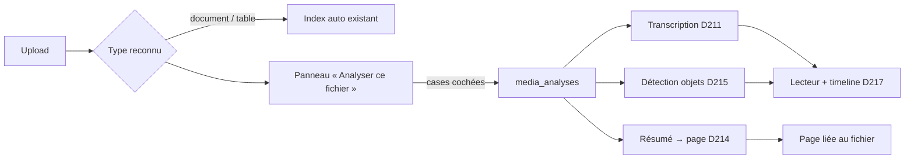

# Pipeline d'import des fichiers — PRD

> **Statut : en cours** (2026-10-16, branche `feat/media-import-pipeline`).
> I1 (D212) et I2 (D213 + D214 sur `document` / `table`) codés ; I3–I6 à faire.
> Décisions proposées **D212–D217** ; D211 (`media-vision-studio.md`
> §4.1bis) en devient la branche audio.

## 0. Ce qui existe déjà (à réutiliser, pas à refaire)

| Brique | Où | État |
|---|---|---|
| Upload médiathèque, kinds libres (photo… document, table, audio, video), contrôle du contenu | `controllers/media/{crud,versions,store}.rs`, `services/media_sniff.rs` | livré |
| Indexation texte **automatique** des `document` / `table` (job `IndexDocumentWorker`, état par version `media_text_index`, carte « Index » + Réindexer) | `store.rs:109`, `services/doc_search.rs`, `pages/media/detail.rs:711` | livré (P1) |
| Fichier comme source de flux → ASR, diarisation, O2 `tx_<slug>` | D206 ; batch = D211 (proposé) | livré / proposé |
| Images d'une vidéo par le décodeur confiné | D203 (Lab) | livré |
| Détections enregistrées + boîtes superposées à la relecture | D105, `camera_detections`, `cameras/player.rs:378` | livré, **caméras device seulement** |
| Écrire une page depuis le backend (version nommée, `ai_generated`) | `services/pages/flow_write.rs:54` | livré |
| Fournisseurs LLM par org, **un seul « par défaut »** pour tout | `services/ai/providers.rs`, point unique `services/ai/config.rs:75` `resolve` | livré (D119) |
| Timelines | caméras (barre de couverture), dossiers (pistes, curseur, 1 126 l.), plages (jour), calendrier (mois) | **4 implémentations, aucun composant commun** |

## 1. Besoin (Shan, 2026-10-14)

À l'import d'un fichier, quel que soit son type, PNEX **propose** un
traitement adapté : texte → indexé et organisé (résumé en page) ; audio →
voix détectées, transcrit ; vidéo → même chose + objets détectés. Ensuite
on **relit** la vidéo avec les analyses superposées et une timeline
commune aux caméras et à l'ontologie. Base pour lancer des analyses
automatiques (flows, rapports M5).

## 2. Principes

- **P1 — Proposé, jamais imposé.** Rien de coûteux ne part sans un geste
  de l'utilisateur ; seule l'indexation texte (déjà automatique, locale,
  bon marché) le reste.
- **P2 — Les options dépendent du LLM.** Sans LLM d'org : uniquement les
  étapes locales. Avec : les étapes LLM apparaissent. Jamais d'option
  morte cliquable : grisée + « connecter un LLM » (lien détail de l'org).
- **P3 — Local d'abord.** Transcription, diarisation, détection d'objets,
  indexation tournent sans LLM ni réseau.
- **P4 — Le bon modèle pour la tâche.** L'org choisit **quel** LLM sert
  à quoi (un petit modèle pour l'extraction, un gros pour l'assistant).
- **P5 — Pas de second pipeline.** Chaque étape délègue à la machine qui
  existe (job d'index, flux batch D211, décodeur D203, `flow_write`).
  Le pipeline n'est qu'un **orchestrateur + un état visible**.
- **P6 — Sortie IA = page versionnée marquée IA**, jamais un texte qui
  écrase autre chose ; approbation comme D210.

## 3. Parcours

1. L'upload se termine comme aujourd'hui.
2. Le détail de l'asset (et un toast après upload) montre le panneau
   **« Analyser ce fichier »** : étapes cochables selon le type et le LLM
   (§4), estimation (durée du média, nombre de pages), bouton Lancer.
3. L'asset affiche une **carte « Analyses »** (remplace / englobe la carte
   Index) : une ligne par étape, état, progression, erreur traduite,
   Relancer.
4. Résultats : page liée, « Voir la transcription », « Relire avec les
   analyses ».

## 4. Matrice des options

| Type | Sans LLM | Avec LLM (usage) |
|---|---|---|
| `document`, `table` (txt, md, pdf, docx, csv, xlsx, ods) | Indexation (auto, existant) | Résumé + points clés → page (`extraction`) ; tags proposés (`extraction`) |
| `audio` | Transcription (+ diarisation si le profil ASR l'a) | Résumé de la transcription → page (`extraction`) |
| `video` | Transcription de la piste audio ; détection d'objets (modèle du registre, 1 image / N s) | Résumé → page (`extraction`) ; description visuelle (`vision`, D195/D196) |
| `photo`, `panorama` | Détection d'objets (une image) | Légende (`vision`) |
| autres (`splat`, `model`, `floorplan`) | rien proposé | rien proposé |

Un type sans profil ASR / sans modèle de détection dans l'org : étape
grisée + lien vers la page de configuration (même règle que P2).

## 5. Décisions proposées

### D212 — Usages LLM (choisir le LLM par tâche)

- Table `llm_usages (org_id, usage, provider_id)` ; usages fermés :
  `assistant`, `extraction` (résumés, classement, compréhension de
  documents, `llm_text`), `vision` (légendes, `media_fuse` avec images).
- `config::resolve(db, cfg, org_id, usage)` : fournisseur de l'usage,
  sinon le **défaut** actuel (aucune migration de comportement). Le
  kill-switch reste en tête.
- UI : détail de l'org, sous la liste des fournisseurs (une seule place,
  D119) : trois sélecteurs « Utilisé pour ».
- Les appelants passent leur usage : assistant (`controllers/ai.rs`),
  `flow_ai::{text, fuse}` → `extraction`, `flow_ai::caption` → `vision`.
- Supprimer un fournisseur utilisé par un usage : l'usage retombe sur le
  défaut (FK `ON DELETE CASCADE` sur la ligne d'usage), jamais d'erreur.

### D213 — `media_analyses` : l'orchestrateur

- Une ligne par **(version média, étape)** : `id, org_id,
  media_version_id, step (index | transcribe | detect | summarize |
  caption), state (queued | running | done | failed | cancelled),
  progress (0–100), error_code, params (json : profil ASR, modèle,
  every_secs…), result_ref (json : page_id, stream_id, layer…),
  created_by, timestamps`.
- `POST /api/v1/media/{id}/analyses {steps:[…], params}` (éditeurs,
  lecteur → 403, org du principal R1) ; `GET` liste ; `POST
  …/{analysis}/retry` ; `DELETE` = annuler.
- Chaque étape **délègue** : `index` = job doc-search existant (la ligne
  reflète `media_text_index`) ; `transcribe` = flux batch D211 **caché**
  (tranche D211 Q-D : un flux interne par asset, absent de la liste des
  flux, lié par `result_ref`) ; `detect` = D215 ; `summarize` = D214.
- Dépendances : `summarize` attend `index` (texte) ou `transcribe`
  (audio/vidéo) ; l'orchestrateur la lance quand l'amont est `done`.
- Fin d'une analyse : événement sur le canal Valkey de l'org →
  `media_source` port `finished` (D211) et, plus généralement, un
  déclencheur de flow « analyse terminée » (asset, étape, résultat).

### D214 — Résumé → page

- Entrée : texte extrait (chunks `text_chunks`) ou transcription (O2).
  Sortie : `flow_write::write` mode `NewPage`, `ai_generated = true`,
  `flow_id = 0`, titre « Résumé — <nom du fichier> ».
- Long document : résumé **par blocs puis synthèse** (map-reduce), borné
  (≤ 200 blocs) et compté dans le plafond quotidien IA de l'org (D196).
- Texte du fichier = **donnée délimitée**, jamais instruction (D208).
- Lien page ↔ fichier : section « Source » en tête de page (lien vers
  l'asset) + `result_ref.page_id` ; le détail de l'asset liste ses pages.
- Ré-analyse = **nouvelle version de la même page** (tranche D211 Q-B
  côté page : l'historique des versions sert de comparaison).

### D215 — Branche vidéo / image : détection d'objets

- Images par le décodeur confiné (D203), 1 image / `every_secs` (défaut
  2 s, ≥ 0,5 s), modèle de détection du registre de l'org (pool vision
  existant D82/D104).
- Stockage : **généraliser D105** au lieu d'un nouveau stream : clé de
  source `device:<slug>` (actuel) **ou** `media:<asset>` dans
  `camera_detections`, couche `layer_id = a<analysis>` ; même schéma
  `FrameAnnotation`, `ts_ms` = position dans le fichier (horloge D211).
- Option `vision` (LLM) : légendes par fenêtre + `media_fuse` →
  description horodatée, mêmes routes que D195/D196.

### D215bis — Description dynamique d'un fichier (fenêtres chaînées)

Besoin (Shan, 2026-10-16) : décrire **ce qui se passe** (gestes,
mouvements, objets qui apparaissent ou changent d'état), pas seulement des
boîtes image par image. Une fenêtre isolée de 20–30 s ne suffit pas : il
faut savoir ce qui s'est passé avant pour comprendre maintenant, et sur un
fichier on dispose aussi de la suite.

- **Passe 0, survol** : ~20 images réparties sur toute la vidéo →
  contexte global court (lieu, acteurs, activité).
- **Fenêtres chevauchantes** : 30 s, pas de 15 s, ~10 images par fenêtre
  dans l'ordre, horodatées. Chaque appel reçoit : le **survol**, **l'histoire
  jusqu'ici** (résumé cumulé des fenêtres précédentes, borné), les
  **détections** de la fenêtre (faits, D215) et la **transcription** de la
  fenêtre (faits, D211) ; les images et textes sont des données, jamais
  des instructions (D208).
- **Sortie par fenêtre** : événements horodatés `{t0, t1, kind (geste |
  mouvement | objet | état), texte, images citées}` ; un événement sans
  image citée est écarté (même règle que D196). Le chevauchement fusionne
  les doublons (même type, intervalles recouvrants).
- **Synthèse** : récit horodaté → page (D214) ; événements → piste
  `caption` de la timeline (D216).
- **Live** : même moteur, passé seulement (pas de survol ni de suite),
  donc moins précis et en retard d'une fenêtre ; c'est `media_fuse` +
  mémoire cumulée, lot ultérieur.
- Coût : 1 appel de survol + ~(durée / 15 s) appels + 1 synthèse,
  estimé et confirmé au-delà du seuil comme le résumé (usage LLM
  `vision`, D212).

### D216 — Contrat temporel commun + composant Timeline

- `pnex_core::timeline::TimelineItem { t0_ms, t1_ms: Option, lane,
  kind (speech | transcript | detection | zone | caption | event |
  range | signal), label, score: Option, ref (asset, segment, objet
  ontologie, page…) }`. Toutes les sources s'y projettent : transcripts
  (O2 `tx_*`), détections (`camera_detections`), plages (`time_ranges`),
  événements ontologie (`event.occurred`), signaux des dossiers.
- `GET /api/v1/timeline?source=media:<id>|device:<slug>&from&to&lanes`
  (tout membre lit, org du principal) : agrège, borne (≤ 5 000 items par
  piste, comme `ANNOTATIONS_MAX`), pistes vides omises.
- Composant front `Timeline` (pistes, curseur, zoom, clic = seek, survol
  = détail) **extrait de `cases/workspace/timeline.rs`** (le plus riche),
  sans logique métier. Migration : nouveau lecteur d'abord, puis caméras,
  puis dossiers ; plages et calendrier restent tels quels (vues jour/mois,
  autre besoin).

### D217 — Lecteur « relire avec les analyses »

- Page `/media/:id/play` : `<video>` / `<audio>` HTML (asset servi inline,
  D203) ; superposition SVG des boîtes (code de `cameras/player.rs`
  factorisé), sous-titres = transcription au curseur avec locuteur ;
  `Timeline` D216 dessous, synchronisée dans les deux sens.
- Couches cochables (comme les couches D105) ; lecteur seul pour les
  membres en lecture.
- Ontologie : bouton « Créer un événement ici » (instant ou plage
  sélectionnée sur la timeline) → objet `event` (`origin = detection` ou
  `manual`) lié à l'asset ; ces événements reviennent comme piste
  `event`. C'est le pont vers les dossiers d'enquête.

## 6. Garde-fous

- R1 / R2 sur toutes les routes ; test lecteur → 403 ; asset d'une autre
  org → 404.
- Une analyse lourde (`transcribe`, `detect`) **à la fois par org**
  (sémaphore, SEC-37) ; 409 `media-analysis-busy`. Bornes D206 (≤ 512 Mo)
  + durée ≤ 4 h.
- Pas d'étape LLM sans fournisseur résolu pour l'usage → 409
  `media-analysis-no-llm` (l'UI ne la propose de toute façon pas, P2).
- Sorties de modèle et texte des fichiers = **non fiables** ; jamais
  rendus en HTML sur l'origine de l'app (R11–R13), pages via le
  convertisseur Markdown existant.
- Aucun identifiant ni secret dans `params` / `result_ref` exposés
  (R4, R16) : ids publics seulement.

## 7. Phasage proposé

| Lot | Contenu | Pourquoi dans cet ordre |
|---|---|---|
| **I1** | D212 usages LLM | petit, débloque toutes les étapes LLM |
| **I2** | D213 squelette + D214 sur `document` / `table` | l'index existe déjà : premier résultat visible sans ASR ni vision |
| **I3** | `transcribe` = D211 + résumé audio | réutilise tout le lot 1–5 média |
| **I4** | D216 contrat + `Timeline` + D217 lecteur audio/vidéo (transcription) | le lecteur a déjà une piste réelle |
| **I5** | D215 détection vidéo / image + couches dans le lecteur | le plus lourd, en dernier |
| **I6** | migration de la timeline caméras puis dossiers vers `Timeline` | standardisation, sans bloquer le reste |

## 8. Questions ouvertes

- **Q1 — Automatique par type ?** Un réglage d'org « toujours lancer X
  pour ce type » (P1 dit non par défaut). Proposé : pas en I1–I5, à
  rouvrir après usage réel.
- **Q2 — Usage `vision` sans modèle images** : vérifier la capacité du
  fournisseur à la configuration (appel d'essai) ou laisser échouer à
  l'étape (`media-analysis-llm-no-image`) ? Proposé : échec à l'étape.
- **Q3 — Voice ID dans le pipeline** (D211 Q-C) : reste hors périmètre
  tant que l'avis juridique manque.
- **Q4 — Tags proposés** (document) : vers les labels D42 ou vers
  l'ontologie ? Proposé : labels D42, propositions à accepter.
- **Q5 — Coût** : plafond quotidien IA commun (D196) suffisant, ou un
  plafond propre aux analyses de fichiers ?
- **Q6 — Ontologie** : faut-il un objet « fichier analysé » (type
  système `media_asset`, D177) pour relier événements, pages et
  personnes, ou le lien par `ref` suffit-il ? Proposé : `ref` d'abord.

## 9. Hors périmètre

OCR d'images et de PDF scannés (`needs_ocr` reste un état), traduction,
identification vocale, entraînement de modèles (Lab), analyse en direct
(déjà couverte par les flux et les caméras), publication hors PNEX.

## 10. Registre

| # | Décision | Date |
|---|---|---|
| D212 | Usages LLM par org (`assistant`, `extraction`, `vision`), repli sur le défaut. Codé : cases « Utilisé pour » dans le formulaire du fournisseur (pas de sélecteurs séparés), table `llm_usages` | 2026-10-16 (codé) |
| D213 | `media_analyses` : orchestrateur + état par (version, étape), délègue aux briques existantes. Codé : `index` (état dans `media_text_index`) + `summarize` ; pas de route retry/cancel (relancer = même POST), une ligne `running` de plus de 15 min est reprise | 2026-10-16 (codé, I2) |
| D214 | Résumé → page versionnée IA liée au fichier, map-reduce borné. Codé : relance = section ajoutée + nouvelle version de la même page (pas de remplacement du contenu) | 2026-10-16 (codé, I2) |
| D215 | Détection d'objets sur fichier, D105 généralisé (`media:<asset>`). Codé (media-review.md R5) : étape `detect`, 1 image / 2 s, premier détecteur valide, documents datés sur la passe (O2 refuse les dates anciennes), `result_ref {layer_id, base_ms}` | 2026-10-18 (codé) |
| D215bis | Description dynamique d'un fichier : survol + fenêtres de 30 s chevauchantes avec histoire cumulée, événements horodatés cités | 2026-10-16 (proposé) |
| D216 | `TimelineItem` + `GET /timeline` + composant `Timeline` commun | 2026-10-14 (proposé) |
| D217 | Lecteur « relire avec les analyses » + création d'événements ontologie ; écran précisé et remplacé par `media-review.md` (D271–D280) | 2026-10-14 (proposé) |
