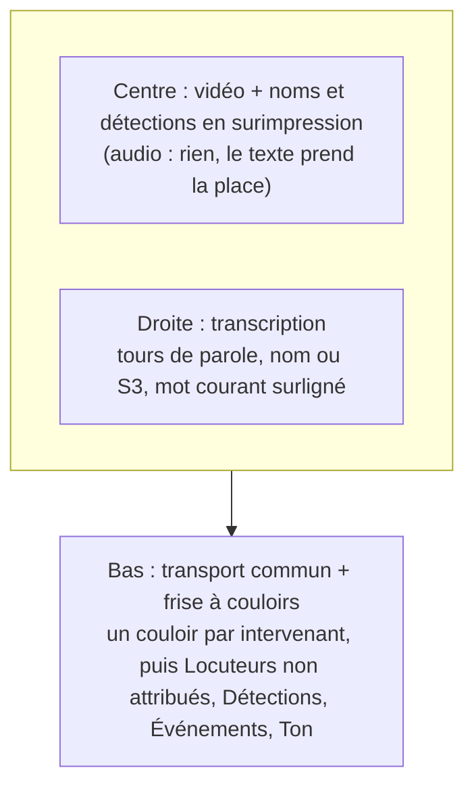

# PRD — Relecture d'un média : intervenants, transcription, attributions (D271–D280)

> **Statut : codé** (R0 → R5 livrés et poussés le 2026-10-18, 886adaab) ; ce qui reste est au §12. Précise et remplace la
> partie écran de **D217** (`media-import-pipeline.md`). S'appuie sur
> D211 (transcription d'un fichier), D216 (frise commune), K17
> (apparitions), K43 (déclarations) et le Voice ID (`voice-id.md`,
> V1–V10). Décisions proposées **D271–D280**.

## 0. Ce qui existe déjà (à réutiliser, pas à refaire)

| Brique | Où | État |
|---|---|---|
| Mise en page « média au centre, panneau, frise à couloirs en bas, transport commun, raccourcis 1–9 » | `pages/lab/workspace.rs`, `pages/lab/timeline.rs` | livré (Vision Lab) |
| Frise à couloirs (règle, couloirs, curseur commun, tracé d'une plage par glisser) | `components/timeline/{axis,view}.rs` | livré (dossiers, Lab) |
| Lecteur commun (`MediaPlayer`, `ScrubBar`, `SpeedPicker`, `Clock`) | `components/transport.rs` | livré |
| Surimpression des détections sur une vidéo | `pages/cameras/player.rs` (D105) | livré, caméras device seulement |
| Transcription horodatée **au mot**, mots et tours étiquetés par locuteur `S1..S16` | `pnex-asr` (`diarize::label_words`, `label_turns`), O2 `tx_<slug>` (D165) | livré pour les flux |
| Transcription d'un **fichier** (cadence batch, horloge fichier `offset_ms`) | D211, lot I3 | **proposé, non codé** |
| Orchestrateur d'analyses d'un fichier | `media_analyses` (D213) | codé (`index`, `summarize`) |
| Profil vocal par Personne, test 1:1 et 1:N, verdict avec marge | `services/voice_id/`, `pnex_core::voice_id` | livré, **une seule voix par extrait testé** |
| Apparitions (`present` / `speaking` / `mentioned`, origine, confiance) | `cases.md` K17 | spécifié |
| Déclaration verbatim rattachée à sa source (`statement`, `said_by`) | `cases-workspace.md` K43, pack `investigation` | spécifié |

Ce qui manque : l'écran, la notion d'**attribution** d'un passage à une
personne, l'identification vocale **par locuteur** (et non par extrait),
et la régénération.

## 1. Besoin (Shan, 2026-10-18)

Sur un audio ou une vidéo :

- un lecteur qui reprend l'interface du Vision Lab et de la frise des
  dossiers : la vidéo au centre (rien pour un audio), **le texte à
  droite**, **en bas la frise des intervenants** à la manière de
  l'ontologie ;
- **poser des noms** : les personnes de l'ontologie reconnues par leur
  voix sont nommées dans la vidéo et dans le texte, **quelle que soit la
  technique de détection** ;
- pour les voix non reconnues : **sélectionner « de tel instant à tel
  instant, c'est cette personne »**, ce qui crée une détection pour une
  personne déclarée dans l'ontologie, **sans reconnaissance vocale** ;
- un bouton **« Régénérer »** : reconnaître une voix oubliée (profil créé
  après coup) ou refaire la transcription ;
- garder la place pour des **métadonnées de ton** (colère, etc.), par
  l'audio et/ou par l'image, destinées à une analyse IA ultérieure.

## 2. Principes

- **R-P1 — Le temps est l'ancre.** Tout ce qui est posé sur le média est
  une plage `[t0, t1]` sur l'horloge du média. Une étiquette de
  diarisation (`S3`) change d'une passe à l'autre ; une plage, non.
- **R-P2 — Une attribution a une origine, jamais une technique
  privilégiée.** Manuel, voix, grille, transcription, plus tard visage ou
  bandeau : même objet, même couloir, origine et confiance affichées.
- **R-P3 — La machine propose, l'humain confirme.** Une proposition
  (voix, transcription) s'affiche en pointillé ; seule une confirmation
  écrit dans l'ontologie (V7, K17).
- **R-P4 — Pas de second lecteur.** L'écran est assemblé avec
  `MediaPlayer`, `Timeline` et la mise en page du Lab (D220, règle 9).
- **R-P5 — Aucune empreinte de voix non enrôlée n'est stockée.** On
  recalcule depuis l'audio conservé au lieu de garder des empreintes de
  tout le monde.

## 3. L'écran

| Zone | Contenu | Gestes |
|---|---|---|
| **Centre** | `<video>` (asset servi inline, D203) ; nom de la personne qui parle ; détections cochables (code de `cameras/player.rs` factorisé, D215) | clic = pause |
| **Droite** | Transcription en tours de parole : pastille du nom (ou `S3` en gris), heure, texte ; le mot sous le curseur surligné (horodatage au mot) ; propositions en pointillé avec « Confirmer / Écarter » | clic sur un mot = déplacer la lecture ; sélection de texte = plage ; menu « C'est… », « Créer une déclaration » |
| **Bas** | `Timeline` (D216) : **un couloir par intervenant** (personne de l'ontologie), plages pleines si confirmées, en pointillé si proposées ; couloir **Locuteurs** (voix encore anonymes) ; puis Détections, Événements, Ton (repliés par défaut) | glisser = sélectionner une plage ; clic sur une plage = la sélectionner ; touches 1–9 = attribuer la sélection à l'intervenant n de la palette (comme les classes du Lab) |
| **Barre d'outils** | Palette des intervenants (personnes choisies, avec ou sans profil vocal), sélecteur des candidats (D274), « Régénérer » (D276), état de l'analyse | — |

Placement (D223) : onglet **Relecture** de la fiche du média
(`/media/:id`), pas une modale. Membres en lecture : écran en lecture
seule.

## 4. Lexique (à ajouter au §7 de `design-system.md` et à `lexicon_guard.rs`)

| Notion | FR | EN | N'est pas |
|---|---|---|---|
| Voix distinguée par la diarisation, anonyme (existant) | Locuteur | Speaker | une personne |
| Personne de l'ontologie rattachée à un passage d'un média | Intervenant | Participant | un locuteur |
| Rattachement d'une plage de temps à une personne, avec origine et confiance | Attribution | Attribution | une étiquette, une annotation |
| Ton estimé par un modèle sur une plage (D280) | Ton | Tone | jamais une propriété de la personne |

## 5. Décisions proposées

### D271 — Écran de relecture : la mise en page du Lab sur un média

- Remplace l'écran de D217 (« `/media/:id/play` ») par l'onglet
  **Relecture** de la fiche du média, sur la mise en page du §3.
- Sources V1 : média `audio` / `video` de la médiathèque analysé par
  D211. Source V2 : fenêtre d'enregistrement d'un **flux** dont l'audio
  est conservé (`audio_retention` ≠ `none`) ; sans audio, le texte et
  les intervenants restent consultables, sans lecture.
- La partie générique (centre + droite + frise) est un composant ; le
  Lab et la relecture le partagent au lieu de deux copies.

### D272 — L'attribution : une plage, une personne, une origine

- Table Postgres `speech_attributions` : `id uuid, org_id, source`
  (`media_version_id` ou `stream_id`, exactement un), `t0_ms, t1_ms`
  (horloge du média ; horloge murale pour un flux), `object_id`
  (personne), `origin` (`manual` | `voice` | `transcript` | `grid`,
  extensible : `face`, `chyron`), `confidence` (0–1, nulle si manuel),
  `status` (`proposed` | `confirmed` | `rejected`), `created_by`,
  horodatages, `version` (concurrence optimiste).
- Postgres et pas O2 : volume borné (édité par l'humain), modifiable,
  supprimable. Le continu des flux reste dans O2 `appearances` (K17).
- **Résolution d'un mot** : le mot appartient à la plage qui contient son
  milieu. Priorité : confirmé manuel > confirmé autre > proposé > `S#`.
  Deux plages confirmées **d'une même personne** qui se recouvrent ou se
  touchent **fusionnent** en une seule (codé ainsi : plus simple qu'un
  refus pour qui glisse sur une zone déjà attribuée). Deux personnes
  différentes peuvent se recouvrir : on peut parler en même temps, les
  deux couloirs le montrent.
- Une attribution `rejected` reste en base pour ne pas reproposer la
  même chose à la passe suivante.

### D273 — Attribution manuelle, sans reconnaissance vocale

- Trois gestes, un seul résultat (une ou plusieurs plages `manual`,
  `confirmed`) :
  1. **plage** : glisser sur la frise ou sélectionner du texte → « C'est… » ;
  2. **locuteur entier** : sur `S3` → « S3, c'est… » ; matérialisé en
     **une plage par tour** de `S3` dans la passe courante (R-P1 : le
     lien survit aux régénérations, l'étiquette non) ;
  3. **raccourci** : touches 1–9 sur la palette.
- La personne n'a **pas besoin** de profil vocal. Recherche dans
  l'ontologie (types `person`) avec création possible (« Nouvelle
  personne… ») sans quitter l'écran.
- C'est l'origine `manual` de K17 : la confirmation écrit l'apparition
  `speaking` (D278).

### D274 — Candidats : un sélecteur, pas toujours « tout le monde »

- Sélecteur des personnes contre lesquelles comparer les voix :
  **intervenants attendus** (personnes liées au média ou au dossier qui
  le contient, par `appears_in`, `about`, `sourced_by`, et le compte qui
  l'a publié par `published_by`, D278), **personnes choisies**, ou **tous
  les profils prêts** du modèle d'empreinte.
- Défaut : intervenants attendus s'il y en a, sinon tous.
- Réduire les candidats réduit les fausses identifications (le seuil de
  V5 n'est calibré que sur la voix de la personne elle-même, §3 de
  `voice-id.md`) : à l'échelle de milliers de profils, l'option « tous »
  avertit.
- Coût : chaque empreinte déchiffrée **une fois par passe** (pas une
  fois par locuteur) ; noms lus en **une** requête ; on renvoie les 5
  meilleurs candidats par locuteur, pas la liste entière. Ordre de
  grandeur visé : 2 000 profils sans changement de schéma. Au-delà
  (index vectoriel), voir Q3.

### D275 — Identification vocale par locuteur

- Aujourd'hui le test fait la moyenne de **tout** l'extrait : faux dès
  que deux voix parlent. Ici, la sonde est construite **par locuteur**
  de la passe : les fenêtres de ses tours (≥ 3 s de parole, porte de V5,
  ≤ 60 fenêtres), puis centroïde, cosinus, verdict de V7 (marge 0,05).
  Même calcul sur une **plage sélectionnée** (« Qui parle ici ? »).
- Sortie : une attribution `voice`, `proposed`, une plage par tour, avec
  le score. Jamais confirmée seule.
- **Exception explicite** à « jamais par la voix » (`media-ingest.md` §2,
  `cases.md` K17) : seulement contre des profils enrôlés avec
  consentement (V3) et seulement si l'org l'active (Q1). L'avis
  juridique demandé par K19 reste une condition.

### D276 — « Régénérer » : deux verbes

| Verbe | Ce qu'il refait | Coût | Quand |
|---|---|---|---|
| **Réidentifier les voix** | D275 sur la passe existante, contre les candidats du moment | décodage + empreintes, sans ASR | un profil a été créé ou régénéré après l'analyse |
| **Retranscrire** | nouvelle passe D211 (ASR + diarisation), puis D275 | complet | autre profil ASR, mauvaise passe |

- Les attributions `manual` et `confirmed` **survivent** : elles sont des
  plages (R-P1). Les `proposed` de l'ancienne passe sont remplacées.
- Une passe = un `run` (tranche D211 Q-B) ; l'écran montre la dernière
  passe `pnex`, sinon la dernière tout court ; les précédentes restent
  consultables.
- Une passe porte une **origine** : `pnex` (ASR + diarisation de PNeX)
  ou `platform` (sous-titres fournis par la plateforme d'où vient le
  média, `extension-collector.md` D267). Une passe `platform` :
  - n'a ni diarisation ni `S#` : pas de couloir Locuteurs, « Réidentifier
    les voix » grisé avec la raison (« retranscrire d'abord ») ;
  - est horodatée par sous-titre, pas au mot : la règle du milieu (D272)
    s'applique au sous-titre entier ;
  - reste du texte non fiable (D208) ;
  - n'est jamais remplacée : « Retranscrire » crée une passe `pnex` à
    côté. L'attribution manuelle (D273) marche sur les deux.
- Pas d'empreinte stockée (R-P5) : pour un fichier, l'original reste en
  médiathèque ; pour un flux, l'audio doit être conservé, sinon
  « Réidentifier » est grisé avec la raison.
- Une analyse lourde à la fois par org (sémaphore D211) ; 409
  `media-analysis-busy`.

### D277 — Enrôler depuis le média

- Sur un intervenant **sans** profil vocal : « Créer son profil vocal à
  partir de ces passages » → les plages confirmées deviennent les extraits
  du profil (V4 : WAV 16 kHz mono, ≤ 180 s, passages choisis seulement).
- Formulaire de **consentement obligatoire** (V3) avant tout calcul ;
  rôles de V8 (owner/admin). Puis « Réidentifier » propose cette voix
  ailleurs dans le média et dans les autres médias analysés.

### D278 — Vers l'ontologie

- Confirmer une attribution écrit l'**apparition** `speaking` de K17
  (personne, média, `media_offset_ms`, durée, `origin`, `confidence`) et
  le lien `appears_in` (un par personne et par média, jamais par tour).
- Sélection de texte → **« Créer une déclaration »** : objet `statement`
  (K43), `quote` verbatim, `locator` (média, `t0`), `context_before` /
  `context_after` pris dans la transcription, `said_by` = l'intervenant
  du passage (origine portée par le lien).
- Retirer une attribution confirmée retire son apparition ; le lien
  `appears_in` tombe quand il n'en reste plus.
- Lien **`published_by`** (pack `investigation`, « publié par ») :
  `piece` ou `media_asset` (type système) → tout type (`person`,
  `organization`, ou `media` du pack `media_coverage`, que le pack
  `investigation` ne connaît pas).
  Il dit **qui a publié** le contenu, jamais qui parle dedans : un compte
  qui reprend l'extrait d'une émission n'est pas un intervenant. Posé par
  l'agent navigateur quand la mission suit un compte rattaché à un objet
  (`extension-collector.md`), ou à la main. `sourced_by` et `about` ne
  conviennent pas : les deux partent d'une `claim`.

## 5bis. Articulation avec les agents navigateur (`extension-collector.md`, D254–D270)

Accord du 2026-10-18 avec la session des agents navigateur :

| Capture de l'agent | Source de la relecture | Ce qui s'applique |
|---|---|---|
| Vidéo publiée (D260) | média `video` de la médiathèque (D271 V1) | D213 `transcribe` selon la `media_policy` de la mission (`always` ou `if_no_transcript`) |
| Sous-titres de la plateforme (D267) | passe d'origine `platform` (D276) | affichés tels quels ; « Retranscrire » pour avoir des locuteurs |
| Direct (`watch_live`) | flux `browser` (D159, D271 V2) | rétention par mission (D268, vocabulaire D161) ; relecture et « Réidentifier » exigent une rétention ≠ `none` |
| Provenance | `media_assets.metadata` : `source`, `mission_id`, `source_url`, `platform`, `platform_id`, `author_handle`, `published_at`, `captured_at` | lu par la fiche du média |
| Compte suivi rattaché à un objet | lien `published_by` (D278) | candidat parmi les intervenants attendus (D274) |

Les décisions suivantes des agents navigateur commencent à D281.

### D279 — Les couloirs de la frise

- Ordre : intervenants (un couloir chacun, temps de parole affiché),
  **Locuteurs** non attribués, **Détections** (D215), **Événements**
  (`event`, D217), **Ton** (D280). Couloirs vides omis.
- Contrat : `TimelineItem` de D216 ; nouveaux `kind` : `attribution`
  (avec `origin`, `status`) et `tone`. Lecture par `GET /timeline`
  (D216), bornes de D216 (≤ 5 000 éléments par couloir).

### D280 — Ton : des métadonnées réservées, pas une fonctionnalité

- Réservé dans le contrat, **aucun modèle livré par ce PRD**. Élément
  `tone` : `{t0, t1, modality: audio | video | text, label, score,
  model_id, run}` ; `label` dans une **liste fermée** (`neutral`,
  `anger`, `joy`, `sadness`, `fear`, `surprise`, `other`), stocké dans O2
  (`tone_<source>`), comme les détections.
- Lu comme **donnée d'entrée incertaine** par une analyse IA ultérieure
  (D215bis, résumés D214) ; jamais une propriété de la personne, jamais
  présenté comme un fait (« ton estimé par <modèle> »), couloir replié
  par défaut.
- **Garde réglementaire** : la reconnaissance des émotions est interdite
  sur le lieu de travail et dans l'enseignement par le règlement
  européen sur l'IA (art. 5, sauf raisons médicales ou de sécurité).
  Activation par org avec une déclaration d'usage, comme D275 ; avis
  juridique avant tout modèle.

## 6. API (esquisse, à mettre au contrat `api-contract.md` au codage)

| Route | Rôle |
|---|---|
| `GET /api/v1/media/{id}/attributions?run=` (`Paginated`) | membres |
| `POST /api/v1/media/{id}/attributions` (plages, personne) | écriture, viewer → 403 |
| `PATCH /api/v1/media/{id}/attributions/{aid}` (confirmer, écarter, déplacer, `expected_version`) | écriture |
| `DELETE /api/v1/media/{id}/attributions/{aid}` | écriture |
| `POST /api/v1/media/{id}/analyses` `step = identify` (D276, candidats D274) | écriture |
| `POST /api/v1/media/{id}/analyses` `step = transcribe` (existant D213/D211) | écriture |

Exposition MCP (`exposure.rs`) : lecture `EXPOSED` ; écriture
d'attribution à trancher (Q5) ; `identify` = `EXCLUDED` (biométrie).

## 7. Garde-fous

- R1 / R2 partout ; org depuis le principal ; personne d'une autre org →
  404 ; test viewer → 403.
- Aucune empreinte, aucun centroïde dans un DTO, un log ni le journal
  (V6, V9) ; chaque identification → journal `voice_id_usage`.
- Transcription et sorties de modèles = données non fiables (D208),
  jamais rendues en HTML sur l'origine de l'app (R11–R13).
- Supprimer une personne supprime ses attributions et apparitions ;
  supprimer un profil vocal retire les propositions `voice` non
  confirmées qu'il a produites.
- Assistant (§9 `ai-assistant.md`) : fiche KB de l'écran ; il peut
  **proposer** une attribution (origine `transcript`), jamais confirmer,
  jamais lancer `identify`.

## 8. Lots

| Lot | Contenu | Prérequis | Sortie vérifiable |
|---|---|---|---|
| **R0** | D211 batch + D216 contrat (lots I3, I4 de `media-import-pipeline.md`) | — | un fichier analysé, transcription au mot avec `S#` et `offset_ms`. **D211 codé le 2026-10-18** (`tests/media_transcribe.rs` `file_analysis_transcribes_in_batch`) ; D216 part avec R1 |
| **R1** | Écran D271 (centre, texte, frise, lecture synchronisée), couloir Locuteurs | R0 | clic sur un mot → la vidéo saute ; curseur commun texte / frise. **Codé le 2026-10-18** : `/media/:id/review`, `GET /media/{id}/transcript`, passes `media_runs` (D276), sous-titres plateforme (`store_platform_run`) |
| **R2** | D272 + D273 + D278 : attributions manuelles, couloirs d'intervenants, apparitions, déclarations | R1 | « 12:30 → 14:10, c'est X » sans profil vocal ; X a une apparition `speaking`. **Codé le 2026-10-18** (`tests/media_review.rs`) : `/media/{id}/attributions`, palette 1–9, sélection d'un locuteur entier, `appears_in` ouvert / fermé, pack `investigation` 1.10.0 (`statement`, `said_by`, `appears_in`). Reste : bouton « Créer une déclaration » depuis le texte |
| **R3** | D274 + D275 + D276 « Réidentifier » | R2, activation Q1 | deux voix enrôlées dans un débat : deux propositions justes, rien d'écrit avant confirmation. **Codé le 2026-10-18** : étape `identify` (`services/voice_id/media.rs`), empreinte par locuteur sur ses 4 plus longs tours (≤ 30 s, ≤ 15 fenêtres), verdict V7, propositions `voice` qui remplacent les précédentes sans contredire un humain ; portée « intervenants attendus » par défaut (sélecteur « tous » non exposé). Non vérifié de bout en bout (O2 absent en test) |
| **R4** | D276 « Retranscrire » (runs) + D277 enrôlement depuis le média | R3 | une retranscription garde les attributions manuelles. **Codé le 2026-10-18** : « Retranscrire » = relancer la transcription (nouvelle passe, attributions conservées) ; `POST /voice-id/profiles/{id}/samples/from-media` (passages confirmés, 180 s, profil consenti existant) + bouton « Enrôler sa voix » |
| **R5** | Source flux (D271 V2) ; détections en surimpression (D215) | R1, D215 | même écran sur une heure d'un flux à audio conservé. **Détections codées le 2026-10-18** : étape `detect` (`services/media_detect.rs`, une image / 2 s, premier détecteur valide de l'org, O2 `camera_detections` source `media:<asset>`, datées sur la passe), `GET /media/{id}/detections`, cadres sur la vidéo + couloir Détections ; MP4/MOV seulement (pas WebM). **Flux codé le 2026-10-18** : `GET /media/streams/{id}/review?from&to` (≤ 6 h, texte + morceaux d'audio conservés), `GET …/segments/{segment}/audio`, écran `/streams/:id/review` (fenêtre 1 h / 6 h, plus tôt / plus tard, lecture enchaînée) ; pas d'attribution sur un flux (elles vivent sur un média), frise en temps relatif à la fenêtre |
| — | D280 ton : schéma seulement, aucun lot tant que Q4 est ouverte | — | — |

## 9. Questions ouvertes

- **Q1 — Activation de l'identification vocale** : **tranchée au codage
  (2026-10-18)** — pas de réglage d'org : l'identification est un geste
  explicite par média (étape `identify` de la carte Analyses, owner/admin,
  V8), contre les seuls profils consentis (V3), et ne produit que des
  propositions. Le commutateur plateforme de K19 reste à décider avec
  l'avis juridique.
- **Q2 — Stockage des apparitions d'un fichier** : Postgres seul
  (`speech_attributions` fait foi, proposé) ou aussi O2 `appearances`
  comme les flux (une seule source de lecture pour la frise des dossiers) ?
- **Q3 — Au-delà de quelques milliers de profils** : un index vectoriel
  exige des empreintes lisibles, contraire au scellement V6. Garder V6 et
  borner, ou un index en mémoire déchiffré au démarrage ?
- **Q4 — Ton** : quel usage réel, sur quels contenus (émissions publiques
  seulement ?), et l'avis juridique (art. 5 du règlement IA) ?
- **Q5 — MCP** : l'écriture d'attributions (manuelle, sans biométrie)
  est-elle exposée aux outils externes ?
- **Q6 — Visage** : l'origine `face` est prévue dans le modèle ; même
  régime que la voix (enrôlement consenti) le jour où elle arrive ?

## 10. Hors périmètre

Reconnaissance faciale, modèle de ton, traduction, sous-titres exportés
(SRT/VTT), montage vidéo, identification sur le direct (cette relecture
est en différé), empreintes de voix non enrôlées.

## 11. Registre

| # | Décision | Date |
|---|---|---|
| D271 | Écran de relecture = mise en page du Lab sur un média (onglet de la fiche), remplace l'écran de D217 | 2026-10-18 (codé) |
| D272 | Attribution = plage de temps → personne, origine, confiance, statut ; table `speech_attributions` | 2026-10-18 (codé) |
| D273 | Attribution manuelle sans reconnaissance vocale (plage, locuteur entier, raccourcis) | 2026-10-18 (codé) |
| D274 | Sélecteur de candidats (attendus / choisis / tous), coût borné | 2026-10-18 (codé, « tous » non exposé dans l'UI) |
| D275 | Identification vocale par locuteur, proposition seulement, exception encadrée à K17 | 2026-10-18 (codé, non vérifié de bout en bout) |
| D276 | « Régénérer » = Réidentifier (sans ASR) ou Retranscrire ; attributions conservées ; passe d'origine `pnex` ou `platform` | 2026-10-18 (codé) |
| D277 | Enrôlement d'un profil vocal depuis les passages confirmés, consentement d'abord | 2026-10-18 (codé) |
| D278 | Attribution confirmée → apparition K17 ; sélection → déclaration K43 ; lien `published_by` (publié par) | 2026-10-18 (codé) |
| D279 | Couloirs de la frise et `kind` `attribution` / `tone` du contrat D216 | 2026-10-18 (couloirs codés dans l'UI ; contrat D216 `GET /timeline` non fait) |
| D280 | Ton = métadonnées réservées, liste fermée, jamais un fait sur une personne | 2026-10-18 (réservé, rien de codé) |

## 12. Suite (reste à faire, au 2026-10-18)

Tout R0 → R5 est livré. Ce qui suit est noté pour ne pas se perdre ; les
raccourcis assumés portent aussi un commentaire `shortcut:` dans le code.

### 12.1 Vérifier en conditions réelles (dev.pnex.io) — voir O81

- [ ] Transcription d'un **vieux** fichier (déposé il y a plus de 5 h) après
  le correctif 538b57a9 : documents O2 datés sur la passe, `offset_ms` juste.
- [ ] Reconnaissance des voix **de bout en bout** : deux voix enrôlées
  (consentement), un débat, deux propositions justes, rien d'écrit avant
  confirmation. Jamais exécutée hors tests (O2 et vrai modèle d'empreinte
  absents des tests).
- [ ] Détection d'objets sur une vraie vidéo MP4 avec un vrai détecteur :
  cadres alignés sur la vidéo, couloir Détections.
- [ ] Relecture d'un flux à rétention `days:N` : lecture enchaînée des
  morceaux, clic sur un mot → bon passage.
- [ ] Sous-titres plateforme (agents navigateur) → passe `platform` visible
  dans l'écran de relecture.

### 12.2 Écarts assumés à combler

- [ ] **Profil de transcription** : sélecteur sur l'étape (aujourd'hui le
  premier profil valide de l'org, `streams::runnable_profile`).
- [ ] **Modèle de détection** : sélecteur (aujourd'hui le premier détecteur
  valide, `media_detect::detector_model`).
- [ ] **Portée « tous les profils »** de la reconnaissance vocale dans l'UI
  (le serveur l'accepte : `StartAnalyses.voice_scope`).
- [ ] **Borne de 4 h** de la transcription d'un fichier (seuls 512 Mo bornés).
- [ ] **Progression en %** de la transcription (« En cours » sans chiffre).
- [ ] **Port `finished`** du nœud `media_source` (D211 point 5) : déclencher
  un flow à la fin d'une analyse.
- [ ] **Résumé d'un audio / d'une vidéo** → page (D214 sur la transcription ;
  `summarize` ne lit que les documents aujourd'hui).
- [ ] **Détection sur WebM** (lives des agents navigateur) :
  `decoder::video_file_format` n'accepte que MP4 / MOV.
- [ ] **Relecture d'un flux** : frise en heure murale (aujourd'hui relative
  au début de la fenêtre) ; `WindowPicker` partagé (D220, inexistant) ;
  attributions sur un flux (elles n'existent que sur un média).
- [ ] **Contrat D216** `GET /api/v1/timeline` (les couloirs sont construits
  côté front pour l'instant).
- [ ] **Lexique** : « Intervenant », « Attribution », « Ton » au §7 de
  `design-system.md` et règles dans `lexicon_guard.rs`.

### 12.3 Décisions en attente

- [ ] **Avis juridique** sur l'identification vocale (K19) et le commutateur
  plateforme (Q1 : tranchée pour l'org — geste explicite par média).
- [ ] **Q3** : passage à des milliers de profils (index vectoriel contre
  scellement V6).
- [ ] **Q4 / D280** : ton — usage, contenus, avis juridique (art. 5 du
  règlement IA). Aucun modèle avant.
- [ ] **Q5** : exposition MCP de l'écriture d'attributions (exposée
  aujourd'hui, rôle re-vérifié).
- [ ] **Q6** : visage (`face`), même régime que la voix ?

### 12.4 Hors de ce PRD, vu en route

- [ ] Dependabot : 2 vulnérabilités signalées sur la branche par défaut
  (1 modérée, 1 faible), non regardées.
