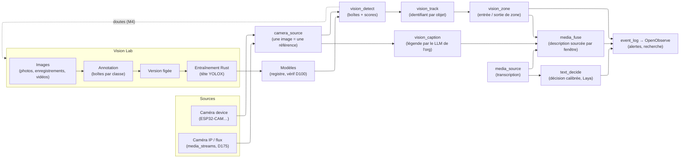
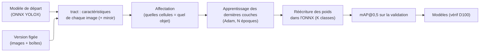
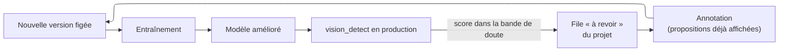

# Media & Vision Studio — guide des concepts

> Compagnon de `media-vision-studio.md` (le PRD et ses décisions D192+).
> Ici, chaque notion est expliquée simplement, avec **où elle vit dans le
> code** et **comment l'essayer dans l'UI**. Tenu à jour à chaque lot.
> Dernière mise à jour : 2026-10-13 (branche `feat/media-vision-studio`).

## 1. La chaîne en une image

Règle d'or (P6 / D128) : **aucun nœud vision ne commande quoi que ce
soit**. Il décrit, compte, alerte. Seul un flow déployé par un humain peut
relier une détection à `device_write`.

## 2. Les nœuds de flow

| Concept | En une phrase | Où dans le code | Essayer |
|---|---|---|---|
| **Image de caméra (frame)** | Une photo JPEG publiée sur le bus Valkey ; le flow ne transporte que sa **référence** (`frame_key`), jamais les octets (D78). | `pnex-node-camera` | Flows › nœud *Source caméra* |
| **Détection** (`vision_detect`) | Un modèle du registre trouve des objets : pour chacun un libellé, un **score** (0–1, confiance) et une **boîte** `[x, y, largeur, hauteur]`. | `pnex-node-vision/src/lib.rs`, `pnex-vision` | Flows › *Détection d'objets* |
| **Seuil** | Score minimal pour garder une détection. Plus bas = plus de trouvailles mais plus de fausses alarmes. | `min_score` du nœud | inspecteur du nœud |
| **Suivi** (`vision_track`, D192) | Relie les détections d'une image à l'autre : chaque objet reçoit un **identifiant de suivi** stable tant qu'il reste visible. Algorithme ByteTrack simplifié (deux passes : scores forts puis faibles). Événements `appear` / `disappear` avec la durée. | `pnex-node-vision/src/track.rs` | *Suivi d'objets* après la détection |
| **Zone** (`vision_zone`, D193) | Un polygone dessiné **sur l'image** (coordonnées 0–1, indépendantes de la résolution). Un objet suivi est « dedans » quand son **point d'ancrage** (bas-centre = les pieds) y est. Événements `enter` / `exit` avec `count` = occupation. `min_dwell_secs` = présence minimale avant d'annoncer l'entrée. | `pnex-node-vision/src/zone.rs` | inspecteur : clics sur la vue live |
| **Légende** (`vision_caption`, D195) | Le **LLM de l'org** (jamais un modèle de la plateforme, D119) décrit l'image, éventuellement recadrée sur l'objet détecté. Brancher le nœud = accepter d'envoyer l'image au fournisseur. | route interne `/internal/flow/ai/caption` | *Légende d'image* |
| **Fusion** (`media_fuse`, D196) | Toutes les 30 s, assemble détections, transcription et légendes et demande au LLM une description **sourcée** : une phrase sans source vérifiable est rejetée. Hiérarchie de confiance : détections = faits, parole = fiable, légendes = indicatives. | `/internal/flow/ai/fuse` | *Fusion média* |
| **Décision rapide** (`text_decide`, D197) | Un petit modèle (Laya, non génératif) répond à des questions typées (`choice`, `score`) avec des **probabilités** ; sert de filtre avant la fusion et de source d'alertes. Tourne sur le backend, en Rust (tract). | crate `pnex-decide` | *Décision* (bundle à installer) |
| **Plafond IA** | Légendes + fusions : 2000 appels par org et par jour (429 `flow-ai-quota`). | `settings.ai.flow_daily_calls` | — |

## 3. Le Vision Lab (créer son propre détecteur)

Page **Médias › Vision Lab** (`/lab`, `/lab/:id`).

| Concept | En une phrase | Où dans le code |
|---|---|---|
| **Projet** | Un détecteur à fabriquer : un nom et une liste de **classes** (« vanne_rouge »…). Une boîte désigne sa classe par **position** dans la liste, d'où l'interdiction de retirer une classe utilisée. | `services/lab.rs`, `pnex_core::lab` |
| **Image** | Une photo de la médiathèque ajoutée au projet (jamais copiée). | table `lab_images` |
| **Source** | Le lot d'où vient l'image (un import, un enregistrement, une vidéo). Sert au **split**. | `lab_images.source` |
| **Split entraînement / validation** | Les images de **validation** ne servent qu'à mesurer le modèle. Le split se fait **par source**, jamais image par image : deux images presque identiques d'une même vidéo ne peuvent pas tomber de chaque côté (sinon la note serait flatteuse et fausse). ≈ 20 % des sources en validation, forçable image par image. | `lab::auto_split` |
| **Boîte** | `[x, y, largeur, hauteur]` en fractions de l'image (0–1). | `LabBox` |
| **Exemple négatif** | Image cochée « aucun objet » : apprend au modèle ce qui **n'est pas** l'objet. | `negative` |
| **Position dans la source** (D203) | Pour une image tirée d'une vidéo ou d'un enregistrement, son instant en ms (`frame_ms`). Permet l'interpolation. | `lab_images.frame_ms` |
| **Import d'enregistrement** (D202) | Une image toutes les N s d'une caméra enregistrée (≤ 1 h, ≤ 200 images). | `import_recording` |
| **Import de vidéo** (D203) | Idem depuis un MP4/MOV de la médiathèque, décodé par le **ffmpeg confiné** de la capture (bac à sable, pas de réseau). Les vidéos de téléphone (index `moov` en fin de fichier) sont réparées en mémoire. Toutes les images d'une même vidéo = une seule source. | `pnex-media-capture` (`mp4.rs`, `decode_video_frames`) |
| **Interpolation** (D203) | On annote une image, on en saute quelques-unes, on annote une plus loin ; sur une image intermédiaire, « Interpoler » propose les boîtes déplacées en ligne droite. Appariement par classe, centres les plus proches. | `lab::interpolate` |
| **Pré-annotation** (D201) | Un modèle du registre propose des boîtes en pointillés ; rien n'est enregistré tant qu'on ne les garde pas. Un libellé égal à un nom de classe prend cette classe. | `services/lab.rs::suggest` |
| **Version figée** (D199) | Photo instantanée et en lecture seule des images annotées, de leurs boîtes, de leur split et de la version de chaque fichier. C'est sur elle qu'on exporte et qu'on entraîne. | `lab_dataset_versions` |
| **Export COCO** (D200) | Zip standard (images + annotations) pour entraîner ailleurs si on le souhaite. | `services/lab.rs::export` |

## 4. L'entraînement sans Python (D204)

**Principe** : on ne réentraîne pas tout le réseau. On part d'un modèle
YOLOX déjà enregistré (par exemple COCO, qui sait déjà « voir » des formes,
des textures, des objets). Son corps reste **figé** ; on ne réapprend que
sa **tête**, c'est-à-dire les dernières couches qui transforment ce que le
réseau voit en « quelle classe, où, avec quelle certitude ».

| Concept | En une phrase |
|---|---|
| **Caractéristiques (features)** | Ce que le réseau figé « voit » en chaque point d'une grille (3 grilles : pas de 8, 16 et 32 pixels). Calculées une fois par image, puis réutilisées à chaque époque : c'est ce qui rend l'entraînement rapide sur CPU. |
| **Cellule** | Une case de grille ; chacune prédit au plus un objet. |
| **Affectation (SimOTA allégée)** | Pour chaque boîte annotée, on choisit les cellules qui doivent la prédire : celles dans la boîte, près du centre, dont la boîte prédite par le modèle de départ la recouvre le mieux. Les autres cellules apprennent « rien ici » (négatifs, échantillonnés). |
| **Époque** | Un passage complet sur toutes les cellules retenues. 30 par défaut, 300 au plus. |
| **Perte (loss)** | L'erreur que l'apprentissage fait baisser ; affichée par époque. Elle doit descendre. |
| **Adam** | La méthode d'ajustement des poids (écrite à la main, pas de bibliothèque). |
| **mAP@0,5** | La note du modèle sur les images de **validation** : 100 % = tous les objets trouvés (recouvrement ≥ 50 %) sans fausse alarme. Pas d'image de validation = pas de note. |
| **Vérification D100** | Tout modèle entrant dans le registre est chargé et exécuté une fois ; s'il échoue, il est refusé. Le modèle entraîné y passe comme un fichier importé. |
| **Exécution** | Dans le serveur, **un entraînement à la fois par serveur** (les suivants attendent). Un « battement » toutes les 10 s ; sans battement depuis 60 s (serveur redémarré), l'entraînement est marqué interrompu. Annulable. Mémoire des caractéristiques plafonnée (~256 Mo). |
| **Limite assumée** | Moins précis qu'un entraînement complet pour des objets très éloignés de ce que COCO connaît ; compenser par des images variées et plus d'époques. Pas de Python, nulle part (règle produit). |

Où : `pnex-vision/src/train.rs` (algorithme), `services/lab_train.rs`
(exécution, enregistrement du modèle), `pages/lab/training.rs` (panneau
« Entraînement »).

## 5. Boucle d'amélioration (M4, D205)

| Concept | En une phrase | Où / essayer |
|---|---|---|
| **Bande de doute** | Le modèle « hésite » quand un score tombe entre deux bornes (0,25 et 0,6 par défaut) : assez pour avoir vu quelque chose, pas assez pour l'affirmer. Ce sont les images qui apprennent le plus au modèle. | réglage *Images douteuses vers le Vision Lab* du nœud *Détection d'objets* |
| **File « à revoir »** (active learning) | Ces images partent dans un projet du Lab avec ce que le modèle a proposé ; au plus une par caméra toutes les 60 s, 500 en attente par projet. Une image quitte la file dès qu'elle est annotée (boîtes ou « aucun objet »). | Lab : point violet, filtre « Seulement les images à revoir » ; code `services/lab.rs::review`, route `/internal/flow/lab-review` |
| **Propagation par suivi** | Sur une vidéo : le modèle propose les boîtes de l'image, et chacune reprend la classe de la boîte la plus proche (recouvrement ≥ 30 %) de l'image annotée précédente. Utile quand le modèle ne connaît pas vos noms de classes (ex. il dit « person », votre classe est « opérateur »). | bouton *Propager* (barre des propositions) ; `lab::propagate` |
| **Guidage de diversité** | Le Lab signale ce qui manque pour qu'un modèle généralise : trop peu de sources pour une classe, objet toujours à la même taille (même distance), toujours au même endroit de l'image, toutes les images à la même luminosité. | panneau Statistiques ; `lab::stats` |
| **Luminance moyenne** | Clarté moyenne d'une image (0 = noir, 255 = blanc), mesurée à l'import ; sert au dernier avertissement. | `lab_images.luma` |
| **INT8** | Modèle quantifié (plus petit, plus rapide sur Pi). | à évaluer |

## 6. Ce qui reste hors de ce pilier

- Reconnaissance faciale, identification de personnes par l'image, pose
  humaine (Q1 : « poste » = poste de travail).
- Studio de rapports (M5) : attend une décision sur D173/D174 (rien ne sort
  de PneX aujourd'hui).

## 7. Relecture du soir (2026-10-13)

Commits de la branche `feat/media-vision-studio` (non poussés), à relire
dans cet ordre :

| Commit | Contenu |
|---|---|
| `7ddc25e2` | PRD : Q1–Q15 tranchées (Q9 = D128, Q10 = pas d'attente de tag) |
| `b88a2953` | D203 : vidéos dans la médiathèque et le Lab, interpolation |
| `7a3931ae` | D204 : entraînement sans Python (tête YOLOX en Rust) |
| `6c54180e` | D205 (partie) : guidage de diversité, propagation par suivi |
| (suivant) | D205 : file « à revoir » (active learning) + ce guide |

Avant de lancer le serveur de la branche : migrations `000015` à `000018`
sur `pnex_vision_dev`. Tests : `TEST_DATABASE_URL=…/pnex_test_vision`,
`PNEX_VISION_TEST_DIR=~/.cache/pnex-vision-test` pour les tests avec le
vrai YOLOX-nano.
