# Médias : bibliothèque, flux, transcription, relecture, empreintes vocales

## 1. Résumé

Ce document décrit la chaîne média de PneX, du fichier déposé à la personne nommée dans une transcription. Il s'adresse aux développeurs et aux admins d'org. La bibliothèque garde les fichiers versionnés de l'org (D21). Les flux captent l'audio et la vidéo de sources réseau continues (D159–D175). La transcription, la diarisation et les empreintes vocales consenties tournent en local, sans LLM (D164–D167, V1–V10, D978–D985). L'écran de relecture rattache les passages d'un média aux personnes de l'ontologie (D271–D280). L'enregistreur PNeX verse les appels du poste de travail dans la même chaîne.

## 2. Concepts

- **Média** : fichier de la bibliothèque (`media_assets`), avec un `kind` (`photo`, `panorama`, `splat`, `model`, `document`, `table`, `audio`, `video`, `floorplan`). Il a une ou plusieurs versions.
- **Version** : un état des octets d'un média (`media_versions`), en ajout seul. Une version est la **courante**.
- **MediaStore** : stockage des octets (S3, RustFS). La base ne garde jamais d'octets.
- **Analyse** : étape proposée sur une version de média (`media_analyses`) : `index`, `summarize`, `transcribe`, `identify`, `detect`.
- **Flux** : source continue déclarée par l'org (`media_streams`) : radio, HLS, caméra IP, fichier HTTP ou fichier de la bibliothèque.
- **Porteur** : processus qui capte un flux : `server`, `worker` ou `device:<id>` (boîtier de capture).
- **Segment** : morceau de 30 s d'audio PCM d'un flux (`media_segments`). La base garde son état, pas ses octets.
- **Profil de transcription (profil)** : combinaison de modèles VAD, ASR et diarisation (`asr_profiles`).
- **Transcription** : texte horodaté au mot, stocké dans O2 (`tx_<slug>`).
- **Locuteur** : voix anonyme distinguée par la diarisation (`S1`…`S16`).
- **Plage** : intervalle de temps nommé, annoncé et recalé (`time_ranges`) : émission, poste d'équipe, lot.
- **Taxonomie** : liste versionnée de sujets (`taxonomies`, `taxonomy_versions`).
- **Passe** : un passage de transcription sur un média (`media_runs`), d'origine `pnex` ou `platform`.
- **Intervenant** : personne de l'ontologie rattachée à un passage d'un média.
- **Attribution** : plage de temps d'un média rattachée à une personne, avec origine, confiance et statut (`speech_attributions`).
- **Profil vocal** : empreinte scellée d'une personne enrôlée avec son consentement (`voice_profiles`). L'UI dit « Empreintes vocales ».
- **Enregistreur PNeX** : utilitaire de bureau qui capte les appels et les envoie à la bibliothèque (`pnex-recorder`).

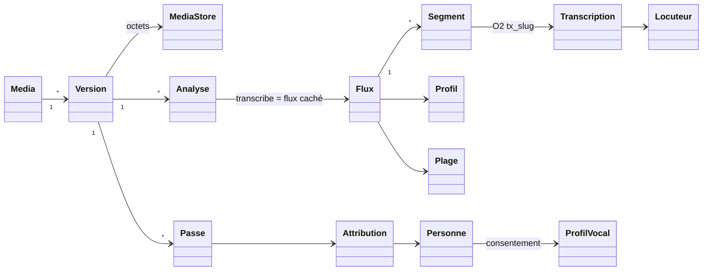

## 3. Fonctionnement

### 3.1 Bibliothèque (D21)

#### Modèle et stockage

`media_assets` porte l'identité : `org_id`, `kind`, `name`, `description`, `metadata` (JSONB), `current_version_id`. `media_versions` porte chaque version : `version_number` unique par média, `filename` assaini, `content_type`, `size_bytes`, `storage_key`, `sha256`, `metadata` (GPano et EXIF lus par version), `note`. `org_id` est copié dans la version pour le scoping et la purge.

Le MediaStore (`services/media.rs`) écrit dans le stockage objet de `settings.storage`. La clé est `org_{org}/media/{asset}/{version}_{filename}`. La purge suit les clés connues en base et reste idempotente.

L'écriture d'une version suit un ordre fixe : le stockage d'abord, la base ensuite. Un blob orphelin se purge, une ligne sans blob ne se purge pas. Si la base échoue, le service supprime le blob qu'il vient d'écrire.

#### Versions

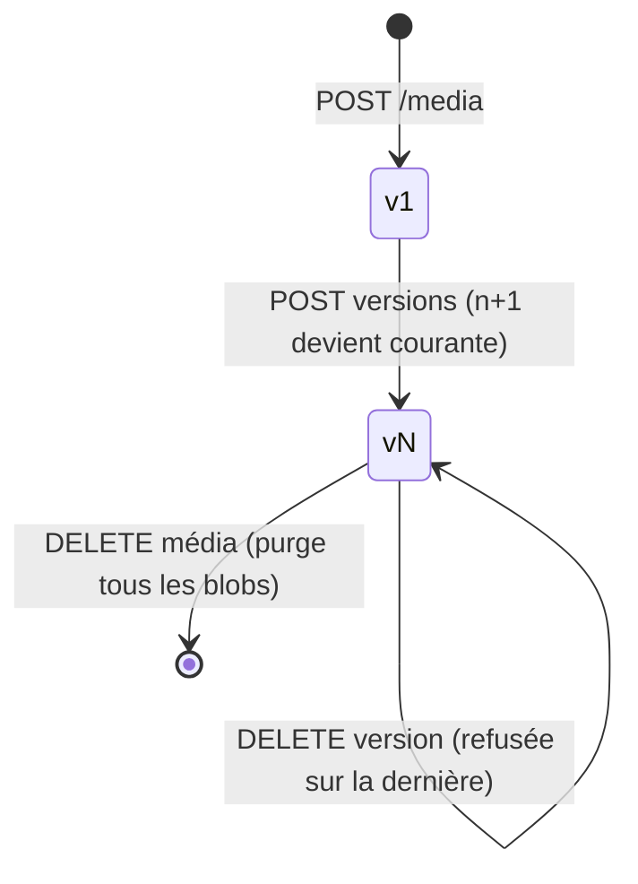

Supprimer la dernière version répond `409 last_version`. Supprimer une autre version re-pose la courante si besoin.

#### Envoi

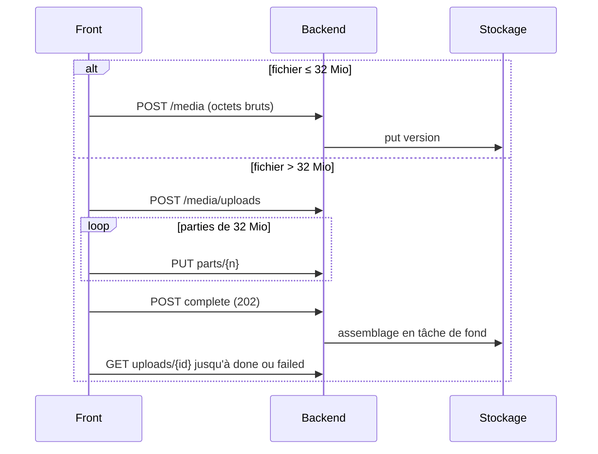

Le corps d'un `POST /media` est en octets bruts, sans multipart. Le même client marche donc en wasm et sur Android. `PNEX_MEDIA_MAX_BYTES` (2 Gio) borne un média, pour accueillir les modèles lourds. Le corps est lu en mémoire : au pire `PNEX_UPLOAD_MAX_CONCURRENT` (4) × 2 Gio.

L'envoi par parties existe parce que Cloudflare borne une requête à 100 Mo. Une partie fait 64 Mio au plus, avec 1000 parties au plus. Le serveur assemble une partie à la fois en mémoire et hache au fil de l'eau. Il juge le format sur la première partie. Une org a 4 envois actifs au plus. Les parties non fermées sont purgées après un jour.

#### Type détecté (`services/media_sniff.rs`)

Le `kind` vient du client d'abord, du contenu ensuite, sinon `photo`. Un JPEG avec `GPano:` et `equirectangular` dans ses 128 premiers Ko est un `panorama`. Les photo spheres de GCam et d'Insta360 sont donc reconnues sans assemblage. Les extensions `.ply`, `.splat`, `.ksplat` et `.spz` donnent `splat`. Un ONNX, un GGML, un GGUF ou une archive de modèle donne `model`.

#### Visionneuses

`js/viewers.js` empaquette pannellum (panorama, WebGL1) et gsplat (splat, WebGL2) dans `assets/viewers.js`. Le pont Rust est `src/media_viewer.rs`. Un échec affiche « aperçu indisponible », jamais une panique.

Le front télécharge les octets en Rust (`util::media_blob_url`), avec les en-têtes d'auth, puis crée une URL blob. Le téléchargement est streamé et montre sa progression. Les octets restent dans Cache Storage (`media_cache.rs`, web seul, 1,5 Go, purgé au logout), sous l'`ETag` = id de version. Chaque vue revalide par `If-None-Match`. Le serveur re-vérifie l'org avant de répondre `304`.

Pièges connus :

- `require('pannellum')` renvoie un objet vide : le paquet pose `window.pannellum`. `viewers.js` valide la forme et retombe sur la globale.
- pannellum pose `.pnlm-container` (`height: 100%`) sur le div hôte. La taille de l'hôte doit donc être en style inline, sinon le canvas fait 0 px.
- `.ksplat` et `.spz` se stockent sans aperçu. En natif, les aperçus ne marchent pas (CORS du webview).

### 3.2 Photo et panorama capturés sur Android

#### Photo

`src/capture.rs` appelle l'intent caméra du système par JNI brut (`::jni::sys`). Le résultat ne passe pas par `onActivityResult` : une boucle vérifie le fichier temporaire toutes les 500 ms, puis envoie la version 1. `patch-android-manifest.py` ajoute le `FileProvider` et la permission `CAMERA`, de façon idempotente.

#### Take 360

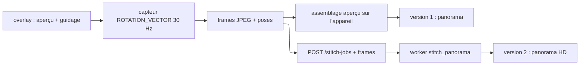

Le bouton **Take 360** guide une capture pas à pas. Un plan d'anneau calcule le pas : `hfov − 20°`, entre 10 et 20 cibles, pour fermer l'anneau par construction. Une frame part seulement sur la cible, alignée, stable et tenue 700 ms. L'utilisateur ancre le zéro (« Ancrer ici ») et peut reprendre la dernière frame.

L'appareil assemble un aperçu en Rust pur (`pnex-stitcher`, poses du capteur seules). Le serveur assemble ensuite la version HD (`Pipeline::Quality`) :

| Étage | Rôle |
|---|---|
| Alignement par modèle (feature `pose-model`) | SuperPoint + LightGlue en ONNX, rotation relative par RANSAC, Gauss-Newton 3 axes avec prior capteur |
| Calibration de focale | échelle de focale qui annule le biais médian des paires fortes (le hfov du track ≠ hfov de la caméra) |
| Gains par canal | Gauss-Seidel, R, G et B indépendants |
| Coutures | plus court chemin par ligne, demi-résolution |
| Warp local | grille 7,5°, actif par défaut |
| Multi-bandes | pyramide de Laplace, 5 niveaux |
| Remplissages | trous par extension verticale, pôles en dégradé |

Le worker écrit le résultat comme nouvelle version du média. `GET /stitch-jobs/by-asset/{asset_id}` porte l'état « version HD en préparation ». Les modèles ONNX vivent dans `deploy/models/` (`PNEX_STITCH_MODELS_DIR`). Sans eux, l'alignement retombe sur la corrélation NCC.

Leçons qui restent valides :

- Un défaut de qualité se juge en pleine frame, à la résolution de publication.
- Une zone sans texture (mur, plafond blanc) ne donne aucune paire. Son placement vient du capteur seul.
- Le stitcher retourne l'image à la sortie (`mirror_rows`) pour la vue « depuis l'intérieur ». La sonde `render_handedness` le verrouille.

### 3.3 Analyses d'un fichier (D212–D215)

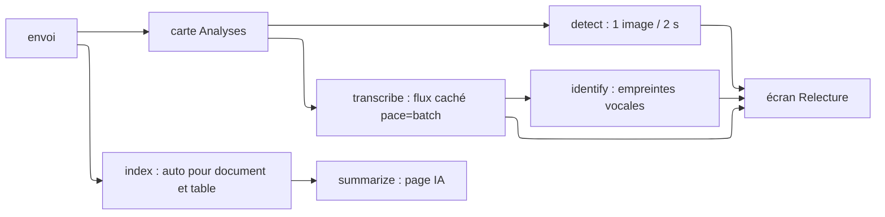

L'analyse est proposée, jamais imposée. Seule l'indexation des `document` et `table` part seule, car elle est locale et peu chère. Les étapes dépendent du `kind` :

| `kind` | Étapes |
|---|---|
| `document`, `table` | `index`, `summarize` |
| `audio` | `transcribe`, `identify` |
| `video` | `transcribe`, `identify`, `detect` |
| autres | aucune |

`media_analyses` garde une ligne par version et par étape : état, progression, code d'erreur, paramètres, `result_ref`. Chaque étape délègue à une brique qui existe :

- `index` : job de recherche documentaire (`doc-search.md`), état dans `media_text_index`.
- `summarize` : résumé par blocs puis synthèse, écrit en page IA (`flow_write`, `ai_generated`). Une relance ajoute une version à la même page. L'étape lit seulement les documents indexés.
- `transcribe` : flux caché `pace = batch` sur la version (`kind = media_asset`). Chaque lancement est une passe.
- `detect` : images décodées par le décodeur confiné, premier détecteur valide de l'org, détections dans O2 `camera_detections` sous la source `media:<asset>`. MP4 et MOV seulement.
- `identify` : reconnaissance par empreintes (§3.12).

Une étape LLM utilise le fournisseur de son **usage** (D212) : `assistant`, `extraction` ou `vision`, sinon le défaut de l'org. Sans fournisseur, l'UI grise l'étape et l'API répond `409 media-analysis-no-llm`. Une analyse lourde à la fois tourne par org (`409 media-analysis-busy`). `POST /api/v1/media/analyses` lance les mêmes étapes sur 200 médias au plus.

### 3.4 Flux : déclaration et capture (D159, D160, D175)

Un flux est une entité, pas un nœud de flow ni un device. Capter une URL arbitraire depuis le runtime multi-org violerait R5, R8 et R10. Le runtime consomme donc les événements d'un flux, il ne le capte pas.

#### Déclaration

| Champ | Règle |
|---|---|
| `slug` | construit par le serveur, figé à la création, clé du bus et des streams O2 ; jamais redonné, même après suppression |
| `kind` | `icecast`, `hls`, `http_file`, `rtsp`, `media_asset` |
| `url` | sans secret (`media-url-has-credentials` sinon) |
| `auth_secret` | `SecretRef` lié à l'origine exacte de `url` |
| `capture_on` | `server`, `worker`, `device:<id>` |
| `tracks`, `fps` | `audio`, `video`, `audio+video` ; 1 à 5 images/s |
| `segment_secs`, `overlap_secs` | 10 à 120 s (30) ; 0 à 3 s (1) |
| `audio_retention` | `none`, `days:N`, `keep` (D161) |
| `tdm_check` | date et note de vérification de l'opposition à la fouille (D172) |

Une org déclare 3 flux au plus (`PNEX_MEDIA_MAX_STREAMS_PER_ORG`), sous verrou advisory. Changer l'origine de `url` ou `auth_secret` d'un flux à secret exige `can_manage_secrets` (`secret-destination-locked`, R9). Une référence d'une autre org (profil, canal, device) répond `400 invalid`, comme un id inexistant.

#### Chaîne de capture

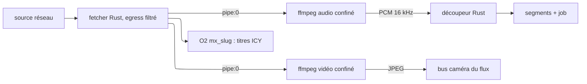

ffmpeg ne touche jamais le réseau. Le fetcher Rust (`pnex-media-capture`) lit la source par `reqwest` et `egress::guarded`. Il revérifie chaque redirection et chaque URL issue d'un manifeste HLS. Il borne la playlist (1 Mo), la profondeur de variantes (2) et le débit. Le secret part seulement vers l'origine exacte de `url`.

Pour RTSP, le client `retina` ouvre la session sur l'IP déjà validée. Il refuse toute redirection et n'accepte que le TCP entrelacé. Les identifiants viennent du coffre, jamais de l'argv ni de l'URL.

ffmpeg reçoit ses options avant `-i` : `-protocol_whitelist pipe`, `-format_whitelist`, `-codec_whitelist`, `-f` imposé par le `kind`. Le confinement par défaut (`PNEX_MEDIA_SANDBOX=kernel`) applique seccomp (aucun socket), Landlock (lecture seule, TCP refusé) et des rlimits (aucun fichier, 1 Gio). bwrap est une option, car Ubuntu 24.04 refuse les user namespaces.

Le ffmpeg des images est compilé par PneX (`deploy/docker/build-ffmpeg.sh`). Il contient seulement le protocole `pipe` et les démuxeurs et décodeurs utiles. Il reste LGPL-2.1, sans `--enable-gpl`, distribué comme programme séparé.

#### Porteurs

- `server` : un superviseur par flux dans le binaire serveur. Un bail `task:media-capture:<id>` garantit un seul capteur en multi-pod. Le redémarrage suit un backoff borné.
- `worker` : même boucle dans un process `--worker` du mesh (`PNEX_MEDIA_CAPTURE_WORKER=1`). Il poste ses segments à `POST /internal/media/segment` avec le jeton de service. Ce worker est de l'infrastructure plateforme, jamais d'une org.
- `device:<id>` : boîtier de capture (§3.10).

L'horodatage d'un segment vient de `EXT-X-PROGRAM-DATE-TIME` si HLS le donne, sinon de l'horloge du porteur. `clock_source` le dit. Pour icecast, l'heure est en avance du tampon du serveur source (20 s au plus).

#### Piste vidéo (D175)

Quand `tracks` contient `video`, un second ffmpeg confiné échantillonne `fps` images par seconde en JPEG (1280 px au plus). Chaque image va sur le bus caméra, dans l'espace du flux : `SET pnex:media:v1:{org}:{slug}:cam:f:{seq}` (TTL 15 s) puis `PUBLISH …:cam`. Le nœud `camera_source` choisit `source: device | stream`. `vision_detect` et `video_record` suivent la source du message. `video_segments` accepte `stream_id` à la place d'un device, jamais les deux.

#### Test d'un flux

`POST /api/v1/media/streams/{id}/test` capte 10 s avec le même fetcher et le même décodeur, puis les transcrit avec le profil du flux. Rien n'est stocké. Le test ne vérifie que l'audio. Un flux de boîtier n'a pas de test.

### 3.5 Segments, rétention, supervision (D161, D162)

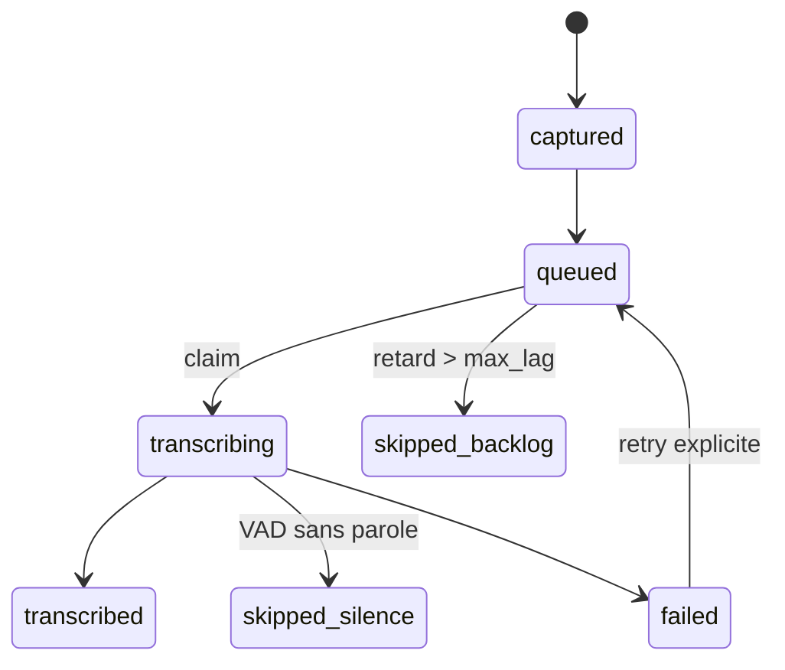

`media_segments` garde l'état, l'horloge, la clé de stockage, le modèle épinglé, la durée de calcul et un code d'erreur court. Un job `failed` n'est jamais rejoué seul. `POST …/segments/retry` remet en file les échecs dont l'audio existe encore.

La rétention de l'audio (D161) est nulle par défaut. Un pruner toutes les 15 min (`task:media-audio-pruner`) applique la règle du flux :

- `none` : audio supprimé après la transcription, ou après 15 min pour un échec.
- `days:N` : audio supprimé après N jours.
- `keep` : jamais supprimé.

Seul le texte reste durable. Changer de profil n'affecte que les nouveaux segments.

La passe `media-health` (30 s, singleton) écrit `media_capture_up`, `media_capture_gap_seconds`, `media_segment_lag_seconds` et `media_coverage_ratio` dans les metrics O2 de l'org. Un flux muet depuis 2 min lève une notification in-app et un envoi sur `notify_channel_id`, une fois par silence. Les trous de capture sont des données.

### 3.6 Transcription (D164–D167)

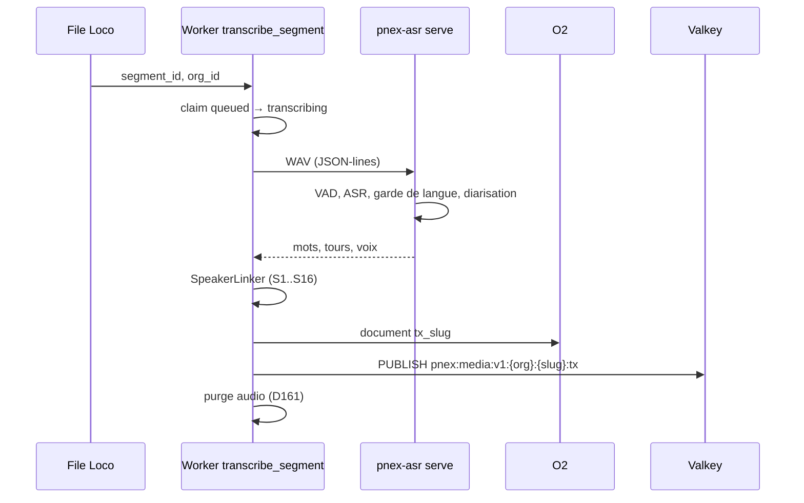

#### File et équité (D166)

Le worker `transcribe_segment` suit le patron de `stitch_panorama` : claim idempotent, état terminal écrit par le worker seul. Loco 1.1 route par tags seulement. `PNEX_ASR_QUEUE_TAG` vide (défaut, Pi) partage la file non taguée en priorité 0. `asr` sert un process `--worker=asr` dédié, sur la machine GPU, où le direct passe avant le rattrapage.

La concurrence ASR est bornée par org (`PNEX_ASR_MAX_PER_ORG`). Au-delà de `PNEX_ASR_MAX_LAG_SECS`, les vieux segments passent en `skipped_backlog`.

#### Process `pnex-asr`

Le runtime ASR est un process séparé, pas une bibliothèque du serveur. Un crash natif ne tue donc pas le serveur. Le process garde son modèle chargé et s'arrête après 10 min d'inactivité. `PNEX_ASR_BIN` choisit le build : sherpa-onnx CPU par défaut, whisper.cpp Vulkan en option. Le process est confiné comme ffmpeg (`PNEX_ASR_SANDBOX`, `none` pour un GPU) et borné en mémoire (`PNEX_ASR_MAX_MEMORY_MB`, 8 Gio).

Le choix du runtime vient du banc du lot 0 (FLEURS fr, 10 min de radio, portable 16 threads, GPU 6 Go). Flux = flux temps réel soutenables, environ 1/RTF :

| Modèle | Runtime | Matériel | Flux radio | WER FLEURS |
|---|---|---|---|---|
| Parakeet TDT 0.6B v3 int8 | sherpa-onnx | CPU | 32 | 8,7 % |
| Canary 180M flash int8 | sherpa-onnx | CPU | 18 | 9,6 % |
| Whisper large-v3-turbo q5_0 | whisper.cpp | Vulkan | 30 | 7,2 % |
| Whisper large-v3-turbo q5_0 | whisper.cpp | CPU | 2 | 7,1 % |

sherpa-onnx est le défaut : meilleur rapport en CPU, et il couvre aussi VAD et diarisation. whisper.cpp Vulkan est le meilleur chemin GPU. sherpa en CUDA n'accélère pas les modèles int8. Les deux runtimes cohabitent dans un binaire seulement si sherpa est lié en bibliothèque partagée.

#### Profil (D164)

Un profil choisit `vad_model_id`, `asr_model_id`, la diarisation (segmentation + empreinte, les deux ou aucun), `language` et `word_timestamps`. Chaque modèle doit être de l'org, de la bonne tâche et `valid`. Un profil par org est le défaut (`is_default`).

La VAD Silero passe d'abord. Un segment sans parole devient `skipped_silence`, sans appel ASR. Quand un silence d'au moins 2 s sépare deux zones de parole, le segment est transcrit en morceaux recollés. Sans cela, Canary et Parakeet perdaient un énoncé sur deux.

La **garde de langue** (`pnex_asr::language::LanguageGuard`) corrige Parakeet, qui choisit seul sa langue. Si un morceau d'au moins 5 mots n'est pas dans la langue du profil, `fallback_asr_model_id` le refait par morceaux de 29,5 s. Mesure sur un débat de France Inter : 1 fenêtre sur 20 en français sans garde, 20 sur 20 avec Whisper large-v3-turbo. Les exports sherpa de Whisper et Canary n'ont pas d'horodatage par mot : les mots sont répartis au prorata des caractères.

#### Registre des modèles audio (D167)

Les octets d'un modèle vivent dans la bibliothèque (`kind = model`). `ml_models` porte les tâches `asr`, `vad`, `diarization_segmentation` et `speaker_embedding`. Formats acceptés : archive sherpa-onnx (`.tar`, `.tar.bz2`, `.tar.gz`, `.zip`), GGML, ou `.onnx` seul qui déclare son type dans ses métadonnées. La famille est lue dans les fichiers. La licence SPDX est obligatoire.

Le check charge le modèle et transcrit un échantillon FLEURS embarqué. Il mesure `load_ms`, RTF et WER. L'UI affiche le débit soutenable. `ml_model_checks` garde un check par porteur : un job `check_asr_model` part au tag ASR. Un modèle qui ne charge pas est enregistré `invalid` avec son diagnostic. Un flux dont le profil référence un modèle invalide ne démarre pas (`media-asr-model-invalid`).

#### Stockage du texte (D165)

Un document O2 par segment dans `tx_<slug>` : `message` (le texte, champ plein texte), `words` et `speakers` en chaînes JSON (O2 aplatit les objets), `lang`, `speech_ms`, modèle et version. `GET /api/v1/media/transcripts` cherche dans les flux de l'org. Le serveur résout le slug en flux de l'org et construit le nom du stream. `q` passe en littéral échappé et borné.

#### Qualité

La couverture (`media_coverage_ratio`) dit le temps capté et transcrit sur la période. Toute donnée écartée est comptée et expliquée, jamais jetée en silence. Le WER se mesure par `pnex_asr::wer`.

### 3.7 Diarisation

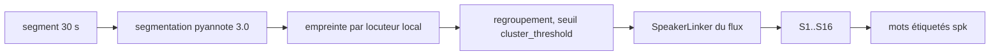

La diarisation tourne dans `pnex-asr` (`OfflineSpeakerDiarization` de sherpa-onnx), sur un segment à la fois. `SpeakerLinker` relie les voix de segment en segment : 16 centroïdes au plus, cosinus ≥ 0,5, oubli après 30 min. Les empreintes ne quittent jamais la mémoire du worker. Un redémarrage repart de `S1`. Une étiquette n'est jamais rattachée à une identité.

Le seuil de regroupement est réglable par profil (`cluster_threshold`, défaut 0,5). Mesure sur 4 réunions AMI réelles annotées : DER 28,8 % à 0,5, 46,0 % à 0,25, 31,7 % à 0,7. Seuls des enregistrements réels annotés tranchent un seuil. Les conversations synthétiques ont trompé. Au-delà de 3 voix, la diarisation par fenêtres confond les locuteurs. La reconnaissance par empreintes (§3.12) traite ce cas en différé.

Les sorties sont `words[].spk`, `speakers` et la série `media_speaker_seconds{stream, speaker}`. Les modèles conseillés sont pyannote segmentation 3.0 (MIT) et 3D-Speaker ERes2Net base (Apache-2.0). CAM++ fusionne les voix et doit être évité.

### 3.8 Flows, sujets et séries (D163, D168, D171)

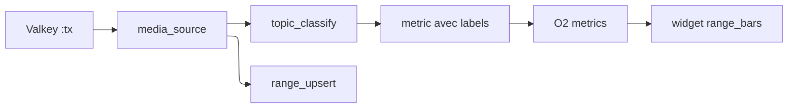

Le nœud `media_source` s'abonne par `SUBSCRIBE` exact au canal `:tx` de chaque flux choisi. Le runtime construit le canal depuis l'org tamponnée et le slug. Le deploy refuse un slug hors de l'org (`media-stream-unknown`). Le nœud émet un message par segment, ou par phrase avec le locuteur majoritaire. Seul le texte transite, jamais l'audio.

Une taxonomie (D168) est une liste versionnée de sujets : id, libellé, définition, mots-clés. Une nouvelle version exige `expected_version` (`409 taxonomy-version-conflict`). Le nœud `topic_classify` épingle une version et classe par mots-clés. Les entités (personnes, organisations) vivent dans l'ontologie, pas dans la taxonomie.

Le nœud `metric` accepte jusqu'à 5 labels libres (`labels`), avec 200 combinaisons au plus par nœud. Un widget lit une série par `SourceRef.labels`. Toute série dérivée porte `taxonomy_version` en label : changer de taxonomie crée de nouvelles séries.

Le texte d'une transcription est non fiable. Il passe comme donnée délimitée, jamais comme instruction.

### 3.9 Plages et métadonnées (D169, D170)

Une plage a une portée (`scope_kind` + `scope_id` : flux ou org), deux niveaux (`planned_*` annoncé, `actual_*` recalé), une `origin` (`epg`, `grid`, `detected`, `manual`, `import`) et une provenance `source_ref`. Les stats utilisent `actual` s'il existe, sinon `planned`, et disent lequel a servi. `source_url` doit être `http(s)` à l'écriture et au rendu (R11).

Trois chemins écrivent une plage, par le même service `services::time_ranges` :

- l'API et l'UI (onglet Plages de `/streams`),
- l'import CSV ou ICS (1 Mio, 5000 lignes, `external_id` obligatoire),
- le nœud `range_upsert` (idempotent sur `scope` + `external_id`).

| Source de métadonnées | Chemin | État |
|---|---|---|
| ICY `StreamTitle` | fetcher → O2 `mx_<slug>`, un événement par seconde au plus | ✅ |
| HLS `PROGRAM-DATE-TIME` | horloge des segments | ✅ |
| ID3 HLS, EPG TNT | — | ⬜ |
| Grilles publiées | flow `http_fetch` → fonction → `range_upsert` | ✅ (JSON) |
| Annonces détectées | flow sur `media_source` → `range_upsert` (`detected`) | ✅ |

Un titre ICY est un événement, pas une plage. Un flow décide d'en faire une plage.

`POST /api/v1/telemetry/aggregate/query` agrège une série par plage ou par tranche horaire. C'est une primitive du noyau (D182), utile aussi à l'IoT. Le widget `range_bars` l'affiche. L'onglet Plages montre une frise annoncé / réel par jour.

### 3.10 Boîtier de capture (`capture_on = device:<id>`)

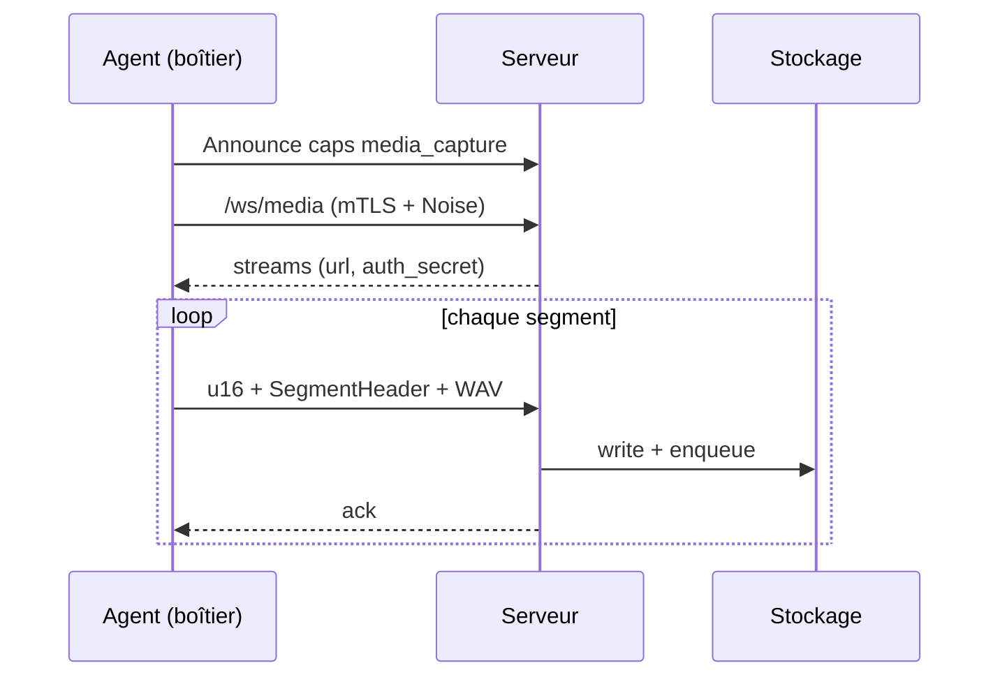

Un boîtier est un `pnex-agent` qui annonce `media_capture` (`config.toml`, Linux seulement). Il réutilise la crate `pnex-media-capture`, sans loco, sea-orm ni redis. Il capte l'audio seulement. Ses segments attendent dans une file mémoire de 32 segments. Il ne détient aucun secret de stockage : le serveur écrit le blob après ses propres contrôles (`segments::accept_upload`).

Le serveur tire l'org et le device du certificat (R1). Un flux qui n'est pas `device:<ce device>` répond `not-found`. Un device envoie 60 segments par minute au plus. Fin du lien = flux du boîtier en `backoff` et `device-offline`.

**Danger :** le secret d'accès à la source part au boîtier désigné, sur son lien chiffré, et reste en mémoire. Déplacer un flux à secret vers un boîtier exige owner ou admin (`secret-destination-locked`). L'exposition d'un boîtier compromis est consignée en SEC-27.

### 3.11 Relecture d'un média (D271–D280)

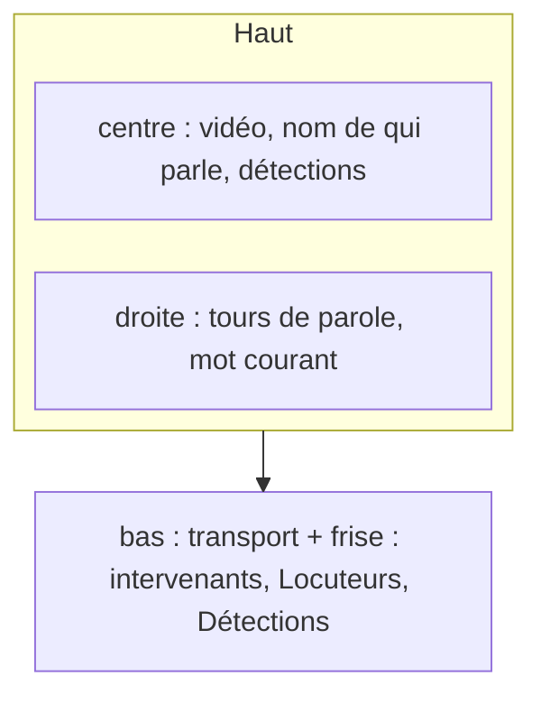

L'onglet **Relecture** de la fiche du média (`/media/:id/review`) reprend la mise en page du Vision Lab. Il remplace le lecteur de D217. Un clic sur un mot déplace la lecture. Le texte et la frise partagent le curseur. `/streams/:id/review` relit une fenêtre de 6 h au plus d'un flux à audio conservé, sans attribution.

Principes :

- Le temps est l'ancre. Une plage `[t0, t1]` survit à une nouvelle passe, une étiquette `S3` non.
- Une attribution a une origine (`manual`, `voice`, `transcript`, `grid`), jamais une technique privilégiée.
- La machine propose, l'humain confirme. Seule une confirmation écrit dans l'ontologie.
- Aucune empreinte de voix non enrôlée n'est stockée.

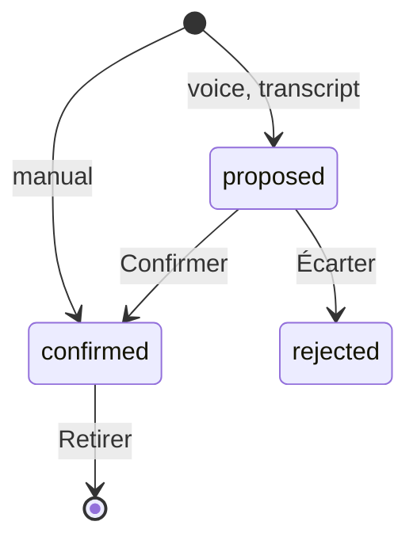

Un mot appartient à la plage qui contient son milieu. La priorité suit cet ordre : manuel confirmé, autre confirmé, proposé, `S#`. Deux plages confirmées d'une même personne qui se touchent fusionnent. Deux personnes peuvent se recouvrir. Une attribution `rejected` reste en base pour ne pas revenir.

L'attribution manuelle ne demande aucun profil vocal. Trois gestes la posent : glisser une plage, prendre tous les tours d'un locuteur, ou une touche 1–9 de la palette. Confirmer écrit l'apparition `speaking` et le lien `appears_in` (un par personne et par média). Une sélection de texte crée une déclaration (`statement`, `said_by`).

« Régénérer » a deux verbes :

| Verbe | Refait | Garde |
|---|---|---|
| Réidentifier les voix | `identify` sur la passe courante | attributions manuelles et confirmées |
| Retranscrire | nouvelle passe `transcribe`, puis `identify` | attributions manuelles et confirmées |

Une passe `platform` vient des sous-titres d'une plateforme (agents navigateur). Elle n'a ni locuteur ni horodatage au mot. « Retranscrire » crée une passe `pnex` à côté, sans la remplacer.

Le lien `published_by` dit qui a publié un contenu, jamais qui parle dedans. Le ton (D280) est réservé dans le contrat, sans modèle. Le règlement européen sur l'IA interdit la reconnaissance des émotions au travail et dans l'enseignement.

### 3.12 Empreintes vocales (V1–V10, D978–D985)

Les empreintes vocales forment un domaine séparé de la diarisation des flux (`pnex_core::voice_id`, `services/voice_id/`, page `/voice-id`, onglet « Voix » de la Personne). Elles suivent la variante A de K19 (`cases.md`) : enrôlement consenti, contrôle humain.

| # | Règle |
|---|---|
| V1 | Domaine séparé. Les étiquettes `S1..S16` des flux restent anonymes. |
| V2 | Un profil par objet `person` (`voice_profiles.object_id` unique). |
| V3 | Consentement obligatoire : date, portée, preuve, confirmation. Retrait = `DELETE` du profil, extraits et blobs compris. |
| V4 | Les extraits d'enrôlement restent dans la bibliothèque (`audio`), 180 s au plus par passage choisi. L'audio testé n'est jamais gardé. |
| V5 | Passages de 8 s, ≥ 3 s de parole, score leave-one-out ≥ 0,25, au moins 3 passages. Seuil calibré = moyenne − 2σ, borné à [0,45 ; 0,80]. |
| V6 | Centroïde scellé XChaCha20-Poly1305, AAD = org + profil. Jamais dans un DTO ni un journal. |
| V7 | Test 1:1 ou 1:N sur un même modèle. `match` si le meilleur passe son seuil et devance le second de 0,05. Résultat = proposition. |
| V8 | Création, extraits, génération, retrait : owner ou admin. Test : droit d'écriture. Lecture : membres. |
| V9 | Chaque génération et chaque test vont dans O2 `voice_id_usage`, sans vecteur ni audio. |
| V10 | L'assistant a une fiche, aucun outil, et ne lit pas les profils. |

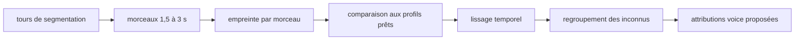

La reconnaissance par empreintes d'abord (D978) inverse l'ordre en différé : elle reconnaît d'abord les personnes connues, morceau par morceau, puis regroupe le reste. Le direct garde la diarisation anonyme. Le nombre de profils comparés n'a pas de borne. Mesure sur AMI (profils appris sur 3 réunions, DER sur la 4ᵉ) : 25,5 % contre 27,6 % pour la diarisation seule. La confusion de locuteur est divisée par 2 à 3.

« Régénérer la reconnaissance » relance `identify` avec les profils du moment. Une relance remplace les propositions non confirmées et ne touche jamais une attribution confirmée ou manuelle. « Enrôler sa voix » transforme les passages confirmés d'une personne en extraits de son profil existant (`samples/from-media`).

Limites :

- La porte de parole mesure l'énergie, pas une VAD. Un enregistrement bruité surestime la parole.
- Le seuil est calibré sur la voix de la personne seule, pas sur des imposteurs.
- `secrets::rekey` ne re-scelle pas les centroïdes. Après une rotation, il faut les régénérer depuis l'audio gardé.
- La génération est synchrone (60 passages au plus).

### 3.13 Enregistreur PNeX et appels (P2.30)

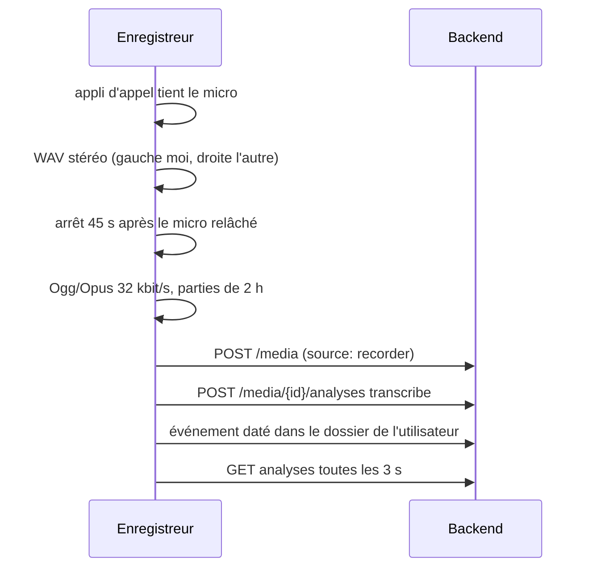

L'enregistreur (`crates/pnex-recorder`) est un utilitaire Dioxus de la barre des tâches. Il ouvre la connexion dans le navigateur système (PKCE S256) et épingle le CA du serveur après accord explicite. Un verrou système empêche deux instances.

La capture est codée pour Linux (libpulse, flux de l'appli d'appel d'abord) et pour Windows (WASAPI loopback, registre `ConsentStore`). Le Windows réel n'a pas été essayé. macOS n'existe pas. Le fichier local reste dans `<data>/pnex/recordings` jusqu'au stockage de toutes ses parties.

**Attention :** la personne qui enregistre doit annoncer l'enregistrement à son interlocuteur. La fenêtre le rappelle au démarrage et offre « Arrêter sans envoyer ».

Le profil conseillé pour les appels est Parakeet + Silero. Canary perd la parole sur un fond bruité. « Ma voix » enrôle l'utilisateur lui-même (6 phrases, 40 s) et teste sa voix en 1:1. La preuve de consentement est `PNeX recorder: self-enrolment of <e-mail>`.

Les lots matériels sont une **proposition, pas codée** :

| Lot | Brique | Matériel |
|---|---|---|
| R2 | Device filaire « PNEX Audio Tap » : jack en passthrough, écouteur = l'autre, micro = moi | ESP32-C6 + ADC stéréo + SD |
| R3 | Device Bluetooth HFP « PNEX Call » : appels GSM, CLIP, `call_state` | ESP32-C6 + TI CC2564C sous Zephyr + SD chiffrée |
| R4 | Proxy Bluetooth : relais HFP, puis A2DP si besoin | brique R3 |

Les options écartées restent valides : BTstack (non permissif), BlueZ (GPL), pilote audio virtuel, appli mobile (Android et iOS bloquent la capture d'appel).

### 3.14 Cadre juridique et non-objectifs (D172–D174)

- PneX capte une URL fournie par l'utilisateur, qui reste responsable de ses sources. PneX ne fournit aucun moyen de contourner une protection (DRM, géoblocage).
- Le texte conservé sert l'analyse, sous l'exception de fouille de textes et de données (CPI L122-5-3). Un flux sans `tdm_check` affiche un avertissement persistant.
- Rien ne sort de l'org (D173) : ni rapport, ni export, ni lien public. Les chiffres se lisent dans les dashboards PneX et sur `/streams`.
- Aucune synthèse LLM d'un flux n'existe (D174). Le LLM sert seulement à un classement fermé.
- Un locuteur de flux n'est jamais nommé par sa voix. Seule l'étape `identify` d'un média nomme une voix, contre des profils consentis, par proposition.
- Un futur studio de rapports devra échapper le contenu et rendre le PDF sans réseau. Il ne devra jamais publier une synthèse IA sans relecture.

## 4. Exigences

1. Une version de média doit être écrite dans le stockage avant sa ligne en base.
2. La base ne doit jamais contenir d'octets de média, d'audio ni de vidéo.
3. ffmpeg doit tourner sans réseau, sans secret en argv, sous `PNEX_MEDIA_SANDBOX`.
4. Toute URL suivie par le fetcher doit passer le filtre d'egress, redirections et sous-URL HLS comprises.
5. Une erreur de capture vue par l'UI doit rester `media-stream-unreachable`, sans dire « refusé » ou « injoignable ».
6. Le serveur doit construire les slugs, les clés de stockage, les noms de streams O2 et les canaux Valkey (R18).
7. Un segment écarté (silence, retard, échec) doit rester visible et compté.
8. Les empreintes de diarisation ne doivent jamais quitter la mémoire du worker.
9. Un profil vocal doit exister seulement après un consentement enregistré.
10. Une identification vocale doit produire des propositions, jamais une écriture confirmée.
11. Une relance d'analyse doit garder les attributions manuelles et confirmées.
12. Un lecteur (viewer) doit recevoir `403` sur toute écriture de média, de flux, de plage ou d'attribution.
13. L'assistant ne doit jamais démarrer ni arrêter une capture, ni lancer `identify`.
14. Un outil de l'assistant doit renvoyer des agrégats et des ids, pas de texte brut de transcription.

## 5. Décisions

État : ✅ codé, 🟡 en partie, ⬜ pas codé. Une décision levée dit ce qui l'a remplacée.

| # | Décision | État |
|---|---|---|
| D21 | Bibliothèque versionnée par org, octets dans le MediaStore, versions en ajout seul nettoyables | ✅ |
| D159 | Un flux est une entité `media_streams`, pas un nœud ni un device ; slug figé, quotas | ✅ `dash`, `dvb` ⬜, RTMP hors champ |
| D160 | Capture : superviseur par flux, fetcher filtré, ffmpeg confiné sans réseau, trois porteurs | ✅ |
| D161 | Rétention audio nulle par défaut, `days:N` ou `keep` en option | ✅ |
| D162 | Table `media_segments` : état, horloge, modèle épinglé, sans octets | ✅ |
| D163 | Nœud `media_source` : un message par segment ou par phrase | ✅ port `finished` ⬜ |
| D164 | Profil = modèles du registre ; garde de langue et seuil de regroupement par profil | ✅ |
| D165 | Transcriptions dans O2 `tx_<slug>`, jamais dans Postgres | ✅ |
| D166 | Worker `transcribe_segment`, tag `PNEX_ASR_QUEUE_TAG`, équité par org | ✅ |
| D167 | Registre de modèles audio, check par porteur | ✅ |
| D168 | Taxonomies de sujets versionnées ; entités dans l'ontologie | 🟡 mots-clés seuls, mode LLM et reclassement ⬜ |
| D169 | Plages annoncées et recalées, type système (D182) | ✅ |
| D170 | Métadonnées en bande par la capture, hors bande par les flows | 🟡 ICY seul, ID3 et EPG ⬜ |
| D171 | Séries O2 à labels libres, `SourceRef` à labels | ✅ |
| D172 | Garde-fous juridiques encodés dans le produit : vérification TDM, rien hors de l'org | ✅ |
| D173 | Pas de publication : les chiffres restent dans PneX | en vigueur |
| D174 | Synthèses IA reportées avec le studio de rapports | en vigueur |
| D175 | Piste vidéo d'un flux sur le bus caméra, `stream_id` dans `video_segments` | ✅ |
| D212 | Usages LLM par org (`assistant`, `extraction`, `vision`), repli sur le défaut | ✅ |
| D213 | `media_analyses` : orchestrateur, état par version et par étape | ✅ |
| D214 | Résumé en page IA versionnée liée au fichier | 🟡 documents seuls |
| D215 | Détection d'objets sur un fichier, D105 généralisé (`media:<asset>`) | ✅ MP4 et MOV |
| D215bis | Description dynamique d'un fichier par fenêtres chaînées | ⬜ |
| D216 | Contrat temporel commun et composant `Timeline` | 🟡 composant seul, `GET /timeline` ⬜ |
| D217 | Lecteur « relire avec les analyses ». Remplacé par D271 | levée |
| D271 | Écran de relecture : mise en page du Lab sur un média ou un flux | ✅ |
| D272 | Attribution = plage → personne, origine, confiance, statut | ✅ |
| D273 | Attribution manuelle sans reconnaissance vocale | ✅ |
| D274 | Sélecteur de candidats (attendus, choisis, tous) | ✅ « tous » absent de l'UI |
| D275 | Identification vocale par locuteur, proposition seulement | ✅ |
| D276 | Régénérer = Réidentifier ou Retranscrire ; passes `pnex` et `platform` | ✅ |
| D277 | Enrôlement depuis les passages confirmés, consentement d'abord | ✅ |
| D278 | Confirmation → apparition `speaking`, déclaration, lien `published_by` | ✅ |
| D279 | Couloirs de la frise, `kind` `attribution` et `tone` | 🟡 couloirs dans l'UI seulement |
| D280 | Ton = métadonnées réservées, liste fermée | ⬜ |
| D978 | Reconnaissance par empreintes d'abord, en différé seulement | ✅ |
| D979 | Nombre de personnes illimité | ✅ |
| D980 | Décision par morceau, lissage temporel | ✅ |
| D981 | Inconnus regroupés sur tout le fichier | 🟡 regroupés, pas affichés |
| D982 | Nommer un inconnu depuis le lecteur | ⬜ |
| D983 | Relance par média et en lot | 🟡 pas de relance sur une sélection de la bibliothèque |
| D984 | Preuve avant livraison, mesure AMI | ✅ |
| D985 | API générique : étape `identify`, route de lot | ✅ |

## 6. Interfaces

### 6.1 Routes

| Route | Rôle |
|---|---|
| `GET POST /api/v1/media`, `GET PATCH DELETE /api/v1/media/{id}` | bibliothèque |
| `…/{id}/versions`, `…/versions/{n}`, `…/versions/{n}/restore`, `…/versions/diff` | versions |
| `GET /api/v1/media/{id}/content`, `…/versions/{n}/content` | octets, `ETag` |
| `POST /api/v1/media/uploads`, `PUT …/parts/{part}`, `POST …/complete`, `GET …/{upload}` | envoi par parties |
| `POST /api/v1/stitch-jobs`, `…/{id}/frames/{k}`, `GET …/{id}`, `GET …/by-asset/{asset_id}` | Take 360 HD |
| `GET POST /api/v1/media/{id}/analyses`, `POST /api/v1/media/analyses` | analyses, lot |
| `GET /api/v1/media/{id}/transcript`, `…/detections` | relecture |
| `GET POST /api/v1/media/{id}/attributions`, `PATCH DELETE …/{aid}` | attributions |
| `GET POST /api/v1/media/streams`, `GET PATCH DELETE …/{id}` | flux |
| `POST …/streams/{id}/test`, `GET …/segments`, `POST …/segments/retry` | flux |
| `GET …/streams/{id}/review`, `GET …/segments/{segment}/audio` | relecture d'un flux |
| `GET /api/v1/media/transcripts`, `GET /api/v1/media/metadata` | texte, titres ICY |
| `GET /api/v1/media/capture-devices` | boîtiers de l'org |
| `GET POST /api/v1/asr/models`, `…/{id}`, `…/{id}/check`, `…/{id}/test` | modèles audio |
| `GET POST /api/v1/asr/profiles`, `…/{id}` | profils |
| `GET POST /api/v1/taxonomies`, `…/{id}`, `…/{id}/versions` | taxonomies |
| `GET POST /api/v1/time-ranges`, `…/{id}`, `POST …/import` | plages |
| `POST /api/v1/telemetry/aggregate/query` | agrégation par plage ou tranche |
| `/api/v1/voice-id/profiles`, `…/{id}/samples`, `…/samples/from-media`, `…/generate`, `/voice-id/test`, `/voice-id/by-object/{object_id}` | empreintes vocales |
| `POST /internal/media/segment` | workers du mesh, jeton de service, hors nginx (R7) |
| `GET /ws/media` | boîtiers, mTLS + Noise |
| `POST /internal/flow/time-range` | runtime, nœud `range_upsert` |

### 6.2 Données hors Postgres

| Nom | Stockage | Contenu |
|---|---|---|
| `tx_<slug>` | O2 logs | transcriptions |
| `mx_<slug>` | O2 logs | titres ICY |
| `media_*` | O2 metrics | supervision, parole, locuteurs, sujets |
| `camera_detections` (source `media:<asset>`) | O2 | détections d'un fichier |
| `voice_id_usage` | O2 logs | journal des empreintes |
| `pnex:media:v1:{org}:{slug}:tx` | Valkey | événement de segment transcrit |
| `pnex:media:v1:{org}:{slug}:cam` | Valkey | images du flux |

### 6.3 Variables d'environnement

| Variable | Rôle |
|---|---|
| `PNEX_MEDIA_MAX_BYTES` | taille max d'un média (2 Gio) |
| `PNEX_UPLOAD_MAX_CONCURRENT`, `PNEX_UPLOAD_WAIT_MS` | envois simultanés |
| `PNEX_STITCH_ENABLED`, `PNEX_STITCH_OUT_WIDTH`, `PNEX_STITCH_MODELS_DIR`, `PNEX_STITCH_MAX_CONCURRENT`, `PNEX_STITCH_TIMEOUT_SECS` | Take 360 HD |
| `PNEX_MEDIA_MAX_STREAMS_PER_ORG` | quota de flux (3) |
| `PNEX_MEDIA_SANDBOX`, `PNEX_MEDIA_BWRAP`, `PNEX_MEDIA_SANDBOX_RO_BINDS` | confinement de ffmpeg |
| `PNEX_MEDIA_CAPTURE_WORKER`, `PNEX_MEDIA_SEGMENT_URL` | porteur `worker` |
| `PNEX_MEDIA_CAPTURE` | capture d'un boîtier |
| `PNEX_FFMPEG` | binaire ffmpeg |
| `PNEX_ASR_BIN`, `PNEX_ASR_MODELS_DIR`, `PNEX_ASR_PROVIDER`, `PNEX_ASR_THREADS` | runtime ASR |
| `PNEX_ASR_SANDBOX`, `PNEX_ASR_MAX_MEMORY_MB` | confinement ASR |
| `PNEX_ASR_QUEUE_TAG`, `PNEX_ASR_CARRIER`, `PNEX_ASR_MAX_PER_ORG`, `PNEX_ASR_MAX_LAG_SECS` | file et porteur ASR |
| `PNEX_RECORDER_MIC`, `PNEX_RECORDER_OUTPUT` | périphériques de l'enregistreur |

## 7. Reste à faire

Vérifications en conditions réelles (O81) :

- Reconnaissance vocale de bout en bout : deux voix enrôlées dans un débat, deux propositions justes.
- Détection d'objets sur une vraie vidéo MP4 avec un vrai détecteur.
- Relecture d'un flux à rétention `days:N` et passe `platform` des agents navigateur.
- Image ffmpeg avec décodeurs vidéo construite et mesurée, RTSP contre une vraie caméra.
- Boîtier : 24 h sur un vrai Pi avec tuner TNT, build croisé `armv7` et `aarch64`.
- Enregistreur : essai sur un vrai Windows.

Écarts à combler :

- Sélecteur du profil de transcription et du modèle de détection sur l'étape (aujourd'hui le premier valide de l'org).
- Portée « tous les profils » de la reconnaissance dans l'UI.
- Durée max de 4 h d'un fichier transcrit, progression en %.
- Port `finished` de `media_source`, résumé d'un audio ou d'une vidéo, détection sur WebM.
- Contrat `GET /api/v1/timeline` (D216, D279).
- Frise d'un flux en heure murale.
- Affichage et nommage des « Inconnu N » (D981, D982).
- Relance sur une sélection de la bibliothèque (D983).
- Kinds `dash` et `dvb`, ID3 HLS, EPG TNT, parseur XMLTV (catalogue de nœuds P2.11).
- Mode LLM de `topic_classify` et job de reclassement (`PNEX_RECLASSIFY_QUEUE_TAG`).
- Vidéo, titres ICY et test d'URL depuis un boîtier.
- Route `/ws/media` dans le chart Helm de l'edge.
- Enregistreur : macOS, transcription par canal (« moi / l'autre »), notification système.
- Nouveau modèle de segmentation à mesurer sur AMI.
- Recouvrements de parole dans la reconnaissance.

Choix de Shan :

- Avis juridique sur l'identification vocale et commutateur plateforme (K19).
- Passage à des milliers de profils : index vectoriel contre scellement V6.
- Ton (D280) : usage, contenus, avis juridique (art. 5 du règlement IA).
- Exposition MCP de l'écriture d'attributions (exposée aujourd'hui).
- Origine `face` : même régime que la voix ?
- Stockage des apparitions d'un fichier : `speech_attributions` seul, ou aussi O2 `appearances`.
- Lexique : « Attribution » désigne déjà le rôle d'un membre (D288, `design-system.md` §7). Le mot pour un passage attribué reste à choisir, avec « Intervenant » et « Ton ».
- Superviseur de capture dans le process serveur sur Pi : proposé, à confirmer.
- Enregistreur : rattacher la Personne de l'utilisateur aux événements de son dossier (base légale `guard_person`).
- Appels matériels R2–R4 : hôte Bluetooth (Zephyr ou Bluedroid), pile firmware sous Zephyr, rétention et droit d'effacement des enregistrements.
- Description dynamique d'un fichier (D215bis) : lancement du lot.
