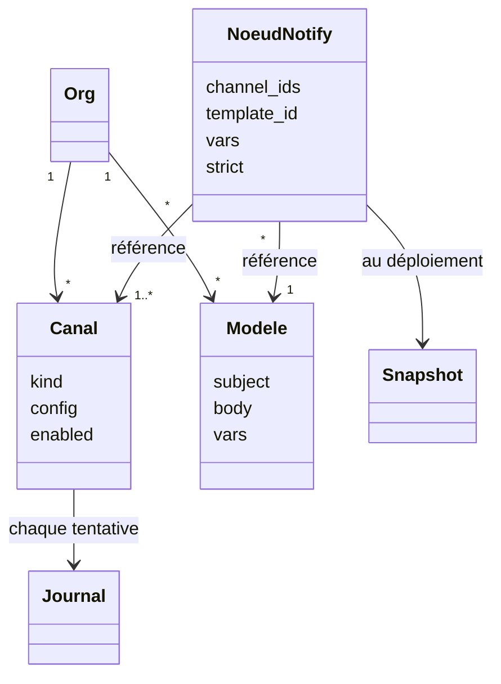
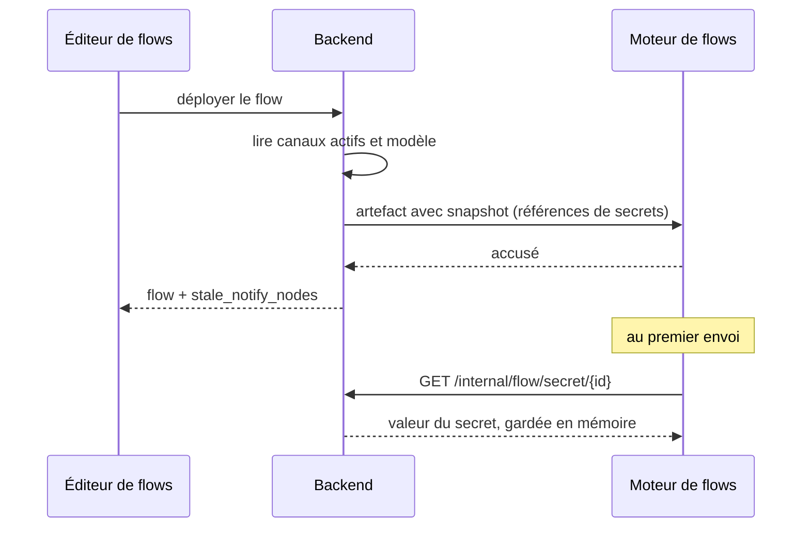
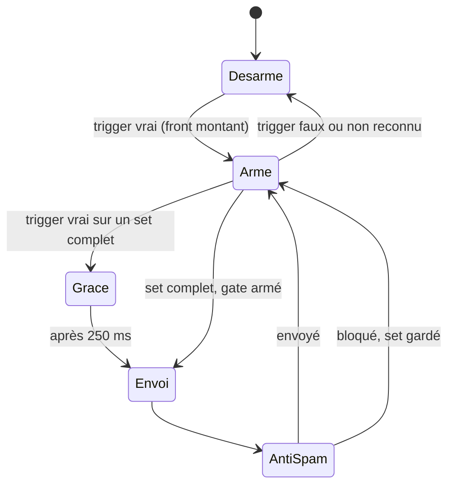
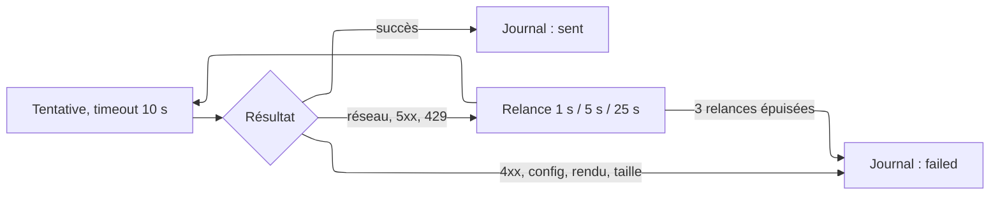
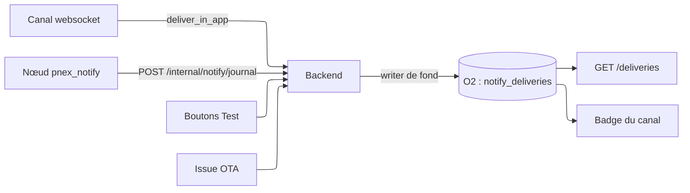
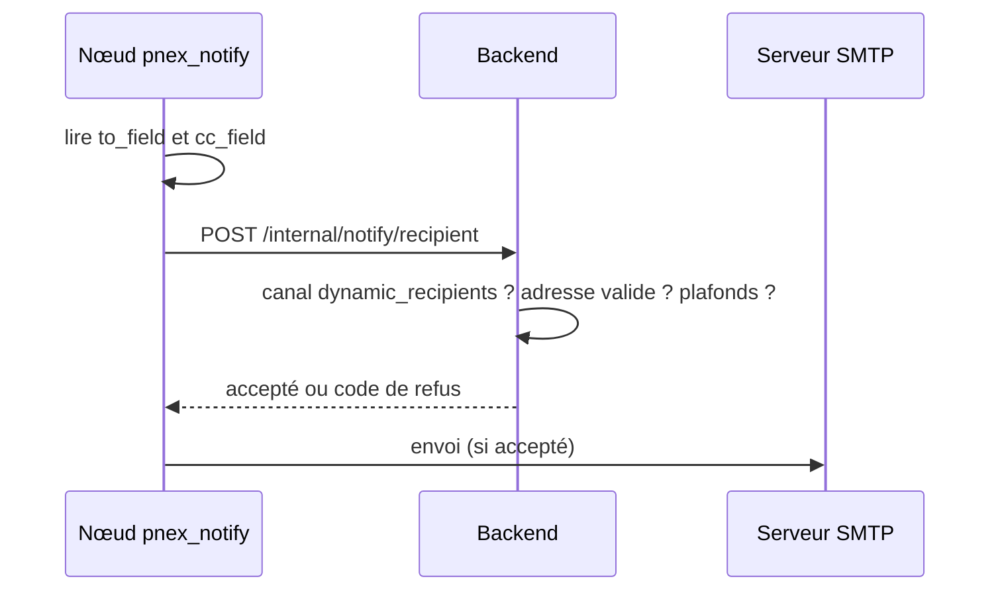

# Notifications : canaux, modèles et nœud de flow (D49–D68, D86)

| | |
|---|---|
| **Statut** | Codé. Sept canaux, modèles minijinja, nœud `pnex_notify`, journal des envois dans OpenObserve, destinataire tiré du message (D313), webhook signé (D315), pièce jointe PDF (D209). |
| **Code** | crate `pnex-notify` (canaux, rendu, relances), crate `pnex-node-notify` (nœud du moteur), `controllers/notify/`, `controllers/internal_notify.rs`, `services/notify_journal.rs`, `services/notify_recipients.rs`, page `pages/notifications.rs` |
| **Renvois** | `flow-engine.md` (version sauvegardée ≠ déployée), `security.md` (coffre de secrets, lot S4), `edge.md` (D44–D48), `partners.md` (D313, D315), `vision.md` (D86, D209) |

## 1. Résumé

Une notification transmet un événement de PneX à un système externe : seuil dépassé, device hors ligne, fin d'un job. Un admin d'org configure des canaux (ntfy, e-mail, Telegram, Slack, Discord, webhook, bus websocket) et des modèles de message. Un flow envoie par le nœud `pnex_notify`, qui rend un modèle et l'envoie sur un ou plusieurs canaux. Le backend, les boutons Test et le nœud passent tous par la même crate `pnex-notify`. Chaque envoi va au journal des envois, dans OpenObserve.

Hors périmètre : les alertes d'infrastructure (OpenObserve envoie déjà ses propres alertes), la couverture de 60 services (5 à 7 canaux suffisent), les préférences par utilisateur (l'exploitation est au niveau de l'org).

## 2. Concepts

| Terme | Définition |
|---|---|
| **Canal** | Destination d'envoi de l'org : `kind`, `name` unique dans l'org, `config` JSON propre au kind, `enabled`. Table `notify_channels`. |
| **Kind** | Type de canal. Une implémentation du trait `Channel` dans `pnex-notify`. |
| **FieldSpec** | Description d'un champ de configuration d'un kind (`text`, `secret`, `number`, `select`, `bool`). Le formulaire de l'UI vient de là. |
| **Modèle** | Message réutilisable : `subject` optionnel, `body`, `vars` déclarées `{name, example}`. Écrit en minijinja. Table `notify_templates`. |
| **Nœud `pnex_notify`** | Nœud de flow : `channel_ids`, `template_id`, `vars`, `strict`, anti-spam, port `trigger`. |
| **Snapshot** | Copie des canaux et du modèle, résolue par le backend au déploiement et portée par l'artefact du flow. |
| **Trigger** | Entrée booléenne obligatoire du nœud. Elle arme ou désarme l'envoi. |
| **Journal des envois** | Stream OpenObserve `notify_deliveries` de l'org. Une entrée par tentative. |

Les trois objets métier (canal, modèle, nœud) appartiennent à une org (couche D42, en-tête `X-Org-Id`).



## 3. Fonctionnement

### 3.1 Résolution au déploiement (D50)



Le nœud porte seulement des références. Au déploiement, le backend résout ces références et injecte un snapshot dans l'artefact. Le moteur n'appelle donc jamais le backend pour rendre un message. Modifier un canal ou un modèle ne change pas un flow déjà déployé : il faut redéployer. La réponse de déploiement liste les nœuds dont le snapshot est périmé (`stale_notify_nodes`), et l'éditeur les affiche dans un toast.

Le déploiement ignore un canal `enabled: false`. Le bouton Test, au contraire, envoie aussi sur un canal désactivé.

### 3.2 Envoi par le nœud (D53, D66–D68)



Chaque variable du modèle devient une ancre d'entrée sur le canevas. Les messages remplissent le set des variables, et la dernière valeur gagne. Le nœud rend et envoie seulement quand le set est complet et le gate armé. Ensuite, il vide le set.

Le port `trigger` est obligatoire (D67). Une fonction logique y branche sa sortie booléenne et décide de l'envoi. Les règles du gate sont :

- Un message de topic `trigger` met à jour le gate. Il ne passe jamais vers l'aval.
- La coercion suit Node-RED : booléens, nombres non nuls, chaînes `"true"`/`"false"`/`"1"`/`"0"`. Toute autre valeur désarme.
- Un `true` sur un set en attente lance le rendu après `COMMIT_GRACE` (250 ms). Les données qui arrivent pendant ce délai mettent le set à jour. Raison : l'ordre du fan-out d'edgelink n'est pas garanti.
- Un modèle sans variable envoie sur le front montant du trigger. Un `true` maintenu n'envoie rien de plus. Un `false` réarme le front suivant.

L'anti-spam est optionnel : au plus N envois par fenêtre de D secondes. En mode ancres, un envoi bloqué est différé, jamais perdu. Sans ancre, un envoi bloqué est abandonné.

Par défaut, un échec d'envoi ne fait pas tomber le flow : le nœud journalise et transmet le message. Avec `strict: true`, l'échec devient une erreur du flow, isolée, sans boucle de redémarrage.

### 3.3 Rendu d'un modèle (D52)

Le rendu se fait en deux temps. D'abord, le nœud rend ses `vars` contre `{msg, meta}`. Une var peut donc être un littéral `"80"` ou une référence `"{{ msg.value }}"`. Ensuite, le modèle est rendu contre `{msg, meta, vars}`.

```json
{
  "msg":  { "payload entrant du flow" },
  "meta": { "flow": "…", "node": "…", "ts": "…", "org": "…" },
  "vars": { "vars du nœud, déjà rendues" }
}
```

Les clés du payload et les vars sont aussi lisibles sans préfixe : `{{ temperature }}` = `{{ msg.temperature }}`. En cas de collision, l'ordre de priorité est : clé du payload < var < espace de noms explicite (`msg`, `meta`, `vars`). minijinja n'a ni accès disque ni include libre. La sortie (sujet + corps) est bornée à 64 KiB (`MAX_OUTPUT_BYTES`).

Projection sur un canal (D62) : `subject` devient le titre (objet de l'e-mail, `title` ntfy, première ligne ailleurs). `body` devient le texte brut. `meta` n'est jamais projeté.

### 3.4 Relances et taille (D53, D63)



La livraison est « au moins une fois ». Une erreur qui se reproduirait (4xx, config invalide) n'est pas relancée. Une taille trop grande échoue sans troncature (D63) : Telegram au-delà de 4096 caractères, Discord au-delà de 2000. ntfy convertit un long message en pièce jointe. Slack et SMTP laissent le serveur décider. Une alerte tronquée en silence est dangereuse.

### 3.5 Journal des envois (D86)



Tout envoi est journalisé. Le backend journalise lui-même chaque envoi websocket. Pour les autres canaux, le nœud poste chaque tentative (`sent`, `failed`, `blocked`) dans une tâche détachée. Le journal ne retarde jamais un envoi et ne le fait jamais échouer.

Une entrée porte `channel_id`, `channel_kind`, `template_id`, `source` (`flow`, `test`, `ota`), `status`, `http_status`, `error`, `subject`, `flow_id`, `node_id`, `delivered` (sessions websocket atteintes), `recipient_hash` et `message` (champ plein texte). La rétention est celle d'O2 (D72). Sans O2, la lecture répond `available: false` et l'écriture est perdue, avec un warn.

Le badge « dernier statut » d'un canal vient d'une seule requête agrégée sur 30 jours. Si O2 est indisponible, le badge manque, sans erreur.

### 3.6 Destinataire tiré du message (D313)



Le nœud peut lire l'adresse dans le message (`to_field`). Seul un canal SMTP marqué `dynamic_recipients` par un admin d'org l'accepte. Le déploiement refuse un nœud `to_field` sur un autre canal. Les plafonds sont de 200 envois par canal et par jour, et de 3 par destinataire et par jour. Le journal garde seulement l'adresse hachée. Codes de refus : `notify-dynamic-recipients-off`, `notify-recipient-invalid`, `notify-channel-daily-cap`, `notify-recipient-daily-cap`.

### 3.7 Pièce jointe (D209)

`attach_field` désigne l'id d'un PDF exporté par un nœud `page_pdf`. Le nœud lit le fichier sur `/internal/flow/media/{id}` à chaque envoi. Le backend sert seulement un PDF de la même org, de 10 Mio au plus. Seul le canal `smtp` porte une pièce jointe. Sans valeur au chemin, le message part sans pièce jointe.

## 4. Exigences

1. Un envoi (backend, Test, nœud) doit passer par `pnex-notify`. Aucun code d'envoi ne doit être dupliqué.
2. Un nouveau kind doit apporter une variante, une implémentation de `Channel`, un `field_spec` et ses clés dans les deux `.ftl`.
3. Le test `field_spec_keys_present_in_the_locales` (`registry.rs`) doit échouer si une clé de `field_spec` manque dans une locale (D65).
4. Un champ `secret` doit être en écriture seule : `PUT` l'accepte, `GET` ne le rend jamais. L'UI affiche « défini » et un bouton « remplacer ».
5. Un champ `secret` stocké doit être une référence `{"secret_id"}` vers le coffre. Le snapshot ne doit porter que ces références.
6. Un secret ne doit jamais paraître dans une URL ni dans un log. Un token est un champ séparé, jamais concaténé dans une URL.
7. La sauvegarde d'un flow doit refuser un nœud `pnex_notify` sans trigger câblé (`notify_trigger_required`).
8. Le moteur doit refuser de construire un artefact sans le drapeau `pnex_notify_trigger`.
9. Une var de modèle nommée `trigger` doit lever `notify_trigger_conflict` quand le trigger est câblé (D68).
10. Le canal websocket doit refuser l'envoi sans `PNEX_NOTIFY_INTERNAL_TOKEN` côté serveur (fermé par défaut).
11. Une évolution de `FieldSpec` doit rester additive : le front construit ses formulaires depuis `GET /kinds`.

## 5. Décisions

| Dn | Titre | Décidé |
|---|---|---|
| D49 | Bibliothèque maison | Trait `Channel` + crate `pnex-notify`, sans dépendance loco. Pas de service Python (Apprise) ni de bibliothèque Go. |
| D50 | Trois objets, snapshot au déploiement | Canal, modèle, nœud par org. Le backend résout les références au déploiement : redéployer pour propager. |
| D51 | Registre de canaux | Un kind = une implémentation du trait. L'UI rend le formulaire depuis `GET /kinds`. |
| D52 | Modèles minijinja | Rendu en deux temps, sortie bornée à 64 KiB. |
| D53 | Sémantique de livraison | Au moins une fois, 3 relances, nœud tolérant par défaut, `strict` en option. |
| D54 | Secrets | Écriture seule en API. Le chiffrement N5 prévu à l'origine a été remplacé par le coffre de secrets (`security.md`, lot S4). |
| D61 | Registre à 7 canaux | Les identifiants vivent dans la config du canal, jamais dans l'environnement (sauf websocket). |
| D62 | Projection du message | `subject` → titre, `body` → texte, `meta` jamais projeté. |
| D63 | Taille sans troncature | `TooLarge`, non relancé. |
| D64 | SMTP lettre en rustls | `relay` (465), `starttls_relay` (587, défaut), `builder_dangerous` (25). Erreur transitoire relancée, 535 non. |
| D65 | URL porteuse de secret | L'URL de webhook Slack ou Discord est un champ `secret`. Garde des clés i18n des `field_spec`. |
| D66 | Ancres du canevas | Une ancre par variable du modèle. |
| D67 | Trigger obligatoire | Gate booléen, front montant, commit après 250 ms, dernière valeur gagnante. |
| D68 | Nom `trigger` réservé | Conflit si une var porte ce nom avec le trigger câblé. |
| D86 | Journal dans OpenObserve | Table `notify_deliveries` supprimée (migration 000037), stream O2 à la place. |
| D209 | Pièce jointe PDF | Un PDF de `page_pdf` part en pièce jointe SMTP (`vision.md`). |
| D313 | Destinataire tiré du message | `to_field` sur canal SMTP `dynamic_recipients`, plafonds, adresse hachée (`partners.md`). |
| D315 | Webhook signé | Mode `hmac` du canal `webhook` (`partners.md`). |

Renvois : D42 (couche org), D14 (enveloppe de liste), D72 (rétention O2).

## 6. Interfaces

### 6.1 Canaux

L'ordre du registre est l'ordre du sélecteur de l'UI.

| Kind | Transport | Champs |
|---|---|---|
| `websocket` | bus `/ws/notify` (fan-out entre pods par Valkey) | aucun, identifiants d'instance par l'environnement |
| `webhook` | POST JSON `{subject, body, meta}` | `url`, `signing` (`header` ou `hmac`), `secret_header`, `secret_value` (secret) |
| `ntfy` | POST JSON `{topic, message, title, priority, tags}` sur `{server}/` | `server`, `topic`, `token` (secret), `priority`, `tags` |
| `telegram` | Bot API `sendMessage` | `bot_token` (secret), `chat_id` |
| `slack` | webhook entrant `{"text"}` | `webhook_url` (secret) |
| `discord` | webhook `{"content"}` | `webhook_url` (secret), `username` |
| `smtp` | lettre 0.11, rustls | `host`, `port`, `tls` (`starttls`, `tls`, `none`), `username`, `password` (secret), `from`, `to`, `dynamic_recipients` |

En mode `hmac` (D315), le secret ne part jamais. Chaque requête porte `x-pnex-timestamp` et `x-pnex-signature: sha256=<HMAC(secret, timestamp + "." + corps)>`. Le récepteur doit refuser un horodatage de plus de 5 min.

**Attention :** ntfy reçoit du JSON, jamais des en-têtes `X-Title`. Un sujet UTF-8 dans un en-tête HTTP casse la requête.

### 6.2 Routes

Routes de l'org (`X-Org-Id`) :

```
GET    /api/v1/notify/kinds                     → [{kind, label, field_spec}]
GET    /api/v1/notify/channels                  → liste, secrets masqués
POST   /api/v1/notify/channels
GET    /api/v1/notify/channels/{id}
PUT    /api/v1/notify/channels/{id}
DELETE /api/v1/notify/channels/{id}
POST   /api/v1/notify/channels/test-draft       {kind, config} → test d'un brouillon
POST   /api/v1/notify/channels/{id}/test        → message de test
GET    /api/v1/notify/deliveries                ?channel_id&status&source&q&from&to
GET    /api/v1/notify/templates
POST   /api/v1/notify/templates
GET    /api/v1/notify/templates/{id}
PUT    /api/v1/notify/templates/{id}
DELETE /api/v1/notify/templates/{id}
POST   /api/v1/notify/templates/{id}/preview    {vars?} → rendu, jamais d'envoi
```

Routes internes du moteur (jeton de service, `Authorization: Bearer` ou `x-pnex-internal-token`) :

```
POST /internal/notify/deliver     envoi websocket
POST /internal/notify/journal     une tentative du nœud (D86)
POST /internal/notify/recipient   contrôle d'un destinataire (D313)
```

### 6.3 Environnement du moteur

Le superviseur injecte `PNEX_NOTIFY_DELIVER_URL`, `PNEX_NOTIFY_DELIVER_TOKEN` et `PNEX_NOTIFY_JOURNAL_URL`. Le serveur lit `PNEX_NOTIFY_INTERNAL_TOKEN`. Le nœud lit les secrets sur `PNEX_FLOW_SECRET_URL` et les pièces jointes sur `PNEX_FLOW_MEDIA_URL`.

### 6.4 UI

La page `/notifications` a trois onglets : **Canaux**, **Modèles**, **Journal des envois**.

- **Canaux** : un sélecteur de kind, puis le formulaire construit depuis `field_spec`. Le bouton Test marche avant la sauvegarde (`test-draft`).
- **Modèles** : nom, sujet, corps, vars déclarées, boutons Aperçu et Test d'envoi.
- **Journal des envois** : filtres canal, statut, source, période et texte. Une ligne s'ouvre sur l'erreur, le nœud et le modèle.

L'inspecteur du nœud `pnex_notify` propose les canaux, le modèle, les vars (littéral ou `{{ msg.x }}`), `strict`, l'anti-spam et un aperçu sur un payload d'exemple. PneX n'a pas de centre de notifications dans l'app : le canal websocket sert les clients externes.

## 7. Reste à faire

- Canal `gotify` : en réserve, sans code. À faire quand un besoin arrive.
- Webhooks entrants (lancer un flow par un appel HTTP externe) : point d'extension, sans lot.
- Push natif FCM ou APNs : reporté. Il demande des identifiants de push par instance.
