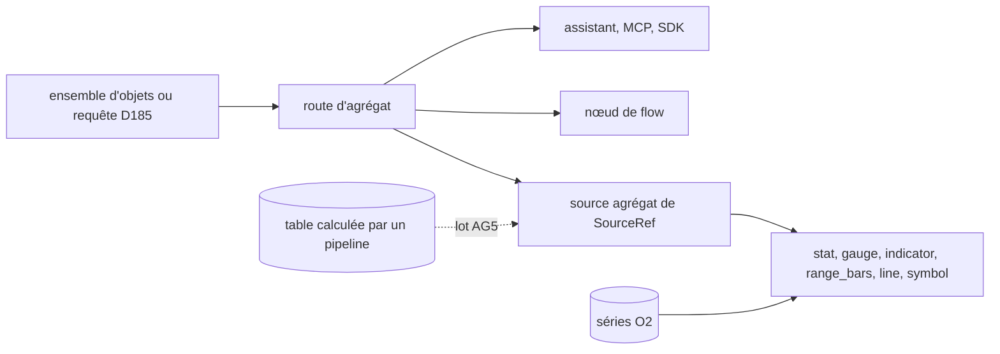

# Agrégats d'objets et widgets génériques (D579–D588)

| | |
|---|---|
| Statut | **Validé par Shan le 2026-11-04.** AG0, AG1, AG2, AG3 codés ; AG4 partiel (§12) ; AG5 attend OP1.2 |
| Déclencheur | Tableaux de bord commerciaux (`crm.md`, CRM3), resté sans spec. Demande de Shan (2026-11-04) : passer par le système SCADA et son runner plutôt que par un widget métier |
| Repose sur | `operational-platform.md` (premier morceau d'OP5, D557), `data-pipelines.md` §9 (D569–D578), `ontology.md` (D185 requête, D187 dashboards de type), `external-apps.md` (D434 ensembles d'objets), `app-builder.md` (D506–D512), `viz-bases.md` (D31, D40), `crm.md` (D442–D443 masquage) |
| Numérotation | **D579…D588**, lots **AG0…AG5** |
| Revient sur | D510 (`object_count` disparaît), et l'ordre d'OP5 (§9) |

## 1. Le besoin en une phrase

Répondre à « combien, quelle somme, réparti comment » sur n'importe quel type d'objet, depuis une seule route de lecture, et l'afficher avec les widgets SCADA existants, dans un dashboard comme dans un écran d'application.

## 2. Constat (relevé dans le code, 2026-11-04)

| Point | État |
|---|---|
| Moteur de rendu | Déjà commun : un écran d'application est un dashboard avec `app_id` (D507), même canevas, même éditeur |
| Données | Séparées. `gauge`, `stat`, `line`, `indicator` et `range_bars` lisent `SourceRef` (séries, mémoire, `object_property`). `object_table`, `object_count` et `object_fields` lisent un ensemble d'objets (`WidgetOptions.app`) |
| Requête d'ontologie | `POST /ontology/query` (`services/ontology/query.rs`) : filtres, traversée, masquage, date `as_of`. Rend des lignes, aucun agrégat. Le plafond de 500 lignes interdit de calculer côté client |
| Doublon | `object_count` est un `stat` dont seule la source change. Une somme ou une répartition en ajouterait d'autres |
| Agrégat existant | `POST /telemetry/aggregate/query` (D182) pour les séries O2 : c'est le modèle de `range_bars`, sans rapport avec les objets |
| Coût mesuré | `GROUP BY` sur 61 000 objets de la base locale : 12 ms, parcours séquentiel. Ordre de grandeur optimiste : la clé groupée était vide, donc un seul groupe. À refaire au lot AG0 |

## 3. Non-objectifs

- **Pas de SQL ni d'expression dans un widget** (D512) : une spec déclarative, validée contre le schéma.
- **Pas de nouvelle écriture** : lecture seule, droits de l'appelant (D557).
- **Pas de fusion dashboard / application** : D506 tient. Même moteur ; on regarde dans l'un, on travaille dans l'autre.
- **Pas de calcul sur dataset à l'affichage** : le moteur n'entre pas dans `pnex-server` (D573, voir D585).
- **Pas de règles ni d'alertes sur agrégat dans ce PRD** : reste d'OP5, qui réutilisera cette route.
- **Pas de canevas d'analyse ni de tableau croisé** : reste d'OP5.

## 4. Modèle



Le calcul vit dans la couche d'ontologie, l'affichage dans le SCADA. Un widget ne connaît ni SQL ni type métier : il reçoit des groupes et des valeurs.

## 5. Décisions

### D579 — L'agrégat est une opération de la requête d'ontologie

`POST /api/v1/ontology/aggregate/query`, permission `ontology:read`, description OpenAPI, exposée au MCP.

Corps : la requête D185 existante (type, filtres, traversée, `within`, `as_of`), plus :

| Champ | Forme |
|---|---|
| `group_by` | 0 à 2 clés : voir D581 |
| `metrics` | 1 à 8 : voir D580 |
| `limit` | groupes rendus, 1 à 1 000, 100 par défaut |

Réponse : `{groups: [{key, labels, values}], others, truncated, computed_at}`. Sans `group_by`, un seul groupe. `others` agrège ce qui dépasse `limit` : une somme, un compte, un minimum ou un maximum restent justes ; une moyenne ou un compte distinct ne se fusionnent pas et sont absents. Au-delà de 5 000 groupes, `truncated` le dit.

Le SQL reprend le plan de `query::run` (mêmes CTE, mêmes filtres, mêmes masques) : on extrait ce plan, on ne le copie pas. Les jetons `$today±n` (D451) sont résolus par le serveur, avec le code de `pnex-core`.

### D580 — Métriques : une liste fermée, conditionnelle

`{key, op, property?, where?}` :

- `op` : `count`, `count_distinct`, `sum`, `avg`, `min`, `max` ;
- `where` : un filtre D185, rendu en `FILTER (WHERE …)`. Il évite une requête par ensemble : le pipeline par étape n'a plus besoin d'un ensemble par étape ;
- **ratio** : `{key, ratio: [a, b], percent}` divise deux métriques du même groupe (taux de conversion = `count where stage = won` / `count`). Dénominateur nul = valeur absente, pas zéro. Jamais sur de la monnaie.

Propriétés admises : `number` et `money`. Une valeur non numérique ne casse pas la requête, elle est ignorée.

**Monnaies** : `sum` et `avg` d'une propriété `money` ne mélangent jamais les devises. Le groupe porte une valeur par devise. Un widget à valeur unique affiche « plusieurs devises » plutôt qu'un total faux.

### D581 — Répartition par propriété, par date ou par lien

| Clé | Forme | Libellé |
|---|---|---|
| Propriété | `{property}` | Libellé D370 d'une énumération, calculé au rendu dans la langue de l'interface |
| Date | `{property, bucket}` : `day`, `week`, `month`, `quarter`, `year`, en UTC (l'org n'a pas de fuseau) ; la clé est le premier jour de la période | Date |
| Lien | `{hops: [{link_type, direction}]}`, 2 sauts au plus, liens ouverts à la date `as_of` | Titre de l'objet atteint, masqué selon D443 |

La clé rendue est la valeur stable (clé d'énumération, id d'objet), jamais le libellé (D370). Objet sans valeur : groupe `key = null`, jamais écarté.

**Un objet lié à deux cibles compte dans les deux groupes.** La somme des groupes peut donc dépasser le total ; `count_distinct` sans `group_by` donne le vrai total. Le dire dans l'éditeur, pas seulement ici.

### D582 — Droits : le masquage s'applique aussi à ce qu'on déduit

- Org depuis le principal (R1), `ontology:read` (R2), types verrouillés invisibles (D188).
- **Refus** (`access-denied`, 403, propriété nommée) si `group_by`, `metrics` ou `where` portent sur une propriété que l'appelant ne peut pas lire, ou si un lien mène à des titres masqués (D443). Sinon, un filtre ou une répartition révélerait la valeur masquée : c'est l'oracle corrigé par SEC-51.
- Coquilles effacées (D446) : comptées, jamais nommées.
- Limite connue : de très petits groupes peuvent identifier une personne. Aucun seuil minimal avant OP3.

### D583 — `SourceRef` gagne une source agrégat

Comme `memory` et `object_property` avant elle : `SourceRef.objects: Option<ObjectsSource>`, et `metric`, `device_id`, `window` sont alors ignorés.

```json
{"metric": "", "device_id": "", "window": "1h",
 "objects": {"object_set": "open_opportunities", "group_by": [{"property": "stage"}],
               "metrics": [{"key": "total", "op": "sum", "property": "amount"}], "show": "total"}}
```

- **Où vit la requête** : dans un écran d'application, `object_set` nomme un ensemble de l'application, ce qui garde le périmètre (D508) ; dans un dashboard, `query` porte une requête D185. L'un des deux, jamais les deux.
- **Paramètres** : `$nom` comme D434 (`bind`, valeurs seulement). Dans un écran, ils viennent des variables (D509). Dans un dashboard de type, `$object` vaut l'objet affiché (D187), dans `ids` ou comme valeur de filtre ; la page le remplace, le serveur ne le voit jamais. Les objets comptés sont ceux qu'atteint un lien : `OntologyQuery.reached` porte leurs filtres, `filters` choisissant le point de départ. Sans objet choisi, le widget ne lit rien. `$object` sans `layout.object_type` est refusé au save.
- **Validation au save** (R2) : type, propriétés, liens et ensemble existent, sinon erreur de champ.

### D584 — Les widgets existants lisent cette source, sans nouveau widget de données

| Widget | Ce qu'il affiche |
|---|---|
| `stat`, `gauge`, `indicator` | La métrique `show`, sans répartition, avec leurs seuils et formats |
| `range_bars` | Une barre par groupe. Son corps lit déjà une agrégation à son propre rythme (D182) |
| `line` | Répartition par date : une courbe par métrique |
| `symbol` | État ou animation pilotés par la valeur, avec ses règles actuelles |

**`object_count` est retiré** (revient sur D510) : `stat` avec `count` le remplace, seuils compris. `object_table` et `object_fields` restent : ils montrent des objets, pas des nombres. Le pack `crm` migre dans le même lot.

Une répartition à plusieurs métriques n'a pas de widget : voir Q-AG3.

### D585 — Un seul contrat, deux sources : objets, puis tables calculées

D570 : une ligne n'est pas forcément un objet. Une partie des données restera donc dans un dataset, et un tableau de bord devra les lire. Pour que ce soit un ajout et pas un second système :

- la **forme de réponse** de D579 est celle que tout widget consomme, quelle que soit la source ;
- `ObjectsSource` gagnera un champ `dataset`, au même titre que `object_set` et `query` ;
- **un widget ne déclenche jamais de calcul sur dataset.** D573 garde DataFusion hors de `pnex-server`, et un `GROUP BY` sur 50 M de lignes prend des minutes (`data-pipelines.md` §9.7 bis). Un pipeline calcule une table, planifiée par D575 ; le widget lit cette table, petite, par le crate `parquet` dans le backend, comme le delta de D577. Il affiche sa date de calcul et le résultat de ses contrôles (D576).

Droits de cette variante : permission `datasets:read`, le dataset étant protégé en entier tant qu'OP3 n'est pas livré (`data-pipelines.md` §9.4). La lecture réutilise le lecteur S3 de `services/datasets/parquet.rs`. Rien n'est codé avant OP1.2.

### D586 — Coût : délai et rythme propre, pas de cache

Mesure AG0 (2026-11-04, transaction annulée, 100 000 objets synthétiques, base locale) : répartition par énumération 50 ms, somme par devise et 200 groupes 24 ms, par mois sur 80 000 objets 35 ms, deux sauts sur 27 000 objets 101 ms, compte distinct 57 ms. Aucun index à ajouter. **Le cache prévu est retiré** : à ce coût et à ce rythme il n'apporterait qu'un risque de fuite entre rôles et des chiffres en retard.

- Transaction en lecture seule, délai SQL de 5 s (`SET LOCAL statement_timeout`), code `ontology-aggregate-timeout`, 503 : une carte en erreur plutôt qu'un serveur chargé.
- Le widget a son propre minuteur, 60 s par défaut (10 s au plus court), comme `range_bars` : l'agrégat n'entre pas dans le `series-batch` (D31), dont la cadence est faite pour des séries.
- Pas de limite de débit propre : `POST /ontology/query` n'en a pas non plus ; une éventuelle limite se posera sur les deux.

### D587 — Le reste de la plateforme y accède par la même route

- **MCP** : `EXPOSED`, lecture seule (`exposure.rs`), droits de l'appelant.
- **Assistant** : outil de lecture `aggregate_objects`, même service, `<data>` sur les libellés, fiche et test « registre == ensemble autorisé » (`ai-assistant.md` §9.3).
- **Flows** : nœud `ontology_aggregate` (`NodeDoc`, recette de nœud), pour un digest ou une alerte chiffrés. Il lit ; il n'écrit pas. Ses filtres résolvent `$today`, `$now`, `$msg.…` à chaque message, ses propriétés sont vérifiées au déploiement.
- **SDK et CLI** : générés du spec, rien à tenir à la main.

### D588 — Le pack `crm` ne livre que des données d'écran

Aucun code métier dans le moteur (D441) ; tests et exemples du moteur sur l'ontologie inventée (`article`, `auteur`). Le pack `crm` déclare ses écrans avec ces sources :

| Chiffre | Spec | Possible aujourd'hui |
|---|---|---|
| Pipeline par étape | `opportunity`, étapes ouvertes, `group_by stage`, `count`, `sum amount` | Oui |
| CA gagné par salon | `stage = won`, `source = trade_show`, `group_by source_detail`, `sum amount` | Oui. `source_detail` est du texte libre : une faute de frappe fait un second salon |
| Taux de conversion par salon | `group_by source_detail`, ratio `count where won` / `count` | Oui |
| Activités en retard par commercial | `activity`, `state = to_do`, `due_on < $today`, `group_by` lien `activity_on` puis `owned_by` | Oui |
| **ROI par salon** | Coût sur le salon, chiffres écrits par un flow | Oui : écran Salons, voir Q-AG1 §10 |
| **Taux par étape de relance** | `group_by` lien `from_step`, ratio `count where replied` / `count` | Oui : voir Q-AG2 §10 |

## 6. Alignement avec les plateformes ontologiques

Lecture du périmètre OP5 : une plateforme opérationnelle agrège au niveau de la couche d'objets, et ses applications ne font qu'afficher. Trois conséquences retenues :

1. l'ensemble d'objets reste l'unité de lecture : D583 le réutilise plutôt que d'inventer une source ;
2. l'agrégat sert à tous les consommateurs (D587), pas à un écran ;
3. dataset et objet ont deux places distinctes, et le calcul lourd se prépare à l'avance (D585).

Ce que PneX ajoute : objets, séries et symboles de procédé sur un même canevas, par exemple un symbole de pompe coloré par ses interventions en retard, à côté de sa pression en direct. Aucun éditeur nommé (D552).

## 7. Sécurité (grille `security.md` §6)

- **R1, R2** : D582. Test sans `ontology:read` → 403 ; test d'un rôle sans `ontology.personal:read` qui groupe sur une propriété `personal` → 403.
- **R4, R16** : aucun identifiant ni secret dans la réponse, hors ids d'objets lisibles par l'appelant.
- **R11–R13** : libellés affichés en texte.
- **Injection** : clés validées contre le schéma, valeurs et clés JSON liées en paramètres. Aucune chaîne de la spec n'entre dans le SQL.
- **Déni de service** : D586. Le `count_distinct` et les traversées sont les plus coûteux : bornés par le délai. Limite : la borne porte sur chaque instruction, une requête à 8 métriques monétaires peut en enchaîner 9.
- **Lecture seule** : la transaction l'est, en plus de la validation.

## 8. Lots

| Lot | Décisions | Sortie | Dépend de |
|---|---|---|---|
| **AG0** | D586 | Mesure sur 100 000 objets de plusieurs types, clés réelles, traversée à 2 sauts ; index à ajouter ou non. Peut changer le délai et le cache | — |
| **AG1** | D579–D582, D586 | Route, masquage, cache. Tests : valeurs exactes par métrique, monnaies, `key = null`, `others`, double compte documenté, chaque refus D582 | AG0 |
| **AG2** | D583, D584 | `SourceRef`, panneau de source dans l'inspecteur, lecture par `stat`, `gauge`, `indicator`, `range_bars`, `line`, `symbol` ; lexique, `t!`, fiche assistant. E2e : un dashboard et un écran affichent la valeur calculée en base | AG1 |
| **AG3** | D584, D588 | Écrans du pack `crm`, retrait d'`object_count`. E2e : créer des opportunités, voir les chiffres changer | AG2 |
| **AG4** | D587 | MCP, outil de l'assistant, nœud de flow | AG1 |
| **AG5** | D585 | Lecture d'une table calculée | OP1.2, D575 |

AG2 et AG3 touchent le constructeur d'application, mis en pause le 2026-11-02 : la pause est levée pour ce périmètre seulement (Shan, 2026-11-04).

## 9. Place dans la roadmap

`operational-platform.md` place OP5 après OP1 à OP3 et le fait dépendre d'OP1. Ce premier morceau n'a pas besoin des datasets (AG0 à AG4) : il peut passer avant, sans changer le reste d'OP5. Les droits par ligne (OP3) s'y brancheront par le plan commun de D579.

## 10. Questions tranchées par Shan (2026-11-04)

1. **Q-AG1 — Coût d'un salon** : un type `trade_show`, avec son coût, et un lien `met_at` depuis la piste et l'opportunité, repris à la conversion. `source_detail` reste pour les autres sources. Un agrégat ne sait pas diviser par une propriété de l'objet groupé : le flow « CRM · trade show figures » écrit sur le salon ses chiffres et son retour, dans la devise de son coût ; un gain dans une autre devise est compté à part, jamais converti.
2. **Q-AG2 — Étape de relance** : lien `from_step` posé par le flow de relance. Une réponse est une activité entrante sur la même opportunité à partir du moment où la relance a été faite (`replied`, flow « CRM · replies to follow-ups »). Limite : un mail sans rapport qui arrive après compte comme une réponse.
3. **Q-AG3 — Tableau de groupes** : `range_bars` en V1.
4. **Q-AG4 — Retrait d'`object_count`** : sans compatibilité (beta) ; une org existante réinstalle l'application.

## 11. Récapitulatif des décisions

| # | Décision |
|---|---|
| D579 | L'agrégat est une opération de la requête d'ontologie, plan commun |
| D580 | Métriques en liste fermée, conditionnelles, ratio ; jamais de mélange de devises |
| D581 | Répartition par propriété, date ou lien (2 sauts) |
| D582 | Refus de tout agrégat sur ce que l'appelant ne peut pas lire |
| D583 | `SourceRef.aggregate` : ensemble nommé ou requête, paramètres `$nom` |
| D584 | Les widgets existants lisent cette source ; `object_count` retiré |
| D585 | Un contrat, deux sources ; un widget ne lance jamais de calcul sur dataset |
| D586 | Délai 5 s, rythme propre ; pas de cache, retiré après la mesure AG0 |
| D587 | MCP, assistant, flows, SDK par la même route |
| D588 | Le pack `crm` ne livre que des données d'écran |

## 12. État d'implémentation (2026-11-04)

| Lot | Où | Tests |
|---|---|---|
| AG0 | Mesure de D586, sans code | — |
| AG1 | `pnex-core` `ontology/aggregate.rs`, service `services/ontology/aggregate.rs`, plan commun extrait de `query.rs`, `POST /ontology/aggregate/query`, code `ontology-aggregate-timeout` | `tests/aggregate.rs` (valeurs exactes par métrique et répartition, devises, refus par champ, droits, frontière d'org) ; unitaires de `check`, ratio et `others` |
| AG2 | `SourceRef.objects`, validation au save (`check_objects_source`, `services/dashboards.rs`, `check_screen`), route par ensemble, `components/objects_widget.rs`, panneau `objects_panel.rs` | `tests/crm.rs` (chaque chiffre des écrans est accepté par le serveur), e2e `crm` |
| AG3 | Pack `crm` 3.3.0 : écrans Pipeline, Chiffres, Salons ; `trade_show`, `met_at`, `from_step`, `replied` ; 2 flows ; `object_count` retiré | `pack_rules.rs`, `tests/crm.rs`, e2e `crm` |
| AG4 | Outil `aggregate_objects`, MCP par le spec | `tests/ai.rs`, `tests/mcp.rs` |
| AG4 bis | Nœud `ontology_aggregate` (`/internal/flow/ontology/aggregate`, `pnex-ontology-aggregate`) ; `$object` ; filtres et lien vers l'objet affiché dans le panneau, `FilterRow` partagé avec le constructeur d'applications | `tests/aggregate.rs` (valeurs, nœud d'un autre type refusé, déploiement refusé), `filter_row` |

Limites :

- Le panneau de l'éditeur couvre un calcul et une répartition ; un calcul à plusieurs métriques, un ratio ou deux sauts s'écrivent dans le pack et s'affichent en lecture seule. Le nœud de flow les prend en JSON, comme ses filtres.
- L'aperçu POI (`DashboardLive`) n'a pas de sélecteur d'objet : ses agrégats sur `$object` n'affichent rien.
