# Noyau ontologique : objets, liens, temps, actions (D176–D191, D367–D370, D589)

| | |
|---|---|
| Statut | Noyau livré en 0.2.0 (lots L0–L5, 2026-10-10). Actions D183 livrées le 2026-10-13. D367 et D368 livrés, D369 acté sans code |
| Numérotation | **D176…D191**, **D367…D370**, **D589**. Décision « étiquettes et ontologie » sans numéro (§4) |
| Repose sur | `docs/journal/inventory.md` D42 (couche Resource), D43 (placements), D69 (recherche), `media.md` (D159–D175), `viz.md`, `ai-assistant.md` (D123, D142–D145), `security.md` (R1–R23) |
| Sécurité | Chaque changement passe `security.md` §6 |

## Résumé

Le noyau ontologique donne à PneX un modèle d'objets métier que l'org définit elle-même. Tout ce que
PneX connaît est un objet typé, relié à d'autres objets, porteur de temps. Chaque fait dit d'où il
vient, et l'humain peut agir depuis l'objet. Le noyau ne connaît aucun métier : les métiers vivent
dans des packs. Ce document fixe le modèle, ses règles de lecture et d'écriture, le stockage graphe
(annexe A) et la GMAO livrée en packs (annexes B et C).

## Concepts

- **Objet** : une chose du monde réel (pompe, site, chaîne, personne). Il a une identité UUID dans
  `objects`, un type, un titre, des propriétés et une validité `valid_from` / `valid_to`.
- **Type système** : type déclaré dans le code (`device`, `flow`, `media_asset`…). Son contenu reste
  dans sa table native.
- **Type d'org** : type que l'org déclare en données (`object_types`, versions en ajout seul).
- **Propriété** : fait typé d'un objet. Une **propriété temporelle** (`series`, `events`) désigne
  des données dans O2, elle ne les copie pas.
- **Lien** : relation typée et datée entre deux objets, avec des attributs et une provenance.
- **Liaison** : lien système `measures` qui relie une capability d'un device à une propriété
  `series` d'un objet.
- **Containment** : arbre de rangement à un seul parent (site › ligne › machine).
- **Plage** : intervalle de temps (`time_ranges`) sur un objet.
- **Action** : opération déclarée sur un type et exécutée par un flow déployé.
- **Provenance** : origine d'un fait (`source_ref`), journalisée dans le stream O2 `object_changes`.
- **Pack** : ensemble YAML versionné de types, liens, actions, réglages, fonctions et flows.
- **Couche d'org** : ce que l'org surcharge dans un pack (réglages, libellés, couleurs).
- **Proposition** : écriture machine en attente d'une décision humaine (D367).
- **Étiquette** : classement libre `clé:valeur` d'un objet, sans schéma (D42, D218).

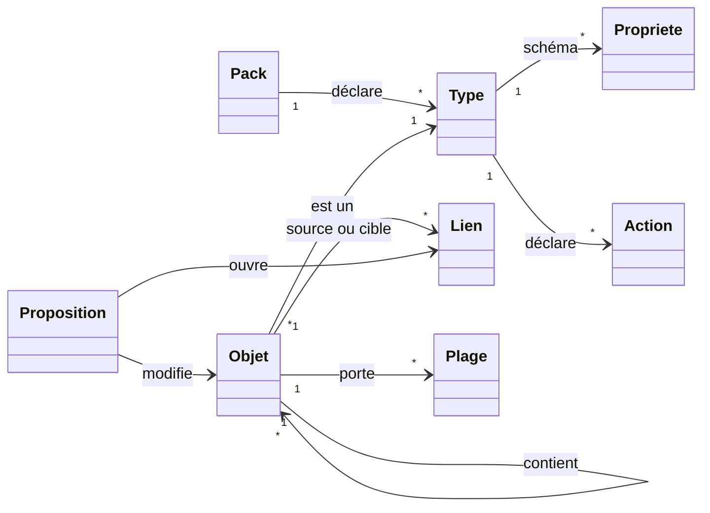

## 1. Fonctionnement

### 1.1 Les cinq primitives et leurs stockages

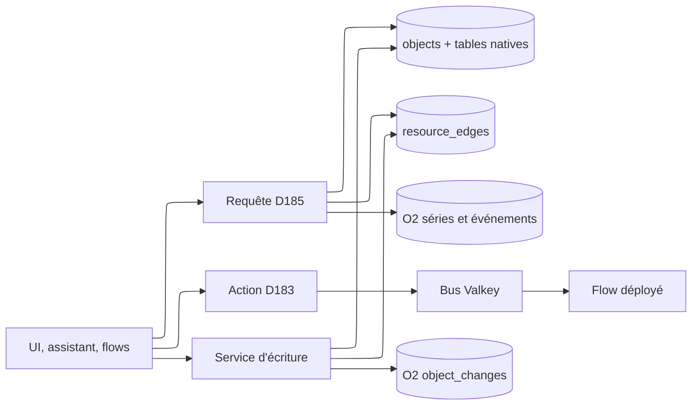

Toute lecture passe par un point unique, la requête D185. Toute écriture passe par le service
partagé entre l'UI, l'API et l'assistant. Le service écrit la provenance de chaque fait dans
`object_changes`. Les octets et la télémétrie restent dans leurs stockages : MediaStore et O2.
L'ontologie les désigne par identifiant.

### 1.2 Identité d'un objet

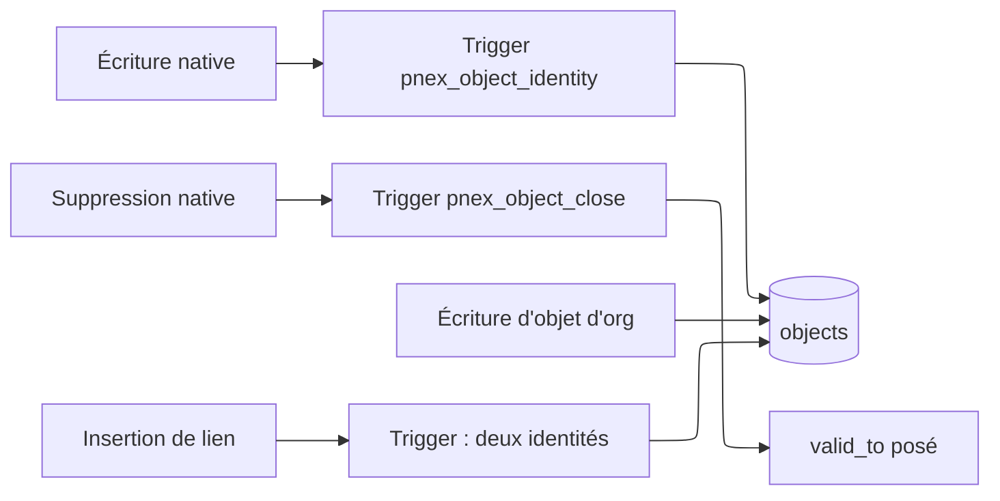

PostgreSQL écrit l'identité d'un objet système dans la même transaction que la ligne native. Les
seeds et les chemins chauds reçoivent donc leur identité sans code applicatif. Le trigger de mise à
jour porte seulement sur la colonne de titre. Une écriture de présence ou d'état ne le déclenche
jamais. Une suppression ferme l'identité, elle ne l'efface pas.

### 1.3 Cycle de vie d'un lien

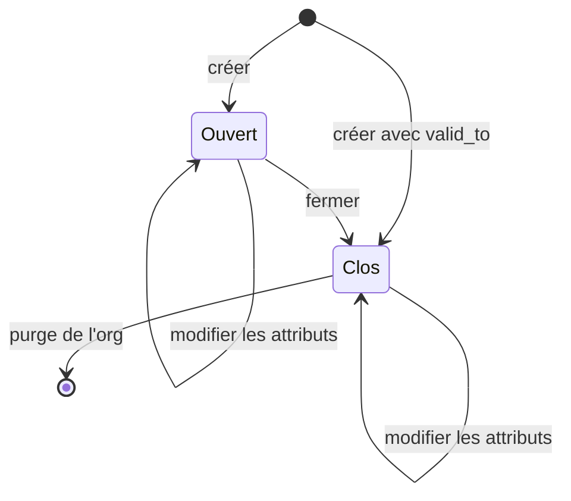

Fermer un lien pose `valid_to`. Le lien reste dans l'historique. Un lien créé avec `valid_to`
s'écrit directement comme historique, même si la paire a déjà un lien ouvert. Seuls les liens
ouverts sont uniques par paire et comptent pour la cardinalité. `valid_to` ne peut pas être futur.
Une fin annoncée va dans un attribut, par exemple `planned_end`. Les extrémités, le type et la
validité d'un lien ne changent pas : il faut fermer le lien et en créer un autre.

## 2. Principes

Le noyau capte des sources, les rattache à des objets typés et les relie dans le temps. Il permet
d'agir et dit d'où vient chaque fait. Il a cinq primitives, et rien d'autre.

| Primitive | Question |
|---|---|
| **Objet** | De quoi parle-t-on ? |
| **Lien** | Comment ces choses sont-elles reliées, et depuis quand ? |
| **Temps** | Que s'est-il passé, quand, et sur quelle plage ? |
| **Action** | Que peut-on faire sur cet objet, qui l'a fait, avec quel résultat ? |
| **Provenance** | D'où vient chaque fait, et peut-on le rejouer ? |

Le noyau tourne sur PostgreSQL, du Raspberry Pi au cluster. Le capteur à 3 € et l'objet métier
vivent dans le même modèle. L'ontologie est optionnelle : un device sans objet rattaché fonctionne
normalement.

## 3. Non-objectifs

- **Base graphe dédiée** : tout reste dans PostgreSQL (annexe A, D589).
- **Notebook dans le cœur** : le calcul passe par les flows et les fonctions. Le tableau local d'une
  page est admis, car une formule lit seulement (`pages.md` P7b). Les notebooks Python existent en
  déploiement séparé (D559).
- **Fédération implicite entre orgs** : le partage entre orgs est explicite et contractuel (D567).
- **Décision par l'IA** : l'assistant propose, l'humain ou un flow déployé agit (D123).

La parité fonctionnelle avec les plateformes opérationnelles n'est plus un non-objectif depuis D551
(`operational-platform.md`).

## 4. Décisions

### D176 — Les types d'objets sont des données, versionnées

Un type d'org vit dans `object_types` et `object_type_versions`, en ajout seul. Une version porte le
schéma des propriétés, les règles de containment et les actions. Une écriture donne
`expected_version`, sinon le serveur répond 409. Les types système sont déclarés dans
`pnex_core::ontology` et ne se suppriment pas. Une ligne d'org sous une clé système est une
**extension** : elle ajoute des propriétés, sans toucher aux colonnes natives. Le noyau dérive les
règles de containment du registre des types. Le `KindSpec` écrit à la main n'existe plus.

### D177 — Identité universelle, contenu natif en place

Chaque objet, système ou d'org, a une ligne d'identité dans `objects` : UUID, `org_id`, `type_id`,
titre, `valid_from` / `valid_to`. Le contenu natif d'un type système reste dans sa table, en 1:1,
avec une FK vers `objects.id`. `objects.native_id` garde la clé native en texte. Les liens ont de
vraies FK vers `objects.id`. Les propriétés d'un objet d'org sont un document JSONB validé par
schéma, pas une table par propriété. Un index GIN couvre les propriétés déclarées `indexed`.

Raison : déplacer les devices dans une table générique casserait `/ws/device`, la présence et l'OTA,
sans gain. Les options écartées sont dans l'annexe A2.

### D178 — Propriétés typées, y compris temporelles

`pnex-core` porte le format des propriétés (`PropertyDef`). Le front (wasm32) et le back valident
avec le même code.

| Famille | Types |
|---|---|
| Scalaires | `text`, `number` (unité, bornes), `bool`, `date`, `date_time`, `enum`, `geo_point`, `geo_area`, `url` (http(s) seulement, R11), `ref`, `money`, `fuzzy_time` (`cases.md` K5) |
| Temporelles | `series` (une série O2 : métrique et dimensions), `events` (un stream O2 filtré sur `object=<id>`) |
| Planification | `recurrence` (annexe B13) |

Une propriété temporelle désigne où vivent les données. Le moteur de lecture (`series-batch`,
`_search`) ne change pas. Une erreur de validation est un jeton de champ : `required`,
`max_length:N`, `invalid`, `unknown`, `duplicate`.

### D179 — Liens typés, temporels, porteurs d'attributs

`link_types` déclare `key`, `name`, `inverse_name`, `from_type`, `to_type` (ou `*`), la cardinalité
de chaque côté, le schéma des attributs et `temporal`. `resource_edges` (D42) est la table des
liens. Elle porte `link_type_id`, `attributes`, `valid_from` / `valid_to` et `source_ref`. Une
lecture « à la date T » voit seulement les liens valides à T. La section 1.3 montre le cycle de vie
d'un lien. La purge `purge_for` (D42) ferme les liens, elle ne les supprime pas.

### D180 — Le containment reste un arbre, séparé des liens

Le containment sert la hiérarchie physique et organisationnelle : un parent, pas de cycle. Le schéma
de type déclare « peut contenir » et « peut être contenu dans ». Les liens servent tout le reste. Un
arbre se navigue, un graphe se requête : le noyau ne les fusionne pas. Une hiérarchie à plusieurs
parents (groupes, filiales) est une vue d'arbre calculée sur des liens de pack (`partners.md`
D305).

### D181 — Le temps appartient aux objets, pas aux devices

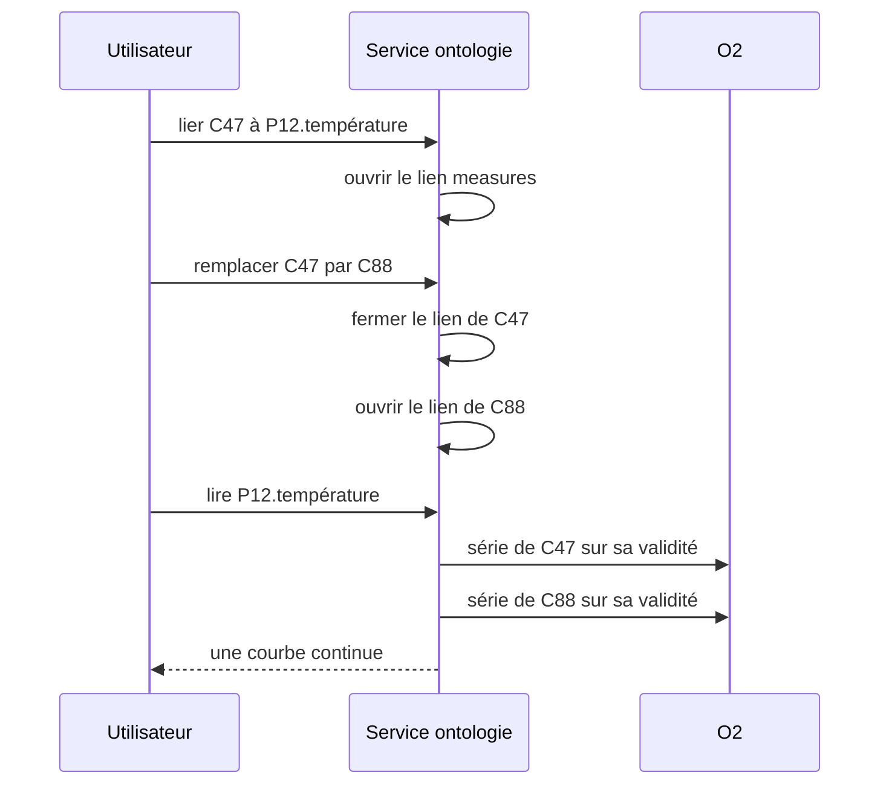

Le lien système `measures` va d'un device vers tout type. Ses attributs sont `{metric, property}`.
Une propriété `series` a un seul capteur ouvert à la fois, sinon le serveur répond 409
`ontology-link-cardinality`. Le service recompose la série segment par segment. Il coupe chaque
segment à la validité de son lien. L'objet survit donc à ses capteurs.

### D182 — Les plages s'appliquent à n'importe quel objet

`time_ranges` (`media.md` D169) accepte `scope_kind = object`. Une plage peut être une
émission, un poste d'équipe, un lot ou un mandat. `POST /api/v1/telemetry/aggregate` agrège une
série O2 (`sum`, `avg`, `max`, `min`, `increase`) par plage d'une portée (D171). Le widget
`range_bars` lit cette route. Une écriture de plage sur un objet exige le `write_role` du type de
l'objet (D188). Un viewer ou un member sans ce rôle reçoit 403 `ontology-write-forbidden`.

### D183 — Actions déclarées sur les types, exécutées par des flows, tracées

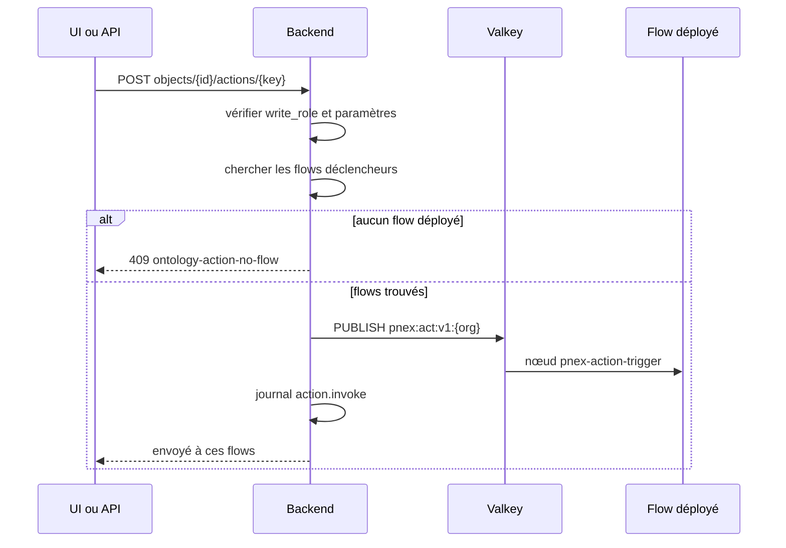

Le schéma du type déclare une action dans `actions` : clé, nom, schéma des paramètres. Un pack ou
l'import YAML la déclare. Le service valide les paramètres comme des propriétés et vérifie les `ref`
dans l'org (R1). L'invocation est sans retour, comme les contrôles D127. Le journal dit à quels
flows (id, version) le service a envoyé l'action. Le journal est l'entrée `action.invoke` de
`object_changes`, visible dans l'onglet Provenance.

- Le déploiement refuse un déclencheur dont l'action n'existe plus (`ontology-action-unknown`).
- `confirm: true` affiche un avertissement. Une invocation UI passe toujours par un dialogue et un
  clic.
- L'assistant utilise `propose_action` : l'outil vérifie, liste les flows et n'envoie rien. L'UI
  montre « Vérifier et exécuter », qui ouvre le même dialogue pré-rempli (D123).

### D184 — Provenance obligatoire sur chaque fait

Chaque objet, propriété modifiée et lien porte `source_ref`. Les formes sont `manual:<user>`,
`assistant:<user>`, `import:<job>`, `flow:<id>@<version>`, `device:<id>`, `device_placements`,
`stream:<id>/segment:<id>` et `api:<token>`.

Le stream O2 `object_changes` garde l'avant, l'après et la provenance. Il n'y a pas de table d'audit
en base. La rétention suit D72. Le serveur écrit en file et lit sans provisionner. La page objet
montre l'onglet **Provenance** : « d'où vient ce chiffre, ce lien ».

### D185 — Une API de requête sur l'ontologie

La requête est un JSON déclaratif. Il n'y a pas de langage textuel. Elle filtre par type,
propriétés, étiquettes effectives et containment. Elle traverse des liens à type explicite, au plus
`MAX_HOPS` (4) sauts, à une date `as_of`. Elle joint la dernière valeur ou un agrégat des propriétés
`series`. Le schéma de la requête vit dans `pnex-core` : l'UI, l'assistant et les flows parlent le
même langage.

- Le serveur contrôle les clés de propriété par jeu de caractères et lie toujours les valeurs.
- L'égalité utilise `@>` (index GIN).
- À `as_of`, le service filtre les liens sur `valid_from` / `valid_to`. Il filtre les objets
  seulement sur leur fermeture : `valid_from` d'un objet est sa date d'enregistrement.
- La recherche globale (D69) couvre les objets.

Le voisinage, l'impact et le chemin utilisent l'interface graphe interne (annexe A3, D589).

### D186 — UI : un explorateur générique, les pages actuelles deviennent des vues

| Route | Contenu |
|---|---|
| `/ontology` | objets, schéma, packs |
| `/ontology/object/:id` | propriétés, liens à date et historique, graphe radial, temps, actions, provenance |
| `/ontology/types/:type_key` | éditeur de type |

L'éditeur de type (as-UI) et l'export / import YAML (as-code) écrivent la même source de vérité
(`agents.md` §3.18). Les pages `/devices`, `/media`, `/cameras`, les dashboards et les tours
restent. Ce sont des vues de types système, avec un bouton « Page objet ». Un utilisateur hobbyiste
peut ignorer l'ontologie : il passe par les packs et les pages spécialisées.

### D187 — Dashboards et rapports se lient aux objets et aux types

Une liaison de lecture (`SourceRef`, D129) peut viser `object_property` : un objet et une propriété
temporelle. Un **dashboard de type** porte `layout.object_type`. Il s'affiche pour n'importe quel
objet du type, avec un sélecteur d'objet. Le serveur résout la propriété au capteur courant
(`/objects/{id}/bindings`), puis le pipeline `series-batch` lit la série. Les rapports
(`media.md` D173) utilisent la même requête D185.

### D188 — Permissions : l'org reste la frontière

La frontière de sécurité est l'org, puis la plateforme (R1, R2). Chaque type porte un `write_role` :
member, admin ou owner. Un viewer lit seulement. Le schéma (types, types de liens, packs, import)
exige `ontology.schema:write`. Les droits par ligne et les marquages viennent de OP3
(`governance.md`). Ils se branchent sur le point de lecture unique (D185).

### D189 — L'assistant IA raisonne sur l'ontologie

Le serveur injecte le schéma de l'org dans le prompt système. L'assistant a ces outils :

| Outil | Effet |
|---|---|
| `describe_ontology` | lit le schéma |
| `query_ontology`, `get_object` | lisent par D185 |
| `create_object`, `update_object`, `open_link`, `close_link`, `save_object_type` | écrivent par le service du contrôleur (`expected_version`, R1, R2, D144) |
| `propose_action` | propose une action (D183), sans l'exécuter |

L'assistant n'archive et ne supprime jamais. La fiche `assistant-kb/ontology.md` décrit ces outils.
Un type système, un type de lien système ou un nœud sans fiche pour l'assistant est un travail non
fini (D142).

### D190 — Packs : la frontière entre le noyau et les métiers

Un pack est un YAML versionné dans `crates/pnex-backend/packs/`. Il déclare des types, des types de
liens, des actions, des réglages, des fonctions, des modèles de flows et des modèles de pages. Le
noyau ne connaît aucun métier. Une fonction utile à un seul pack va dans le pack. La garde
`tests/engine_genericity.rs` refuse tout nom de type, de lien ou de pack dans le code du moteur
(D441, `external-apps.md` D432).

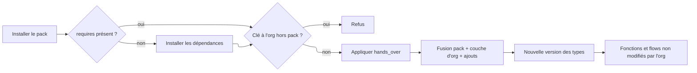

- `requires:` installe d'abord les packs dont le pack utilise les types.
- `extends:` (D306) étend un type d'un autre pack. Une couche pays s'écrit `<pack générique>_<pays>`
  et contient seulement ce qui est propre au pays.
- Le format porte aussi `unique` (D302), des mappings d'import (D301), des fonctions et des modèles
  de flows jamais déployés par l'installation (D316, D123).
- Les types installés appartiennent à l'org et restent éditables. Une montée de version garde les
  ajouts de l'org : propriétés, actions, attributs de lien, types source et cible (test
  `pack_upgrade_keeps_org_additions`).

Packs livrés, entre autres : `maintenance`, `maintenance_partners`, `investigation`,
`media_coverage`, `companies`, `companies_fr`, `prospecting_b2b`, `quali_watch`, `web_presence`,
`crm`, `markets`. La liste complète est le dossier `crates/pnex-backend/packs/`.

### D191 — Migration 0.1 → 0.2 : non destructive

La 0.2.0 a migré les données d'une base 0.1. Les tables système sont devenues des types système.
Chaque entité existante a reçu sa ligne d'identité. Les lignes `placed_on` ont reçu leur type de
lien. `device_placements` (D43) reste un index matérialisé : un trigger tient les liens `placed_at`
(device → map_pin, cardinalité un). Déplacer un device ferme un lien et en ouvre un autre. Les
routes `/api/v1/resources/*` restent servies. Les routes `/api/v1/ontology/*` sont additives :
`CONTRACT` n'a pas changé pour elles.

### Étiquettes et ontologie : deux rôles, pas deux modèles

Décision du 2026-10-11, sans numéro D.

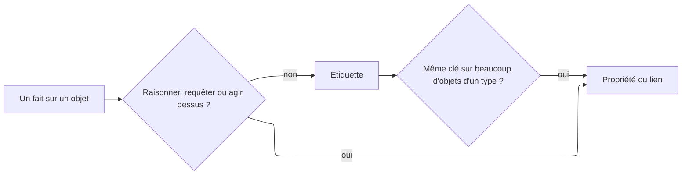

- L'ontologie dit ce que l'objet **est** : type, propriétés typées, liens datés et sourcés.
- Une étiquette est un classement de travail (`lot:2026`, `à-vérifier`), pour trier et filtrer. D218
  étend les étiquettes à tout objet listable et à la recherche globale.
- Une étiquette qui porte un fait métier (`marque:grundfos`) est une dette. Sa place est une
  propriété ou un lien.
- Les dimensions des séries O2 (`__name__`, `device_id`) ne sont pas des étiquettes. Elles
  sélectionnent les données d'une propriété `series`.
- Sur une fiche, le type et les propriétés viennent d'abord. Les étiquettes sont des `LabelTag`
  discrets.

## 5. Modèle de données

| Table / stream | Rôle |
|---|---|
| `objects` | identité de tout objet, propriétés des objets d'org (D177) |
| `object_types` / `object_type_versions` | types d'org et extensions de types système (D176) |
| `link_types` | types de liens (D179) |
| `resource_edges` | liens typés, temporels, avec attributs (D179) |
| `link_versions`, `object_versions` | temps de connaissance (`markets-research.md` D912–D917) |
| `resource_containments`, `resource_labels`, `resource_folders` | containment, étiquettes, dossiers (D42, D180) |
| `device_placements` | index matérialisé des liens `placed_at` (D191) |
| `time_ranges` | plages sur tout objet (D182) |
| `packs` (+ `settings`, `display`) | packs installés et couche d'org (D190, D368) |
| O2 `object_changes` | historique, provenance, invocations `action.invoke` (D183, D184) |

Migrations : `m20261011_000002_ontology` (identité, types, liens temporels, packs, reprise 0.1),
`m20261011_000010_placed_at_links` (D191).

## 6. Exemple de bout en bout (pack Maintenance)

Un technicien installe le pack `maintenance` et crée la pompe P12 dans la ligne L2. Il lie le
capteur C47 à `P12.température`. Le flow d'anomalie lit la propriété de l'objet, pas l'identifiant
du capteur. Le remplacement de C47 par C88 ne casse donc ni le flow, ni le dashboard de type
(diagramme de D181). L'invocation de `start_maintenance` suit le diagramme de D183.

## 7. Exigences

1. Chaque objet doit avoir une ligne `objects`, écrite dans la transaction de sa ligne native.
2. Une écriture de présence ou d'état d'un device ne doit pas toucher `objects`.
3. Une suppression d'objet ou de lien doit fermer sa validité, jamais effacer la ligne.
4. Le front et le back doivent valider une propriété avec le même code `pnex-core`.
5. Une propriété temporelle ne doit copier aucune donnée de O2.
6. Une propriété `series` doit avoir au plus un lien `measures` ouvert.
7. Une lecture `as_of` doit voir seulement les liens valides à cette date.
8. Une requête D185 doit refuser plus de `MAX_HOPS` (4) sauts.
9. Chaque écriture doit porter un `source_ref` et une entrée `object_changes`.
10. Une invocation d'action sans flow déployé doit répondre 409 `ontology-action-no-flow`.
11. L'assistant doit écrire par le service du contrôleur, jamais archiver ni supprimer.
12. Le code du moteur ne doit nommer aucun type, lien ou pack (`tests/engine_genericity.rs`).
13. Une montée de version de pack doit garder les ajouts et la couche de l'org.
14. Un parcours de graphe plafonné doit le dire par `truncated`, jamais en silence (D589).

## 8. Risques

- **Sur-généricité** : un noyau trop abstrait devient lent et illisible. Parade : types système dans
  leurs tables, packs concrets, pas de langage de requête textuel.
- **Performance du JSONB** : un index GIN couvre seulement les propriétés `indexed`. La mesure sur
  100 k objets reste à faire.
- **Complexité perçue** par les makers : l'ontologie reste invisible tant qu'ils n'en ont pas besoin
  (D186, D190).
- **Comparaison commerciale** : jamais de comparaison à un éditeur nommé (D552).

## 9. Questions ouvertes

Ces choix reviennent à Shan.

1. Un langage de requête textuel (Cypher ou GQL réduit) : en 0.3, ou jamais ?
2. Les types système et le format des packs deviennent-ils une spécification publique versionnée à
   part, en vue d'une fondation ?
3. Types libres par org ou base fixe étendue : D176 répond (types système, types d'org, packs). Shan
   doit reconfirmer ce choix.

Le temps de connaissance (bitemporel) a sa réponse dans `markets-research.md` D912–D917.

## 10. Mise en œuvre

Cette section donne les choix d'implémentation. Elle ne change pas les décisions D176–D191.

### 10.1 Identité tenue par la base

Les triggers de la section 1.2 tiennent l'identité des types système.

- La table native porte `object_id` (FK, unique). `objects.native_id` est la clé native en texte.
  Pour un type d'org, c'est l'id de l'objet lui-même.
- `resource_edges` reçoit ses deux identités par trigger à l'insertion.

### 10.2 Propriétés (D178)

`PropertyDef` a un `kind` à plat. Il se désérialise à la main via `Value`, à cause du piège
`arbitrary_precision` des enums taggés. `TypeSet` vaut `"*"` ou une liste de clés, lisible en YAML.

### 10.3 Temps (D181, D182)

Les préréglages de fenêtre des plages comptent 7 j et 30 j.

### 10.4 Requête, graphe, UI (D185–D188)

Le trait de stockage graphe, asynchrone, vit côté backend (`services/ontology/graph.rs`). Les
algorithmes purs vivent dans `pnex_core::ontology::graph`. L'aperçu POI (`DashboardLive`) n'a pas de
sélecteur d'objet de type.

### 10.5 Provenance, packs, assistant (D184, D189, D190)

- Packs : YAML embarqués. L'installation crée puis versionne les types. Elle refuse une clé qui
  appartient à l'org hors pack.
- `PUT /api/v1/ontology/links/{id}` remplace les attributs d'un lien, ouvert ou clos, validés contre
  son type. Il ne s'applique pas aux liaisons `measures` et `depicts`. Le journal note `link.update`
  avec la version précédente (test `link_attributes_update_in_place`).
- Test du lien clos à côté du lien ouvert : `closed_link_is_history_beside_the_open_one`.
- Pack `media_coverage` : `media`, `program`, `party`, `mandate`, et des liens qui portent leur
  source, leur date de consultation et leur début collecté. Il exige `investigation` (test
  `media_coverage_pack_requires_investigation`).

## 11. Décisions de pérennité (D367–D370)

Critère : ce qui deviendrait un piège de migration si PneX attendait.

### D367 — La proposition est un objet du noyau

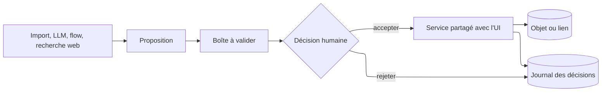

Une écriture machine peut arriver comme proposition au lieu d'une donnée vivante. Une proposition
porte une cible, une différence, des preuves, une source, une confiance et un auteur machine.
Accepter applique la différence par le service partagé avec l'UI : mêmes contrôles, mêmes 409. Les
packs ne déclarent plus d'état `to_validate` par type. Le détail et les lots P0–P4 sont dans
`proposals.md` (D371–D377).

### D368 — Contrat pack + couche d'org

Un pack déclare ses points réglables : réglages, libellés et couleurs des valeurs d'énumération,
modèles de pages, hiérarchies. Une org surcharge seulement ces points, dans sa couche. Elle peut
toujours ajouter des propriétés et des actions (`keep_org_additions`). À la montée de version, la
fusion est fixe : pack, puis couche d'org, puis ajouts de l'org. `hands_over` s'applique avant.

**Réglages.** Le pack déclare `settings` : `key`, nom, description, `kind` (`number`, `text`,
`bool`), `default`, `min` / `max`.

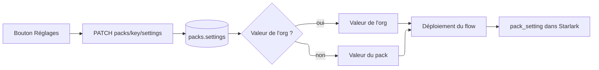

- `null` rend un réglage au pack. Une clé inconnue ou une valeur hors bornes donne 400.
- Une réinstallation ou une montée de version ne touche pas la couche de l'org.
- Une fonction Starlark lit `pack_setting("<pack>.<clé>", défaut)`, dans une fonction et pas au
  niveau du module. Le déploiement copie les valeurs dans chaque nœud Starlark de l'org. Un
  changement s'applique donc au prochain déploiement, geste humain (D123).

**Libellés et couleurs** (D370). `PropertyDef.labels` donne un libellé par langue à chaque valeur, à
côté de `colors` (8 langues au plus). Sans libellé, l'UI affiche la clé en mots. La couche de l'org
est la colonne `packs.display`, clé `type:<clé>/<propriété>` ou `link:<clé>/<attribut>`. Chaque
écriture de type y note ce qui diffère du pack propriétaire. Un libellé que l'org a retiré vaut
`null` et reste retiré à la montée de version. Les pages générées (`page_render`) écrivent le
libellé dans la langue de l'auteur.

**Fonctions et flows du pack.** Une montée de version écrit une nouvelle version d'une fonction ou
d'un flow que l'org n'a pas modifié. Dès que l'org a sa propre version, le pack n'y touche plus.
`PackView.kept` liste ces éléments modifiés. `POST /ontology/packs/{key}/take` écrit la version du
pack par-dessus. La version de l'org reste dans l'historique. Un flow mis à jour reste à redéployer
(D123).

### D369 — Identité externe et frontière des transactions

Principe acté. Le code commence avec le CRM ou l'ERP. `external_ref` n'existe pas encore dans le
code.

- `external_ref` de premier rang sur les objets et les liens : système, identifiant externe, version
  ou etag, dernière synchro, sens. Aucun pack ne crée de champ `<outil>_id`.
- Événements de changement sortants : D356 (`import.applied`) s'étend à toute écriture. Une synchro
  bidirectionnelle arbitre ses conflits par la version.
- Les écritures chiffrées (mouvements de stock, lignes de facture, temps passés) vont dans des
  tables dédiées en ajout seul. L'ontologie reste le graphe des choses.

### D370 — Clé d'énumération stable, libellé séparé

La clé d'une valeur d'énumération (`customer`, `to_validate`) est un identifiant stable. Personne ne
la renomme, pas même pour la traduire. Le libellé est séparé, par langue, et l'org peut le
surcharger (D368). Renommer une clé est une migration de données. La même règle s'applique au texte
d'un modèle de page : `body` en anglais, `bodies.fr` pour le français, avec les mêmes champs `{{…}}`
(garde du test des packs).

## Annexe A — Ontologie et stockage graphe

### A1. Principes

POI et placements sont des types intégrés, migrés, jamais dupliqués (D191). Le méta-modèle (format
des schémas, types et liens système, interface graphe) vit dans `pnex-core`.

### A2. Stockage : identité universelle

| Option | Verdict |
|---|---|
| Tout dans des tables `object` / `link` génériques | Écartée : chemins chauds en JSONB, perte des FK typées et des entités SeaORM |
| `ResourceRef` en chaîne, sans identité | Écartée : pas de FK sur les liens, intégrité par purge applicative |
| **Table d'identité pour tout objet, contenu natif en place** | **Retenue** (D177) |

Contraintes pour toute projection graphe future : identifiants stables, un type par lien, source et
destination explicites.

### A3. Accès graphe

| Besoin | Mécanisme |
|---|---|
| Parcours de la requête D185 | jointures et CTE générées par le cœur Rust, timeout et plafond de lignes |
| Voisinage, impact, plus court chemin | lecture niveau par niveau (D589) |
| Algorithmes (cycles, composantes) | `petgraph` ou code pur de `pnex-core`, sur le sous-graphe chargé |
| Filtre temporel | SQL sur `valid_from` / `valid_to` |

Toutes les requêtes graphe passent par une seule interface, un trait Rust. L'API D185 reste bornée à
4 sauts. SQL/PGQ n'est pas dans PostgreSQL 19 (vérifié sur 19beta4). Il donnerait seulement une
syntaxe. PneX reste sur PostgreSQL 18. Il passera à 19 en GA, quand PostGIS et pgvector le suivront
sur arm64. pgRouting (GPL-2) et Apache AGE (A4) sont des branchements possibles, jamais des
prérequis.

Une ontologie opérationnelle n'exige pas de base graphe : objets en tables, liens par clés, parcours
bornés. L'écart réel est dans les actions, les droits fins et l'intégration de sources.

### A4. Apache AGE : réserve, pas départ

- AGE (Apache-2.0) apporte openCypher et les chemins de longueur variable.
- Cible éventuelle : une projection en lecture, alimentée par triggers, sur le même serveur.
  PostgreSQL relationnel reste la source de vérité. PneX fonctionne sans AGE.
- AGE seul est écarté : perte des jointures, `agtype` sans schéma, temporel verbeux, pas de
  migrations Loco, retard possible sur les versions majeures.
- Le coût réel d'une projection est la cohérence de deux modèles, pas le disque.

### A5. Options écartées

| Option | Raison |
|---|---|
| Neo4j | Une brique de plus, GPL pour la version Community |
| SurrealDB | Licence BSL |
| XTDB, ArcadeDB | JVM, trop lourd pour le Pi |
| AgensGraph | Fork de PostgreSQL : il remplace la base de toute la plateforme |
| Grafeo, LadybugDB, NeuG | Une base de plus à synchroniser, isolation par org à refaire. À tester seulement si AGE échoue |
| DuckDB + DuckPGQ | Dépassements de temps et erreurs au comparatif |
| FalkorDB, TuringDB | Licences SSPL, BSL |

### D589 — Graphe à grande échelle : PostgreSQL d'abord, AGE en réserve

Shan a tranché le 2026-11-04. PostgreSQL reste la seule source de vérité. PneX corrige la requête de
parcours avant d'ajouter un composant. AGE reste la seule réserve : une projection en lecture,
jamais une dépendance d'une fonction essentielle. Si PneX l'adopte, ce sera un seul graphe à labels
génériques (`object`, `link`). L'org devient une propriété filtrée dans chaque requête.

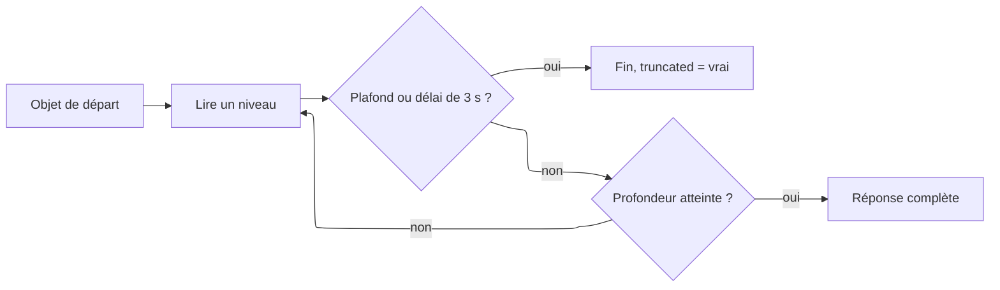

- Voisinage et impact lisent niveau par niveau, sans revisite, plafonnés à 5 000 liens
  (`EDGES_MAX`). La réponse porte `truncated`.
- L'impact suit le sens des liens, dans la limite de `depth`.
- Le chemin part des deux extrémités, plafonné à 200 000 liens (`PATH_EDGES_MAX`). Coupé avant
  d'aboutir, il répond 503 `ontology-path-incomplete`, jamais un faux 404. Trouvé malgré une coupe,
  il porte `truncated`.
- Test : `tests/ontology.rs`, `a_walk_past_its_cap_says_so`.

Mesure de référence (30 M de liens, PostgreSQL réglé, 95ᵉ percentile à 3 sauts) :

| Cas | Index actuels | Index couvrants |
|---|---|---|
| Plafond de 5 000 liens, objet ordinaire | 25 ms | 10 ms |
| Plafond de 5 000 liens, objet très connecté | 9 ms | 5 ms |
| Sans plafond, objet ordinaire (~555 000 liens) | 2,3 s | 1,2 s |
| Sans plafond, objet très connecté (~24 M de liens) | délai dépassé | 89 s |

La cible (moins de 500 ms à 3 sauts sur 30 M de liens) est atteinte avec un plafond signalé. Le
graphe de test est synthétique, à une seule org, sans `as_of` ni masquage. Le comparatif public
`graph-bench` ne tranche pas : il ne mesure pas PostgreSQL.

**Conditions pour rouvrir la question.** Une seule suffit. Sans elle, la question reste close.

1. La requête corrigée rate la cible sur des données réelles.
2. Des parcours de 5 sauts ou plus, interactifs, sur des millions d'objets, deviennent un goulot.
3. Cypher devient un besoin utilisateur.

Dans ce cas, tester AGE en projection, sur les mêmes graphes : réponses, disque, 8 clients,
écritures concurrentes, `kill -9`. Une autre base entre seulement si AGE échoue et qu'elle fait 10
fois mieux sans perte de données.

## Annexe B — Calendrier GMAO

La GMAO est un pack (D190). Le noyau gagne seulement ce qui sert aussi hors maintenance : la
propriété `recurrence` et l'état d'occurrence des plages. L'étude de l'existant (roadmap P2.20,
décision #26) est dans `research/gmao-calendar/` : une fiche par projet, `matrice.md`, `patterns.md`
(18 patterns, 9 anti-patterns) et `modele-cible.md`. Le solveur d'optimisation et le serveur CalDAV
sont hors de l'étude.

### B1. Objectif

Étudier des projets open source sur quatre plans : modèle métier, UX, moteur de récurrence,
optimisation. En tirer des règles en langage naturel, puis écrire le code depuis zéro en Rust.

### B2. Règles d'étude (clean-room)

PneX est sous MIT. Une partie du corpus est sous copyleft.

| Règle | Détail |
|---|---|
| Aucun extrait de code dans les notes | Ni copier-coller, ni pseudo-code calqué sur une source copyleft |
| Comportements, pas implémentations | « La date suivante part de la clôture de l'OT » oui, « la fonction X appelle Y » non |
| Schéma au niveau concept | Entités, relations, états. Jamais les noms de tables ou de colonnes |
| Captures en usage interne | `shots/` n'est pas versionné |
| Séparation | Notes dans `research/gmao-calendar/`. Le code part du PRD, pas des notes |
| Projets permissifs aussi | Réécrire par défaut. Seules des crates MIT/BSD/Apache vérifiées s'utilisent telles quelles |

### B3. Corpus

Modèle métier : Atlas CMMS, Odoo Maintenance, ERPNext, openMAINT (copyleft). UI : EventCalendar,
FullCalendar core, Frappe Gantt (MIT). Moteur : `rrule`, `icalendar` (MIT / Apache-2.0), RustiCal
(AGPL, étude seulement). Contraintes : quickstart Timefold (Apache-2.0).

### B4. Méthode par projet

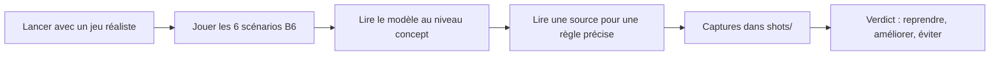

Le jeu réaliste compte 3 sites, 20 équipements, 3 équipes et 10 plans préventifs mixtes. Chaque
projet a sa fiche `research/gmao-calendar/<projet>.md`.

### B6. Scénarios communs

| # | Scénario | Observation |
|---|---|---|
| S1 | Graissage tous les 3 mois sur une pompe | saisie, aperçu des dates |
| S2 | Vidange toutes les 500 h de marche | déclencheur compteur |
| S3 | Décaler une occurrence sans toucher la règle | exception ou modification de série |
| S4 | Clôturer un OT en retard de 10 jours | échéance fixe ou flottante |
| S5 | Charge d'une équipe sur 4 semaines | vue ressource, conflit |
| S6 | Arrêt de 3 jours avec 8 OT dépendants | Gantt, dépendances |

### B7. Grille comparative

`research/gmao-calendar/matrice.md` note chaque projet de 0 à 3 par critère : récurrence, compteur,
fixe ou flottant, matérialisation, vues, Gantt, glisser-déposer, conflits, mobile, interop,
performance.

### B8. Hypothèses de modèle

| Hypothèse | État |
|---|---|
| Un plan se rattache à tout objet, device nu compris | fait : lien `maintains` (B13) |
| Déclencheur date | fait : propriété `recurrence`, sans RRULE |
| Déclencheur compteur (heures de marche) | ouvert : propriété `series` (D181) |
| Déclencheur condition (alerte de flow) | ouvert : flows, notifications (D86) |
| Mode `fixed` ou `floating` | fait : champ `floating` |
| Occurrence = plage D182 sur un horizon glissant | fait : plage de l'objet plan, 90 jours |
| OT = procédure instanciée des Pages (`pages.md` P9) | remplacé : OT = objet `work_order` (annexe C1) |
| Action au début d'une occurrence | ouvert : action D183, exécutée par un flow (D123) |
| Ressources : technicien, équipe, compétence | partiel : `assigned_to` (annexe C2) |
| Assistant | fait : il propose, il n'écrit jamais en silence |

### B11. Questions ouvertes

1. Le compteur produit-il une date prévisionnelle au calendrier ? Avec le nœud forecast ?
2. L'horizon de matérialisation (90 jours) devient-il réglable par org ?
3. Les calendriers ouvrés (fériés, astreintes, horaires d'équipe) entrent-ils dès la v1 ?
4. Comment représenter un OT correctif pour voir la charge réelle ?
5. Le mode hors ligne entre-t-il en v1 ?
6. Le calendrier est-il une vue générique des plages (noyau) ou une vue du pack ?

### B12. État de l'étude

L'étude documentaire est faite, sans instance lancée. Aucun projet ne couvre à la fois modèle, vue
de charge et Gantt. Le compteur est partout manuel. FullCalendar premium est exclu par sa licence.

### B13. Calendrier livré

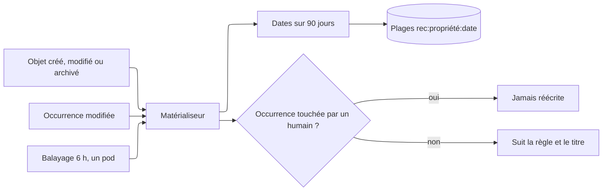

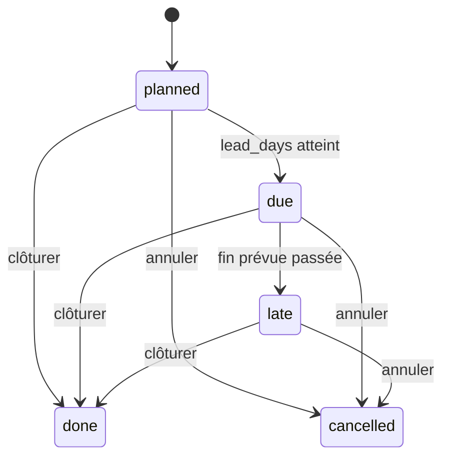

- **Noyau** : `pnex-core/src/ontology/recurrence.rs`. Début, tous les N jours, semaines, mois ou
  ans, fin facultative, `floating`, durée, `lead_days`. 1000 dates au plus, fins de mois sans
  dérive. Pas de RRULE : il faudra `rrule` quand un plan demandera BYDAY ou une heure.
- **État** : `pnex_core::time_range::occurrence_state`, partagé par le serveur, l'UI et l'assistant.
- **Matérialiseur** : `services/ontology/recurrence.rs`, `HORIZON_DAYS` = 90. Les occurrences
  portent sur l'objet qui tient la récurrence, le plan. La cible se rejoint par `maintains`. Toute
  propriété `recurrence` de tout type produit ses plages.
- **Pack** : type `maintenance_plan`, lien `maintains` vers tout type, device compris.
- **UI** : `/calendar`, grille du mois native Dioxus. Le dialogue d'occurrence marque réalisée
  (date, temps passé), annule ou déplace. L'occurrence change seule, jamais le plan. La carte
  « Occurrences » de l'onglet Temps apparaît sur le plan et sur tout objet lié à lui.
- **Sécurité** : une plage d'objet exige le `write_role` du type (D182, D188). Le nœud
  `range_upsert` d'un flow déployé n'est pas concerné.
- **Assistant** : fiche `assistant-kb/calendar.md`, `list_calendar` (lecture),
  `propose_occurrence_change` (rien n'est écrit, même règle `scope_writable` que l'API).

## Annexe C — GMAO générique : ordres de travail, pièces, stock, fournisseurs, QR

La GMAO vaut pour tout corps de métier de la maintenance. Elle repose sur la collecte et la mesure
existantes : devices, séries d'objets, alertes, calendrier. Aucun type ni règle de métier n'entre
dans le moteur. Un métier ajoute au besoin sa couche `maintenance_<métier>`.

### C1. Choix (Shan, 2026-11-12)

| Sujet | Choix |
|---|---|
| Ordre de travail (OT) | Objet `work_order` du pack Maintenance. La procédure des Pages s'y rattachera plus tard |
| Stock de pièces | Par emplacement (magasin, site, véhicule), seuil de réapprovisionnement, sortie à la clôture d'un OT |
| Fournisseurs et prix | Les `organization` du graphe (pack `investigation`, partagé avec le CRM). Pas de type « fournisseur » |
| QR code | Sur la fiche de chaque objet, planche d'étiquettes imprimable, scan dans l'app mobile |

### C2. Modèle

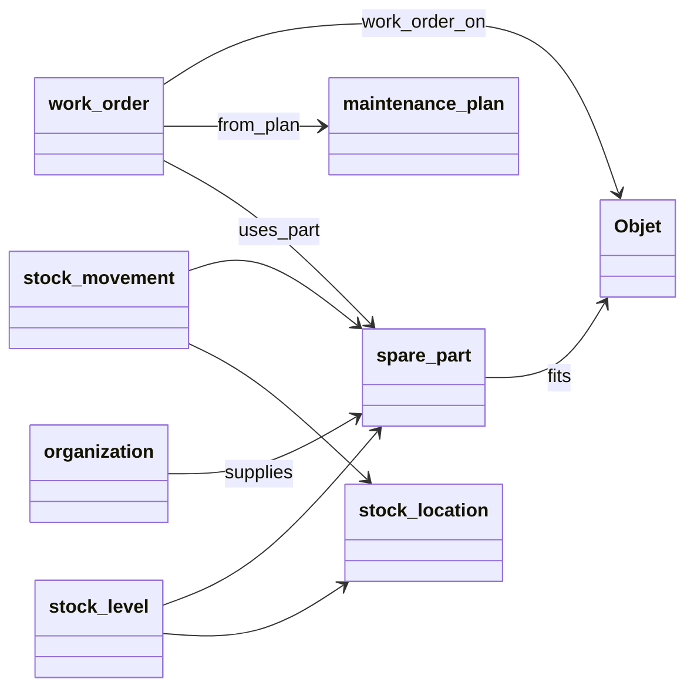

- `work_order` : référence unique, nature (`preventive`, `corrective`, `inspection`, `improvement`),
  état, priorité, dates, compte rendu, heures, emplacement d'où sortent les pièces. Les états sont
  `requested`, `planned`, `in_progress`, `on_hold`, `done`, `cancelled`. Le pack n'impose aucune
  transition.
- `stock_movement` : le stock est un journal. Un mouvement porte une pièce, un emplacement, une
  quantité signée, un motif, une date et un OT. Personne ne corrige un mouvement : on en ajoute un.
- `stock_level` : une ligne par pièce et emplacement, `on_hand` calculé, seuil `min_quantity`,
  drapeau `below_min`.
- Pack `maintenance_partners` (`requires: [maintenance, investigation]`) : `supplies` (prix `money`,
  référence fournisseur, délai, minimum, préféré), `assigned_to` (technicien), `performed_by`
  (sous-traitant), `manufactures`.

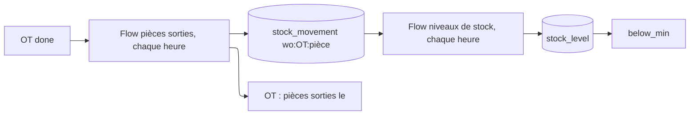

Les deux flows sont des modèles en brouillon. L'installation ne les déploie jamais (D123). La clé
`wo:<OT>:<pièce>` rend le rejeu sans doublon. Un OT sans emplacement attend. Le flow des niveaux
écrit seulement les niveaux qui changent.

Limites connues :

- 500 niveaux et 1000 couples pièce × emplacement par passe.
- Un niveau sans mouvement n'est jamais signalé sous le seuil.
- Un OT dont une partie des mouvements s'écrit est marqué quand même.

Les nomenclatures, références de pièces et variantes d'équipement sont dans `parts-docs.md`
(D960–D971, lots PD0 et PD1).

### C3. Lots suivants

| Lot | Contenu |
|---|---|
| C-QR1 | QR sur la fiche objet : URL courte vers un jeton `qr_tags` (D962, `parts-docs.md` §5.4), planche d'étiquettes, planches vierges (D963). Lot commun avec PD1 |
| C-QR2 | Scan dans l'app mobile : caméra, puis objet ouvert |
| C-PV | OT préventif créé depuis une occurrence de plan qui devient due |
| C-AL | Une alerte d'un device lié à un équipement propose un OT correctif |
| C-DOC | Document d'intervention par métier : modèle de page du pack métier, rempli depuis l'OT |
| C-ACH | Demande d'achat depuis un niveau sous le seuil, fournisseur préféré proposé |
| C-UI | File des OT d'un technicien, fiche pièce avec stock et prix par fournisseur |

## Reste à faire

- **Actions D183** : éditeur d'actions dans l'éditeur de type, préconditions, retour de résultat par
  le flow, plafond de débit par objet. Pas d'action système (archiver) en V1.
- **Étiquetage d'ingestion** `object=<kind>/<id>` sur les points de télémétrie (D181) : non fait. La
  liaison `measures` couvre le besoin.
- **Performance** : mesures sur 100 k objets (§8).
- **Assistant** : deep-link de la trace vers l'objet écrit. La trace nomme l'objet.
- **API** : `/api/v1/resources/*` n'est pas marqué déprécié (D191).
- **Graphe** : l'UI n'affiche pas `truncated` sur un chemin trouvé, l'API et le MCP le rendent. Les
  parcours de la requête D185 (`query.rs`) n'ont pas reçu la lecture niveau par niveau. Le coût en
  écriture des index couvrants n'est pas mesuré.
- **Packs (D368)** : pas de fusion d'une fonction ou d'un flow modifié par l'org avec la version du
  pack, c'est l'une ou l'autre. Le nœud JavaScript ne lit pas les réglages.
- **D369** : `external_ref` et événements de changement sortants, au démarrage du CRM ou de l'ERP.
- **Calendrier GMAO** : compteur (S2 en heures de marche), équipes et vue de charge, Gantt d'arrêt,
  flux `.ics`, proposer `start_maintenance` à l'ouverture d'une occurrence, jours en UTC.
- **Étude GMAO** : jouer les 6 scénarios sur Atlas, Odoo et EventCalendar. Relire `modele-cible.md`.
  Vérifier qu'aucun extrait de code tiers n'est dans `research/`.
- **Annexe C** : lots C-QR1 à C-UI (§C3).
- **Questions de Shan** : §9 et B11.
