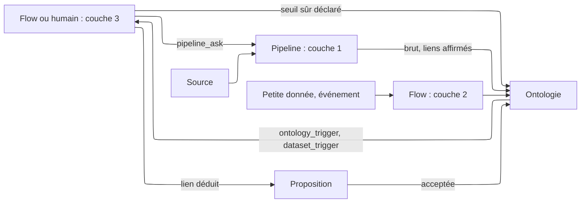
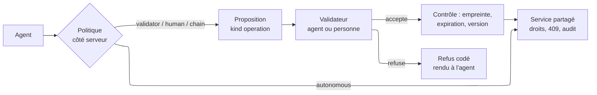
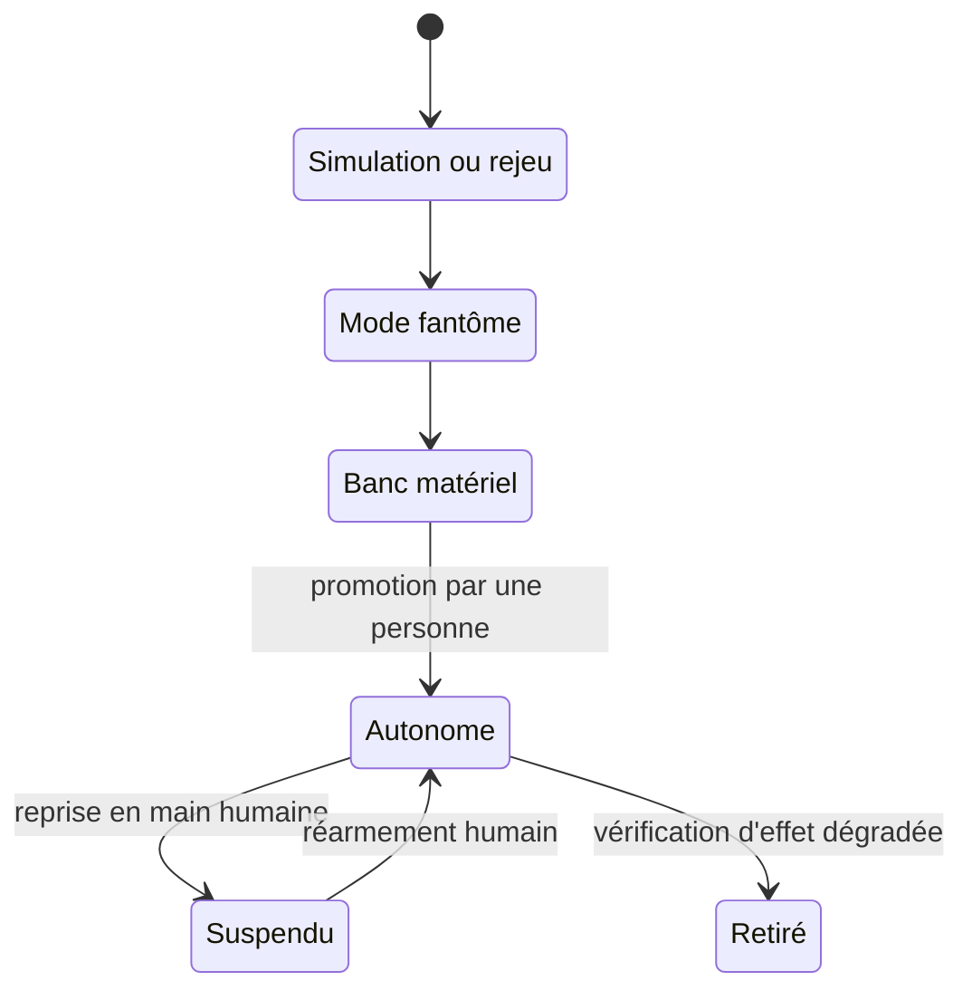

# Plateforme opérationnelle complète : périmètre et décisions levées (D551–D568)

| | |
|---|---|
| Statut | Périmètre validé le 2026-11-03. OP1 en grande partie livré. OP2, OP3, OP5 (hors AN4) et OP9 livrés. État des lots au **§11** |
| Numérotation | **D551…D568**, lots **OP1…OP15** |
| Repose sur | `ontology.md`, `pipelines.md`, `iam.md`, `proposals.md`, `agents.md` (§3.3), `viz.md`, `security.md` §8, `app-builder.md`, `external-apps.md` |
| Sécurité | Chaque lot passe `security.md` §6. Un finding = une ligne SEC-n au §7 |

## Résumé

PneX vise toutes les capacités civiles d'une plateforme opérationnelle ontologique. Le militaire est
exclu. Ce document fixe ce périmètre et lève les décisions antérieures qui le bloquaient (§9). Le
travail est découpé en quinze lots, OP1 à OP15. Chaque lot a son PRD avant le code. Le document
porte aussi D998, la règle des trois couches : ingérer, manipuler, organiser (§3).

## Concepts

- **Lot (OP1…OP15)** : ensemble de capacités livré sous un PRD propre (§2).
- **Table** : données versionnées par transactions sur S3, cataloguées dans PostgreSQL (D554).
  Le code dit `dataset`.
- **Connecteur** : cadre commun de lecture, d'écriture retour et de CDC vers un système externe
  (D555).
- **Branche** : mécanisme unique pour données, schémas, applications et flows (D556).
- **Porte de validation** : politique qui donne un mode par agent et par opération (D563).
- **Action physique** : action d'ontologie déclarée `physical`, exécutée par un flow déployé par un
  humain (D564).
- **Enveloppe** : limites d'une action physique : plage, vitesse, durée, fréquence,
  interverrouillage (D564).
- **Lien affirmé** : lien qu'une source déclare. Le mapping de l'import le pose (D998).
- **Lien déduit** : lien qu'aucune source n'affirme. Un flow ou un humain le pose (D998).

Les diagrammes de D998 (§3) et de D563 (§6) montrent les relations entre ces termes.

## 1. Principe (D551–D553)

### D551 — Toute capacité d'une plateforme opérationnelle ontologique, sauf le militaire

PneX vise les capacités civiles du marché des plateformes opérationnelles : données versionnées,
ontologie, applications, analyse, IA, gouvernance, livraison logicielle, edge. Une décision
antérieure qui l'empêche est levée ou amendée (§9).

**Hors périmètre, sans exception** : ciblage, planification de mission, systèmes d'armes,
intégration tactique, réseaux classifiés, habilitations étatiques de défense, offres destinées aux
forces armées.

**Exclus aussi, faute de besoin et pour raison légale** : reconnaissance faciale et identification
biométrique à distance (`cases.md` §4). L'OSINT sur les personnes reste exclu tant que l'accès par
finalité (OP3) et un avis juridique n'existent pas (Q-O3).

### D552 — Aucun éditeur de référence nommé

Ni le repo, ni l'UI, ni le site, ni un commit ne nomment l'éditeur de référence ou ses produits. Les
capacités portent des noms génériques. PneX ne reprend ni ses noms, ni ses visuels, ni ses textes,
et ne se vend jamais par comparaison à un éditeur nommé.

### D553 — Le cœur reste en Rust

Tout ce qui est requis pour faire tourner PneX est en Rust. Python et la JVM entrent seulement dans
un **déploiement optionnel, séparé et débranchable** (D559), jamais comme dépendance du cœur. PneX
n'embarque ni Spark ni Flink. Les transformations et le streaming passent par un moteur Rust (Q-O1).
Les règles de licence (briques permissives) ne changent pas.

## 2. Ce qui manque, par lot

Relevé du 2026-11-03. L'état détaillé de chaque capacité est dans les docs de domaine.

| Lot | Capacités | Point de départ | Dépend de |
|---|---|---|---|
| **OP1** | Tables versionnées (transactions, historique, retour dans le temps), lignage amont et aval, santé des données, ordonnanceur à dépendances, type d'objet adossé à une Table | Rien (provenance par objet D184 seulement) | — |
| **OP2** | Framework de connecteurs, bases (D352), SaaS et ERP, stockage cloud, écoute de webhooks, CDC, tables virtuelles, écriture retour déclarative | Fichier, URL, API, IMAP, RTSP | OP1 |
| **OP3** | Droits par ligne (I4, I5), marquages obligatoires, habilitations utilisateur, accès par finalité, justification d'accès, détection de données sensibles, pseudonymisation, SAML, export d'audit, droits des personnes | Colonnes sensibles D442, audit D294 | — |
| **OP4** | Branches transverses : données, ontologie, applications, flows ; revue et fusion ; polymorphisme (interfaces) d'ontologie | Versions par document | OP1 |
| **OP5** | Agrégats d'objets, analyse tabulaire sans code, canevas d'analyse objets et séries, SQL en lecture, règles sans code avec rejeu historique, blocs vivants dans les pages | Dashboards de type, flows | OP1 |
| **OP6** | Tableur et traitement de texte (D558) | `sheet_write`, `document_text`, pages | — |
| **OP7** | Notebooks Python en déploiement séparé, SDK d'accès aux données (D559) | Client OpenAPI | OP1, OP3 |
| **OP8** | SDK typés générés, applications en code sur origine isolée, génération d'application par l'IA, formulaires hors ligne (D560) | App builder AB0–AB5 | OP3 |
| **OP9** | Validation générique (D563) | Propositions D367, A0–A2 | P2.29 |
| **OP10** | Action physique gouvernée (D564) | Surfaces D123, acquittements, HIL | OP9, P0.1, P0.3 |
| **OP11** | Agents (A0–A5), évaluation des fonctions LLM, chaînes de prompts dédiées, analyse conversationnelle, OCR, extraction de tableaux, vecteurs, scénarios what-if, modèles tabulaires, objectifs et dérive (D565) | Assistant, Lab vision | OP5 |
| **OP12** | Centre de livraison, canaux, canari, SBOM et vulnérabilités de parc, air-gap, hub de kits avec kits payants (D562) | Images CI, chart, P2.24 | — |
| **OP13** | Simulation de jumeau, graphes causaux, process mining, ordonnancement Gantt à contraintes, revue CAD | Impact, calendrier P2.20 | OP5 |
| **OP14** | Inférence embarquée pilotée par le serveur, chaînage de modèles entre sites, réalité mixte via SDK, imagerie satellite civile (D566) | Parc, OTA, Vision | OP8, OP10 |
| **OP15** | Packs sectoriels civils : production, énergie, supply chain, achats, LCB-FT, assurance, santé, retail, finance | Packs D190 | OP2, OP5 |

Ordre : OP1 → OP2 → OP3, puis OP5 et OP9. Le reste suit la demande client. La certification (ISO
27001, SOC 2, SecNumCloud, HDS) n'est pas un lot de code. Ses exigences se tracent dans
`security.md` §8.

## 3. Données (D554–D557, D998)

### D554 — La Table devient une notion du noyau

Une Table est versionnée par transactions sur S3, en Parquet. Le format ouvert Iceberg
est retenu si `iceberg-rust` tient la mesure (Q-O1). Le catalogue est dans PostgreSQL. Un type
d'objet peut être adossé à une Table. Le stockage JSONB reste le défaut. L'exécution écrit le
lignage, personne ne le déclare à la main.

### D555 — Connecteurs : un cadre unique, y compris en écriture

Lecture, écriture retour et CDC passent par un cadre commun, en liste blanche d'egress (R8), avec
les secrets au coffre. L'écriture retour vers un système externe est une action de l'ontologie,
soumise à D563. Les connecteurs CRM et ERP (D369) démarrent à OP2.

### D556 — Branches : un seul mécanisme transverse

Une branche couvre données, schémas, applications et flows. Un flow sur branche **ne touche jamais
le physique** (D564). Fusion = revue humaine.

### D557 — Analyse : lecture seule, droits de l'appelant

SQL, analyse tabulaire et règles lisent sous les droits de l'appelant, marquages et lignes compris.
D353 est levée : le moteur SQL est retenu (Q-O1). Une règle crée une alerte ou une proposition. Elle
agit seulement à travers D563.

### D998 — Trois couches : ingérer, manipuler, organiser (choix de Shan, 2026-11-18)

Un pipeline ingère. Un flow, ou un humain, organise l'ontologie. Une décision d'organisation n'est
jamais figée dans la collecte : elle se rejoue sur l'état courant. D998 amende D934 et D996 (§9).
D788 prévoyait déjà cette séparation : la recette cherche, un flow du pack score et écrit. T3 la
livre en flow.

| Couche | Ce qu'elle fait | Outil |
|---|---|---|
| **1. Ingestion** | Gros volumes : données publiques, fichiers lourds, collecte web longue (pause et reprise, D995). Planifiée, ajout puis réconciliation (clé naturelle, différence, reprise par élément D937). Stocke le brut, rejouable sans effet de bord | Pipeline |
| **2. Petites données et manipulations** | Une page ponctuelle, un enrichissement, une réaction à un événement, un petit calcul | Flow (ou pipeline si c'est plus simple : une page ponctuelle va dans l'un ou l'autre) |
| **3. Organisation de l'ontologie** | Faire et défaire les liens **déduits** (rapprochement, rattachement, propositions, « chercher encore »), à tout moment, sur les données telles qu'elles sont **maintenant** | À la main, ou flow (score déterministe, LLM en option) |

Règles :

- **Un lien affirmé par la source reste de l'ingestion.** Exemple : « X est la mère de Y » dans un
  registre ou dans GLEIF. Ce lien est une donnée, et le mapping de l'import le pose. La couche 3
  porte seulement les liens qu'aucune source n'affirme.
- **La couche 3 est rejouable.** Un changement de données la déclenche (nouvel objet, propriété
  modifiée, nouveau candidat), ou une personne à la main. Elle relit l'ontologie au lieu d'un sujet
  copié.
- **Le LLM n'est ni la seule voie ni un écrivain direct.** Une org sans fournisseur (D119, D565)
  organise par le score déterministe. Le LLM tranche les cas ambigus. Un lien déduit passe par une
  proposition (D367, `link_upsert` en `propose`), sauf au-dessus d'un seuil sûr déclaré. Il passe
  aussi par la porte D563 quand elle s'applique.
- **Le volume et la planification séparent la couche 1 de la couche 2**, pas « web ou non ». Le
  runtime de flows exécute du code utilisateur et ne voit pas les octets (`pipelines.md` §3.2).
- **Un calcul dérivé est admis en couche 1.** Une table recalculée entièrement depuis ses sources
  (agrégat, indicateur) n'est pas une décision figée.
- **Tout écart a une ligne au tableau des écarts** : quoi, pourquoi, quand il se lève. Si une revue
  trouve une décision de couche 3 dans un pipeline sans ligne, elle la refuse.

Tableau des écarts :

| Écart au principe | Justification | Où il se lève |
|---|---|---|
| `world_events/lead_confirmations` confirme des pistes depuis les événements | **volume** : jointure ensembliste de toutes les pistes et de tous les événements vérifiés, hors de portée d'un flow. Rejouée chaque jour sur l'état courant : une piste non confirmée est reprise au passage suivant | justifié le 2026-11-18 |
| `markets/market_moves` calcule les séances anormales | calcul dérivé recalculé depuis les séries : admis | à garder |
| `markets/gleif_identity` rapproche une société SEC d'un LEI par son nom légal et propose (`same_company_as` ou LEI) | recherche dans un registre = collecte. Le lien est seulement **proposé** (un humain décide). Une société sans résultat est redemandée 30 jours plus tard (`empty: retry`) | justifié le 2026-11-18 (markets 1.20.1) |
| `markets/market_press`, `prospecting_b2b_fr/press_gdelt` rattachent un article à un compte suivi par son nom (`strpos` sur les organisations GKG) | **volume** (Q-D998-2) : le filtre par noms des comptes suivis réduit les fichiers GKG à quelques lignes. Un humain valide le signal | justifié le 2026-11-18 |
| `markets/filing_events` (MK3) fait lire les communiqués 8-K par le fournisseur d'IA de l'org et en tire des événements | **ingestion** du contenu d'un document de la source. Le pipeline écrit seulement des **propositions** (création de `market_event` + lien `event_about` vers le déposant, affirmé par la source), chaque champ cité mot pour mot. Un membre accepte (Q-MK15, D119) | justifié le 2026-11-19 (markets 1.22.0) |
| `markets/sec_subsidiaries` pose `subsidiary_of` depuis l'Exhibit 21 | lien affirmé par la source (le groupe déclare ses filiales) : admis | à garder |
| `prospecting_b2b/profile_capture_*` posent `uses_identifier` vers le profil capté | adresse donnée par un humain sur la fiche de la personne : décision humaine, admis | à garder |
| Relations d'un contact (D976, PE5.4) : seules les personnes nommant une organisation de la sélection sont gardées, à la collecte | **minimisation** (D254, D341) : une personne hors sélection n'est jamais écrite. `knows` est affirmé par le réseau | **justifié le 2026-11-20** : D976 gardé (Shan), le retrait du 2026-11-18 est annulé. La capture passe dans un pipeline du pack `prospecting_b2b` (PE5.4, en cours) |

Décision sur Q-D998-1 (Q-D998-2 : voir la ligne presse du tableau des écarts) :

- **Q-D998-1 (Shan, 2026-11-18)** : un profil LinkedIn est seulement un identifiant lié à la
  personne, et une personne peut en avoir plusieurs. PneX ne garde aucune carte de candidat. La
  collecte garde seulement les profils qui nomment la personne (minimisation), dans un document de 2
  jours que le flow évalue. Rescorer = relancer la collecte (D999).

Tâches de mise en conformité (D998-T1…T12) :

| Tâche | Contenu | État |
|---|---|---|
| **T1** | Nœud `ontology_trigger` (objet créé ou modifié, lien, proposition décidée) | fait (D999.1) |
| **T2** | Nœud `pipeline_ask` : un flow demande des lignes à un pipeline (droits du déployeur, plafond quotidien) | fait (D999.2) |
| **T3** | PE5.3 refait : pipeline de collecte, trois flows du pack, action `find_profile` | fait (D999.3, D999.4) |
| **T4** | PE5.4 : relations d'un contact en pipeline, filtre de minimisation à la collecte | à faire, avec le lot PE5.4 du moteur |
| **T5** | `lead_confirmations` | justifié (volume, rejoué chaque jour) |
| **T6** | `gleif_identity` | justifié, `retry_days: 30` |
| **T7** | Presse GDELT | justifié (Q-D998-2) |
| **T8** | PE5.5 : chaque règle d'org migrée est classée par couche avant migration | s'applique au lot PE5.5 |
| **T9–T11** | T9 : audit des clés de mapping des imports. T10 : règle `ingest_vs_organize` dans `FLOW_AUTHORING_RULES`. T11 : section « Ingérer, manipuler, organiser » du `CLAUDE.md` | faits. Toutes les clés d'objet sont des identifiants de la source, aucun import ne rapproche par nom |
| **T12** | Fermer ce tableau | reste T4 |

## 4. Bureautique (D558)

**GridCraft** et **WordCraft** deviennent le tableur et le traitement de texte de PneX. Ce sont des
briques ArtCraft : `MIT OR Apache-2.0`, Rust pur, WebAssembly, `xlsx`/`docx`/`pdf`, MCP. Relevé du
2026-11-03 :

| Point | Constat | Conséquence |
|---|---|---|
| Maturité | Créés en octobre 2026, versions 0.16 et 0.15, très actifs, 1 666 et 2 595 issues ouvertes | Épingler une révision, monter de version après test ; le contenu reste exportable en formats standards |
| Découpage | Moteur en couches, UI `egui` séparée | Moteurs en dépendance côté serveur et agents ; `document_text` et `sheet_write` y migrent |
| UI web | Canevas `egui` en wasm, fork d'egui épinglé, pas en Dioxus | Application dans un cadre isolé, chargée à la demande, jamais dans le bundle principal ; `t!`, thème et accessibilité sont à vérifier au POC |
| Collaboration | Pas de co-édition temps réel relevée | V1 : un rédacteur à la fois (verrou), versions D221. Les pages Yjs restent le document collaboratif |
| Dépendance git | `deny.toml` refuse les sources git | Exception motivée dans `deny.toml`, ou fork vendu sous `vendor/patches` |

Un POC tranche avant tout code produit : taille du wasm, ouverture d'un fichier de 100 000 lignes,
droits D443 sur les cellules, garde `i18n_guard`. Un fichier reste un média versionné, soumis aux
droits de l'objet qui le porte.

## 5. Notebooks et SDK (D559, D560)

### D559 — Notebooks : déploiement séparé, API standard

JupyterHub (BSD-3) est un **profil de déploiement optionnel**, dans son propre namespace, désactivé
par défaut. Le cœur le connaît seulement comme un client de l'API.

- **Accès aux données** : seulement le SDK Python généré du spec OpenAPI, et un transport colonnaire
  (Parquet ou Arrow) pour le volume. Aucun accès direct à PostgreSQL, S3, Valkey ou O2.
- **Identité** : connexion OIDC par Rauthy, jeton de l'utilisateur. Le SDK a exactement ses droits.
  L'org vient du principal (R1). Le backend re-vérifie lignes, colonnes et marquages.
- **Écriture** : par les actions de l'ontologie, jamais sur les tables.
- **Exécution** : un kernel = un pod durci (D387), ressources bornées, egress en liste blanche,
  volume par utilisateur. Le pod ne reçoit aucun secret de plateforme.
- **Physique** : aucun chemin. Un notebook n'a ni accès device, ni accès contrôle. Il passe par une
  action soumise à D563 et D564, comme tout client.
- **Export** : journalisé. Selon le marquage, il est bloqué ou soumis à justification.

Le SDK Python et le SDK Rust sont générés du même spec et testés par la même garde que `task sdk`.
Un notebook ne se déploie jamais en production. Une revue promeut son résultat en Table ou en
fonction.

### D560 — SDK typés et applications en code

D438 et D512 sont amendées. PneX génère, en plus du client générique, un SDK **typé par ontologie**
(TypeScript, Python, Rust). Le builder sans code reste la voie par défaut. Une application en code
s'exécute sur **une origine isolée** (R11–R13), avec un jeton borné à l'application et à ses
ensembles d'objets. Rien d'utilisateur en HTML sur l'origine de l'app.

## 6. Agents et validation générique (D561, D563)

### D561 — Charges de travail : un seul exécuteur

Agent, connecteur, transformation lourde, entraînement et module client sont des jobs de la fabric.
Le runner de `agents.md` §3.3 les exécute : image épinglée par digest, registre, secrets, pod
par tâche (D386–D394).

- Une org construit sa propre image depuis un Dockerfile, dans un bac à sable BuildKit (D700 de
  `agents.md`). L'image va vers un registre, puis l'org l'épingle par digest.
- Les secrets du run arrivent par un Secret Kubernetes propre au run, en variables d'environnement
  ou en fichier (D705).
- La clé du fournisseur LLM reste hors du bac (D385).

### D563 — Une porte de validation générique, pour toute opération

Une politique (D380) donne, par agent et par opération, un mode :

| Mode | Effet |
|---|---|
| `autonomous` | Exécute directement, journalisé, dans ses droits et budgets |
| `validator` | Soumet à un agent validateur désigné |
| `human` | Soumet à une personne |
| `chain` | Validateur puis personne |

Le défaut est le refus. Une surcharge par run peut seulement resserrer (D380).

**Pas de second système** : la proposition (D367) a le kind `operation`. Ce kind porte un
`operationId` du spec, ses arguments canoniques et leur empreinte, `expected_version` et `origin =
agent:<id>@<run>`. La porte couvre donc toute l'API, pas seulement l'ontologie : import, fusion de
branche (D388), image, flow, envoi, action physique.

Règles opposables :

1. **Séparation** : le validateur n'est ni le demandeur, ni un agent de sa chaîne de délégation
   (D390). Le serveur le vérifie.
2. **Pas de modification** : un validateur accepte ou refuse. Changer un argument, c'est une
   nouvelle demande.
3. **Contenu = donnée** : ce que lit le validateur n'élargit aucun droit (D381). Il voit la demande
   et ses preuves, jamais une consigne du demandeur.
4. **Exécution bornée** : usage unique, expiration, empreinte contrôlée, `expected_version`. Un 409
   relance une demande. L'opération tourne avec l'intersection des droits du demandeur et de la
   politique (D373).
5. **Rejet** : D372 (« jamais reproposé ») reste vrai pour les faits. Pour `operation`, le rejet
   vaut pour cette empreinte jusqu'à son expiration.
6. **Disjoncteur** : un validateur agent a un débit maximal. Au-delà, ou s'il accepte tout
   (échantillon relu par un humain), il repasse en `human`.
7. **Audit** : décision et motif au journal chaîné (D401). La personne qui a désigné un agent
   validateur reste identifiée.

**Jamais délégable à un agent** (liste serveur, non modifiable par une politique) : suppression et
purge, droits d'accès, coffre, marquages, action physique de classe C3, levée d'une enveloppe
(D564).

D374 est amendée : un agent peut décider si l'org l'a désigné, hors liste ci-dessus.
`proposals:decide` reste absent du MCP public. Le validateur passe par son token de run.

## 7. Monde physique (D564)

### D564 — Une action physique peut être autonome, jamais hors enveloppe

D123, D144 et D391 sont amendées **à l'arrivée du lot OP10, pas avant**. Jusque-là, les gardes
actuelles (`tests/mcp.rs`, registre de l'assistant) restent bloquantes. L'assistant conversationnel
reste sans action physique.

**Une seule voie** : une action d'ontologie déclarée `physical`, exécutée par un **flow déployé par
un humain**. « Une surface lit, un flow agit » et « un seul écrivain par sortie » restent vrais.
Aucun agent n'écrit en direct sur un device, un pin, une mémoire de contrôle ou une OTA.

| Classe | Exemple | Autonomie maximale |
|---|---|---|
| **C0** Sans effet | Affichage, journal local | `autonomous` |
| **C1** Réversible, bornée | Consigne dans sa plage | `autonomous` après mode fantôme |
| **C2** Effet sur le procédé | Démarrer, arrêter, changer de mode | `validator` puis personne par défaut ; `validator` seul sur décision écrite de l'org |
| **C3** Irréversible, ou risque pour une personne | Dosage, ouverture, énergie dangereuse, OTA de parc | `human`, jamais délégable |

Une personne fixe la classe à la création de l'action. Sans classe : C3.

**Chaîne de garanties**, toutes obligatoires :

1. **Enveloppe** : plage, vitesse de variation, durée, fréquence, conditions d'interverrouillage. Le
   serveur la contrôle, **et** le device ou l'automate aussi. Si le serveur se trompe, le device
   reste juge.
2. **Validation** : mode D563 selon la classe.
3. **Fraîcheur** : commande à durée de vie courte, anti-rejeu (D153), clé d'idempotence. Commande
   périmée ou état capteur trop vieux : refus.
4. **Acquittement** : le device confirme la réception et l'application. Sans acquittement, l'échec
   est signalé, jamais de renvoi aveugle.
5. **Vérification de l'effet** : relecture d'un capteur indépendant dans un délai déclaré. Écart :
   retour à l'état sûr et alerte.
6. **État sûr** : déclaré par sortie, appliqué par le device à la perte de liaison. Un agent ne peut
   pas le modifier.
7. **Priorité humaine** : commande locale manuelle et arrêt par site priment. Après reprise en main,
   l'autonomie reste suspendue jusqu'à réarmement humain.
8. **Disjoncteur** : débit et cumul bornés. Dépassement = suspension.
9. **Preuve** : intention, validateur, mesure avant et après, au journal chaîné (D401).

**Avant toute autonomie** : simulation ou rejeu historique, puis **mode fantôme** sur le site réel,
puis banc matériel (D122). En mode fantôme, l'agent décide, rien n'est envoyé, et on compare à ce
qu'a fait l'humain.

**Limite assumée** : PneX ne garantit pas la sécurité fonctionnelle et ne revendique aucun niveau
SIL (EX-J2). Une fonction qui protège une personne, une installation ou l'environnement reste sur un
automate de sécurité indépendant. PneX ne peut ni le piloter ni le contourner. Un site sans cette
séparation ne dépasse pas C1.

## 8. Livraison, edge, IA (D562, D565–D568)

### D562 — Centre de livraison

Le centre de livraison est un produit à part entière, distinct de la fabric. Il couvre le catalogue
de versions, les canaux et le canari. Il promeut sur critères de santé et durée d'observation. Il
gère rappel, retour arrière, fenêtres de maintenance et approbations. Il donne SBOM et CVE par
déploiement, et des bundles signés pour l'air-gap.

Chaque déploiement tire en sortant (modèle D386) : **aucun kubeconfig central**. `agents.md`
§13 reste vrai pour la fabric. OP12 dégèle le hub de kits, kits payants admis.

### D565 — IA

D119 est amendée : la plateforme peut fournir des modèles sur un déploiement géré, désactivés par
défaut. Apporter son fournisseur reste le défaut. Un marquage borne ce qu'un modèle peut lire. Une
fonction LLM passe des évaluations avant sa promotion en production (étend D399).

### D566 — Edge

PneX pousse des modèles signés aux sites et devices capables, avec retour arrière. Les décisions
locales suivent les mêmes enveloppes (D564). Hors ligne, le site applique une politique déjà signée
et n'en reçoit pas de nouvelle. Le M2M résilient (`edge.md` §3.8) reste le socle.

### D567 — Partage entre orgs : explicite, jamais implicite

R1 reste la frontière. Un partage est un contrat entre deux orgs : périmètre, durée, marquages,
droit de révocation, journal des deux côtés. Pas de recherche fédérée implicite (amende
`ontology.md` §3).

### D568 — Offres sectorielles = packs

Le métier reste dans les packs (D190). D441 ne change pas. Aucun nom de secteur n'entre dans le
noyau.

## 9. Décisions levées ou amendées

| Décision | Avant | Maintenant |
|---|---|---|
| `ontology.md` §3 | Parité fonctionnelle exclue | Levée (D551) |
| `ontology.md` §3 | Notebooks exclus | Déploiement séparé (D559) |
| `ontology.md` §3, R1 | Pas de fédération | Partage contractuel explicite (D567) |
| Tout-Rust (`pipelines.md`, décisions #5, #18) | Ni Python ni JVM | Cœur en Rust ; Python en déploiement séparé (D553) |
| D353 | Moteur SQL « sur besoin mesuré » | Retenu (D557) |
| D355 | Studio sans canevas de graphe | Canevas admis pour les pipelines à plusieurs étapes (OP1) |
| D369 | Connecteurs CRM/ERP non planifiés | Planifiés à OP2, écriture retour par action et D563 (D555) |
| D374 | Seul un humain décide | Agent désigné, hors liste réservée (D563) |
| D119 | Pas de LLM plateforme | Option d'un déploiement géré (D565) |
| D123, D144, D391 | Aucune action physique par agent | Action gouvernée, à la livraison d'OP10 (D564) |
| D934 (`pipelines.md`) | « Tout est un pipeline », décisions comprises | Un seul format pour l'**ingestion** ; l'organisation de l'ontologie est en flow ou à la main (D998) |
| D996 (`pipelines.md`) | Score et rattachement dans le pipeline de collecte | Collecte en pipeline, score et rattachement en flow (D998) |
| D438, D512 | Client générique ; pas de code en application | SDK typés, code sur origine isolée (D560) |
| `hub.md` §3 | Gel, pas de kits payants | Dégel et kits payants à OP12 (D562) |
| `agents.md` §3.18 | Pas de fleet manager | Vrai pour la fabric ; centre de livraison à part (D562) |

**Inchangé** : R1–R23, frontière org puis plateforme, briques permissives, pas de reconnaissance
faciale, flow déployé par un humain seul à agir sur le physique, `expected_version`, secrets jamais
en sortie d'outil.

## 10. Questions ouvertes

- **Q-O1** — Moteur de calcul Rust (DataFusion, Polars) et format (Iceberg, Delta) : à trancher au
  PRD d'OP1 par un test de charge (`pipelines.md` §3.7, D569–D578, lot OP1.0).
- **Q-O2** — Bureautique : cadre isolé ou portage de l'UI en Dioxus ? Le POC d'OP6 tranche.
- **Q-O3** — Enquêtes sur des personnes : avis juridique et accès par finalité avant toute levée de
  l'exclusion.
- **Q-O4** — Premier site pilote pour le mode fantôme d'OP10.
- **Q-O5** — Stockage d'objets à grande échelle : RustFS tient-il les volumes d'OP1 ? Mesure avant
  engagement.

## 11. État réel des lots

L'ordre fixé (OP1 → OP2 → OP3, puis OP5 et OP9) est livré. La suite dépend de la demande client. Le
reste de chaque lot est dans son PRD.

Décisions des lots : D791–D806 (OP2, OP3), D825–D832 (OP5), D833–D840 (OP9).

| Lot | État | PRD | Reste |
|---|---|---|---|
| OP1 | En grande partie livré | `pipelines.md` | voir le PRD |
| OP2 | Livré (CN1–CN5) | `pipelines.md` §3.10 | aucun : secret des webhooks généré ou collé, décidé le 2026-11-20 |
| OP3 | Livré (G1–G7) | `governance.md` §7 | SAML à la première demande client, I4 général |
| OP5 | Livré (AN1–AN3) + agrégats | `analysis.md` §2, `viz.md` | AN4 (analyse sans code), règle → proposition (D829) |
| OP9 | Livré (VG1–VG3) | `agents.md` §3.12 | voir le PRD |
| OP4, OP6–OP8, OP10–OP15 | Non commencés | — | OP10 dépend aussi de P0.1 et P0.3 |

## Reste à faire

- **D976** (gardé le 2026-11-20) : la capture des relations d'un contact passe dans un pipeline
  du pack `prospecting_b2b`. Ce lot (PE5.4, `pipelines.md`) est en cours.
