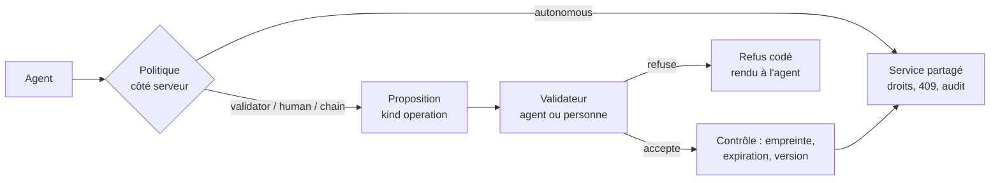

# Plateforme opérationnelle complète : périmètre et décisions levées (D551–D568)

| | |
|---|---|
| Statut | **Périmètre validé le 2026-11-03.** Au 2026-11-08 : OP1 en grande partie, OP2, OP3, OP5 (hors AN4) et OP9 codés ; état réel et reprise au **§11**. Chaque lot a son PRD avant le code |
| Numérotation | **D551…D568**, lots **OP1…OP15** |
| Repose sur | `ontology.md`, `data-pipelines.md`, `iam.md`, `proposals.md`, `autonomous-agents.md`, `worker-fabric.md` §14, `surfaces-controls.md`, `security-tiers.md`, `app-builder.md`, `external-apps.md` |
| Sécurité | Chaque lot passe `security.md` §6 ; finding = ligne SEC-n au §7 |

## 1. Principe (D551–D553)

### D551 — Toute capacité d'une plateforme opérationnelle ontologique, sauf le militaire

PneX vise l'ensemble des capacités civiles du marché des plateformes
opérationnelles : données versionnées, ontologie, applications, analyse,
IA, gouvernance, livraison logicielle, edge. Une décision antérieure qui
l'empêche est levée ou amendée (§9).

**Hors périmètre, sans exception** : ciblage, planification de mission,
systèmes d'armes, intégration tactique, réseaux classifiés, habilitations
étatiques de défense, offres destinées aux forces armées.

**Restent exclus, faute d'en avoir besoin et pour raison légale** :
reconnaissance faciale et identification biométrique à distance
(`cases.md` §4). L'OSINT sur les personnes reste exclu tant que l'accès par
finalité (OP3) et un avis juridique n'existent pas (question Q-O3).

### D552 — Aucun éditeur de référence nommé

Ni le repo, ni l'UI, ni le site, ni un commit ne nomment l'éditeur de
référence ou ses produits. Les capacités portent des noms génériques et
PneX ne reprend ni ses noms, ni ses visuels, ni ses textes. PneX ne se vend
jamais par comparaison à un éditeur nommé.

### D553 — Le cœur reste en Rust

Tout ce qui est requis pour faire tourner PneX est en Rust. Python et la JVM
n'entrent que dans un **déploiement optionnel, séparé et débranchable**
(D559), jamais comme dépendance du cœur. Aucun moteur Spark ou Flink n'est
embarqué : les transformations et le streaming passent par un moteur Rust
(Q-O1). Les règles de licence (briques permissives) ne changent pas.

## 2. Ce qui manque, par lot

Lecture du 2026-11-03 : `ontology`, `cases`, `flows`, `pages`, `carte` et
parc de devices existent ; l'état détaillé vit dans les docs de domaine.

| Lot | Capacités | Point de départ | Dépend de |
|---|---|---|---|
| **OP1** | Datasets versionnés (transactions, historique, retour dans le temps), lignage amont et aval, santé des données, ordonnanceur à dépendances, type d'objet adossé à un dataset | Rien (provenance par objet D184 seulement) | — |
| **OP2** | Framework de connecteurs, bases (D352), SaaS et ERP, stockage cloud, écoute de webhooks, CDC, tables virtuelles, écriture retour déclarative | Fichier, URL, API, IMAP, RTSP | OP1 |
| **OP3** | Droits par ligne (I4, I5), marquages obligatoires, habilitations utilisateur, accès par finalité, justification d'accès, détection de données sensibles, pseudonymisation, SAML, export d'audit, droits des personnes | Colonnes sensibles D442, audit D294 | — |
| **OP4** | Branches transverses : données, ontologie, applications, flows ; revue et fusion ; polymorphisme (interfaces) d'ontologie | Versions par document | OP1 |
| **OP5** | Agrégats d'objets, analyse tabulaire sans code, canevas d'analyse objets et séries, SQL en lecture, règles sans code avec rejeu historique, blocs vivants dans les pages | Dashboards de type, flows | OP1 |
| **OP6** | Tableur et traitement de texte (D558) | `sheet_write`, `document_text`, pages | — |
| **OP7** | Notebooks Python en déploiement séparé, SDK d'accès aux données (D559) | Client OpenAPI | OP1, OP3 |
| **OP8** | SDK typés générés, applications en code sur origine isolée, génération d'application par l'IA, formulaires hors ligne (D560) | App builder AB0–AB5 | OP3 |
| **OP9** | Validation générique (D563) | Propositions D367, A0–A2 | P2.29 |
| **OP10** | Action physique gouvernée (D564) | Surfaces D123, acquittements, HIL | OP9, P0.1, P0.3 |
| **OP11** | Agents (A0–A5), évaluation des fonctions LLM, chaînes de prompts dédiées, analyse conversationnelle, OCR, extraction de tableaux, vecteurs, scénarios what-if, modèles tabulaires, objectifs et dérive (D565) | Assistant, Lab vision | OP5 |
| **OP12** | Centre de livraison, canaux, canari, SBOM et vulnérabilités de parc, air-gap, hub de kits avec kits payants (D562) | Images CI, chart, P2.24 | — |
| **OP13** | Simulation de jumeau, graphes causaux, process mining, ordonnancement Gantt à contraintes, revue CAD | Impact, calendrier P2.20 | OP5 |
| **OP14** | Inférence embarquée pilotée par le serveur, chaînage de modèles entre sites, réalité mixte via SDK, imagerie satellite civile (D566) | Parc, OTA, Vision | OP8, OP10 |
| **OP15** | Packs sectoriels civils : production, énergie, supply chain, achats, LCB-FT, assurance, santé, retail, finance | Packs D190 | OP2, OP5 |

Ordre : OP1 → OP2 → OP3, puis OP5 et OP9. Le reste suit la demande client.
La certification (ISO 27001, SOC 2, SecNumCloud, HDS) n'est pas un lot de
code : les exigences se tracent dans `security-tiers.md`.

## 3. Données (D554–D557)

### D554 — Le dataset devient une notion du noyau

Dataset = table versionnée par transactions sur S3 (Parquet, format ouvert
Iceberg si `iceberg-rust` tient la mesure, Q-O1), catalogue dans PostgreSQL.
Un type d'objet peut être adossé à un dataset ; le stockage JSONB reste le
défaut. Le lignage est écrit par l'exécution, jamais déclaré à la main.

### D555 — Connecteurs : un cadre unique, y compris en écriture

Lecture, écriture retour et CDC passent par un cadre commun, en liste
blanche d'egress (R8), secrets au coffre. L'écriture retour vers un système
externe est une action de l'ontologie, soumise à D563. Le code des connecteurs
CRM et ERP, prévu « au démarrage CRM/ERP » par D369, démarre à OP2.

### D556 — Branches : un seul mécanisme transverse

Une branche couvre données, schémas, applications et flows. Un flow sur
branche **ne touche jamais le physique** (D564). Fusion = revue humaine.

### D557 — Analyse : lecture seule, droits de l'appelant

SQL, analyse tabulaire et règles lisent sous les droits de l'appelant,
marquages et lignes compris. D353 est levée : le moteur SQL est retenu
(Q-O1). Une règle crée une alerte ou une proposition ; elle n'agit qu'à
travers D563.

## 4. Bureautique (D558)

**GridCraft** et **WordCraft** (ArtCraft, `MIT OR Apache-2.0`, Rust pur,
WebAssembly, `xlsx`/`docx`/`pdf`, MCP) deviennent le tableur et le traitement
de texte de PneX. Relevé du 2026-11-03 :

| Point | Constat | Conséquence |
|---|---|---|
| Maturité | Créés en octobre 2026, versions 0.16 et 0.15, très actifs, 1 666 et 2 595 issues ouvertes | Épingler une révision, monter de version après test ; le contenu reste exportable en formats standards |
| Découpage | Moteur en couches, UI `egui` séparée | Moteurs en dépendance côté serveur et agents ; `document_text` et `sheet_write` y migrent |
| UI web | Canevas `egui` en wasm, fork d'egui épinglé, pas en Dioxus | Application dans un cadre isolé, chargée à la demande, jamais dans le bundle principal ; `t!`, thème et accessibilité sont à vérifier au POC |
| Collaboration | Pas de co-édition temps réel relevée | V1 : un rédacteur à la fois (verrou), versions D221. Les pages Yjs restent le document collaboratif |
| Dépendance git | `deny.toml` refuse les sources git | Exception motivée dans `deny.toml`, ou fork vendu sous `vendor/patches` |

Un POC tranche avant tout code produit : taille du wasm, ouverture d'un
fichier de 100 000 lignes, droits D443 sur les cellules, garde `i18n_guard`.
Un fichier reste un média versionné, soumis aux droits de l'objet qui le porte.

## 5. Notebooks et SDK (D559, D560)

### D559 — Notebooks : déploiement séparé, API standard

JupyterHub (BSD-3) est un **profil de déploiement optionnel**, dans son
propre namespace, désactivé par défaut. Le cœur ne le connaît que comme un
client de l'API.

- **Accès aux données** : uniquement le SDK Python généré du spec OpenAPI, et
  un transport colonnaire (Parquet ou Arrow) pour le volume. Aucun accès
  direct à PostgreSQL, S3, Valkey ou O2.
- **Identité** : connexion OIDC par Rauthy, jeton de l'utilisateur. Le SDK a
  exactement ses droits ; org depuis le principal (R1), lignes, colonnes et
  marquages re-vérifiés par le backend.
- **Écriture** : par les actions de l'ontologie, jamais sur les tables.
- **Exécution** : un kernel = un pod durci (D387), ressources bornées, egress
  en liste blanche, volume par utilisateur. Le pod ne reçoit aucun secret de
  plateforme.
- **Physique** : aucun chemin. Un notebook n'a ni accès device, ni accès
  contrôle. Il passe par une action soumise à D563 et D564, comme tout client.
- **Export** : journalisé ; bloqué ou soumis à justification selon le marquage.

Le SDK Python et le SDK Rust sont générés du même spec et testés par la même
garde que `task sdk`. Un notebook ne se déploie jamais en production : on
promeut son résultat en dataset ou en fonction, par une revue.

### D560 — SDK typés et applications en code

D438 et D512 sont amendées. PneX génère, en plus du client générique, un SDK
**typé par ontologie** (TypeScript, Python, Rust). Le builder sans code reste
la voie par défaut ; une application en code s'exécute sur **une origine
isolée** (R11–R13), avec un jeton borné à l'application et ses ensembles
d'objets. Rien d'utilisateur en HTML sur l'origine de l'app.

## 6. Agents et validation générique (D561, D563)

### D561 — Charges de travail : un seul exécuteur

Agent, connecteur, transformation lourde, entraînement et module client sont
des jobs de la fabric, exécutés par le runner de `worker-fabric.md` §14 :
image épinglée par digest, registre, secrets et pod par tâche. C'est déjà
planifié pour les agents (D386–D394), rien n'est codé.

Ajouts : une org construit sa propre image depuis un Dockerfile, dans un bac
à sable (BuildKit, D700 de `agent-environments.md`, remplace buildah), vers un
registre, puis l'épingle par digest. Les secrets du run arrivent par un Secret
Kubernetes propre au run, en variables d'environnement ou en fichier (D705) ; la
clé du fournisseur LLM reste hors du bac (D385).

### D563 — Une porte de validation générique, pour toute opération

Une politique (D380) donne, par agent et par opération, un mode :

| Mode | Effet |
|---|---|
| `autonomous` | Exécute directement, journalisé, dans ses droits et budgets |
| `validator` | Soumet à un agent validateur désigné |
| `human` | Soumet à une personne |
| `chain` | Validateur puis personne |

Le défaut est le refus. Une surcharge par run ne fait que resserrer (D380).

**Pas de second système** : la proposition (D367) gagne le kind `operation`,
qui porte un `operationId` du spec, ses arguments canoniques et leur empreinte,
`expected_version`, `origin = agent:<id>@<run>`. La porte couvre donc tout ce
qui existe dans l'API, pas seulement l'ontologie : import, fusion de branche
(D388), image, flow, envoi, action physique.

Règles opposables :

1. **Séparation** : le validateur n'est ni le demandeur, ni un agent de sa
   chaîne de délégation (D390). Vérifié côté serveur.
2. **Pas de modification** : un validateur accepte ou refuse. Changer un
   argument, c'est une nouvelle demande.
3. **Contenu = donnée** : ce que lit le validateur n'élargit aucun droit
   (D381). Il voit la demande et ses preuves, jamais une consigne du demandeur.
4. **Exécution bornée** : usage unique, expiration, empreinte contrôlée,
   `expected_version` ; un 409 relance une demande. L'opération tourne avec
   l'intersection des droits du demandeur et de la politique (D373).
5. **Rejet** : D372 (« jamais reproposé ») reste vrai pour les faits. Pour
   `operation`, le rejet vaut pour cette empreinte jusqu'à son expiration.
6. **Disjoncteur** : un validateur agent a un débit maximal ; au-delà, ou s'il
   accepte tout (échantillon relu par un humain), il repasse en `human`.
7. **Audit** : décision et motif au journal chaîné (D401). Un agent qui décide
   ne fait jamais écran : la personne qui l'a désigné reste identifiée.

**Jamais délégable à un agent** (liste serveur, non modifiable par une
politique) : suppression et purge, droits d'accès, coffre, marquages, action
physique de classe C3, levée d'une enveloppe (D564).

D374 est amendée : un agent peut décider si l'org l'a désigné, hors liste
ci-dessus. `proposals:decide` reste absent du MCP public ; le validateur passe
par son token de run.

## 7. Monde physique (D564)

### D564 — Une action physique peut être autonome, jamais hors enveloppe

D123, D144 et D391 sont amendées **à l'arrivée du lot OP10, pas avant** :
d'ici là les gardes actuelles (`tests/mcp.rs`, registre de l'assistant)
restent inchangées et bloquantes. L'assistant conversationnel reste sans
action physique.

**Une seule voie** : une action d'ontologie déclarée `physical`, exécutée par
un **flow déployé par un humain**. « Une surface lit, un flow agit » et « un
seul écrivain par sortie » restent vrais. Aucun agent n'écrit sur un device,
un pin, une mémoire de contrôle ou une OTA en direct.

| Classe | Exemple | Autonomie maximale |
|---|---|---|
| **C0** Sans effet | Affichage, journal local | `autonomous` |
| **C1** Réversible, bornée | Consigne dans sa plage | `autonomous` après mode fantôme |
| **C2** Effet sur le procédé | Démarrer, arrêter, changer de mode | `validator` puis personne par défaut ; `validator` seul sur décision écrite de l'org |
| **C3** Irréversible, ou risque pour une personne | Dosage, ouverture, énergie dangereuse, OTA de parc | `human`, jamais délégable |

La classe est fixée par une personne à la création de l'action. Sans classe :
C3.

**Chaîne de garanties**, toutes obligatoires :

1. **Enveloppe** : plage, vitesse de variation, durée, fréquence, conditions
   d'interverrouillage. Contrôlée côté serveur **et** par le device ou
   l'automate, qui reste juge si le serveur se trompe.
2. **Validation** : mode D563 selon la classe.
3. **Fraîcheur** : commande à durée de vie courte, anti-rejeu (D153), clé
   d'idempotence. Commande périmée ou état capteur trop vieux : refus.
4. **Acquittement** : le device confirme la réception et l'application.
   Pas d'acquittement : échec signalé, jamais de renvoi aveugle.
5. **Vérification de l'effet** : relecture d'un capteur indépendant dans un
   délai déclaré. Écart : retour à l'état sûr et alerte.
6. **État sûr** : déclaré par sortie, appliqué par le device à la perte de
   liaison. Un agent ne peut pas le modifier.
7. **Priorité humaine** : commande locale manuelle et arrêt par site priment.
   Après reprise en main, l'autonomie reste suspendue jusqu'à réarmement humain.
8. **Disjoncteur** : débit et cumul bornés ; dépassement = suspension.
9. **Preuve** : intention, validateur, mesure avant et après, au journal
   chaîné (D401).

**Avant toute autonomie** : simulation ou rejeu historique, puis **mode
fantôme** sur le site réel (l'agent décide, rien n'est envoyé, on compare à ce
qu'a fait l'humain), puis passage au banc matériel (D122). Promotion par une
personne, retrait automatique si la vérification d'effet se dégrade.

**Limite assumée** : PneX ne garantit pas la sécurité fonctionnelle. Aucun
niveau SIL n'est revendiqué (EX-J2). Une fonction qui protège une personne,
une installation ou l'environnement reste sur un automate de sécurité
indépendant, que PneX ne peut ni piloter ni contourner. Un site sans cette
séparation ne dépasse pas C1.

## 8. Livraison, edge, IA (D562, D565–D568)

### D562 — Centre de livraison

Un produit à part entière, distinct de la fabric : catalogue de versions,
canaux, promotion sur critères de santé et durée d'observation, canari,
rappel, retour arrière, fenêtres de maintenance, approbations, SBOM et CVE par
déploiement, bundles signés pour l'air-gap. Chaque déploiement tire en sortant
(modèle D386) : **aucun kubeconfig central**. `worker-fabric.md` §13 reste
vrai pour la fabric. Le hub de kits est dégelé par OP12, kits payants admis.

### D565 — IA

D119 est amendée : la plateforme peut fournir des modèles sur un déploiement
géré, désactivés par défaut ; apporter son fournisseur reste le défaut. Un
marquage borne ce qu'un modèle a le droit de lire. Évaluations obligatoires
avant promotion d'une fonction LLM en production (étend D399).

### D566 — Edge

Modèles poussés aux sites et devices capables, signés, avec retour arrière ;
décisions locales soumises aux mêmes enveloppes (D564). Hors ligne : le site
applique une politique déjà signée, il n'en reçoit pas de nouvelle. Le M2M
résilient (`m2m-resilient.md`) reste le socle.

### D567 — Partage entre orgs : explicite, jamais implicite

R1 reste la frontière. Un partage est un contrat entre deux orgs : périmètre,
durée, marquages, droit de révocation, journal des deux côtés. Pas de
recherche fédérée implicite (amende `ontology.md` §3).

### D568 — Offres sectorielles = packs

Le métier reste dans les packs (D190) ; D441 ne change pas. Aucun nom de
secteur n'entre dans le noyau.

## 9. Décisions levées ou amendées

| Décision | Avant | Maintenant |
|---|---|---|
| `ontology.md` §3 | Parité fonctionnelle exclue | Levée (D551) |
| `ontology.md` §3 | Notebooks exclus | Déploiement séparé (D559) |
| `ontology.md` §3, R1 | Pas de fédération | Partage contractuel explicite (D567) |
| Tout-Rust (`data-pipelines.md`, décisions #5, #18) | Ni Python ni JVM | Cœur en Rust ; Python en déploiement séparé (D553) |
| D353 | Moteur SQL « sur besoin mesuré » | Retenu (D557) |
| D355 | Studio sans canevas de graphe | Canevas admis pour les pipelines à plusieurs étapes (OP1) |
| D369 | Connecteurs CRM/ERP non planifiés | Planifiés à OP2, écriture retour par action et D563 (D555) |
| D374 | Seul un humain décide | Agent désigné, hors liste réservée (D563) |
| D119 | Pas de LLM plateforme | Option d'un déploiement géré (D565) |
| D123, D144, D391 | Aucune action physique par agent | Action gouvernée, à la livraison d'OP10 (D564) |
| D438, D512 | Client générique ; pas de code en application | SDK typés, code sur origine isolée (D560) |
| `hub.md` §3 | Gel, pas de kits payants | Dégel et kits payants à OP12 (D562) |
| `worker-fabric.md` §13 | Pas de fleet manager | Vrai pour la fabric ; centre de livraison à part (D562) |

**Inchangé** : R1–R23, frontière org puis plateforme, briques permissives,
pas de reconnaissance faciale, flow déployé par un humain seul à agir sur le
physique, `expected_version`, secrets jamais en sortie d'outil.

## 11. État réel au 2026-11-08 (à lire en reprenant)

Tout ce qui suit est **commité en local sur `main`, pas encore poussé** au moment de l'écriture
(Shan pousse). L'ordre fixé (OP1 → OP2 → OP3, puis OP5 et OP9) est terminé ; la suite dépend
de la demande client.

| Lot | État | PRD (section avancement) | Commits | Reste |
|---|---|---|---|---|
| OP1 | En grande partie livré | `data-pipelines.md` | antérieurs | voir le PRD |
| OP2 | Codé (CN1–CN5) | `connectors.md` §9 | `c412bbb9` → `f0e2372c` | choix du secret HMAC des webhooks provisoire (§3) ; tables virtuelles après OP3 ; écriture retour = action D563 |
| OP3 | Codé (G1–G7) | `governance.md` §7 | `a1d33bf5` → `5a93eefd` | SAML à la demande ; I4 général (droits par ligne de toutes les listes) ; SEC-80 (garde au démarrage) |
| OP5 | Codé (AN1–AN3) + agrégats | `analysis.md` §6, `object-aggregates.md` | `e43e71b4` → `8d5fcda0` | AN4 (analyse sans code) ; règle → proposition (D829) ; aperçu de version des blocs vivants ; séparateur de milliers |
| OP9 | Codé (VG1–VG3) | `validation-gate.md` §6 | `c705641d`, `4e6d66c6`, `2b1cc076` | boîte « À valider » jamais vue en navigateur avec une demande chez le validateur ; choix du validateur limité aux 200 premiers agents |
| OP4, OP6–OP8, OP10–OP15 | Non commencés | — | — | OP10 dépend d'OP9 (fait), P0.1, P0.3 |

Migrations prises par ces lots : 000123–000129 (OP2, OP3), 000131–000132 (OP5), 000134 (OP9).
Décisions : D791–D806 (OP2, OP3), D825–D832 (OP5), D833–D840 (OP9). La session marchés
(markets-research.md) tient en parallèle D807–D824, D841–D849, D880–D889 et les migrations 000130, 000133,
000135, 000136 ; on se coordonne par message avant de prendre un numéro ou de commiter un fichier
partagé (`iam.rs`, `exposure.rs`, `openapi.json`, `err_codes.rs`, les deux `.ftl`), commité par
morceaux.

Actions en attente de Shan :

1. Pousser les commits.
2. `helm upgrade` du dev : `PNEX_PSEUDONYM_KEY` est ajoutée dans `pnex-deploy/helm/values-dev.yaml`
   (fichier ignoré par git, `pipelineWorker.extraEnv`) ; une vraie installation la prendra d'un
   secret du chart (à ajouter au chart quand une prod en aura besoin).
3. Trancher le secret HMAC des webhooks (généré par PneX ou collé), `connectors.md` §3.

Dettes connues, non bloquantes : axe (accessibilité) non passé sur les nouveaux onglets et la
page Règles ; deux marquages peuvent porter le même nom ; la détection ne propose que le marquage
« personnel » ; sur téléphone, les filtres du formulaire de règle (composant partagé
`FilterRow`) se suivent sans séparation.

## 10. Questions ouvertes

- **Q-O1** — Moteur de calcul Rust (DataFusion, Polars) et format
  (Iceberg, Delta) : à trancher au PRD d'OP1 par un test de charge
  (`data-pipelines.md` §9, D569–D578, lot OP1.0).
- **Q-O2** — Bureautique : cadre isolé ou portage de l'UI en Dioxus ? Le POC
  d'OP6 tranche.
- **Q-O3** — Enquêtes sur des personnes : avis juridique et accès par finalité
  avant toute levée de l'exclusion.
- **Q-O4** — Premier site pilote pour le mode fantôme d'OP10.
- **Q-O5** — Stockage d'objets à grande échelle : RustFS tient-il les volumes
  d'OP1 ? Mesure avant engagement.
